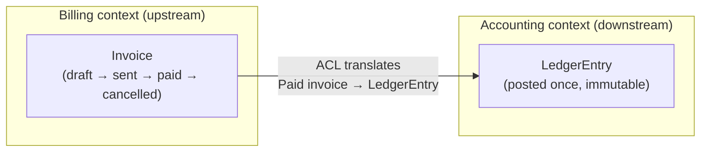
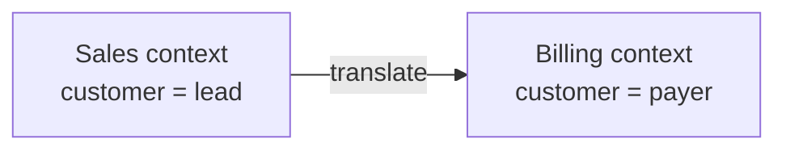
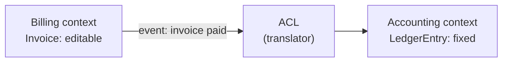
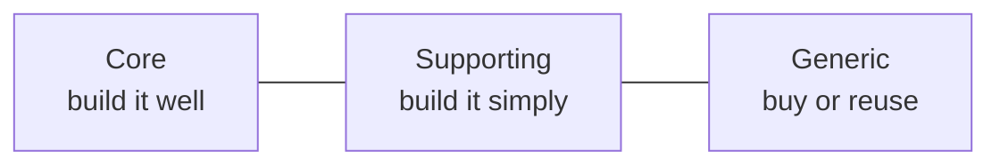
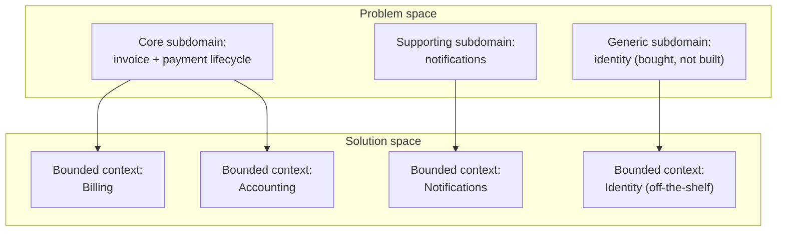
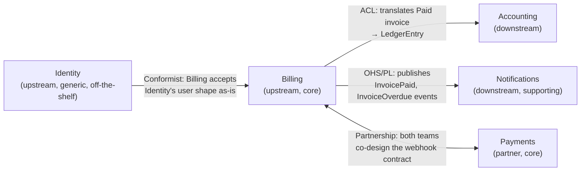
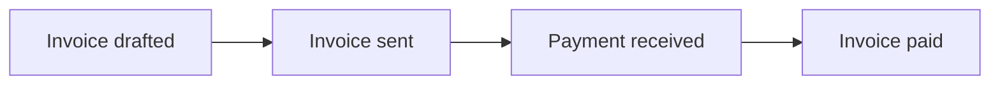
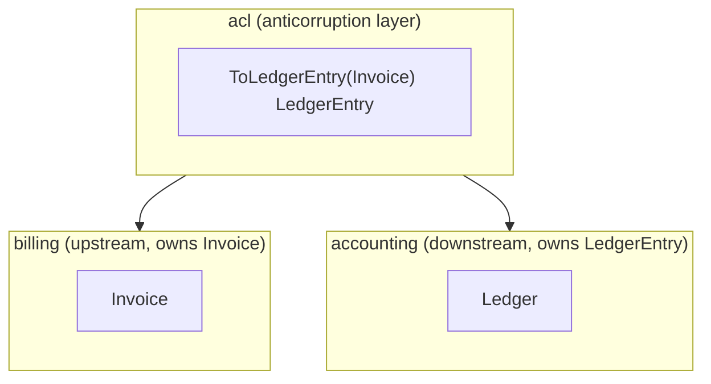

# Domain-Driven Design - Strategic Design

> [!summary] TL;DR
> Strategic DDD is the set of tools for drawing boundaries in a large business domain *before* writing code: splitting it into subdomains by business value, giving each a **bounded context** where one model and one vocabulary hold, and naming the relationships between contexts explicitly instead of letting them tangle. It answers "how do we split this system?" — the tactical patterns (entities, aggregates, repositories) answer "how do we build inside one piece?" and live in a separate note.

> [!abstract] Core idea
> - A **bounded context** is a boundary inside which one word means one thing. The same word can mean something else in a different context — that's not a naming bug, it's two models that were never meant to be one.
> - **Subdomains** (core, supporting, generic) tell you where to spend your best engineering effort; not every part of the business deserves the same care.
> - A **context map** names how bounded contexts actually relate — partnership, customer–supplier, conformist, anticorruption layer, open host service — because "they talk to each other" hides the power dynamic that determines who breaks whom.
> - DDD is orthogonal to hexagonal/clean architecture and to microservices: it tells you *where the seams are*; those other topics tell you how to build cleanly inside one seam, or whether to deploy it separately.

### Whiteboard version

InvoiceOps has a `Billing` context (draft, send, cancel an invoice) and an `Accounting` context (post a ledger entry once money has actually moved). Both use the word "invoice", but they mean different things: Billing's invoice is mutable until paid; Accounting's is an immutable fact recorded after the money event.

Mapping that directly onto one shared `Invoice` struct would force Accounting's immutability rule and Billing's draft/cancel rule onto the same type — a model that satisfies neither context well.



Billing stays free to add a `partially_paid` status tomorrow without Accounting's ledger model ever needing to change — the anticorruption layer (ACL) absorbs that, translating only "an invoice just became Paid" into "post this fact", and nothing else crosses the boundary.

## Start here: the basics 🟢

> [!info] How to read this note (pick your level)
> - 🟢 **New to this?** Read "From zero" below, then 1 (why it exists), 2 (mental model) and 10 (cheat sheet). Stop there, that is a full first pass.
> - 🟡 **Know the basics?** Add 3 (how it works), 4 (worked example), 5 (variants and comparison) and 6 (trade-offs).
> - 🔴 **Interview / SDE-3 prep?** Add 7 (in production), 8 (deep dive) and 9 (interview questions). Headings are tagged 🟢🟡🔴 so you always know where you are.

**From zero, in 60 seconds** 🟢

In a big business, the same word means different things to different teams.
To sales, a "customer" is a lead. To billing, a "customer" is someone with an unpaid invoice.
If one code model tries to serve both, it becomes a mess.
**DDD** (Domain-Driven Design) says: split the business into areas, and give each area its own model and its own words.
Each such area is a **bounded context**. Inside it, one word has one meaning.
Then you draw how the contexts talk to each other. That drawing is the **context map**.



The rest of this note is just these 3 questions:
1. How do you split a business into areas worth different effort?
2. How do you draw and name the boundaries?
3. How do contexts talk without leaking into each other?


**The problem in one story.**
Billing says an "invoice" can be edited until it is paid.
Accounting says an "invoice" is a fixed record that never changes.
Both teams share one `Invoice` struct and keep breaking each other.
Strategic DDD says: these are two models, give each its own boundary.

**Words you need first**

| Word | Plain meaning | Tiny example |
| --- | --- | --- |
| Domain | The business area the software serves | Invoicing for freelancers |
| Model | The code's simplified version of business ideas | `Invoice` struct with its rules |
| Bounded context | A boundary where each word has one meaning | Billing context, Accounting context |
| Subdomain | One part of the business (core, supporting or generic) | Core: billing; generic: email sending |
| Ubiquitous language | Shared words used by experts and code alike | "overdue" means the same in chat and code |
| Upstream / downstream | Who supplies data and who depends on it | Billing upstream, Accounting downstream |
| Anticorruption layer (ACL) | A translator that protects one model from another | Paid invoice becomes a `LedgerEntry` |

**Picture it**



**Analogy.** Countries on a map: "football" means different games in the US and the UK, and each country is right inside its own borders. Trade between them needs translators.
Where it breaks: countries rarely redraw borders; bounded contexts get split and merged as the business learns.

**How the rest of this note builds up**

- First, why one shared model fails (section 1) and the countries mental model (section 2).
- Then bounded contexts, subdomains, ubiquitous language, context-map patterns and EventStorming (section 3).
- Then a worked InvoiceOps context map (section 4) and variants (section 5).
- Finally the SDE-3 view: trade-offs, production pitfalls, and mapping contexts to teams and services (sections 6-8).

> [!tip] Remember
> One word, one meaning, per bounded context; translate at the borders.

## 1. Why it exists 🟢

A single shared `Invoice` type, used by every team and every context in a growing company, accumulates fields for every context's needs: a `discount_reason` field Sales needs, a `gl_account` field Accounting needs, a `dunning_level` field Collections needs.

Every team is afraid to change it because every other team also depends on it, so it grows forever and nobody owns it cleanly — the classic anemic, bloated domain model that forms around one "God object" shared by an entire company.

Strategic DDD's answer is not "one correct model" but "as many models as there are genuinely distinct ways of thinking about the business, each kept inside its own boundary".

Billing's invoice, Accounting's ledger entry, and Collections' dunning case can all legitimately describe the same real-world paper document without being the same type in code — because each team's rules about it really are different, and forcing one shared type hides that instead of expressing it.

## 2. Mental model 🟢

Picture the business domain as a country, and bounded contexts as the countries on the map, each with its **own language** for the same underlying concepts — the way "football" means two different sports depending on which country you're in.

A context map is the diplomatic relations between those countries: who is upstream (sets the terms), who is downstream (adapts to them), and who translates at the border.

The key discipline: **the language changes at the boundary, and that's fine.** A word crossing a context boundary is expected to be translated, not preserved. Trying to keep one universal vocabulary company-wide is what produces the bloated shared model in the first place.

## 3. How it works 🟡

### 3.1 Subdomains: where to spend effort

**In plain words: rank business areas: the core that makes you money, the support work, and the generic stuff you can buy.**

Before drawing any boundaries, DDD asks you to rank parts of the business by how much competitive value they create:

- **Core domain** — what makes this company win. For InvoiceOps (an invoicing SaaS), that's the invoice lifecycle and payment reconciliation: the thing customers actually pay for. Gets your best engineers and the most careful modeling.
- **Supporting subdomain** — necessary, specific to this business, but not the differentiator. Notification templating, report generation. Built well, but not over-invested in.
- **Generic subdomain** — solved problems every company has: authentication, file storage, email delivery. Buy or use an off-the-shelf library/service; don't reinvent it.

This ranking is a business judgment, not a technical one, and it changes over time — what's generic for one company can be core for another (identity is generic for InvoiceOps, but it's the entire core domain for an IdP vendor).



### 3.2 Bounded context

A bounded context is the boundary inside which a model's vocabulary is internally consistent: every term means one thing, every invariant holds everywhere inside it. Crossing the boundary, a term can mean something else entirely — that's expected, not a bug to be fixed by renaming.



Subdomains (problem space) and bounded contexts (solution space) are not forced into a 1:1 mapping: the core domain here split into two contexts (Billing and Accounting) because they genuinely need different models and different rates of change, even though both serve the one core subdomain.

### 3.3 Ubiquitous language

**In plain words: the team and the code use exactly the same words for the same things.**

Inside a bounded context, the team and the code use exactly the same words, with exactly the same meaning, in conversation, in the ticket tracker, and in the type names.

If a product manager says "an invoice is **overdue** once the due date passes and no payment has posted", the code has a state (or a method) literally named `Overdue`, not `status == 3` or `isLate()`.

The language is "ubiquitous" because it crosses every artifact — conversation, docs, code — inside that one context; it is explicitly *not* meant to cross into another context unchanged.

### 3.4 Context map: naming the relationships

A context map draws contexts as boxes and labels the *kind* of relationship between them, because "calls" or "depends on" hides who has the power to break whom.



| Pattern | Meaning | InvoiceOps example |
| --- | --- | --- |
| **Partnership** | Two teams succeed or fail together; they co-design the interface and change it jointly | Billing and Payments co-own the webhook payload schema |
| **Shared kernel** | Two teams deliberately share a small, explicit slice of model (and its code) that both depend on and agree to change only together | Billing and Payments share one `Money` value type (amount + currency, no float arithmetic) as a tiny common library — not a general "shared" package, just that one type, versioned and reviewed by both teams on every change |
| **Customer–supplier** | Downstream depends on upstream, but upstream's team prioritizes the downstream's needs in planning | Billing (supplier) commits to a stable `InvoicePaid` event shape for Accounting (customer) |
| **Conformist** | Downstream has no negotiating power and just accepts upstream's model unchanged | Billing conforms to whatever shape the bought Identity provider returns |
| **Anticorruption layer (ACL)** | Downstream translates upstream's model into its own, at the boundary, so upstream's changes don't leak in | The `acl` package below, translating Billing's `Invoice` into Accounting's `LedgerEntry` |
| **Open host service / published language (OHS/PL)** | Upstream publishes a stable, documented interface (often an event schema) for many downstreams to consume | Billing publishes `InvoicePaid`/`InvoiceOverdue` domain events that Notifications, Accounting and Analytics all subscribe to |
| **Separate ways** | No integration at all; duplicating a little logic is cheaper than coordinating | A reporting sandbox recomputes totals itself instead of calling Billing |

A shared kernel is not the same mistake as the company-wide `shared` package this note warns against in the deep dive below: a kernel is a small, named, jointly-reviewed slice (one value type, one event schema) that both teams explicitly choose to co-own, while an undisciplined `shared` package accretes every type any context happened to need and nobody owns the cost of changing it.

If the "shared" surface grows past a handful of types, or one team starts changing it without the other, it has stopped being a kernel and become the anti-pattern.

### 3.5 EventStorming (how teams find these boundaries)

**In plain words: a sticky-note workshop where experts list everything that happens in the business, in order.**

EventStorming is a workshop format, not a diagram notation: domain experts and engineers stand at a wall covered in paper (physical or virtual) and populate it with orange sticky notes for **domain events** ("Invoice Sent", "Payment Received", "Invoice Overdue") in the order they happen, then add commands (blue), actors (yellow), and external systems (pink) around them.

Clusters of events that share vocabulary and change together, with clear "but here the word means something else" seams between clusters, are where bounded-context boundaries get proposed — the technique turns "where should the boundary go?" from an architectural guess into something the whole room can see and argue about together, before any code exists.



## 4. Worked example 🟡

The context map above translates directly into Go packages: Billing and Accounting never import each other, and a dedicated `acl` package is the *only* code allowed to depend on both, exactly because translating between two models is its entire job.



```go
// package billing — the Billing bounded context. Its "Invoice" is the
// upstream, customer-facing model: still draft, still editable, still
// cancellable.
package billing

type Status string

const (
	Draft     Status = "draft"
	Sent      Status = "sent"
	Paid      Status = "paid"
	Cancelled Status = "cancelled"
)

// Invoice is Billing's own model. Nothing outside this package should know
// its shape; Accounting gets a translated view instead (see acl).
type Invoice struct {
	ID       string
	Customer string
	AmountP  int64 // minor units (paise/cents)
	Currency string
	Status   Status
}
```

```go
// package accounting — the Accounting bounded context: downstream of
// Billing in this context map. It has its own "Invoice" word with a
// different meaning (a posted ledger entry, immutable once recorded) and
// never imports the billing package.
package accounting

type LedgerEntry struct {
	Ref      string
	AmountP  int64
	Currency string
	Posted   bool
}

type Ledger struct {
	entries map[string]LedgerEntry
}

func NewLedger() *Ledger {
	return &Ledger{entries: make(map[string]LedgerEntry)}
}

// Post records a ledger entry. Posting twice for the same ref is a no-op:
// Accounting's own invariant, independent of whatever Billing does.
func (l *Ledger) Post(e LedgerEntry) {
	if existing, ok := l.entries[e.Ref]; ok && existing.Posted {
		return
	}
	e.Posted = true
	l.entries[e.Ref] = e
}

func (l *Ledger) Get(ref string) (LedgerEntry, bool) {
	e, ok := l.entries[ref]
	return e, ok
}
```

```go
// package acl — the anticorruption layer between Billing (upstream) and
// Accounting (downstream). It is the only package allowed to import both:
// neither context imports the other directly, so a change to Billing's
// Invoice shape breaks only this one translation, never Accounting's
// domain model.
package acl

import (
	"errors"
	"fmt"

	"dddemo/accounting"
	"dddemo/billing"
)

var ErrNotPostable = errors.New("acl: invoice is not in a postable state")

// ToLedgerEntry translates Billing's Invoice into Accounting's own
// LedgerEntry, reinterpreting "invoice" for the downstream context: only a
// Paid invoice becomes a postable fact.
func ToLedgerEntry(inv billing.Invoice) (accounting.LedgerEntry, error) {
	if inv.Status != billing.Paid {
		return accounting.LedgerEntry{}, fmt.Errorf("%w: status=%s", ErrNotPostable, inv.Status)
	}
	return accounting.LedgerEntry{
		Ref:      "billing:" + inv.ID,
		AmountP:  inv.AmountP,
		Currency: inv.Currency,
	}, nil
}
```

Tests prove both sides of the translation, and the idempotence Accounting relies on when a duplicate event arrives (the same guarantee [[Receiving Webhooks Idempotently]] needs for the webhook that triggers this in the first place):

```go
func TestToLedgerEntryTranslatesAPaidInvoice(t *testing.T) {
	inv := billing.Invoice{
		ID: "inv_1", Customer: "cust_9",
		AmountP: 150000, Currency: "INR", Status: billing.Paid,
	}
	entry, err := ToLedgerEntry(inv)
	if err != nil {
		t.Fatalf("ToLedgerEntry: %v", err)
	}
	want := accounting.LedgerEntry{Ref: "billing:inv_1", AmountP: 150000, Currency: "INR"}
	if entry != want {
		t.Fatalf("entry = %+v, want %+v", entry, want)
	}
}

func TestToLedgerEntryRejectsAnUnpaidInvoice(t *testing.T) {
	inv := billing.Invoice{ID: "inv_2", Status: billing.Draft}
	_, err := ToLedgerEntry(inv)
	if !errors.Is(err, ErrNotPostable) {
		t.Fatalf("err = %v, want ErrNotPostable", err)
	}
}

func TestLedgerPostIsIdempotentPerRef(t *testing.T) {
	ledger := accounting.NewLedger()
	inv := billing.Invoice{ID: "inv_3", AmountP: 500, Currency: "INR", Status: billing.Paid}
	entry, _ := ToLedgerEntry(inv)

	ledger.Post(entry)
	ledger.Post(entry) // a retried webhook or duplicate event

	got, ok := ledger.Get(entry.Ref)
	if !ok || !got.Posted {
		t.Fatalf("entry not posted exactly once: %+v, ok=%v", got, ok)
	}
}
```

**Measured:** this package set (3 packages, 3 tests) passed `go vet ./...` and `go test -race ./...` on Go 1.24.4.

## 5. Variants and comparison 🟡

| Context-map pattern | Who has power | Use when |
| --- | --- | --- |
| Partnership | Shared, both teams co-design | Two teams ship a feature that spans both contexts together |
| Shared kernel | Shared, but over a small fixed slice of model, not the whole interface | Two teams need one concept (a value type, an event schema) to be bit-for-bit identical, and are willing to review changes to it jointly |
| Customer–supplier | Upstream, but plans around downstream's needs | A formal internal API contract with a committed SLA |
| Conformist | Fully upstream | The upstream is external/bought and won't change for you (an IdP, a payment processor) |
| Anticorruption layer | Downstream insulates itself | Upstream's model is a poor fit, legacy, or genuinely a different concept (this note's example) |
| Open host service / published language | Upstream, serving many consumers | One context has several downstream consumers who shouldn't each build their own integration |
| Separate ways | Neither — no integration | The coordination cost exceeds the cost of a little duplicated logic |

## 6. Trade-offs and when not to use 🟡

- Drawing a bounded context has a real cost: a translation layer at every boundary, and often a service boundary and a team boundary to go with it. For a small domain with one team, splitting into contexts purely for DDD's sake adds ceremony without the growth problem it solves.
- Getting the subdomain classification wrong is expensive in the other direction: treating a core domain like a generic one ("just buy it") underinvests in the thing that differentiates the business; treating a generic subdomain like a core one burns engineering time reinventing authentication.
- Bounded contexts are not required to map 1:1 to microservices. A modular monolith (see [[Modular Monolith]]) can hold several bounded contexts as separate packages with no network boundary between them — the context boundary is about the model and language, the deployment boundary is a separate decision.
- EventStorming needs real domain experts in the room; run without them, it's just engineers guessing at boundaries with sticky notes, which defeats the point.

## 7. In production 🔴

- **Real systems:** Evans' original book (2003) and Vernon's *Implementing Domain-Driven Design* (2013) are the field's reference texts; most large e-commerce and fintech platforms that split into dozens of services (Amazon's internal service boundaries are the most cited example) describe arriving at those boundaries through something like subdomain/bounded-context analysis, whether or not they used DDD's vocabulary for it.
- **Failure modes → fixes:**
  - Bounded contexts drawn around org chart boxes instead of real model seams → two teams fight over one shared, incoherent model; fix by running EventStorming with both teams and letting the vocabulary clash reveal the real seam.
  - No anticorruption layer at a context boundary → upstream's internal refactor breaks downstream silently; fix by adding the translation layer, even a thin one, at the first integration point.
  - Treating DDD as "one service per aggregate" → premature microservices with the coordination cost of distribution and none of DDD's modeling benefit; fix by starting as a modular monolith with contexts as packages.
  - Ubiquitous language used in conversation but not in code (`status == 3` instead of `Overdue`) → the model silently drifts from what the business actually means; fix by naming the type, constant or method after the exact word the domain expert used.
- **What to monitor:** this is a modeling discipline, not a runtime system — the proxy signals are how often a PR touches two contexts' models in the same commit (a sign the boundary leaked), how many "wait, which invoice do you mean?" conversations happen in planning, and whether new team members can describe their context's vocabulary without needing another team's help.

## 8. Deep dive 🔴

- **Why the same word is allowed to mean different things.** This is the idea newcomers resist hardest: it feels like a naming inconsistency to fix. It isn't — "Invoice" in Billing (mutable, has a lifecycle) and "Invoice" (as a `LedgerEntry`) in Accounting (immutable, posted once) are different *concepts* that happen to share an English word because they both ultimately describe the same real-world paper. Forcing one type to serve both meanings is what produces the anemic, bloated shared model DDD exists to avoid.
- **Context boundaries versus service boundaries versus team boundaries.** These three often align but are conceptually independent: a context boundary is about where the model and vocabulary change; a service boundary is about independent deployment (see [[Monolith vs Microservices]]); a team boundary is about who owns the code (Conway's law pulls these toward alignment over time, but they don't have to start aligned). A modular monolith deliberately keeps context boundaries without service boundaries.
- **Picking the ACL side.** The anticorruption layer conventionally lives on the *downstream* side — the side with less power to dictate the shape of data crossing the boundary — because it is the side protecting its own model from a shape it doesn't control. In the worked example, Accounting is downstream of Billing, so the `acl` package sits logically on Accounting's side of the boundary even though in this small demo it's its own package depended on by neither context directly.
- **Context maps change.** A customer–supplier relationship earned through trust can degrade to conformist if the upstream team stops prioritizing the downstream's needs; a conformist relationship to a vendor can be upgraded to an ACL once the integration proves painful enough to justify the translation cost. The map is a living document, revisited the same way an ADR is — see [[Architecture Decision Records]] for recording *why* a context relationship changed.

## 9. Interview questions 🔴

> [!question]- What is a bounded context, in one sentence?
> A boundary inside which one model and one vocabulary are internally consistent — the same term can mean something entirely different once you cross into another bounded context, and that's expected, not a bug.

> [!question]- How is a subdomain different from a bounded context?
> A subdomain is a problem-space classification (core, supporting, generic) that says where the business creates value and where to invest engineering effort. A bounded context is a solution-space boundary in the code and model. They don't have to map 1:1 — InvoiceOps's one core subdomain (invoicing) split into two bounded contexts (Billing and Accounting) because each needed a different model.

> [!question]- When would you use an anticorruption layer versus just letting two contexts share a model?
> Use an ACL whenever the two contexts' meanings of a shared-sounding concept genuinely differ, or when upstream is external/legacy and you don't want its model's shape or its changes leaking into your own. Skip it (and consider sharing a model, or merging the contexts) if, after checking with the domain experts, the two "different" models turn out to describe the exact same rules — that's often a sign the contexts were split in the wrong place, not that an ACL is needed.

> [!question]- Does DDD mean every bounded context becomes its own microservice?
> No. A bounded context is a modeling boundary; a microservice is a deployment boundary. A modular monolith can hold several bounded contexts as separate packages with enforced import boundaries and zero network calls between them. Split into services when you need independent deployment, scaling or failure isolation — a separate decision from where the model boundaries are.

> [!question]- Trap: "We have a `shared` package with our common domain types used by every context. Good DDD?"
> No — that's the anemic-shared-model anti-pattern DDD exists to prevent. A `shared` package of domain types (as opposed to generic utilities) is usually evidence that no real bounded contexts were drawn; every context that imports it is coupled to every other context's changes to those types. Each context should own its own model and translate at the boundary instead.

> [!question]- What's the difference between customer–supplier and conformist relationships?
> In customer–supplier, downstream still depends on upstream, but upstream's team takes downstream's needs into account when planning changes — there's negotiation. In conformist, downstream has no influence at all and simply adapts to whatever upstream provides, typically because upstream is external (a vendor, a legacy system, a bought identity provider) and won't change for you.

> [!question]- How would you find your bounded contexts on a real, messy existing codebase?
> Run an EventStorming session with the actual domain experts (not just engineers): populate a timeline of domain events in business language, cluster the ones that share vocabulary and change together, and watch for the places where the same word is being used to mean two different things — those seams are your bounded-context candidates. Validate each candidate by checking whether its model's invariants genuinely differ from its neighbors', not just whether its code happens to live in a different folder today.

> [!question]- How would you split a monolith like InvoiceOps into services?
> Start from subdomains, not from the code's existing module boundaries: rank the business by value (core: invoicing and payment reconciliation; supporting: notifications; generic: identity) to see where independent scaling or ownership is actually worth the coordination cost. Then find bounded contexts inside the core — here, Billing and Accounting split because their models and rates of change genuinely differ, even though both serve one core subdomain — and only turn a bounded context into a separate service once you need independent deployment, scaling or failure isolation (see [[Monolith vs Microservices]]); a modular monolith lets the same context boundaries exist as packages first, with zero network calls, so the split can be validated before paying for distribution.

## 10. Cheat sheet 🟢

- Bounded context = a boundary where one word has one meaning; crossing it, meanings are expected to change.
- Subdomain (core/supporting/generic) is a business-value ranking that tells you where to invest; bounded context is a code/model boundary. They needn't be 1:1.
- Context map patterns: partnership, shared kernel, customer–supplier, conformist, anticorruption layer, open host service/published language, separate ways — each names a power relationship, not just "they integrate".
- Anticorruption layer lives on the side with less power (usually downstream) and is the only code allowed to depend on both models.
- EventStorming finds context boundaries by clustering domain events and watching where vocabulary clashes, with real domain experts in the room.
- DDD boundaries ≠ service boundaries ≠ team boundaries — they often align, but each is a separate decision (modeling, deployment, ownership).
- A shared "common domain types" package across contexts is almost always evidence the contexts weren't really separated.

## Links 🟢

- **Before this:** [[Architecture Fundamentals - Coupling, Cohesion and Dependency Direction]]
- **Next:** [[Domain-Driven Design - Tactical Patterns in Go]]
- **Compare with:** [[Monolith vs Microservices]] (context boundary vs deployment boundary), [[Modular Monolith]] (bounded contexts without a network boundary), [[API Gateway and BFF]] (where an open host service is often exposed to external consumers)

### Watch on YouTube

- [Strategic Domain-Driven Design by Nick Tune #AgileIndia2019](https://www.youtube.com/watch?v=hNW8bdTw_IU) · ConfEngine · 45 min · 6,734 views
- [Domain Driven Design: What You Need To Know](https://www.youtube.com/watch?v=4rhzdZIDX_k) · Alex Hyett · 8 min · 297,098 views
