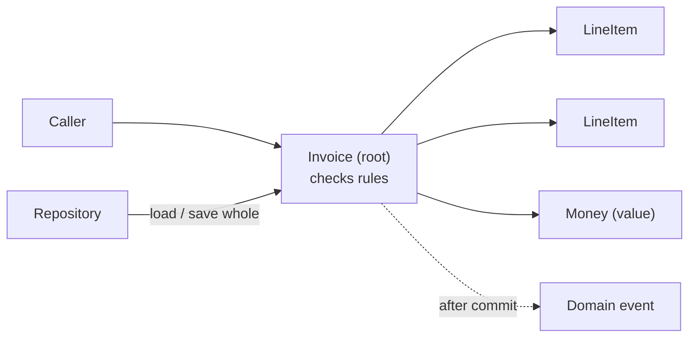
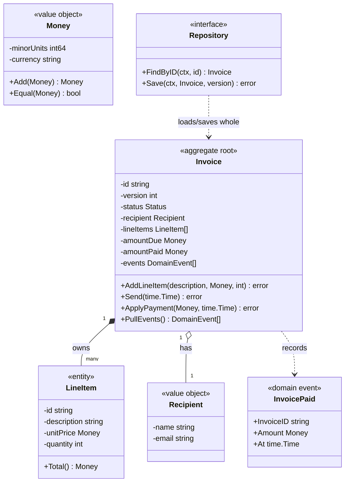
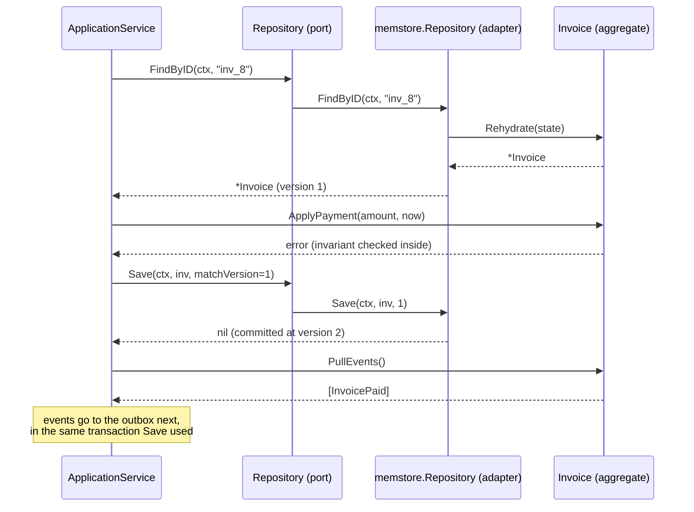

# Domain-Driven Design - Tactical Patterns in Go

> [!summary] TL;DR
> Tactical DDD is the set of building blocks — entities, value objects, aggregates, repositories, domain events — that keep a bounded context's business rules in one place and make it impossible to construct an object that breaks them. In Go, that means unexported struct fields, a constructor that is the only way in, and methods that are the only way to change state.

> [!abstract] Core idea
> - A **value object** (Money, an email) has no identity; two with the same fields are the same value. An **entity** (a line item) has identity even if its fields match another's.
> - An **aggregate** is a cluster of entities and value objects with one **root** and one transaction boundary: you load it, change it, and save it as a whole, and its invariants can never be false in between.
> - A **repository** loads and saves exactly one aggregate type, by its root, never by any entity buried inside it.
> - **Domain events** are facts the aggregate records about itself; they leave the aggregate only after the transaction that produced them has committed.
> - In Go, "rich, not anemic" means unexported fields and a constructor, not a framework: a bare struct literal with exported fields can never be relied on to be valid, because nothing stops a caller from building one directly.

### Whiteboard version

The smallest version of the idea: an aggregate that refuses to be invalid, because the only way to create or change one is through a function that checks first.

```go
package wb

import "fmt"

// Invoice is rich, not anemic: every field is unexported, so the only way
// to get one is NewInvoice, and the only way to add a line is AddLine.
type Invoice struct {
	id        string
	lineTotal int64 // minor units; a real Invoice uses a Money value object, shown below
}

func NewInvoice(id string) (*Invoice, error) {
	if id == "" {
		return nil, fmt.Errorf("invoice: id must not be empty")
	}
	return &Invoice{id: id}, nil
}

// AddLine is the only way lineTotal changes — it is impossible to set a
// negative total from outside this package, because there is no setter.
func (inv *Invoice) AddLine(amount int64) error {
	if amount <= 0 {
		return fmt.Errorf("invoice: line amount %d must be positive", amount)
	}
	inv.lineTotal += amount
	return nil
}
```

The full version below adds the rest of the pattern: a Money and a Recipient value object, an entity (LineItem) inside the aggregate, domain events, a repository interface the domain itself declares, and a second factory (`Rehydrate`) for loading an existing aggregate instead of creating a new one.

## Start here: the basics

**The problem in one story.**
Three pieces of code can change an invoice: create, pay, and a reminder job.
Each one is supposed to check "amount due equals sum of lines".
One forgets, and a customer gets billed the wrong amount.
Tactical DDD puts the rule inside the invoice, so nobody can forget it.

**Words you need first**

| Word | Plain meaning | Tiny example |
| --- | --- | --- |
| Invariant | A rule that must always be true | Amount due = sum of line items |
| Value object | Data with no identity; equal if fields are equal | `Money{500, "INR"}` |
| Entity | An object with its own identity | Line item #3 |
| Aggregate | A group of objects changed and saved as one unit | `Invoice` plus its line items |
| Aggregate root | The one object outsiders talk to | `Invoice`, not `LineItem` |
| Repository | Code that loads and saves one aggregate | `InvoiceRepo.FindByID` |
| Domain event | A record that something happened | `InvoicePaid` |
| Unexported field | A lowercase Go field only its package can touch | `amountDue int64` |

**Picture it**



**Analogy.** A bank teller: you never reach into the vault yourself; you ask the teller, who checks the rules and updates the books in one go.
Where it breaks: a teller can serve many accounts at once; an aggregate guards only its own data, and cross-aggregate changes go through events.

**How the rest of this note builds up**

- First, why rules scattered across handlers fail (section 1) and the "object with a lock" mental model (section 2).
- Then value objects, entities, aggregates, repositories, domain events and services in Go (section 3).
- Then a full compiling InvoiceOps example with tests (section 4) and variants (section 5).
- Finally the SDE-3 deep dive: aggregate size, optimistic locking with versions, and eventual consistency (sections 6-8).

> [!tip] Remember
> The aggregate root is the only door; every change goes through a method that checks the rules first.

## 1. Why it exists

A `CreateInvoice` handler, a `MarkInvoicePaid` handler and a reminder job each hold a piece of "what makes an invoice valid" if `Invoice` is a plain struct with exported fields: nothing stops one of them from setting `AmountPaid` higher than `AmountDue` and forgetting to flip `Status`, or from building an `Invoice{}` literal with a line item whose currency does not match the invoice's own.

Three call sites agreeing to follow the same unwritten rule is how real systems end up with a partially-paid invoice silently marked `paid`, discovered only when a customer disputes a charge.

Tactical DDD's answer is to give the rule exactly one owner. `Invoice` becomes a type that is impossible to construct or change except through code that already enforces the rule, so there is only one place to get it right and only one place to look when something is wrong.

## 2. Mental model

Think of an aggregate as a small object with a lock on it that only its own methods have the key to. `NewInvoice` builds the first valid one. Every `Add*`, `Apply*`, `Send` method is the only door in, and each one checks the invariant before it lets a change through.

A repository is the only thing allowed to carry the whole object across a transaction boundary — load it whole, save it whole — and it is declared by the domain itself, not by whatever package happens to hold a database connection (see [[Hexagonal Architecture (Ports and Adapters)]] for why the domain never imports its own infrastructure).

## 3. How it works

### 3.1 Value objects: no identity, interchangeable by value

`Money` and `Recipient` below carry no ID. Two `Money{100, "INR"}` values are the same ₹1.00 wherever they appear — there is nothing to distinguish them, so they are compared field by field and passed by value, never pointers.



A `Repository` is drawn as an interface that *depends on* `Invoice`, never the reverse — an adapter package imports this package to implement it; this package imports nothing from an adapter. That arrow is the package-level version of dependency inversion applied to persistence: see "Worked example" for the two real Go packages (`invoice` and `memstore`) that draw it.

### 3.2 Aggregates: one root, one transaction, invariants inside

`Invoice` is the root; `LineItem` is an entity that lives only inside it. There is no `LineItemRepository` — a line item is never loaded, changed or saved on its own, because doing so could leave `Invoice.AmountDue` out of sync with the sum of its lines.

**One aggregate is one transaction**: `ApplyPayment` changes only this `Invoice`'s own fields in one call; it never reaches into a `Client` or a ledger aggregate in the same method, even though a payment conceptually "belongs" to both.

A second aggregate that needs to know about the payment finds out through a domain event, consumed later, not through a direct call across the aggregate boundary (see 3.4 and "Eventual consistency between aggregates" below).

A `LineItem` is referenced by its own ID within the aggregate, but another aggregate is always referenced **by ID only**, never by embedding or pointer: if `Invoice` held a `*Client` pointer, saving the invoice could accidentally also save stale client data, and the two aggregates' transaction boundaries would blur into one.

### 3.3 Repositories: per aggregate root, not per table



`Repository` is declared in the `invoice` package, next to `Invoice`, not in a generic `repositories` package — this is the same consumer-owns-the-interface rule [[Service Project Layout and Wiring]] derives for application services, applied to the domain layer instead. The interface has exactly two methods, shaped around one aggregate's lifecycle (`FindByID`, `Save`), not one method per table.

### 3.4 Domain events: recorded, then pulled after commit

`Send` and `ApplyPayment` append to `Invoice`'s own `events` slice; nothing is sent anywhere yet. Only after `Repository.Save` has committed does the application service call `PullEvents` and hand the result to the outbox — the ordering that `Transactional Outbox and CDC` builds the delivery guarantee on top of.

Publishing before the commit (or on a goroutine racing the commit) risks an event for a write that then rolls back.

### 3.5 Domain service vs application service

Neither is where business logic goes if it can live on the aggregate instead. `ApplicationService.RecordPayment` in the worked example below has no `if` about invoice rules in it at all — it loads, calls `inv.ApplyPayment`, saves, and pulls events.

A **domain service** earns its place only for logic that spans two aggregates but belongs to neither on its own (for example, "can this payment provider refund this currency", which is not really `Invoice`'s business or a `PaymentProvider` adapter's business); this note's example needs none, because `ApplyPayment`'s invariant is entirely `Invoice`'s own.

## 4. Worked example

The code below is the InvoiceOps billing domain, split across two Go packages to make the dependency direction a type signature instead of a comment: `invoice` (the domain: the aggregate, its value objects, the `Repository` interface) and `memstore` (an adapter: it imports `invoice` to implement `Repository`; `invoice` imports nothing from `memstore`).

It compiles and passes `go vet` and `go test -race` on Go 1.24.4.

**`invoice/invoice.go`** — value objects, the entity, the aggregate root, and its own factory:

```go
// Package invoice is the InvoiceOps billing domain: one aggregate (Invoice),
// its value objects (Money, Recipient) and the repository interface the
// domain declares for itself. Nothing here imports database/sql, pgx or
// net/http — see Hexagonal Architecture (Ports and Adapters) for why.
package invoice

import (
	"errors"
	"fmt"
	"strings"
	"time"
)

// ---- Value objects -------------------------------------------------------
//
// A value object has no identity: two Moneys of the same amount and
// currency ARE the same value, so it is safe to copy, compare with ==-style
// Equal methods, and never mutate in place.

// Money is a value object: an amount in minor units plus its currency. See
// Capstone - InvoiceOps for why money is never a float64.
type Money struct {
	minorUnits int64
	currency   string // ISO 4217, e.g. "INR"
}

// NewMoney validates the currency at construction so an invalid Money value
// can never exist inside the domain.
func NewMoney(minorUnits int64, currency string) (Money, error) {
	if minorUnits < 0 {
		return Money{}, fmt.Errorf("money: minor units %d must not be negative", minorUnits)
	}
	if len(currency) != 3 {
		return Money{}, fmt.Errorf("money: %q is not a 3-letter ISO 4217 code", currency)
	}
	return Money{minorUnits: minorUnits, currency: strings.ToUpper(currency)}, nil
}

func (m Money) MinorUnits() int64 { return m.minorUnits }
func (m Money) Currency() string  { return m.currency }

// Add returns the sum of two Moneys in the same currency. It is a pure
// function: m and other are never mutated, a new Money is returned.
func (m Money) Add(other Money) (Money, error) {
	if m.currency != other.currency {
		return Money{}, fmt.Errorf("money: cannot add %s to %s", other.currency, m.currency)
	}
	return Money{minorUnits: m.minorUnits + other.minorUnits, currency: m.currency}, nil
}

// Equal reports whether two Moneys represent the same value (value-object
// equality: no identity, just field equality).
func (m Money) Equal(other Money) bool {
	return m.minorUnits == other.minorUnits && m.currency == other.currency
}

// Recipient is a value object: the billing contact on an invoice. Two
// Recipients with the same name and email are interchangeable, so Invoice
// stores one by value, not by a foreign-key-shaped reference.
type Recipient struct {
	name  string
	email string
}

// NewRecipient validates the email at construction (a minimal, deliberately
// strict check: exactly one "@", a non-empty local and domain part). A
// fuller RFC 5322 parser belongs in net/mail, not restated here.
func NewRecipient(name, email string) (Recipient, error) {
	name = strings.TrimSpace(name)
	if name == "" {
		return Recipient{}, errors.New("recipient: name must not be empty")
	}
	at := strings.IndexByte(email, '@')
	if at <= 0 || at == len(email)-1 || strings.ContainsRune(email[at+1:], '@') {
		return Recipient{}, fmt.Errorf("recipient: %q is not a valid email", email)
	}
	return Recipient{name: name, email: email}, nil
}

func (r Recipient) Name() string  { return r.name }
func (r Recipient) Email() string { return r.email }

// ---- Entity inside the aggregate -----------------------------------------

// LineItem is an entity, not a value object: two line items with the same
// description and price are still different lines (each has its own ID),
// because an operator can delete one and keep the other. It has no
// repository of its own — only the Invoice aggregate root is ever loaded
// or saved directly; a LineItem is reached only by walking the aggregate
// that owns it.
type LineItem struct {
	id          string
	description string
	unitPrice   Money
	quantity    int
}

func (l LineItem) ID() string          { return l.id }
func (l LineItem) Description() string { return l.description }
func (l LineItem) Quantity() int       { return l.quantity }

// Total is unitPrice * quantity. It panics on a currency mismatch only in
// the sense that Money.Add would — in practice every LineItem on one
// Invoice shares the invoice's currency, enforced by AddLineItem below.
func (l LineItem) Total() Money {
	return Money{minorUnits: l.unitPrice.minorUnits * int64(l.quantity), currency: l.unitPrice.currency}
}

// ---- Domain events ---------------------------------------------------

// DomainEvent is something that happened to an aggregate, named in past
// tense. The aggregate only records these; it never sends them anywhere.
// They are pulled after a successful commit and handed to the outbox — see
// Transactional Outbox and CDC for the delivery mechanics this note does
// not repeat.
type DomainEvent interface {
	EventName() string
}

// InvoiceSent fires when a draft invoice is sent to its recipient.
type InvoiceSent struct {
	InvoiceID string
	At        time.Time
}

func (InvoiceSent) EventName() string { return "invoice.sent" }

// InvoicePaid fires when a payment brings an invoice's paid amount to or
// above its due amount.
type InvoicePaid struct {
	InvoiceID string
	Amount    Money
	At        time.Time
}

func (InvoicePaid) EventName() string { return "invoice.paid" }

// ---- Aggregate root -------------------------------------------------

// Status is the invoice lifecycle state. See Capstone - InvoiceOps for the
// full state machine with every guard; this note only needs draft/sent/paid
// to demonstrate the aggregate's own invariants.
type Status string

const (
	StatusDraft Status = "draft"
	StatusSent  Status = "sent"
	StatusPaid  Status = "paid"
)

// Invoice is the aggregate root: the only type in this package a
// repository loads or saves whole, and the only type whose methods may
// change a LineItem or the invoice's totals. Every invariant below is
// enforced inside Invoice's own methods — it is impossible to construct an
// Invoice whose AmountDue does not equal the sum of its line items, because
// no field is exported and the only way in is through these methods.
type Invoice struct {
	id         string
	version    int // optimistic-concurrency token; see "Deep dive"
	status     Status
	currency   string
	recipient  Recipient
	lineItems  []LineItem
	amountDue  Money
	amountPaid Money
	nextLineID int
	events     []DomainEvent
}

// NewInvoice is the factory: the only way to create an Invoice, and the
// place that enforces the invariants a bare struct literal could otherwise
// skip (a non-zero version, a valid recipient, a currency that every line
// item must then match).
func NewInvoice(id string, recipient Recipient, currency string) (*Invoice, error) {
	if id == "" {
		return nil, errors.New("invoice: id must not be empty")
	}
	currency = strings.ToUpper(currency)
	zero, err := NewMoney(0, currency)
	if err != nil {
		return nil, fmt.Errorf("invoice: %w", err)
	}
	return &Invoice{
		id:         id,
		version:    1,
		status:     StatusDraft,
		currency:   currency,
		recipient:  recipient,
		amountDue:  zero,
		amountPaid: zero,
	}, nil
}

func (inv *Invoice) ID() string        { return inv.id }
func (inv *Invoice) Version() int      { return inv.version }
func (inv *Invoice) Status() Status    { return inv.status }
func (inv *Invoice) AmountDue() Money  { return inv.amountDue }
func (inv *Invoice) AmountPaid() Money { return inv.amountPaid }
func (inv *Invoice) LineItems() []LineItem {
	out := make([]LineItem, len(inv.lineItems)) // defensive copy: callers cannot mutate the aggregate's slice
	copy(out, inv.lineItems)
	return out
}

// PullEvents returns and clears the events recorded since the last pull.
// The application service calls this exactly once, after the repository's
// Save has committed — never before, or an event could be dispatched for a
// change that then fails to persist. See Transactional Outbox and CDC.
func (inv *Invoice) PullEvents() []DomainEvent {
	out := inv.events
	inv.events = nil
	return out
}

// AddLineItem enforces the invariant "you cannot edit a sent invoice" and
// "every line item shares the invoice's currency" — both impossible to
// violate from outside the package, because lineItems is unexported.
func (inv *Invoice) AddLineItem(description string, unitPrice Money, quantity int) error {
	if inv.status != StatusDraft {
		return fmt.Errorf("invoice: cannot add a line item in status %q, want %q", inv.status, StatusDraft)
	}
	if unitPrice.currency != inv.currency {
		return fmt.Errorf("invoice: line item currency %s does not match invoice currency %s", unitPrice.currency, inv.currency)
	}
	if quantity <= 0 {
		return fmt.Errorf("invoice: quantity %d must be positive", quantity)
	}
	inv.nextLineID++
	item := LineItem{
		id:          fmt.Sprintf("%s-line-%d", inv.id, inv.nextLineID),
		description: description,
		unitPrice:   unitPrice,
		quantity:    quantity,
	}
	inv.lineItems = append(inv.lineItems, item)
	total, err := inv.amountDue.Add(item.Total())
	if err != nil {
		return fmt.Errorf("invoice: %w", err) // unreachable given the currency check above
	}
	inv.amountDue = total
	return nil
}

// Send moves a draft invoice to sent and requires at least one line item —
// an invariant a bare setter (SetStatus("sent")) could not enforce.
func (inv *Invoice) Send(now time.Time) error {
	if inv.status != StatusDraft {
		return fmt.Errorf("invoice: cannot send from status %q, want %q", inv.status, StatusDraft)
	}
	if len(inv.lineItems) == 0 {
		return errors.New("invoice: cannot send an invoice with no line items")
	}
	inv.status = StatusSent
	inv.events = append(inv.events, InvoiceSent{InvoiceID: inv.id, At: now})
	return nil
}

// ApplyPayment records a payment and moves the invoice to paid once the
// paid amount reaches the due amount. One Invoice is one transaction
// boundary: a payment never touches a second aggregate (a Client, a
// ledger) in the same call — if those also need updating, that is handled
// by a domain event consumed later, not by this method reaching across
// aggregates. See "Eventual consistency between aggregates" below.
func (inv *Invoice) ApplyPayment(amount Money, now time.Time) error {
	if inv.status != StatusSent {
		return fmt.Errorf("invoice: cannot apply a payment in status %q, want %q", inv.status, StatusSent)
	}
	if amount.currency != inv.currency {
		return fmt.Errorf("invoice: payment currency %s does not match invoice currency %s", amount.currency, inv.currency)
	}
	paid, err := inv.amountPaid.Add(amount)
	if err != nil {
		return fmt.Errorf("invoice: %w", err)
	}
	inv.amountPaid = paid
	if inv.amountPaid.minorUnits >= inv.amountDue.minorUnits {
		inv.status = StatusPaid
		inv.events = append(inv.events, InvoicePaid{InvoiceID: inv.id, Amount: inv.amountPaid, At: now})
	}
	return nil
}

// ---- Reconstitution (the persistence mapping) --------------------------
//
// A repository adapter never builds an *Invoice with a struct literal —
// every field is unexported, so it physically cannot — and never calls
// NewInvoice either, because NewInvoice's invariants are creation-time
// invariants (an invoice starts at version 1, draft, with no line items).
// Loading row 9000 from Postgres is not "creating" an invoice; it is
// recovering one that already satisfied every invariant the moment it was
// last saved. State is the plain-data shape a SQL row (or Snapshot) maps
// onto, and Rehydrate is the second, separate factory for that case — the
// "factories" tactical pattern applied to the create/reconstitute split.

// LineItemState is the persisted shape of one LineItem.
type LineItemState struct {
	ID             string
	Description    string
	UnitPriceMinor int64
	Quantity       int
}

// State is the persisted shape of a whole Invoice: exactly the columns an
// `invoices` + `invoice_line_items` pair of tables would hold. It has no
// behaviour — mapping SQL rows to and from State is a repository adapter's
// job, not this package's.
type State struct {
	ID              string
	Version         int
	Status          Status
	Currency        string
	RecipientName   string
	RecipientEmail  string
	LineItems       []LineItemState
	AmountPaidMinor int64
}

// Snapshot returns inv's persisted shape. A repository's Save calls this,
// then writes the result; it never reads Invoice's unexported fields
// directly, because it cannot.
func (inv *Invoice) Snapshot() State {
	items := make([]LineItemState, len(inv.lineItems))
	for i, l := range inv.lineItems {
		items[i] = LineItemState{ID: l.id, Description: l.description, UnitPriceMinor: l.unitPrice.minorUnits, Quantity: l.quantity}
	}
	return State{
		ID:              inv.id,
		Version:         inv.version,
		Status:          inv.status,
		Currency:        inv.currency,
		RecipientName:   inv.recipient.name,
		RecipientEmail:  inv.recipient.email,
		LineItems:       items,
		AmountPaidMinor: inv.amountPaid.minorUnits,
	}
}

// Rehydrate reconstructs an Invoice from its persisted State. Unlike
// NewInvoice it does not require a fresh, empty, draft invoice — it
// accepts whatever status and line items were last saved — but it still
// re-derives AmountDue from the line items rather than trusting a stored
// total column, so a corrupted or hand-edited total is caught immediately
// instead of silently propagating. Only a repository adapter should call
// this; application code calls NewInvoice or Repository.FindByID instead.
func Rehydrate(s State) (*Invoice, error) {
	recipient, err := NewRecipient(s.RecipientName, s.RecipientEmail)
	if err != nil {
		return nil, fmt.Errorf("rehydrate invoice %s: %w", s.ID, err)
	}
	currency := strings.ToUpper(s.Currency)
	due, err := NewMoney(0, currency)
	if err != nil {
		return nil, fmt.Errorf("rehydrate invoice %s: %w", s.ID, err)
	}
	paid, err := NewMoney(s.AmountPaidMinor, currency)
	if err != nil {
		return nil, fmt.Errorf("rehydrate invoice %s: %w", s.ID, err)
	}
	items := make([]LineItem, len(s.LineItems))
	for i, li := range s.LineItems {
		price, err := NewMoney(li.UnitPriceMinor, currency)
		if err != nil {
			return nil, fmt.Errorf("rehydrate invoice %s line %s: %w", s.ID, li.ID, err)
		}
		items[i] = LineItem{id: li.ID, description: li.Description, unitPrice: price, quantity: li.Quantity}
		total, err := due.Add(Money{minorUnits: price.minorUnits * int64(li.Quantity), currency: price.currency})
		if err != nil {
			return nil, fmt.Errorf("rehydrate invoice %s: %w", s.ID, err)
		}
		due = total
	}
	return &Invoice{
		id:         s.ID,
		version:    s.Version,
		status:     s.Status,
		currency:   currency,
		recipient:  recipient,
		lineItems:  items,
		amountDue:  due,
		amountPaid: paid,
		nextLineID: len(items), // resumes numbering after the highest persisted line; this toy never deletes a line item
	}, nil
}
```

**`invoice/repository.go`** — the port the domain declares for itself, plus the application service that is the only thing allowed to call it:

```go
package invoice

import (
	"context"
	"errors"
	"fmt"
	"time"
)

// ErrNotFound is returned by Repository.FindByID when no invoice has that
// ID.
var ErrNotFound = errors.New("invoice: not found")

// ErrConcurrentUpdate is returned by Repository.Save when the invoice was
// changed by someone else since it was loaded. See "Deep dive" for why this
// check exists and what a caller should do about it (reload and retry).
var ErrConcurrentUpdate = errors.New("invoice: concurrent update")

// Repository is declared here, in the invoice package, next to the
// aggregate it loads and saves — not in a generic "repositories" package
// and not per-table. One Invoice is one row's worth of writes (its own
// table plus its line items' table) committed as one unit; there is no
// separate LineItemRepository, because a LineItem is never addressed
// without its Invoice. An adapter package (memstore here; a pgx-backed
// package in production) imports invoice to implement this interface —
// invoice never imports an adapter back. See "How it works" for the
// package diagram this asymmetry draws.
type Repository interface {
	// FindByID loads an invoice by ID, or ErrNotFound.
	FindByID(ctx context.Context, id string) (*Invoice, error)
	// Save persists an invoice. If matchVersion does not equal the
	// currently stored version, it returns ErrConcurrentUpdate and saves
	// nothing — see Invoice.Version and "Deep dive".
	Save(ctx context.Context, inv *Invoice, matchVersion int) error
}

// ---- Application service ----------------------------------------------
//
// ApplicationService coordinates one use case across the repository and
// (in a real handler) the outbox; it holds no business rule of its own —
// every invariant above lives on Invoice. This is the "domain service vs
// application service" split: a domain service would hold logic that
// spans two aggregates but belongs to neither (none is needed here,
// because ApplyPayment's invariant is entirely the Invoice's own); an
// application service only orchestrates loading, calling the aggregate,
// saving and collecting events — no `if` about invoice rules belongs here.
type ApplicationService struct {
	repo Repository
}

func NewApplicationService(repo Repository) *ApplicationService {
	return &ApplicationService{repo: repo}
}

// RecordPayment loads the invoice, asks it to apply the payment, and saves
// it with the version it was loaded at — if another request saved a
// different version in between, Save returns ErrConcurrentUpdate and this
// method does not retry; the caller (a webhook handler) decides whether a
// retry is safe. A real handler would call inv.PullEvents() right after a
// successful Save and hand the events to the outbox in the same database
// transaction Save used — the outbox mechanics themselves are
// Transactional Outbox and CDC's note, not repeated here.
func (s *ApplicationService) RecordPayment(ctx context.Context, invoiceID string, amount Money, now time.Time) ([]DomainEvent, error) {
	inv, err := s.repo.FindByID(ctx, invoiceID)
	if err != nil {
		return nil, fmt.Errorf("record payment: %w", err)
	}
	loadedVersion := inv.Version()
	if err := inv.ApplyPayment(amount, now); err != nil {
		return nil, fmt.Errorf("record payment: %w", err)
	}
	if err := s.repo.Save(ctx, inv, loadedVersion); err != nil {
		return nil, fmt.Errorf("record payment: %w", err)
	}
	return inv.PullEvents(), nil
}
```

**`memstore/memstore.go`** — the adapter. It imports `invoice`; `invoice` never imports it back:

```go
// Package memstore is a repository adapter: it imports invoice to
// implement invoice.Repository, and invoice never imports memstore back.
// It stands in for a pgx-backed adapter the same way the "Deep dive"
// section's matchVersion check stands in for a real `UPDATE ... WHERE
// version = $2` — the optimistic-concurrency shape is identical, only the
// storage engine differs.
package memstore

import (
	"context"
	"fmt"
	"sync"

	"ddd/invoice"
)

// Repository is an in-memory stand-in for a Postgres-backed
// invoice.Repository. It stores invoice.State, not *invoice.Invoice,
// because that is what Invoice.Snapshot/invoice.Rehydrate round-trip
// through — the same separation a real adapter keeps between its SQL rows
// and the domain type.
type Repository struct {
	mu    sync.Mutex
	rows  map[string]invoice.State
	saved map[string]int // id -> stored version, checked by Save
}

func New() *Repository {
	return &Repository{rows: make(map[string]invoice.State), saved: make(map[string]int)}
}

func (r *Repository) FindByID(_ context.Context, id string) (*invoice.Invoice, error) {
	r.mu.Lock()
	defer r.mu.Unlock()
	state, ok := r.rows[id]
	if !ok {
		return nil, fmt.Errorf("%w: %s", invoice.ErrNotFound, id)
	}
	return invoice.Rehydrate(state)
}

func (r *Repository) Save(_ context.Context, inv *invoice.Invoice, matchVersion int) error {
	r.mu.Lock()
	defer r.mu.Unlock()
	id := inv.ID()
	if stored, exists := r.saved[id]; exists && stored != matchVersion {
		return fmt.Errorf("%w: invoice %s is at version %d, not %d", invoice.ErrConcurrentUpdate, id, stored, matchVersion)
	}
	state := inv.Snapshot()
	state.Version = matchVersion + 1
	r.rows[id] = state
	r.saved[id] = state.Version
	return nil
}
```

Tests (`go test -race -v ./...`):

```go
package invoice

import (
	"testing"
	"time"
)

func mustMoney(t *testing.T, minor int64, currency string) Money {
	t.Helper()
	m, err := NewMoney(minor, currency)
	if err != nil {
		t.Fatalf("NewMoney: %v", err)
	}
	return m
}

func mustRecipient(t *testing.T) Recipient {
	t.Helper()
	r, err := NewRecipient("Priya Freelance", "billing@priya.dev")
	if err != nil {
		t.Fatalf("NewRecipient: %v", err)
	}
	return r
}

func TestInvoiceAddLineItemComputesAmountDue(t *testing.T) {
	inv, _ := NewInvoice("inv_1", mustRecipient(t), "INR")
	_ = inv.AddLineItem("Design work", mustMoney(t, 50000, "INR"), 2)
	_ = inv.AddLineItem("Hosting", mustMoney(t, 10000, "INR"), 1)
	want := mustMoney(t, 110000, "INR") // 50000*2 + 10000*1
	if !inv.AmountDue().Equal(want) {
		t.Fatalf("AmountDue = %+v, want %+v", inv.AmountDue(), want)
	}
}

func TestInvoiceCannotAddLineItemAfterSend(t *testing.T) {
	inv, _ := NewInvoice("inv_3", mustRecipient(t), "INR")
	_ = inv.AddLineItem("Design work", mustMoney(t, 50000, "INR"), 1)
	_ = inv.Send(time.Now())
	if err := inv.AddLineItem("Late addition", mustMoney(t, 1000, "INR"), 1); err == nil {
		t.Fatal("expected an error adding a line item to a sent invoice, got nil")
	}
}

func TestInvoiceApplyPaymentTransitionsToPaidAndRecordsEvent(t *testing.T) {
	inv, _ := NewInvoice("inv_5", mustRecipient(t), "INR")
	_ = inv.AddLineItem("Design work", mustMoney(t, 100000, "INR"), 1)
	_ = inv.Send(time.Now())
	if err := inv.ApplyPayment(mustMoney(t, 100000, "INR"), time.Now()); err != nil {
		t.Fatalf("ApplyPayment: %v", err)
	}
	events := inv.PullEvents()
	if len(events) != 2 || events[0].EventName() != "invoice.sent" || events[1].EventName() != "invoice.paid" {
		t.Fatalf("events = %v, want [invoice.sent invoice.paid]", events)
	}
	if again := inv.PullEvents(); len(again) != 0 {
		t.Fatalf("second PullEvents returned %d events, want 0 (the buffer must be cleared)", len(again))
	}
}

func TestSnapshotRehydrateRoundTrip(t *testing.T) {
	inv, _ := NewInvoice("inv_9", mustRecipient(t), "INR")
	_ = inv.AddLineItem("Design work", mustMoney(t, 50000, "INR"), 2)
	_ = inv.Send(time.Now())
	rehydrated, err := Rehydrate(inv.Snapshot())
	if err != nil {
		t.Fatalf("Rehydrate: %v", err)
	}
	if !rehydrated.AmountDue().Equal(inv.AmountDue()) {
		t.Fatalf("AmountDue = %+v, want %+v (re-derived from line items, not trusted from storage)", rehydrated.AmountDue(), inv.AmountDue())
	}
}
```

```go
// package invoice_test — a separate package, because it imports memstore,
// which imports invoice; this file must sit outside invoice to avoid a
// cycle, which is itself a small proof that the dependency arrow only
// points one way (memstore -> invoice).
package invoice_test

import (
	"context"
	"errors"
	"testing"
	"time"

	"ddd/invoice"
	"ddd/memstore"
)

func TestRepositorySaveDetectsConcurrentUpdate(t *testing.T) {
	ctx := context.Background()
	repo := memstore.New()
	recipient, _ := invoice.NewRecipient("Priya Freelance", "billing@priya.dev")
	inv, _ := invoice.NewInvoice("inv_7", recipient, "INR")
	price, _ := invoice.NewMoney(100000, "INR")
	_ = inv.AddLineItem("Design work", price, 1)
	_ = repo.Save(ctx, inv, 1) // initial save, matches the factory's starting version

	a, _ := repo.FindByID(ctx, "inv_7")
	b, _ := repo.FindByID(ctx, "inv_7")

	_ = a.Send(time.Now())
	if err := repo.Save(ctx, a, 2); err != nil {
		t.Fatalf("Save(a): %v", err)
	}

	_ = b.Send(time.Now())
	err := repo.Save(ctx, b, 2) // b loaded the same version a started from, but a already moved it on
	if !errors.Is(err, invoice.ErrConcurrentUpdate) {
		t.Fatalf("Save(b) error = %v, want ErrConcurrentUpdate", err)
	}
}

func TestApplicationServiceRecordPaymentPullsEvents(t *testing.T) {
	ctx := context.Background()
	repo := memstore.New()
	recipient, _ := invoice.NewRecipient("Priya Freelance", "billing@priya.dev")
	inv, _ := invoice.NewInvoice("inv_8", recipient, "INR")
	price, _ := invoice.NewMoney(100000, "INR")
	_ = inv.AddLineItem("Design work", price, 1)
	_ = inv.Send(time.Now())
	_ = repo.Save(ctx, inv, 1) // Save persists State, which has no events field

	svc := invoice.NewApplicationService(repo)
	events, err := svc.RecordPayment(ctx, "inv_8", price, time.Now())
	if err != nil {
		t.Fatalf("RecordPayment: %v", err)
	}
	if len(events) != 1 || events[0].EventName() != "invoice.paid" {
		t.Fatalf("events = %v, want exactly one invoice.paid", events)
	}
}
```

**Measured** (Go 1.24.4, scratch module `ddd`, 2026-11-07): `go vet ./...` is clean, `gofmt -l .` reports no files, and `go test -race -v ./...` passes 6 tests in `ddd/invoice` — 4 in the package itself (value objects via aggregate invariants, event recording, the snapshot/rehydrate round trip) and 2 in its external `invoice_test` package (concurrent-update detection through `memstore`, and the application service pulling events after a successful save).

## 5. Variants and comparison

| Pattern | How it works in Go | Use when | Cost |
| --- | --- | --- | --- |
| Rich aggregate (this note) | Unexported fields, a constructor, methods that guard every change | Any bounded context with real invariants to protect | More boilerplate than a plain struct; every change needs a method |
| Anemic model | Exported fields, a separate "service" with all the logic as free functions | Thin CRUD with no real business rule, or a quick prototype | Nothing stops a caller from building an invalid value; the rule lives nowhere enforceable |
| Transaction script | One function per use case, SQL inline, no aggregate type at all | A single simple operation with no reuse across use cases | Logic duplicates the moment a second use case needs the same rule |
| Repository per table | One repository per SQL table, mirroring the schema | Never, for an aggregate with child tables — it re-exposes the aggregate's internals | Child-table writes can go out of sync with the parent; invariants move into callers |
| Domain events via a shared mutable list | Events appended directly to a package-level slice, no per-aggregate buffer | Never — it loses the "whose write produced this event" link | Can't tell which aggregate instance or transaction an event belongs to |

## 6. Trade-offs and when not to use

- **CRUD with no real invariants is DDD overkill.** A `Tag` table with a name and a color has no rule worth protecting with a constructor and unexported fields; a plain struct and a thin repository is simpler and exactly as correct.
- **The mapping tax is real.** `Snapshot`/`Rehydrate` exist because the domain type and the persisted row are deliberately different shapes; every field added to `Invoice` means updating both, plus whatever SQL a real adapter runs. For a small CRUD service this doubling is pure cost.
- **Small teams pay strategic DDD's cost without its benefit.** Bounded contexts and context maps (see [[Domain-Driven Design - Strategic Design]]) earn their keep when multiple teams own different parts of the domain; a two-person team modeling one `Invoice` type does not need a context map to know what "invoice" means.
- **An aggregate that is too large serializes unrelated writes.** If `Invoice` held every `Payment` and every `AuditLog` row instead of referencing them by ID, two unrelated changes would fight over the same optimistic-concurrency version — see "Aggregate sizing" below.

## 7. In production

- **Real systems:** this is the shape most Go DDD ports/adapters repositories on GitHub converge on (an aggregate package with no infrastructure imports, a separate package per adapter); it is also exactly the split [[Hexagonal Architecture (Ports and Adapters)]] draws for ports in general, applied specifically to persistence.
- **Failure modes → fixes:**
  - A field added to `Invoice` but not to `Snapshot`/`Rehydrate` silently drops data on the next save-then-load round trip → a repository conformance test (like `TestSnapshotRehydrateRoundTrip` above) run against every field catches this in CI, not in production.
  - Two requests both load version 1, both apply a change, the second `Save` call loses silently → it does not, here: `Save` returns `ErrConcurrentUpdate` and the second caller must reload and retry (or fail the request) — the bug this note's optimistic-locking test exists to prevent.
  - A handler calls `PullEvents` before `Save` commits, then the write fails → the outbox entry was still queued for a change that never happened. The ordering in `RecordPayment` (`ApplyPayment` → `Save` → `PullEvents`) is the fix: pull only after a successful save.
- **What to monitor:** `ErrConcurrentUpdate` rate per aggregate type (a sudden spike means a hot aggregate — too many writers contending for one row); time between an event being pulled and the outbox dispatching it; aggregate load size (row count for `LineItems`) if it trends upward without bound.

## 8. Deep dive

### Aggregate sizing

Vernon's rule of thumb (*Effective Aggregate Design*, 2011) is "model true invariants in consistency boundaries" and otherwise keep aggregates small: an aggregate should hold only what must be updated together in one transaction, and reference everything else by ID.

`Invoice` holds its `LineItem`s because "amount due must equal the sum of the lines" is a true invariant that must never be observed broken. It references a `Client` by ID only, because "this client's name changed" has no bearing on whether this invoice's total is correct.

A larger aggregate means fewer round trips but more contention: two unrelated updates to the same aggregate now race on the same optimistic-concurrency version, each forcing the other to reload and retry.

### Optimistic locking, exactly

`Invoice.version` is not business data — `AddLineItem` and `ApplyPayment` never read or change it.

Only the repository boundary uses it: `FindByID` returns the version an aggregate was loaded at, `Save` takes `matchVersion` as a separate argument, and a real Postgres adapter would run `UPDATE invoices SET ..., version = version + 1 WHERE id = $1 AND version = $2` and treat zero rows affected as `ErrConcurrentUpdate` — exactly what `memstore.Repository.Save` does with a map lookup under a mutex instead of a `WHERE` clause.

This is cheaper than a pessimistic `SELECT ... FOR UPDATE` lock held for the whole request, at the cost of making the caller handle a conflict instead of just waiting for one.

### Eventual consistency between aggregates

`ApplyPayment` only ever changes `Invoice`'s own fields. If a `Client`'s lifetime-spend total also needs to move when a payment lands, that update happens in a second transaction, driven by the `InvoicePaid` event, after this one commits — the two aggregates are eventually, not immediately, consistent with each other.

This is a deliberate cost: the alternative (one transaction touching both aggregates) would mean every payment write locks two unrelated rows together, and a `Client` table hotspot would slow down every invoice in the system, not just that client's own.

### Why `Rehydrate` re-derives `AmountDue` instead of trusting the stored column

A stored `amount_due_minor` column could, in principle, be hand-edited by an operator running a one-off `UPDATE` in an incident, or by a future migration bug.

`Rehydrate` re-sums `LineItems` on every load rather than reading a persisted total, so that kind of drift surfaces the moment the row is read again, instead of propagating silently until a customer notices their invoice total is wrong.

## 9. Interview questions

> [!question]- Design the Invoice aggregate: what's inside it, what isn't, and why?
> Inside: `LineItem`s and the running totals they determine (`AmountDue`, `AmountPaid`), because "the total equals the sum of the lines" must never be observably false — that's the true invariant the aggregate boundary protects. Outside, referenced by ID only: `Client`, `Payment` history beyond the running total, and anything else that doesn't have to change atomically with the invoice's own fields. The boundary is drawn around the smallest set of things that must commit together, not around everything conceptually related to "invoice".

> [!question]- What's the difference between an entity and a value object, concretely?
> Identity. Two `Money{100, "INR"}` are the same value anywhere they appear — compare them field by field, copy them freely, never mutate in place. Two `LineItem`s with identical description, price and quantity are still two different lines, because each has its own ID and a user can delete one while keeping the other; identity is what makes them distinguishable despite equal fields.

> [!question]- Trap: if `Invoice` already has a `Repository` interface, why not add one for `LineItem` too, so callers can `Get(lineItemID)` directly?
> Because a `LineItem` is never valid on its own — its price and quantity only make sense as part of an `Invoice`'s total, and loading or saving it separately would let it drift out of sync with that total. Repositories exist per aggregate root, not per entity or per table; a caller that needs a line item loads the `Invoice` and reads `LineItems()`.

> [!question]- Where do domain events get published — inside `ApplyPayment`, or somewhere else?
> Inside `ApplyPayment`, they are only recorded (appended to an in-memory slice) — not published. Publishing happens in the application service, after `Repository.Save` has committed, via `PullEvents`. Publishing from inside the aggregate method itself would risk an event for a change that the surrounding transaction then fails to commit.

> [!question]- Why does `NewInvoice` reject a zero-length ID but `Rehydrate` doesn't re-validate that an invoice has at least one line item, even though `Send` requires one?
> `NewInvoice` enforces creation-time invariants: a fresh invoice is always empty of line items by definition, so "has no lines yet" isn't an error there. `Rehydrate` is reconstructing an invoice that already passed every invariant the last time it was saved — if it has zero lines, that's because it's a legitimate still-`draft` invoice nobody has tried to send yet, not a reason to fail the load.

> [!question]- When is tactical DDD overkill?
> When the type being modeled has no invariant worth protecting — a lookup table, a config value, most CRUD. The cost (unexported fields, constructors, a repository interface, a persistence mapping) buys you one guarantee: an invalid instance of this type cannot exist. If nothing can make the type invalid in the first place, that guarantee is free, and the machinery is pure overhead.

> [!question]- How does the repository interface here differ from a generic CRUD `Repository[T]`?
> It's named for the aggregate (`invoice.Repository`, with `FindByID`/`Save`), not generic — it has exactly the methods this one use case needs, in the package that needs them, next to the type they operate on. A generic `Repository[T any]` with `Get/List/Create/Update/Delete` tends to leak table-shaped thinking back in (the temptation to add `Update(id, fields map[string]any)`), which is exactly the per-table mindset tactical DDD's repository-per-aggregate rule exists to avoid.

## 10. Cheat sheet

- Value object: no identity, compared by value (`Money`, `Recipient`/`Email`). Entity: has identity even with equal fields (`LineItem`).
- Aggregate = one root + one transaction boundary; invariants live inside it, enforced by its own methods, never by an external caller.
- Reference other aggregates by ID only — never embed or hold a pointer to a different aggregate root.
- Repository per aggregate root, declared in the domain package, implemented by an adapter package that imports the domain (never the reverse).
- Domain events are recorded on the aggregate, pulled after the transaction commits, then handed to the outbox.
- Application service orchestrates (load, call, save, pull events); it holds no business rule — every `if` about the domain belongs on the aggregate.
- Two factories: `New*` for a fresh, invariant-satisfying instance; `Rehydrate` for reconstructing one that was already valid when saved.
- Optimistic locking: a `version` field the repository compares, not business data the aggregate itself reads.
- DDD tactical patterns are overkill wherever there's no real invariant to protect — plain CRUD doesn't need them.

## Links

- **Before this:** [[Domain-Driven Design - Strategic Design]], [[Architecture Fundamentals - Coupling, Cohesion and Dependency Direction]]
- **Next:** [[Modular Monolith]], [[Strangler Fig Pattern and Legacy Migration]]
- **Compare with:** [[Hexagonal Architecture (Ports and Adapters)]] (the same port/adapter shape applied to the whole app, not just persistence), [[Clean Architecture]], [[SOLID in Go]] (dependency inversion, the general principle this note's `Repository` is one instance of), [[Transactions and the Repository Pattern]] (the repository mechanics without the DDD vocabulary), [[Transactional Outbox and CDC]] (what happens to a pulled domain event next), [[Capstone - InvoiceOps]] (the full invoice state machine and webhook flow this note's aggregate is a slice of)

### Watch on YouTube

- [Domain Driven Design: Tactical Patterns](https://www.youtube.com/watch?v=nU7VripqFyc) · Trendyol Tech · 126 min · 8,442 views
- [Domain Driven Design: What You Need To Know](https://www.youtube.com/watch?v=4rhzdZIDX_k) · Alex Hyett · 8 min · 297,098 views
