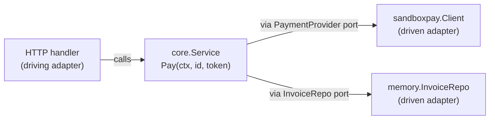
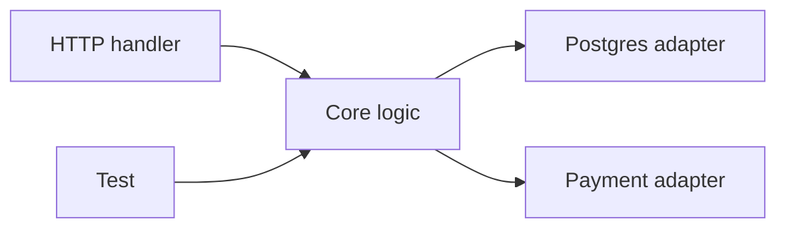
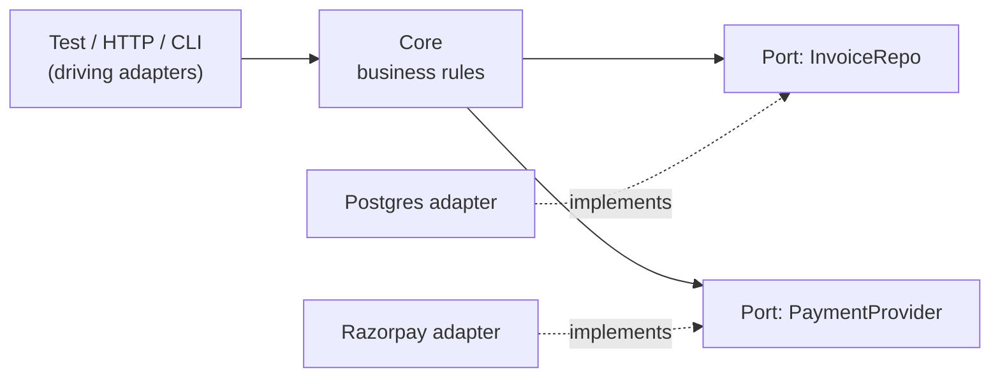
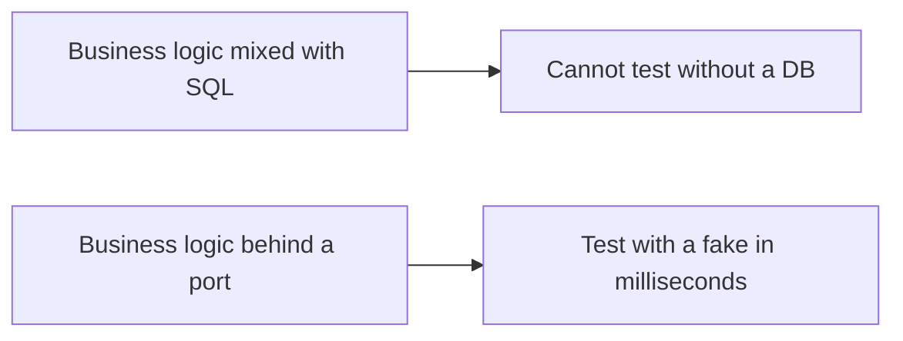
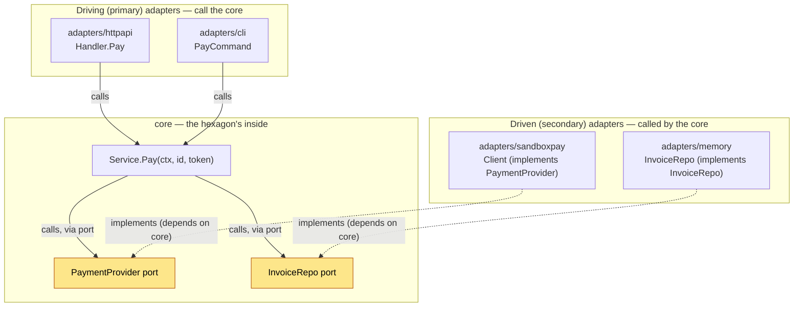
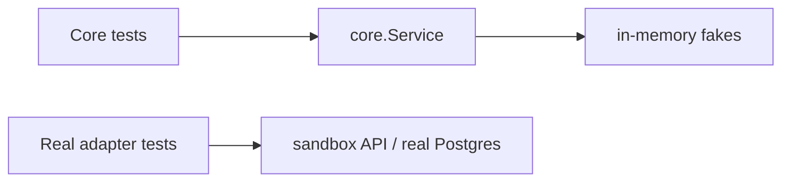

# Hexagonal Architecture (Ports and Adapters)

> [!summary] TL;DR
> Hexagonal architecture (Cockburn, 2005) puts the application's core logic in the center and surrounds it with **ports** (interfaces the core declares) and **adapters** (concrete implementations that plug into those ports). The core is driven equally by tests, a UI, or a script, and it never imports anything outside itself — no HTTP, no SQL driver, no payment SDK.

> [!abstract] Core idea
> - **Ports** are interfaces the core declares for what it needs. **Adapters** are concrete types elsewhere that satisfy those interfaces. The core imports zero adapters; every adapter imports the core.
> - **Driving (primary) adapters** call into the core: an HTTP handler, a gRPC server, a CLI, a message consumer. **Driven (secondary) adapters** are called by the core: a Postgres repository, a payment provider client, an email sender.
> - Cockburn's actual intent: the application must be equally drivable by its real UI, by an automated test, and by a batch script — "symmetry" is the point, not just "isolate the database."
> - Unlike [[Layered Architecture]], there is no structural "bottom" layer. A payment-provider port and a database port sit at the same level; both are just adapters the core doesn't know the concrete type of.
> - Classic mistake: drawing the core calling an "out port" that calls a "DB adapter" as if that were the dependency direction. That's the *call* direction. The *dependency* (import) direction is the reverse: the adapter depends on (implements) the port the core declared.

### Whiteboard version

InvoiceOps paying an invoice, with exactly one port on each side:



The handler calls the core; the core calls two ports it declared itself. Swap `sandboxpay.Client` for a Razorpay client, or `memory.InvoiceRepo` for a Postgres one, and `core.Service` does not change one line, because it never imported either concrete type.

## Start here: the basics 🟢

> [!info] How to read this note (pick your level)
> - 🟢 **New to this?** Read "From zero" below, then 1 (why it exists), 2 (mental model) and 10 (cheat sheet). Stop there, that is a full first pass.
> - 🟡 **Know the basics?** Add 3 (how it works), 4 (worked example), 5 (variants and comparison) and 6 (trade-offs).
> - 🔴 **Interview / SDE-3 prep?** Add 7 (in production), 8 (deep dive) and 9 (interview questions). Headings are tagged 🟢🟡🔴 so you always know where you are.

> [!note] Before this note
> - [[Layered Architecture]]: code split into handler → service → repository, each calling the one below. Hexagonal removes the idea of a "bottom" layer: the database becomes just one more plug.

**From zero, in 60 seconds** 🟢

Put your business logic in the middle of a box.
Everything outside, like the web, the database or a payment company, plugs in from the sides.
Each socket on the box is a **port**: an interface the core defines, like "I need to save an invoice".
Each plug is an **adapter**: real code that fits the socket, like a Postgres saver.
Some adapters call into the core (a web handler, a test). Some are called by the core (the database).
Because the core only knows sockets, you can plug in a fake for tests or swap Postgres for something else.



The rest of this note is just these 3 questions:
1. What are ports and adapters, really?
2. Which side drives and which side is driven?
3. Where does each piece go in a Go project?


**The problem in one story.**
Your app charges customers through one payment company.
The code that talks to that company is sprinkled all over the app.
One day the business wants a second payment company for another country.
Now you must hunt down every scattered call. Hexagonal architecture keeps "talk to the payment company" in exactly one plug-in piece.

**Words you need first**

| Word | Plain meaning | Tiny example |
| --- | --- | --- |
| Interface | A list of methods a type promises to have, without saying how | `type PaymentProvider interface { Charge(...) }` |
| Core (domain) | The business rules, with no tech details | "An invoice is paid when a charge succeeds" |
| Port | An interface the core declares for what it needs or offers | `InvoiceRepo` port |
| Adapter | A concrete type outside the core that fits a port | `postgres.InvoiceRepo`, an HTTP handler |
| Driving adapter | Something that calls into the core | HTTP handler, CLI, test |
| Driven adapter | Something the core calls out to | Database, payment SDK, email sender |
| Import / dependency | Package A uses package B's code | `import "invoiceops/core"` |
| Composition root | The one place (usually `main`) that wires adapters to the core | `core.NewService(pgRepo, razorpay)` |
| Call direction vs import direction | Who runs whose code at run time vs which package imports which | Core calls the DB adapter; the DB adapter imports the core |
| Fake (in-memory adapter) | A pretend adapter for tests, backed by a map, no network | `memory.InvoiceRepo` |
| Sandbox | A payment company's practice version that moves no real money | SandboxPay test card |
| SDK | The ready-made client library a company ships for its API | Razorpay's Go SDK |

**Picture it**



**Analogy.** A laptop with standard sockets (USB-C, HDMI). The laptop defines the socket shape; any brand of charger or monitor that fits can plug in, and the laptop never changes.
Where it breaks: real sockets are fixed by a standards body, while in code the core itself designs each port to fit exactly what it needs.

**How the rest of this note builds up**

- First, why it exists (section 1) and the hexagon mental model (section 2).
- Then how ports, adapters and dependency direction work (section 3), and a full Go worked example on InvoiceOps (section 4).
- Then variants vs layered and clean architecture, and trade-offs (sections 5-6).
- Finally the SDE-3 deep dive: production use, call vs import direction, interview questions (sections 7-9).

> [!tip] Remember
> The core declares the sockets; everything outside is a plug that imports the core, never the other way round.

## 1. Why it exists 🟢

🟢 **Plain version:** Without a plan, code that talks to the payment company (Razorpay) ends up in many files: the web handler, the service, a few helpers. When the business adds a second payment company for another country, you have to find and fix every one of those spots. Hexagonal architecture puts all "talk to Razorpay" code in one package that plugs into a socket the core defines. Adding Stripe then means writing one new package and changing one line.

InvoiceOps's payment webhook handler, written without ports, ends up with Razorpay's **signature-verification** function call (checking a secret-key stamp that proves the message really came from Razorpay), its SDK's error types, and its specific status-code mapping scattered across the handler, the service, and a few helper functions — because nothing forced "talk to Razorpay" to live in one place.

The day InvoiceOps needs to support Stripe (another payment company) for a second market, every one of those scattered call sites needs auditing, and the business rule "an invoice becomes paid when a charge succeeds" is tangled up with "this is specifically how Razorpay tells you that."

Hexagonal architecture's fix: declare a `PaymentProvider` port inside the core — `Charge(ctx, amount, currency, token) (chargeID string, err error)` — and make every provider-specific detail live in one adapter package that implements it.

Swapping providers becomes "write a new adapter package, change one line in the composition root," with the core untouched and every existing test against the core still valid.



## 2. Mental model 🟢

Picture the application core as a hexagon (the shape is arbitrary — it just has more than two sides, so you stop thinking "top" and "bottom"). Every side has a port: a socket of a specific shape, declared by the core itself, saying exactly what it needs or offers.

Adapters plug into those sockets from outside. An HTTP adapter plugs into a driving port to call the core. A Postgres adapter plugs into a driven port the core calls.

Both plugs look the same from the hexagon's point of view — an interface call — even though one adapter answers to "the web" and the other answers to "the database."

The test suite is just another plug. Nothing about the core's ports says "and this socket is only for production adapters" — an in-memory fake implementing `InvoiceRepo` is exactly as valid a plug as a real Postgres repository, which is precisely why the core can be tested with zero infrastructure running.

### Real-life example 🟢

Think of a shopping app like Flipkart that takes payments by UPI, card and wallet.
The rule "mark the order paid only when the charge succeeds" is the same for all three.
In hexagonal style, the core says "I need something that can `Charge` an amount". UPI, card and wallet are three adapters that each fit that one socket.
When the app adds a new "pay later" option, the team writes one new adapter. The order rules, and every test of them, do not change.

## Common beginner mistakes 🟢

- **Reading "Core → Port → DB adapter" as the import direction** → you make the core import the database package → the arrow is the call; the import goes the other way: the adapter imports the core.
- **Naming a port after its current adapter (`PostgresRepo`)** → it invites Postgres-only details into the port → name it after what the core needs: `InvoiceRepo`.
- **Putting SQL or vendor types in a port's methods** → a second adapter can't fit, and the core imports `pgx` anyway → use business types like `Save(ctx, Invoice)`.
- **Making a port for every tiny function** → many one-use interfaces nobody swaps → make a port only for real outside systems or things you must fake in tests.
- **Using hexagonal for a one-database, one-API service** → extra files with no payoff yet → start layered; switch when a second kind of outside system appears.

## 3. How it works 🟡

> 🟢 → 🟡 **You now know** the socket-and-plug picture: ports are sockets the core owns, adapters are plugs. **Next we open the box**: which way each arrow really points, which adapters drive the core and which are driven by it, and which Go folder holds each piece.



Read the arrows carefully: `S -->` (solid) is a **call**. `SB -.->` and `MEM -.->` (dashed, labeled "implements") are **dependencies** — and they point from the adapter *into* the core, because an adapter must import the core's port type to implement it. The core package itself has zero imports of `httpapi`, `cli`, `sandboxpay`, or `memory`.

That is the one fact that makes this hexagonal rather than just "a service with interfaces": nothing inside the hexagon ever names anything outside it.

### Driving vs. driven, concretely

**In plain words: driving adapters call your app (web, CLI, tests); driven adapters are called by your app (DB, email).**

**Step by step:**
1. A request `POST /invoices/inv-1/pay` hits the HTTP handler. The handler is a **driving** adapter: it calls `Service.Pay`.
2. `Service.Pay` needs the invoice, so it calls `InvoiceRepo.Get`. The repo is a **driven** adapter: the core calls it.
3. Then it calls `PaymentProvider.Charge` for ₹500. Also driven.
4. The same `Service.Pay` can be called by a CLI command or a test. Those are driving adapters too.
5. For tests, the driven side uses in-memory fakes; each real adapter gets its own separate tests.



Full detail:

| | Driving (primary) | Driven (secondary) |
| --- | --- | --- |
| Who calls whom | Adapter calls the core | Core calls the adapter (through a port) |
| InvoiceOps examples | REST handler, gRPC server, a CLI command, a Kafka consumer (a worker that reads messages from a Kafka queue) | Postgres repository, Razorpay client, SES email sender (Amazon's email service), S3 file storage (Amazon's file storage) |
| Where the interface is declared | The core exposes a plain method (`Service.Pay`); no interface needed on this side unless you want to mock (replace with a pretend version for a test) the whole core | The core declares the port interface (`PaymentProvider`, `InvoiceRepo`) |
| Who must change to add a new one | Nothing in the core; write a new adapter and call `Service.Pay` from it | Nothing in the core; write a new adapter type satisfying the port |

InvoiceOps's own core ([[Capstone - InvoiceOps]]) has three driven ports built this way: `PaymentProvider` (shown in full below), `EmailSender` (send a reminder or a receipt, one method, any provider behind it), and `FileStorage` (store and fetch a generated PDF, one method each way, S3 or local disk behind it).

All three are declared next to the service that needs them and are swappable the same way.

**Testing strategy differs by side.** The core and every driving adapter are tested against **in-memory driven adapters** — no network, no real database, the way every test in this note's worked example runs.

Each driven adapter is additionally tested on its own, separately, against the real thing it wraps: `adapters/sandboxpay` (or a real `adapters/razorpay`) gets its own test suite hitting a sandbox API (the provider's practice version) or a recorded fixture (a saved real response replayed in tests), and a Postgres-backed `InvoiceRepo` gets its own test suite against a real (or test-container) Postgres.

The core's tests never need that infrastructure; the adapter's tests are the only place that infrastructure is required at all.

### Go: where each piece lives

**In plain words: which folder holds the core, the ports and each adapter.**

**Step by step:**
1. `core/`: the `Invoice` type, the ports `InvoiceRepo` and `PaymentProvider`, and `Service.Pay`. Imports only the standard library.
2. `adapters/memory/` and `adapters/sandboxpay/`: driven adapters. Each imports `core`.
3. `adapters/httpapi/` and `adapters/cli/`: driving adapters. Each imports `core`.
4. `main.go`: builds the adapters and hands them to `core.NewService`.

```text
hexagonal/
  core/
    core.go            # domain type, PaymentProvider + InvoiceRepo ports, Service (the use case)
  adapters/
    httpapi/           # driving: net/http handler, imports core
    cli/               # driving: command-line entry point, imports core
    memory/            # driven: InvoiceRepo implementation, imports core
    sandboxpay/        # driven: PaymentProvider implementation, imports core
```

`core` has no subdirectory called `adapters` inside it, and it imports nothing under `adapters/` — that import rule is the whole architecture. This is the same "consumer owns the interface" rule [[Service Project Layout and Wiring]] uses for an ordinary Go service's packages; hexagonal architecture is that rule applied deliberately to every external dependency, not just the database.

## 4. Worked example 🟡

**The core** — domain type, both ports, and the one use case this slice implements (`Pay`). No import outside the standard library:

**What this code does, in plain words:** `Pay` loads the invoice, refuses if it is already paid, asks the payment port to charge the amount, and saves the invoice as paid only if the charge worked.

```go
// Package core is the hexagon's inside: the domain model, the ports
// (interfaces), and the application service that implements the use case.
// It imports nothing outside the standard library — no net/http, no SQL
// driver, no payment-provider SDK. That is the whole point of hexagonal
// architecture: every arrow drawn FROM this package points at another type
// in this package; every arrow pointing INTO this package belongs to an
// adapter that imports core, never the reverse.
package core

import (
	"context"
	"errors"
	"fmt"
)

// Invoice is the domain model the use case operates on.
type Invoice struct {
	ID       string
	Amount   int64 // minor units
	Currency string
	Status   string // "pending" | "paid" | "payment_failed"
}

const (
	StatusPending       = "pending"
	StatusPaid          = "paid"
	StatusPaymentFailed = "payment_failed"
)

var ErrNotFound = errors.New("invoice not found")

// InvoiceRepo is a driven (secondary) port. It is declared here, in the
// core, because the core is the consumer: it decides what shape of storage
// it needs. Whatever adapter implements this (Postgres, in-memory, a fake
// for tests) depends on core — core never imports it.
type InvoiceRepo interface {
	Get(ctx context.Context, id string) (Invoice, error)
	Save(ctx context.Context, inv Invoice) error
}

// PaymentProvider is the second driven port. A webhook or a direct charge
// call both end up going through this interface, never through a
// provider-specific type leaking into the core.
type PaymentProvider interface {
	// Charge returns a provider-assigned charge ID on success.
	Charge(ctx context.Context, amount int64, currency, token string) (chargeID string, err error)
}

// ErrDeclined is returned by a PaymentProvider adapter when the payment
// network itself declines the charge (not a wiring or network error).
var ErrDeclined = errors.New("payment declined")

// Service is the application core. Every driving adapter (HTTP, gRPC, a
// CLI, a test) calls exactly these methods — Cockburn's point that the
// core must be equally drivable by a UI, a script or an automated test.
type Service struct {
	invoices InvoiceRepo
	payments PaymentProvider
}

func NewService(invoices InvoiceRepo, payments PaymentProvider) *Service {
	return &Service{invoices: invoices, payments: payments}
}

// Pay is the one use case this capstone slice implements: charge the
// invoice's amount through whichever PaymentProvider adapter was wired in,
// and flip the invoice to paid or payment_failed depending on the result.
func (s *Service) Pay(ctx context.Context, invoiceID, paymentToken string) (Invoice, error) {
	inv, err := s.invoices.Get(ctx, invoiceID)
	if err != nil {
		return Invoice{}, err
	}
	if inv.Status == StatusPaid {
		return inv, nil // idempotent: paying twice is a no-op, not an error
	}

	_, err = s.payments.Charge(ctx, inv.Amount, inv.Currency, paymentToken)
	if err != nil {
		inv.Status = StatusPaymentFailed
		if saveErr := s.invoices.Save(ctx, inv); saveErr != nil {
			return Invoice{}, fmt.Errorf("charge failed (%w) and save failed: %v", err, saveErr)
		}
		return inv, fmt.Errorf("charge invoice %s: %w", invoiceID, err)
	}

	inv.Status = StatusPaid
	if err := s.invoices.Save(ctx, inv); err != nil {
		return Invoice{}, fmt.Errorf("save paid invoice: %w", err)
	}
	return inv, nil
}
```

**A driven adapter** — `InvoiceRepo` backed by a map (swap for `*pgx.Pool` in production, core unchanged):

```go
// Package memory is a driven adapter implementing core.InvoiceRepo. A
// production build swaps this package for one backed by pgx, without core
// or any other adapter changing at all.
package memory

import (
	"context"
	"sync"

	"hexagonal/core"
)

type InvoiceRepo struct {
	mu   sync.Mutex
	rows map[string]core.Invoice
}

func NewInvoiceRepo(seed ...core.Invoice) *InvoiceRepo {
	r := &InvoiceRepo{rows: make(map[string]core.Invoice)}
	for _, inv := range seed {
		r.rows[inv.ID] = inv
	}
	return r
}

func (r *InvoiceRepo) Get(ctx context.Context, id string) (core.Invoice, error) {
	r.mu.Lock()
	defer r.mu.Unlock()
	inv, ok := r.rows[id]
	if !ok {
		return core.Invoice{}, core.ErrNotFound
	}
	return inv, nil
}

func (r *InvoiceRepo) Save(ctx context.Context, inv core.Invoice) error {
	r.mu.Lock()
	defer r.mu.Unlock()
	r.rows[inv.ID] = inv
	return nil
}
```

**A second driven adapter** — `PaymentProvider` for a fictional "SandboxPay", standing in for the Razorpay/Stripe SDK call InvoiceOps's real webhook flow ([[Capstone - InvoiceOps]]) would make:

```go
// Package sandboxpay is a driven adapter implementing core.PaymentProvider
// against a fictional provider, "SandboxPay". Swapping to Razorpay or
// Stripe later means writing a new package exactly like this one and
// changing one line in main() — core.Service never changes.
package sandboxpay

import (
	"context"
	"fmt"

	"hexagonal/core"
)

// Client stands in for an SDK client (HTTP base URL, API key). In
// production it would wrap net/http calls to the real provider's API.
type Client struct {
	// DeclineToken, if non-empty, makes Charge fail for that exact token,
	// simulating a declined card without a real payment network.
	DeclineToken string
}

func (c *Client) Charge(ctx context.Context, amount int64, currency, token string) (string, error) {
	if token == c.DeclineToken && token != "" {
		return "", fmt.Errorf("sandboxpay: %w", core.ErrDeclined)
	}
	if amount <= 0 {
		return "", fmt.Errorf("sandboxpay: invalid amount %d", amount)
	}
	// A real adapter would make an HTTP call here and map the provider's
	// response/error shape onto core.PaymentProvider's contract.
	return "ch_" + token + "_ok", nil
}
```

**A driving adapter** — HTTP, doing nothing but translation:

```go
// Package httpapi is a driving (primary) adapter: something outside drives
// the core through it. It depends on core, never the other way around, and
// it does no business logic of its own beyond decoding/encoding.
package httpapi

import (
	"encoding/json"
	"errors"
	"net/http"

	"hexagonal/core"
)

type Handler struct {
	svc *core.Service
}

func New(svc *core.Service) *Handler {
	return &Handler{svc: svc}
}

type payResponse struct {
	ID     string `json:"id"`
	Status string `json:"status"`
}

// Pay handles POST /invoices/{id}/pay?token=... . The driving adapter's only
// job is translating HTTP in and out of a call to core.Service.Pay.
func (h *Handler) Pay(w http.ResponseWriter, r *http.Request, invoiceID string) {
	token := r.URL.Query().Get("token")
	inv, err := h.svc.Pay(r.Context(), invoiceID, token)
	switch {
	case err == nil:
		w.Header().Set("Content-Type", "application/json")
		_ = json.NewEncoder(w).Encode(payResponse{ID: inv.ID, Status: inv.Status})
	case errors.Is(err, core.ErrNotFound):
		http.Error(w, "invoice not found", http.StatusNotFound)
	case errors.Is(err, core.ErrDeclined):
		w.WriteHeader(http.StatusPaymentRequired)
		_ = json.NewEncoder(w).Encode(payResponse{ID: inv.ID, Status: inv.Status})
	default:
		http.Error(w, "internal error", http.StatusInternalServerError)
	}
}
```

**A second driving adapter** — a CLI command, proving Cockburn's symmetry point: it drives the exact same `Service.Pay`, no business logic duplicated:

```go
// Package cli is a second driving adapter for the same core.Service used by
// adapters/httpapi. This is Cockburn's symmetry point made concrete: the
// core does not know or care whether it is driven by an HTTP handler, this
// command-line function, or a test calling svc.Pay directly.
package cli

import (
	"context"
	"fmt"

	"hexagonal/core"
)

// PayCommand is what `invoiceops pay <id> <token>` would call. It is a thin
// translation from argv to a core.Service.Pay call, just like httpapi.Pay
// is a thin translation from an HTTP request.
func PayCommand(ctx context.Context, svc *core.Service, invoiceID, token string) string {
	inv, err := svc.Pay(ctx, invoiceID, token)
	if err != nil {
		return fmt.Sprintf("pay %s: %v", invoiceID, err)
	}
	return fmt.Sprintf("invoice %s is now %s", inv.ID, inv.Status)
}
```

Two of the tests against the core — note that neither imports `net/http` or `httptest`:

**What this code does, in plain words:** it plugs fakes into the core and checks two cases: a good charge marks the invoice paid, and a declined charge leaves it unpaid.

```go
// TestPay_Success proves the use case against two in-memory adapters, with
// no HTTP server and no real payment network involved.
func TestPay_Success(t *testing.T) {
	repo := memory.NewInvoiceRepo(core.Invoice{ID: "inv_1", Amount: 5000, Currency: "INR", Status: core.StatusPending})
	provider := &sandboxpay.Client{}
	svc := core.NewService(repo, provider)

	inv, err := svc.Pay(context.Background(), "inv_1", "tok_good")
	if err != nil {
		t.Fatalf("Pay: %v", err)
	}
	if inv.Status != core.StatusPaid {
		t.Fatalf("status = %s, want paid", inv.Status)
	}
}

// TestPay_Declined proves a provider decline flips the invoice to
// payment_failed instead of leaving it pending, and that the error wraps
// core.ErrDeclined so a driving adapter can branch on it with errors.Is.
func TestPay_Declined(t *testing.T) {
	repo := memory.NewInvoiceRepo(core.Invoice{ID: "inv_1", Amount: 5000, Currency: "INR", Status: core.StatusPending})
	provider := &sandboxpay.Client{DeclineToken: "tok_bad"}
	svc := core.NewService(repo, provider)

	inv, err := svc.Pay(context.Background(), "inv_1", "tok_bad")
	if !errors.Is(err, core.ErrDeclined) {
		t.Fatalf("want ErrDeclined, got %v", err)
	}
	if inv.Status != core.StatusPaymentFailed {
		t.Fatalf("status = %s, want payment_failed", inv.Status)
	}
}
```

And one test driving the HTTP adapter and one driving the CLI adapter against the same core, proving the two driving adapters are interchangeable:

```go
// TestHandler_Pay_SamePathDifferentAdapter proves the driving adapter can
// be swapped for a test's httptest double while the driven adapters stay
// the same in-memory fakes used by the core tests — the two swap
// independently.
func TestHandler_Pay_SamePathDifferentAdapter(t *testing.T) {
	repo := memory.NewInvoiceRepo(core.Invoice{ID: "inv_1", Amount: 5000, Currency: "INR", Status: core.StatusPending})
	svc := core.NewService(repo, &sandboxpay.Client{})
	h := httpapi.New(svc)

	req := httptest.NewRequest(http.MethodPost, "/invoices/inv_1/pay?token=tok_good", nil)
	rec := httptest.NewRecorder()

	h.Pay(rec, req, "inv_1")

	if rec.Code != http.StatusOK {
		t.Fatalf("status = %d, body = %s", rec.Code, rec.Body.String())
	}
}

// TestPayCommand_UsesSameCore proves the CLI adapter drives the identical
// core.Service.Pay the HTTP adapter drives — no business logic duplicated.
func TestPayCommand_UsesSameCore(t *testing.T) {
	repo := memory.NewInvoiceRepo(core.Invoice{ID: "inv_1", Amount: 1500, Currency: "INR", Status: core.StatusPending})
	svc := core.NewService(repo, &sandboxpay.Client{})

	out := cli.PayCommand(context.Background(), svc, "inv_1", "tok_good")
	if !strings.Contains(out, "is now paid") {
		t.Fatalf("output = %q, want it to mention paid", out)
	}
}
```

And the concurrency test the "Measured" line below reports — two different invoices paid from two goroutines at once, exercising `memory.InvoiceRepo`'s locking under `-race`:

```go
// TestPay_Concurrent pays two different invoices from two goroutines
// simultaneously, confirming memory.InvoiceRepo's locking is race-free.
func TestPay_Concurrent(t *testing.T) {
	repo := memory.NewInvoiceRepo(
		core.Invoice{ID: "inv_1", Amount: 5000, Currency: "INR", Status: core.StatusPending},
		core.Invoice{ID: "inv_2", Amount: 7000, Currency: "INR", Status: core.StatusPending},
	)
	svc := core.NewService(repo, &sandboxpay.Client{})

	done := make(chan error, 2)
	go func() {
		_, err := svc.Pay(context.Background(), "inv_1", "tok_good")
		done <- err
	}()
	go func() {
		_, err := svc.Pay(context.Background(), "inv_2", "tok_good")
		done <- err
	}()
	for i := 0; i < 2; i++ {
		if err := <-done; err != nil {
			t.Fatalf("Pay: %v", err)
		}
	}
}
```

**Measured:** `go test -race ./...` across `core`, `adapters/httpapi` and `adapters/cli` in a scratch module (Go 1.24.4, darwin/arm64, 2026-11-07): all tests pass, including a concurrency test that pays two different invoices from two goroutines simultaneously, confirming `memory.InvoiceRepo`'s locking is race-free.

## 5. Variants and comparison 🟡

| Option | How it works | Use when | Cost |
| --- | --- | --- | --- |
| [[Layered Architecture]] | Fixed stack, dependencies point downward to a "bottom" persistence layer | Simple CRUD, one kind of backing store, one kind of entry point | Adding a second external dependency kind (a provider, a second store) doesn't fit the stack cleanly |
| Hexagonal (ports and adapters) | Core has no "bottom"; every external dependency is a port at the same level | More than one kind of driven dependency, or more than one kind of driving entry point, and you want to swap either without touching the core | More interfaces and a manual composition root to wire adapters to ports |
| [[Clean Architecture]] | Same inward-dependency rule, but named concentric rings (entities, use cases, interface adapters, frameworks) and mandatory boundary DTOs at every ring crossing | You want the same isolation as hexagonal, with a stricter, more prescriptive set of rings and a vocabulary (interactors, presenters) that scales to larger teams | More mapping boilerplate between rings than hexagonal typically requires |

> [!warning] Interview trap
> The diagram "Core → OutPort → DBAdapter" drawn with a left-to-right arrow looks like the database depends on the core. That arrow is the **call** direction. The **dependency** (import) direction is the opposite: `DBAdapter` imports the core's port type to implement it; the core never imports `DBAdapter`. Confusing the two is the single most common mistake in explaining this pattern.


## 6. Trade-offs and when not to use 🟡

- More interfaces and more files than a direct call would need — a `PaymentProvider` port plus a `sandboxpay` adapter is two types where a layered service might have had one concrete client.
- Someone has to wire adapters to ports by hand (or with a DI tool, a dependency-injection library that builds and connects objects for you); there is no framework magic doing it for you, by design — see [[Service Project Layout and Wiring]] for the composition-root pattern this relies on.
- For a service with exactly one storage engine and exactly one entry point (one HTTP API, nothing else), the extra ports buy you optionality you may never use. [[Layered Architecture]] is simpler for that case and you can evolve into hexagonal later, at the exact point a second adapter kind appears.
- A port shaped around one specific adapter's needs (`SaveToPostgres(ctx, pgxTx, row)`) isn't really a port — it's an adapter-shaped interface with extra steps. A port's method names and parameter types should read as business operations (`Save(ctx, Invoice)`), never as "whatever Postgres happens to need."

## 7. In production 🔴

> 🟡 → 🔴 **You now know** how ports, adapters and the composition root look in real Go, with tests on both sides. **Next is the senior view**: how ports leak in real codebases, what to watch in production, and exactly how hexagonal differs from layered and clean.


- **Real systems:** Cockburn's original write-up; it is also the structural idea behind Spring's `@Repository`/`@Service` separation when done well, and it is the default advice in most "Go web service structure" blog posts once they reach the "how do I swap my database" question. InvoiceOps's own payment and notification adapters follow this shape (see [[Capstone - InvoiceOps]]).
- **Failure modes → fixes:**
  - SQL or ORM types (`*sql.Rows`, a generated ORM struct) show up as a method parameter or return type on a port → the port is leaking its adapter's shape; change the port to return the domain type and map inside the adapter.
  - A port is named after its only current adapter (`PostgresRepo` instead of `InvoiceRepo`) → rename it; the name should describe what the core needs, not who currently provides it.
  - "Interface pollution": a one-method interface created for every single function, never reused, never swapped → only promote something to a port when you actually expect more than one adapter, or need to fake it in a test.
  - Swapping Razorpay for Stripe touches more than the adapter package → the port leaked a Razorpay-specific concept (a particular webhook field, a particular error code) into its contract; redesign the port around the business operation, not the vendor's API shape.
- **What to monitor:** per-adapter latency and error rate (a `sandboxpay` adapter timing out is a different alert than the core having a bug); how many concrete types a new test needs to construct (rising sharply suggests a port is in the wrong place); time to add a second adapter for an existing port (should be "write the type," not "also touch the core").

## 8. Deep dive 🔴

**Swap Razorpay for Stripe: what actually changes.** Nothing in `core` changes, because `core.PaymentProvider` was never shaped around Razorpay. A new `adapters/stripe` package is written, implementing `Charge(ctx, amount, currency, token) (string, error)` against Stripe's SDK, mapping Stripe's own error types onto `core.ErrDeclined` the same way `sandboxpay` does above.

The only other change is one line in the composition root (`main.go`) constructing `stripe.Client{}` instead of `sandboxpay.Client{}`. Every existing test against `core.Service` — all of them built against fakes — keeps passing unchanged, because they never depended on which provider was wired in.

**Vs. layered, more precisely.** [[Layered Architecture]]'s persistence layer is structurally special: everything funnels through it, and there is exactly one of it per service. Hexagonal architecture removes that specialness.

A database port and a payment-provider port are both just "a driven port," and the core treats them identically — it does not know, or need to know, that one happens to involve SQL and the other happens to involve an HTTP call to a third party.

This is why hexagonal generalizes better once a service accumulates several different kinds of external dependency: nothing about the shape changes as you add the third, fourth, or fifth port.

**Vs. clean/onion, more precisely.** Clean Architecture (Martin, 2012) and the Onion Architecture (Palermo, 2008) are the same dependency-inversion idea Cockburn described in 2005, expressed as concentric rings with explicit names (entities, use cases, interface adapters, frameworks and drivers) instead of a hexagon with ports on its sides.

Hexagonal is unopinionated about how many kinds of thing sit "inside" versus "outside" — it just says "ports in, adapters out." Clean Architecture is more prescriptive: it names the use-case layer specifically, requires an explicit DTO at every ring boundary, and gives dependency inversion a stricter home.

See [[Clean Architecture]] for exactly how that differs in Go code.

**Composition root.** The one place allowed to know every concrete adapter type is the `main.go` that constructs `core.NewService(memory.NewInvoiceRepo(...), sandboxpay.Client{...})` and passes the result into `httpapi.New(...)`.

This is the exact same manual-DI pattern [[Service Project Layout and Wiring]] covers for Go services generally — hexagonal architecture doesn't add a new wiring mechanism, it just makes the wiring step unavoidable, because the core genuinely cannot construct its own dependencies without knowing their concrete types.

## 9. Interview questions 🔴

> [!question]- What is Cockburn's actual intent behind hexagonal architecture?
> Not just "isolate the database" — the application must be equally drivable by its real UI, by an automated test suite, and by a batch script or CLI, with no code path privileged over another. Symmetry between driving adapters is as much the point as isolating driven ones.

> [!question]- Trap: in the diagram "Core → Port → DBAdapter", which way does the dependency point?
> The arrow as drawn is the call direction. The dependency (import) direction is the reverse: `DBAdapter` imports the core's port interface to implement it structurally; the core never imports `DBAdapter`'s package. Confusing call direction with import direction is the most common mistake made explaining this pattern.

> [!question]- What's the difference between a driving and a driven adapter?
> A driving (primary) adapter calls into the core — an HTTP handler, a CLI command, a gRPC server. A driven (secondary) adapter is called by the core through a port it declared — a database repository, a payment provider client. The direction of the initial call is what distinguishes them, not whether they're "input" or "output" in some generic sense.

> [!question]- You need to swap Razorpay for Stripe. What changes?
> A new adapter package implementing `core.PaymentProvider` against Stripe's SDK, mapping its errors onto the core's sentinel errors. One line changes in the composition root to construct the new adapter instead of the old one. `core.Service` and every test against it are untouched, provided the port was never shaped around Razorpay-specific concepts.

> [!question]- How do you test the core without a database or a payment network running?
> Pass in-memory implementations of `InvoiceRepo` and `PaymentProvider` — ordinary Go structs backed by a map, with no I/O. Because the core only depends on the port interfaces, these fakes are exactly as valid a dependency as the real adapters, and the tests run in milliseconds.

> [!question]- What does "adapter-shaped port" mean, and why is it a pitfall?
> A port whose method signatures leak one specific adapter's concepts — `SaveToPostgres(ctx, *pgx.Tx, Row)` instead of `Save(ctx, Invoice) error` — is really just that adapter's API with an extra layer of indirection. It defeats the purpose: a second adapter can't satisfy it without faking Postgres-shaped arguments, and the core ends up importing `pgx` types anyway.

> [!question]- When would you prefer layered architecture over hexagonal?
> When the service has exactly one kind of backing store and exactly one kind of entry point, and you don't anticipate adding a second of either soon. The extra ports and composition-root wiring hexagonal needs buy you an optionality that, in that case, you're unlikely to spend.

## 10. Cheat sheet 🟢

- Port = interface the core declares. Adapter = concrete type that satisfies it. The core imports zero adapters.
- Driving adapters call the core (HTTP, CLI, gRPC, consumers). Driven adapters are called by the core through a port (DB, payment provider, email).
- Dependency direction is the reverse of call direction: adapters depend on (import) the core, never the other way around.
- No structural "bottom" layer, unlike layered architecture — every port sits at the same level.
- Symmetry is Cockburn's actual point: the core must be equally drivable by a UI, a test, or a script.
- A port shaped around one adapter's needs (SQL types, vendor error codes) is an adapter in disguise — name ports after business operations.
- The composition root (`main.go`) is the only place allowed to know every concrete adapter type.
- Evolve from layered to hexagonal the moment a second kind of external dependency needs isolating.

## Self-check 🟢🟡

> [!question]- (easy) What is a port, and what is an adapter?
> A port is an interface the core declares; an adapter is real code outside the core that fits it.

> [!question]- (easy) Is an HTTP handler a driving or a driven adapter?
> Driving: it calls into the core.

> [!question]- (easy) Does the core import the Postgres adapter?
> No. The Postgres adapter imports the core to implement its port.

> [!question]- (medium) You swap Razorpay for Stripe. What changes?
> A new `adapters/stripe` package and one line in `main.go`; the core and its tests stay the same.

> [!question]- (medium) Why is `SaveToPostgres(ctx, pgxTx, row)` a bad port?
> It is shaped like one adapter; a second adapter can't fit it and the core ends up importing `pgx`.

> [!question]- (medium) When is layered architecture the better choice?
> When there is one kind of store and one kind of entry point, and no second one coming soon.

## Links 🟢
- **Before this:** [[Layered Architecture]]
- **Next:** [[Clean Architecture]]
- **Compare with:** [[SOLID in Go]] (dependency inversion at the class/interface level; hexagonal is the same idea at the service's architectural boundary), [[Capstone - InvoiceOps]] (the running example this note's ports mirror), [[API Gateway and BFF]] (a different kind of driving-adapter concern: shaping the entry point itself, not isolating the core)

### Watch on YouTube

- [The HEXAGONAL Architecture Explained / Ports and Adapters Pattern](https://www.youtube.com/watch?v=92eWCQrcsvQ) · Marco Lenzo · 11 min · 19,071 views
- [How Ports and Adapters aka Hexagonal Architecture Can Benefit Your Node.js Application?](https://www.youtube.com/watch?v=JF_IJnkIAPw) · Alex Rusin · 12 min · 3,577 views
