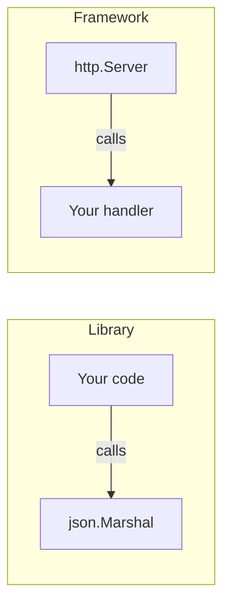
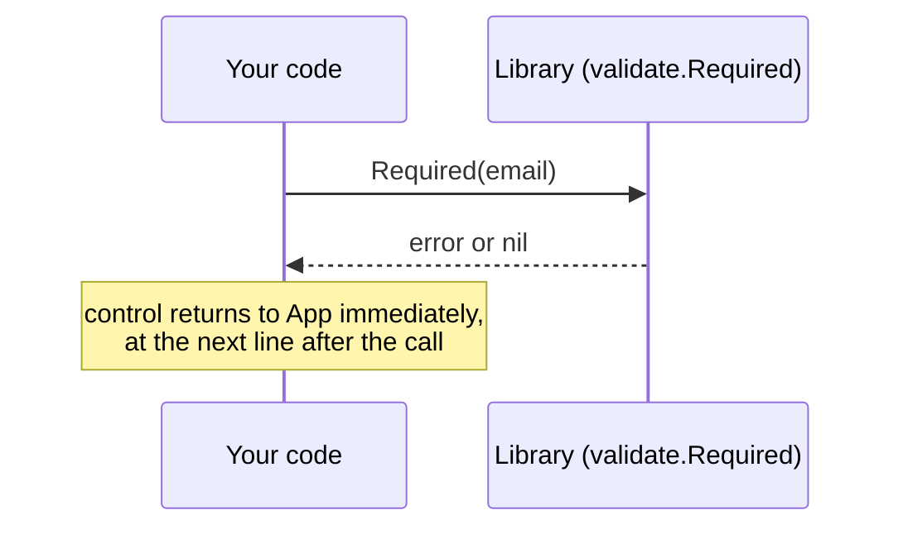
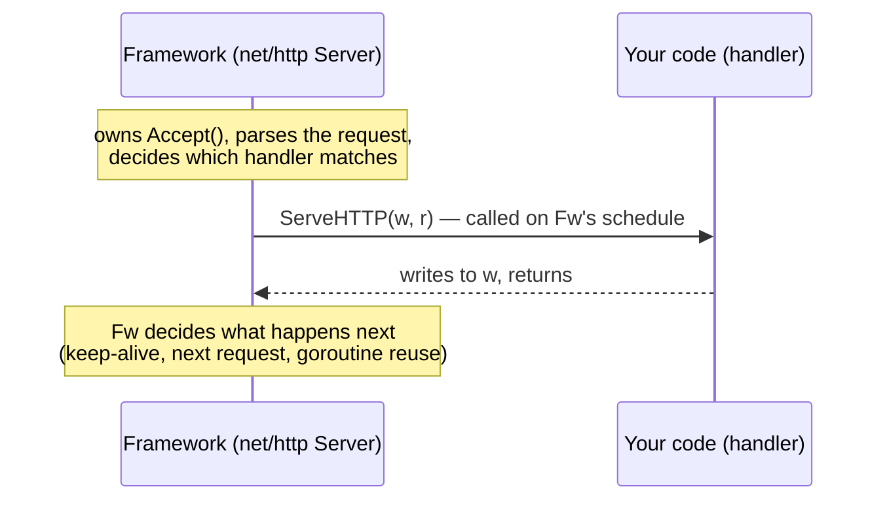
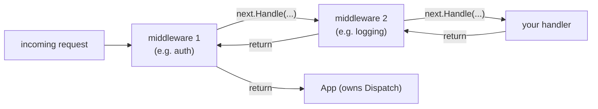

# Inversion of Control - Library vs Framework

> [!summary] TL;DR
> A library is code you call, on your own schedule, to do one job — you stay in control of the program's flow. A framework is a skeleton that calls your code, at a time and in an order it decides — it holds control of the flow, and you fill in the blanks. The underlying idea is **inversion of control**: normally your code decides when to call a piece of logic; a framework inverts that and decides for you.

> [!abstract] Core idea
> - "Who calls whom" is the test: you call a library; a framework calls you.
> - This is sometimes called the **Hollywood principle**: "don't call us, we'll call you."
> - Dependency injection is one specific technique for inversion of control: instead of a type constructing its own dependencies, something outside hands them in.
> - Go's standard library has both shapes at once: `encoding/json` is a library you call; `net/http`'s `*http.Server` is a small framework that calls your `http.Handler` when a request arrives.
> - Choosing a framework is choosing to hand over control flow in exchange for a convention you no longer have to invent yourself — and the lock-in that comes with it.

## Start here: the basics

**The problem in one story.**
You write a function `sayHello` and call it yourself on line 10: you are in charge.
Then you use a web server: you hand it `sayHello`, and it calls it whenever a visitor arrives.
You never write the line that calls it.
That flip, from "I call it" to "it calls me", is inversion of control.

**Words you need first**

| Word | Plain meaning | Tiny example |
| --- | --- | --- |
| Control flow | The order in which code runs | `main` calls `load`, then `save` |
| Library | Code you call when you choose | `json.Marshal(v)` |
| Framework | A skeleton that calls your code when it chooses | `net/http` calling your handler |
| Callback | A function you hand over so someone else can call it later | `mux.HandleFunc("/", h)` |
| Interface | A set of methods a type promises to have | `http.Handler` needs `ServeHTTP` |
| Dependency | Something a piece of code needs to do its job | A service needs a database |
| Dependency injection | Handing a type its dependencies from outside | `NewService(repo)` |

**Picture it**



**Analogy.** Library: you are the chef and pick up a knife when you want. Framework: you are a line cook, and the expediter calls out orders that you answer.
Where it breaks: a line cook can refuse or be slow, but your handler cannot change when the framework calls it; it can run many times at once.

**How the rest of this note builds up**

- First, why the distinction matters (section 1) and the "who calls whom" test (section 2).
- Then how the inversion works, including callbacks and dependency injection (section 3), with a Go worked example (section 4).
- Then variants and trade-offs, including framework lock-in (sections 5-6).
- Finally the SDE-3 deep dive: production pitfalls, concurrency of framework-called code, interview questions (sections 7-9).

> [!tip] Remember
> You call a library; a framework calls you.

## 1. Why it exists

A new engineer on InvoiceOps is asked to add structured logging and gets two different answers depending on which part of the codebase they touch.

In the validation code, they write `if err := validate.Required(email); err != nil { ... }` — a direct function call, at the exact line where the check is needed, returning control back to the caller immediately. This is a **library** call: ordinary, predictable, and entirely on the caller's schedule.

In the HTTP layer, they register a handler with `mux.HandleFunc("POST /invoices", createInvoice)` and never call `createInvoice` themselves anywhere in the codebase. `net/http`'s server calls it, once per matching request, whenever one arrives — in a goroutine the server itself created. This is a **framework** relationship: the engineer wrote code, but gave up deciding when and how often it runs.

Mixing up the two is a common, costly mistake: expecting a registered handler to run exactly once like a function call (it can run concurrently, many times, for many requests) or trying to "just call" a piece of framework-owned lifecycle code out of its normal sequence (a React component's render function, a test framework's `setUp`) and getting surprising results, because that code was written assuming the framework's rules about *when* it runs.

## 2. Mental model

Picture two kitchens. In the first, you are the chef: you decide which knife to pick up and when (a library — you call it).

In the second, you are a line cook working a shift: an expediter calls out orders, and you only ever respond to a call that arrives on someone else's schedule, in the order they choose (a framework — it calls you).

**Simple test:** stare at the call site. If *your* code's line number is where the function starts running, it is a library. If your code is sitting inside a slot (a registered handler, a callback, an interface method) and you cannot point to the line in your codebase that calls it, it is a framework calling you.

## 3. How it works

### The inversion, drawn as two sequences





The two diagrams show the same shape with the arrows reversed. In the library diagram, your code is the one initiating; in the framework diagram, the framework initiates and your code is a slot it calls into.

### Library, framework, platform/SDK: three different words

| Term | What it controls | Go example |
| --- | --- | --- |
| Library | Nothing beyond the one call; you call it when you need it | `encoding/json`, `strings`, `crypto/sha256` |
| Framework | The overall control flow and lifecycle; it calls your code | `net/http`'s `*http.Server`, a test runner's `TestMain` |
| Platform / SDK | A whole runtime environment plus its own conventions (deployment, scaling, config) that your code runs inside | AWS Lambda (your handler function is called by the Lambda runtime, which also owns scaling and retries), Kubernetes operators (your reconcile function is called by the controller-runtime framework) |

A platform is usually a framework with an operational environment wrapped around it: Lambda is a framework for the call ("here is an event, handle it") plus a platform decision about how many instances exist and when they start.

### IoC inside a single process: middleware chains and plugin hooks

Inversion of control is not only "the whole app is a framework". It shows up at a much smaller scale, every time code registers a callback and hands control to something that decides when to invoke it:



Each middleware is handed `next`, a callable it chooses to invoke (or not — an auth middleware can refuse to call `next` at all and reject the request itself). The app that owns `Dispatch` decides the order the middlewares were composed in; no middleware calls itself.

This is the same Hollywood principle at the scale of a single request, and it is why middleware chains, plugin systems and event-hook registries ("on save", "before commit") all count as inversion of control even without a capital-F Framework in sight.

### Dependency injection: IoC applied to construction

Dependency injection is the specific case where what gets "called for you" is the *construction* of a dependency, not a lifecycle event. Instead of:

```text
service := NewService(postgres.NewStore(dsn))   // Service builds its own dependency
```

a constructor takes the already-built dependency:

```text
store := postgres.NewStore(dsn)                 // built elsewhere (a composition root)
service := domain.NewService(store, notifier)   // handed in, not constructed inside
```

`Service` no longer decides how its `Store` is built, or even what kind it is — control over that decision moved to whatever calls `NewService`.

In Go this is usually done by hand in a `main` composition root (see [[Architecture Fundamentals - Coupling, Cohesion and Dependency Direction]]); `google/wire` generates that wiring code at compile time, and `uber-go/fx` builds and calls it at runtime from a dependency graph, but both are automating the same manual pattern, not doing something different in kind.

## 4. Worked example

### Whiteboard version

The bare shape: a slot your code fills, and something else that decides when to call it.

```go
package wb

// Framework-owned slot: the framework defines this type, your code
// implements it, and only the framework ever calls Run.
type Job interface {
	Run()
}

type Scheduler struct {
	jobs []Job
}

func (s *Scheduler) Register(j Job) { s.jobs = append(s.jobs, j) }

// Tick is the framework deciding when registered code runs.
func (s *Scheduler) Tick() {
	for _, j := range s.jobs {
		j.Run()
	}
}
```

The full version below contrasts a library (`validate`, called directly) with a small framework (`miniframework`, which owns dispatch and middleware), both compiling together with a composition root in `main`.

A Go package pair (`validate`, `miniframework`) that compiles and passes `go vet` and `go test -race` on Go 1.24.

```go
// validate/validate.go - a library: your code calls it, on your schedule.
package validate

import (
	"errors"
	"strings"
)

var ErrRequired = errors.New("validate: value is required")

func Required(s string) error {
	if strings.TrimSpace(s) == "" {
		return ErrRequired
	}
	return nil
}
```

```go
// miniframework/framework.go - a framework: it owns control flow. You
// register a Handler and it calls you, the way net/http's *http.Server
// calls your http.Handler when it is ready, not when you ask it to.
package miniframework

import "context"

type Request struct {
	Path string
	Body string
}

type Response struct {
	Status int
	Body   string
}

type Handler interface {
	Handle(ctx context.Context, req Request) Response
}

type HandlerFunc func(ctx context.Context, req Request) Response

func (f HandlerFunc) Handle(ctx context.Context, req Request) Response { return f(ctx, req) }

// Middleware wraps a Handler with cross-cutting behaviour. The framework
// decides the call order; a middleware only decides whether to call next.
type Middleware func(next Handler) Handler

type App struct {
	routes      map[string]Handler
	middlewares []Middleware
}

func New() *App { return &App{routes: make(map[string]Handler)} }

func (a *App) Use(mw Middleware) { a.middlewares = append(a.middlewares, mw) }

func (a *App) Register(path string, h Handler) { a.routes[path] = h }

// Dispatch is the framework calling your code.
func (a *App) Dispatch(ctx context.Context, req Request) Response {
	h, ok := a.routes[req.Path]
	if !ok {
		return Response{Status: 404, Body: "not found"}
	}
	wrapped := h
	for i := len(a.middlewares) - 1; i >= 0; i-- {
		wrapped = a.middlewares[i](wrapped)
	}
	return wrapped.Handle(ctx, req)
}
```

```go
// main.go - the library is called directly, inside code the framework calls.
package main

import (
	"context"
	"fmt"

	"note2/miniframework"
	"note2/validate"
)

func main() {
	app := miniframework.New()
	app.Register("/invoices", miniframework.HandlerFunc(func(_ context.Context, req miniframework.Request) miniframework.Response {
		if err := validate.Required(req.Body); err != nil {
			return miniframework.Response{Status: 400, Body: err.Error()}
		}
		return miniframework.Response{Status: 200, Body: "created:" + req.Body}
	}))
	resp := app.Dispatch(context.Background(), miniframework.Request{Path: "/invoices", Body: "inv-42"})
	fmt.Printf("%+v\n", resp)
}
```

Tests proving both halves of the claim: the library is called by the test (standing in for your application code), while the framework calls the registered handler itself, and runs middleware in the order it, not the handler, decides.

```go
// validate/validate_test.go
package validate

import (
	"errors"
	"testing"
)

func TestRequired_CalledDirectlyByTheCaller(t *testing.T) {
	if err := Required("inv-1"); err != nil {
		t.Fatalf("got %v, want nil", err)
	}
	if err := Required("   "); !errors.Is(err, ErrRequired) {
		t.Fatalf("got %v, want ErrRequired", err)
	}
}
```

```go
// miniframework/framework_test.go
package miniframework

import (
	"context"
	"testing"
)

func TestApp_Dispatch_CallsRegisteredHandlerOnFrameworksSchedule(t *testing.T) {
	app := New()
	called := false
	app.Register("/invoices", HandlerFunc(func(_ context.Context, req Request) Response {
		called = true
		return Response{Status: 200, Body: "ok:" + req.Body}
	}))

	resp := app.Dispatch(context.Background(), Request{Path: "/invoices", Body: "inv-1"})

	if !called {
		t.Fatal("the framework never called the registered handler")
	}
	if resp.Status != 200 || resp.Body != "ok:inv-1" {
		t.Fatalf("got %+v", resp)
	}
}

func TestApp_Dispatch_UnknownRouteReturns404(t *testing.T) {
	app := New()
	resp := app.Dispatch(context.Background(), Request{Path: "/missing"})
	if resp.Status != 404 {
		t.Fatalf("got status %d, want 404", resp.Status)
	}
}

func TestApp_MiddlewareRunsInRegistrationOrder(t *testing.T) {
	app := New()
	var order []string
	trace := func(name string) Middleware {
		return func(next Handler) Handler {
			return HandlerFunc(func(ctx context.Context, req Request) Response {
				order = append(order, name+":before")
				resp := next.Handle(ctx, req)
				order = append(order, name+":after")
				return resp
			})
		}
	}
	app.Use(trace("auth"))
	app.Use(trace("logging"))
	app.Register("/ping", HandlerFunc(func(_ context.Context, _ Request) Response {
		order = append(order, "handler")
		return Response{Status: 200}
	}))

	app.Dispatch(context.Background(), Request{Path: "/ping"})

	want := []string{"auth:before", "logging:before", "handler", "logging:after", "auth:after"}
	if len(order) != len(want) {
		t.Fatalf("got %v, want %v", order, want)
	}
	for i := range want {
		if order[i] != want[i] {
			t.Fatalf("got %v, want %v", order, want)
		}
	}
}
```

**Run, Go 1.24, module `note2`:**

```text
go vet ./...
go test -race ./...
ok  	note2/miniframework	1.861s
ok  	note2/validate	1.436s
```

### `net/http` is the real-world version of `miniframework`

`mux.HandleFunc("POST /invoices", createInvoice)` is exactly `app.Register` above: you hand the server a slot-filler, and from that point on `(*http.Server).Serve` decides when `createInvoice` runs, on which goroutine, and what happens to the connection afterward.

`http.Handler` middleware (logging, recovery, auth) wraps a handler the same way `Middleware` does here — this is why the pattern in `net/http` code and in this note's toy framework look identical: it is the same inversion of control, at production scale.

## 5. Variants and comparison

| Shape | Who initiates the call | Go example | Trade-off |
| --- | --- | --- | --- |
| Library | Your code | `encoding/json`, `crypto/sha256`, `strings` | Full control, but you must write the orchestration yourself |
| Framework | The framework, into a slot you filled | `net/http`'s server calling your `http.Handler` | Less code to write per feature; you accept its lifecycle and conventions |
| Plugin / middleware hook | The owning component, at a point it defines | HTTP middleware, `database/sql` driver registration, Cobra command hooks | Fine-grained IoC without adopting a whole framework |
| Platform / SDK | The platform's runtime, including scaling decisions | AWS Lambda handler, Kubernetes controller-runtime `Reconcile` | Framework trade-off plus operational lock-in (how it scales, deploys, retries) |
| Dependency injection container | Whatever resolves the graph (your `main`, or `wire`/`fx`) | hand-wired `main.go`, `google/wire`, `uber-go/fx` | Removes manual wiring boilerplate; a generated or reflection-based graph is harder to read top-down |

## 6. Trade-offs and when not to use

- A framework buys you a convention (routing, lifecycle, configuration) you did not have to invent, at the cost of your code now running inside rules someone else wrote — a bug in understanding *when* your code runs is a framework bug, not a logic bug, and is usually harder to find.
- Framework lock-in is real: code written against a framework's lifecycle (hooks, base classes, required method shapes) is expensive to port to a different framework later, because the coupling is to *when and how you are called*, not just to a function signature.
- For a small number of call sites, a library-shaped direct call is simpler to read, trace and test than registering a handler with a framework and hoping its lifecycle matches your mental model.
- Dependency injection containers (`fx`-style, resolved by reflection at runtime) trade a small amount of manual wiring code for a graph that is harder to read statically — prefer hand-wiring in `main` until the number of dependencies makes that wiring itself unwieldy.

## 7. In production

- **Real systems:** React is a library (you call `createRoot(...).render(...)`, and your code decides when state changes trigger it); Next.js, layered on top of React, is a framework (it owns routing, data-fetching lifecycle and build output, and calls your page components). `net/http` is simultaneously a small framework (`*http.Server` calling your `http.Handler`) and ships libraries beside it (`net/http.Get`, which you call). Gin and Echo are slightly heavier frameworks than the stdlib mux, trading `http.Handler` compatibility for their own context type and conventions.
- **Failure modes → fixes:**
  - Expecting a framework-owned callback to run exactly once, synchronously, like a function call — it may run concurrently, be retried, or run zero times if a route never matches. Fix by writing handlers that are safe to call concurrently and idempotent where retries are possible.
  - Fighting the framework's lifecycle (manually calling a hook method the framework also calls) and getting double-invocation or ordering bugs. Fix by using the extension points the framework actually offers (middleware, hooks) instead of calling its internals directly.
  - Adopting a framework for a service with one route and no middleware needs, then spending more code satisfying its conventions than the route itself required. Fix by starting with the standard library and only adopting a router or framework when route grouping or middleware composition earns its keep.
- **What to monitor:** nothing is IoC-specific to alert on directly; the practical signal is how much of a PR's diff is "satisfying the framework" (config, lifecycle boilerplate) versus actual business logic, which is a cheap proxy for whether the framework is pulling its weight.

## 8. Deep dive

**The Hollywood principle's older name.** "Don't call us, we'll call you" is older film-industry slang for a casting rejection, reused in software to describe exactly this call-you relationship; "inversion of control" is the more general, later term that also covers DI containers.

Fowler's 2004 article (cited above) is about naming and taxonomizing *IoC containers and dependency injection*, not about the Hollywood principle's own history — this note does not have a verified primary source for exactly when the phrase first entered framework literature, so treat its first software use as unconfirmed rather than dated to a specific decade.

The core idea (control over *when* code runs moves to the framework) is the same one whether the vocabulary is a GUI event loop, a servlet container, or a modern HTTP framework.

**Why `net/http` is only a small framework, not a large one.** It inverts control for exactly one thing — when your handler runs — and otherwise stays out of the way: no required base type, no mandated project layout, no opinion on your database access.

Larger frameworks (Rails, Django, Spring, NestJS) additionally invert control over routing conventions, request validation, ORM lifecycle and dependency wiring, which is why switching frameworks in those ecosystems costs far more than switching HTTP routers in Go typically does.

**Dependency injection without a container, and when one earns its cost.** Go's standard idiom is passing dependencies as constructor arguments by hand; this scales fine up to a modest number of services.

`wire` generates the exact same hand-written wiring code at compile time from a declarative set of "providers", so a misconfigured graph is still a compile error.

`fx` instead resolves the graph at runtime via reflection and manages component lifecycles (start/stop order) for you, trading compile-time checking for less boilerplate on large graphs — reach for it once the number of services and their startup/shutdown ordering becomes hard to track by hand, not as a default.

## 9. Interview questions

> [!question]- What is the one-sentence test for "is this a library or a framework"?
> Look at the call site: if your code's call starts the execution, it is a library; if your code sits in a slot something else invokes, on a schedule it controls, it is a framework calling you.

> [!question]- What is the Hollywood principle, and why that name?
> "Don't call us, we'll call you" — a line associated with film auditions, reused since the 1980s to describe frameworks that call your registered code rather than being called by it. It is the same idea as inversion of control, named memorably.

> [!question]- Is `net/http` a library or a framework?
> Both, depending on which call you look at. `http.Get` is a library call you make directly. `(*http.Server).Serve` is a small framework: you register a handler, and the server decides when to call it, per incoming request, on its own goroutine.

> [!question]- How does dependency injection relate to inversion of control?
> DI is IoC applied specifically to constructing dependencies: instead of a type building its own collaborators, something external (a composition root, or a container like `wire`/`fx`) builds and hands them in. IoC is the general principle; DI is one instance of it.

> [!question]- Trap: "Using interfaces means I'm doing dependency injection." True or false?
> False on its own. An interface is what lets you *substitute* an implementation; dependency injection is specifically about *who constructs* that implementation and hands it to the consumer. You can have interfaces with no injection (a type still builds its own dependency, just typed as an interface) and injection with no interfaces (passing a concrete struct in through a constructor).

> [!question]- What does adopting a framework cost you that a library doesn't?
> Lock-in to its lifecycle and conventions: code written to satisfy a framework's required method shapes, hooks or base behaviour is expensive to port elsewhere, because the coupling is to *when and how you are called*, which is harder to isolate behind your own interface than a plain function dependency is.

> [!question]- Give a Go example of IoC that is not "a whole framework".
> An `http.Handler` middleware chain: each middleware is handed `next` and decides whether and when to call it, and the outer `App`/`Dispatch`-style owner decides the composition order. No capital-F framework is involved; it is IoC at the scale of one request.

## 10. Cheat sheet

- You call a library; a framework calls you (the Hollywood principle: "don't call us, we'll call you").
- Platform/SDK ≈ framework + an operational environment (scaling, deployment) wrapped around the same call-you relationship.
- Middleware chains and plugin hooks are IoC at a smaller scale than a whole framework.
- Dependency injection is IoC applied to construction: a composition root (or `wire`/`fx`) builds dependencies and hands them in, instead of a type building its own.
- `net/http`: `http.Get` is a library call; `(*http.Server).Serve` calling your handler is a small framework.
- React (library, you call `render`) vs Next.js (framework, it owns routing and calls your pages) is the canonical frontend example of the same split.
- Pick a framework for the convention it saves you from inventing; expect the lock-in that comes with its lifecycle.

## Links

- **Before this:** [[Interfaces]], [[Architecture Fundamentals - Coupling, Cohesion and Dependency Direction]]
- **Next:** [[Hexagonal Architecture (Ports and Adapters)]], [[Monolith vs Microservices]]
- **Compare with:** [[Service Project Layout and Wiring]] (where a composition root lives in a Go repo), [[Backend Request Lifecycle and Layering]] (the request lifecycle `net/http` calls your code inside)

### Watch on YouTube

- [Library vs. Framework Explained Simply: The Inversion of Control Secret](https://www.youtube.com/watch?v=EjSrK3DM_CU) · Stack Crate · 5 min · 41 views
- [Framework vs Library 🤔 / Who Controls Your Code?](https://www.youtube.com/watch?v=phnWCsUMWrg) · The Coding Driver · 4 min · 90 views
