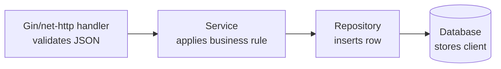
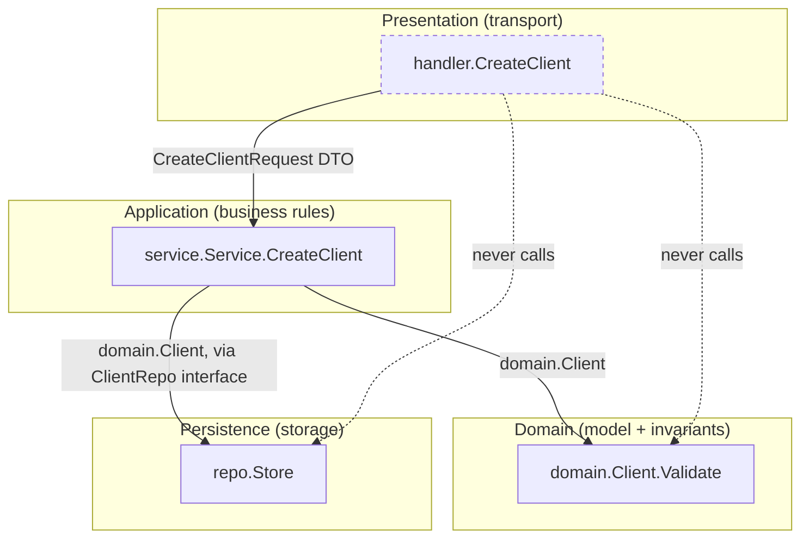
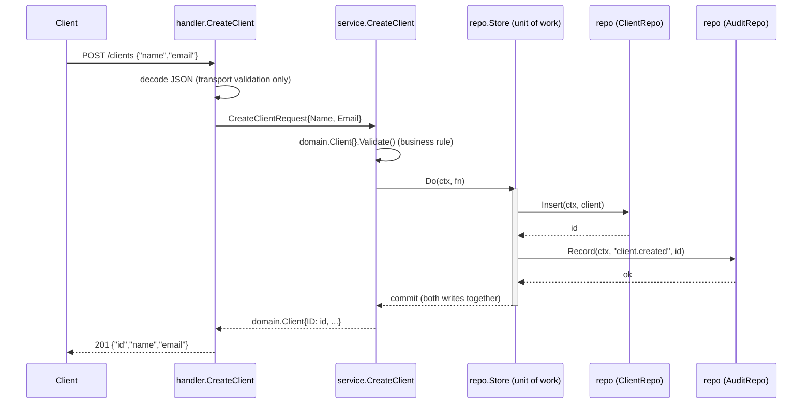

# Layered Architecture

> [!summary] TL;DR
> Layered architecture splits a service into a stack of layers — typically presentation, application, domain and persistence — where each layer only calls the layer directly below it, and dependencies only ever point downward. It is the default shape of almost every CRUD service you will touch.

> [!abstract] Core idea
> - Four layers, one direction: **presentation → application → domain → persistence**, and the arrow never points back up.
> - A **logical layer** is a grouping of responsibility; a **physical tier** is a separate deployable or separate machine. Most services have four logical layers running in one physical tier (one binary).
> - The layer boundary is only real if each layer has its own type: a transport DTO, a domain model, and a storage row are three different structs, mapped at the boundary — not one struct wearing three hats.
> - The classic failure is the **sinkhole anti-pattern**: a layer that only forwards the call to the one below it, unchanged, on every single operation. If a layer never transforms, validates or decides anything, it has no reason to exist.

### Whiteboard version

The shape every layered service starts as, before anything else is added:



A client-creation request: the handler checks the JSON is well-formed, the service checks the business rule (is this email already a client of this workspace?), the repository runs one `INSERT`, and the database stores the row. Three layers, three different jobs, one direction.

## 1. Why it exists

A small service starts as one `main.go` with a handler function that decodes JSON, runs a SQL query inline, and writes the response — fine for a prototype, unworkable once a second feature needs the same validation rule, or once you want to test the business rule without a running Postgres.

Concretely: InvoiceOps's "create a client" operation needs the same duplicate-email check whether it's called from the REST handler, a CSV bulk-import job, or a test. Write that check inside an `http.HandlerFunc` and the bulk-import job either calls the HTTP endpoint over loopback (slow, fragile) or duplicates the check (now two places can disagree). Layered architecture's fix is to give that rule its own layer — a `service` package with no `net/http` import — so every caller goes through the same function and the business rule is tested once, with no database or HTTP server running at all.

## 2. Mental model

Picture four rooms in a line, and a rule painted on every doorway: **you may only walk toward the room on your right.** The presentation room (handlers) can walk into the application room (services). The application room can walk into the domain room (the model and its rules) and the persistence room (repositories). Nothing downstream ever walks back left: a repository does not call a service, and a service never imports `net/http`.

Compare this to [[Hexagonal Architecture (Ports and Adapters)]]: hexagonal draws the same "the inside must not depend on the outside" rule but arranges it as a hexagon with symmetric ports on every side, specifically so that the persistence room is not structurally a "bottom" layer the whole stack must pass through. Layered architecture is simpler to picture and build; hexagonal buys you the ability to swap persistence or add a second kind of "front door" (a CLI, a consumer) without the core caring which one called it. [[Clean Architecture]] takes the same inward-dependency rule and makes it stricter by naming each ring and requiring you to cross every ring boundary with an explicit DTO.

## 3. How it works



The dashed "never calls" arrows are the whole rule. `handler` only knows `service`'s exported API; it has never heard of `repo.Store`. `service` declares the `ClientRepo` interface it needs (the consumer owns the interface, the same pattern [[Service Project Layout and Wiring]] uses for a whole service's package layout), and `repo` implements it without `service` importing `repo` back. That's what keeps this a layered architecture and not a tangle: the compiler enforces the one-way arrow, because `repo` importing `service` would be a Go import cycle if `service` ever imported `repo`'s concrete type.

A single create-client request traced through the layers, including the part most layered-architecture diagrams leave out — the transaction:



### Strict vs. relaxed layering

**Strict layering** means a layer may only call the layer immediately below it — presentation can never call persistence directly, even to skip a trivial pass-through in the service. **Relaxed layering** allows a layer to call any layer below it, not just the next one, which is common for cross-cutting reads (a handler calling a read-only cache layer directly for a health check). Pick strict by default: it is what keeps the service layer the single place business rules live, and it is what makes the service layer testable without an HTTP server. Relax it deliberately and narrowly (health checks, metrics reads), never as a habit, or the "why does this handler have a database connection" question starts coming up in code review.

### Logical layers vs. physical tiers

The four rooms above are **logical layers**: a way of organizing code inside one process. A **physical tier** is a separate deployable — a separate binary, container, or machine, usually talking over the network. A monolith with a layered internal structure has four logical layers and one physical tier. A classic "three-tier" web app (web server, application server, database server) has physical tiers that happen to line up with layers, but the two ideas are independent: you can have logical layers with no tier boundaries (this note's whole example), and you can have tier boundaries that don't line up with the logical layers at all (a CDN in front of a monolith adds a tier, not a layer).

### Where validation lives

Two different kinds of "is this valid" question get asked, and they belong in two different layers:

- **Transport validation** — is this valid JSON, are the required fields present, is `amount` actually a number — lives in the handler, because it's about the wire format, not the business.
- **Domain validation** — is this email actually well-formed, is this invoice amount positive, does this transition from `pending` to `paid` make sense — lives in the domain model (`domain.Client.Validate` below), because it must hold true for every caller, not just the HTTP one.

A validation rule that only exists in the handler is invisible to the bulk-import job and to every test that calls the service directly. That's the bug layered architecture's downward-only rule is designed to prevent.

## 4. Worked example

The Go code below implements exactly the diagram above: `handler` → `service` → `repo`, plus the one detail most layered-architecture write-ups skip — a transaction that spans two repositories (the client insert and its audit row). It compiles and passes `go vet` and `go test -race` on Go 1.24.

**The domain layer** — one invariant, enforced once, usable by every caller:

```go
// Package domain holds the layered example's domain model: the shape every
// layer eventually agrees on, but that only the service and repository
// layers are allowed to import directly.
package domain

import "errors"

// Client is the domain model. It carries only what the business rules need,
// never JSON tags or SQL column names.
type Client struct {
	ID    int64
	Name  string
	Email string
}

var ErrInvalidEmail = errors.New("invalid email")

// Validate is a domain invariant: it belongs here, not in the handler,
// because any caller of the service (HTTP, a CLI, a test) must get it too.
func (c Client) Validate() error {
	if c.Name == "" {
		return errors.New("name is required")
	}
	if c.Email == "" || !hasAt(c.Email) {
		return ErrInvalidEmail
	}
	return nil
}

func hasAt(s string) bool {
	for _, r := range s {
		if r == '@' {
			return true
		}
	}
	return false
}
```

**The service (application) layer** — it owns the `ClientRepo` and `AuditRepo` interfaces it needs, plus a `UnitOfWork` interface for the transaction:

```go
// Package service is the business layer. It owns the interfaces it needs
// from the repository layer (the consumer defines the interface, not the
// implementer) and never imports the handler or any concrete storage
// package.
package service

import (
	"context"
	"errors"
	"fmt"

	"layered/domain"
)

// ClientRepo is declared here, next to the service that uses it, so the
// import arrow always points repo -> service, never the other way.
type ClientRepo interface {
	Insert(ctx context.Context, c domain.Client) (int64, error)
	ByID(ctx context.Context, id int64) (domain.Client, error)
}

// AuditRepo records "a client was created" as a separate row in a separate
// table, owned by a different repository. It must commit atomically with
// the client insert, which is why both go through a UnitOfWork below.
type AuditRepo interface {
	Record(ctx context.Context, event string, clientID int64) error
}

// UnitOfWork runs fn inside one transaction and commits only if fn returns
// nil. This is the "tx-in-context" style: the transaction lives on the
// context fn receives, and repositories pull it back out instead of a
// *sql.Tx being threaded through every method signature by hand.
type UnitOfWork interface {
	Do(ctx context.Context, fn func(ctx context.Context) error) error
}

// Service is the layered architecture's middle layer: all business rules
// live here, not in the handler and not in the repository.
type Service struct {
	clients ClientRepo
	audit   AuditRepo
	uow     UnitOfWork
}

func New(clients ClientRepo, audit AuditRepo, uow UnitOfWork) *Service {
	return &Service{clients: clients, audit: audit, uow: uow}
}

// CreateClientRequest is the transport-facing DTO. It never crosses into
// the repository layer; CreateClient maps it into the domain model first.
type CreateClientRequest struct {
	Name  string
	Email string
}

var ErrValidation = errors.New("validation failed")

// CreateClient is one business operation. Validation of domain invariants
// happens here (not in the handler, which only validates "is this valid
// JSON"), and the client insert plus its audit row commit atomically.
func (s *Service) CreateClient(ctx context.Context, req CreateClientRequest) (domain.Client, error) {
	c := domain.Client{Name: req.Name, Email: req.Email}
	if err := c.Validate(); err != nil {
		return domain.Client{}, fmt.Errorf("%w: %v", ErrValidation, err)
	}

	var id int64
	err := s.uow.Do(ctx, func(ctx context.Context) error {
		var err error
		id, err = s.clients.Insert(ctx, c)
		if err != nil {
			return err
		}
		return s.audit.Record(ctx, "client.created", id)
	})
	if err != nil {
		return domain.Client{}, err
	}
	c.ID = id
	return c, nil
}

func (s *Service) GetClient(ctx context.Context, id int64) (domain.Client, error) {
	return s.clients.ByID(ctx, id)
}
```

**The persistence layer** — an in-memory store standing in for Postgres. The comments show exactly what the real `*pgx.Pool` version would look like:

```go
// Package repo is the persistence layer. It implements the interfaces the
// service layer declared, and it is the only layer that knows about a
// concrete store (here, an in-memory map standing in for Postgres).
//
// A real implementation would use *pgx.Pool and run this package's UnitOfWork
// as `pool.BeginTx(ctx, ...)`, storing the *pgx.Tx on the context and having
// Insert/Record pull it back out with a type-asserted context value — the
// same shape, just with SQL instead of a map.
package repo

import (
	"context"
	"fmt"
	"sync"

	"layered/domain"
)

type ctxKey struct{}

// txKind is what sits on the context while a unit of work is open. A real
// SQL version would hold a *pgx.Tx here instead of a *memTx.
type txKind struct {
	mu      sync.Mutex
	clients map[int64]domain.Client
	audit   []string
	nextID  int64
}

// Store is the InMemoryClients + InMemoryAudit + UnitOfWork combined,
// standing in for one Postgres connection pool shared by two tables.
type Store struct {
	mu      sync.Mutex
	clients map[int64]domain.Client
	audit   []string
	nextID  int64
}

func NewStore() *Store {
	return &Store{clients: make(map[int64]domain.Client)}
}

// Do opens a "transaction": a snapshot that is only written back to the
// store if fn succeeds, and discarded otherwise. This mirrors
// `pool.BeginTx` / `tx.Commit` / `tx.Rollback` without needing a real
// database in this scratch module.
//
// s.mu is held for the whole call, so transactions are serialized — exactly
// what a real database gives you at the SERIALIZABLE isolation level,
// just enforced here with a mutex instead of MVCC. Without holding the lock
// for the whole duration, two concurrent transactions could each clone the
// same starting state and the second commit would silently overwrite the
// first's writes (a lost update).
func (s *Store) Do(ctx context.Context, fn func(ctx context.Context) error) error {
	s.mu.Lock()
	defer s.mu.Unlock()

	tx := &txKind{
		clients: cloneClients(s.clients),
		audit:   append([]string(nil), s.audit...),
		nextID:  s.nextID,
	}

	txCtx := context.WithValue(ctx, ctxKey{}, tx)
	if err := fn(txCtx); err != nil {
		return err // rollback: the snapshot in tx is simply discarded
	}

	s.clients = tx.clients
	s.audit = tx.audit
	s.nextID = tx.nextID
	return nil
}

func cloneClients(m map[int64]domain.Client) map[int64]domain.Client {
	out := make(map[int64]domain.Client, len(m))
	for k, v := range m {
		out[k] = v
	}
	return out
}

func fromCtx(ctx context.Context) (*txKind, bool) {
	tx, ok := ctx.Value(ctxKey{}).(*txKind)
	return tx, ok
}

// Insert implements service.ClientRepo. It must run inside a Do callback;
// outside one it returns an error instead of writing straight to the store,
// which is what keeps the client insert and the audit row atomic.
func (s *Store) Insert(ctx context.Context, c domain.Client) (int64, error) {
	tx, ok := fromCtx(ctx)
	if !ok {
		return 0, fmt.Errorf("repo: Insert called outside a unit of work")
	}
	tx.mu.Lock()
	defer tx.mu.Unlock()
	tx.nextID++
	c.ID = tx.nextID
	tx.clients[c.ID] = c
	return c.ID, nil
}

// ByID implements service.ClientRepo for reads. Reads are allowed outside a
// unit of work: they read the last committed snapshot.
func (s *Store) ByID(ctx context.Context, id int64) (domain.Client, error) {
	if tx, ok := fromCtx(ctx); ok {
		tx.mu.Lock()
		defer tx.mu.Unlock()
		c, ok := tx.clients[id]
		if !ok {
			return domain.Client{}, fmt.Errorf("client %d not found", id)
		}
		return c, nil
	}
	s.mu.Lock()
	defer s.mu.Unlock()
	c, ok := s.clients[id]
	if !ok {
		return domain.Client{}, fmt.Errorf("client %d not found", id)
	}
	return c, nil
}

// Record implements service.AuditRepo. Same rule: must run inside the same
// unit of work as the Insert it is paired with.
func (s *Store) Record(ctx context.Context, event string, clientID int64) error {
	tx, ok := fromCtx(ctx)
	if !ok {
		return fmt.Errorf("repo: Record called outside a unit of work")
	}
	tx.mu.Lock()
	defer tx.mu.Unlock()
	tx.audit = append(tx.audit, fmt.Sprintf("%s:%d", event, clientID))
	return nil
}

// AuditLog is a read-only accessor for tests; a real version would be a
// SELECT against the audit table.
func (s *Store) AuditLog() []string {
	s.mu.Lock()
	defer s.mu.Unlock()
	return append([]string(nil), s.audit...)
}
```

**The presentation layer** — the only layer that imports `net/http`:

```go
// Package handler is the presentation layer: it only knows HTTP and the
// service it calls. It never imports repo, and it never runs a business
// rule — "is this JSON well-formed" is as far as its validation goes.
package handler

import (
	"encoding/json"
	"errors"
	"net/http"

	"layered/domain"
	"layered/service"
)

type Handler struct {
	svc *service.Service
}

func New(svc *service.Service) *Handler {
	return &Handler{svc: svc}
}

// clientResponse is the transport DTO: it is shaped for JSON, not for the
// domain or the database, and it can diverge from both without either
// layer noticing.
type clientResponse struct {
	ID    int64  `json:"id"`
	Name  string `json:"name"`
	Email string `json:"email"`
}

func toResponse(c domain.Client) clientResponse {
	return clientResponse{ID: c.ID, Name: c.Name, Email: c.Email}
}

type createClientRequest struct {
	Name  string `json:"name"`
	Email string `json:"email"`
}

// CreateClient decodes the request, hands it to the service, and encodes
// whatever comes back. Every business decision (is the email well-formed,
// does the insert and the audit row commit together) happens one layer
// down, in service.CreateClient.
func (h *Handler) CreateClient(w http.ResponseWriter, r *http.Request) {
	var req createClientRequest
	if err := json.NewDecoder(r.Body).Decode(&req); err != nil {
		http.Error(w, "malformed json", http.StatusBadRequest)
		return
	}

	c, err := h.svc.CreateClient(r.Context(), service.CreateClientRequest{
		Name:  req.Name,
		Email: req.Email,
	})
	if err != nil {
		if errors.Is(err, service.ErrValidation) {
			http.Error(w, err.Error(), http.StatusBadRequest)
			return
		}
		http.Error(w, "internal error", http.StatusInternalServerError)
		return
	}

	w.Header().Set("Content-Type", "application/json")
	w.WriteHeader(http.StatusCreated)
	_ = json.NewEncoder(w).Encode(toResponse(c))
}
```

Three of the tests that back this, covering validation placement, transaction atomicity, and concurrency:

```go
// TestCreateClient_ValidationRunsInService proves the business rule lives in
// the service, not the handler: an invalid email is rejected before any
// repository call, with no HTTP involved at all.
func TestCreateClient_ValidationRunsInService(t *testing.T) {
	store := repo.NewStore()
	svc := service.New(store, store, store)

	_, err := svc.CreateClient(context.Background(), service.CreateClientRequest{
		Name:  "Asha",
		Email: "not-an-email",
	})
	if !errors.Is(err, service.ErrValidation) {
		t.Fatalf("want ErrValidation, got %v", err)
	}
}

// TestCreateClient_InsertAndAuditCommitTogether proves the unit of work is
// atomic: a successful CreateClient leaves exactly one client row and
// exactly one matching audit row.
func TestCreateClient_InsertAndAuditCommitTogether(t *testing.T) {
	store := repo.NewStore()
	svc := service.New(store, store, store)

	c, err := svc.CreateClient(context.Background(), service.CreateClientRequest{
		Name:  "Asha",
		Email: "asha@example.com",
	})
	if err != nil {
		t.Fatalf("CreateClient: %v", err)
	}

	got, err := svc.GetClient(context.Background(), c.ID)
	if err != nil {
		t.Fatalf("GetClient: %v", err)
	}
	if got.Name != "Asha" || got.Email != "asha@example.com" {
		t.Fatalf("got %+v", got)
	}

	log := store.AuditLog()
	if len(log) != 1 || log[0] != "client.created:1" {
		t.Fatalf("audit log = %v, want one client.created:1 entry", log)
	}
}

// TestHandler_CreateClient_EndToEnd drives the presentation layer with
// httptest, proving handler -> service -> repo actually connects end to
// end, not just that each layer compiles in isolation.
func TestHandler_CreateClient_EndToEnd(t *testing.T) {
	store := repo.NewStore()
	svc := service.New(store, store, store)
	h := handler.New(svc)

	req := httptest.NewRequest(http.MethodPost, "/clients", strings.NewReader(`{"name":"Asha","email":"asha@example.com"}`))
	rec := httptest.NewRecorder()

	h.CreateClient(rec, req)

	if rec.Code != http.StatusCreated {
		t.Fatalf("status = %d, body = %s", rec.Code, rec.Body.String())
	}
}

// TestCreateClient_ConcurrentCallsDoNotCorruptState exercises the layers
// under concurrency so `go test -race` can prove the unit of work's
// locking is correct.
func TestCreateClient_ConcurrentCallsDoNotCorruptState(t *testing.T) {
	store := repo.NewStore()
	svc := service.New(store, store, store)

	const n = 50
	var wg sync.WaitGroup
	wg.Add(n)
	for i := 0; i < n; i++ {
		go func(i int) {
			defer wg.Done()
			_, err := svc.CreateClient(context.Background(), service.CreateClientRequest{
				Name:  "Client",
				Email: "client@example.com",
			})
			if err != nil {
				t.Errorf("CreateClient: %v", err)
			}
		}(i)
	}
	wg.Wait()

	if got := len(store.AuditLog()); got != n {
		t.Fatalf("audit log has %d entries, want %d", got, n)
	}
}
```

**Measured:** `go test -race ./...` in a scratch module (Go 1.24.4, darwin/arm64, 2026-11-07): all tests pass, including the end-to-end test that drives `handler` through `service` into `repo`, and the 50-goroutine concurrency test above, confirming the unit of work's whole-call lock serializes transactions with no lost updates and no data race.

## 5. Variants and comparison

| Option | How it works | Use when | Cost |
| --- | --- | --- | --- |
| Strict layered | Each layer calls only the layer directly below | Most CRUD-shaped services; teams of any size wanting a predictable default | Persistence still feels like a "bottom" everything must pass through |
| Relaxed layered | A layer may call any layer below it, not just the next one | Narrow cross-cutting reads (health checks, metrics) | Import rules get fuzzier the more you relax them |
| [[Hexagonal Architecture (Ports and Adapters)]] | Core has no "bottom"; driving and driven adapters both depend on ports the core owns | You need to swap infrastructure (DB, payment provider) or add a second driving adapter (CLI, consumer) without touching the core | More interfaces, a composition root to wire by hand |
| [[Clean Architecture]] | Concentric rings, dependency rule points inward, explicit boundary DTOs at every ring | You want the same inward rule as hexagonal but with named rings and stricter boundary-crossing conventions | More mapping code between rings |

## 6. Trade-offs and when not to use

- It is DB-centric by default: because persistence sits "underneath" everything, it is easy to let the database schema's shape leak upward into the domain model instead of the other way around.
- Business logic has a tendency to leak into the handler the moment a deadline is tight — "just add one `if` in the controller" is always the path of least resistance, and layered architecture has no structural barrier against it the way hexagonal's "core imports nothing" rule does.
- The sinkhole anti-pattern: once a service grows a fifth "orchestration" layer that only forwards calls unchanged, that layer is pure overhead. Delete layers that never transform, validate or decide.
- For a two-endpoint internal tool, even four layers is often too many files for the value delivered — a single package with a clear function boundary is enough, and you add layers when a second caller or a second backing store actually shows up.

## 7. In production

- **Real systems:** nearly every Spring/Django/Rails-generation web framework scaffolds this shape by default (MVC's model/view/controller maps loosely onto domain/presentation), and it is still the default advice for a new Go service with one Postgres database and one HTTP API.
- **Failure modes → fixes:**
  - Business rule duplicated between the HTTP handler and a background job → move it into the service layer; both callers call the same function.
  - A test needs a running Postgres just to check a discount calculation → that calculation belongs in the domain/service layer, not inline SQL, so it can be unit-tested with a fake repository.
  - A "simple" pass-through service layer that never does anything → that is the sinkhole anti-pattern; collapse the layer.
  - Two repositories updated by two separate calls, one succeeds and one fails → wrap both in one unit of work (shown above), never two independent calls.
- **What to monitor:** which layer a given error originates in (tag errors with the layer, or at least the package, in logs); test run time per layer (service-layer tests should be fast, no I/O; repository tests are the slow ones); how often a change touches more than one layer (a sign the boundary is in the wrong place).

## 8. Deep dive

**DTO vs. domain vs. DB model mapping.** Three different structs for the same "client" is not accidental duplication — it is what lets each layer change for its own reason. A transport DTO changes because the API contract changes (a new optional field in a request body). A domain model changes because a business rule changes (clients now require a tax ID in one country). A database row changes because a migration changes a column type. Collapsing all three into one struct (common with code generators that produce one struct from a SQL schema) means an API consumer sees your database schema, and a schema migration becomes an API-breaking change.

**The sinkhole anti-pattern in more detail.** A layer is a sinkhole when, for a given operation, it does nothing but call the layer below unchanged: no added validation, no transformation, no cross-cutting concern (logging, auth, metrics) applied. A small amount of sinkhole behavior is normal and fine — not every operation needs every layer to do real work. It becomes a design smell when it's the majority of operations through a layer: at that point the layer is pure ceremony, and either it should be removed, or it is a sign the "layer" you added was actually meant to be a cross-cutting concern (observability, authorization) that belongs in middleware, not in the call stack.

**When to evolve to hexagonal.** Layered architecture's persistence layer is implicitly "the" backing store. The moment a second kind of external dependency shows up that needs the same isolation treatment — a payment provider, an email sender, a second storage engine for search — the single "repository" concept stops fitting, and naming each one a **port** the core depends on (regardless of whether it is a database, an HTTP API, or a queue) is what [[Hexagonal Architecture (Ports and Adapters)]] formalizes. The trigger is not line count; it's "do I now have more than one kind of adapter to isolate and swap".

## 9. Interview questions

> [!question]- Where does business logic go in a layered service?
> In the application/service layer, operating on the domain model. The handler only does transport-level validation and encoding; the repository only does storage. A business rule that lives in the handler is untestable without an HTTP server and invisible to any non-HTTP caller.

> [!question]- What's the difference between a logical layer and a physical tier?
> A logical layer is a code-organization boundary inside one process (presentation, application, domain, persistence). A physical tier is a separate deployable — a separate binary or machine. You can have four logical layers in one tier (a typical monolith) or tiers that don't map onto layers at all (a CDN in front of a monolith).

> [!question]- Trap: "layered architecture means three-tier architecture, right?"
> No. Three-tier is about physical deployment boundaries (web tier, app tier, database tier); layered architecture is about logical code organization inside a process. A single-binary monolith can be fully layered with one physical tier, and a three-tier deployment can have a tangled, unlayered application tier.

> [!question]- Why pass a transaction through a `UnitOfWork` interface instead of a raw `*sql.Tx`?
> A raw `*sql.Tx` threaded through every method signature couples every repository method to `database/sql`'s concrete type and makes it impossible to fake in a service-layer test. A `UnitOfWork.Do(ctx, fn)` interface (or tx-in-context) lets the service layer stay storage-agnostic and lets tests swap in an in-memory implementation.

> [!question]- When is layered architecture the wrong choice from the start?
> When you already know you need to isolate more than one kind of external system (two storage engines, a payment provider plus a database) or support more than one kind of entry point (HTTP plus a CLI plus a message consumer) on day one — start with [[Hexagonal Architecture (Ports and Adapters)]] instead of building layered and migrating later.

> [!question]- How do you test each layer independently?
> The domain layer needs no mocks at all — pure functions on the model. The service layer is tested against a fake or in-memory implementation of the repository interfaces it declared, with no real database. The repository layer is tested against a real (or a very close test-container) database, because that is the one layer whose whole job is to talk to it. The handler layer is tested with `net/http/httptest`, injecting a real or fake service.

> [!question]- What exactly is the sinkhole anti-pattern, and how do you spot it?
> A layer that does nothing but forward a call unchanged, for most of its operations. Spot it by reading one layer's source file top to bottom: if nearly every method is `return other.SameMethod(args)` with no added validation, transformation, or cross-cutting behavior, that layer is overhead and should be removed or replaced with middleware.

## 10. Cheat sheet

- Four logical layers, one direction: presentation → application → domain → persistence.
- Logical layer = code boundary inside one process; physical tier = a separate deployable.
- Strict layering: call only the layer directly below. Relax narrowly, never by habit.
- Three structs, not one: transport DTO, domain model, DB row — mapped at each boundary.
- Business and domain validation live in the service/domain layer; transport validation (well-formed JSON) lives in the handler.
- A transaction spanning repositories needs a unit of work, not two independent calls.
- A layer that never transforms, validates or decides anything is a sinkhole — delete it.
- Evolve to hexagonal once you need to isolate more than one kind of external dependency.

## Links
- **Before this:** [[Monolith vs Microservices]]
- **Next:** [[Hexagonal Architecture (Ports and Adapters)]], [[Clean Architecture]]
- **Compare with:** [[Service Project Layout and Wiring]] (the Go package layout this pattern runs on top of), [[Backend Request Lifecycle and Layering]] (one request's full path through a Go service)
