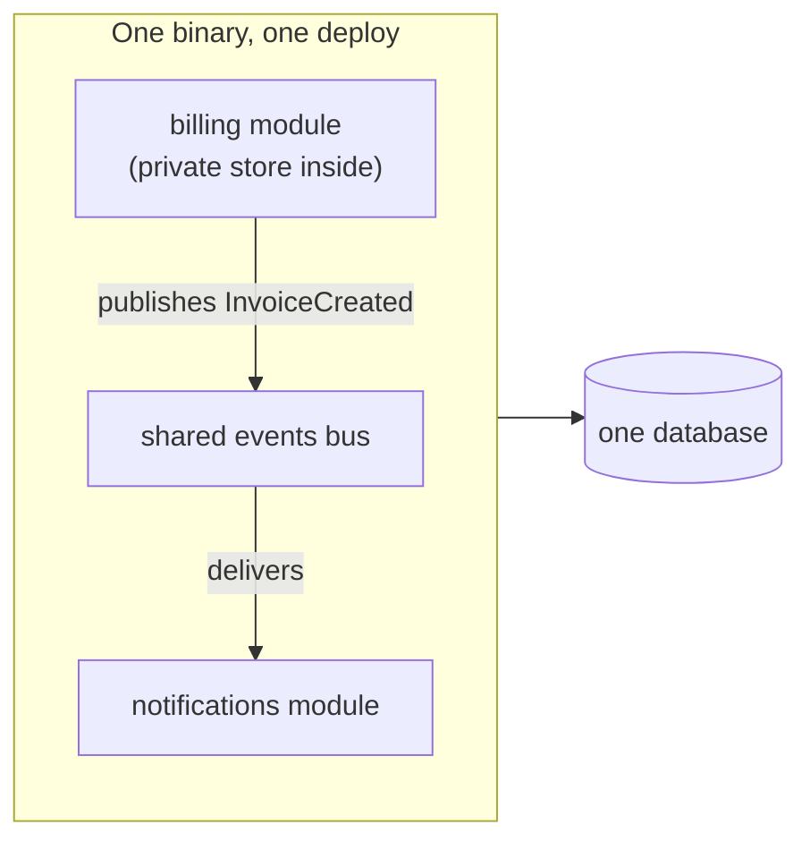
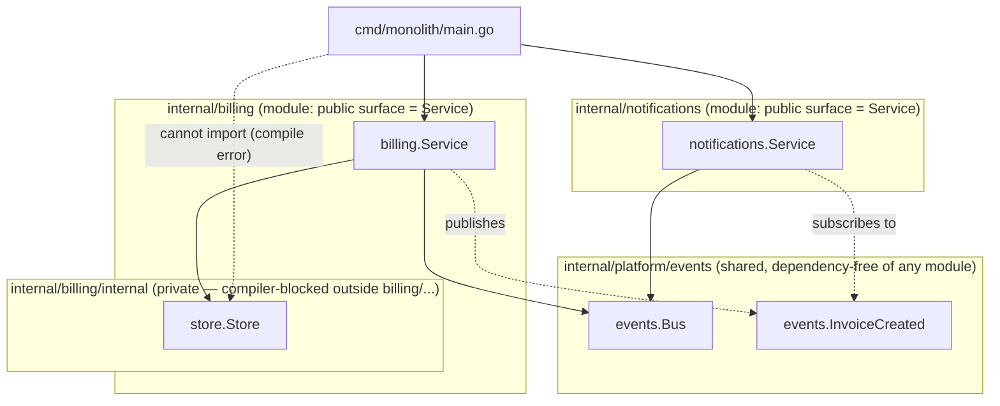
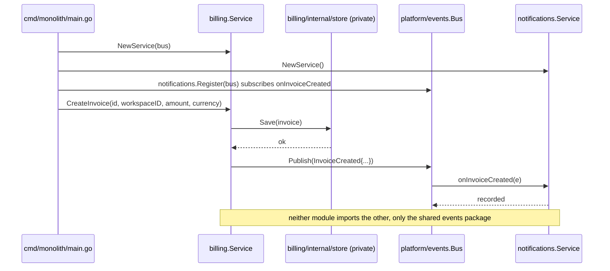

# Modular Monolith

> [!summary] TL;DR
> A modular monolith is one deployable service whose code is split into modules with enforced boundaries — each module owns its own data and exposes only a narrow public API — so it gets most of microservices' separation of concerns without the network calls, duplicated infrastructure, or distributed-transaction problems a true service split brings.

> [!abstract] Core idea
> - One binary, one deploy, one database connection pool — but the code is organized as if it were several services, with each module's internals hidden from every other module.
> - In Go, "hidden" is not a convention: a module's own `internal/` subtree is invisible to every other package by the compiler's own rule, not a lint warning someone can ignore.
> - Modules talk to each other in two ways only: a narrow public Go API (direct function calls, same process) or published events on an in-process bus — never by reaching into another module's storage.
> - This buys you the option to extract a module into its own service later, because the module already has no secret backdoor another module's code depends on.

## Start here: the basics

**The problem in one story.**
A team builds one app that handles invoices and sends emails.
At first everything lives in one folder, and any code can call any other code.
A year later, changing the invoice code breaks emails, and nobody knows why.
A modular monolith keeps one app but puts walls between its parts, so that can't happen silently.

**Words you need first**

| Word | Plain meaning | Tiny example |
| --- | --- | --- |
| Monolith | One program deployed as one unit | One Go binary serving the whole API |
| Microservice | A small program deployed on its own, talking over the network | A separate billing service called over HTTP |
| Module | A self-contained part of the code with one job | `billing`, `notifications` |
| Boundary | A rule about what one module may see in another | `notifications` can't read billing's database code |
| Go package | A folder of Go files compiled together | `internal/billing` |
| `internal/` folder | Go rule: only nearby code may import what's inside | `billing/internal/store` is private to `billing` |
| Event / event bus | A "this happened" message, and the thing that delivers it to listeners | `InvoiceCreated` sent to whoever subscribed |
| Deploy | Shipping a new version to production | One `go build` + one rollout |

**Picture it**



**Analogy.** An apartment building: one building and one front gate, but each flat has its own locked door. Neighbours talk through a notice board in the lobby, not by walking into each other's flats.
Where it breaks: flats can't share a kitchen by accident, but modules sharing one database can still read each other's tables unless you add schema rules too.

**How the rest of this note builds up**

- First, a tiny whiteboard version and why the pattern exists (section 1), then the apartment mental model (section 2).
- Then how Go's `internal/` rule, architecture tests and the in-process event bus enforce the walls (section 3).
- Then a full runnable two-module example with tests (section 4), and variants compared (section 5).
- Finally the SDE-3 deep dive: trade-offs, production failure modes, `depguard` vs architecture tests, Conway's law (sections 6-8).

> [!tip] Remember
> One deploy, many walled-off modules: they talk only through a public API or events, never through each other's private code.

### Whiteboard version

The smallest version of the idea: two packages, each private (`internal/billing`, `internal/notifications`) with a strict one-way rule between them, and a shared package neither owns.

```go
// modmono/internal/billing/billing.go
package billing

type Event struct{ InvoiceID string }

type Bus interface{ Publish(Event) }

type Service struct{ bus Bus }

func (s *Service) CreateInvoice(id string) { s.bus.Publish(Event{InvoiceID: id}) }
```

```go
// modmono/internal/notifications/notifications.go
package notifications

import "modmono/internal/billing" // allowed: a published event type, not billing's storage

func OnInvoiceCreated(e billing.Event) { /* send an email */ }
```

The full version below replaces `billing.Event`/`notifications` importing `billing` directly with a shared, neutral `events` package — so `notifications` depends on nothing billing owns at all — and adds the part a toy can't show: a Go-enforced private module directory, and an architecture test that fails the build if either rule above is ever broken.

## 1. Why it exists

A single Go service with one flat `internal/` tree (`internal/invoice.go`, `internal/notify.go`, `internal/client.go`, all one package) has no compiler-enforced boundary between "billing logic" and "notification logic" at all — any function can call any other function and read any other package-level variable, so after a few quarters nobody can say with confidence which code a change to the invoice schema might break.

The usual fix people reach for is "split it into microservices", which does enforce a boundary (a network call cannot accidentally become a shared-memory read), but it also means every module now needs its own deploy pipeline, its own on-call rotation, a service mesh or at least retries and circuit breakers for calls that used to be a function call, and a plan for what happens when two services' writes need to stay consistent.

A modular monolith takes the boundary microservices give you — "module A's data and code are off-limits to module B" — and gets it from the compiler and a package layout instead of from a network hop, while keeping one deploy, one transaction-capable database, and one process to operate.

[[Monolith vs Microservices]] covers the deployment-unit decision in general; this note is about how to get real internal boundaries once you've decided to stay on one deployment unit.

## 2. Mental model

Picture the monolith as an apartment building, not a single open-plan office.

Each module is its own apartment with its own locked door (`internal/<module>/internal/...`); nobody else in the building can walk into your apartment and rearrange your furniture, even though everyone shares the same building (binary), the same front gate (one deploy), and the same utilities (one database, one process).

When one tenant wants to tell the building something happened, they post a notice on the shared lobby board (the event bus) that any apartment can read — nobody needs to know who's listening, and nobody can read a notice before it's been posted.

## 3. How it works

### 3.1 Module boundaries enforced in Go

A module is a subtree under `internal/<module-name>/`. Its public surface is whatever that top-level package exports (typically one `Service` type); everything it wants to keep private goes one level deeper, under `internal/<module-name>/internal/...`.

Go's own rule (in effect since Go 1.4) is: a package whose import path contains an `internal` segment can be imported only by code rooted at the directory that is the parent of that `internal` segment.

For `modmono/internal/billing/internal/store`, that parent is `modmono/internal/billing` — so only code under `modmono/internal/billing/...` can import `store`, and nothing else in the module, not even `cmd/monolith`'s own `main.go`, can.



The dashed arrow from `main.go` to `Store` is the one every other arrow in this diagram is drawn to make true: even the file that wires every module together cannot see into one module's private internals, because the import simply does not compile.

"How it works" in [[Service Project Layout and Wiring]] covers the single-module version of this `internal/` rule; a modular monolith applies it once per module instead of once per service.

### 3.2 Import rules beyond what `internal/` catches

`internal/` stops a module from being imported from outside its own tree, but it does not stop `billing` from importing `notifications`' *public* `Service` directly, which would be just as real a boundary violation (now billing's build depends on notifications, and a notifications bug or slow test blocks a billing deploy).

That rule — "module X's package may depend on module Y's public package" or not — is a policy decision no `internal/` folder expresses, which is exactly what `depguard` (a golangci-lint linter) or a hand-written **architecture test** exists to check.

"Worked example" below writes one as a plain `go test` using `go list -json`, so the rule runs in CI with no extra tool.

### 3.3 In-process domain events

Direct calls between modules are fine when one module simply needs an answer right now (`notifications.Service` could, in principle, call `billing.Service.GetInvoice` synchronously).

But the common case — "billing wants other modules to react to something that happened, without knowing who they are" — is better served by an event: `billing` publishes `events.InvoiceCreated` to an in-process bus; `notifications` subscribes, with no reference to `billing` in its own imports at all, only to the shared `events` package.

This is exactly the publish/subscribe shape [[Domain-Driven Design - Tactical Patterns in Go]] describes for domain events, except the "broker" here is a synchronous Go function-call fan-out — a real message queue (covered in 09 Messaging & Async) is a cost this note's "Trade-offs" section weighs against it.



### 3.4 Path to extraction

Because `notifications` never imported `billing` directly — only the shared, plain-data `events` package — splitting `notifications` into its own deployed service later is mostly a wiring change, not a rewrite: `events.Bus.Publish` becomes "publish to Kafka/SNS instead of calling an in-process handler list", and `notifications.Register` becomes "a consumer process subscribing to that topic instead of a function call at startup".

The event payload (`InvoiceCreated`) was already plain, serializable data with no pointer into billing's aggregate — exactly what a real message needs to be — so the one thing that would otherwise force a rewrite (reshaping the payload) was done up front.

[[Strangler Fig Pattern and Legacy Migration]] covers the rest of an actual extraction (routing, data migration, verification); this is only the "did we leave ourselves an exit" half of the story.

## 4. Worked example

The code below is a two-module monolith: `billing` (owns an invoice store, publishes one event) and `notifications` (reacts to that event, owns nothing billing can see).

A third, shared `platform/events` package holds the in-process bus and the event payload type; neither module owns it, and it depends on neither module. It compiles and passes `go vet` and `go test -race` on Go 1.24.4.

**`internal/platform/events/bus.go`** — the one package every module may depend on, and that depends on no module back:

```go
// Package events is the one "platform" package every module may depend on.
// It never imports a module package back — see archtest for the rule that
// enforces this. Event payload types live here too, as plain data (no
// methods, no pointers into a module's aggregates), because a payload
// shape is the one thing two modules agree on even after a future
// extraction into separate services (see "Path to extraction").
package events

import "sync"

// InvoiceCreated is published by billing after a committed invoice write.
// It carries only plain, serializable fields — exactly what would cross
// the wire as a Kafka/SNS message if billing were ever extracted.
type InvoiceCreated struct {
	InvoiceID      string
	WorkspaceID    string
	AmountDueMinor int64
	Currency       string
}

// Handler processes one published event. A real system would wrap this in
// a recover() and a dead-letter path per handler; omitted here to keep the
// bus itself small enough to read in one sitting.
type Handler func(InvoiceCreated)

// Bus is an in-process publish/subscribe registry: no network, no broker,
// no serialization — a function call list. This is "in process events" at
// its cheapest: see "Trade-offs" for what it gives up compared to the
// real broker 09 Messaging & Async covers.
type Bus struct {
	mu       sync.RWMutex
	handlers []Handler
}

func NewBus() *Bus { return &Bus{} }

// Subscribe registers a handler. Call it once at startup, from main, for
// every module that needs billing's events — never from inside billing
// itself, which does not know or care who is listening.
func (b *Bus) Subscribe(h Handler) {
	b.mu.Lock()
	defer b.mu.Unlock()
	b.handlers = append(b.handlers, h)
}

// Publish calls every subscribed handler synchronously, in registration
// order, on the publisher's own goroutine. Synchronous means a slow or
// panicking subscriber directly stalls or crashes the publishing request —
// the cost this note's "Trade-offs" section weighs against a real queue.
func (b *Bus) Publish(e InvoiceCreated) {
	b.mu.RLock()
	hs := make([]Handler, len(b.handlers))
	copy(hs, b.handlers)
	b.mu.RUnlock()
	for _, h := range hs {
		h(e)
	}
}
```

**`internal/billing/internal/store/store.go`** — billing's private persistence, unreachable from outside `internal/billing/...` by the compiler's own `internal/` rule:

```go
// Package store is billing's own persistence detail. Its import path is
// modmono/internal/billing/internal/store — a Go "internal" segment whose
// parent is modmono/internal/billing, so the compiler allows this import
// only from packages rooted at modmono/internal/billing/... A sibling
// module (notifications, or a future shipping module) gets a build error
// the moment it tries `import "modmono/internal/billing/internal/store"`,
// with no lint config required. See "How it works" for the exact rule.
package store

import (
	"fmt"
	"sync"
)

// Invoice is the row shape store persists. It has no behaviour — billing's
// own Service type (one package up) holds the invariants; store only
// stores and retrieves.
type Invoice struct {
	ID             string
	WorkspaceID    string
	AmountDueMinor int64
	Currency       string
}

// Store is an in-memory stand-in for a Postgres-backed repository — the
// same role InMemoryRepository plays in Domain-Driven Design - Tactical
// Patterns in Go, kept deliberately simple here because persistence detail
// is not this note's point; the import boundary is.
type Store struct {
	mu   sync.Mutex
	rows map[string]Invoice
}

func New() *Store { return &Store{rows: make(map[string]Invoice)} }

func (s *Store) Save(inv Invoice) {
	s.mu.Lock()
	defer s.mu.Unlock()
	s.rows[inv.ID] = inv
}

func (s *Store) Get(id string) (Invoice, error) {
	s.mu.Lock()
	defer s.mu.Unlock()
	inv, ok := s.rows[id]
	if !ok {
		return Invoice{}, fmt.Errorf("store: invoice %s not found", id)
	}
	return inv, nil
}
```

**`internal/billing/billing.go`** — the module's only public surface:

```go
// Package billing is one module of the monolith: a single Go package tree
// (modmono/internal/billing/...) that owns the invoice table, is the only
// code that may write it, and publishes one event when an invoice is
// created. Its only public surface is Service — everything under
// billing/internal is invisible outside this module, enforced by the
// compiler (see internal/store).
package billing

import (
	"fmt"

	"modmono/internal/billing/internal/store"
	"modmono/internal/platform/events"
)

// Service is billing's module boundary: the only type another module, or
// cmd/monolith, is allowed to call into. A caller never reaches into
// internal/store directly — not because of a comment, but because that
// import does not compile from outside this module's own tree.
type Service struct {
	store *store.Store
	bus   *events.Bus
}

// NewService builds billing's own store internally. A caller outside this
// module's tree cannot pass one in even if it wanted to: *store.Store's
// type lives at modmono/internal/billing/internal/store, which only code
// rooted at modmono/internal/billing/... may import — cmd/monolith, one
// directory outside that tree, gets a compile error on that import path.
// The constructor signature is shaped by that boundary, not by taste.
func NewService(bus *events.Bus) *Service {
	return &Service{store: store.New(), bus: bus}
}

// CreateInvoice stores the invoice and then publishes InvoiceCreated.
// Publishing after the store write (never before) matches the outbox
// ordering Transactional Outbox and CDC derives for a real broker: a
// subscriber must never observe an event for a write that did not, in
// fact, happen. The in-process bus makes "after the write" easy to get
// right, because there is no second system that could commit out of order
// with the first — see "Trade-offs" for what this costs once the module
// is split into its own service.
func (s *Service) CreateInvoice(id, workspaceID string, amountDueMinor int64, currency string) error {
	if amountDueMinor <= 0 {
		return fmt.Errorf("billing: amount due %d must be positive", amountDueMinor)
	}
	s.store.Save(store.Invoice{
		ID:             id,
		WorkspaceID:    workspaceID,
		AmountDueMinor: amountDueMinor,
		Currency:       currency,
	})
	s.bus.Publish(events.InvoiceCreated{
		InvoiceID:      id,
		WorkspaceID:    workspaceID,
		AmountDueMinor: amountDueMinor,
		Currency:       currency,
	})
	return nil
}

// AmountDue looks up what CreateInvoice stored, used only by this
// package's own tests to confirm the write happened before the publish.
func (s *Service) AmountDue(id string) (int64, error) {
	inv, err := s.store.Get(id)
	if err != nil {
		return 0, err
	}
	return inv.AmountDueMinor, nil
}
```

**`internal/notifications/notifications.go`** — a second module that never imports `billing` at all:

```go
// Package notifications is a second module. It reacts to billing's events
// but never imports billing at all — only the shared events package — so
// nothing here breaks if billing's internal storage, or even billing's
// public Service signature, changes shape, as long as the event payload
// does not.
package notifications

import (
	"fmt"
	"sync"

	"modmono/internal/platform/events"
)

// Service records every "would have sent an email for this invoice"
// outcome it reacts to. A real implementation would call an email
// provider; recording in memory keeps this testable without I/O, exactly
// like the webhook fakes in Domain-Driven Design - Tactical Patterns in Go.
type Service struct {
	mu   sync.Mutex
	sent []string
}

func NewService() *Service { return &Service{} }

// Register subscribes this module to billing's events. cmd/monolith calls
// this once at startup; notifications itself never imports the bus's
// publisher (billing), only the bus and the event type, both from the
// shared platform package.
func (s *Service) Register(bus *events.Bus) {
	bus.Subscribe(s.onInvoiceCreated)
}

func (s *Service) onInvoiceCreated(e events.InvoiceCreated) {
	s.mu.Lock()
	defer s.mu.Unlock()
	s.sent = append(s.sent, fmt.Sprintf("invoice-created email: workspace=%s invoice=%s amount=%d%s",
		e.WorkspaceID, e.InvoiceID, e.AmountDueMinor, e.Currency))
}

// Sent returns a copy of every notification this service has recorded —
// used only by the test below.
func (s *Service) Sent() []string {
	s.mu.Lock()
	defer s.mu.Unlock()
	out := make([]string, len(s.sent))
	copy(out, s.sent)
	return out
}
```

**`cmd/monolith/main.go`** — the single binary; the only file that imports every module:

```go
// cmd/monolith is the single binary this whole module compiles to: one
// process, one deploy artifact, both modules' migrations run against one
// database at startup in a real build. main is the only file that imports
// every module; see "How it works" for why that asymmetry is the point.
package main

import (
	"log"

	"modmono/internal/billing"
	"modmono/internal/notifications"
	"modmono/internal/platform/events"
)

func main() {
	bus := events.NewBus()

	// NewService builds its own store internally: main could not pass one
	// in even if it tried — modmono/internal/billing/internal/store is not
	// importable from cmd/monolith. See billing.NewService's comment.
	billingSvc := billing.NewService(bus)

	notifySvc := notifications.NewService()
	notifySvc.Register(bus)

	if err := billingSvc.CreateInvoice("inv_1", "ws_1", 150000, "INR"); err != nil {
		log.Fatal(err)
	}
	log.Printf("notifications sent so far: %v", notifySvc.Sent())
}
```

**`archtest/arch_test.go`** — the fitness function: a `go test` that fails the build the moment the dependency graph breaks a rule `depguard` would otherwise need an external config and a separate lint step to enforce:

```go
// Package archtest is a fitness function: a test that fails the build the
// moment the dependency graph breaks the rules this monolith was designed
// around, instead of waiting for a human to notice in review. It shells
// out to `go list`, the same data a depguard or go-arch-lint config reads,
// so no extra dependency is needed to make the rule executable. See
// Documenting Architecture - C4 Diagrams and Fitness Functions for the
// general idea; this is its Go-specific, dependency-free form.
package archtest

import (
	"encoding/json"
	"os/exec"
	"strings"
	"testing"
)

// pkgJSON is the subset of `go list -json` this test reads. Imports is the
// package's own, direct import lines; Deps is the transitive closure of
// every package underneath it. The two rules below use different fields
// on purpose: a transitive-closure check (Deps) catches a violation
// routed through a third package, while a direct-import check (Imports)
// matches exactly what the Go compiler's own internal/ rule evaluates —
// the literal import path written in source — so it agrees with the
// compiler instead of flagging code that merely builds on top of
// something that itself legitimately uses the private package.
type pkgJSON struct {
	ImportPath string
	Imports    []string
	Deps       []string
}

// list runs `go list -json <pkg>` from the module root.
func list(t *testing.T, pkg string) pkgJSON {
	t.Helper()
	cmd := exec.Command("go", "list", "-json", pkg)
	cmd.Dir = ".." // modmono's module root, one level above archtest/
	out, err := cmd.Output()
	if err != nil {
		t.Fatalf("go list -json %s: %v", pkg, err)
	}
	var p pkgJSON
	if err := json.Unmarshal(out, &p); err != nil {
		t.Fatalf("decode go list output for %s: %v", pkg, err)
	}
	return p
}

func deps(t *testing.T, pkg string) []string { return list(t, pkg).Deps }

func hasPrefixAny(deps []string, prefix string) []string {
	var out []string
	for _, d := range deps {
		if strings.HasPrefix(d, prefix) {
			out = append(out, d)
		}
	}
	return out
}

// TestNotificationsNeverImportsBillingInternals is the rule a depguard
// config would spell out as a denied-import-path list: notifications may
// depend on the shared platform/events package, but never reaches into
// billing's module tree at all — not even its public Service. If it did,
// a change to billing's internals (or a future split into a separate
// repository) would force a notifications change too, which defeats the
// whole point of the module boundary.
func TestNotificationsNeverImportsBillingInternals(t *testing.T) {
	d := deps(t, "modmono/internal/notifications")
	if bad := hasPrefixAny(d, "modmono/internal/billing"); len(bad) != 0 {
		t.Fatalf("notifications imports billing package(s) %v; it must depend only on modmono/internal/platform/events", bad)
	}
}

// TestBillingNeverImportsNotifications is the other direction of the same
// rule: billing publishes events and knows nothing about who, if anyone,
// subscribes.
func TestBillingNeverImportsNotifications(t *testing.T) {
	d := deps(t, "modmono/internal/billing")
	if bad := hasPrefixAny(d, "modmono/internal/notifications"); len(bad) != 0 {
		t.Fatalf("billing imports notifications package(s) %v; billing must not know its subscribers", bad)
	}
}

// TestPlatformEventsNeverImportsAModule enforces the direction every
// module -> platform, never platform -> module.
func TestPlatformEventsNeverImportsAModule(t *testing.T) {
	d := deps(t, "modmono/internal/platform/events")
	for _, prefix := range []string{"modmono/internal/billing", "modmono/internal/notifications"} {
		if bad := hasPrefixAny(d, prefix); len(bad) != 0 {
			t.Fatalf("platform/events imports module package(s) %v; platform must not depend on a module", bad)
		}
	}
}

// TestBillingStoreIsUnreachableOutsideBilling documents the compiler's own
// internal/ rule as an executable test: cmd/monolith (one directory
// outside billing's tree) must not directly import billing's store
// package. (modmono/internal/billing/internal/store still shows up in
// cmd/monolith's *transitive* Deps, because billing legitimately uses its
// own store underneath — that is not a violation, which is exactly why
// this check reads Imports, not Deps.)
func TestBillingStoreIsUnreachableOutsideBilling(t *testing.T) {
	imports := list(t, "modmono/cmd/monolith").Imports
	if bad := hasPrefixAny(imports, "modmono/internal/billing/internal"); len(bad) != 0 {
		t.Fatalf("cmd/monolith directly imports billing-private package(s) %v; the compiler should have refused this", bad)
	}
}
```

Tests for the modules themselves (`go test -race -v ./...`):

```go
package billing

import (
	"testing"

	"modmono/internal/platform/events"
)

func TestCreateInvoicePublishesAfterStoring(t *testing.T) {
	bus := events.NewBus()
	var got []events.InvoiceCreated
	bus.Subscribe(func(e events.InvoiceCreated) { got = append(got, e) })

	svc := NewService(bus)
	if err := svc.CreateInvoice("inv_1", "ws_1", 150000, "INR"); err != nil {
		t.Fatalf("CreateInvoice: %v", err)
	}
	if len(got) != 1 || got[0].InvoiceID != "inv_1" {
		t.Fatalf("published event = %v", got)
	}
	amount, err := svc.AmountDue("inv_1")
	if err != nil || amount != 150000 {
		t.Fatalf("AmountDue = %d, %v; want 150000, nil", amount, err)
	}
}

func TestCreateInvoiceRejectsNonPositiveAmount(t *testing.T) {
	svc := NewService(events.NewBus())
	if err := svc.CreateInvoice("inv_2", "ws_1", 0, "INR"); err == nil {
		t.Fatal("expected an error for a zero amount, got nil")
	}
}
```

```go
package notifications

import (
	"sync"
	"testing"

	"modmono/internal/platform/events"
)

// TestServiceHandlesConcurrentPublishes exercises Bus and Service together
// under -race: many goroutines publishing concurrently must not corrupt
// Service's internal slice.
func TestServiceHandlesConcurrentPublishes(t *testing.T) {
	bus := events.NewBus()
	svc := NewService()
	svc.Register(bus)

	var wg sync.WaitGroup
	for i := 0; i < 100; i++ {
		wg.Add(1)
		go func(n int) {
			defer wg.Done()
			bus.Publish(events.InvoiceCreated{InvoiceID: "inv", WorkspaceID: "ws", AmountDueMinor: int64(n + 1), Currency: "INR"})
		}(i)
	}
	wg.Wait()
	if len(svc.Sent()) != 100 {
		t.Fatalf("len(Sent()) = %d, want 100", len(svc.Sent()))
	}
}
```

**Measured** (Go 1.24.4, scratch module `modmono`, 2026-11-07): `go vet ./...` is clean, `gofmt -l .` reports no files, and `go test -race -v ./...` passes 8 tests across `archtest` (4 architecture-fitness tests), `internal/billing` (2), and `internal/notifications` (2, including the 100-goroutine concurrent-publish stress test).

A manual check confirms the boundary is real, not just test-asserted: temporarily adding `import "modmono/internal/billing/internal/store"` to `notifications.go` and running `go build ./...` produces `use of internal package modmono/internal/billing/internal/store not allowed` — the compiler itself refuses the build.

## 5. Variants and comparison

| Approach | How it works in Go | Use when | Cost |
| --- | --- | --- | --- |
| Modular monolith (this note) | `internal/<module>/internal/...` per module, a shared event bus, an architecture test | A growing team on one deployable, where some modules may split off later | Discipline to keep the rule alive as the team and code grow; an architecture test catches drift, a human has to write one |
| Flat `internal/` monolith | One `internal/` tree, package split by convenience, no enforced walls | A small team, early-stage product, one or two engineers who all know the whole codebase | No compiler-enforced wall at all; coupling grows invisibly until a rewrite is the only fix |
| Microservices | Each module is its own deployed service, talking over the network | Independent team ownership, independent scaling/deploy cadence genuinely needed | Network calls where function calls used to be; distributed transactions; much more operational surface (see [[Monolith vs Microservices]]) |
| Shared library per module (separate Go modules, one repo) | Each module is its own `go.mod`, imported as a dependency by a thin `cmd` module | Code genuinely reused by more than one deployable binary | Versioning overhead; a change to a shared module requires a release cycle even for an in-repo consumer |
| `depguard` / `go-arch-lint` config instead of a hand-written test | A YAML file lists allowed import paths per package, checked by `golangci-lint` | A team that already runs golangci-lint and wants the rule declared, not coded | An extra tool and config file to maintain; the rule is data, not an assertion a new hire can read as a test |

## 6. Trade-offs and when not to use

- **A one-person or two-person team gets little from this.** The entire value of a module boundary is stopping *someone else's* change from reaching into your module by accident; with one or two people who both know the whole codebase, the ceremony (nested `internal/`, a shared events package, an architecture test) outweighs the benefit.

  Start with a flat `internal/` tree and add module boundaries once a second team, or a second concern big enough to need its own mental model, shows up.
- **The in-process bus is synchronous and in-memory.** `Bus.Publish` calls every handler on the publisher's own goroutine before returning — a slow or panicking `notifications` handler directly slows down or crashes the request that created the invoice.

  There is also no delivery guarantee across a process restart: an event published between the last successful handler call and a crash is simply lost, because nothing persisted it.

  A module that needs guaranteed, durable delivery writes to the outbox table in its own transaction instead (see [[Transactional Outbox and CDC]]) and treats the in-process bus as a local fan-out convenience on top of that, not a replacement for it.
- **Module boundaries do not replace schema boundaries.** If `billing` and `notifications` share one Postgres schema with no convention keeping `notifications`' queries off `billing`'s tables, a raw SQL query can bypass the Go-level wall entirely.

  A stricter version of this pattern gives each module its own Postgres schema (or even its own database) so a cross-module read is also a build-time-visible cross-schema query, not just a Go import.
- **Extraction is still work, not a flag flip.** "Path to extraction" above describes why it's *cheaper* than extracting from a flat monolith, not free: the module still needs its own deploy pipeline, its own database (or at least its own schema with its own migrations), and a real broker in place of the in-process bus.

## 7. In production

- **Real systems:** Shopify's core Ruby monolith adopted this shape at scale in two steps — Kirsten Westeinde's 2019 Shopify Engineering post, "Deconstructing the Monolith," describes splitting the codebase into bounded "components" with enforced public interfaces; Shopify then open-sourced `packwerk` in 2020 (a static analysis gem) to fail CI on a cross-component privacy violation, the same role this note's `archtest` package plays for a Go codebase.

  Martin Fowler's **MonolithFirst** (2015) argues for starting monolithic and splitting only once real service boundaries have proven themselves in production — a modular monolith is the structure that makes that later split cheaper, because the boundaries already exist in the code before they exist in the deployment.
- **Failure modes → fixes:**
  - A new hire adds `import "modmono/internal/notifications"` to `billing` to call one convenience function → the architecture test (or, with `depguard` configured, the linter) fails CI before review, not after a production incident traces a deploy coupling back to it.
  - A module's private package grows a second, unrelated responsibility because "it's already `internal`, nobody else can see it, so who cares" → `internal/` enforces *who can import it*, not *how big or well-organized it is*; a module's own `internal/` tree can still rot without a sibling module ever noticing, so code review has to apply ordinary cohesion judgment inside a module too, not just at its border.
  - An event handler panics inside `Bus.Publish` and takes the publishing request down with it → wrap each handler call in its own `recover()`, and log-and-continue instead of propagating a subscriber's bug into the publisher's response.
- **What to monitor:** architecture-test failures in CI (a leading indicator of coupling creep, ideally caught before merge, not after); the in-process bus's handler count and per-handler latency, since `Publish` is only as fast as its slowest synchronous subscriber; which modules' package sizes (file count, LOC) are growing fastest, as an early signal of which one might be the next candidate to extract.

## 8. Deep dive

### Why a nested `internal/` per module, not one `internal/` at the repo root

A single `internal/` at the repository root only stops *other repositories* from importing anything inside it — it says nothing about `billing` and `notifications` importing each other, because both already live under that one root `internal/` tree and the rule is satisfied either way.

Nesting a second `internal/` one level inside each module (`internal/billing/internal/...`) moves the enforced boundary from "outside this repo" to "outside this module", which is the boundary a modular monolith actually needs.

### Why the event payload lives in a third, neutral package

If `notifications` imported `billing.InvoiceCreated` directly, the import graph would still show `notifications -> billing`, and `TestNotificationsNeverImportsBillingInternals`-style checks would have to special-case "except for this one event type", which is exactly the kind of exception that quietly grows over time.

Defining the payload in `platform/events` — a package both modules depend on and that depends on neither — keeps the dependency graph a clean two-level tree (`modules -> platform`, never `platform -> modules`, never `module -> module`), which is also the shape that survives a future extraction cleanly: whichever side gets pulled out keeps importing `events`, now as a tiny shared contracts package or a generated protobuf, instead of as another service's internal type.

### What `depguard` adds that a hand-rolled architecture test doesn't

`depguard` (a `golangci-lint` linter) runs as part of normal linting, on every file, incrementally, and its deny-list is declarative YAML a reviewer can scan without reading Go.

The architecture test in this note's worked example is arguably more precise for this exact shape (it reasons about whole dependency closures via `go list`, not per-file import statements) but it is Go code a team has to write and maintain itself, and it only runs where `go test` runs.

Many real codebases use both: `depguard` for fast, per-file feedback in the editor and in lint CI, and a small number of whole-graph architecture tests for the handful of global invariants (like "platform never depends on a module") that are awkward to express as a per-file rule.

### Component ownership and Conway's law

A module boundary works best when it also matches who is allowed to change it: one team "owns" `billing` the way they would own a `billing` microservice's repository, even though the code sits in the same repository and binary as everything else.

[[Architecture Fundamentals - Coupling, Cohesion and Dependency Direction]] covers Conway's law in general; a modular monolith is one way to get the organizational clarity Conway's law describes (one team per module) without yet paying for the operational cost of one deploy per team.

## 9. Interview questions

> [!question]- What exactly stops one module from reaching into another module's database table in a modular monolith?
> In Go, nothing stops a raw SQL query from reaching another module's table if both modules share one schema and one connection — the `internal/` rule only blocks a Go *import*, not a query string.
>
> The stronger version of this pattern gives each module its own Postgres schema (or its own database), so a cross-module read becomes a cross-schema query that's visible in a migration review, not a wall the compiler enforces on its own.

> [!question]- Trap: if two modules communicate only through events, haven't you basically already built microservices, just without the network?
> No — the events are in-process function calls with no serialization, no network hop, no partial-failure mode where the publisher succeeds but the subscriber never finds out, and (critically) no separate deploy or database per module.
>
> The event *shape* (plain, serializable payloads) is deliberately chosen to resemble what a real message would look like, specifically so that splitting a module out later is cheaper — but until that split happens, this is still one process with one transaction-capable database, which is the entire point.

> [!question]- How would you enforce "module A may not import module B" without buying a static-analysis tool?
> Two compiler-level mechanisms, plus one test: nest a second `internal/` inside each module so its own private packages are unreachable from outside it (enforced by `go build` itself); keep each module's own package as the only public surface another module may import; and write a small `go test` that runs `go list -json` on each module and fails if its dependency closure contains another module's import path, as this note's `archtest` package does.

> [!question]- Why does `billing.NewService` build its own `store.Store` internally instead of taking one as a constructor argument, the way the DDD tactical-patterns note's repository is injected?
> Because `*store.Store`'s type lives under `billing/internal/`, which only code rooted at `billing/...` may import — `cmd/monolith`, one directory outside that tree, cannot construct a `*store.Store` to pass in even if the constructor wanted one.
>
> The signature is a direct consequence of the `internal/` boundary, not a style choice; a repository interface injected from outside (as in the DDD tactical-patterns note) is still the right shape across a module's own internal layers, just not across the module boundary itself.

> [!question]- What's the single biggest risk of adopting this pattern with a small team?
> Paying real ongoing cost (the nested `internal/` layout, a shared events package, an architecture test to maintain) for a boundary that never gets violated anyway, because the team is small enough that everyone already holds the whole system in their head.
>
> The pattern earns its keep once a second team, or a module complex enough to need its own mental model, actually shows up — introducing it earlier is optimizing for a coordination problem that doesn't exist yet.

> [!question]- If `notifications` needs an answer from `billing` right now — not an event — how should it ask?
> A direct call to `billing`'s public `Service` type (or a narrow interface `notifications` declares for just the method it needs), the same consumer-owns-the-interface shape [[Service Project Layout and Wiring]] uses within one module.
>
> This is still a cross-module Go import, which is fine — the rule a modular monolith enforces is "never import another module's *private* internals", not "modules may never call each other synchronously".

## 10. Cheat sheet

- One module = one `internal/<name>/` subtree; its private detail lives one level deeper, `internal/<name>/internal/...`, invisible outside the module by the compiler's own rule.
- `internal/` blocks an *import*, not a shared-schema SQL query — give each module its own schema if that distinction matters to you.
- Modules talk through a narrow public API (direct calls) or published events on a shared, dependency-free `events`-style package — never module-to-module through another module's private storage.
- An in-process event bus is synchronous and in-memory: no delivery guarantee across a crash, and a slow subscriber slows the publisher. Pair it with an outbox when you need durability.
- An architecture test (`go list -json` + a dependency-prefix check) or `depguard` turns "please don't import that" into a CI failure instead of a code-review house rule.
- Keep event payloads as plain data with no pointer into a module's internal types — that's what makes a later extraction to a real broker a wiring change, not a rewrite.
- This pattern is overhead a one- or two-person team doesn't need yet; it earns its keep once a second team or a genuinely separate concern shows up.
- Shopify's `packwerk` and this note's `archtest` solve the same problem in two different ecosystems: fail the build on a cross-module privacy violation.

## Links

- **Before this:** [[Architecture Fundamentals - Coupling, Cohesion and Dependency Direction]], [[Monolith vs Microservices]]
- **Next:** [[Strangler Fig Pattern and Legacy Migration]], [[Documenting Architecture - C4 Diagrams and Fitness Functions]]
- **Compare with:** [[Service Project Layout and Wiring]] (the single-module version of the `internal/` and consumer-owns-the-interface rules this note applies per module), [[Domain-Driven Design - Tactical Patterns in Go]] (domain events inside one aggregate/module, the pattern this note's event bus generalizes across modules), [[Transactional Outbox and CDC]] (durable delivery, for when the in-process bus's guarantees aren't enough)

### Watch on YouTube

- [Modular Monoliths • Simon Brown • GOTO 2018](https://www.youtube.com/watch?v=5OjqD-ow8GE) · GOTO Conferences · 46 min · 111,731 views
- [Introduction to Spring Modulith - Modular Monoliths in Spring Boot](https://www.youtube.com/watch?v=xHlDyKVyvig) · Dan Vega · 37 min · 25,634 views
