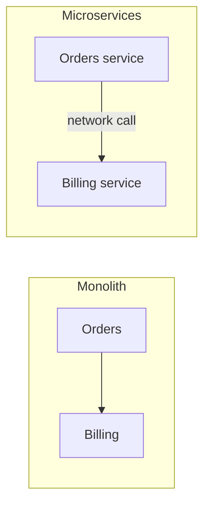
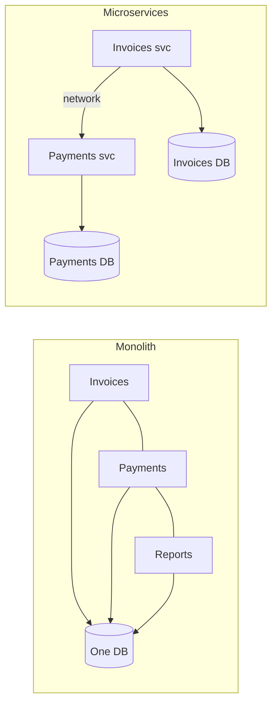
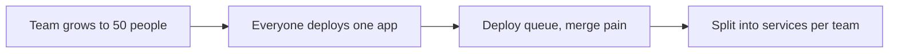
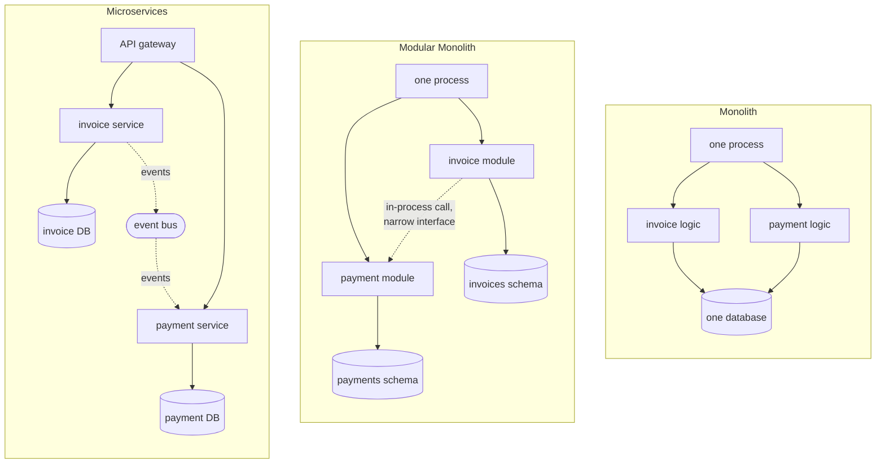
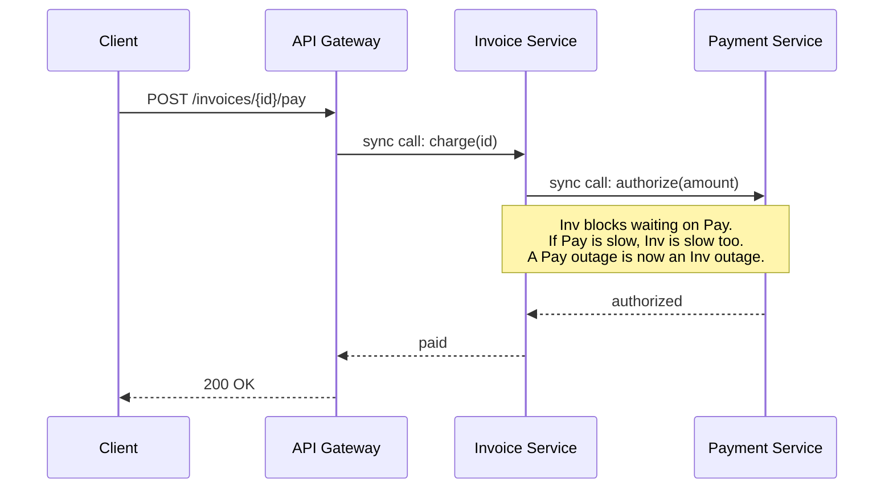
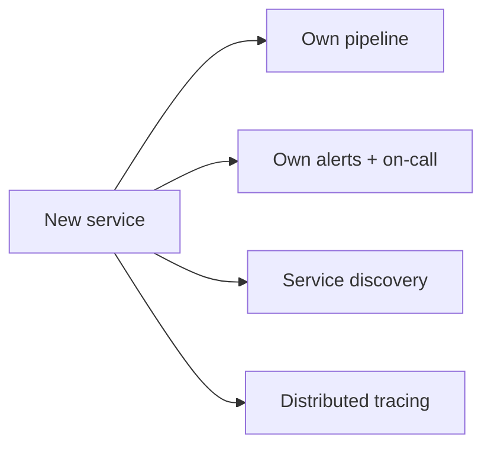
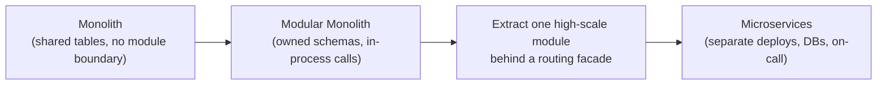
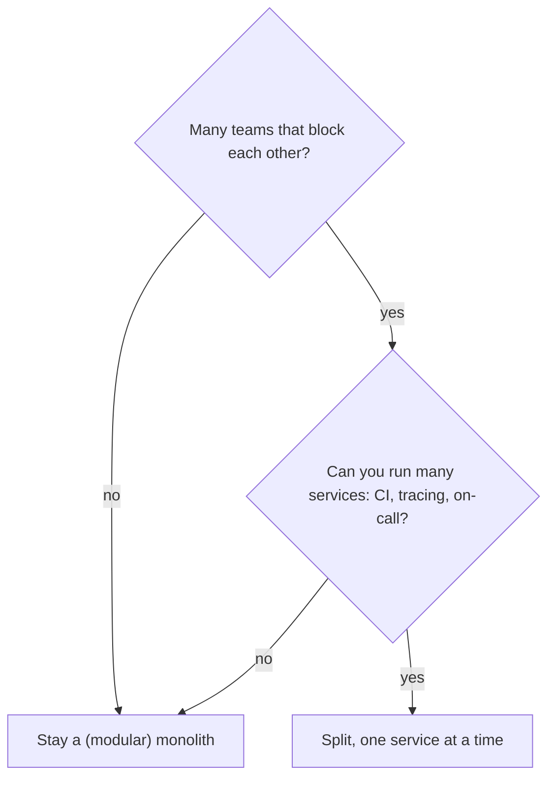

# Monolith vs Microservices

> [!summary] TL;DR
> A monolith is one deployable unit containing all of a system's logic, usually against one database. Microservices split that logic into many independently deployable services, each owning its own data, talking to each other over the network instead of in-process function calls. The split is really about four things moving together — deployment, code ownership, data ownership and team ownership — not just "how many repos" or "how many processes".

> [!abstract] Core idea
> - The real axis is **what is independent**: can one part deploy, scale, fail and be owned by a team without touching the rest?
> - A monolith can still be well-organized (a **modular monolith**) with clean internal boundaries; a split into services with a shared database gets none of the benefits and all of the cost (the **distributed monolith**).
> - Splitting trades in-process function calls and one transaction for network calls, and either synchronous RPC's extra latency and partial-failure modes, or asynchronous events and eventual consistency.
> - Conway's law means service boundaries tend to mirror team boundaries whether or not anyone plans it that way.
> - Fowler's MonolithFirst: start with a monolith (ideally a modular one) and split out a service only when a concrete, measured need (independent scaling, independent deploys, a genuinely separate team) appears.

## Start here: the basics 🟢

> [!info] How to read this note (pick your level)
> - 🟢 **New to this?** Read "From zero" below, then 1 (why it exists), 2 (mental model) and 10 (cheat sheet). Stop there, that is a full first pass.
> - 🟡 **Know the basics?** Add 3 (how it works), 4 (worked example), 5 (variants and comparison) and 6 (trade-offs).
> - 🔴 **Interview / SDE-3 prep?** Add 7 (in production), 8 (deep dive) and 9 (interview questions). Headings are tagged 🟢🟡🔴 so you always know where you are.

> [!note] Before this note
> - [[Architecture Fundamentals - Coupling, Cohesion and Dependency Direction]]: "coupling" is how much one part must change when another changes, and "data coupling" means two parts sharing one table. Splitting an app only helps if it removes that coupling.

**From zero, in 60 seconds** 🟢

A **monolith** is one app with all the features, deployed as one piece, usually with one database.
**Microservices** split those features into many small apps. Each has its own database and they talk over the network.
Microservices let teams ship on their own and scale parts on their own.
But every function call becomes a network call that can be slow or fail. You also need much more tooling to run them.
So microservices are not "better". They trade code tangle for network and ops pain.
Most teams should start with a well-split monolith and break off a service only when there is a clear reason.



The rest of this note is just these 3 questions:
1. What really changes when you split an app?
2. What extra costs come with the split?
3. When should you split, and how do you do it without a rewrite?


**The problem in one story.**
A small team ships one app that does everything: invoices, payments, reports.
It is easy to run and change. Years later three teams step on each other's releases,
and the busy payment part needs ten times more servers than the reports part.
Should the app be split into separate services? This note answers when and how.

**Words you need first**

| Word | Plain meaning | Tiny example |
| --- | --- | --- |
| Deploy | Put a new version of code into production | Shipping a new container image |
| Monolith | One deployable app holding all the logic | One Go binary for all of InvoiceOps |
| Microservice | A small app that deploys and owns its data on its own | A separate `payments` service |
| In-process call | A plain function call inside one program | `billing.Charge(inv)` |
| Network call (RPC) | Asking another program over the network | HTTP/gRPC to `payments:8080` |
| Transaction | A group of DB writes that all succeed or all fail | Insert invoice + payment together |
| Eventual consistency | Data agrees across services, but after a delay | Report shows payment a second later |
| Conway's law | Systems end up shaped like the teams that build them | Three teams, three services |
| Modular monolith | One app, but split inside into walled modules that own their data | `billing` and `notifications` modules, one binary |
| Distributed monolith | Many services that still share a database or must deploy together | Two services writing one `invoices` table |
| Service discovery | How one service finds another's address at run time | `payments` looked up by name |
| Distributed tracing | Following one user request across many services' logs | One trace ID through 4 services |
| Saga | A chain of local steps, each with an "undo" step, instead of one big transaction | Reserve, charge, confirm; refund if confirm fails |
| Cascading failure | One slow or broken service drags down every service that calls it | Payments down, so checkout hangs too |

**Picture it**



**Analogy.** A single restaurant kitchen sharing one fridge versus a food hall of separate stalls, each with its own fridge and staff.
Where it breaks: stalls in a food hall rarely need each other's food, but services often must call each other for one request, so network failures matter much more.

**How the rest of this note builds up**

- First, why the question comes up (section 1) and the four axes: deployment, data, team, communication (section 2).
- Then how calls, data and failures change when you split (section 3), with a Go worked example (section 4).
- Then variants (modular monolith, distributed monolith) and trade-offs (sections 5-6).
- Finally the SDE-3 deep dive: production signals, Conway's law, MonolithFirst, interview questions (sections 7-9).

> [!tip] Remember
> Split only when deployment, data and team ownership can all become independent, not just the code.

## 1. Why it exists 🟢

🟢 **Plain version:** One app is great at first: easy to run, easy to change. Later, one part (payments) needs far more servers than another (reports), several teams block each other's releases, and a slow report can starve payments of database connections. Splitting into services can fix this, but only if each service also gets its own data and its own team. If they still share one database, you get all the extra work of many apps and none of the gains.

InvoiceOps starts as one Go binary: an HTTP layer, invoice and payment logic, and one Postgres database, deployed as a single **container** (a packaged, ready-to-run copy of the app). One engineer can run the whole thing locally with `docker compose up` (a command that starts the app's database and helpers on a laptop) and one `go run`.

Eighteen months later: the payments path needs to scale to ten times the traffic of the reporting path, three teams now touch the codebase and keep blocking each other's deploys, and a slow reporting query occasionally saturates the same **connection pool** (the fixed set of open database connections the app shares) the payment webhook handler needs.

These are not bugs; they are the actual, measured costs of one deployment unit once its parts have outgrown it together.

The tempting fix — "split it into microservices" — solves exactly these problems only if the split also separates the data each part owns and the team that owns each part.

A split that keeps one shared Postgres database and one team touching every "service" buys network latency and operational complexity (service discovery, distributed tracing, more CI/CD pipelines, the automated build-test-deploy steps) without buying independent scaling, deployment or ownership.

That half-measure has a name: the **distributed monolith**, and it is strictly worse than the monolith it replaced, because it has a monolith's coupling and a microservices architecture's operational cost at the same time.



## 2. Mental model 🟢

Four questions decide where a system sits on the monolith-to-microservices spectrum, and they can move independently of each other:

- **Deployment**: how many independently deployable artifacts exist?
- **Data ownership**: does each part of the system have a table or schema nothing else writes to directly?
- **Team ownership**: does one team own a part end to end, including its on-call?
- **Communication**: do parts call each other in-process (a function call) or over the network (sync RPC, or async events)?

A monolith answers "one" to the first three and "in-process" to the fourth. Microservices answer "many, separately deployed, separately owned, separately scaled" to the first three, communicating over the network.

A **modular monolith** is the useful middle ground: still one deployment and one process, but with the second and third questions already answered as if it were split — each module owns its data and its logic cleanly, so splitting it out later is a deployment change, not a redesign.

**Analogy:** a single restaurant kitchen (monolith) where every station shares one walk-in fridge versus a food-hall of independent stalls (microservices), each with its own fridge, its own staff, and its own hours — ordering between stalls now means walking over and placing an order rather than reaching across a shared counter.

A kitchen that is internally organized into clean stations that never touch each other's ingredients, but still shares one walk-in and one lease (modular monolith) is the easiest of the three to later split into stalls.

### Real-life example 🟢

Picture a ride-hailing app like Ola in its first year: one app handles riders, drivers, trips and payments, run by one small team. That is the right choice.
A few years on, matching drivers to riders at rush hour needs 20 times more servers than sending receipts. Separate teams own payments and maps.
Now splitting "driver matching" into its own service, with its own data and team, pays off: it can scale alone and ship alone.
Splitting "receipts" too, while it still reads the trips table directly, would only add network calls and another thing to run.

## Common beginner mistakes 🟢

- **Splitting into services that share one database** → they still have to change together, now over the network (a distributed monolith) → give each service its own data first.
- **Starting a new product as 10 microservices** → you guess the boundaries before you know the business, and pay the running cost from day one → start with a (modular) monolith.
- **Chaining many synchronous calls** → each hop adds delay, and one failure breaks the whole chain → use async events where no instant answer is needed, plus timeouts.
- **Thinking Docker or Kubernetes means microservices** → they are just packaging and running tools → what matters is independent data, deploys and teams.
- **Forgetting the running cost** → every service needs pipelines, dashboards, alerts and on-call → only split when you can staff that.

## 3. How it works 🟡

> 🟢 → 🟡 **You now know** the two ends (one app vs many) and the middle (modular monolith). **Next we open the box**: exactly what changes when you split, how services talk, what extra running cost appears, and how to move without a rewrite.

### The spectrum, as deployment units and data ownership

**Step by step:**
1. Monolith: one binary, one database, any code can read any table.
2. Modular monolith: still one binary and one database, but `billing` owns the `invoices` schema and `payments` owns `payments`. They call each other through small Go interfaces.
3. Microservices: `billing` and `payments` are separate binaries with separate databases. The Go call becomes an HTTP or gRPC call.



The modular monolith already has the data-ownership and code-boundary discipline of microservices; the only thing that changes when (if) it splits is the dotted in-process call becoming a network call.

### What actually splits, and what does not have to

**In plain words: splitting code, data, deploys and teams are separate choices. You do not have to do all of them at once.**

**Step by step:**
1. Split code: put `billing` and `payments` in separate modules.
2. Split data: each module gets its own tables that nobody else writes.
3. Split teams: Team A owns billing, Team B owns payments, including on-call.
4. Split deploys: only now make them separate services.
Doing step 4 before step 2 is the classic mistake.

| Axis | Monolith | Modular monolith | Microservices |
| --- | --- | --- | --- |
| Deployment artifacts | 1 | 1 | N |
| Data ownership per module | shared tables, no enforced boundary | separate schemas, enforced by code review/convention | separate databases, enforced by network boundary |
| Team ownership | usually shared | can be per-module | per-service, matching Conway's law |
| In-module communication | direct function/struct access | narrow Go interface between modules | network call (sync RPC or async event) |
| Scaling granularity | the whole binary scales together | the whole binary scales together | each service scales independently |

Splitting the deployment artifact without first splitting data ownership is the most common mistake: two "services" that both read and write the same `invoices` table are coupled exactly as tightly as a monolith's two packages would be, except now a network call and a deploy pipeline sit between the coupling and the fix.

### Synchronous versus asynchronous communication

**Step by step:**
1. Sync: the customer pays. `Invoice` service calls `Payment` service and waits. Each takes 100 ms, so the customer waits 200 ms plus network.
2. If `Payment` is down, `Invoice` fails too, and so does the customer's request.
3. Async: `Invoice` publishes "charge requested" and returns right away.
4. `Payment` picks it up when it can and publishes "payment authorized".
5. The cost: for a moment, the invoice says "pending", not "paid". That delay is eventual consistency.



Chaining synchronous calls (`Gateway -> Inv -> Pay`, and potentially further) adds the full latency of every hop and makes every downstream failure a failure of everyone upstream — exactly the **chatty-call** symptom (many small back-and-forth network calls for one request) of a distributed monolith.

The alternative is async: `Inv` publishes an `InvoiceChargeRequested` event and returns immediately; `Pay` consumes it on its own schedule and publishes `PaymentAuthorized` back.

This trades immediate consistency (the client cannot be told "paid" synchronously) for isolation from `Pay`'s latency and availability — eventual consistency, coordinated with a saga or an outbox (a table where events are saved in the same transaction as the data, then sent), is the price of removing that chain.

[[Monolith vs Microservices]] draws the boundary at this decision; sagas, outbox delivery and the consistency models behind "eventually" are owned by 10 System Design and Distributed Systems, not repeated here.

### Operational cost that a split adds, independent of the code

**In plain words: every new service needs its own deploys, logs, alerts and on-call. That is real work.**

**Step by step:**
1. You split out `payments`.
2. It now needs its own build-and-deploy pipeline.
3. It needs dashboards, alerts and someone on call for it.
4. `billing` needs a way to find it (service discovery).
5. Debugging one slow checkout now means following one request across two services' logs (distributed tracing).



Full detail:

Splitting into services adds work that has nothing to do with business logic: each service needs its own CI/CD pipeline, its own on-call rotation and dashboards, a way to find the other services at runtime (service discovery or a fixed gateway registry), and distributed tracing to reconstruct a single user request across several services' logs.

None of this is optional once a split happens — it is the fixed operational tax that buys independent scaling and deployment, and it is exactly the tax a distributed monolith pays without getting the benefit.

### Conway's law as a decision input, not just an observation

**In plain words: split along team lines, or the services will drift back together.**

**Step by step:**
1. You split `invoices` and `reminders` into two services, but one team owns both.
2. That team changes both in the same pull request and deploys them together.
3. In practice they act as one app again.
4. If instead two teams each own one, they keep the boundary clean, because crossing it means talking to another team.

A split that does not match team boundaries tends to drift back toward a distributed monolith: two services "owned" by the same team, reviewed in the same PRs and deployed together in practice, behave like one deployment unit no matter what the architecture diagram says.

Conversely, deliberately drawing service boundaries to match (or reshape) team boundaries — the "inverse Conway manoeuvre" — tends to produce splits that survive, because the team doing the owning can actually keep the boundary clean day to day.

### Migrating without a rewrite

**In plain words: move one feature at a time behind a router, not the whole app in one go.**

**Step by step:**
1. Put a router in front of the monolith. All traffic still goes to the monolith.
2. Build the new `payments` service.
3. Point only `/payments/*` at the new service.
4. Once it is stable, delete the old payments code from the monolith.
5. Repeat for the next module, only if there is a real reason.

The practical path from monolith to microservices is almost never "rewrite it as services"; it is extracting one module at a time behind a routing facade while the rest keeps running, covered in full in [[Strangler Fig Pattern and Legacy Migration]].

The decision of *which* module to extract first, and whether to extract at all, is this note's job; the mechanics of extracting it safely are that note's.

## 4. Worked example 🟡

### Whiteboard version

The smallest version of the trade-off: a direct call (monolith shape) versus a channel-based event (async, microservices-flavoured shape), inside one process.

```go
package wb

type Event struct {
	InvoiceID string
}

// Direct call: the monolith shape. The caller blocks until Handle returns,
// and a panic or slow call inside Handle is the caller's problem too.
func PublishSync(h func(Event), evt Event) {
	h(evt)
}

// Channel-based: the async shape. The caller returns immediately; whatever
// drains the channel runs on its own schedule, decoupled in time.
func PublishAsync(ch chan<- Event, evt Event) {
	ch <- evt
}
```

The full version below is a modular monolith with two modules (`billing`, `notifications`) talking both ways: a direct, synchronous call, and a channel-based event bus standing in for what a real message broker gives two separate microservices.

A Go package (`modularmonolith`) that compiles and passes `go vet` and `go test -race` on Go 1.24.

**What this code does, in plain words:** two modules in one program. `billing` calls `notifications` directly when it needs an answer now, and also sends events through a Go channel (standing in for a message queue) that `notifications` reads on its own goroutine.

```go
// modularmonolith/modularmonolith.go
package modularmonolith

import (
	"context"
	"sync"
)

// InvoiceCreated is the one fact billing publishes. The notifications
// module depends on this event type, never on billing's internal table.
type InvoiceCreated struct {
	InvoiceID   string
	AmountCents int64
}

// NotificationSink is the port billing calls through. In the monolith it
// is satisfied by an in-process module; after a split it would be
// satisfied by a message producer (Kafka, SQS) instead, with no change to
// billing itself.
type NotificationSink interface {
	Handle(ctx context.Context, evt InvoiceCreated) error
}

// BillingModule owns invoices. Its own table is private: no other module
// reaches into it directly.
type BillingModule struct {
	mu       sync.Mutex
	invoices map[string]int64
	sink     NotificationSink
}

func NewBillingModule(sink NotificationSink) *BillingModule {
	return &BillingModule{invoices: make(map[string]int64), sink: sink}
}

func (b *BillingModule) CreateInvoice(ctx context.Context, id string, amountCents int64) error {
	b.mu.Lock()
	b.invoices[id] = amountCents
	b.mu.Unlock()
	// A direct, synchronous call: the monolith's main cost and benefit at
	// once. One stack trace and one transaction, but a slow or failing
	// sink blocks invoice creation unless the caller runs it async.
	return b.sink.Handle(ctx, InvoiceCreated{InvoiceID: id, AmountCents: amountCents})
}

// NotificationsModule owns its own notification log. It never queries
// billing's table; it only reacts to the event billing hands it.
type NotificationsModule struct {
	mu  sync.Mutex
	log []InvoiceCreated
}

func NewNotificationsModule() *NotificationsModule { return &NotificationsModule{} }

func (n *NotificationsModule) Handle(_ context.Context, evt InvoiceCreated) error {
	n.mu.Lock()
	defer n.mu.Unlock()
	n.log = append(n.log, evt)
	return nil
}

func (n *NotificationsModule) Sent() []InvoiceCreated {
	n.mu.Lock()
	defer n.mu.Unlock()
	out := make([]InvoiceCreated, len(n.log))
	copy(out, n.log)
	return out
}

// AsyncBus is a tiny channel-based event bus: the in-process shape of what
// an event bus (Kafka, SQS, NATS) gives microservices for free — decoupled,
// asynchronous delivery — without the operational cost of running one.
type AsyncBus struct {
	events chan InvoiceCreated
	sink   NotificationSink
	done   chan struct{}
}

func NewAsyncBus(sink NotificationSink, buffer int) *AsyncBus {
	bus := &AsyncBus{events: make(chan InvoiceCreated, buffer), sink: sink, done: make(chan struct{})}
	go bus.run()
	return bus
}

func (b *AsyncBus) run() {
	for evt := range b.events {
		// Errors from an async handler never reach the publisher: this is
		// exactly why async delivery needs its own retry/outbox story.
		_ = b.sink.Handle(context.Background(), evt)
	}
	close(b.done)
}

// Publish returns immediately: the caller (billing) is decoupled in time
// from the subscriber (notifications), the same relationship a message
// broker gives two separate microservices.
func (b *AsyncBus) Publish(evt InvoiceCreated) { b.events <- evt }

func (b *AsyncBus) Close() {
	close(b.events)
	<-b.done
}
```

```go
// modularmonolith/modularmonolith_test.go
package modularmonolith

import (
	"context"
	"sync"
	"testing"
	"time"
)

func TestBillingModule_CreateInvoice_SyncCallReachesNotifications(t *testing.T) {
	notifications := NewNotificationsModule()
	billing := NewBillingModule(notifications)

	if err := billing.CreateInvoice(context.Background(), "inv-1", 2500); err != nil {
		t.Fatalf("CreateInvoice: %v", err)
	}

	sent := notifications.Sent()
	if len(sent) != 1 || sent[0].InvoiceID != "inv-1" || sent[0].AmountCents != 2500 {
		t.Fatalf("got %+v", sent)
	}
}

// A slow or failing synchronous sink is visible immediately to the
// caller: the "distributed monolith" risk restated inside one process,
// a lockstep dependency between two modules that should be independent.
type failingSink struct{ err error }

func (f failingSink) Handle(context.Context, InvoiceCreated) error { return f.err }

func TestBillingModule_CreateInvoice_SyncSinkFailurePropagates(t *testing.T) {
	billing := NewBillingModule(failingSink{err: context.DeadlineExceeded})
	if err := billing.CreateInvoice(context.Background(), "inv-2", 100); err == nil {
		t.Fatal("expected the synchronous sink's error to propagate to the caller")
	}
}

func TestAsyncBus_DecouplesPublisherFromSubscriber(t *testing.T) {
	notifications := NewNotificationsModule()
	bus := NewAsyncBus(notifications, 10)
	defer bus.Close()

	var wg sync.WaitGroup
	for i := 0; i < 50; i++ {
		wg.Add(1)
		go func(n int) {
			defer wg.Done()
			bus.Publish(InvoiceCreated{InvoiceID: "evt", AmountCents: int64(n)})
		}(i)
	}
	wg.Wait()

	deadline := time.Now().Add(2 * time.Second)
	for len(notifications.Sent()) < 50 && time.Now().Before(deadline) {
		time.Sleep(time.Millisecond)
	}
	if got := len(notifications.Sent()); got != 50 {
		t.Fatalf("got %d delivered events, want 50", got)
	}
}
```

**Run, Go 1.24, module `note3`:**

```text
go vet ./...
go test -race ./...
ok  	note3/modularmonolith	3.597s
```

### Migration path



Each arrow is a decision with evidence behind it, not a default next step: move from monolith to modular monolith once a boundary is drawn and enforced by code review, not before; move from modular monolith to an extracted service once one module has a measured, independent scaling, deployment or team need the others do not share.

## 5. Variants and comparison 🟡

| Style | How it works | Use when | Cost |
| --- | --- | --- | --- |
| Monolith | One deployable, usually one shared database, logic organized loosely or not at all | A new product, a small team, or a system genuinely simple enough that splitting has no payoff | Grows into a big ball of mud without discipline; the whole thing scales and deploys together |
| Modular monolith | One deployable, but modules own their own schema and talk through narrow interfaces | Most systems past the prototype stage, especially with more than one team | Still one deployment unit: a bug in one module can still crash the whole process |
| Microservices | Many deployables, each owning its data, talking over the network | A genuine, measured need for independent scaling, deployment or team ownership | Network latency, partial failure, service discovery, distributed tracing, more CI/CD and on-call surfaces |
| Distributed monolith (anti-pattern) | Many deployables that share a database or deploy in lockstep | Never intentionally — it is what a premature or incomplete split produces | All of microservices' operational cost, none of its isolation benefits |
| Serverless functions | Many small, independently deployed functions, usually event-triggered, with the platform owning scaling | Spiky or infrequent workloads where paying per-invocation beats running idle servers | Cold starts (the delay when a function that was idle has to start up first), vendor-specific triggers and limits, harder local development and tracing |

## 6. Trade-offs and when not to use 🟡

- A monolith (or better, a modular monolith) is the right starting point for almost every new system: Fowler's MonolithFirst observation is that you cannot yet know where the real scaling and ownership seams are until the system has been built and used, and the cost of guessing wrong and splitting along the wrong seam is high.
- Microservices add real, fixed operational cost (service discovery, per-service pipelines, distributed tracing, a platform team to run all of it) that must be paid whether or not the split buys you anything yet — do not take on that cost for a system with one team and no scaling asymmetry.
- Splitting the deployment unit without splitting data ownership produces a distributed monolith: strictly worse than either pure style, because every write still needs cross-service coordination, but now over a network and across separate deploy pipelines.
- Prime Video's 2023 move of part of its monitoring pipeline from a serverless/microservices design back to a monolith, and Segment's well-known 2018 "Goodbye Microservices" post, are both documented cases where a team found their specific service boundaries were adding coordination cost (and, for Prime Video, cost at scale) without a matching benefit — not a general argument against microservices, but evidence that the trade-off has to be re-checked against real operating data, not assumed once and left alone.



## 7. In production 🔴

> 🟡 → 🔴 **You now know** what changes when you split and what it costs to run. **Next is the senior view**: what Amazon, Netflix, Shopify and Prime Video actually did, how distributed monoliths fail, and why bounded contexts make good split lines.


- **Real systems:** Amazon and Netflix are the canonical large-scale microservices adopters, each with thousands of independently deployed services and dedicated platform teams to run the shared infrastructure that makes that possible. Shopify runs a large, deliberately modular monolith (their own public engineering writing calls out the choice) rather than microservices, specifically to avoid paying distributed-systems cost for a codebase where team ownership, not technical scaling limits, was the actual driver. Prime Video's monitoring team publicly documented moving a specific pipeline from a distributed, serverless design to a monolith after measuring it was cheaper and simpler at their scale — a single, well-reported case, not a blanket recommendation either way.
- **Failure modes → fixes:**
  - Cascading failures through a chain of synchronous calls → timeouts and circuit breakers at every hop, and prefer async events for any call that does not need an immediate answer.
  - A distributed monolith from a shared database → give each service its own schema or database, with a migration plan (dual-write: write to both old and new places for a while; CDC: stream every database change to the new store; backfill: copy the old rows over) covered in [[Strangler Fig Pattern and Legacy Migration]].
  - Cross-service consistency bugs after a split (an invoice marked paid while the payment record is still pending) → a saga or outbox pattern, owned by 10 System Design and Distributed Systems, coordinates the two writes instead of assuming a shared transaction.
  - A split that outpaces the team that owns it (two people running twelve services) → consolidate back toward a modular monolith rather than adding a platform team the organization cannot yet staff.
- **What to monitor:** request latency and error rate per hop in a call chain (to catch cascading-failure risk before it pages someone), deploy frequency and lead time per module/service (the actual evidence that a split is buying independence), and cross-service consistency lag for anything eventually consistent (outbox backlog, event-processing delay).

## 8. Deep dive 🔴

**The distributed monolith, precisely.** It is not "microservices done badly" in a vague sense; it has a specific, checkable cause: at least one piece of data or one deploy decision that two or more services still depend on jointly.

A shared database table two services both write to, a shared library both services must upgrade in lockstep, or a release process that only works if three services deploy together are all the same root cause wearing different clothes. The fix is always the same shape: give the shared thing exactly one owner.

**Database-per-service, and what it actually removes.** Once each service owns its own database, cross-service joins are gone by construction — a "join" across invoice and payment data becomes two calls (or a pre-joined read model maintained by a consumer of both services' events) instead of one SQL query.

This is the single biggest reason a genuine microservices split changes how queries and reports are written, not just how code is deployed.

**Serverless as a fourth point on the spectrum, not a separate axis.** A serverless function is a microservice taken to its logical extreme on the deployment axis (one function, independently deployed and scaled, down to zero instances when idle) while handing team ownership of *how* it scales entirely to the platform.

The same data-ownership and chatty-call risks from the microservices section apply to a system of many serverless functions calling each other, often more acutely, because each cold start adds the kind of latency a synchronous call chain already had to worry about.

**Why DDD's bounded contexts are the natural split lines.**

A bounded context (see [[Domain-Driven Design - Strategic Design]]) is already a boundary where a model is internally consistent and a word like "Invoice" has one meaning; splitting along an existing bounded context means the new service's data ownership and its domain model boundary are the same line, which is why DDD and microservices are so often discussed together even though, as [[Architecture Fundamentals - Coupling, Cohesion and Dependency Direction]] notes, DDD is orthogonal to the deployment decision itself.

## 9. Interview questions 🔴

> [!question]- What is the real difference between a monolith and microservices, beyond "one app vs many"?
> Four things that usually move together: how many units deploy independently, whether each part owns its own data, whether a team owns each part end to end, and whether parts talk in-process or over the network. A split that only changes the first without the second and third is a distributed monolith, not a real microservices architecture.

> [!question]- What is a distributed monolith, and how do you recognize one?
> Multiple independently deployed services that still share a database table, must deploy in lockstep, or otherwise cannot change independently. Recognize it by asking: can I deploy this service alone, this week, without coordinating with another team? If the honest answer is no, the split did not remove the coupling, it just moved it onto the network.

> [!question]- When would you recommend splitting a monolith into services, concretely?
> When there is a measured, specific need: one module needs an order of magnitude more scale than the rest, a team needs to deploy on its own schedule without blocking others, or a module has fundamentally different reliability or compliance requirements. "It feels like it should be microservices" is not a reason.

> [!question]- Trap: "We use Docker and Kubernetes, so we have microservices." True or false?
> False. Containers and an orchestrator are deployment tooling; they say nothing about whether services own their own data, can deploy independently, or are owned by separate teams. A monolith can run in a single container on Kubernetes, and a distributed monolith can run as ten containers that still share one database.

> [!question]- What does a modular monolith buy you over a plain monolith, if it is still one deployment?
> Enforced data ownership and interface boundaries between modules, checked by code review (or compile-time package boundaries in Go), without paying network latency, partial failure or operational overhead yet. If a module later needs to be split out, the boundary work is already done; only the call mechanism changes from in-process to network.

> [!question]- How do sagas or an outbox relate to this decision?
> They are the mechanism that makes cross-service consistency work once you no longer have one database transaction spanning the write — a direct consequence of choosing microservices' "each service owns its data" model. The mechanics (saga steps and compensations, outbox table plus a relay) belong to 10 System Design and Distributed Systems; this note only covers the decision to split and the trade-off that creates the need for them.

> [!question]- Why does Conway's law matter when deciding where to split?
> A service boundary that does not match a team boundary tends to drift back toward a distributed monolith in practice, because the people who would need to coordinate a clean boundary are the same people already blocked by slow cross-team communication. Deliberately aligning (or reshaping) team boundaries before or during a split tends to produce boundaries that actually hold.

## 10. Cheat sheet 🟢

- The real axes: independent deployment, independent data ownership, independent team ownership, in-process vs network calls — not just "how many repos".
- Modular monolith = microservices' data/code discipline, monolith's deploy and transaction simplicity; the easiest state to split from later.
- Distributed monolith = microservices' operational cost, monolith's coupling; it is strictly worse than either pure style.
- Sync RPC chains add latency and propagate failure upstream; async events decouple at the cost of eventual consistency and the need for a saga/outbox.
- Database-per-service removes cross-service SQL joins by construction; that is the real cost center of a split, not the network call itself.
- Conway's law: boundaries that do not match team boundaries tend to erode back toward a distributed monolith.
- Start with a (modular) monolith; split a specific module only when a measured scaling, deployment or ownership need appears. Revisit the decision with real operating data — Prime Video and Segment both did, in opposite directions from the industry default assumption.

## Self-check 🟢🟡

> [!question]- (easy) What is a monolith?
> One app with all the features, deployed as one piece, usually with one database.

> [!question]- (easy) What is a distributed monolith?
> Many services that still share a database or must deploy together: the cost of microservices with none of the benefit.

> [!question]- (easy) What should most new products start as?
> A (modular) monolith; split later only for a measured need.

> [!question]- (medium) Name three concrete reasons to split out a service.
> It needs very different scale, a team needs to deploy on its own schedule, or it has different reliability or compliance needs.

> [!question]- (medium) What do you give up when you switch a sync call to an async event?
> The instant answer: the data is only eventually consistent, and you need a saga or outbox to keep both sides right.

> [!question]- (medium) Why does database-per-service change how reports are written?
> Cross-service SQL joins are gone; you need two calls or a combined read model fed by events.

## Links 🟢

- **Before this:** [[Architecture Fundamentals - Coupling, Cohesion and Dependency Direction]]
- **Next:** [[Modular Monolith]], [[Strangler Fig Pattern and Legacy Migration]]
- **Compare with:** [[Domain-Driven Design - Strategic Design]] (bounded contexts as natural split lines), [[API Gateway and BFF]] (the front door once there is more than one service), [[Capstone - InvoiceOps]] (the running example this note traces)

### Watch on YouTube

- [Moving from MONOLITHS to MICROSERVICES 🎂 → 🍰🍰🍰](https://www.youtube.com/watch?v=rckfN7xFig0) · Gaurav Sen · 19 min · 244,851 views
- [What are MicroServices? When & Why is it used? / Monolithic vs Microservices Architecture](https://www.youtube.com/watch?v=7IFJb-uLEaI) · Apna College · 9 min · 805,293 views
