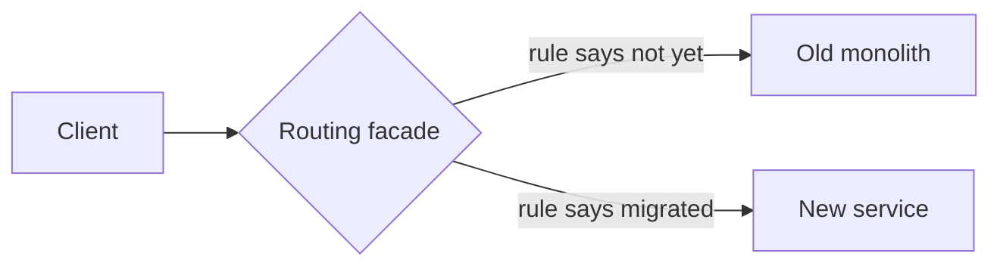
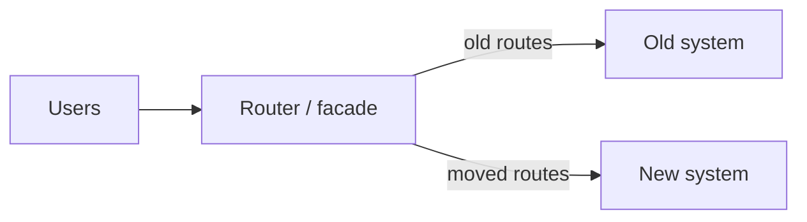
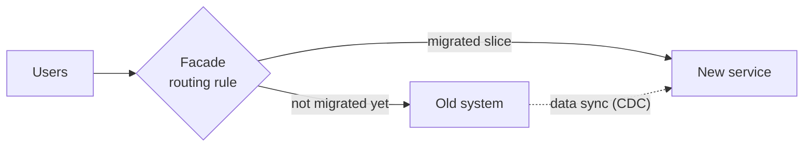
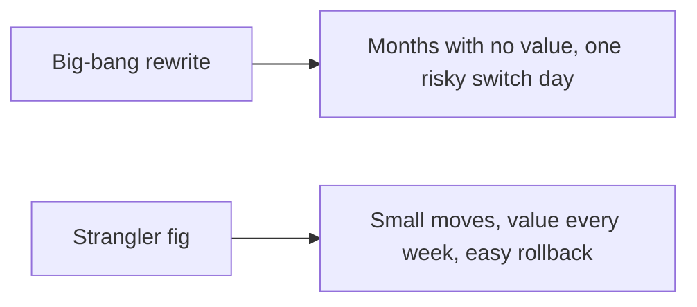
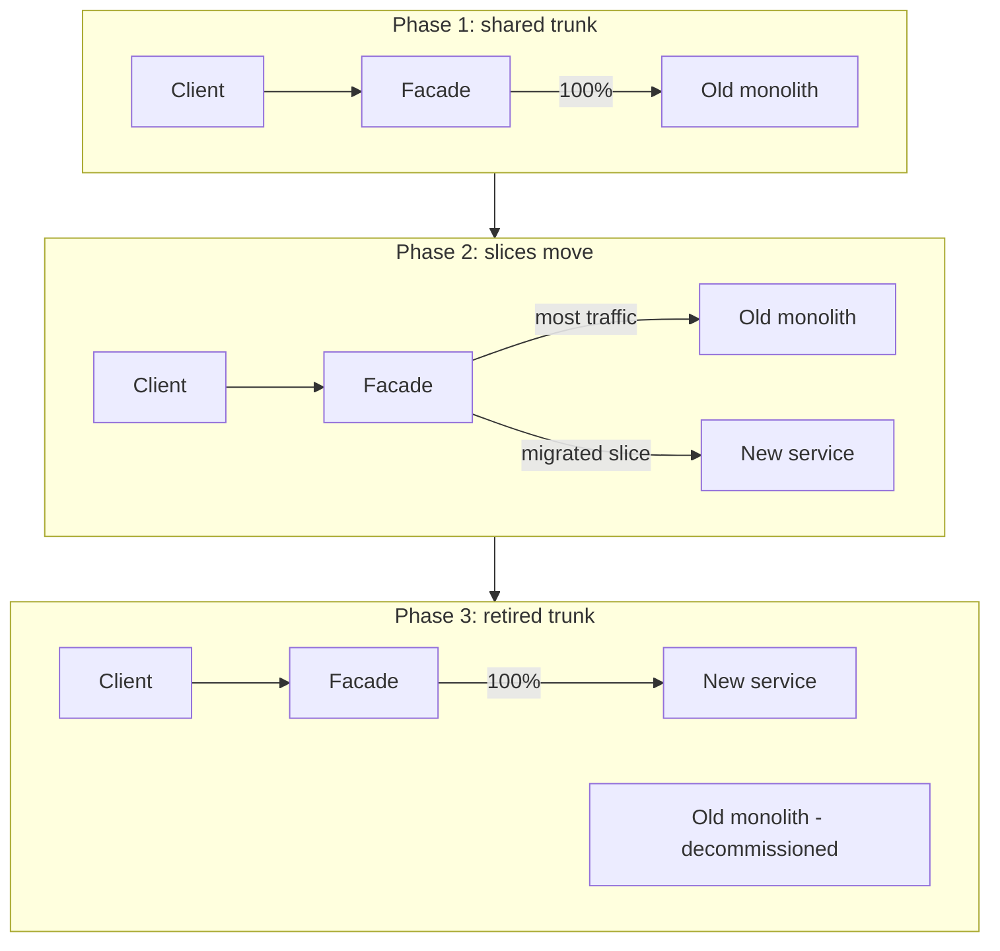
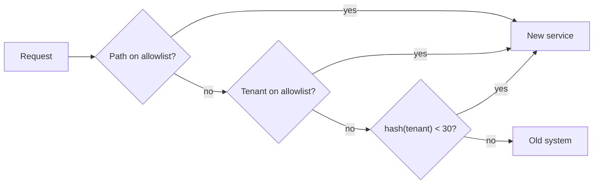
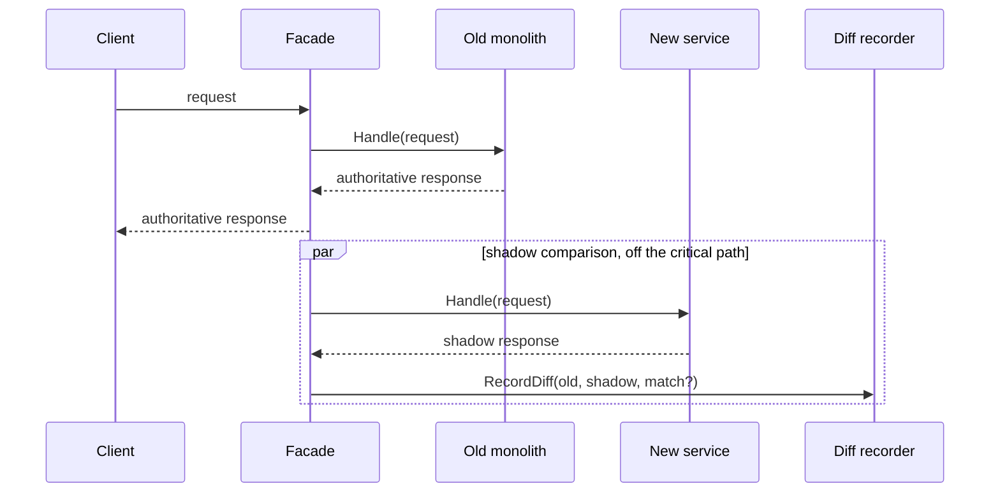
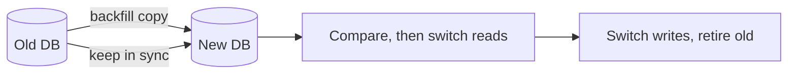
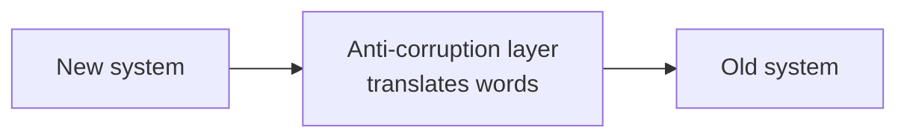
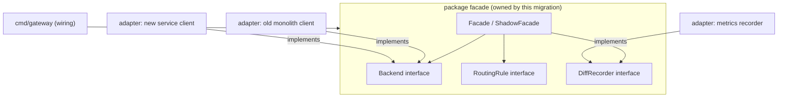

# Strangler Fig Pattern and Legacy Migration

> [!summary] TL;DR
> Put a routing facade in front of an old system and a new one, move traffic across one slice (one route, one tenant, one percentage) at a time, and keep both systems correct throughout. The old system is never rewritten in one shot; it is **strangled** — its traffic share shrinks to zero while it keeps running, the way a strangler fig vine slowly replaces the tree it grows on.

> [!abstract] Core idea
> - A **routing facade** (reverse proxy, API gateway, or a library-level seam) sits in front of both systems and decides, per request, which one answers.
> - Migration moves in **slices** small enough to verify: one route, one tenant cohort, or one percentage of traffic at a time — never "cut over everything Friday night."
> - Data has its own migration curve, independent of code: a shared database first, then change-data-capture keeping a new store in sync, then an ownership switch.
> - **Shadow traffic** (calling the new system in parallel, without using its answer) proves the new system agrees with the old one before any real request depends on it.
> - Classic mistake: strangling forever. Without a rollback-closing and retirement step, the "temporary" facade and the old system become permanent, and now there are two systems to maintain instead of one.

### Whiteboard version

The bare shape, before any of the machinery below: a facade owns a boolean decision, and the two backends behind it never need to know about each other.



Everything in this note is this one diagram made precise: what the rule can look at, how it changes over weeks instead of flipping once, and what happens to the data underneath while the arrow moves.

## Start here: the basics 🟢

> [!info] How to read this note (pick your level)
> - 🟢 **New to this?** Read "From zero" below, then 1 (why it exists), 2 (mental model) and 10 (cheat sheet). Stop there, that is a full first pass.
> - 🟡 **Know the basics?** Add 3 (how it works), 4 (worked example), 5 (variants and comparison) and 6 (trade-offs).
> - 🔴 **Interview / SDE-3 prep?** Add 7 (in production), 8 (deep dive) and 9 (interview questions). Headings are tagged 🟢🟡🔴 so you always know where you are.

> [!note] Before this note
> - [[Monolith vs Microservices]]: a monolith is one big app; pulling a module out into its own service only helps if it also gets its own data. This note is how you do that pull-out safely.
> - [[Hexagonal Architecture (Ports and Adapters)]]: code depends on an interface, and any adapter that fits can be plugged in. The routing facade here is built the same way: old and new systems are two adapters behind one `Backend` interface.

**From zero, in 60 seconds** 🟢

You have an old system that works but is hard to change. Rewriting it all at once is very risky.
A strangler fig is a plant that grows around an old tree until it replaces it. The pattern copies that idea.
You put a **facade** (a router) in front of the old system.
You build one piece of the new system, then tell the router to send that one piece of traffic to it.
Step by step, more traffic goes to the new system, and the old one shrinks until you can switch it off.
At every step, both systems keep working, and you can roll back one slice if something goes wrong.



The rest of this note is just these 3 questions:
1. How do you pick what to move first?
2. How do you prove the new part is right before trusting it?
3. How do you move the data, which is the hardest part?


**The problem in one story.**
A company has an old app that still earns money every day.
Rewriting it all and switching over in one night is very risky.
Instead, you put a "traffic director" in front, and move one small feature at a time to the new app.
If something breaks, you send that feature's traffic back to the old app in seconds.

**Words you need first**

| Word | Plain meaning | Tiny example |
| --- | --- | --- |
| Legacy system | An old system still in use that is hard to change | A 5-year-old invoicing monolith |
| Reverse proxy / facade | A front door that forwards each request to a backend | Nginx or an API gateway |
| Routing rule | The check that picks which backend answers | "tenant in cohort A → new service" |
| Slice | A small, separately movable piece of traffic | One route, one tenant group, 5% of requests |
| Cutover | Switching traffic from old to new | Rule flips for `/invoices` |
| Rollback | Switching back if the new side misbehaves | Flip the rule back |
| Shadow traffic | Sending a copy of requests to the new system, ignoring its answer | Compare old vs new responses |
| CDC (change data capture) | Streaming every DB change to another store | Debezium copying rows to the new DB |
| Seam | A spot where you can cut in and send a request elsewhere | The `/invoices/*` URL prefix |
| Canary | Sending a small share of real traffic to the new side first | 5% of tenants |
| Blast radius | How many users are hurt if this step goes wrong | One test tenant vs everyone |
| Branch by abstraction | Same idea inside one codebase: interface, two versions, a flag | `InvoiceStore` old vs new |
| Dual write | The app writes to the old and the new database itself | Risky: one write can fail |
| Backfill | Copying existing old rows into the new store | One-time job over 2 years of invoices |

**Picture it**



**Analogy.** Renovating a house room by room while the family keeps living in it, instead of demolishing it and camping outside for a year.
Where it breaks: rooms in a house are separate, but old and new systems often share data, so the data move needs its own careful plan.

**How the rest of this note builds up**

- First, why big-bang rewrites fail (section 1) and the facade mental model (section 2).
- Then how routing, slices, shadow traffic and data migration work (section 3), with a Go worked example (section 4).
- Then variants (branch by abstraction, parallel run) and trade-offs (sections 5-6).
- Finally the SDE-3 deep dive: production practice, retiring the old system, interview questions (sections 7-9).

> [!tip] Remember
> Move one small, reversible slice at a time until the old system has no traffic left, then delete it.

## 1. Why it exists 🟢

🟢 **Plain version:** Rewriting a big old system and switching everyone over in one night usually goes wrong. The rewrite takes longer than planned, because the old system keeps changing meanwhile. On switch-over day, one serious bug means rolling back everything. The strangler fig way moves one small piece at a time, so a bad step hurts a few users for an hour, and you undo it by flipping one rule.

A five-year-old monolith has one module — say, invoicing — that a team wants to extract into its own service, written in Go with a cleaner schema. The tempting plan is a **big-bang rewrite**: freeze the old invoicing code, write the new service over two months, cut every client over on release day.

Fowler's *MonolithFirst* (2015) and the original *StranglerFigApplication* post (2004) both argue this plan fails in a specific, recurring way: the rewrite takes longer than planned (the old system kept shipping bug fixes and new invoice edge cases the whole time, which the rewrite has to catch up on, forever one release behind), and the cutover is a single all-or-nothing event with no partial-failure recovery — if the new system has one serious bug, the only rollback is reverting the whole deployment and losing two months of parallel changes in the old system.

**For example, out of 100,000 requests through the routing facade below, migrating one tenant cohort at a time:** moving 30% of tenants to a new backend changes the request path for roughly 30,000 of them and leaves the other 70,000 completely untouched by the migration — each slice is independently revertible, because "revert" means flipping that slice's rule back, not redeploying anything.

A big-bang cutover has no equivalent partial state: every request is on the new system, or none are.

The strangler fig pattern replaces the single cutover with a long sequence of small, reversible ones, so a bad slice costs a percentage of traffic for an hour, not all of it for a weekend.



## 2. Mental model 🟢

A strangler fig seed germinates in the branches of a host tree and sends roots down around the trunk.

Over years the fig's roots thicken into a lattice, the host tree below dies and rots away, and the fig stands on its own, in the exact shape the old tree used to occupy — but the fig was never "installed" in one move; it grew around the tree while the tree kept standing.

The **facade is the fig's growing lattice**: it occupies the position every client already calls (the old system's URL, the old system's internal API), and it decides, request by request, whether the old trunk or the new growth answers.

The host tree (the old system) never had to be demolished for the fig to take root — it keeps serving requests the facade hasn't routed away yet, right up until the facade routes nothing to it and it can be switched off.

### Real-life example 🟢

Imagine a bank moving its old net-banking app to a new one. It does not switch all customers on one Sunday.
First, only the "download statement" page goes to the new app, because it only reads data and is easy to check.
Next, bank staff accounts use the whole new app. Then 5% of customers, then 30%, then everyone.
If the new "fund transfer" page misbehaves for the 5%, the bank flips that page back to the old app in seconds. Only when no customer uses the old app does the bank switch it off.

## Common beginner mistakes 🟢

- **Moving a write-heavy, money-moving feature first** → a bug costs real money and is hard to undo → start with a low-traffic, read-only page.
- **Picking which side a tenant goes to at random on every request** → a user's data seems to appear and vanish → hash the tenant ID so each tenant always lands on the same side.
- **Having the app write to both databases** → one write can fail and the two quietly disagree → use CDC to copy committed changes from the old database.
- **Trusting the new system because the code "looks right"** → hidden differences show up for real users → run shadow traffic and compare answers first.
- **Never switching the old system off** → you now run two systems forever → set a retirement date and delete the old branch when traffic reaches zero.

## 3. How it works 🟡

> 🟢 → 🟡 **You now know** the idea: a router in front, small slices moved one at a time. **Next we open the box**: the three phases, how to choose a slice, how to check the new side before trusting it, how the data moves, and how to keep old ideas from leaking into the new code.

### 3.1 The three phases

**Step by step:**
1. Phase 1: a router sits in front. 100% of requests still go to the old system.
2. Phase 2: the router sends `/invoices/:id/pdf` to the new service. Later, more routes and more tenants. This can last months.
3. Phase 3: the old system gets 0% of traffic. Switch it off and delete the router's "old" branch from the code.



Phase 1 is the starting point, not a step to build: the facade exists (it might already be a reverse proxy or API gateway doing something else) and every request still reaches the old system.

Phase 2 is where the pattern lives — it can last months, with the migrated slice growing from one route to most of them.

Phase 3 is the only truly final step: the old system is decommissioned, and the facade's "old" branch is deleted from the code, not just left unused, or the pattern never finishes and the facade becomes permanent dead weight.

### 3.2 Finding seams and routing by slice

**In plain words: a seam is a spot where you can cut in and send a request somewhere else.**

**Step by step:**
1. Find a seam: the URL path `/invoices/:id/pdf`.
2. First rule: send just that path to the new service.
3. Second rule: send every request from tenant `t-test` (your own test account) to the new service.
4. Third rule: hash each tenant ID into a number from 0 to 99; numbers below 30 go to the new service. Tenant `t-42` always gets the same number, so it never flips sides.



Full detail:

A **seam** is a boundary in the old system where a request can be intercepted without understanding the whole monolith: a URL prefix (`/invoices/*`), a tenant ID, a message type on a queue, or a function call behind an interface the old code already has.

The facade routes by whichever seam the old system exposes most cleanly — usually the URL path, because most monoliths already have a URL-routing layer to hook into.

Three concrete routing rules, each real and each used at a different point in the migration:

- **Path allowlist.** Route `/invoices/:id/pdf` to the new service, everything else to the old one. This is the first slice: a single read-only endpoint, chosen because it has no write side effects to reconcile if the new service is wrong.
- **Tenant allowlist.** Route specific tenant IDs (an internal test tenant, then a handful of consenting beta customers) to the new service regardless of which route they call. This slice tests the new system against real, varied traffic from a small **blast radius** (the number of users hurt if it goes wrong).
- **Percentage canary** (named after the canary miners carried as an early warning). Route a stable percentage of *all* tenants to the new service, where "stable" means the same tenant always lands on the same side for the length of the migration wave — a tenant whose data looks half-migrated and half-not because it flip-flopped between requests is worse than either side alone. The Go code below makes this stickiness a hashed, deterministic decision instead of a coin flip per request.

### 3.3 Verifying before trusting: shadow traffic

**Step by step:**
1. A request for invoice `inv-9` arrives.
2. The facade sends it to the old system **and** to the new one at the same time.
3. The customer gets the old system's answer, always.
4. The two answers are compared. Same? Log "match". Different? Log the difference.
5. Only after many days of matches does a rule let the new system answer for real.

Before any routing rule sends a tenant's *live* traffic to the new service, **shadow traffic** proves the new service would have answered the same way, without the new service's answer ever reaching the caller:



The client only ever sees the old system's answer; the new system's call happens in parallel and its result only feeds a diff log. A migration should see a long run of `match? = true` on representative traffic before a routing rule is allowed to let the new system answer for real.

This is the same idea as a **dark launch** (running new code in production without exposing it) applied specifically to the strangler seam, and it is the piece the old 92%-template version of this note was missing entirely.

### 3.4 Branch by abstraction: the in-process sibling

**In plain words: the same idea inside one codebase: put an interface in front of old code, then swap in the new code.**

**Step by step:**
1. Old code calls `legacyInvoiceStore` directly. Put an `InvoiceStore` interface in front of it.
2. Write `newInvoiceStore` that fits the same interface.
3. Add a flag: tenant `t-test` uses the new one, everyone else the old one.
4. Widen the flag over time. When everyone is on the new one, delete the old code.

When the seam is inside one codebase rather than between two deployed services — the invoicing *module* needs replacing but will stay in the same binary for now — **branch by abstraction** is the strangler fig's in-code twin: introduce an interface the old implementation already satisfies, write the new implementation behind the same interface, flip a flag per call site (or per tenant, same as 3.2) to choose which implementation runs, and delete the old implementation once every call site has flipped.

It avoids a long-lived **feature branch** (a separate copy of the code in git, merged back later) that drifts from `main`; both implementations ship on every commit, selected at runtime instead of at merge time.

### 3.5 Data migration, the part that outlasts the code

**In plain words: code can move one route at a time; data needs copying, syncing and a careful switch.**

**Step by step:**
1. At first the new service reads and writes the old tables directly.
2. Then it gets its own tables. A CDC tool copies every saved change from the old tables into the new ones, a moment later.
3. A job copies over the old history (backfill) and compares old vs new, again and again.
4. When several comparisons in a row find zero differences, writes switch to the new tables first.
5. A reverse copy (new → old) runs until nothing reads the old tables any more.

Full detail:

Code can be migrated route by route; data cannot be migrated row by row without a window where both systems might touch the same row. Three stages, in order:

1. **Shared database.** The new service reads and writes the old system's existing tables directly (through its own repository layer, never the old monolith's **ORM** models, i.e. the structs a database-mapping library built for those tables — see [[Hexagonal Architecture (Ports and Adapters)]] for why the port stays stable while the implementation underneath it changes). This is the fastest way to get a second code path running, and the most coupled: a schema change for one system is a schema change for both.
2. **Change data capture (CDC) sync.** The new service gets its own schema; a CDC tool (Debezium reading Postgres's **write-ahead log**, the change diary the database writes before changing tables, is the common choice) streams every committed change from the old tables into the new schema, keeping it current without the old system's code knowing a second consumer exists. See [[Transactional Outbox and CDC]] for the mechanics CDC shares with the outbox pattern.
3. **Dual-write danger, and why CDC beats it.** The tempting shortcut — have the *application* write to both databases in the request path — creates a window where one write succeeds and the other fails, with no transaction spanning two different database engines to make that atomic. CDC avoids this because it reads what already committed to the old database's WAL; there is nothing to partially fail. Dual-writes are acceptable only as a short bridge with reconciliation, never as the steady state.
4. **Ownership switch.** Once CDC has run long enough that a **backfill**-and-diff job (copy old rows across, then compare both sides) finds zero discrepancies between old and new for several consecutive runs, the new schema becomes authoritative: writes flip to the new service first, and a reverse sync (new → old) runs only until every remaining old-system caller has moved — one more slice in 3.2's sense, applied to the write path itself.



### 3.6 Anti-corruption layer

**In plain words: a translator so the old system's messy words do not leak into the new one.**

**Step by step:**
1. The old system has one `Invoice` row with a negative amount meaning "refund".
2. The new system has two types: `Invoice` and `CreditNote`.
3. A small translator at the seam turns "old invoice with amount below 0" into a `CreditNote`, and back.
4. The new code never has to know the old trick.

While the old and new systems coexist, they often disagree on what a word means — the old monolith's `Invoice` row might represent what the new system splits into `Invoice` and `CreditNote`.

An **anticorruption layer** (a DDD term; see [[Domain-Driven Design - Strategic Design]]) is a translation adapter at the seam that maps the old model to the new one and back, so neither side's domain model has to compromise to understand the other.

Without it, the new service's domain model slowly absorbs the old system's historical quirks just to stay compatible, and the whole point of rewriting is lost.



## 4. Worked example 🟡

### Whiteboard version

The facade's job reduced to its essence: look at the request, ask a rule, call one of two interchangeable backends.

```go
package wb

type Request struct{ Path, TenantID string }
type Backend interface{ Handle(Request) string }
type Rule interface{ RouteToNew(Request) bool }

func Route(r Request, rule Rule, old, new Backend) string {
	if rule.RouteToNew(r) {
		return new.Handle(r)
	}
	return old.Handle(r)
}
```

The full version below adds the parts a real migration needs: a stable percentage canary, and a shadow-traffic facade that never lets the new system's answer reach the caller until a rule says it may.

### Package layout and dependency direction



`facade` imports nothing from either adapter: it declares `Backend`, `RoutingRule` and `DiffRecorder` as interfaces and depends only on those.

**What the code below does, in plain words:** `Facade` asks a rule "old or new?" and calls that backend. `PercentCanary` hashes the tenant ID to decide, so a tenant always gets the same answer. `ShadowFacade` calls both backends, always returns the old answer, and records whether the two matched.

Both the old-monolith adapter and the new-service adapter import `facade` to implement `Backend`, never the reverse — the same inward-pointing dependency direction [[Hexagonal Architecture (Ports and Adapters)]] and [[Clean Architecture]] both require, applied here to a migration seam instead of a layered application.

```go
// Package facade is the routing facade a strangler-fig migration puts in
// front of an old and a new system. It owns the Backend and RoutingRule
// interfaces; concrete adapters for the old monolith and the new service
// implement Backend from outside this package and are wired in by main, so
// facade never imports anything monolith- or service-specific.
package facade

import (
	"hash/fnv"
	"sync"
)

// Request is the subset of an inbound call the facade needs to route it.
type Request struct {
	Path     string
	TenantID string
}

// Response is what a backend returned. HandledBy is set by the facade, not
// the backend, so a backend cannot lie about who served the request.
type Response struct {
	Body      string
	HandledBy string
}

// Backend is either side of the migration: the old monolith or the new
// service. Both satisfy the same contract so the facade can call either one
// without knowing which it is.
type Backend interface {
	Handle(Request) Response
}

// RoutingRule decides, per request, whether the new system should serve it.
type RoutingRule interface {
	RouteToNew(Request) bool
}

// Facade is the strangler-fig seam: every request enters here and leaves
// through exactly one backend, chosen by Rule. Callers depend on Facade;
// Facade depends only on the Backend and RoutingRule interfaces it declares.
type Facade struct {
	Old  Backend
	New  Backend
	Rule RoutingRule
}

// Handle routes one request to whichever backend Rule selects.
func (f *Facade) Handle(r Request) Response {
	if f.Rule.RouteToNew(r) {
		resp := f.New.Handle(r)
		resp.HandledBy = "new"
		return resp
	}
	resp := f.Old.Handle(r)
	resp.HandledBy = "old"
	return resp
}

// PathAllowlist routes a fixed set of paths to the new system and everything
// else to the old one. This is the first, coarsest routing rule in a
// migration: "GET /invoices/:id/pdf moved, nothing else has."
type PathAllowlist map[string]bool

func (p PathAllowlist) RouteToNew(r Request) bool { return p[r.Path] }

// PercentCanary routes a stable percentage of tenants to the new system.
// Stability matters: a tenant must land on the same side on every request
// during a migration wave, or its own data looks inconsistent to it. The
// bucket is derived from a hash of the tenant id, not a random number, so
// the same tenant always gets the same bucket.
type PercentCanary struct {
	Percent int // 0..100: percent of tenants routed to New
}

func NewPercentCanary(percent int) (*PercentCanary, error) {
	if percent < 0 || percent > 100 {
		return nil, ErrPercentOutOfRange
	}
	return &PercentCanary{Percent: percent}, nil
}

func (p *PercentCanary) RouteToNew(r Request) bool {
	h := fnv.New32a()
	h.Write([]byte(r.TenantID))
	bucket := h.Sum32() % 100
	return int(bucket) < p.Percent
}

// ErrPercentOutOfRange is returned by NewPercentCanary for an invalid percent.
var ErrPercentOutOfRange = errPercentOutOfRange{}

type errPercentOutOfRange struct{}

func (errPercentOutOfRange) Error() string { return "percent must be between 0 and 100" }

// DiffRecorder is told about every shadow comparison. A production
// implementation writes to metrics/logs; the tests use one that collects
// results on a channel.
type DiffRecorder interface {
	RecordDiff(req Request, old, new Response, match bool)
}

// ShadowFacade always answers from Old — the new system's response never
// reaches the caller — but it also calls New in the background and reports
// whether the two agreed. This is the verification step of 3.3: prove the
// new system would have answered the same way before a RoutingRule is ever
// allowed to send it live traffic.
type ShadowFacade struct {
	Old      Backend
	New      Backend
	Recorder DiffRecorder

	wg sync.WaitGroup
}

// Handle returns Old's response unconditionally and compares against New on
// a background goroutine. Wait blocks until that comparison has run, which
// tests use instead of sleeping; production code never calls Wait.
func (s *ShadowFacade) Handle(r Request) Response {
	oldResp := s.Old.Handle(r)
	oldResp.HandledBy = "old (shadowed)"

	s.wg.Add(1)
	go func() {
		defer s.wg.Done()
		// A panicking shadow call (a bug in the still-unproven new system)
		// must never affect the response the caller already has.
		defer func() { _ = recover() }()
		newResp := s.New.Handle(r)
		s.Recorder.RecordDiff(r, oldResp, newResp, oldResp.Body == newResp.Body)
	}()
	return oldResp
}

// Wait blocks until every shadow comparison started so far has finished.
// Tests use it for deterministic synchronization instead of a sleep.
func (s *ShadowFacade) Wait() { s.wg.Wait() }
```

Tests (`go test -race ./...`, Go 1.24.4, 2026-11-07):

```go
package facade

import (
	"fmt"
	"sync"
	"testing"
)

type fakeBackend struct {
	name string
	fail bool
}

func (f fakeBackend) Handle(r Request) Response {
	if f.fail {
		panic("boom: " + f.name)
	}
	return Response{Body: fmt.Sprintf("%s:%s:%s", f.name, r.Path, r.TenantID)}
}

func TestFacadeRoutesByPathAllowlist(t *testing.T) {
	f := &Facade{
		Old:  fakeBackend{name: "old"},
		New:  fakeBackend{name: "new"},
		Rule: PathAllowlist{"/invoices/pdf": true},
	}

	got := f.Handle(Request{Path: "/invoices/pdf", TenantID: "t1"})
	if got.HandledBy != "new" {
		t.Fatalf("HandledBy = %q, want new", got.HandledBy)
	}

	got = f.Handle(Request{Path: "/invoices/list", TenantID: "t1"})
	if got.HandledBy != "old" {
		t.Fatalf("HandledBy = %q, want old", got.HandledBy)
	}
}

func TestPercentCanaryRejectsBadPercent(t *testing.T) {
	if _, err := NewPercentCanary(-1); err == nil {
		t.Fatal("expected an error for -1")
	}
	if _, err := NewPercentCanary(101); err == nil {
		t.Fatal("expected an error for 101")
	}
}

func TestPercentCanaryIsStickyPerTenant(t *testing.T) {
	rule, err := NewPercentCanary(30)
	if err != nil {
		t.Fatal(err)
	}
	req := Request{TenantID: "tenant-42", Path: "/x"}
	first := rule.RouteToNew(req)
	for i := 0; i < 100; i++ {
		if rule.RouteToNew(req) != first {
			t.Fatalf("tenant-42 flipped sides between calls: a migrating tenant must stay on one side")
		}
	}
}

func TestPercentCanaryApproximatesThePercentage(t *testing.T) {
	rule, err := NewPercentCanary(30)
	if err != nil {
		t.Fatal(err)
	}
	const n = 10_000
	routedNew := 0
	for i := 0; i < n; i++ {
		req := Request{TenantID: fmt.Sprintf("tenant-%d", i), Path: "/x"}
		if rule.RouteToNew(req) {
			routedNew++
		}
	}
	// Measured over 10,000 synthetic tenant ids hashed with FNV-1a; a
	// 30% rule should land within a few percentage points of 3,000.
	if routedNew < 2700 || routedNew > 3300 {
		t.Fatalf("routed %d/%d (%.1f%%) to new, want close to 30%%", routedNew, n, 100*float64(routedNew)/n)
	}
}

type chanRecorder struct{ ch chan diffRecord }
type diffRecord struct {
	req        Request
	old, newer Response
	match      bool
}

func (c *chanRecorder) RecordDiff(req Request, old, newer Response, match bool) {
	c.ch <- diffRecord{req, old, newer, match}
}

func TestShadowFacadeAlwaysReturnsOldResponse(t *testing.T) {
	rec := &chanRecorder{ch: make(chan diffRecord, 1)}
	s := &ShadowFacade{
		Old:      fakeBackend{name: "old"},
		New:      fakeBackend{name: "new"}, // deliberately returns a different body
		Recorder: rec,
	}

	got := s.Handle(Request{Path: "/invoices", TenantID: "t1"})
	if got.Body != "old:/invoices:t1" {
		t.Fatalf("body = %q, want the old backend's body", got.Body)
	}
	if got.HandledBy != "old (shadowed)" {
		t.Fatalf("HandledBy = %q, want %q", got.HandledBy, "old (shadowed)")
	}

	s.Wait()
	diff := <-rec.ch
	if diff.match {
		t.Fatal("old and new returned different bodies, match should be false")
	}
}

func TestShadowFacadeSurvivesNewPanicking(t *testing.T) {
	rec := &chanRecorder{ch: make(chan diffRecord, 1)}
	s := &ShadowFacade{
		Old:      fakeBackend{name: "old"},
		New:      fakeBackend{name: "new", fail: true}, // panics inside Handle
		Recorder: rec,
	}

	got := s.Handle(Request{Path: "/invoices", TenantID: "t1"})
	if got.Body != "old:/invoices:t1" {
		t.Fatalf("a panic in the shadowed New backend must never change the caller's response, got %q", got.Body)
	}

	s.Wait()
	select {
	case d := <-rec.ch:
		t.Fatalf("RecordDiff should not run after a panic, got %+v", d)
	default:
	}
}

func TestShadowFacadeIsSafeForConcurrentRequests(t *testing.T) {
	rec := &chanRecorder{ch: make(chan diffRecord, 100)}
	s := &ShadowFacade{Old: fakeBackend{name: "old"}, New: fakeBackend{name: "new"}, Recorder: rec}

	var wg sync.WaitGroup
	for i := 0; i < 50; i++ {
		wg.Add(1)
		go func(i int) {
			defer wg.Done()
			s.Handle(Request{Path: "/x", TenantID: fmt.Sprintf("t%d", i)})
		}(i)
	}
	wg.Wait()
	s.Wait()
	close(rec.ch)
	n := 0
	for range rec.ch {
		n++
	}
	if n != 50 {
		t.Fatalf("got %d diff records, want 50", n)
	}
}
```

`go vet ./...` is clean and `go test -race -v ./...` passes all 7 tests: the path-allowlist routing, the percent-canary's validation, its stickiness and its approximate 30% split over 10,000 synthetic tenants, the shadow facade's guaranteed-old-response behaviour (including when the new backend panics), and its safety under 50 concurrent requests.

## 5. Variants and comparison 🟡

| Approach | How it works | Use when | Cost |
| --- | --- | --- | --- |
| Strangler fig (facade + slices) | A routing facade moves traffic slice by slice; old and new coexist for the duration | Any legacy system still taking production traffic that must keep working during the migration | Running two systems and a facade simultaneously for months; data-sync machinery |
| Branch by abstraction | Same idea, one codebase: an interface, two implementations, a runtime flag | The seam is inside one binary, not between two deployed services | Both implementations ship on every commit; the flag and dead implementation must actually get removed |
| Big-bang rewrite | Build the whole replacement, cut over once | A system too small or too short-lived to justify incremental machinery, with a real maintenance window | All-or-nothing risk; no partial rollback; the old system typically keeps changing underneath the rewrite |
| Parallel run (dark launch without a facade decision) | Both systems run on every request; only the old answer is used, the new one is only logged | Early verification before any routing decision exists yet | Doubles load on every dependency the new system touches; no traffic actually migrates |
| Feature-flag cutover (no slicing) | One global flag flips 100% of traffic at once, with instant rollback via the flag | A small, low-risk change where per-slice migration is overkill | No partial blast-radius control; if the new system is slow rather than wrong, a single flag does not help only some tenants |

## 6. Trade-offs and when not to use 🟡

- **It is slower than a rewrite, on purpose.** A migration planned to take two months of big-bang work often takes longer end to end with a strangler fig, because verification and slow slice-by-slice rollout are real calendar time, not overhead to eliminate. The trade is calendar time for the ability to stop safely at any point.
- **Running two systems costs real money and on-call load** for as long as phase 2 lasts: two sets of dashboards, two code paths to patch for the same security issue, and a facade that is itself a new single point of failure if it has no redundancy.
- **The distributed-monolith failure mode.** If the new service still calls back into the old monolith's internal APIs or shares its database with no anticorruption layer (3.6), the "migration" produces two deployables that must still release together — none of the independence a service split is supposed to buy.
- **It never finishes without an explicit retirement step.** A facade with a permanent 95%/5% split and no plan to reach 100% is not "nearly done"; it is a permanent two-system architecture wearing a migration's clothes. Put the retirement date and the "what % must hold for how long before switching ownership" criteria in an ADR (see [[Architecture Decision Records]]) when the migration starts, not when someone asks why it's still going eighteen months later.
- **Skip the pattern entirely** for a system small enough, or new enough, that a scheduled maintenance window and a single cutover carry acceptable risk — most internal tools and anything pre-launch.

## 7. In production 🔴

> 🟡 → 🔴 **You now know** how to route by slice, shadow-test, move the data and translate between models, with working Go code. **Next is the senior view**: real tools (gateways, GitHub's Scientist), how migrations fail in production, and the finer points like why CDC beats dual writes.


- **Real systems:**
	- Fowler's original 2004 post takes its name from strangler figs he saw on a trip to Queensland's rain forests, used as a metaphor for colleagues' work modernising legacy systems; the post itself names no specific client, but its further-reading links to Ferri and Coggrave's writing on introducing seams into a mainframe system.
	- API gateways and reverse proxies (Envoy, Nginx, an internal [[API Gateway and BFF]]) are the usual facade implementation at the HTTP layer; a message broker's routing rules serve the same role for event-driven seams.
	- GitHub's open-source **Scientist** library is a widely used, production-proven implementation of exactly 3.3's shadow-comparison idea at the function level: it runs an old and a new code path side by side on a sample of real calls, always returns the old path's result, and logs any mismatch — the same "never let the unproven side answer" rule the `ShadowFacade` below enforces at the request level.
- **Failure modes → fixes:**
	- A migrated slice is slower than the old path under real load, not wrong — only caught after rollout, since shadow traffic doesn't measure latency under full production concurrency → add a load-test stage before widening a percentage canary, and keep the percentage-canary's step size small enough that a latency regression affects a bounded fraction of tenants.
	- Shared-database phase: a schema migration on the old system's tables silently breaks the new service's assumptions → version the shared schema and require the new service's owner to review any migration touching tables it also reads.
	- The facade itself becomes a bottleneck or single point of failure as 100% of traffic eventually flows through it → run it as a redundant, horizontally scaled component from day one, not an afterthought bolted onto an existing reverse proxy.
	- Rollback after a bad slice forgets the data side: code routes back to the old system, but writes already landed in the new schema and are now invisible to it → the CDC/backfill job (3.5) must support running in reverse, not only forward.
- **What to monitor:** percentage of traffic on each side, per route and per tenant; error-rate and latency parity between old and new for the same route; shadow-traffic match rate before widening a slice; CDC replication lag; count of distinct call sites or routes still pointing at the old system (the single number that answers "how much is left").

## 8. Deep dive 🔴

- **Why CDC instead of dual writes, precisely.** A dual write from the application is two separate commits to two separate storage engines with no shared transaction coordinator between them; the window between the two commits is a window where a crash, a timeout, or a retry can leave the systems permanently disagreeing, and nothing detects that disagreement until a customer notices. CDC reads a single source of truth's write-ahead log after it has already committed, so there is exactly one commit to reason about, and the sync is naturally eventually consistent rather than silently inconsistent.
- **Sizing the first slice.** The first migrated slice should have three properties at once: low traffic (a small blast radius if wrong), no destructive side effects (prefer a read endpoint over a write), and high observability (good existing logs/metrics on the old path to diff against). A read-only PDF export or a dashboard summary endpoint usually satisfies all three; a payment-capture endpoint satisfies none of them and should migrate last, not first.
- **Percentage canary bucket stability under tenant churn.** Hashing the tenant ID (as the Go code above does with FNV-1a, a simple, fast hash function) rather than assigning buckets in a lookup table means a new tenant signing up mid-migration gets a stable bucket automatically, with no table row to maintain — at the cost of not being able to force a *specific* tenant onto a side without a path- or tenant-allowlist override layered in front of the percentage rule.
- **When the "old" system in the diagram is itself a vendor product**, the facade pattern is identical, but the anticorruption layer (3.6) usually has to carry much more translation weight, because a vendor's data model cannot be changed to meet the new system halfway the way an in-house monolith's model sometimes can.

## 9. Interview questions 🔴

> [!question]- Design the extraction of the payments module from a monolith with zero downtime. What's your first slice?
> A read-only, low-traffic, high-observability endpoint — for example a payment receipt PDF export — behind a path-allowlist rule in a routing facade, verified with shadow traffic before it carries live responses. Payment *capture* (the write path with real financial side effects) migrates last, after the read paths have proven the new service's correctness and the data-sync machinery is trusted.

> [!question]- Trap: if shadow traffic shows the new service matching the old one 100% of the time for a week, is it safe to cut over to 100% immediately?
> No — shadow traffic proves functional correctness under *shadowed* load (the new service's answer is discarded, so it never experiences being the actual critical path, including the backpressure and timeouts real callers would apply). Widen gradually with a percentage canary and watch latency and error-rate parity under real traffic before going to 100%.

> [!question]- Why can't you just have the application write to both the old and new databases to migrate the data?
> Two separate commits to two separate engines have no shared transaction; a crash or timeout between them leaves the systems disagreeing with nothing to detect it. Change data capture, reading the old database's write-ahead log after a single commit, avoids the two-commit window entirely.

> [!question]- What's the difference between the strangler fig pattern and branch by abstraction?
> Both move traffic between an old and new implementation behind a seam; strangler fig's seam is between two deployed systems (a network call through a facade), branch by abstraction's seam is an interface inside one codebase, selected by a runtime flag instead of a network router.

> [!question]- How do you know a strangler-fig migration is actually finished, not just "mostly done forever"?
> Track one number: how many call sites, routes, or tenants still route to the old system. The migration finishes when that number reaches zero, the old system is decommissioned, and the facade's "old" branch and the compatibility/anticorruption code are deleted — not merely unused.

> [!question]- A tenant's percentage-canary bucket must not change between requests. Why does that matter, and what could go wrong if it did?
> A tenant whose requests alternate between the old and new system can see its own writes disappear (written to one system's database, read back from the other) or see internally inconsistent state across two requests in the same session. Hashing the tenant ID gives every request from that tenant the same bucket, so the rule's decision is stable for the whole migration wave.

> [!question]- When would you skip the strangler fig pattern entirely and just do a cutover?
> When the system is small enough, or pre-launch, that a scheduled maintenance window and a single release carry acceptable risk — the incremental machinery (facade, shadow traffic, CDC sync) costs real engineering time that only pays off when the system is too large or too live to risk an all-or-nothing cutover.

## 10. Cheat sheet 🟢

- Fowler, 2004: don't rewrite in one shot — put a facade in front of old and new, migrate slice by slice, retire the old system last.
- Slices: by path, by tenant allowlist, or by a stable percentage canary (hash the tenant id, never flip-flop a tenant between sides).
- Verify before trusting: shadow traffic calls the new system in parallel and only diffs its answer; the client never sees it until a rule says so.
- Branch by abstraction is the same pattern inside one codebase: an interface, two implementations, a runtime flag.
- Data migration order: shared database → CDC sync (never dual-write from the app) → backfill-and-diff → ownership switch.
- Anticorruption layer translates between the old and new domain models while both exist, so neither has to compromise to understand the other.
- A migration without a retirement step (old system decommissioned, old branch of the facade deleted) is a permanent two-system architecture, not a migration in progress.

## Self-check 🟢🟡

> [!question]- (easy) What does the routing facade do?
> For each request it decides whether the old or the new system answers.

> [!question]- (easy) Which feature should you move first?
> A low-traffic, read-only, well-logged one, like a PDF export.

> [!question]- (easy) How do you undo a bad slice?
> Flip that slice's routing rule back to the old system.

> [!question]- (medium) Why hash the tenant ID for the percentage canary?
> So each tenant always lands on the same side and never sees its data flip between systems.

> [!question]- (medium) Why is CDC safer than dual writes?
> CDC copies changes that already committed in one database; dual writes are two separate commits that can half-fail.

> [!question]- (medium) Shadow traffic matched 100% for a week. Go to 100% at once?
> No. Shadow traffic doesn't test the new side as the real critical path; widen with a canary and watch latency and errors.

## Links 🟢

- **Before this:** [[Monolith vs Microservices]], [[Hexagonal Architecture (Ports and Adapters)]]
- **Next:** [[Documenting Architecture - C4 Diagrams and Fitness Functions]]
- **Compare with:** [[Architecture Decision Records]] (record the retirement criteria as an ADR), [[API Gateway and BFF]] (the usual place the routing facade lives), [[Service Project Layout and Wiring]] (where the new service's own package boundaries come from)

### Watch on YouTube

- [Microservice Design Patterns / Strangler Fig in Action and Real Migration Story](https://www.youtube.com/watch?v=0nKCfZgUhNA) · Krish Dinesh · 46 min · 2,602 views
- [Strangling the dragon: modernizing legacy systems with the Strangler Fig pattern   by Daniel Ranela](https://www.youtube.com/watch?v=AmL_OCs5F4E) · Devoxx · 35 min · 1,656 views
