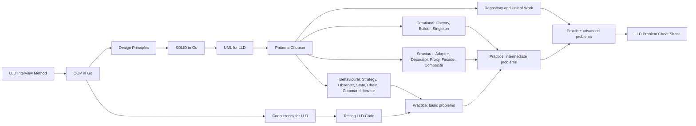

# 17 LLD MOC

> [!summary] What this folder covers
> After this folder you can run a 60-minute low-level design round in Go: clarify scope, model entities, pick the right pattern, make the shared state race-free, and show a test. It covers the method, principles, every common pattern in idiomatic Go, and 26 worked practice problems.

## Before and after

- **Before this:** [[04 Go Language MOC]]
- **After this:** [[19 Interview & Career MOC]]

Back to [[Home]].

## Learning path

1. [[LLD Interview Method]] · basic. The step-by-step script for any LLD round, from clarifying to testing.
2. [[OOP in Go - Structs, Interfaces, Embedding]] · basic. How Go does objects without classes or inheritance.
3. [[Design Principles - DRY, KISS, YAGNI, Coupling and Cohesion]] · basic. The judgement calls that keep a design small.
4. [[SOLID in Go]] · basic. The five principles, rewritten for interfaces and composition.
5. [[UML for LLD]] · basic. Just enough class, sequence and state diagrams for a whiteboard.
6. [[Design Patterns Overview and Chooser]] · basic. Which pattern fits which smell, in one table.

### Patterns

7. [[Strategy and Template Method]] · intermediate. Swap an algorithm behind an interface; the most used pattern in LLD rounds.
8. [[Factory and Abstract Factory]] · intermediate. Centralise construction by type or family.
9. [[Builder and Functional Options]] · intermediate. Idiomatic Go configuration for objects with many optional fields.
10. [[Singleton and sync.Once]] · intermediate. Lazy, safe one-time setup, and why globals hurt tests.
11. [[Adapter]] · intermediate. Wrap a third-party API behind your own interface.
12. [[Decorator and Middleware]] · intermediate. Add logging, retries or limits by wrapping the same interface.
13. [[Proxy]] · intermediate. Control access: caching, lazy loading, protection.
14. [[Facade (vs Mediator)]] · intermediate. One simple entry point over a subsystem, and when routing needs a mediator.
15. [[Composite]] · intermediate. Treat trees of objects and single objects the same way.
16. [[Observer and Event Bus]] · intermediate. Fan-out events in process; owns publish-after-commit and the outbox link.
17. [[State Machines in Go]] · intermediate. Transition tables, guards and compare-and-set persistence.
18. [[Chain of Responsibility and Pipelines]] · intermediate. Pass a request along handlers until one takes it.
19. [[Command, Undo and Memento]] · intermediate. Turn actions into values you can queue, log and undo.
20. [[Iterator and range-over-func]] · intermediate. Go 1.23 iterators for walking collections lazily.
21. [[Repository and Unit of Work]] · intermediate. Hide storage behind interfaces and commit related writes together.
22. [[Rare GoF Patterns in Go]] · advanced. Visitor, Interpreter, Flyweight, Prototype and friends, briefly.
23. [[Concurrency for LLD]] · advanced. Mutexes, atomic claims and single-writer goroutines for shared state.
24. [[Testing LLD Code]] · intermediate. Table tests, fakes, injected clocks and race tests.

### Practice

25. [[Parking Lot]] · basic. The classic first round: atomic spot claim plus swappable pricing.
26. [[Vending Machine]] · basic. The textbook State pattern with real change-making.
27. [[Library Management]] · basic. Title versus copy, holds and fines.
28. [[Meeting Room Scheduler]] · basic. Interval overlap and the double-booking race.
29. [[LRU Cache with TTL]] · basic. Map plus linked list, with expiry.
30. [[Elevator System]] · basic. LOOK scheduling in a deterministic tick simulation.
31. [[Tic-Tac-Toe and Snake and Ladder]] · basic. Machine-coding warm-up with a shared game skeleton.
32. [[Cart Checkout with Coupons]] · intermediate. A saga with compensation and idempotent retries.
33. [[Inventory Order Assignment (Dark Store)]] · intermediate. All-or-nothing stock reservation at the nearest store.
34. [[Delivery Partner Assignment]] · intermediate. Offer, timeout and fallback with a compare-and-set rider claim.
35. [[Notification Service]] · intermediate. Worker pool, retries, failover and graceful drain.
36. [[Rate Limiter]] · intermediate. Token bucket and friends behind one `Allow` call.
37. [[Logging Library]] · intermediate. Levels, formatters and non-blocking appenders.
38. [[File Search (Unix find)]] · intermediate. A Composite file tree queried by a tree of filters.
39. [[ATM]] · intermediate. Session states plus dispensing cash safely.
40. [[In-memory KV Store with TTL and Transactions]] · intermediate. A tiny Redis with nested transactions.
41. [[Task Scheduler (delayed and recurring jobs)]] · intermediate. A min-heap dispatcher and a worker pool.
42. [[Circuit Breaker]] · intermediate. Closed, open and half-open with a sliding window.
43. [[Movie Ticket Booking]] · advanced. Seat holds, expiry and idempotent payment confirmation.
44. [[Splitwise Expense Sharing]] · advanced. Split strategies, net balances and debt simplification.
45. [[Food Ordering System]] · advanced. Cart versus order, actor-checked state machine and refunds.
46. [[Pub-Sub Message Queue]] · advanced. Offsets, acks and redelivery in memory.
47. [[Ride Sharing]] · advanced. Trip state machine, grid matching and atomic driver claim.
48. [[Hotel Booking]] · advanced. Per-night inventory with holds and cancellation policies.
49. [[Order Book Matching Engine]] · advanced. Price-time priority with a single-writer book.
50. [[Digital Wallet and Ledger]] · advanced. Double-entry ledger with idempotent transfers.
51. [[LLD Problem Cheat Sheet]] · intermediate. All 26 problems in one table for last-minute revision.

## Concept map

## Interview focus

- How do you approach an LLD round in 60 minutes? See [[LLD Interview Method]].
- How do you do inheritance and polymorphism in Go without classes? See [[OOP in Go - Structs, Interfaces, Embedding]].
- Explain SOLID with a Go example, especially dependency inversion. See [[SOLID in Go]].
- When do you use Strategy versus State? See [[Strategy and Template Method]] and [[State Machines in Go]].
- How do you stop two users from booking the same seat or spot? See [[Movie Ticket Booking]] and [[Concurrency for LLD]].
- Design a parking lot. See [[Parking Lot]].
- Design an LRU cache with expiry. See [[LRU Cache with TTL]].
- Design a rate limiter and pick an algorithm. See [[Rate Limiter]].
- How do you make a payment or checkout retry-safe? See [[Cart Checkout with Coupons]] and [[Digital Wallet and Ledger]].
- How do you test time-dependent and concurrent code? See [[Testing LLD Code]].

## Sources worth reading

- Gamma, Helm, Johnson and Vlissides, *Design Patterns: Elements of Reusable Object-Oriented Software*: the original catalogue.
- Freeman and Robson, *Head First Design Patterns*: the gentlest introduction to the same patterns.
- Robert C. Martin, *Clean Architecture*: SOLID and dependency direction.
- refactoring.guru, "Design Patterns in Go": short Go examples for every GoF pattern.
- The Go blog, "Range Over Function Types" (2024): the iterator design used in this folder.
- Dave Cheney, "Functional options for friendly APIs" (2014): the origin of the options pattern used in the Builder note.
