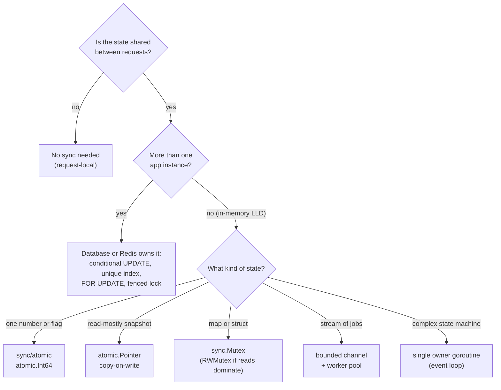
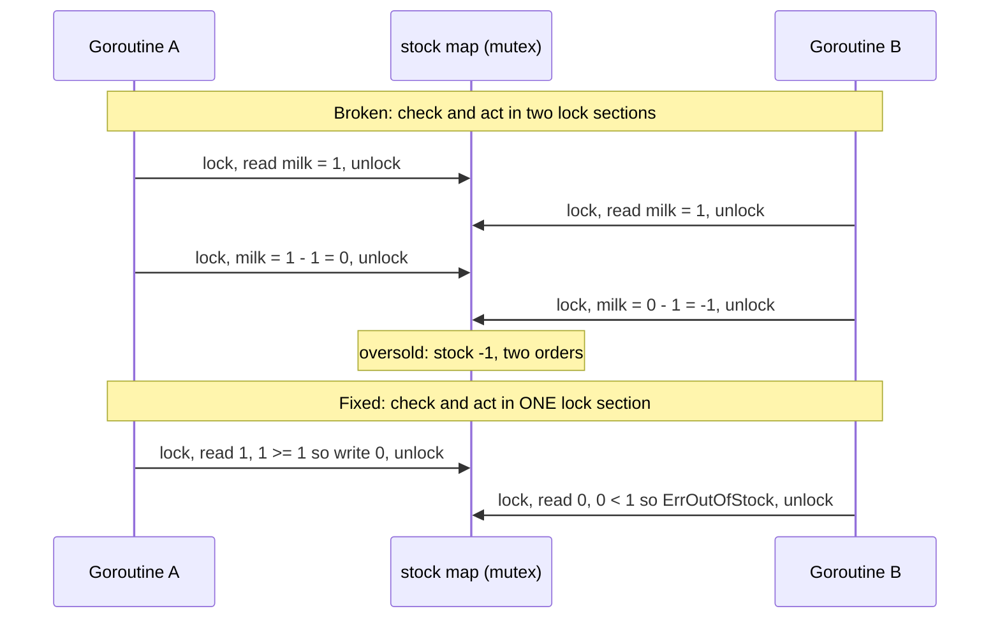
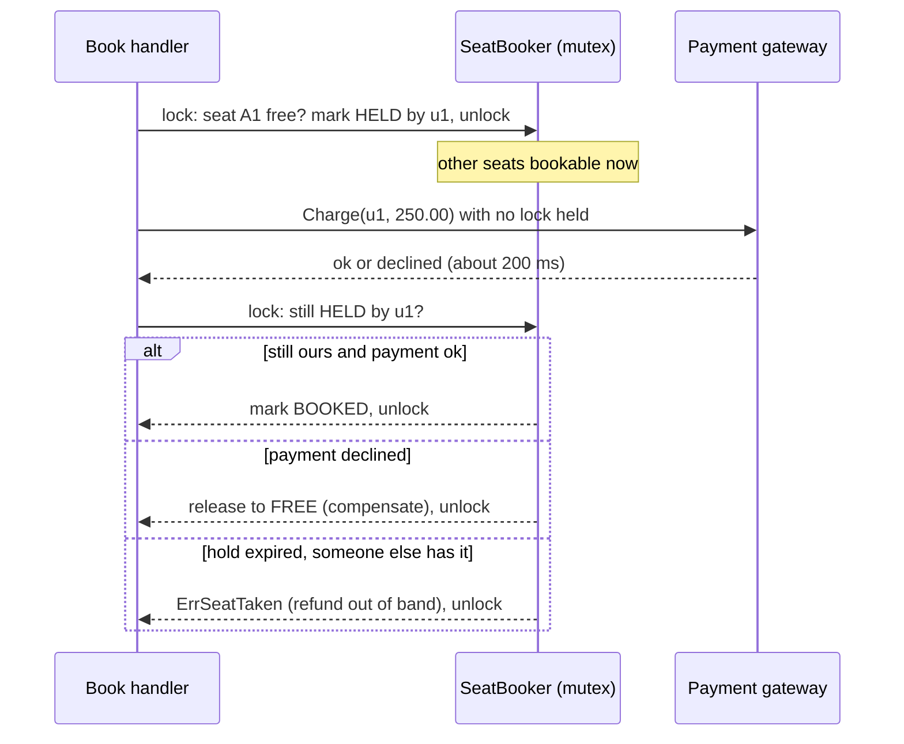
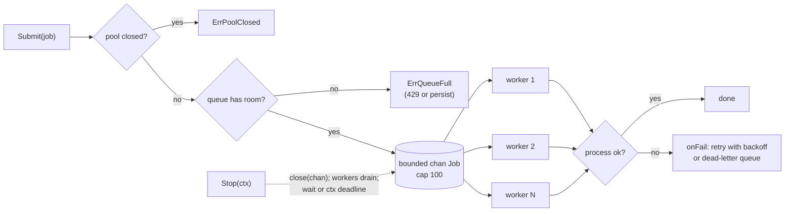

# Concurrency for LLD

> [!summary] TL;DR
> A Go server runs every request in its own goroutine, so any service struct shared between requests is shared memory. Name the invariant first ("exactly one user gets the last seat"), then pick what protects it: a mutex for in-process state, a single owner goroutine for event-loop style designs, atomics for one value, and the database once there is more than one app instance.

> [!abstract] Core idea
> - State the invariant before writing any lock: what must never happen when two requests collide?
> - Check and act must sit in one critical section; two separate lock sections still oversell.
> - Never hold a lock across I/O: decide under the lock, call outside it, then re-lock and re-check.
> - Take several locks in one fixed global order, or you will eventually deadlock.
> - A Go mutex protects one process. With N instances the invariant moves into the database (conditional `UPDATE`, unique index, `FOR UPDATE`) or a fenced lock.

This note is the LLD angle: where invariants live and how to defend them in an interview design. The mechanics of each primitive live in [[Goroutines and Channels]], [[sync Primitives and Atomics]] and [[select and Concurrency Patterns]].

## 1. Why it exists

A **data race** is two goroutines touching the same memory at the same time, with at least one write and no synchronisation between them. A **race condition** is the broader bug: the result depends on timing, even if every single access is synchronised.

Concrete scenario: a dark store has **1 packet of milk** left. Two customers tap "Pay" within the same millisecond. Two HTTP requests arrive, `net/http` starts one goroutine for each, and both call `inventory.Reserve("milk", 1)`.

- If `Reserve` reads the stock, releases the lock, and then writes, both goroutines see `1` and both succeed. Stock becomes `-1`: one customer is charged for milk that does not exist.
- If the map is not locked at all, Go's runtime may crash the whole process with `fatal error: concurrent map read and map write`. That is not a panic you can recover; every request on the instance dies.

Almost every LLD follow-up is a version of this: two users book the last seat, two riders get the same order, two requests spend the same wallet balance. The interviewer wants three answers:

1. **Where** is the shared mutable state?
2. **What** protects it, and why that tool?
3. **What happens** to the loser? (A clear error such as `ErrOutOfStock`, never a silent corruption.)

## 2. Mental model

Think of shared state as a **single-occupancy room** with a whiteboard inside.

- A **mutex** is the door lock. Whoever is inside can read the whiteboard and update it, and nobody else can see a half-written number.
- **Check-then-act** means: read the whiteboard and update it *during the same visit*. Leaving the room between reading and writing lets someone else in.
- **Holding a lock across I/O** is staying in the room while on the phone to the bank. The queue outside grows for no reason.
- A **single-owner goroutine** is a receptionist who alone may touch the whiteboard. Everyone else hands her a note (a channel message) and waits for the reply.
- **Many app instances** are many buildings, each with its own room. A lock on one building's door does not stop the next building. The only shared whiteboard is the database.

## 3. How it works

### Where does the invariant live?



### Decision table

| Situation | Use | Why | Cost |
| --- | --- | --- | --- |
| Shared map or struct in one process | `sync.Mutex` | Simplest and clearest; covers multi-field invariants | All callers serialise on one lock |
| Reads far outnumber writes and the critical section is not tiny | `sync.RWMutex` | Readers run in parallel | More bookkeeping than `Mutex`; often slower for tiny sections; a waiting writer blocks new readers |
| One counter or flag | `atomic.Int64`, `atomic.Bool` | Lock-free, very cheap | Only one value; cannot keep two fields consistent |
| Read-mostly config or routing table | `atomic.Pointer[T]` with immutable snapshots | Readers never block; reload swaps the whole snapshot | Every write copies the snapshot |
| One-time init | `sync.Once` / `sync.OnceValue` | Safe lazy init (see [[Singleton and sync.Once]]) | A panic or error inside is not retried |
| Stream of independent jobs | Bounded channel + N workers | Caps concurrency and memory; gives backpressure | Need a drain and shutdown story |
| State machine with many rules (matching engine, elevator controller) | Single owner goroutine reading a command channel | No locks at all; events processed strictly in order | One goroutine is the throughput ceiling; every call is a round trip |
| Wait for N goroutines, first error cancels the rest | `errgroup.Group` | Join plus error plus context cancel | Extra dependency (`golang.org/x/sync`) |
| Many callers miss the cache for the same key | `singleflight.Group` | One load, shared result | A slow load blocks all waiters for that key |
| At most K things at once | `semaphore.Weighted` or a buffered `chan struct{}` | Caps parallel calls to a fragile dependency | Callers wait or fail fast |
| At most R things per second | `golang.org/x/time/rate.Limiter` | Token bucket with burst | Per process only |
| State shared across instances | Database or Redis | A Go mutex protects only one process | Network round trip; needs DB design |

Go proverb: *"Don't communicate by sharing memory; share memory by communicating."* For guarding a map or a struct, a mutex is still simpler and perfectly idiomatic. Use channels when ownership of data really moves between goroutines.

### The oversell race, and the fix

The bug is check-then-act split across two critical sections. Both goroutines pass the check before either acts:



### Lock granularity

Lock granularity is how much state one lock covers.

1. **Global lock**: one mutex for the whole service. Correct and simple; the right first answer in an interview.
2. **Per entity**: one mutex per show, per wallet, per store. Bookings for different shows no longer wait on each other.
3. **Striped (sharded)**: `N` locks, and key `k` uses lock `hash(k) % N`. Bounded memory, most contention removed. Used inside caches and rate limiters with millions of keys.

Move down this list only when you can say which lock is contended. Each step adds a way to get it wrong, such as an operation that needs two entities and now needs two locks.

### Lock ordering and deadlock

A **deadlock** happens when goroutine 1 holds lock A and waits for B while goroutine 2 holds B and waits for A. Neither can move. The fix is a fixed global order: whenever one operation needs several locks, it takes them sorted by a stable key (wallet ID, seat ID). Then the cycle can never form. Go's runtime only detects the case where **every** goroutine is blocked (`fatal error: all goroutines are asleep - deadlock!`); a server with one stuck pair just hangs those requests.

### Never hold a lock across I/O

Calling a payment gateway, an HTTP API, or a database while holding a mutex turns a 200 ms network call into a 200 ms stall for every other request that needs the lock. The pattern is three steps:



The claim in step 1 is an **atomic pick-and-claim**: the check ("is it free?") and the claim ("now it is HELD by me") happen in one critical section, so only one goroutine can move the seat out of FREE. The re-check in step 3 matters because the world may have changed while the lock was released. The code below keeps the hold-expiry janitor out for brevity, so its `ErrSeatTaken` branch in step 3 only fires once a TTL sweeper is added; in that branch a failed charge is masked by `ErrSeatTaken`, and a successful one must be refunded.

## 4. Worked example

### Whiteboard version

```text
Invariant 1: stock[p] >= 0            -> Reserve: lock { if stock < q: fail; stock -= q }
Invariant 2: money is conserved        -> Transfer: amount > 0; lock both wallets
                                          sorted by ID; check; move; unlock
Invariant 3: one booking per seat      -> lock { FREE -> HELD(u) }; unlock
                                          pay() with no lock
                                          lock { still HELD(u)? BOOKED : fail/release }
Background jobs                        -> chan Job (cap 100), 4 workers
                                          Submit: non-blocking, ErrQueueFull = backpressure
                                          Stop: refuse new, close(chan), workers drain, wait
Hot config                             -> atomic.Pointer[Config], swap whole snapshot
Calls to a fragile API                 -> semaphore (<= 3 in flight) + rate.Limiter (<= R/s)
Proof                                  -> 100 goroutines behind a start barrier,
                                          count winners atomically, go test -race,
                                          goleak in TestMain
Many instances                         -> same invariants in PostgreSQL (section 7)
```

All the code below is one package, tested with Go 1.24.4 (`golang.org/x/sync`, `golang.org/x/time/rate` and `go.uber.org/goleak` as dependencies): `go vet ./...` is clean and `go test -race -count=3 ./...` passes.

### Check-then-act in one critical section

```go
package conc

import (
	"errors"
	"sync"
)

var ErrOutOfStock = errors.New("out of stock")

// Store keeps stock per product. Invariant: stock never goes below zero.
type Store struct {
	mu    sync.Mutex
	stock map[string]int // productID -> available qty, guarded by mu
}

func NewStore() *Store { return &Store{stock: make(map[string]int)} }

func (s *Store) Add(productID string, qty int) {
	s.mu.Lock()
	defer s.mu.Unlock()
	s.stock[productID] += qty
}

// Reserve is check-then-act. Both steps sit inside ONE critical section,
// otherwise two goroutines can both see qty=1 and both take it.
func (s *Store) Reserve(productID string, qty int) error {
	s.mu.Lock()
	defer s.mu.Unlock()
	if s.stock[productID] < qty {
		return ErrOutOfStock
	}
	s.stock[productID] -= qty
	return nil
}

func (s *Store) Available(productID string) int {
	s.mu.Lock()
	defer s.mu.Unlock()
	return s.stock[productID]
}
```

### Lock ordering: a wallet transfer that cannot deadlock

The balance is unexported, so no caller can read or change it without the lock. `Transfer` rejects non-positive amounts; without that check, a transfer of `-50` would move money the wrong way and pass the balance check.

```go
package conc

import (
	"errors"
	"sync"
)

var (
	ErrInsufficientFunds = errors.New("insufficient funds")
	ErrInvalidAmount     = errors.New("amount must be positive")
	ErrSameWallet        = errors.New("cannot transfer to the same wallet")
)

// Wallet hides its balance so no caller can read or write it without the lock.
type Wallet struct {
	id      string
	mu      sync.Mutex
	balance int64 // paise, guarded by mu
}

func NewWallet(id string, balance int64) *Wallet { return &Wallet{id: id, balance: balance} }

func (w *Wallet) Balance() int64 {
	w.mu.Lock()
	defer w.mu.Unlock()
	return w.balance
}

// Transfer locks both wallets in ID order, so A->B and B->A running at the
// same time cannot deadlock.
func Transfer(from, to *Wallet, amount int64) error {
	if amount <= 0 {
		return ErrInvalidAmount
	}
	if from.id == to.id {
		return ErrSameWallet
	}
	first, second := from, to
	if second.id < first.id {
		first, second = second, first
	}
	first.mu.Lock()
	defer first.mu.Unlock()
	second.mu.Lock()
	defer second.mu.Unlock()

	if from.balance < amount {
		return ErrInsufficientFunds
	}
	from.balance -= amount
	to.balance += amount
	return nil
}
```

### Never hold a lock across I/O

```go
package conc

import (
	"context"
	"errors"
	"sync"
)

var ErrSeatTaken = errors.New("seat taken")

type seatState int

const (
	seatFree seatState = iota
	seatHeld
	seatBooked
)

type PaymentGateway interface {
	Charge(ctx context.Context, userID string, amount int64) error
}

// SeatBooker shows the "decide under the lock, call outside, re-check" rule.
type SeatBooker struct {
	mu    sync.Mutex
	seats map[string]seatState // guarded by mu
	owner map[string]string    // seat -> user holding it, guarded by mu
	pay   PaymentGateway
}

func NewSeatBooker(seatIDs []string, pay PaymentGateway) *SeatBooker {
	b := &SeatBooker{seats: map[string]seatState{}, owner: map[string]string{}, pay: pay}
	for _, id := range seatIDs {
		b.seats[id] = seatFree
	}
	return b
}

func (b *SeatBooker) Book(ctx context.Context, userID, seatID string, price int64) error {
	// 1. Decide and claim under the lock (atomic pick-and-claim).
	b.mu.Lock()
	if b.seats[seatID] != seatFree {
		b.mu.Unlock()
		return ErrSeatTaken
	}
	b.seats[seatID] = seatHeld
	b.owner[seatID] = userID
	b.mu.Unlock()

	// 2. Slow I/O with NO lock held: other seats stay bookable.
	err := b.pay.Charge(ctx, userID, price)

	// 3. Re-take the lock and re-check that we still own the hold.
	b.mu.Lock()
	defer b.mu.Unlock()
	if b.seats[seatID] != seatHeld || b.owner[seatID] != userID {
		return ErrSeatTaken // hold expired and someone else took it
	}
	if err != nil {
		b.seats[seatID] = seatFree // compensate: release the hold
		delete(b.owner, seatID)
		return err
	}
	b.seats[seatID] = seatBooked
	return nil
}

// Free counts seats that are free. Used by tests and the seat map.
func (b *SeatBooker) Free() int {
	b.mu.Lock()
	defer b.mu.Unlock()
	n := 0
	for _, s := range b.seats {
		if s == seatFree {
			n++
		}
	}
	return n
}
```

### A bounded worker pool that drains on shutdown

The pool has a fixed number of workers and a bounded queue. `Submit` never blocks: a full queue returns `ErrQueueFull`, which is **backpressure** (the caller learns the system is saturated and can return HTTP 429 or store the job durably). `Stop` refuses new jobs, closes the channel, and the workers' `range` loop keeps going until the queue is empty, so nothing accepted is silently dropped. The `RWMutex` makes "check closed, then send" atomic with respect to `close`, so a late `Submit` cannot panic with "send on closed channel".



```go
package conc

import (
	"context"
	"errors"
	"sync"
)

var (
	ErrQueueFull  = errors.New("queue full")
	ErrPoolClosed = errors.New("pool closed")
)

type Job struct {
	ID      string
	Payload string
}

type Processor func(ctx context.Context, job Job) error

// Pool runs jobs on a fixed number of workers with a bounded queue.
// Submit never blocks (backpressure); Stop drains what was accepted.
type Pool struct {
	mu      sync.RWMutex // guards closed and the close of jobs
	closed  bool
	jobs    chan Job
	process Processor
	onFail  func(Job, error) // retry or dead-letter hook
	wg      sync.WaitGroup
}

func NewPool(workers, queueSize int, process Processor, onFail func(Job, error)) *Pool {
	p := &Pool{jobs: make(chan Job, queueSize), process: process, onFail: onFail}
	for range workers {
		p.wg.Add(1)
		go func() {
			defer p.wg.Done()
			// range ends only when jobs is closed AND empty: nothing is dropped.
			for job := range p.jobs {
				if err := p.process(context.Background(), job); err != nil {
					p.onFail(job, err)
				}
			}
		}()
	}
	return p
}

func (p *Pool) Submit(job Job) error {
	p.mu.RLock()
	defer p.mu.RUnlock()
	if p.closed {
		return ErrPoolClosed
	}
	select {
	case p.jobs <- job:
		return nil
	default:
		return ErrQueueFull // caller returns 429 or persists the job
	}
}

// Stop rejects new jobs, lets workers drain the queue, and waits for them
// until ctx expires.
func (p *Pool) Stop(ctx context.Context) error {
	p.mu.Lock()
	if !p.closed {
		p.closed = true
		close(p.jobs)
	}
	p.mu.Unlock()

	done := make(chan struct{})
	go func() { p.wg.Wait(); close(done) }()
	select {
	case <-done:
		return nil
	case <-ctx.Done():
		return ctx.Err()
	}
}
```

In a real service `Stop` runs from the shutdown path after `http.Server.Shutdown`, with a deadline shorter than the orchestrator's kill timeout (Kubernetes sends `SIGKILL` 30 s after `SIGTERM` by default). Jobs that matter more than that window belong in a durable queue, not in a channel.

### Copy-on-write config with atomic.Pointer

```go
package conc

import "sync/atomic"

// Config is immutable once published. To change it, build a new one and swap.
type Config struct {
	MaxHoldSeats int
	FeatureFlags map[string]bool
}

type ConfigStore struct{ p atomic.Pointer[Config] }

func NewConfigStore(c *Config) *ConfigStore {
	s := &ConfigStore{}
	s.p.Store(c)
	return s
}

// Load is lock-free: readers on the hot path never block a reload.
func (s *ConfigStore) Load() *Config { return s.p.Load() }

// Swap publishes a whole new snapshot; readers see either old or new, never a mix.
func (s *ConfigStore) Swap(c *Config) { s.p.Store(c) }
```

The rule that makes this safe: a published `*Config` is never mutated. A reload builds a fresh struct (including a fresh map) and swaps the pointer.

### Semaphore, rate limit and sync.Cond

A **semaphore** limits how many operations run at once. A **rate limiter** limits how many start per second. They answer different questions, and calls to a fragile partner API often need both. `sync.Cond` lets goroutines sleep until a condition on locked state becomes true; it is the textbook tool for a blocking bounded queue, although a buffered channel does the same job in most Go code.

```go
package conc

import (
	"context"
	"sync"

	"golang.org/x/sync/semaphore"
	"golang.org/x/time/rate"
)

// FetchAll calls fetch for every id with at most maxInFlight calls at once
// (a semaphore) and at most rps calls started per second (a token bucket).
func FetchAll(ctx context.Context, ids []string, maxInFlight int64, rps float64,
	fetch func(context.Context, string) error) []error {

	sem := semaphore.NewWeighted(maxInFlight)
	lim := rate.NewLimiter(rate.Limit(rps), 1) // burst 1
	errs := make([]error, len(ids))
	var wg sync.WaitGroup
	for i, id := range ids {
		if err := lim.Wait(ctx); err != nil { // blocks until a token is free
			errs[i] = err
			continue
		}
		if err := sem.Acquire(ctx, 1); err != nil {
			errs[i] = err
			continue
		}
		wg.Add(1)
		go func() {
			defer wg.Done()
			defer sem.Release(1)
			errs[i] = fetch(ctx, id) // each goroutine writes its own index
		}()
	}
	wg.Wait()
	return errs
}

// BlockingQueue is a bounded FIFO built on sync.Cond: Take waits until an
// item exists, Put waits until there is room.
type BlockingQueue struct {
	mu       sync.Mutex
	notEmpty *sync.Cond
	notFull  *sync.Cond
	items    []int
	cap      int
}

func NewBlockingQueue(capacity int) *BlockingQueue {
	q := &BlockingQueue{cap: capacity}
	q.notEmpty = sync.NewCond(&q.mu)
	q.notFull = sync.NewCond(&q.mu)
	return q
}

func (q *BlockingQueue) Put(v int) {
	q.mu.Lock()
	defer q.mu.Unlock()
	for len(q.items) == q.cap { // always a loop: another goroutine may take the slot first
		q.notFull.Wait() // atomically unlocks mu, sleeps, re-locks mu
	}
	q.items = append(q.items, v)
	q.notEmpty.Signal()
}

func (q *BlockingQueue) Take() int {
	q.mu.Lock()
	defer q.mu.Unlock()
	for len(q.items) == 0 {
		q.notEmpty.Wait()
	}
	v := q.items[0]
	q.items = q.items[1:]
	q.notFull.Signal()
	return v
}
```

### errgroup and singleflight

`errgroup.Group` (from `golang.org/x/sync`) is a `WaitGroup` that also collects the first error and, with `WithContext`, cancels the other goroutines when one fails. `SetLimit` caps how many run at once. `singleflight.Group` collapses concurrent calls with the same key into one call whose result all callers share, which stops a cache stampede when a hot key expires.

```go
package conc

import (
	"context"
	"sync"

	"golang.org/x/sync/errgroup"
	"golang.org/x/sync/singleflight"
)

// LoadOrderPage fetches the order, user and items in parallel. The first
// error cancels ctx for the others, and Wait returns that first error.
func LoadOrderPage(ctx context.Context, orderID string,
	load func(ctx context.Context, what, id string) (string, error)) ([3]string, error) {

	var out [3]string
	g, ctx := errgroup.WithContext(ctx)
	g.SetLimit(3) // never more than 3 calls in flight
	for i, what := range []string{"order", "user", "items"} {
		g.Go(func() error {
			v, err := load(ctx, what, orderID)
			out[i] = v // each goroutine writes its own index
			return err
		})
	}
	err := g.Wait()
	return out, err
}

// PriceCache collapses concurrent misses for the same key into one load.
type PriceCache struct {
	sf    singleflight.Group
	mu    sync.Mutex
	cache map[string]int64 // guarded by mu
	load  func(key string) (int64, error)
}

func NewPriceCache(load func(string) (int64, error)) *PriceCache {
	return &PriceCache{cache: map[string]int64{}, load: load}
}

func (c *PriceCache) Get(key string) (int64, error) {
	c.mu.Lock()
	v, ok := c.cache[key]
	c.mu.Unlock()
	if ok {
		return v, nil
	}
	res, err, _ := c.sf.Do(key, func() (any, error) {
		p, err := c.load(key) // runs once per key, however many callers wait
		if err != nil {
			return int64(0), err
		}
		c.mu.Lock()
		c.cache[key] = p
		c.mu.Unlock()
		return p, nil
	})
	return res.(int64), err
}
```

```go
package conc

import (
	"context"
	"errors"
	"sync"
	"sync/atomic"
	"testing"
	"time"
)

func TestLoadOrderPage_FirstErrorCancelsOthers(t *testing.T) {
	errDown := errors.New("user service down")
	_, err := LoadOrderPage(context.Background(), "o1", func(ctx context.Context, what, id string) (string, error) {
		if what == "user" {
			return "", errDown
		}
		select {
		case <-ctx.Done(): // cancelled by the failing sibling
			return "", ctx.Err()
		case <-time.After(time.Second):
			return what, nil
		}
	})
	if !errors.Is(err, errDown) {
		t.Fatalf("err = %v, want %v", err, errDown)
	}
}

func TestPriceCache_OneLoadForConcurrentMisses(t *testing.T) {
	var loads atomic.Int32
	c := NewPriceCache(func(key string) (int64, error) {
		loads.Add(1)
		time.Sleep(20 * time.Millisecond) // slow DB call
		return 199_00, nil
	})
	start := make(chan struct{})
	var wg sync.WaitGroup
	for range 50 {
		wg.Add(1)
		go func() {
			defer wg.Done()
			<-start
			if v, err := c.Get("milk"); err != nil || v != 199_00 {
				t.Errorf("Get = %d, %v", v, err)
			}
		}()
	}
	close(start)
	wg.Wait()
	if n := loads.Load(); n != 1 {
		t.Fatalf("loads = %d, want 1", n)
	}
}
```

### Proving it

`goleak` (from `go.uber.org/goleak`) fails the package if goroutines are still alive when tests end, which catches workers that were never stopped. The winner test releases 100 goroutines from a closed channel (a **start barrier**) so they really collide, and counts winners with an atomic.

```go
package conc

import (
	"context"
	"errors"
	"sync"
	"sync/atomic"
	"testing"
	"time"

	"go.uber.org/goleak"
)

// TestMain fails the package if any goroutine is still running after the tests.
func TestMain(m *testing.M) { goleak.VerifyTestMain(m) }

func TestReserve_ExactlyOneWinner(t *testing.T) {
	s := NewStore()
	s.Add("milk", 1)

	start := make(chan struct{})
	var wins atomic.Int32
	var wg sync.WaitGroup
	for range 100 {
		wg.Add(1)
		go func() {
			defer wg.Done()
			<-start // all goroutines race from the same moment
			if s.Reserve("milk", 1) == nil {
				wins.Add(1)
			}
		}()
	}
	close(start)
	wg.Wait()

	if got := wins.Load(); got != 1 {
		t.Fatalf("winners = %d, want 1", got)
	}
	if got := s.Available("milk"); got != 0 {
		t.Fatalf("stock = %d, want 0", got)
	}
}

func TestTransfer_OppositeDirectionsNoDeadlock(t *testing.T) {
	a, b := NewWallet("A", 1_000_000), NewWallet("B", 1_000_000)
	var wg sync.WaitGroup
	for range 1000 {
		wg.Add(2)
		go func() { defer wg.Done(); _ = Transfer(a, b, 1) }()
		go func() { defer wg.Done(); _ = Transfer(b, a, 1) }()
	}
	done := make(chan struct{})
	go func() { wg.Wait(); close(done) }()
	select {
	case <-done:
	case <-time.After(5 * time.Second):
		t.Fatal("deadlock: transfers did not finish")
	}
	if total := a.Balance() + b.Balance(); total != 2_000_000 {
		t.Fatalf("money created or lost: total = %d", total)
	}
}

func TestTransfer_Rules(t *testing.T) {
	a, b := NewWallet("A", 100), NewWallet("B", 0)
	tests := []struct {
		name    string
		from    *Wallet
		to      *Wallet
		amount  int64
		wantErr error
	}{
		{"zero amount", a, b, 0, ErrInvalidAmount},
		{"negative amount steals money", a, b, -50, ErrInvalidAmount},
		{"same wallet", a, a, 10, ErrSameWallet},
		{"not enough", a, b, 101, ErrInsufficientFunds},
		{"ok", a, b, 100, nil},
	}
	for _, tc := range tests {
		t.Run(tc.name, func(t *testing.T) {
			if err := Transfer(tc.from, tc.to, tc.amount); !errors.Is(err, tc.wantErr) {
				t.Fatalf("err = %v, want %v", err, tc.wantErr)
			}
		})
	}
}

func TestPool_StopDrainsAcceptedJobs(t *testing.T) {
	var done atomic.Int32
	p := NewPool(4, 100, func(ctx context.Context, j Job) error {
		time.Sleep(time.Millisecond)
		done.Add(1)
		return nil
	}, func(Job, error) {})

	accepted := 0
	for i := range 100 {
		if p.Submit(Job{ID: string(rune('a' + i%26))}) == nil {
			accepted++
		}
	}
	ctx, cancel := context.WithTimeout(context.Background(), 5*time.Second)
	defer cancel()
	if err := p.Stop(ctx); err != nil {
		t.Fatal(err)
	}
	if got := int(done.Load()); got != accepted {
		t.Fatalf("processed %d, accepted %d: jobs were dropped", got, accepted)
	}
	if err := p.Submit(Job{ID: "late"}); !errors.Is(err, ErrPoolClosed) {
		t.Fatalf("submit after stop: err = %v, want ErrPoolClosed", err)
	}
}

func TestPool_QueueFullIsBackpressure(t *testing.T) {
	release := make(chan struct{})
	p := NewPool(1, 1, func(ctx context.Context, j Job) error { <-release; return nil }, func(Job, error) {})
	var full int
	for range 10 {
		if errors.Is(p.Submit(Job{}), ErrQueueFull) {
			full++
		}
	}
	close(release)
	_ = p.Stop(context.Background())
	if full < 8 { // 1 running + 1 queued at most
		t.Fatalf("full = %d, want >= 8", full)
	}
}

func TestConfigStore_SwapWhileReading(t *testing.T) {
	cs := NewConfigStore(&Config{MaxHoldSeats: 6})
	var wg sync.WaitGroup
	for range 8 {
		wg.Add(1)
		go func() {
			defer wg.Done()
			for range 1000 {
				if c := cs.Load(); c.MaxHoldSeats != 6 && c.MaxHoldSeats != 10 {
					t.Errorf("torn config: %d", c.MaxHoldSeats)
					return
				}
			}
		}()
	}
	cs.Swap(&Config{MaxHoldSeats: 10})
	wg.Wait()
}

type slowPay struct {
	delay time.Duration
	err   error
}

func (p slowPay) Charge(ctx context.Context, userID string, amount int64) error {
	time.Sleep(p.delay)
	return p.err
}

func TestSeatBooker_OneWinnerAndNoLockDuringIO(t *testing.T) {
	b := NewSeatBooker([]string{"A1", "A2"}, slowPay{delay: 50 * time.Millisecond})
	var wins atomic.Int32
	var wg sync.WaitGroup
	for range 20 {
		wg.Add(1)
		go func() {
			defer wg.Done()
			if b.Book(context.Background(), "u", "A1", 250_00) == nil {
				wins.Add(1)
			}
		}()
	}
	// While A1's payment is in flight, A2 must still be bookable quickly.
	time.Sleep(5 * time.Millisecond)
	startA2 := time.Now()
	if err := b.Book(context.Background(), "v", "A2", 250_00); err != nil {
		t.Fatal(err)
	}
	wg.Wait()
	if wins.Load() != 1 {
		t.Fatalf("A1 winners = %d, want 1", wins.Load())
	}
	if d := time.Since(startA2); d > 200*time.Millisecond {
		t.Fatalf("A2 took %v: lock was held across I/O", d)
	}
}

func TestSeatBooker_PaymentFailureReleasesSeat(t *testing.T) {
	b := NewSeatBooker([]string{"A1"}, slowPay{err: errors.New("declined")})
	if err := b.Book(context.Background(), "u", "A1", 100); err == nil {
		t.Fatal("want payment error")
	}
	if b.Free() != 1 {
		t.Fatal("seat not released after failed payment")
	}
}
```

```go
package conc

import (
	"context"
	"sync"
	"sync/atomic"
	"testing"
	"time"
)

func TestFetchAll_RespectsMaxInFlight(t *testing.T) {
	var inFlight, peak atomic.Int32
	ids := make([]string, 30)
	errs := FetchAll(context.Background(), ids, 3, 1000, func(ctx context.Context, id string) error {
		n := inFlight.Add(1)
		for {
			p := peak.Load()
			if n <= p || peak.CompareAndSwap(p, n) {
				break
			}
		}
		time.Sleep(5 * time.Millisecond)
		inFlight.Add(-1)
		return nil
	})
	for _, err := range errs {
		if err != nil {
			t.Fatal(err)
		}
	}
	if peak.Load() > 3 {
		t.Fatalf("peak in flight = %d, want <= 3", peak.Load())
	}
}

func TestBlockingQueue_ProducersConsumers(t *testing.T) {
	q := NewBlockingQueue(2)
	var sum atomic.Int64
	var wg sync.WaitGroup
	for p := range 4 {
		wg.Add(1)
		go func() {
			defer wg.Done()
			for i := 1; i <= 100; i++ {
				q.Put(p*1000 + i)
			}
		}()
	}
	var cwg sync.WaitGroup
	for range 4 {
		cwg.Add(1)
		go func() {
			defer cwg.Done()
			for range 100 {
				sum.Add(int64(q.Take()))
			}
		}()
	}
	wg.Wait()
	cwg.Wait()
	// sum over p of (p*1000*100 + 5050) for p = 0..3
	if want := int64(600_000 + 4*5050); sum.Load() != want {
		t.Fatalf("sum = %d, want %d", sum.Load(), want)
	}
}
```

```bash
go vet ./...
go test -race -count=3 ./...
```

Measured: `ok example.com/conc 3.048s` on an Apple Silicon laptop with Go 1.24.4 (three runs of every test under the race detector).

## 5. Variants and comparison

| Approach | How it works | When to use | Cost and risk |
| --- | --- | --- | --- |
| One global mutex | Every method locks the same `sync.Mutex` | Default for interview LLD; small state | Contention once throughput is high |
| Per-entity mutex | `map[id]*entity`, each entity has its own lock | Shows, wallets, stores that rarely interact | Cross-entity operations need lock ordering; the map itself still needs a lock |
| Striped locks | `locks[hash(key) % N]` | Millions of keys (cache, rate limiter) | Unrelated keys sometimes share a stripe |
| Single owner goroutine (actor or event loop) | One goroutine owns the state; callers send commands on a channel and wait for a reply | Order book, elevator scheduler, game loop: strict ordering, many rules | One core of throughput; every call is a channel round trip; must handle shutdown |
| Atomics | CPU-level read-modify-write on one word | Counters, flags, pointer swaps | Cannot protect multi-field invariants; easy to write subtle bugs |
| Database owns the invariant | Conditional `UPDATE`, unique index, `FOR UPDATE` | Any state shared by more than one instance | Round trip per operation; lock contention moves to the DB |
| Distributed lock (Redis `SET NX PX`) | Lease with a TTL across instances | Short holds where the DB cannot express the rule | Leases expire during GC pauses; needs fencing tokens |

## 6. Trade-offs and when not to use

- **Do not add concurrency the problem does not need.** A parking lot with one gate and an in-memory map needs one mutex, not channels, actors and striping. Over-engineering costs interview minutes and adds bugs.
- **RWMutex is not a free upgrade.** For a critical section of a few map operations, a plain `Mutex` is often as fast or faster, and `RWMutex` makes it easy to forget that a "read" path (an LRU `Get` moves the item to the front) actually writes.
- **Channels are not automatically safer.** A design with five channels and three `select` statements is harder to prove correct than a struct with one mutex. Use channels when work or ownership moves; use a mutex when goroutines share a struct.
- **Atomics only cover one word.** Two atomics are not one atomic: `count.Add(1)` followed by `total.Add(price)` can be observed half done.
- **The in-process lock is pointless across instances.** Once the service is horizontally scaled, only the database or a fenced distributed lock can enforce "exactly one wins". Say this unprompted in an interview.

## 7. In production

### Multi-instance invariants (PostgreSQL 17)

| Technique | SQL | Use when |
| --- | --- | --- |
| Conditional UPDATE | `UPDATE inventory SET qty = qty - $1 WHERE product_id = $2 AND qty >= $1;` and 0 rows affected means out of stock | Counters and stock; one statement, no explicit lock |
| Row lock | `SELECT qty FROM inventory WHERE product_id = $1 FOR UPDATE;` then update in the same transaction | Read-modify-write that needs logic between read and write |
| Queue claim | `SELECT id FROM jobs WHERE status = 'ready' ORDER BY id LIMIT 10 FOR UPDATE SKIP LOCKED;` | Many workers taking distinct rows without blocking each other |
| Optimistic version | `UPDATE orders SET status = $1, version = version + 1 WHERE id = $2 AND version = $3;` and retry on 0 rows | Low contention; long user think time |
| Unique constraint | `UNIQUE (show_id, seat_id)` on bookings | "Only one can ever win", enforced even against buggy code |
| Partial unique index | `CREATE UNIQUE INDEX one_active_hold ON seat_holds (show_id, seat_id) WHERE status = 'HELD';` | One active row per key while history rows remain |
| Idempotency key | `UNIQUE (idempotency_key)` on payments | Client and network retries (see [[Idempotency and Idempotency Keys]]) |
| Redis lease | `SET lock:seat:A1 <token> NX PX 30000` | Short holds outside the DB; pair with a fencing token |

The conditional `UPDATE` is the multi-instance version of `Store.Reserve`: the check (`qty >= $1`) and the act (`qty = qty - $1`) run in one statement, and PostgreSQL's row lock serialises concurrent updates to the same row. The deeper story of row locks, `NOWAIT`, `SKIP LOCKED` and optimistic retries is in [[Locking - Optimistic vs Pessimistic]].

A **fencing token** is a number that increases every time the lock is granted. The lock holder sends it with every write, and the storage rejects any write carrying a token lower than one it has already seen. Without it, a holder that paused (GC, network) past its TTL can still write after someone else got the lock. Details are in [[Distributed Locks and Fencing Tokens]].

### Where this shows up in the practice problems

| Problem | Shared state | Protection |
| --- | --- | --- |
| [[Inventory Order Assignment (Dark Store)]] | Stock per store | Mutex in memory; conditional `UPDATE` in the DB |
| [[Movie Ticket Booking]] | Seat status per show | Seats locked in sorted order; hold with TTL; `UNIQUE (show_id, seat_id)` |
| [[Parking Lot]] | Free spots | One mutex around find-and-assign; `FOR UPDATE SKIP LOCKED` in the DB |
| [[Rate Limiter]] | Tokens per key | One limiter-wide mutex over the key map (striping as the scale-up); Redis Lua across instances |
| [[LRU Cache with TTL]] | Map plus recency list | One mutex, because `Get` also mutates the list |
| [[Notification Service]] | Job queue | Bounded channel plus worker pool, retries and DLQ |
| [[Delivery Partner Assignment]] | Free riders | Atomic pick-and-claim of a rider under one lock |
| [[Library Management]] | Available copies | Mutex in memory; conditional `UPDATE` in the DB |

### Failure modes and fixes

- **Oversell under load** → check and act in one critical section; in the DB, a conditional `UPDATE` or a unique index.
- **p99 latency spikes when a dependency is slow** → a lock was held across I/O; move the call out and re-check.
- **Requests hang forever under specific traffic** → lock-order deadlock; sort locks; dump goroutines with `SIGQUIT` or `/debug/pprof/goroutine?debug=2` to see who waits on what.
- **Memory and goroutine count grow slowly** → leaked goroutines blocked on a channel nobody closes; add `ctx.Done()` cases and goleak tests.
- **Jobs lost during deploys** → the pool did not drain; close the queue, wait with a deadline, persist anything important.

### What to monitor

- Goroutine count (`runtime.NumGoroutine`, exported by the Prometheus Go collector as `go_goroutines`).
- Mutex and block profiles (`runtime.SetMutexProfileFraction`, `/debug/pprof/mutex`).
- Worker pool queue depth, `ErrQueueFull` rate and job latency.
- In the DB: lock waits (`pg_stat_activity.wait_event_type = 'Lock'`) and deadlock count (`pg_stat_database.deadlocks`).

## 8. Deep dive

- **What a mutex actually guarantees.** Under the Go memory model, `Unlock` *synchronises before* the next `Lock` of the same mutex. Everything written before the unlock is visible after the lock. That visibility guarantee, not just mutual exclusion, is why reading a field "just once" without the lock is still a data race.
- **Mutex starvation mode.** Since Go 1.9, a `sync.Mutex` switches to starvation mode when a waiter has waited longer than 1 ms: the lock is handed directly to the oldest waiter instead of letting new arrivals barge in. This trades throughput for fairness under heavy contention.
- **`go vet` copylocks.** A struct holding a `sync.Mutex` must not be copied after first use; the copy has its own lock state. `go vet` reports value receivers and assignments that copy locks, which is why the types above use pointer receivers.
- **`sync.Cond` needs a loop.** `Wait` can return when the condition is still false: Go's `Cond` has no spurious wake-ups, but between `Signal` and the waiter re-locking, another goroutine can take the item first, so it is always `for !cond { c.Wait() }`, never `if`. `Cond` also cannot be combined with `select` or a context, which is why channels usually win in Go.
- **`WaitGroup.Go` (Go 1.25).** `wg.Go(f)` does `Add(1)`, starts `f` in a goroutine and calls `Done` when it returns. It removes the classic bug of calling `Add` inside the goroutine. The code here targets Go 1.24, so it uses `Add` and `Done`.
- **`testing/synctest`.** It runs goroutines in a "bubble" with a fake clock that jumps forward when every goroutine in the bubble is blocked, so a 10-minute timeout test runs in microseconds. In Go 1.24 it is experimental (`GOEXPERIMENT=synctest`, `synctest.Run`); Go 1.25 makes it standard with `synctest.Test(t, func(t *testing.T))`. See [[Testing LLD Code]].
- **What `-race` can and cannot do.** The race detector instruments memory accesses at run time, so it only finds races on code paths your tests actually execute, and only when the goroutines really overlap. It typically costs 5–10x memory and 2–20x execution time (Go race detector article). A clean `-race` run plus a winner test is evidence, not proof; the invariant still has to be argued.
- **Single-owner goroutine in practice.** An order book is the clearest case: every command (`Place`, `Cancel`) goes into one channel, one goroutine applies them in order, and replies travel back on a per-command channel. Price-time priority falls out for free because there is exactly one order of events.

## 9. Interview questions

> [!question]- Two users tap "Book" on the last seat at the same moment. Walk me through what your code does.
> Each request is its own goroutine. Both call `Book`, which locks the booker, checks the seat is FREE and marks it HELD in the same critical section. Only the first gets FREE; the second sees HELD and returns `ErrSeatTaken`. With several instances, the same guarantee comes from `UNIQUE (show_id, seat_id)` or a partial unique index on active holds.

> [!question]- Trap: "I put a mutex around both the check and the update, so it is safe." Is it?
> Only if both happen inside the same lock section. Locking, reading, unlocking, then locking again to write lets two goroutines both pass the check. And it is only safe within one process: a second app instance has its own mutex, so a multi-instance service still needs the DB to enforce the rule.

> [!question]- Why should you not call the payment gateway while holding the lock?
> The lock then lasts as long as the network call, so every other request for that lock waits 200 ms or more, and a hung gateway freezes the service. Decide and claim under the lock, release it, make the call, then re-lock and re-check that the claim is still yours before committing or compensating.

> [!question]- How do you prevent deadlock when a transfer locks two wallets?
> Always lock in one global order, for example by sorted wallet ID. A transfer A→B and B→A then both lock A first, so no cycle can form. Also validate inputs (positive amount, different wallets) before taking any lock.

> [!question]- Mutex or channels for an in-memory booking service?
> A mutex. The state is a struct shared by request goroutines, and a mutex makes the invariant obvious. I would pick a single owner goroutine with a command channel only if the rules were complex and strict ordering mattered, as in a matching engine.

> [!question]- When is RWMutex worse than Mutex?
> When critical sections are tiny, because its extra bookkeeping costs more than the parallel reads save, and when "reads" actually write, such as an LRU `Get`. Under steady writes, a waiting writer also blocks new readers. Measure with a benchmark before switching.

> [!question]- How do you prove your concurrent code is correct in a 60-minute round?
> State the invariant, then write a test that releases N goroutines from a start barrier against one resource, counts winners with an atomic, and asserts exactly one winner and a consistent final state. Run it with `go test -race -count=N`, and add goleak so leaked workers fail the build.

> [!question]- Your worker pool loses jobs during deploys. Why, and what do you change?
> Workers probably exit on `ctx.Done()` while the queue still holds jobs. On shutdown, stop accepting, close the channel, and let workers `range` until it is empty, waiting with a deadline below the kill timeout. Anything that must survive a crash goes to a durable queue or an outbox table instead.

## 10. Cheat sheet

- Every request is a goroutine; shared service state is shared memory.
- Name the invariant first; then choose the protection.
- Check and act in one critical section; claim atomically, then do slow work.
- No lock across I/O: decide, unlock, call, re-lock, re-check.
- Several locks: one global order (sorted IDs).
- Mutex by default; RWMutex only after measuring; atomics for one value; `atomic.Pointer` for immutable snapshots.
- Background work: bounded channel, fixed workers, backpressure, drain on stop.
- Many instances: conditional `UPDATE`, unique or partial unique index, `FOR UPDATE SKIP LOCKED`, fenced leases.
- Prove it: start barrier, atomic winner count, `-race -count=N`, goleak.

## Links

- **Before this:** [[Goroutines and Channels]], [[sync Primitives and Atomics]], [[OOP in Go - Structs, Interfaces, Embedding]]
- **Next:** [[Testing LLD Code]], [[Movie Ticket Booking]], [[Inventory Order Assignment (Dark Store)]]
- **Compare with:** [[Locking - Optimistic vs Pessimistic]] (the same invariants inside PostgreSQL), [[Distributed Locks and Fencing Tokens]] (locks across instances), [[select and Concurrency Patterns]] (pipelines and fan-out mechanics)
