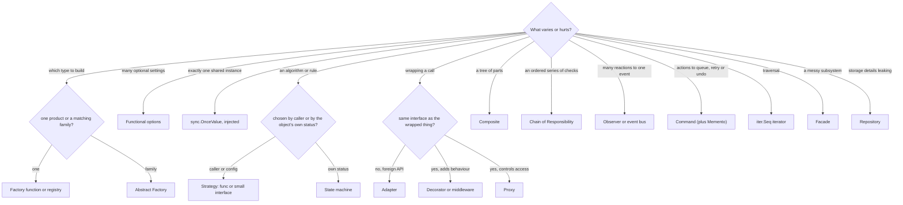
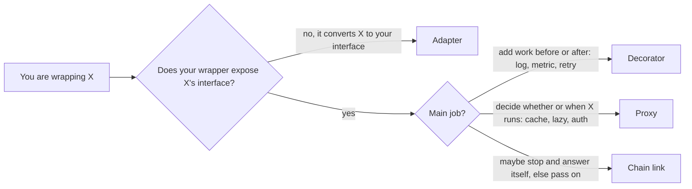

# Design Patterns Overview and Chooser

> [!summary] TL;DR
> A **design pattern** is a named, reusable solution to a design problem that keeps recurring, such as "swap the algorithm at runtime" or "add logging around every call". The classic catalogue is the 23 **GoF** patterns (from the 1994 "Gang of Four" book), grouped as creational, structural and behavioural. In Go many of them shrink to a language feature (a function value, `range` over a function, `sync.Once`), so the useful skill is not memorising 23 class diagrams but asking **"what varies here?"** and picking the smallest construct that isolates it.

> [!abstract] Core idea
> - Start from the problem ("the pricing rule changes per city"), never from the pattern name.
> - Creational patterns isolate **how objects are built**, structural ones **how they are wrapped and combined**, behavioural ones **who decides and who reacts**.
> - In Go, Strategy is a `func`, Iterator is `iter.Seq`, Singleton is `sync.OnceValue`, and Decorator is `func(http.Handler) http.Handler`.
> - Several pairs look alike and differ only in intent: Strategy and State, Decorator, Proxy and Adapter, Facade and Mediator.
> - A pattern that hides the failure path or adds a layer nobody varies is making the design worse.

## 1. Why it exists

A checkout service starts with one payment provider, one delivery fee and one way to notify the user. Within a year it has:

- four payment providers chosen by country,
- three delivery-fee rules (flat, free above ₹199, surge at night),
- an order lifecycle with seven statuses,
- notifications by push, SMS, email and a webhook to the restaurant,
- logging, auth, rate limiting and metrics on every endpoint.

Without shared vocabulary, each of these becomes an ad-hoc `if country == ...` ladder or a copy-pasted wrapper. Patterns give each recurring shape a name and a known-good structure, so a reviewer who reads "this is a Strategy" or "this is middleware" knows where the variation lives, and an interviewer can follow your design in one sentence.

## 2. Mental model

Patterns are like chess openings. Nobody wins by reciting openings; they win by recognising the position and knowing which plan fits it. The position is your problem, described by **what varies** and **what must stay stable**. The pattern is the plan that puts the varying part behind a seam.

Terms used below:

- **GoF (Gang of Four):** Erich Gamma, Richard Helm, Ralph Johnson and John Vlissides, authors of *Design Patterns* (1994), which catalogued 23 patterns.
- **Seam:** a place where you can change behaviour without editing the code around it (an interface, a function parameter, a registry).
- **Idiom:** a language-specific way of writing something. A pattern in one language can be a mere idiom in another; Peter Norvig argued in a 1996 talk that 16 of the 23 GoF patterns are invisible or simpler in dynamic languages such as Lisp and Dylan, thanks to features like first-class functions and types.

## 3. How it works

### The catalogue

The 23 GoF patterns, plus the backend patterns this folder treats as first-class, and the note that owns each:

| Category | Pattern | One-line intent | Owning note |
| --- | --- | --- | --- |
| Creational | Factory Method, Abstract Factory | Choose which implementation (or family) to build | [[Factory and Abstract Factory]] |
| Creational | Builder | Build a complex object step by step; Go uses functional options | [[Builder and Functional Options]] |
| Creational | Singleton | Exactly one instance, created lazily | [[Singleton and sync.Once]] |
| Creational | Prototype | Create by cloning a configured template | [[Rare GoF Patterns in Go]] |
| Structural | Adapter | Make a foreign API fit your interface | [[Adapter]] |
| Structural | Decorator | Add behaviour around a call, same interface | [[Decorator and Middleware]] |
| Structural | Proxy | Control access to an object: lazy, cached, remote, guarded | [[Proxy]] |
| Structural | Facade | One simple entry point over a subsystem | [[Facade (vs Mediator)]] |
| Structural | Composite | Treat a tree of parts and a single part the same way | [[Composite]] |
| Structural | Bridge, Flyweight | Split abstraction from implementation; share immutable state | [[Rare GoF Patterns in Go]] |
| Behavioural | Strategy, Template Method | Swap an algorithm; fix a skeleton, vary its steps | [[Strategy and Template Method]] |
| Behavioural | Observer | Many listeners react to one event | [[Observer and Event Bus]] |
| Behavioural | State | Behaviour depends on a lifecycle status | [[State Machines in Go]] |
| Behavioural | Chain of Responsibility | Pass a request through ordered handlers | [[Chain of Responsibility and Pipelines]] |
| Behavioural | Command, Memento | Turn an action into a value (queue, retry, undo); snapshot state | [[Command, Undo and Memento]] |
| Behavioural | Iterator | Traverse without exposing internals | [[Iterator and range-over-func]] |
| Behavioural | Mediator | Peers talk through a hub instead of to each other | [[Facade (vs Mediator)]] and [[Rare GoF Patterns in Go]] |
| Behavioural | Visitor, Interpreter | Add operations over a fixed node set; evaluate a small language | [[Rare GoF Patterns in Go]] |
| Enterprise (Fowler) | Repository, Unit of Work | Collection-like storage boundary; commit changes atomically | [[Repository and Unit of Work]] |

### The chooser: what varies?



Each decision node asks one exclusive question, so every path ends at exactly one pattern.

### Problem-to-pattern decision table

| Problem you hear in the requirements | Pattern | Backend example | Where it is practised |
| --- | --- | --- | --- |
| "Fee or pricing rule depends on city, time or user tier" | Strategy | Delivery fee: flat, free above ₹199, night surge | [[Cart Checkout with Coupons]], [[Rate Limiter]] |
| "Same import steps, different file formats" | Template Method | CSV and JSON importers sharing parse, validate, save | [[Strategy and Template Method]] |
| "Pick provider by config or country" | Factory | Razorpay in India, Stripe elsewhere | [[Notification Service]] |
| "Each provider needs a matching charge, refund and webhook verifier" | Abstract Factory | One family per payment provider | [[Factory and Abstract Factory]] |
| "Client has 10 optional settings with defaults" | Functional options | HTTP client with timeout, retries, logger | [[Builder and Functional Options]] |
| "One shared config or metrics registry" | Singleton | Lazy config load with `sync.OnceValue` | [[Singleton and sync.Once]] |
| "Wrap a third-party SDK" | Adapter | Courier API behind `Shipper` | [[Delivery Partner Assignment]] |
| "Add auth, logging, rate limit to every endpoint" | Decorator | `func(http.Handler) http.Handler` | [[Logging Library]] |
| "Cache or guard access to a slow or remote service" | Proxy | Read-through cache in front of a catalogue service | [[LRU Cache with TTL]] |
| "One call that hides inventory, payment and order" | Facade | `CheckoutService.PlaceOrder` | [[Food Ordering System]] |
| "Categories contain categories and products" | Composite | Menu or file tree with uniform `Size()` | [[File Search (Unix find)]] |
| "When an order is placed, notify, audit and update analytics" | Observer | In-process event bus, outbox in production | [[Notification Service]] |
| "Status must move only along legal edges" | State | Order, vending machine, elevator lifecycles | [[Vending Machine]], [[Elevator System]] |
| "Validate cart, then stock, then coupon, then payment" | Chain of Responsibility | Checkout validation pipeline | [[Cart Checkout with Coupons]] |
| "Retryable admin action or undo" | Command, Memento | Refund job; draft-invoice undo | [[Command, Undo and Memento]] |
| "Stream a large result set page by page" | Iterator | `iter.Seq[Order]` over keyset pagination | [[Iterator and range-over-func]] |
| "Business code should not see SQL" | Repository | `OrderRepository` with Postgres and in-memory versions | [[Library Management]], [[Movie Ticket Booking]] |
| "Choose a parking spot or a store by a rule" | Strategy | Nearest-spot versus spread-load allocation | [[Parking Lot]], [[Inventory Order Assignment (Dark Store)]] |

### Patterns in the Go standard library

| Pattern | Standard library example |
| --- | --- |
| Decorator | `bufio.NewReader`, `gzip.NewReader`, `io.LimitReader` wrap an `io.Reader`; `http.TimeoutHandler` and `http.StripPrefix` wrap an `http.Handler` |
| Adapter | `http.HandlerFunc` turns a function into an `http.Handler` |
| Proxy | `httputil.ReverseProxy` |
| Strategy | `sort.Sort` with a `sort.Interface`; `slices.SortFunc` with a comparison function (Go 1.21) |
| Factory and registry | `sql.Register` plus `sql.Open("pgx", dsn)` picks a driver by name |
| Bridge | `database/sql` (abstraction) over `database/sql/driver` (implementation); `slog.Logger` over `slog.Handler` (Go 1.21) |
| Composite | `io.MultiWriter` and `io.MultiReader` treat many writers or readers as one |
| Builder | `strings.Builder`, `bytes.Buffer` |
| Visitor | `ast.Walk` with an `ast.Visitor` |
| Interpreter | `text/template` parses a template into a tree and executes it |
| Iterator | `maps.Keys` returns an `iter.Seq`, `slices.All` an `iter.Seq2` (Go 1.23) |
| Flyweight | `unique.Make` interns comparable values (Go 1.23) |
| Singleton | `sync.OnceValue` (Go 1.21); `http.DefaultClient` is a package-level shared instance |

## 4. Worked example

### Whiteboard version

```text
GoF pattern       Java shape                                   Go shape
Strategy          interface + one class per algorithm          type FeeFunc func(int64) int64
Iterator          hasNext()/next() class                        func (c *Catalog) InStock() iter.Seq[Item]
Singleton         private ctor + static getInstance + lock      var DefaultConfig = sync.OnceValue(load)
Template Method   abstract base class, subclasses override      func Import(r io.Reader, steps RowSteps)
Decorator         class implementing and wrapping interface     func(next http.Handler) http.Handler
Command           Command interface with execute()              func(ctx context.Context) error
Observer          Subject with attach/notify                    []func(Event) or a channel
```

### The tested code

Four GoF patterns written as Go idioms. Each is shorter than its class-based form and has no extra types.

```go
package idioms

import (
	"bufio"
	"fmt"
	"io"
	"iter"
	"strings"
	"sync"
)

// Strategy -> a function value. No interface, no struct per algorithm.
type FeeFunc func(subtotalPaise int64) int64

func FlatFee(f int64) FeeFunc { return func(int64) int64 { return f } }

func FreeAbove(limit, fee int64) FeeFunc {
	return func(s int64) int64 {
		if s >= limit {
			return 0
		}
		return fee
	}
}

func Total(subtotal int64, fee FeeFunc) int64 { return subtotal + fee(subtotal) }

// Iterator -> iter.Seq (range-over-func, Go 1.23+).
type Item struct {
	SKU   string
	Stock int
}

type Catalog struct{ items []Item }

func (c *Catalog) InStock() iter.Seq[Item] {
	return func(yield func(Item) bool) {
		for _, it := range c.items {
			if it.Stock > 0 && !yield(it) {
				return // consumer broke out of the loop: stop, nothing leaks
			}
		}
	}
}

// Singleton -> sync.OnceValue (Go 1.21+): lazy, goroutine-safe, built once.
type Config struct{ Region string }

var loads int

var DefaultConfig = sync.OnceValue(func() Config {
	loads++ // runs exactly once, so no data race
	return Config{Region: "ap-south-1"}
})

// Template Method -> a plain function that fixes the skeleton and takes the
// varying steps as a small interface.
type RowSteps interface {
	Parse(line string) (Item, error)
	Save(Item) error
}

func Import(r io.Reader, steps RowSteps) (int, error) {
	sc := bufio.NewScanner(r)
	n := 0
	for line := 1; sc.Scan(); line++ {
		text := strings.TrimSpace(sc.Text())
		if text == "" {
			continue
		}
		it, err := steps.Parse(text)
		if err != nil {
			return n, fmt.Errorf("line %d: %w", line, err)
		}
		if err := steps.Save(it); err != nil {
			return n, fmt.Errorf("line %d: %w", line, err)
		}
		n++
	}
	return n, sc.Err()
}
```

What each piece demonstrates:

- **Strategy as a function:** `FlatFee` and `FreeAbove` are strategies, built by closures. Adding a night-surge fee is a new function, not a new type (see [[Strategy and Template Method]]).
- **Iterator as `iter.Seq`:** the `yield` result tells the iterator to stop when the caller `break`s, so nothing keeps running. A channel-based iterator would leave its goroutine blocked forever on early exit (see [[Iterator and range-over-func]]).
- **Singleton as `sync.OnceValue`:** the first call runs the loader; concurrent callers wait and then all get the same value. Prefer building such values in `main` and injecting them; keep `OnceValue` for truly process-wide, read-only things (see [[Singleton and sync.Once]]).
- **Template Method as a function:** `Import` owns the skeleton (scan, skip blanks, parse, save, wrap errors with the line number). No base class; the varying steps are a two-method interface.

```go
package idioms

import (
	"errors"
	"fmt"
	"strings"
	"sync"
	"testing"
)

func TestStrategyAsFunc(t *testing.T) {
	free := FreeAbove(19900, 2500)
	cases := []struct {
		sub  int64
		fee  FeeFunc
		want int64
	}{
		{10000, FlatFee(2500), 12500},
		{10000, free, 12500},
		{19900, free, 19900},
	}
	for _, c := range cases {
		if got := Total(c.sub, c.fee); got != c.want {
			t.Errorf("Total(%d) = %d, want %d", c.sub, got, c.want)
		}
	}
}

func TestIteratorEarlyBreak(t *testing.T) {
	c := &Catalog{items: []Item{{"a", 1}, {"b", 0}, {"c", 5}, {"d", 2}}}
	var got []string
	for it := range c.InStock() {
		got = append(got, it.SKU)
		if len(got) == 2 {
			break
		}
	}
	if strings.Join(got, ",") != "a,c" {
		t.Fatalf("got %v", got)
	}
}

func TestSingletonOnce(t *testing.T) {
	var wg sync.WaitGroup
	for range 50 {
		wg.Add(1)
		go func() {
			defer wg.Done()
			if DefaultConfig().Region != "ap-south-1" {
				t.Error("wrong region")
			}
		}()
	}
	wg.Wait()
	if loads != 1 {
		t.Fatalf("loaded %d times", loads)
	}
}

type memSteps struct{ saved []Item }

var errBadRow = errors.New("bad row")

func (m *memSteps) Parse(line string) (Item, error) {
	var it Item
	if _, err := fmt.Sscanf(line, "%s %d", &it.SKU, &it.Stock); err != nil {
		return Item{}, errBadRow
	}
	return it, nil
}

func (m *memSteps) Save(it Item) error { m.saved = append(m.saved, it); return nil }

func TestTemplateFunc(t *testing.T) {
	steps := &memSteps{}
	n, err := Import(strings.NewReader("milk 3\n\nbread 0\n"), steps)
	if err != nil || n != 2 {
		t.Fatalf("n=%d err=%v", n, err)
	}
	_, err = Import(strings.NewReader("milk 3\noops\n"), &memSteps{})
	if !errors.Is(err, errBadRow) || !strings.Contains(err.Error(), "line 2") {
		t.Fatalf("err = %v", err)
	}
}
```

Result (measured: `go vet ./... && go test -race -count=1 ./...` with Go 1.24.4 on darwin/arm64):

```text
ok  	example.com/chooser	1.452s
```

`TestSingletonOnce` runs 50 goroutines under the race detector and checks the loader ran once; `TestIteratorEarlyBreak` checks that `break` stops the iterator after two in-stock items.

### Choosing patterns for one problem

Requirements for a dark-store checkout: pick a store by rule, validate the cart, charge one of several providers, move the order through a lifecycle, and notify several channels. Walking the chooser:

1. *Store choice varies by rule* → Strategy ([[Inventory Order Assignment (Dark Store)]]).
2. *Ordered validations* → Chain of Responsibility, a slice of `func(ctx, Cart) error`.
3. *Provider by country* → Factory (registry in `main`) plus one Adapter per SDK.
4. *Order status* → State machine with a transition table.
5. *Several reactions to "order placed"* → Observer, backed by a transactional outbox in production (see [[Transactional Outbox and CDC]]).
6. *Endpoint concerns* → middleware Decorators.
7. *Storage* → Repository.

Seven patterns, and none was chosen for its name: each answers one "what varies" question from the requirements.

## 5. Variants and comparison

### Patterns that Go idioms replace or shrink

| GoF pattern | Why it shrinks in Go | Go idiom |
| --- | --- | --- |
| Strategy | Functions are values | `func` type or a one-method interface |
| Command | Closures capture arguments | `func(ctx context.Context) error` |
| Template Method | No inheritance to override | A function taking a step interface or step functions |
| Iterator | Range-over-func since Go 1.23 | `iter.Seq[T]` / `iter.Seq2[K, V]` |
| Singleton | Package initialisation and `sync.Once` | `sync.OnceValue` or a value built in `main` |
| Builder | Variadic options | Functional options `WithX(...)` |
| Observer (in-process) | Function slices and channels | `[]func(Event)` or a channel per subscriber |
| Factory Method | No constructors to override | `NewX(kind string) (Interface, error)` or a `map[string]func() Interface` |
| Abstract Factory | Interfaces satisfied implicitly | A struct of related interfaces per provider |

Patterns rarely needed in Go (all in [[Rare GoF Patterns in Go]] unless noted): Visitor (a type switch over a closed set is usually enough), Interpreter (only for real rule languages), Flyweight (`unique.Make` covers interning), Prototype (copy a struct value; deep-copy only slices and maps), Bridge (two interfaces already give two independent axes), Mediator (an orchestrating service usually suffices, see [[Facade (vs Mediator)]]), and Memento (a snapshot struct, see [[Command, Undo and Memento]]).

### Confusable pairs

| Pair | Same shape | Difference in intent | Quick test |
| --- | --- | --- | --- |
| Strategy vs State | Both delegate to an interchangeable object | Strategy is chosen by the caller; State changes itself as the object moves through its lifecycle | Does the object switch its own behaviour after an event? Then State |
| Decorator vs Proxy vs Adapter | All wrap another object | Decorator adds behaviour (same interface); Proxy controls access (same interface: cache, lazy load, auth); Adapter converts a different interface | Different interface → Adapter; same interface, adds features → Decorator; same interface, guards or defers → Proxy |
| Facade vs Mediator | Both sit in the middle | Facade is a one-way simplified API for clients; the subsystems do not know it. Mediator is a hub the peers themselves talk through | Do the parts call the middle object? Then Mediator |
| Factory vs Abstract Factory | Both hide `new` | Factory builds one product; Abstract Factory builds a matching family | Must several created objects be consistent with each other? Then Abstract Factory |
| Chain vs Decorator | Both are lists of wrappers around a call | Chain handlers may stop the request or pass it on (one handles it); decorators always call the next and add behaviour around it | Can a link end the request as "handled"? Then Chain. Go middleware often does both |
| Composite vs Decorator | Both hold children with the same interface | Composite holds many children and aggregates results; Decorator wraps exactly one | One wrapped object → Decorator |



## 6. Trade-offs and when not to use

- **Pattern-itis.** Using a pattern because the name is impressive. A `PaymentStrategyFactoryProvider` for one provider is three files of indirection. Write the direct code first and introduce the seam when the second variant arrives.
- **Java-style pairs.** `IOrderService` plus `OrderServiceImpl` with one implementation adds nothing in Go: interfaces are satisfied implicitly, so declare the interface in the consumer when it is needed (see [[SOLID in Go]]).
- **Hidden failure paths.** Observers that swallow errors and decorators that retry non-idempotent calls make behaviour harder to reason about. Every pattern must keep error handling, retries and idempotency visible.
- **Layers that hide performance.** A Repository that issues one query per item inside an Iterator causes N+1 queries; a deep decorator stack adds an allocation and a call per layer on hot paths.
- **Closed sets.** If you own all the cases and they rarely change (five order statuses), a `switch` on a typed constant beats a State interface per status.

## 7. In production

- **Real systems:** Go HTTP servers are decorator stacks (`net/http` middleware in chi, gorilla/handlers, otelhttp); `database/sql` is a registry factory plus a bridge to drivers; `log/slog` handlers are chained decorators; Kubernetes controllers are state machines driven by an event loop.
- **Failure modes and fixes:**
	- *Observer with in-process callbacks loses events when the process crashes:* use a transactional outbox and a queue for anything that must not be lost.
	- *Singleton holding request data:* one user's data leaks into another's request. Keep singletons immutable and process-wide only.
	- *Retry decorator around a non-idempotent call:* double charges. Retry only idempotent operations or send an idempotency key.
	- *Channel iterator abandoned by a `break`:* goroutine leak. Use `iter.Seq`, or pass a `context` and cancel it.
- **What to monitor:** patterns are invisible to monitoring, but their failure modes are not: goroutine count (leaked iterators or observers), per-middleware latency (deep decorator stacks), and duplicate side effects (retry decorators).

## 8. Deep dive

**Why the catalogue shrinks in Go.** Many GoF patterns work around missing language features in 1994 C++: no first-class functions (Strategy, Command), no closures (Observer callbacks), no built-in iteration protocol (Iterator), and inheritance as the main reuse tool (Template Method). Go has functions as values, closures, range-over-func (since Go 1.23), implicit interfaces and embedding, so the *intent* of these patterns remains while the *structure* disappears. The intent is what you name in an interview: "this is a strategy; in Go it is just a `func`".

**Patterns that stay fully relevant.** Adapter, Decorator, Proxy, Facade, Composite, State, Chain of Responsibility, Repository and Observer (as an event bus) describe architecture, not language gaps. They appear in every Go service.

**Patterns beyond GoF that LLD rounds use.** Several practice problems rely on patterns the GoF book does not list:

- *Specification:* composable predicates (`And(Size(>1MB), Ext(".go"))`) in [[File Search (Unix find)]];
- *Null Object:* a no-op implementation (`NopPublisher`) instead of `nil` checks;
- *Object pool:* reusing expensive objects (`sync.Pool` for buffers; `*sql.DB` is a connection pool);
- *Circuit Breaker:* a state machine around remote calls, see [[Circuit Breaker]];
- *Unit of Work:* group repository changes into one transaction ([[Repository and Unit of Work]]).

**Combining patterns.** Real designs layer them: a Facade (`CheckoutService`) uses Strategies (pricing), a Factory (provider), Adapters (SDKs), a State machine (order), a Repository (storage) and Observers (events), and the HTTP layer adds Decorators. In an interview, name each one where it applies, in one sentence each, and spend your time on the hard part: concurrency and failure handling.

**Interview signal.** Interviewers rarely ask "implement the Visitor pattern". They give a problem with a hidden variation point and watch whether you isolate it. Naming the pattern earns little; placing the seam correctly, and explaining why you did *not* add one elsewhere, earns a lot.

## 9. Interview questions

> [!question]- What are the three GoF categories, with one Go example each?
> Creational (how objects are built): functional options for an HTTP client. Structural (how objects are combined and wrapped): `func(http.Handler) http.Handler` middleware. Behavioural (how responsibility and communication are split): a strategy `func` that computes delivery fees.

> [!question]- Strategy versus State: what is the difference?
> Both delegate to a swappable behaviour. Strategy is chosen from outside (config, caller, user tier) and does not change by itself. State changes as the object moves through its lifecycle: after `Pay`, an order's behaviour switches from "pending" to "paid" rules.

> [!question]- Decorator, Proxy and Adapter all wrap an object. How do you tell them apart?
> Adapter converts a different interface into yours. Decorator keeps the same interface and adds behaviour around the call (logging, metrics). Proxy keeps the same interface and controls whether or when the real object runs (cache, lazy loading, access checks).

> [!question]- Trap: should a Go service use a Singleton for its database pool?
> Usually no. `*sql.DB` is already a concurrency-safe pool; build it once in `main` and inject it. A global singleton hides the dependency, prevents tests from using a different database in parallel, and couples every package to one global. Keep `sync.OnceValue` for immutable, process-wide values.

> [!question]- Which GoF patterns become trivial in Go, and why?
> Strategy and Command (functions and closures are values), Iterator (range-over-func, Go 1.23), Singleton (`sync.OnceValue`), Template Method (a function taking a step interface instead of inheritance) and Builder (functional options). The intent stays; the class structure disappears.

> [!question]- Facade versus Mediator?
> A Facade gives clients one simple entry point over a subsystem; the subsystems do not know it exists. A Mediator is a hub that peers call to coordinate with each other, so they stop referencing each other directly. A checkout orchestrator called by the HTTP handler is a Facade.

> [!question]- How do you avoid over-using patterns in an LLD round?
> Add a seam only where the requirements name a variation or where testing needs one. Write the direct code first, name the pattern in one sentence when it appears, and explain where you deliberately did not add an abstraction.

## 10. Cheat sheet

- Ask "what varies?" first; the answer picks the pattern.
- Creational = building, structural = wrapping and combining, behavioural = deciding and reacting.
- Go shrinks: Strategy → `func`, Iterator → `iter.Seq`, Singleton → `sync.OnceValue`, Builder → functional options, Template Method → function plus step interface.
- Wrappers: different interface → Adapter; same interface plus behaviour → Decorator; same interface plus access control → Proxy.
- Strategy is chosen from outside; State changes itself.
- Facade simplifies for clients; Mediator is a hub for peers.
- No `IFoo`/`FooImpl`, no pattern without a second variant, never hide the failure path.

## Links

- **Before this:** [[SOLID in Go]], [[UML for LLD]], [[OOP in Go - Structs, Interfaces, Embedding]]
- **Next:** [[Strategy and Template Method]], then the pattern notes in catalogue order, ending with [[Rare GoF Patterns in Go]]
- **Compare with:** [[Design Principles - DRY, KISS, YAGNI, Coupling and Cohesion]], [[LLD Interview Method]], [[Concurrency for LLD]]
