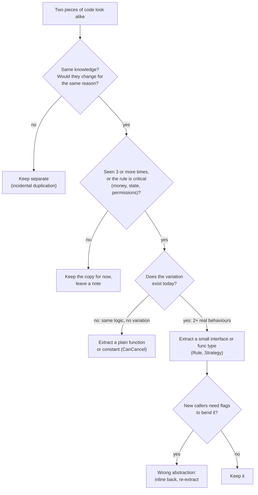
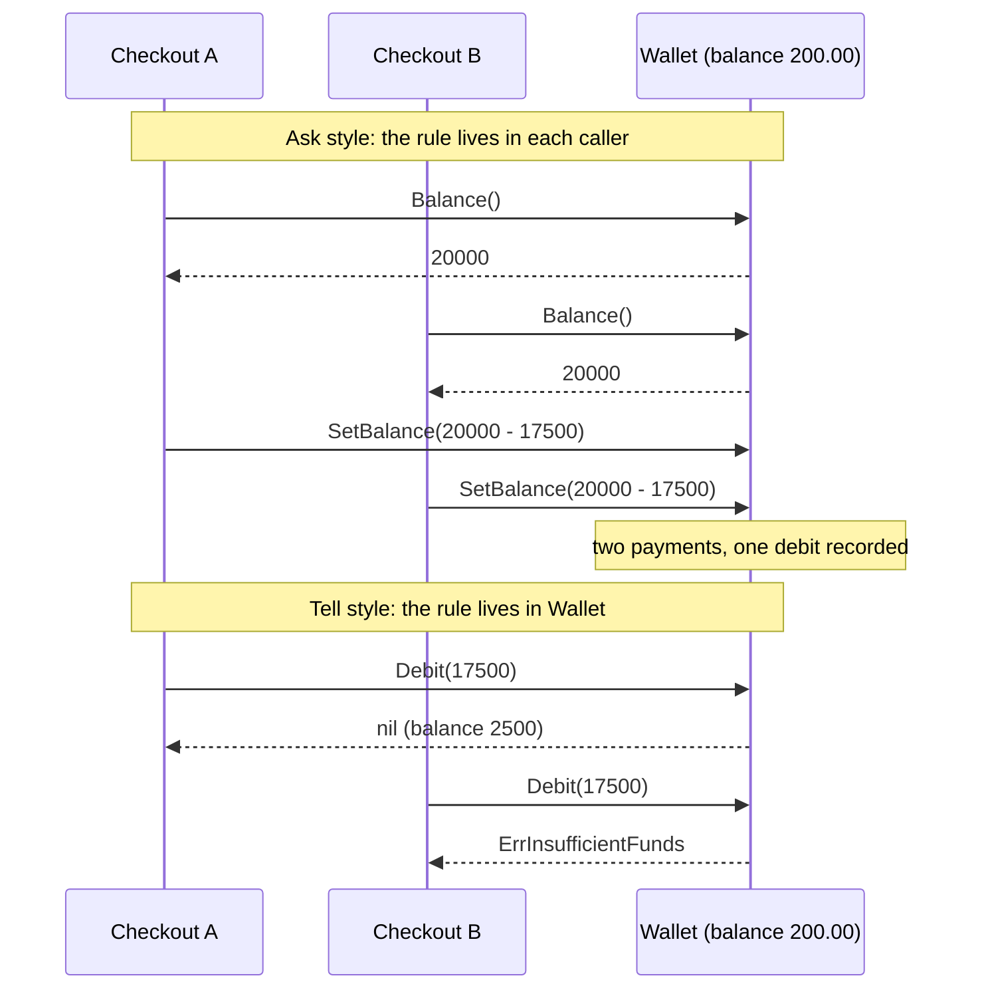

# Design Principles - DRY, KISS, YAGNI, Coupling and Cohesion

> [!summary] TL;DR
> Five rules of thumb decide where code goes and when to abstract. **DRY** (Don't Repeat Yourself): each business rule has one owner. **KISS** (Keep It Simple): the simplest design that meets today's use cases. **YAGNI** (You Aren't Gonna Need It): do not build for imagined requirements. **Low coupling, high cohesion**: modules know little about each other, and each module does one job. They pull against each other, and the skill is resolving that pull for a concrete case.

> [!abstract] Core idea
> - DRY is about duplicated *knowledge* (a rule, a formula), not duplicated *lines*; similar-looking code with different reasons to change should stay separate.
> - Abstract on the third real occurrence (rule of three); a wrong abstraction costs more than duplication.
> - KISS and YAGNI: start concrete, add an interface or pattern when a second real variation or a test needs it.
> - Coupling is how much one module must know about another; cohesion is how well one module's parts belong together. Aim for low and high.
> - Tell, don't ask: ask an object to do the work (`wallet.Debit`) instead of reading its data and deciding for it.

## 1. Why it exists

Take a cart checkout service in its first month.

- **Without DRY:** the "can this order be cancelled?" rule (`created` or `reserved`) is written in the order page handler, the admin tool and the refund job. Product adds "packed orders are cancellable". One of the three is updated. Admins now see a Cancel button that the API rejects.
- **Without KISS and YAGNI:** on day one there is one coupon, `SAVE50`. Someone builds `DiscountEngine`, `DiscountStrategyFactory`, `RuleRegistry` and a plugin interface: 6 types and 3 interfaces for an `if`. Three months later the first real new discount (first-order 10%) does not fit the plugin interface, because it needs to know whether this is the customer's first order, which nobody imagined.
- **With high coupling:** the checkout handler reads `order.Customer.Wallet.Balance`, compares it with the total and writes the new balance. The wallet's rule ("never negative") now lives in the handler, and two concurrent checkouts can both pass the check.

The principles are the vocabulary for spotting and naming these problems in an LLD round, before they are coded.

## 2. Mental model

Every piece of code answers two questions: **what does it know**, and **why would it change**?

- **DRY** says: each piece of knowledge has one home. If two places change for the same reason, merge them.
- **The flip side of DRY** says: if two places look alike but change for *different* reasons, they are two pieces of knowledge. Keep them apart.
- **KISS and YAGNI** say: only encode knowledge you actually have. An interface is a claim that "this varies"; do not make that claim without evidence.
- **Coupling and cohesion** say: put knowledge next to the data it is about (cohesion), and let other modules reach it only through a narrow door (low coupling).

**Analogy:** a kitchen. DRY is one recipe card per dish, not three slightly different copies. KISS is not buying a 40-piece knife set before you know what you will cook. Cohesion is keeping the spices in one cupboard; low coupling is the waiter asking the chef for a dish rather than walking in and cooking it.

## 3. How it works

### DRY: one authoritative representation

The Pragmatic Programmer defines DRY as "every piece of knowledge must have a single, unambiguous, authoritative representation within a system". The unit is knowledge, not text:

| Looks duplicated | Same knowledge? | Verdict |
| --- | --- | --- |
| Cancellation check in the order page and the admin page | Yes, one business rule | Merge into `CanCancel` |
| Order-cancel validation and refund validation both check `status` | No; refunds will grow rules about payment state | Keep separate |
| Two `for` loops that sum a slice | No business meaning | Leave them; a helper adds nothing |
| The tax rate `18` in pricing and in invoice code | Yes | One constant or one function |
| A Go struct and a SQL table with the same fields | Same shape, different reasons to change (API vs storage) | Usually keep separate types and map between them |

Duplication of the same knowledge is **real duplication**; similar-looking code with different reasons to change is **incidental duplication**. Merging incidental duplication creates coupling between things that should evolve apart.

**Rule of three** (credited to Don Roberts in Fowler's Refactoring): the first time, write it; the second time, notice and tolerate the copy; the third time, extract. Three examples show what actually varies; two often mislead.

**The wrong abstraction.** Sandi Metz: "duplication is far cheaper than the wrong abstraction". A shared function that grows a boolean parameter for each new caller (`process(order, isAdmin, skipTax, legacyMode)`) is the symptom. The fix is to inline it back into the callers and re-extract what is truly shared.

**Go's angle.** The Go proverb "A little copying is better than a little dependency" applies DRY's cost to packages: importing a large module to reuse a 10-line function couples your build, your upgrades and your security surface to it.

### KISS and YAGNI

- **KISS:** the simplest design that satisfies the stated use cases. In Go that means fewer types, plain structs, direct control flow, explicit errors, no reflection, and no framework layers. A useful measure in an interview: can you explain the core flow of each type in one sentence, and does every type appear in at least one use case?
- **YAGNI:** do not build capability for requirements nobody has stated. Fowler calls the result **speculative generality**: hooks, parameters and interfaces with one implementation "in case we need it".
- Rule from practice: **simple first, extensible where the requirement demands it.**

Bad (the name is the design review):

```go
type OrderCreationAbstractFactoryProviderRegistry interface {
	ResolveOrderCreationPipelineFactory(kind string) any
}
```

Before adding an interface, ask four questions. If all answers are no, use the concrete type:

1. Do I have more than one implementation **today**?
2. Do I need a fake for this in tests (database, network, clock)?
3. Is this an external or unstable boundary (payment gateway, third-party API)?
4. Does the abstraction make the caller simpler?



The "critical rule" shortcut matters: a cancellation, pricing or permission rule duplicated even twice is worth merging immediately, because the cost of the copies drifting is a production bug.

### Coupling and cohesion

**Coupling** is how much one module must know about another to work and to change. From loosest to tightest (after Stevens, Myers and Constantine):

| Kind | Example in Go | Problem |
| --- | --- | --- |
| Data | `Total(c Cart, rules ...Rule)`: passes only what is needed | None; the goal |
| Stamp | `SendReceipt(o *Order)` when it only needs an email | Breaks when `Order` changes shape |
| Control | `Process(o, mode string)` where `mode` picks the branch inside | Caller knows callee's internals |
| External | Two packages both depend on the exact JSON shape of a third-party API response | A change outside your code breaks both |
| Common | Two packages read and write a package-level `var config` | Hidden shared state, races |
| Content | Reaching into another package's internals (only possible through `unsafe` or reflection in Go; the in-package equivalent is touching another type's fields) | Any internal change breaks you |

**Cohesion** is how strongly the parts of one module belong together. Best is **functional** cohesion (everything in `package pricing` computes prices). Worst is **coincidental** cohesion: `package util` or `common` holding string helpers, retry logic and tax rates. The Go blog on package names advises against `util`, `common` and `misc` for exactly this reason.

**Separation of concerns** in a Go service is coupling and cohesion applied to layers:

| Layer | Knows about | Must not know about |
| --- | --- | --- |
| Handler (transport) | HTTP, JSON, status codes | Business rules, SQL |
| Service (use case) | Business rules, domain errors | HTTP, SQL text |
| Repository (storage) | SQL, tables, transactions | HTTP, business rules |

The full request path is in [[Backend Request Lifecycle and Layering]].

### Law of Demeter and tell, don't ask

The **Law of Demeter** (Lieberherr and Holland, 1989): a method should call methods only on its own object, its parameters, objects it creates, and its direct fields, not on objects returned by those. `order.Customer().Wallet().Debit(x)` breaks it: checkout now depends on the shape of `Customer` and `Wallet`.

**Tell, don't ask** is the practical form: tell the object that owns the data to do the work.



In the "tell" version, the check and the update are one method, so adding a mutex (or a conditional SQL `UPDATE`) inside `Debit` fixes concurrency for every caller at once. In the "ask" version every caller must remember to lock.

### Composition over inheritance

The GoF book's advice, "favor object composition over class inheritance", is built into Go: there is no inheritance. Build behaviour by holding small parts (a `Service` holds a `Saver`, a `Clock`, a `[]Rule`) instead of deep "is-a" trees. The parts can be swapped and tested alone. How embedding differs from inheritance is in [[OOP in Go - Structs, Interfaces, Embedding]].

## 4. Worked example

**The tension, on one feature: cart discounts.** All amounts are `int64` paise (1 rupee = 100 paise), so there is no rounding error.

**DRY first, on a critical rule.** The duplicated cancellation rule:

```go
package bad

// The cancellation rule lives in two places. When "packed" orders
// become cancellable, someone updates one function and not the other.
func CanCancelFromOrderPage(status string) bool {
	return status == "created" || status == "reserved"
}

func CanCancelFromAdminPage(status string) bool {
	return status == "created" || status == "reserved"
}
```

One owner, in the package that owns orders (not in `pricing`, which would be low cohesion):

```go
package order

type OrderStatus string

const (
	Created  OrderStatus = "created"
	Reserved OrderStatus = "reserved"
	Paid     OrderStatus = "paid"
)

// CanCancel is the single owner of the cancellation rule.
// The order page, the admin page and the API all call it.
func CanCancel(s OrderStatus) bool {
	return s == Created || s == Reserved
}
```

**Pricing v1 (KISS, YAGNI).** One coupon exists. No interface, no rule type:

```go
// Package v1 is the KISS first version: one coupon kind, no Rule type.
package v1

type Cart struct {
	SubtotalPaise int64
	Coupon        string
}

func Total(c Cart) int64 {
	total := c.SubtotalPaise
	if c.Coupon == "SAVE50" {
		total -= 5000
	}
	return max(total, 0)
}
```

**Pricing v2.** A second discount arrives (first order 10%, capped). It is tempting to build the rule engine now. Two cases are not yet enough to see the shape, so the honest move is a second `if`. **Pricing v3.** A third discount (bulk milk) arrives, and now the shape is clear: each rule looks at the cart and the amount still payable, and returns a discount. Three real variations justify a `Rule` type (rule of three), and the "never below zero" invariant moves into the one function that applies them (DRY).

| Version | Discounts | Design | Why |
| --- | --- | --- | --- |
| v1 | `SAVE50` | One `if` in `Total` | KISS; nothing varies |
| v2 | + first order 10% | Two `if`s | Two cases; shape not clear yet |
| v3 | + bulk SKU | `type Rule func(Cart, int64) int64`, `Total(c, rules...)` | Third variation; shape is now visible |
| Not built | Plugin registry, rule DSL, priorities | — | YAGNI: no requirement |

### Whiteboard version

```go
package wb

type Cart struct {
	SubtotalPaise int64
	Coupon        string
	FirstOrder    bool
}

// Rule: given the cart and what is still payable, return the discount.
type Rule func(c Cart, payable int64) int64

func Total(c Cart, rules ...Rule) int64 {
	payable := c.SubtotalPaise
	for _, r := range rules {
		payable -= r(c, payable)
	}
	return max(payable, 0) // the invariant lives in one place
}
```

### Full code (tested)

```go
// Package pricing is the DRY/KISS/YAGNI worked example: cart discounts.
package pricing

import "errors"

// Line is one cart row. Money is int64 paise (1 rupee = 100 paise).
type Line struct {
	SKU       string
	Qty       int64
	UnitPaise int64
}

type Cart struct {
	Lines      []Line
	Coupon     string
	FirstOrder bool
}

func Subtotal(c Cart) int64 {
	var sum int64
	for _, l := range c.Lines {
		sum += l.Qty * l.UnitPaise
	}
	return sum
}

// Rule returns the discount it grants, given the amount still payable.
// This type exists because three real discount kinds exist today (rule of three).
type Rule func(c Cart, payable int64) int64

// FlatCoupon takes a fixed amount off when the coupon code matches.
func FlatCoupon(code string, off int64) Rule {
	return func(c Cart, payable int64) int64 {
		if c.Coupon != code {
			return 0
		}
		return min(off, payable)
	}
}

// FirstOrderPercent takes pct% off a first order, capped at maxOff.
func FirstOrderPercent(pct, maxOff int64) Rule {
	return func(c Cart, payable int64) int64 {
		if !c.FirstOrder {
			return 0
		}
		return min(payable*pct/100, maxOff)
	}
}

// BulkSKU takes offPerUnit off each unit of sku when qty >= minQty.
func BulkSKU(sku string, minQty, offPerUnit int64) Rule {
	return func(c Cart, payable int64) int64 {
		var off int64
		for _, l := range c.Lines {
			if l.SKU == sku && l.Qty >= minQty {
				off += l.Qty * offPerUnit
			}
		}
		return min(off, payable)
	}
}

// Total applies rules in order. The "never below zero" invariant lives
// here once, not inside every rule's caller (DRY of knowledge).
func Total(c Cart, rules ...Rule) int64 {
	payable := Subtotal(c)
	for _, r := range rules {
		payable -= r(c, payable)
	}
	return max(payable, 0)
}

// ---- Tell, don't ask (Law of Demeter) ----

var (
	ErrInsufficientFunds = errors.New("insufficient funds")
	ErrInvalidAmount     = errors.New("invalid amount")
)

// Wallet owns its balance rule. Callers tell it to Debit; they never
// read the balance, compare, and write it back themselves.
type Wallet struct{ balance int64 }

func NewWallet(balance int64) *Wallet { return &Wallet{balance: balance} }

func (w *Wallet) Balance() int64 { return w.balance }

func (w *Wallet) Debit(amount int64) error {
	if amount < 0 {
		return ErrInvalidAmount
	}
	if amount > w.balance {
		return ErrInsufficientFunds
	}
	// amount == 0 is allowed: a cart fully covered by discounts must still check out.
	w.balance -= amount
	return nil
}

// Checkout talks only to its direct collaborators: the cart rules and the wallet.
func Checkout(c Cart, w *Wallet, rules ...Rule) (int64, error) {
	total := Total(c, rules...)
	if err := w.Debit(total); err != nil {
		return 0, err
	}
	return total, nil
}
```

Tests, with the arithmetic in the comments:

```go
package pricing

import (
	"errors"
	"testing"
)

var cart = Cart{
	Lines: []Line{
		{SKU: "milk", Qty: 6, UnitPaise: 3000},  // 180.00
		{SKU: "bread", Qty: 1, UnitPaise: 4500}, // 45.00
	},
	Coupon:     "SAVE50",
	FirstOrder: true,
}

func TestTotal(t *testing.T) {
	tests := []struct {
		name  string
		rules []Rule
		want  int64
	}{
		{"no rules", nil, 22500},
		{"flat coupon", []Rule{FlatCoupon("SAVE50", 5000)}, 17500},
		{"wrong coupon", []Rule{FlatCoupon("OTHER", 5000)}, 22500},
		{"bulk milk 5+ gets 2 off each", []Rule{BulkSKU("milk", 5, 200)}, 21300},
		// 22500 -> bulk 1200 -> 21300 -> coupon 5000 -> 16300 -> 10% = 1630 (cap 10000) -> 14670
		{"all three in order", []Rule{BulkSKU("milk", 5, 200), FlatCoupon("SAVE50", 5000), FirstOrderPercent(10, 10000)}, 14670},
		{"cap applies", []Rule{FirstOrderPercent(50, 2000)}, 20500},
		{"never below zero", []Rule{FlatCoupon("SAVE50", 99999), FlatCoupon("SAVE50", 99999)}, 0},
	}
	for _, tc := range tests {
		t.Run(tc.name, func(t *testing.T) {
			if got := Total(cart, tc.rules...); got != tc.want {
				t.Fatalf("got %d want %d", got, tc.want)
			}
		})
	}
}

func TestCheckoutTellDontAsk(t *testing.T) {
	w := NewWallet(20000)
	paid, err := Checkout(cart, w, FlatCoupon("SAVE50", 5000))
	if err != nil || paid != 17500 || w.Balance() != 2500 {
		t.Fatalf("paid=%d err=%v balance=%d", paid, err, w.Balance())
	}
	if _, err := Checkout(cart, w); !errors.Is(err, ErrInsufficientFunds) {
		t.Fatalf("got %v want ErrInsufficientFunds", err)
	}
	if w.Balance() != 2500 {
		t.Fatalf("failed debit must not change balance, got %d", w.Balance())
	}
	if paid, err := Checkout(cart, w, FlatCoupon("SAVE50", 99999)); err != nil || paid != 0 {
		t.Fatalf("free cart: paid=%d err=%v", paid, err)
	}
}
```

```go
package order

import "testing"

func TestCanCancel(t *testing.T) {
	for s, want := range map[OrderStatus]bool{Created: true, Reserved: true, Paid: false} {
		if got := CanCancel(s); got != want {
			t.Errorf("CanCancel(%s) = %v, want %v", s, got, want)
		}
	}
}
```

Measured: `go vet` is clean and `go test -race -count=1` passes on Go 1.24.4 (darwin/arm64).

Trace of `all three in order` on a cart of 6 milk at 30.00 and 1 bread at 45.00:

| Step | Rule | Discount | Payable after |
| --- | --- | --- | --- |
| 0 | subtotal | — | 22500 |
| 1 | bulk milk, 6 × 200 | 1200 | 21300 |
| 2 | `SAVE50` flat | 5000 | 16300 |
| 3 | first order 10% of 16300, cap 10000 | 1630 | 14670 |

Rule order changes the result: applying the 10% first would give 10% of 21300 = 2130, a different total. That ordering is business knowledge, so it belongs in one place (the caller that builds the rule list), not spread across rules.

`Rule` is a function type rather than an interface because each rule is one operation with no other methods; a function is the simplest thing that carries the variation. When rules need names, logging or persistence, an interface with `Discount` and `Name` methods would be the next step; see [[Strategy and Template Method]] and the full problem in [[Cart Checkout with Coupons]].

## 5. Variants and comparison

| Principle | Says | Use when | Over-applied, it becomes |
| --- | --- | --- | --- |
| DRY | One owner per piece of knowledge | Business rules, formulas, state transitions, permission checks | Wrong abstractions, flag parameters, a `util` package everyone imports |
| KISS | Simplest design that meets the use cases | Always the default, especially in a timed round | Under-design: one 500-line function, missing edge cases |
| YAGNI | Do not build for imagined needs | Plugin systems, generic engines, extra interfaces | Ignoring stated non-functional requirements (concurrency, idempotency) |
| Low coupling | Know little about other modules | Package and layer boundaries | Interfaces between every pair of types; indirection everywhere |
| High cohesion | One module, one job | Package design, type responsibilities | Dozens of one-function packages |
| Law of Demeter | Talk to direct collaborators only | Domain objects with rules (wallet, order) | Wrapper methods for every field on plain data structs |
| Composition over inheritance | Assemble from parts | Every Go design | — (Go has no inheritance to overuse) |

Which pattern removes which duplication (patterns are owned by their own notes):

| Repeated thing | Pattern that can help |
| --- | --- |
| Validation steps repeated in several handlers | [[Chain of Responsibility and Pipelines]] |
| Object or provider creation repeated by config | [[Factory and Abstract Factory]] |
| Same workflow skeleton, different steps | [[Strategy and Template Method]] |
| Logging, auth, metrics around every handler | [[Decorator and Middleware]] |
| Repeated translation of a third-party SDK | [[Adapter]] |
| Status checks scattered around the code | [[State Machines in Go]] |

And the YAGNI test the other way: a pattern is justified by a real problem.

| Real problem today | Useful pattern |
| --- | --- |
| Several pricing or assignment algorithms | Strategy |
| Several providers chosen by config | Factory |
| An external API with a mismatched shape | Adapter |
| An order lifecycle with rules per state | State |
| Several subscribers to one event | [[Observer and Event Bus]] |

## 6. Trade-offs and when not to use

- **DRY vs coupling.** Every extraction couples its callers to each other through the shared code. Extract when they change together; duplicate when they change apart.
- **DRY in tests.** Table-driven tests remove repetition, but test helpers that hide the arrange and assert steps make failures hard to read. A little repetition in tests is often clearer.
- **KISS vs stated NFRs.** If the interviewer said "many gates at once", a mutex is not over-engineering; it is the requirement. YAGNI applies to *unstated* needs only.
- **YAGNI vs expensive-to-change decisions.** Money as `int64` minor units, IDs as strings, and a clock interface cost nothing now and are expensive to retrofit. Make those choices on day one.
- **Law of Demeter on data.** Plain data structures (DTOs, config) are meant to be read; `cfg.DB.Host` is fine. The law matters for objects that own rules.
- **Interfaces for testability.** A fake for the database or clock is a real need even with one production implementation; that is one of the four questions, not a YAGNI violation.

## 7. In production

- **Real systems:** the Go standard library shows cohesion by package (`net/http`, `encoding/json`, `strconv`), small interfaces that keep coupling low (`io.Reader`), and almost no `util` packages. Proverbs like "a little copying is better than a little dependency" are why many Go projects vendor or copy small helpers instead of importing a utility module.
- **Failure modes → fixes:**

| Failure | Symptom | Fix |
| --- | --- | --- |
| Rule duplicated across handlers | UI and API disagree after a change | One function or method owns it; callers call it |
| Wrong abstraction | Shared function with 4 boolean flags | Inline into callers, re-extract only the shared part |
| `util` package | Every package imports it; import cycles | Move each helper next to its only real user |
| Speculative interface | Interface with one implementation and no fake | Delete it; reintroduce when a second use appears |
| Ask-then-act on shared state | Lost updates, negative balances | Tell the owner to do it in one method, under its lock or one SQL statement |
| Handler with SQL | Business rule untestable without HTTP and a database | Move the rule into the service; repo behind an interface |

- **What to monitor:** in code review, watch for flag parameters, interfaces with one implementation, packages named `util`/`common`, and chains like `a.B().C().D()`. Import graphs (`go list -deps`, `go mod graph`) show coupling between packages.

## 8. Deep dive

**DRY applies to knowledge in every form**, not just code: a rule in Go and the same rule in a SQL `CHECK` constraint is duplication, but often the right kind (the database is the last line of defence when several services write). Make it deliberate: name the owner, and test that both agree.

**Connascence** (Meilir Page-Jones) refines coupling: two parts are connascent if changing one forces a change in the other. Connascence of name (calling a function) is weak; connascence of meaning (both sides know that status `3` means "paid") is stronger and is what a typed enum with `String()` removes; dynamic forms such as connascence of timing (two goroutines that must run in order) are stronger still, and Page-Jones ranks connascence of identity (two parts must refer to the very same object) as the strongest. Strong connascence is acceptable only inside one small module.

**Cohesion of Go packages.** Go's import rules (no cycles) punish low cohesion: a `models` package that every layer imports becomes the hub of every change. Packaging by domain (`internal/order`, `internal/inventory`) keeps each package cohesive and keeps the (necessarily acyclic) dependency graph shallow, with few packages that everything imports.

**Interview phrasing** that signals judgement:
- "I'll keep this concrete for now; there's one implementation. If a second provider appears, I'll extract an interface at the call site."
- "These two checks look the same, but refunds will grow their own rules, so I'll keep them separate."
- "The balance check and the debit belong in `Wallet`, so the lock lives in one place."
- "This is the third discount type, so now a `Rule` type pays for itself."

## 9. Interview questions

> [!question]- What does DRY actually mean?
> One authoritative representation of each piece of knowledge, such as a business rule or formula. It is not "no similar lines": code that looks alike but changes for different reasons is incidental duplication and should stay separate.

> [!question]- Trap: you see the same 8 lines in two handlers. Do you extract them immediately?
> Not automatically. First ask whether they encode the same rule and would change together. If they do and the rule is critical (money, state, permissions), extract now. Otherwise wait for a third occurrence; a wrong shared abstraction costs more than the copy.

> [!question]- How do KISS and YAGNI differ?
> KISS is about how you build what is needed: the simplest structure that works. YAGNI is about what you build at all: nothing for unstated requirements. A plugin registry for one coupon breaks YAGNI; a 300-line function for a stated requirement breaks KISS.

> [!question]- When is adding an interface not a YAGNI violation, even with one implementation?
> When it is a boundary you must fake in tests (database, clock, network) or an external unstable dependency (payment gateway). Declare it at the consumer with only the methods used.

> [!question]- Explain coupling and cohesion with a Go example.
> Coupling: how much a module knows about another. `Total(c Cart, rules ...Rule)` takes only what it needs (data coupling); `Process(o, mode)` with a mode flag is control coupling. Cohesion: whether a package's parts belong together. `package pricing` is cohesive; `package util` is not.

> [!question]- What is the Law of Demeter, and how does "tell, don't ask" relate to it?
> Talk only to direct collaborators: your fields, parameters and objects you create. `order.Customer().Wallet().Debit()` violates it. Tell, don't ask moves the decision into the owner (`wallet.Debit(x)` returns an error), so the rule and its lock live in one place.

> [!question]- Where does composition over inheritance show up in Go?
> Everywhere: Go has no inheritance. A service holds small parts (a store, a clock, a list of rules) passed in by its constructor, and each part can be replaced or faked.

## 10. Cheat sheet

- DRY = one owner per piece of knowledge, not per line; incidental duplication stays.
- Rule of three; but merge critical rules (money, state, permissions) on the second copy.
- The wrong abstraction costs more than duplication; flag parameters are the symptom.
- KISS: simplest design for the stated use cases. YAGNI: nothing for unstated ones.
- Four interface questions: second implementation? test fake? external boundary? simpler caller?
- Low coupling (pass data, not modes), high cohesion (no `util`), handler/service/repo.
- Tell, don't ask: the owner checks and changes its own state in one method.

## Links

- **Before this:** [[OOP in Go - Structs, Interfaces, Embedding]]
- **Next:** [[SOLID in Go]], [[Design Patterns Overview and Chooser]], [[LLD Interview Method]]
- **Compare with:** [[Strategy and Template Method]] (the pattern the pricing rules grow into), [[Cart Checkout with Coupons]], [[Backend Request Lifecycle and Layering]]
