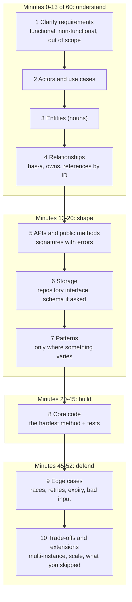
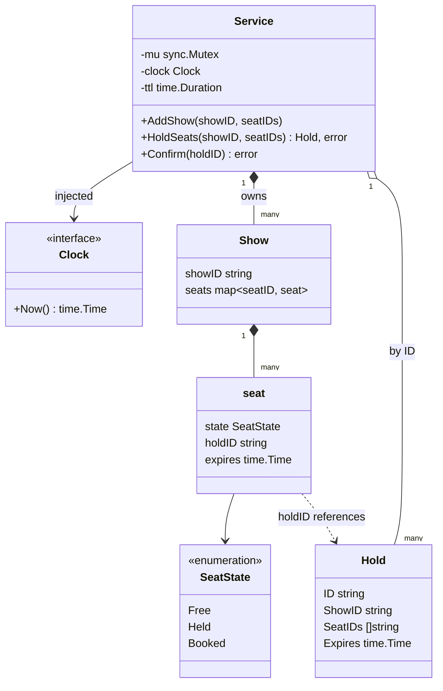
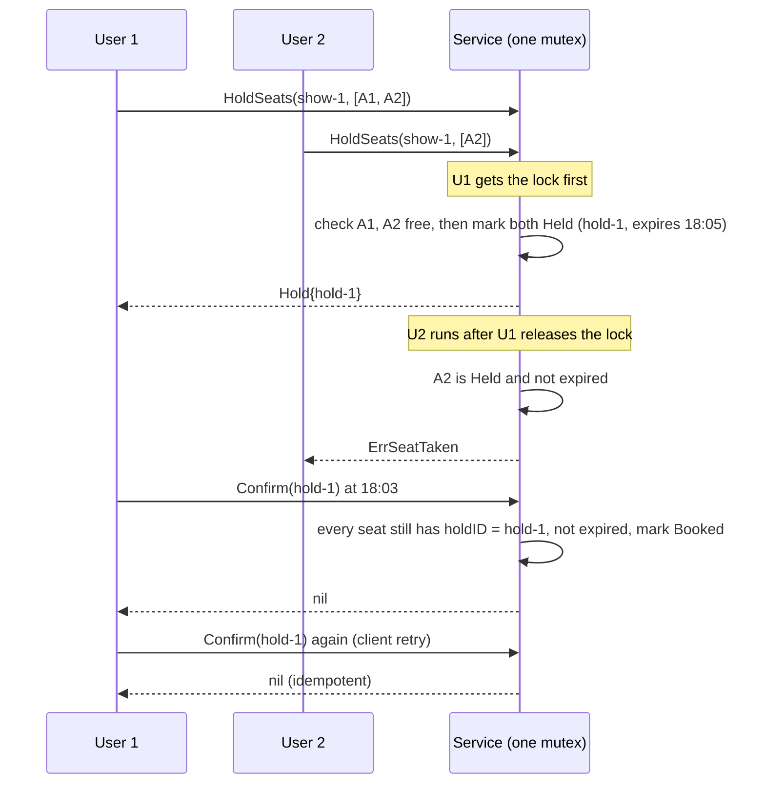

# LLD Interview Method

> [!summary] TL;DR
> A low-level design (LLD) round asks you to turn a vague problem ("design a parking lot") into classes, method signatures and working code in 45 to 90 minutes. This note gives one fixed 10-step method, the same one every note in `17 LLD/Practice` follows, plus how to split the clock, how to drive the requirements and what the interviewer actually scores.

> [!abstract] Core idea
> - Always walk the same 10 steps: requirements → actors and use cases → entities → relationships → APIs → storage → patterns → core code → edge cases → trade-offs.
> - Spend at most about a quarter of the time on steps 1–4 and the biggest block (40–50%) on the code of the single hardest method.
> - You drive: state assumptions out loud, write them down, and ask the interviewer to confirm them.
> - The score is mostly correctness of the hard method, clean boundaries, and how you handle concurrency and failure, not how many patterns you name.
> - Classic failure: drawing 15 classes, coding getters, and never reaching the method where the race lives.

## 1. Why it exists

An LLD question is deliberately under-specified. "Design a movie ticket booking system" can mean a 2-hour product spec or a 40-line seat-locking function. Without a method, candidates do one of two things:

- **Jump to code** at minute 3, model the wrong thing (for example, no seat hold, so two users can pay for one seat), and rewrite at minute 30.
- **Draw forever:** 20 boxes on a class diagram at minute 35, no working method, and nothing to test.

In a 60-minute round you have roughly 45 minutes of design and coding once introductions and your questions at the end are subtracted (an estimate; rounds vary). A fixed order of steps turns that time into a checklist, so the interviewer can see progress every few minutes, and you always reach the code.

**Three round types**, so you know which variant of the method applies:

| Round | What is asked | What "done" means |
| --- | --- | --- |
| **HLD** (high-level design) | Services, databases, queues, scaling to millions of users | A box-and-arrow architecture with capacity numbers |
| **LLD / object design** | Classes, interfaces, method signatures, one or two methods coded | Clean model plus the hard method written and explained |
| **Machine coding** | A runnable program in 60–120 minutes, often with a command-line driver | Code that compiles, runs the given commands and has tests |

LLD sits between the two others: one process, in memory, but correct under concurrency. When the interviewer says "now assume 3 instances behind a load balancer", you are being pulled toward HLD; answer with the database-level version (see Step 10).

## 2. Mental model

Think of the 10 steps as **zooming in**. You start with the whole problem in one sentence and end with one function and its tests. Every step narrows the next:

- Requirements decide which actors exist.
- Use cases decide which entities matter (an entity no use case touches gets cut).
- Entities and relationships decide the method signatures.
- Signatures decide what storage needs to answer.
- Only then do patterns appear, as answers to "what will change here?"

**Analogy:** an architect visiting a client. They ask how many people live there and what rooms they need before they draw walls, and they draw walls before they choose the tiles. Patterns are the tiles.

## 3. How it works

### The 10 steps with time boxes



Each step has one output you write on the shared doc or whiteboard:

| # | Step | Output you write | Typical mistake |
| --- | --- | --- | --- |
| 1 | Clarify requirements | 4–8 bullet requirements, NFRs (non-functional requirements such as concurrency or latency), out-of-scope list | Asking nothing, or asking 20 questions |
| 2 | Actors and use cases | `User: search, hold seats, pay, cancel` | Listing features no one asked for |
| 3 | Entities | `Show, Seat, Hold, Booking` | Adding entities no use case touches |
| 4 | Relationships | "Show has many Seats; Booking references a Hold by ID" | Deep object graphs with pointers everywhere |
| 5 | APIs and methods | Go signatures: `HoldSeats(showID string, seatIDs []string) (Hold, error)` | Signatures without errors or IDs |
| 6 | Storage | `type BookingRepo interface{...}`, and a SQL table if the round is backend-flavoured | Picking a database brand instead of an access pattern |
| 7 | Patterns | "Pricing varies by show → Strategy; seat lifecycle → state enum" | Naming patterns with no varying part |
| 8 | Core code | The hardest method plus 2–3 tests | Coding constructors and getters first |
| 9 | Edge cases | A list, each with how the code handles it | Mentioning "concurrency" without saying what is locked |
| 10 | Trade-offs | What you chose, what it costs, what changes at scale | Silence, or "it depends" with no decision |

### Time boxes by round length

All numbers below are planning targets (estimates), not rules from any company.

| Step block | 45-min round | 60-min round | 90-min machine coding |
| --- | --- | --- | --- |
| Steps 1–2: requirements, use cases | 5 min | 8 min | 10 min |
| Steps 3–4: entities, relationships (+ a small class diagram) | 4 min | 5 min | 10 min |
| Steps 5–7: methods, storage, patterns | 5 min | 7 min | 10 min |
| Step 8: core code + tests | 20 min | 25 min | 45 min (whole runnable program) |
| Steps 9–10: edge cases, trade-offs | 6 min | 7 min | 10 min |
| Buffer and your questions | 5 min | 8 min | 5 min |

Rules of thumb behind the table:

- **Steps 1–4 never take more than about a quarter** of the round. If you are at minute 15 of 45 without method signatures, stop modelling and say "let me move to the API".
- **The code block is the biggest block.** In a 45-minute round you code one method well; in a 90-minute machine-coding round you code everything, so steps 1–7 compress into a few written lines.
- **Product-company rounds move APIs and schema earlier.** Backend-heavy interviewers often ask for the REST endpoints and the tables right after the use cases, because overselling and double assignment are solved in the database. Then run steps 5–6 before 3–4 and derive the entities from the tables. The method is the same; only the order of the middle steps moves.

### Driving the requirements

You drive; the interviewer confirms. The pattern is **propose, then ask**: "I'll assume a seat is held for 5 minutes while the user pays. Is that fine?" A proposal gets a yes or a correction in 5 seconds; an open question ("how long should a hold be?") often gets "what do you think?" back.

Question bank by problem type (pick 3–5, not all):

| Problem type | Examples | Questions that change the design |
| --- | --- | --- |
| Booking and reservation | [[Movie Ticket Booking]], [[Meeting Room Scheduler]], [[Hotel Booking]] | Hold before payment? Hold length? Partial booking allowed? Cancellation and refund? Can two users race for one seat? |
| Inventory and orders | [[Inventory Order Assignment (Dark Store)]], [[Cart Checkout with Coupons]], [[Food Ordering System]] | Reserve stock at cart or at checkout? What if payment fails after reserving? Coupons stack? Idempotent retries? |
| State machines | [[Vending Machine]], [[Elevator System]], [[ATM]] | Which states, which events? What happens on an invalid event? Cancel mid-flow? Out-of-service mode? |
| Matching and assignment | [[Delivery Partner Assignment]], [[Ride Sharing]], [[Parking Lot]] | Selection rule (nearest, least loaded)? Can one partner get two orders? Timeout and reassignment? |
| Infrastructure components | [[Rate Limiter]], [[LRU Cache with TTL]], [[Logging Library]], [[Pub-Sub Message Queue]] | Single process or shared? Per-key limits? Eviction policy? Blocking or drop when full? |
| Money | [[Splitwise Expense Sharing]], [[Digital Wallet and Ledger]] | Currency and rounding? Integer minor units? Audit trail? Can balances go negative? |

Always ask the two questions that change the code most: **"Can two requests touch the same thing at the same time?"** and **"What happens if a step fails halfway?"**

### Choosing the hardest method

After step 5, point at one signature and say "this is where the correctness lives, I'll code it". The hardest method is the one with:

- **a shared resource** that two callers can want (a seat, a stock unit, a delivery partner, a token bucket),
- **an invariant** that must never break (no double booking, stock never negative, total never below zero),
- **a multi-step change** that must be all-or-nothing (hold 3 seats, reserve then charge).

| Problem | Method to code first | Invariant it protects |
| --- | --- | --- |
| Movie booking | `HoldSeats` | One seat, one holder at a time |
| Parking lot | `Park` | One spot, one vehicle |
| Dark store | `ReserveStock` | Stock never negative |
| Delivery assignment | `Assign` | One partner, one active order |
| Rate limiter | `Allow` | At most N requests per window |
| Splitwise | `SimplifyDebts` | Sum of balances stays zero |

### Code layout in a round

For a 45–60 minute round, one package with five files is enough. Put the layout on screen before you code so the interviewer sees the boundaries:

```text
booking/
  go.mod
  model.go         // entities, enums (SeatState), value types
  errors.go        // ErrSeatTaken, ErrHoldExpired, ErrNotFound
  repository.go    // storage interface + in-memory implementation
  service.go       // use cases: HoldSeats, Confirm (the hard method lives here)
  service_test.go  // winner test, expiry test with a fake clock
  main.go          // optional: wiring and a short demo
```

For a 90-minute machine-coding round, or when the problem has several domains, split by domain, not by layer:

```text
dark-store/
  go.mod
  cmd/app/main.go          // composition root: build repos, inject into services
  internal/order/          // model.go, service.go, repository.go, errors.go
  internal/inventory/      // model.go, service.go, repository.go
  internal/delivery/       // model.go, service.go, strategy.go
  internal/platform/       // clock.go, id.go (injected, so tests are deterministic)
```

Package by domain (`internal/order`, `internal/inventory`), not by technical layer (`models/`, `services/`), because a change to "orders" then touches one folder. The `internal/` directory makes those packages importable only from inside this module. The full production layout is in [[Service Project Layout and Wiring]].

## 4. Worked example

Problem: "Design movie ticket booking. Users pick seats for a show, hold them while paying, and confirm." Here is the method applied with the outputs you would actually write.

**Step 1, requirements (written in 3 minutes):**
- Functional: list seats of a show; hold 1–10 seats for a show; confirm a hold after payment; a hold expires after 5 minutes.
- Non-functional: many users at once; no seat is ever held or booked by two users; confirm can be retried safely (idempotent: calling it twice has the same effect as once).
- Out of scope: search, pricing tiers, payment gateway internals, refunds.

**Step 2, actors and use cases:** User: view seats, hold seats, confirm. System: expire holds.

**Steps 3–4, entities and relationships:**



`Show` is drawn as a class for clarity; in the code it is the inner map `seats[showID]`. A seat refers to its hold **by ID**, not by pointer, which keeps the model storable in a table later.

**Step 5, methods:** `HoldSeats(showID string, seatIDs []string) (Hold, error)` and `Confirm(holdID string) error`. `HoldSeats` is the hard one: shared seats, an invariant, and an all-or-nothing change.

**Step 6, storage:** in memory for the round. Backend version: a `seats(show_id, seat_id, state, hold_id, expires_at)` table where the hold is one `UPDATE seats SET state = 'held', hold_id = $3, expires_at = now() + interval '5 minutes' WHERE show_id = $1 AND seat_id = ANY($2) AND (state = 'free' OR (state = 'held' AND expires_at <= now()))` (note the parentheses: without them the `OR` escapes the `show_id` filter), and the row count must equal the number of seats requested; see [[Locking - Optimistic vs Pessimistic]].

**Step 7, patterns:** seat lifecycle as a small state enum (Free → Held → Booked); the clock as an injected interface so expiry is testable. No Strategy or Factory: nothing varies yet. Full lifecycle patterns are in [[State Machines in Go]].



### Whiteboard version

Say this first, in under a minute, then write the full code. It is a Go-shaped sketch with helper names left abstract; the compiled version follows.

```text
func (s *Service) HoldSeats(showID string, ids []string) (Hold, error) {
	s.mu.Lock()
	defer s.mu.Unlock()
	now := s.clock.Now()
	for _, id := range ids { // 1. check all
		if !free(s.seats[showID][id], now) {
			return Hold{}, ErrSeatTaken
		}
	}
	h := newHold(showID, ids, now.Add(s.ttl))
	for _, id := range ids { // 2. then mark all, same lock
		s.seats[showID][id].hold(h)
	}
	return h, nil
}
```

The two loops run under one lock, so no other caller can sneak in between "check" and "mark". This is the whole answer to "how do you prevent double booking in one process".

### Step 8, core code (tested)

```go
// Package booking is the 45-minute core of a movie-booking round:
// hold seats for a few minutes, then confirm or let the hold expire.
package booking

import (
	"errors"
	"fmt"
	"sync"
	"time"
)

var (
	ErrSeatTaken   = errors.New("seat already held or booked")
	ErrHoldExpired = errors.New("hold expired")
	ErrNotFound    = errors.New("hold not found")
)

// Clock is injected so tests can move time without sleeping.
type Clock interface{ Now() time.Time }

type SeatState int

const (
	Free SeatState = iota
	Held
	Booked
)

type seat struct {
	state   SeatState
	holdID  string
	expires time.Time
}

type Hold struct {
	ID      string
	ShowID  string
	SeatIDs []string
	Expires time.Time
}

type Service struct {
	mu     sync.Mutex
	clock  Clock
	ttl    time.Duration
	seats  map[string]map[string]*seat // showID -> seatID -> seat
	holds  map[string]Hold
	nextID int
}

func NewService(clock Clock, ttl time.Duration) *Service {
	return &Service{
		clock: clock,
		ttl:   ttl,
		seats: map[string]map[string]*seat{},
		holds: map[string]Hold{},
	}
}

// AddShow registers the seats of one show, all Free.
func (s *Service) AddShow(showID string, seatIDs ...string) {
	s.mu.Lock()
	defer s.mu.Unlock()
	m := make(map[string]*seat, len(seatIDs))
	for _, id := range seatIDs {
		m[id] = &seat{}
	}
	s.seats[showID] = m
}

// isFree treats an expired hold as free (lazy expiry: no background goroutine).
func (s *Service) isFree(st *seat, now time.Time) bool {
	return st.state == Free || (st.state == Held && !now.Before(st.expires))
}

// HoldSeats is the hardest method: all seats or none, checked and marked
// under one lock so two users can never hold the same seat.
func (s *Service) HoldSeats(showID string, seatIDs []string) (Hold, error) {
	s.mu.Lock()
	defer s.mu.Unlock()
	now := s.clock.Now()
	show, ok := s.seats[showID]
	if !ok {
		return Hold{}, fmt.Errorf("show %s: %w", showID, ErrNotFound)
	}
	for _, id := range seatIDs { // check every seat first
		st, ok := show[id]
		if !ok || !s.isFree(st, now) {
			return Hold{}, fmt.Errorf("seat %s: %w", id, ErrSeatTaken)
		}
	}
	s.nextID++
	h := Hold{
		ID:      fmt.Sprintf("hold-%d", s.nextID),
		ShowID:  showID,
		SeatIDs: append([]string(nil), seatIDs...),
		Expires: now.Add(s.ttl),
	}
	for _, id := range seatIDs { // then mark every seat
		*show[id] = seat{state: Held, holdID: h.ID, expires: h.Expires}
	}
	s.holds[h.ID] = h
	return h, nil
}

// Confirm turns a live hold into a booking. Calling it twice is safe.
func (s *Service) Confirm(holdID string) error {
	s.mu.Lock()
	defer s.mu.Unlock()
	h, ok := s.holds[holdID]
	if !ok {
		return ErrNotFound
	}
	show := s.seats[h.ShowID]
	for _, id := range h.SeatIDs {
		st := show[id]
		if st.holdID != holdID {
			return ErrHoldExpired // someone else took the seat after expiry
		}
		if st.state == Held && !s.clock.Now().Before(st.expires) {
			return ErrHoldExpired
		}
	}
	for _, id := range h.SeatIDs {
		show[id].state = Booked
	}
	return nil
}
```

### What to test

Three tests cover what interviewers ask about most:

- **Winner test:** N goroutines race for the same seat; exactly one wins and N−1 get `ErrSeatTaken`. Run it with `-race`.
- **All-or-nothing test:** a request that includes one taken seat holds nothing.
- **Fake-clock test:** move an injected clock past the expiry instead of calling `time.Sleep`, so the test is instant and deterministic.

For problems with a payment step, add a **compensation test**: payment fails after a reservation, and the reservation is released (otherwise stock leaks).

```go
package booking

import (
	"errors"
	"sync"
	"sync/atomic"
	"testing"
	"time"
)

type fakeClock struct{ t time.Time }

func (f *fakeClock) Now() time.Time { return f.t }

func newSvc() (*Service, *fakeClock) {
	clk := &fakeClock{t: time.Date(2026, 11, 4, 18, 0, 0, 0, time.UTC)}
	s := NewService(clk, 5*time.Minute)
	s.AddShow("show-1", "A1", "A2", "A3")
	return s, clk
}

// Winner test: 100 goroutines race for the same seat; exactly one wins.
func TestHoldSeats_OneWinner(t *testing.T) {
	s, _ := newSvc()
	var wins, taken atomic.Int32
	var wg sync.WaitGroup
	for range 100 {
		wg.Add(1)
		go func() {
			defer wg.Done()
			_, err := s.HoldSeats("show-1", []string{"A1", "A2"})
			switch {
			case err == nil:
				wins.Add(1)
			case errors.Is(err, ErrSeatTaken):
				taken.Add(1)
			default:
				t.Errorf("unexpected error: %v", err)
			}
		}()
	}
	wg.Wait()
	if wins.Load() != 1 || taken.Load() != 99 {
		t.Fatalf("wins=%d taken=%d, want 1 and 99", wins.Load(), taken.Load())
	}
}

// All-or-nothing: a partly taken request holds nothing.
func TestHoldSeats_AllOrNothing(t *testing.T) {
	s, _ := newSvc()
	if _, err := s.HoldSeats("show-1", []string{"A2"}); err != nil {
		t.Fatal(err)
	}
	if _, err := s.HoldSeats("show-1", []string{"A1", "A2"}); !errors.Is(err, ErrSeatTaken) {
		t.Fatalf("got %v, want ErrSeatTaken", err)
	}
	if _, err := s.HoldSeats("show-1", []string{"A1"}); err != nil {
		t.Fatalf("A1 should still be free: %v", err)
	}
}

// Fake clock: an expired hold frees the seat and cannot be confirmed.
func TestHoldExpiry(t *testing.T) {
	s, clk := newSvc()
	h1, err := s.HoldSeats("show-1", []string{"A3"})
	if err != nil {
		t.Fatal(err)
	}
	clk.t = clk.t.Add(5 * time.Minute) // exactly at expiry
	h2, err := s.HoldSeats("show-1", []string{"A3"})
	if err != nil {
		t.Fatalf("seat should be free after expiry: %v", err)
	}
	if err := s.Confirm(h1.ID); !errors.Is(err, ErrHoldExpired) {
		t.Fatalf("old hold: got %v, want ErrHoldExpired", err)
	}
	if err := s.Confirm(h2.ID); err != nil {
		t.Fatalf("new hold: %v", err)
	}
	if err := s.Confirm(h2.ID); err != nil { // idempotent retry
		t.Fatalf("second confirm: %v", err)
	}
}
```

Measured: `go vet` is clean and `go test -race -count=1` passes on Go 1.24.4 (darwin/arm64).

**Step 9, edge cases** (say each with the line of code that handles it): two users, one seat → one mutex around check and mark; a seat id that does not exist → `ErrSeatTaken` from the `!ok` branch; hold expires during payment → `Confirm` returns `ErrHoldExpired` and the payment must be refunded; client retries `Confirm` → second call returns `nil`; expired holds are never cleaned up → lazy expiry is enough for correctness, a sweeper only frees memory.

**Step 10, trade-offs:** one mutex for all shows is simple and correct but serialises every show; a lock per show removes that contention (see [[Concurrency for LLD]]). With 3 service instances the mutex no longer protects anything, so the hold moves into the database as a conditional `UPDATE` or `SELECT ... FOR UPDATE`. A hold is a lease: it trades a little seat availability (abandoned holds block seats for 5 minutes) for never charging two people for one seat.

## 5. Variants and comparison

| Approach | How it runs | Use when | Cost |
| --- | --- | --- | --- |
| **Canonical 10 steps** (this note) | Requirements → … → trade-offs, code one hard method | Object-design LLD rounds of 45–60 minutes | Little code; you must pick the right method to code |
| **API and schema first** | Requirements → use cases → REST endpoints → tables → entities → code | Product companies with backend-heavy interviewers (orders, inventory, payments) | Easy to drift into HLD; keep it to one service |
| **Machine coding** | 5 minutes of requirements, then write the whole program with a command loop and tests | 90–120 minute rounds with "it must run" | Little time for discussion; design must be visible in file layout and names |
| **Class-diagram first (UML)** | Draw the full class diagram, then code | Some Java-heavy panels expect it | Long diagrams eat the clock; keep it to 6–8 classes (see [[UML for LLD]]) |
| **Code first, explain later** | Start typing at minute 2 | Never as a plan; only when told "just code it" | Wrong model, rewrites, no shared understanding |

## 6. Trade-offs and when not to use

- **Do not run all 10 steps at the same depth.** For [[LRU Cache with TTL]] steps 2–4 are one line each ("one actor, two entities: entry and list"); go straight to the data structure. For [[Splitwise Expense Sharing]] step 4 deserves time.
- **Skip step 6 in pure in-memory rounds** if the interviewer says "no persistence". Still keep a repository interface if it makes testing easier, and say why in one sentence.
- **Step 7 is often "no pattern".** Saying "nothing varies yet, so no Strategy here" is a positive signal; see [[Design Principles - DRY, KISS, YAGNI, Coupling and Cohesion]].
- **The method can make you slow** if you write long prose at each step. The output of each step is a few lines, not a paragraph.
- **When the interviewer redirects, follow.** If they say "skip requirements, I'll give them to you", jump to step 3 and keep the order from there.

## 7. In production

The same steps map onto real design work, which is why interviewers use them:

- **Real systems:** a design doc for a new service usually has the same skeleton: requirements and non-goals (step 1), API (step 5), data model (step 6), failure handling (step 9) and alternatives considered (step 10).
- **Failure modes → fixes** (seen in interviews; these are the patterns interviewers report, not measured data):

| Failure pattern | What it looks like | Fix |
| --- | --- | --- |
| Silent start | Typing code before saying one requirement | Say the 3-line requirement list first, even if obvious |
| Class zoo | 15 classes, half never used by any method | Cut every entity no use case touches |
| Getter coding | 15 minutes of constructors, getters, `String()` methods | Code the hard method first; stub the rest |
| Pattern bingo | "Factory, Strategy, Observer, Singleton" with no varying part | Name the thing that changes, then the pattern |
| Race blindness | Check-then-act across two locked sections, or no lock | One critical section around check and mark; say it out loud |
| Floats for money | `float64` prices | `int64` minor units (paise, cents) |
| No failure path | Reserve, then charge, nothing on charge failure | Compensation: release on failure; test it |
| No decision | "It depends" at every trade-off | Pick one, state the cost, say when you would switch |

- **What interviewers score** (a composite of common rubrics; exact rubrics vary by company):

| Signal | Strong | Weak |
| --- | --- | --- |
| Requirements | Proposes assumptions, confirms, writes out-of-scope | Asks nothing, or asks without proposing |
| Modelling | Few entities, clear ownership, IDs between aggregates | Deep pointer graphs, god objects |
| Code correctness | Hard method compiles, handles the invariant, has a test | Pseudocode only, or happy path only |
| Concurrency and failure | Names what is shared, how it is locked, what happens on retry | "We can add a lock" with no detail |
| Extensibility | One interface where variation is real | Interfaces everywhere, or none where needed |
| Communication | Narrates decisions and trade-offs as they happen | Long silences, then a code dump |

## 8. Deep dive

**Narrating trade-offs.** A trade-off statement has three parts: the choice, its cost, and the condition to switch. "I hold seats with one mutex; that serialises all shows, which is fine for one process; if contention shows up I'd switch to a lock per show." Practise saying one of these per step 7–10.

**SDE-3 additions.** At senior level the interviewer expects you to raise, without being asked:
- **Multi-instance correctness:** the in-memory lock becomes a database constraint, a conditional update or a lease with a fencing token.
- **Idempotency:** every write that a client can retry (`Confirm`, `PlaceOrder`) takes an idempotency key; see [[Idempotency and Idempotency Keys]].
- **Time:** inject a clock everywhere; never call `time.Now()` inside domain logic you want to test.
- **Observability:** which counter tells you double bookings are happening (for example, "holds rejected per show per minute").

**Deterministic tests are part of the design.** Injected clocks and ID generators are not test-only hacks; they make the system replayable. If your design cannot be tested without `time.Sleep`, that is a design smell to fix in step 5.

**Machine-coding specifics.** In a runnable round, add a thin driver: a loop that reads commands such as `hold show-1 A1 A2` from standard input and calls the service. Keep it in `main.go` so the service stays testable without it.

## 9. Interview questions

> [!question]- What is the difference between an HLD round, an LLD round and a machine-coding round?
> HLD is services, storage and scale across machines. LLD is classes, interfaces and method signatures inside one service, with one or two methods coded. Machine coding is a runnable program in 60–120 minutes. LLD questions often end with an HLD twist: "now run 3 instances".

> [!question]- You are 15 minutes into a 45-minute round and still listing entities. What do you do?
> Stop and say so: "I'll freeze the model here and move to the method signatures." Pick the hardest method and start coding it. An unfinished class list costs less than no working code.

> [!question]- Which method do you code first, and why?
> The one that touches a shared resource, protects an invariant and changes several things at once: `HoldSeats`, `Park`, `ReserveStock`, `Allow`. That is where correctness and concurrency are tested; getters and constructors can be stubbed.

> [!question]- Trap: "Your code uses a mutex. Is double booking solved?"
> Only inside one process. With two instances each has its own mutex, so both can hold seat A2. The fix moves the check-and-mark into the database: a conditional `UPDATE ... WHERE state = 'free'` that checks the affected row count, or `SELECT ... FOR UPDATE` in a transaction.

> [!question]- How do you test expiry without making the test slow or flaky?
> Inject a `Clock` interface and use a fake in tests; advance it by 5 minutes and call the method again. No `time.Sleep`, so the test runs in microseconds and gives the same result every run.

> [!question]- When do you move API and schema before entities?
> In backend-flavoured product rounds (orders, inventory, payments), where the invariant is enforced by the database. Then the tables define the entities, and the hard method becomes a transaction or a conditional update.

> [!question]- What does the interviewer score most heavily?
> A correct, tested hard method with its concurrency and failure handling, and clear explanation of choices. Pattern names count for little; a pattern with no varying part counts against you.

## 10. Cheat sheet

- 10 steps: requirements, use cases, entities, relationships, APIs, storage, patterns, code, edge cases, trade-offs.
- Time: steps 1–4 at most a quarter, code is the biggest block (40–50%); in machine coding compress design to a few lines.
- Drive requirements by proposing an assumption, then asking for a yes.
- Always ask: "can two requests touch the same thing?" and "what if a step fails halfway?"
- Code the hardest method first; stub the rest.
- Tests: winner test under `-race`, all-or-nothing test, fake-clock test, compensation test.
- Layout: one package with model, errors, repository, service, test; `internal/<domain>` for bigger rounds.
- Every trade-off: choice, cost, when to switch.

## Links

- **Before this:** [[OOP in Go - Structs, Interfaces, Embedding]], [[Design Principles - DRY, KISS, YAGNI, Coupling and Cohesion]]
- **Next:** [[UML for LLD]], [[Design Patterns Overview and Chooser]], then practise on [[Parking Lot]] and [[Movie Ticket Booking]]
- **Compare with:** [[LLD Round Playbook]] (round logistics and scripts), [[Testing LLD Code]], [[Concurrency for LLD]], [[LLD Problem Cheat Sheet]]
