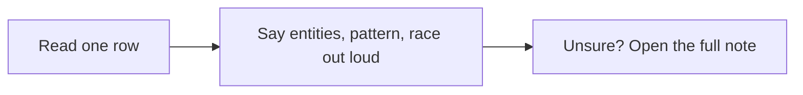
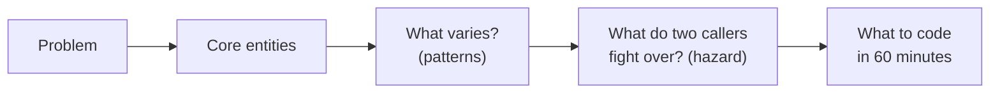

# LLD Problem Cheat Sheet

> [!summary] TL;DR
> One table for all 26 practice problems in this folder: the core entities, the patterns each one uses, the part that trips people up, the race you must name, and what to actually code in a 60-minute round. Use it the night before an interview, then open the linked note for the full design, code and tests.

## Start here: the basics 🟢

> [!info] How to read this note (pick your level)
> - 🟢 **New to this?** Read "From zero" below, then scan the table for 3-4 problems you know. Stop there.
> - 🟡 **Know the basics?** Read the whole table, row by row, and open the full note for any row that feels unclear.
> - 🔴 **Interview / SDE-3 prep?** Use "How to pick your first 5 minutes" and say the "race" column out loud for each problem. Headings are tagged 🟢🟡🔴 so you always know where you are.

**From zero, in 60 seconds** 🟢

This note is one big table, one row per practice problem in this folder.
Each row lists the main things to model (the **entities**), the patterns used, and the trap most people fall into.
It also names the **race**: the spot where two users at the same time can break the data, like two people booking one seat.
Use it the night before an interview to refresh, not to learn a problem for the first time.

**The problem in one story.**
Tomorrow you have an LLD interview and 26 practice problems in this folder.
You cannot reread every note tonight.
This page puts one row per problem: what the main objects are, which patterns fit, and where the bug hides.
Read the table, then open only the notes you feel shaky on.

**Words you need first**

| Word | Plain meaning | Tiny example |
| --- | --- | --- |
| Entity | A main noun in the problem with its own data | `Spot`, `Ticket` in a parking lot |
| Pattern | A named, reusable design shape | Strategy for swappable pricing |
| Strategy | Pass the changing rule in as a value or interface | A `FeeRule` function |
| State machine | An object whose allowed actions depend on its current state | Vending machine: idle → has coin → dispensing |
| Concurrency hazard | A bug that appears when two requests run at once | Two gates giving away the same spot |
| Compare-and-set | "Change it only if it still has the value I saw" | `available → busy` only if still `available` |
| Race test | A test run with `go test -race` to catch unsafe sharing | Many goroutines calling `Park` together |

**Picture it**

**Analogy.** A revision card before an exam: one line per topic to jog memory.
Where it breaks: a card cannot teach the topic; if a row makes no sense, open the full linked note.

**How the rest of this note builds up**

- First, the table: one row per practice problem with entities, patterns, tricky part, hazard and what to code.
- Then "How to pick your first 5 minutes": a five-step opening routine for any problem.
- Finally the links to the method, pattern and concurrency notes for depth.

> [!tip] Remember
> For every problem: name the nouns, what varies, what two callers fight over, and the one method you will code.

## The table 🟡

| Problem | Core entities | Patterns used | The tricky part | Concurrency hazard | What to code in 60 min |
|---|---|---|---|---|---|
| [[Parking Lot]] | ParkingLot, Spot, Vehicle, Ticket | Strategy (spot choice, pricing), Facade | Keeping spot allocation and fee rules swappable; money in `int64` paise with an injected clock | Two gates claiming the same free spot | `Park` and `Unpark` with an atomic find-and-take, one fee strategy, a race test |
| [[Vending Machine]] | Machine, State, Item, CoinBox, escrow | State, Strategy | Change-making with finite coins (greedy fails); escrow until the item drops | Coin inserts and cancel racing on one machine | State transitions, bounded change search, refund on jam |
| [[Library Management]] | Book (title), BookCopy, Member, Loan, Hold | Strategy (fines), Observer (hold notifications) | Title versus physical copy; FIFO hold queue with expiry | Two members borrowing the last copy | Borrow, return with hold assignment, fine strategy |
| [[Meeting Room Scheduler]] | Room, Booking, interval, recurrence | Strategy (room choice) | Half-open overlap rule `start < otherEnd && otherStart < end`; recurrence in the organizer's time zone | Two bookings for one room at once | Per-room lock, overlap check, all-or-nothing recurring booking |
| [[LRU Cache with TTL]] | Cache, entry, doubly linked list, map | Decorator-friendly interface | O(1) get/put with recency list; expired entries evicted before live ones | Concurrent get/put mutating the list | Map plus list, TTL check on read, sweeper, `-race` test |
| [[Elevator System]] | Controller, Car, up and down stop sets, Dispatcher | Strategy (dispatch), State | LOOK order: keep going while calls remain ahead, then turn | Hall calls arriving while cars move | Tick-based `Step()`, two stop sets, one dispatch strategy |
| [[Tic-Tac-Toe and Snake and Ladder]] | Player, Board, Game, Dice | Strategy, injected interfaces | O(1) win check with running sums; scripted dice for tests | Usually none (single-threaded turn loop) | Shared game skeleton, both rule sets, deterministic tests |
| [[Cart Checkout with Coupons]] | Cart, Coupon, Order, Payment | Strategy, Chain of Responsibility, saga | Compensation after each side effect; rounding rule for discounts | Two checkouts consuming a single-use coupon or the last stock | Price, coupon validate and consume, reserve, charge, undo on failure |
| [[Inventory Order Assignment (Dark Store)]] | Store, StockItem, Order, Reservation | Strategy (store selection), State, Repository | Reserving every item at one store all-or-nothing, falling back to the next store | Losing a stock race mid-reservation | Idempotent assign, nearest-first strategy, compare-and-set status |
| [[Delivery Partner Assignment]] | Rider, Offer, Order, Dispatcher | State, Adapter (3PL), Strategy | Offer timeouts, widening radius, 3PL fallback | Two orders holding one rider | Compare-and-set `available → busy`, offer timeout, retry next rider |
| [[Notification Service]] | Event, Message, Channel, Provider, Preference | Factory, Adapter, Decorator, Chain (failover) | Retrying only retryable errors with jittered backoff; priority lane for OTPs | Full queue blocking the caller; drain on shutdown | Worker pool, idempotency claim, retry policy, graceful `Close` |
| [[Rate Limiter]] | Limiter, bucket per key, Decision | Strategy (algorithm), Decorator (middleware) | Returning when to retry; deleting idle keys | Concurrent `Allow` on one key; distributed state | Token bucket behind `Allow(ctx, key)`, janitor, HTTP middleware |
| [[Logging Library]] | Logger, Entry, Level, Formatter, Appender | Chain, Strategy, Decorator (async appender) | Never blocking the request on a slow output; flush on shutdown | Async appender buffer and shutdown races | Level filter, JSON formatter, console and async appenders |
| [[File Search (Unix find)]] | Node (File, Directory, Symlink), Filter | Composite, Strategy, Specification-style filters | Query as a tree of AND, OR and NOT filters; symlink cycles | Optional parallel walk with a worker pool | Tree walk with DFS or BFS, filter tree, visited set |
| [[ATM]] | ATM, Session, Card, Account, CashDispenser | State, Strategy | Bounded change-making with limited notes; debit plus dispense with reversal on hardware failure | Two sessions on one account | Session state machine, dispense algorithm, reversal path |
| [[In-memory KV Store with TTL and Transactions]] | Store, entry, transaction stack | Command, Memento-style layers | Nested `BEGIN`/`ROLLBACK`/`COMMIT` as a stack of write maps | Sweeper and writers sharing the store | Get, Set with TTL, Delete, nested transactions, lazy plus active expiry |
| [[Task Scheduler (delayed and recurring jobs)]] | Scheduler, Job, min-heap, worker pool | Command, Strategy | One timer reset to the earliest job; recurring reschedule | Adding a job earlier than the one the timer waits for | Heap dispatcher, bounded workers, injected clock, cancel |
| [[Circuit Breaker]] | Breaker, window, State | State, Decorator | Sliding failure-rate window and a half-open probe limit | Many callers racing during half-open | Closed, open and half-open transitions with an injected clock |
| [[Movie Ticket Booking]] | Show, ShowSeat, Hold, Booking | State, Strategy (pricing), Facade | Seat state on ShowSeat, not Seat; late payment after hold expiry | Two users holding the same seats | All-or-nothing `LockSeats`, TTL expiry, idempotent confirm |
| [[Splitwise Expense Sharing]] | Group, User, Expense, Balance | Strategy (split types), Factory | Integer paise with remainders; delete as negated deltas; debt simplification | Concurrent expenses on one group | Equal, exact and percent splits, net balances, greedy simplify |
| [[Food Ordering System]] | Restaurant, MenuItem, Cart, Order, OrderLine | State (table with actors), Strategy, Observer | Cart versus order snapshot; actor-checked transitions; refunds | Double-tap checkout charging twice | Idempotent `PlaceOrder`, transition table, auto-reject job |
| [[Pub-Sub Message Queue]] | Topic, log, Subscription, offset | Observer, Iterator | Per-subscription offsets; redelivery of un-acked messages | Slow subscriber versus bounded buffer | Append-only log, ack and redelivery timeout, back-pressure |
| [[Ride Sharing]] | Rider, Driver, Trip, grid index | State, Strategy (matching, fare) | Grid lookup for nearby drivers; surge locked at request time | Two riders claiming one driver | Trip state machine, matcher, atomic driver claim |
| [[Hotel Booking]] | Hotel, RoomType, night inventory, Hold, Booking | Strategy (cancellation policy), State | Nights, not days; check-out day is not a night | Overbooking the last room for one night | Atomic reserve of every night, hold expiry, refund policy |
| [[Order Book Matching Engine]] | Order, PriceLevel, Book, Trade | Command, single writer | Price-time priority; trade at the resting price; market remainder cancelled | Concurrent submissions, solved by one owning goroutine | Bid and ask books, match loop, sequenced trade events |
| [[Digital Wallet and Ledger]] | Account, Transaction, Entry | Command, Repository | Double entry summing to zero; reversals instead of edits | Concurrent transfers overdrawing one account | Atomic transfer with balance check, idempotency key, reconcile |

## How to pick your first 5 minutes 🔴

1. **Restate the problem and cut scope.** Name the three to five use cases you will code and say out loud what you are leaving out ([[LLD Interview Method]]).
2. **Find the scarce resource.** Almost every problem above has one thing two callers fight over: a spot, a seat, a rider, a coupon, a balance. Name it and say how you make the claim atomic ([[Concurrency for LLD]]).
3. **Find what varies.** Pricing, matching, splitting and dispatch rules change often, so each becomes a strategy ([[Strategy and Template Method]]). Anything with a lifecycle becomes a state machine ([[State Machines in Go]]).
4. **Sketch entities, not classes for everything.** Four to six nouns with their key fields, then the relationships ([[UML for LLD]]).
5. **Decide the test you will show.** One happy path and one race or edge case, with an injected clock if time matters ([[Testing LLD Code]]).

## Links 🟢

- **Before this:** [[Digital Wallet and Ledger]], [[LLD Interview Method]]
- **Next:** [[17 LLD MOC]], [[LLD Round Playbook]]
- **Compare with:** [[Design Patterns Overview and Chooser]]

### Watch on YouTube

- [Watch This Before Your Next LLD Interview (Concurrency Cheatsheet)](https://www.youtube.com/watch?v=Qa6ePZYmTEU) · bhavika pawani · 21 min · 2,193 views
- [Low Level Design 102 /What is LLD(Low Level Design)? Simplified steps to learn and break LLD problem](https://www.youtube.com/watch?v=5Tz9EUMHOGI) · sudoCODE · 7 min · 105,776 views
