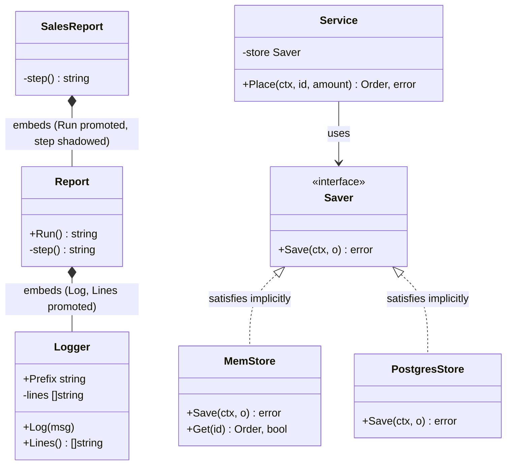
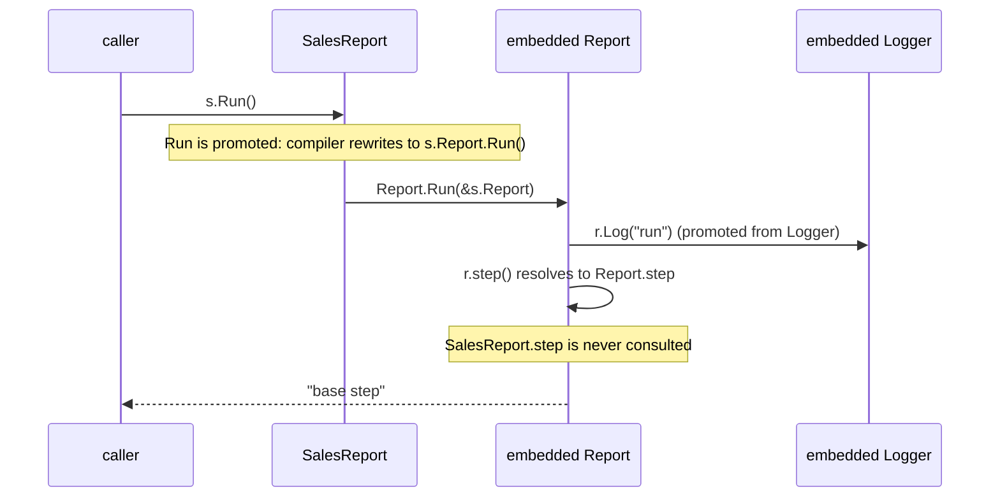

# OOP in Go - Structs, Interfaces, Embedding

> [!summary] TL;DR
> Go has no classes and no inheritance, but it covers everything an LLD round needs: a **struct** (a record of named fields) with **methods** plays the role of a class, an **interface** (a named set of method signatures) gives polymorphism without an `implements` keyword, and **embedding** (putting one type inside another without a field name) reuses code by composition. The traps are in the details: pointer receivers change which types satisfy an interface, embedding is not overriding, and a nil pointer stored in an interface is not a nil interface.

> [!abstract] Core idea
> - Class → struct plus methods; constructor → a plain `NewX` function; private → lower-case name, private to the package.
> - Interfaces are satisfied implicitly, kept small, and declared by the code that uses them; constructors accept interfaces and return concrete structs.
> - Pointer-receiver methods belong only to `*T`, so only `*T` satisfies an interface that needs them.
> - Embedding promotes the inner type's methods, but the inner type never calls back into the outer one: there is no virtual dispatch.
> - Classic mistake: returning a nil `*MyError` as an `error`; the caller sees `err != nil`.

## 1. Why it exists

Most LLD material is written in Java: abstract classes, `extends`, `@Override`, `IOrderService` with an `OrderServiceImpl`. Translating it line by line into Go produces code that compiles but behaves differently, and interviewers who write Go notice within a minute. Three concrete examples from practice problems:

- **Template method by embedding.** A Java-style `Report` base with `Run()` calling `step()`, embedded in `SalesReport` that defines its own `step()`. In Java `Run()` would call the subclass's step. In Go it calls `Report.step`, every time. The test in Section 4 shows it.
- **Value vs pointer.** `Order.Cancel()` declared with a value receiver cancels a copy; the order stored in the map stays `created`, and the double-cancel guard never fires.
- **Typed nil.** A validator returns `var ve *ValidationError` (nil) as an `error`, and every caller's `if err != nil` branch runs on valid input.

Getting these right is the price of entry for writing Go in an LLD round.

## 2. Mental model

Separate **data**, **behaviour contracts** and **reuse**, which Java's class bundles together:

- A **struct** holds data. Methods are just functions with a receiver (the value the method is called on), declared next to the type.
- An **interface** is a contract that describes *what the caller needs*, not what the provider is. Any type whose method set (the set of methods callable through that type) contains those methods satisfies it, without declaring so.
- **Embedding** is a field without a name. Its methods and fields are *promoted*: you can call them on the outer value as a shortcut. It is delegation written for you, not a parent class.

**Analogy:** a power socket (interface) does not know which appliance you plug in; any plug with the right pins fits. Embedding is a toolbox bolted inside a van: you can reach the tools from the van, but the toolbox does not know it is in a van.

## 3. How it works

### Java/OOP to Go translation

| OOP idea | Go version | Note |
| --- | --- | --- |
| class | `struct` + methods | Methods can be declared only in the struct's own package |
| constructor | `func NewOrder(...) (*Order, error)` | Plain function; validate and return an error instead of throwing |
| `private` / `public` | lower-case / upper-case identifier | Visibility is per **package**, not per type |
| interface + `implements` | interface, satisfied implicitly | Declare it where it is used |
| `extends` (inheritance) | embedding or a field | No subtype relation: a `SalesReport` is not a `Report` |
| abstract class | interface + an injected helper, or a struct with a function field | No abstract methods; the "hook" must be passed in |
| method override | a different type implementing the same interface | Or shadowing through embedding, which is not override |
| `enum` | typed constant + `iota` + `String()` | Any integer converts to the type; validate |
| `static` method / field | package-level function / variable | Avoid mutable package state |
| `synchronized` | `sync.Mutex` in the struct, or an atomic update in the database | Mutex protects one process only |
| exceptions | `error` return values | `panic` only for programmer bugs |
| dependency injection container | pass dependencies into `NewX`, wire them in `main` | Code-generated (google/wire) or reflection-based (uber/fx) wiring are optional |
| generic class `Cache<K,V>` | `type LRU[K comparable, V any] struct` (since Go 1.18) | Use generics when the algorithm is identical for all types |

### Value vs pointer receivers and method sets

A method's receiver is either a value (`func (o Order) ID()`) or a pointer (`func (o *Order) Cancel()`).

- A **value receiver** gets a copy. Use it for small, read-only methods.
- A **pointer receiver** gets the address. Use it when the method mutates, when the struct is large, or when it contains a `sync.Mutex` (copying a mutex copies its locked state; `go vet`'s copylocks check flags it).
- Rule of thumb from Go Code Review Comments: if any method needs a pointer receiver, give all methods pointer receivers for consistency. (The code below mixes them on purpose to show the method-set rule.)

The **method set** decides interface satisfaction (Go spec, "Method sets"):

| Type | Its method set contains | Satisfies `Canceller` (needs `Cancel()` with pointer receiver)? |
| --- | --- | --- |
| `Order` | methods with value receivers only | No |
| `*Order` | methods with value **and** pointer receivers | Yes |

Calling `v.Cancel()` on a plain variable `v Order` still compiles, because the variable is addressable and Go rewrites the call to `(&v).Cancel()`. That convenience does not extend to interface satisfaction, and it does not work for values that are not addressable, such as map elements: `m["o1"].Cancel()` with `map[string]Order` does not compile. Store `map[string]*Order` instead.

### Interfaces: implicit, small, consumer-side

An interface value is a pair: (dynamic type, dynamic value). Calling a method looks up the method for the dynamic type at run time. That is Go's only dynamic dispatch.

Rules that interviewers check:

| Rule | Meaning |
| --- | --- |
| Small | 1–3 methods. `io.Reader` has one. |
| Consumer-side | The package that *uses* a dependency declares the interface with only the methods it calls. |
| Accept interfaces, return structs | `NewService(store Saver) *Service`: callers can pass fakes, and they get the full concrete type back. |
| Implicit | No `implements`; a type satisfies every interface whose methods it has, including ones declared later in other packages. |
| Compile-time check | `var _ Canceller = (*Order)(nil)` fails to compile if the methods drift. |
| No interface for one implementation | Unless it is a real boundary (database, external API) or you need a fake in tests. |
| Interface embedding | `type ReadWriter interface { Reader; Writer }`, as in `io.ReadWriter`. |

### Embedding: promotion, shadowing, no virtual dispatch



- **Promotion:** `SalesReport{}` gets `Run`, `Log`, `Lines` and the field `Prefix` from its embedded types. `s.Log("x")` is shorthand for `s.Report.Logger.Log("x")`.
- **Shadowing:** a method or field at a shallower depth hides one with the same name deeper down. `SalesReport.step` hides `Report.step` *for callers of `s.step()`*. Two same-named fields or methods at the same depth are ambiguous, and using that name is a compile error.
- **No virtual dispatch:** inside `Report.Run` the receiver is a `*Report`. It has no idea it lives inside a `SalesReport`, so `r.step()` is `Report.step`:



The Go way to get a template method is to **inject the varying step** as an interface or function value (`Runner{steps: SalesStep{}}`), which is the Strategy pattern; see [[Strategy and Template Method]].

Other embedding facts:
- Embedding a **pointer** (`struct{ *Logger }`) shares one helper between values, but a zero-value outer struct has a nil `*Logger`, and a promoted method that touches its fields panics.
- Embedding an **interface** in a struct promotes the interface's methods; calling one that was never set panics with a nil pointer dereference. It is useful in tests to implement only the methods a test needs.
- Embedding a type also promotes its **exported** methods into your public API, which is how a `sync.Mutex` embedded in an exported struct leaks `Lock`/`Unlock` to callers. Use a named field `mu sync.Mutex` instead.

### Enums, constructors and zero values

- **Enums:** `type Status int` plus `const ( StatusUnknown Status = iota; ... )`. Reserve the zero value for "unknown" so a forgotten field is detectable, add `String()` for logs, and a `Valid()` check, because `Status(9)` compiles.
- **Constructors:** `NewOrder` validates input and returns `(*Order, error)`. Other packages cannot set unexported fields, so the constructor is the only way to build a valid `Order` from outside.
- **Useful zero values:** design types so `var x T` works where possible, as `sync.Mutex`, `bytes.Buffer` and `strings.Builder` do. When a zero value cannot be valid (an `Order` with no ID), hide the fields and require the constructor.

### Encapsulation by package

- Lower-case names are visible only inside the **package** (all files in one directory). Two types in the same package can read each other's unexported fields; that is the unit of encapsulation, not the type.
- A directory named `internal/` limits imports to code rooted at the parent of `internal` (enforced by the go command). `myapp/internal/order` can be imported by `myapp/cmd/api` but not by another module.

## 4. Worked example

### Whiteboard version

The four facts in one sketch (it compiles as shown):

```go
package sketch

type Status int
type ValidationError struct{}

func (*ValidationError) Error() string { return "invalid" }

type Order struct{ status Status } // unexported field: encapsulated

func (o *Order) Cancel() error { return nil } // pointer receiver mutates

type Canceller interface{ Cancel() error }

var _ Canceller = (*Order)(nil) // *Order satisfies it; Order does not

type Report struct{}

func (r *Report) step() string { return "base step" }
func (r *Report) Run() string  { return r.step() } // always Report.step

type SalesReport struct{ Report }   // embedding
func (s *SalesReport) step() string { return "sales step" }

// (&SalesReport{}).Run() == "base step": no virtual dispatch

func validate() error {
	var ve *ValidationError // nil pointer
	return ve               // non-nil error! return nil instead
}
```

### Full code (tested)

`order.go`:

```go
// Package order shows Go's take on classes, interfaces and inheritance.
package order

import (
	"context"
	"errors"
	"fmt"
	"strings"
)

// ---- Enum: typed constant + iota + String + validation ----

type Status int

const (
	StatusUnknown Status = iota // zero value means "not set"
	StatusCreated
	StatusPaid
	StatusCancelled
)

var statusNames = [...]string{"unknown", "created", "paid", "cancelled"}

func (s Status) String() string {
	if s < 0 || int(s) >= len(statusNames) {
		return fmt.Sprintf("Status(%d)", int(s))
	}
	return statusNames[s]
}

func (s Status) Valid() bool { return s > StatusUnknown && s <= StatusCancelled }

// ---- Struct with unexported fields: encapsulation is per package ----

var ErrInvalidTransition = errors.New("invalid state transition")

type Order struct {
	id     string
	amount int64 // paise
	status Status
}

// NewOrder is the only way other packages can build a valid Order.
func NewOrder(id string, amount int64) (*Order, error) {
	if id == "" || amount <= 0 {
		return nil, fmt.Errorf("new order: id=%q amount=%d: invalid input", id, amount)
	}
	return &Order{id: id, amount: amount, status: StatusCreated}, nil
}

// Value receivers: read-only, work on both Order and *Order.
func (o Order) ID() string     { return o.id }
func (o Order) Status() Status { return o.status }

// Pointer receiver: mutates, so it must see the caller's Order.
func (o *Order) Cancel() error {
	if o.status != StatusCreated {
		return fmt.Errorf("cancel %s from %s: %w", o.id, o.status, ErrInvalidTransition)
	}
	o.status = StatusCancelled
	return nil
}

// ---- Method sets ----

type Canceller interface{ Cancel() error }

// *Order is a Canceller. Order (a value) is NOT, because Cancel has a
// pointer receiver. Compile-time proof:
var _ Canceller = (*Order)(nil)

// var _ Canceller = Order{} // does not compile: Cancel has pointer receiver

// ---- Consumer-side interface, accept interfaces, return structs ----

// Saver is declared HERE, by the code that needs it, with only one method.
type Saver interface {
	Save(ctx context.Context, o *Order) error
}

type Service struct{ store Saver }

func NewService(store Saver) *Service { return &Service{store: store} }

func (s *Service) Place(ctx context.Context, id string, amount int64) (*Order, error) {
	o, err := NewOrder(id, amount)
	if err != nil {
		return nil, err
	}
	if err := s.store.Save(ctx, o); err != nil {
		return nil, fmt.Errorf("place %s: %w", id, err)
	}
	return o, nil
}

// MemStore has more methods than Saver needs; it still satisfies Saver.
type MemStore struct{ byID map[string]*Order }

func NewMemStore() *MemStore { return &MemStore{byID: map[string]*Order{}} }

func (m *MemStore) Save(_ context.Context, o *Order) error {
	m.byID[o.id] = o
	return nil
}

func (m *MemStore) Get(id string) (*Order, bool) { o, ok := m.byID[id]; return o, ok }

// ---- Embedding: promotion, shadowing, no virtual dispatch ----

// Logger is a reusable helper that other types embed.
type Logger struct {
	Prefix string
	lines  []string
}

func (l *Logger) Log(msg string)  { l.lines = append(l.lines, l.Prefix+msg) }
func (l *Logger) Lines() []string { return l.lines }

// Report is a "base" written Java-style: Run calls step().
type Report struct{ Logger }

func (r *Report) step() string { return "base step" }

// Run always calls Report.step, even when Report is embedded in
// something that defines its own step. Go has no virtual dispatch.
func (r *Report) Run() string {
	r.Log("run")
	return r.step()
}

// SalesReport embeds Report: Run and Log are promoted.
type SalesReport struct{ Report }

// This step SHADOWS Report.step for callers of SalesReport.step,
// but Report.Run will never call it.
func (s *SalesReport) step() string { return "sales step" }

// The Go way: inject the varying step as a small interface.
type Stepper interface{ Step() string }

type Runner struct{ steps Stepper }

func (r Runner) Run() string { return r.steps.Step() }

type SalesStep struct{}

func (SalesStep) Step() string { return "sales step" }

// ---- Typed-nil interface trap ----

type ValidationError struct{ Field string }

func (e *ValidationError) Error() string { return "invalid " + e.Field }

// validateBad returns a nil *ValidationError inside a non-nil error.
func validateBad(name string) error {
	var ve *ValidationError
	if strings.TrimSpace(name) == "" {
		ve = &ValidationError{Field: "name"}
	}
	return ve // BUG: interface holds (type=*ValidationError, value=nil)
}

// validateGood returns a literal nil when there is no error.
func validateGood(name string) error {
	if strings.TrimSpace(name) == "" {
		return &ValidationError{Field: "name"}
	}
	return nil
}
```

`order_test.go`:

```go
package order

import (
	"context"
	"errors"
	"testing"
)

func TestStatusString(t *testing.T) {
	cases := map[Status]string{StatusCreated: "created", StatusCancelled: "cancelled", Status(9): "Status(9)"}
	for s, want := range cases {
		if got := s.String(); got != want {
			t.Errorf("%d: got %q want %q", int(s), got, want)
		}
	}
	var zero Status
	if zero.Valid() {
		t.Error("zero Status must be invalid")
	}
}

func TestCancelNeedsPointer(t *testing.T) {
	o, err := NewOrder("o1", 49900)
	if err != nil {
		t.Fatal(err)
	}
	copyOf := *o                            // a value copy
	if err := copyOf.Cancel(); err != nil { // addressable var: Go takes &copyOf
		t.Fatal(err)
	}
	if o.Status() != StatusCreated {
		t.Fatalf("original changed to %s; the copy should be independent", o.Status())
	}
	if err := o.Cancel(); err != nil {
		t.Fatal(err)
	}
	if err := o.Cancel(); !errors.Is(err, ErrInvalidTransition) {
		t.Fatalf("second cancel: got %v", err)
	}
}

func TestConsumerInterface(t *testing.T) {
	store := NewMemStore()
	svc := NewService(store) // *MemStore satisfies Saver implicitly
	if _, err := svc.Place(context.Background(), "o2", 100); err != nil {
		t.Fatal(err)
	}
	if _, ok := store.Get("o2"); !ok {
		t.Fatal("order not saved")
	}
	if _, err := svc.Place(context.Background(), "", 100); err == nil {
		t.Fatal("want validation error")
	}
}

func TestEmbeddingNoVirtualDispatch(t *testing.T) {
	s := &SalesReport{}
	s.Prefix = "[sales] " // promoted field from the embedded Logger
	if got := s.Run(); got != "base step" {
		t.Fatalf("Run() = %q; embedding has no virtual dispatch", got)
	}
	if got := s.step(); got != "sales step" {
		t.Fatalf("direct call should hit the shadowing method, got %q", got)
	}
	if got := s.Lines(); len(got) != 1 || got[0] != "[sales] run" {
		t.Fatalf("promoted Log: %v", got)
	}
	if got := (Runner{steps: SalesStep{}}).Run(); got != "sales step" {
		t.Fatalf("injected step: %q", got)
	}
}

func TestTypedNilTrap(t *testing.T) {
	if err := validateBad("ok"); err == nil {
		t.Fatal("expected the trap: a nil *ValidationError is a non-nil error")
	}
	if err := validateGood("ok"); err != nil {
		t.Fatalf("validateGood: %v", err)
	}
	var ve *ValidationError
	if err := validateGood(" "); !errors.As(err, &ve) || ve.Field != "name" {
		t.Fatalf("errors.As failed: %v", err)
	}
}
```

Measured: `go vet` is clean and `go test -race -count=1` passes on Go 1.24.4 (darwin/arm64). The test `TestEmbeddingNoVirtualDispatch` proves `SalesReport.Run()` returns `"base step"`, and `TestTypedNilTrap` proves the nil `*ValidationError` compares non-nil as an `error`.

### Constructor injection and the composition root

The **composition root** is the one place, usually `main`, that builds concrete types and passes them into constructors. Nothing else calls `NewPostgresStore`:

```go
package main

import (
	"context"

	"example.com/shop/order" // the order package above
)

func main() {
	store := order.NewMemStore()   // swap for a Postgres store in production
	svc := order.NewService(store) // accepts the Saver interface
	_, _ = svc.Place(context.Background(), "o1", 49900)
}
```

For a handful of services, hand wiring like this is the common Go choice: it is explicit and the compiler checks it. google/wire generates the same wiring code at build time; uber/fx wires at run time with reflection and adds lifecycle hooks (check each project's current maintenance status before adopting it). Both pay off only when the dependency graph is large. Layout details are in [[Service Project Layout and Wiring]].

## 5. Variants and comparison

How to get "same call, different behaviour" in Go:

| Mechanism | How it works | Use when | Cost |
| --- | --- | --- | --- |
| Interface | Dynamic dispatch on the stored type | Behaviour varies by implementation (stores, providers, strategies) | One indirect call; harder "go to definition" |
| Function value | Store a `func` field or pass a closure | One varying operation, no state | No name for the role; can hide too much |
| Type switch | `switch v := x.(type)` over a closed set | A fixed, small set of types you own (AST nodes, events) | Every new type edits the switch |
| Generics | Type parameters, `[K comparable, V any]` | Same algorithm, different element types (`LRU[K,V]`, sets, queues) | Cannot vary behaviour by type without an interface constraint |
| Embedding | Promote methods of an inner type | Reuse a helper's methods (logger, metrics, base fields) | No override; leaks the inner API |
| Named field | `log *Logger` and explicit delegation | Same as embedding when you want control over the API | A few delegating lines |

Generics and interfaces combine: `func Max[T cmp.Ordered](a, b T) T` uses an interface as a constraint. More in [[Generics and Iterators]] and [[LRU Cache with TTL]].

## 6. Trade-offs and when not to use

- **Do not create an interface per struct.** `OrderService` + `OrderServiceImpl` is Java style. Declare the interface in the consumer when a second implementation or a test fake exists.
- **Do not embed to get "is-a".** If you want `SalesReport` to be usable where a `Report` is expected, define an interface both satisfy. Embedding does not create a subtype.
- **Do not embed a mutex in an exported type.** It makes `Lock` part of the public API.
- **Value receivers for small immutable types** (money, coordinates, IDs) are fine and avoid aliasing bugs; pointer receivers for entities that change (orders, accounts).
- **Generics are not polymorphism.** A generic `Notifier[T]` does not let you choose email or SMS at run time; an interface does.
- **Large producer-side interfaces** (a 12-method `Repository` declared next to the Postgres code) force every fake to implement 12 methods. Split by consumer.

## 7. In production

- **Real systems:** the standard library is the model. `io.Reader`/`io.Writer` are one-method consumer-friendly interfaces; `http.Handler` is one method; `bufio.ReadWriter` embeds `*bufio.Reader` and `*bufio.Writer` to promote both method sets; `sync.Mutex` and `bytes.Buffer` have useful zero values.
- **Failure modes → fixes:**

| Failure | Symptom | Fix |
| --- | --- | --- |
| Value receiver on a mutating method | State change "disappears" | Pointer receiver; store `*T` in maps |
| Typed nil returned as `error` | `err != nil` on success; `errors.As` finds a nil pointer | Return the literal `nil`; never declare `var err *MyErr` and return it |
| Template method via embedding | Override never runs | Inject the step as an interface or func |
| Nil embedded pointer | Panic on first promoted call | Construct with `NewX`, or embed by value |
| Copying a struct with a mutex | Two copies, two locks, data race | Pointer receivers; `go vet` copylocks |
| Unvalidated enum | `Status(7)` stored in the database | `Valid()` at the boundary; zero value means unknown |

- **What to monitor:** in code review, `go vet` (copylocks, printf), `staticcheck`, and the race detector in CI (`go test -race`). Compile-time `var _ I = (*T)(nil)` assertions catch interface drift before deploy.

## 8. Deep dive

**Why typed nil happens.** An `error` is an interface value: (type, value). `return ve` where `ve` is a nil `*ValidationError` produces (`*ValidationError`, nil). An interface equals `nil` only when both parts are nil, so the result is not nil (Go FAQ). Calling `err.Error()` would then call the method with a nil receiver, which works or panics depending on whether the method dereferences it. The same trap applies to any interface, such as a nil `*MemStore` passed as a `Saver`.

**Promotion depth rules.** The selector `x.f` picks the shallowest `f` among `x` and its embedded fields. At equal depth with two candidates, `x.f` is illegal, but the program still compiles if nothing uses `x.f`. Method sets of the outer struct include promoted methods: for `S` embedding `T`, `S` gets `T`'s value methods and `*S` gets `T`'s and `*T`'s methods; for `S` embedding `*T`, both `S` and `*S` get all of `T`'s and `*T`'s methods (Go spec, "Struct types").

**Interface satisfaction and embedding together.** Because promoted methods count, `SalesReport` satisfies any interface that `Report` satisfies through promotion. That looks like inheritance from outside but the dispatch inside the promoted method still goes to the embedded type.

**Type switch vs polymorphism.** A type switch is fine when the set of types is closed and you own it (for example, parser nodes). If adding a type means editing switches in five files, move the behaviour onto an interface method instead (the open-closed idea from [[SOLID in Go]]).

**Errors are values.** The domain error package, wrapping with `%w`, `errors.Is`/`errors.As`/`errors.Join` and the mapping to HTTP status at the edge belong to [[Error Handling]]; this note only covers the interface-shaped trap.

## 9. Interview questions

> [!question]- Why does `*T` satisfy an interface but `T` does not?
> Methods with pointer receivers are in the method set of `*T` only. If the interface needs one of them, only a `*T` has it. You can still call such a method on an addressable `T` variable because Go takes its address for you, but that rewrite does not apply to interface satisfaction.

> [!question]- Trap: `SalesReport` embeds `Report` and defines its own `step()`. `Report.Run()` calls `r.step()`. What does `salesReport.Run()` call?
> `Report.step`. Embedding promotes methods but there is no virtual dispatch: inside `Run` the receiver is the embedded `*Report`. To vary the step, inject it as an interface or function.

> [!question]- Trap: a function returns `var e *MyErr; return e`. Why does `err != nil` hold?
> The returned `error` holds (type `*MyErr`, value nil). An interface is nil only if both its type and value are nil. Return the literal `nil` when there is no error.

> [!question]- Where should an interface be declared, and how big should it be?
> In the package that uses it, with only the methods that package calls, usually 1–3. The producer returns a concrete struct. This keeps fakes small and decouples packages, since satisfaction is implicit.

> [!question]- How do you do encapsulation in Go without `private`?
> Lower-case identifiers are private to the package. Hide fields, provide a `NewX` constructor that validates, and expose methods. Use `internal/` directories to stop other modules importing implementation packages.

> [!question]- Interface or generics for an LRU cache? For a notifier?
> LRU: generics, because the algorithm is identical for every key and value type (`LRU[K comparable, V any]`). Notifier: interface, because email and SMS behave differently and are chosen at run time.

> [!question]- How do you model an enum safely?
> A named integer type with `iota` constants, the zero value reserved for "unknown", a `String()` method, and a `Valid()` check at the boundary, because any integer converts to the type.

## 10. Cheat sheet

- Struct + methods = class; `NewX` = constructor; lower-case = package-private.
- Mutating or large or contains a mutex → pointer receiver; only `*T` then satisfies the interface.
- Interfaces: small, consumer-side, implicit; accept interfaces, return structs; `var _ I = (*T)(nil)`.
- Embedding promotes; outer names shadow inner; no virtual dispatch, so inject variation instead.
- Never return a typed nil pointer as an interface; return `nil`.
- Enums: `iota`, zero = unknown, `String()`, `Valid()`.
- Wire concrete types in `main` (composition root); everything else takes interfaces.

## Links

- **Before this:** [[Structs, Methods and Embedding]], [[Interfaces]], [[Pointers, Values and Escape Analysis]]
- **Next:** [[Design Principles - DRY, KISS, YAGNI, Coupling and Cohesion]], [[SOLID in Go]], [[LLD Interview Method]]
- **Compare with:** [[Strategy and Template Method]] (the right way to vary a step), [[Generics and Iterators]], [[Error Handling]]
