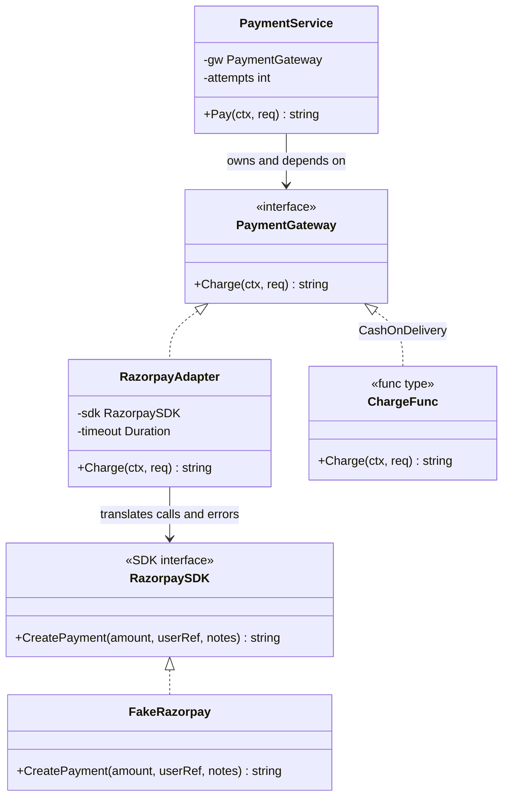
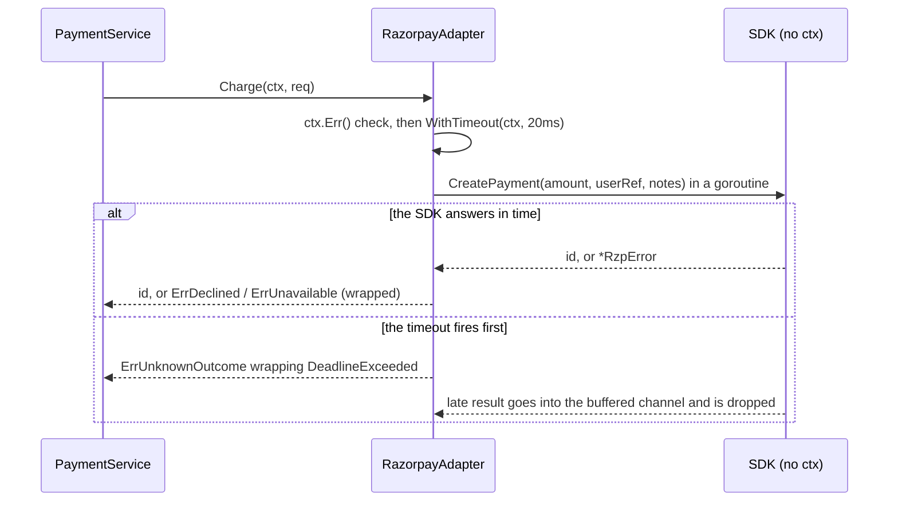

# Adapter

> [!summary] TL;DR
> An **adapter** makes something you do not control (a payment SDK, a courier API, a plain function) fit an interface **you** own. Your service calls `PaymentGateway.Charge(ctx, req)`; a `RazorpayAdapter` translates that call into the SDK's own method, adds the timeout the SDK lacks, and translates the SDK's errors into your domain errors. In Go, `http.HandlerFunc` is the best-known adapter: it turns a function into an `http.Handler`.

## 1. Why it exists

A checkout service accepts Razorpay, Stripe, an internal wallet and cash on delivery. Each provider has its own SDK: different method names, amount types, metadata formats and error types. If the checkout code calls the SDKs directly:

- Every caller learns four APIs, and provider types (`*RzpError`, `map[string]string` notes) spread through business code.
- Switching or adding a provider touches every caller instead of one file.
- Error handling diverges: one place retries a declined card, which can never succeed, while another fails a request on a transient `SERVER_ERROR` that one retry would have fixed.
- An SDK method without a `context.Context` parameter cannot be cancelled. If the provider hangs for 60 seconds, so does the checkout request, holding a goroutine and a connection the whole time.

The old note's adapter had exactly the last two problems: it ignored `ctx` and returned SDK errors unchanged. The adapter below fixes both.

## 2. Mental model

A travel plug adapter. Your laptop charger (your code) has one plug shape (your interface). Each country's socket (each SDK) is different. You do not rewire the laptop for each country; you carry a small adapter per socket. A good travel adapter also has a fuse: it protects your side from whatever the wall does. In software the fuse is the timeout and the error translation.

The key point is **direction**: you own the target interface, written in your domain's words, and adapt the external thing **to it**. If you shape your interface after one SDK, the next SDK will not fit.

## 3. How it works

1. **Define the target interface on your side**, in domain terms: `PaymentGateway.Charge(ctx, ChargeRequest)` with amounts in paise and your own error values `ErrDeclined`, `ErrUnavailable`, `ErrUnknownOutcome`.
2. **Describe the slice of the SDK you use** as a small interface (`RazorpaySDK`). The real SDK client satisfies it implicitly, and tests can supply a fake.
3. **Write the adapter**: a struct holding the SDK, with methods of the target interface. Each method:
	- checks `ctx.Err()` first, so a request that is already cancelled never starts a payment;
	- converts the request into the SDK's shape (user reference, `notes["order_id"]`);
	- runs the SDK call under a timeout, even though the SDK takes no context (see below);
	- maps SDK errors to domain errors, so callers use `errors.Is(err, ErrDeclined)` and never see `*RzpError`.
4. **Add a compile-time check**: `var _ PaymentGateway = (*RazorpayAdapter)(nil)` fails the build if a method signature drifts.
5. **Use function adapters for one-method interfaces**: `type ChargeFunc func(...)` with a `Charge` method lets a plain function (cash on delivery) satisfy `PaymentGateway`, exactly like `http.HandlerFunc` does for `http.Handler`.



Every method also returns an `error`, left out of the diagram for space. The real Razorpay client would sit where `FakeRazorpay` is.

### A timeout for an SDK call that takes no context

The adapter runs the SDK call in a goroutine and waits on whichever comes first: the result or `ctx.Done()`.



Two details make this safe:

- The result channel has a buffer of 1, so the goroutine can always send and exit, even when nobody is waiting any more. With an unbuffered channel it would block forever: a goroutine leak per timeout.
- A timeout **abandons** the call; it does not cancel it. The provider may still charge the customer. That is why a timeout maps to `ErrUnknownOutcome` ("check the payment status before retrying"), not to "failed".

## 4. Worked example

One `package main` with the owner's `PaymentGateway`, `ChargeRequest` and `RazorpayAdapter`, now with context handling, a timeout, error translation, a compile-time check, a function adapter and a fake SDK. `RzpError` codes are modeled on Razorpay's documented error codes; the SDK itself is an in-memory stand-in. Built with Go 1.24.4; `go vet` is clean and `go test -race` passes.

```go
package main

import (
	"context"
	"errors"
	"fmt"
	"net/http"
	"net/http/httptest"
	"sync"
	"time"
)

// ---------- Our side: the target interface and domain errors ----------

type ChargeRequest struct {
	OrderID string
	UserID  string
	Amount  int64 // paise
}

// PaymentGateway is the interface WE own; every provider is adapted to it.
type PaymentGateway interface {
	Charge(ctx context.Context, req ChargeRequest) (paymentID string, err error)
}

var (
	ErrDeclined       = errors.New("payment declined")             // permanent: never retry
	ErrUnavailable    = errors.New("payment provider unavailable") // safe to retry
	ErrUnknownOutcome = errors.New("payment outcome unknown")      // check status before retrying
)

// ---------- Their side: the SDK shape we do not control ----------

// RzpError mimics an SDK error type that carries provider error codes.
type RzpError struct{ Code, Description string }

func (e *RzpError) Error() string { return e.Code + ": " + e.Description }

// RazorpaySDK is the narrow slice of the SDK we use. Note: no context parameter.
type RazorpaySDK interface {
	CreatePayment(amount int64, userRef string, notes map[string]string) (string, error)
}

// FakeRazorpay is an in-memory SDK: it fails with Errs in order, then succeeds.
type FakeRazorpay struct {
	mu    sync.Mutex
	Errs  []error
	Delay time.Duration
	calls int
}

func (f *FakeRazorpay) CreatePayment(_ int64, _ string, notes map[string]string) (string, error) {
	f.mu.Lock()
	f.calls++
	n := f.calls
	f.mu.Unlock()
	time.Sleep(f.Delay)
	if n <= len(f.Errs) {
		return "", f.Errs[n-1]
	}
	return "pay_" + notes["order_id"], nil
}

func (f *FakeRazorpay) Calls() int {
	f.mu.Lock()
	defer f.mu.Unlock()
	return f.calls
}

// ---------- The object adapter ----------

type RazorpayAdapter struct {
	sdk     RazorpaySDK
	timeout time.Duration
}

// Compile-time check: the build fails if the adapter stops satisfying the interface.
var _ PaymentGateway = (*RazorpayAdapter)(nil)

func NewRazorpayAdapter(sdk RazorpaySDK, timeout time.Duration) *RazorpayAdapter {
	return &RazorpayAdapter{sdk: sdk, timeout: timeout}
}

func (a *RazorpayAdapter) Charge(ctx context.Context, req ChargeRequest) (string, error) {
	if err := ctx.Err(); err != nil {
		return "", err // the caller is gone: do not start a payment
	}
	ctx, cancel := context.WithTimeout(ctx, a.timeout)
	defer cancel()

	type result struct {
		id  string
		err error
	}
	done := make(chan result, 1) // buffered, so a late SDK call can still finish and exit
	go func() {
		id, err := a.sdk.CreatePayment(req.Amount, req.UserID, map[string]string{"order_id": req.OrderID})
		done <- result{id, err}
	}()

	select {
	case r := <-done:
		if r.err != nil {
			return "", translate(r.err)
		}
		return r.id, nil
	case <-ctx.Done():
		// The SDK call cannot be cancelled; it may still charge the customer.
		return "", fmt.Errorf("razorpay: %w: %w", ErrUnknownOutcome, ctx.Err())
	}
}

// translate maps provider errors to domain errors. The provider type is not
// wrapped (%v, not %w), so callers cannot start depending on it.
func translate(err error) error {
	var re *RzpError
	if errors.As(err, &re) {
		switch re.Code {
		case "BAD_REQUEST_ERROR":
			return fmt.Errorf("razorpay %v: %w", re, ErrDeclined)
		case "GATEWAY_ERROR", "SERVER_ERROR":
			return fmt.Errorf("razorpay %v: %w", re, ErrUnavailable)
		}
	}
	return fmt.Errorf("razorpay %v: %w", err, ErrUnknownOutcome)
}

// ---------- A function adapter, the http.HandlerFunc trick ----------

type ChargeFunc func(ctx context.Context, req ChargeRequest) (string, error)

func (f ChargeFunc) Charge(ctx context.Context, req ChargeRequest) (string, error) {
	return f(ctx, req)
}

// CashOnDelivery needs no struct: a function becomes a PaymentGateway.
var CashOnDelivery = ChargeFunc(func(_ context.Context, req ChargeRequest) (string, error) {
	return "cod_" + req.OrderID, nil
})

// ---------- The client: knows only our interface and our errors ----------

type PaymentService struct {
	gw       PaymentGateway
	attempts int
}

func (s *PaymentService) Pay(ctx context.Context, req ChargeRequest) (string, error) {
	var err error
	for range max(s.attempts, 1) { // at least one call, even if attempts is unset
		var id string
		id, err = s.gw.Charge(ctx, req)
		if err == nil || !errors.Is(err, ErrUnavailable) {
			return id, err // success, or an error that a retry cannot fix
		}
	}
	return "", err
}

func main() {
	ctx := context.Background()
	req := ChargeRequest{OrderID: "o_101", UserID: "u_7", Amount: 49900}

	flaky := &FakeRazorpay{Errs: []error{&RzpError{"SERVER_ERROR", "upstream 503"}}}
	svc := &PaymentService{gw: NewRazorpayAdapter(flaky, time.Second), attempts: 3}
	id, err := svc.Pay(ctx, req)
	fmt.Println("retried:", id, err, "sdk calls:", flaky.Calls())

	declined := &FakeRazorpay{Errs: []error{&RzpError{"BAD_REQUEST_ERROR", "card declined"}}}
	svc = &PaymentService{gw: NewRazorpayAdapter(declined, time.Second), attempts: 3}
	_, err = svc.Pay(ctx, req)
	fmt.Println("declined:", err, "| is ErrDeclined:", errors.Is(err, ErrDeclined), "| sdk calls:", declined.Calls())

	slow := &FakeRazorpay{Delay: 50 * time.Millisecond}
	_, err = NewRazorpayAdapter(slow, 20*time.Millisecond).Charge(ctx, req)
	fmt.Println("slow:", err)

	id, _ = (&PaymentService{gw: CashOnDelivery, attempts: 1}).Pay(ctx, req)
	fmt.Println("cod:", id)

	var h http.Handler = http.HandlerFunc(func(w http.ResponseWriter, _ *http.Request) {
		fmt.Fprint(w, "pong")
	})
	rec := httptest.NewRecorder()
	h.ServeHTTP(rec, httptest.NewRequest(http.MethodGet, "/ping", nil))
	fmt.Println("http.HandlerFunc:", rec.Code, rec.Body.String())
}
```

```go
package main

import (
	"context"
	"errors"
	"testing"
	"time"
)

var req = ChargeRequest{OrderID: "o1", UserID: "u1", Amount: 100}

func TestErrorTranslation(t *testing.T) {
	tests := []struct {
		name string
		sdk  error
		want error
	}{
		{"declined", &RzpError{"BAD_REQUEST_ERROR", "card declined"}, ErrDeclined},
		{"gateway", &RzpError{"GATEWAY_ERROR", "bank down"}, ErrUnavailable},
		{"server", &RzpError{"SERVER_ERROR", "503"}, ErrUnavailable},
		{"unknown", errors.New("connection reset"), ErrUnknownOutcome},
	}
	for _, tc := range tests {
		t.Run(tc.name, func(t *testing.T) {
			a := NewRazorpayAdapter(&FakeRazorpay{Errs: []error{tc.sdk}}, time.Second)
			_, err := a.Charge(context.Background(), req)
			if !errors.Is(err, tc.want) {
				t.Fatalf("err = %v, want %v", err, tc.want)
			}
			var re *RzpError
			if errors.As(err, &re) {
				t.Fatal("the provider error type must not leak through the adapter")
			}
		})
	}
}

func TestRetriesOnlyRetryableErrors(t *testing.T) {
	flaky := &FakeRazorpay{Errs: []error{&RzpError{"SERVER_ERROR", "503"}, &RzpError{"GATEWAY_ERROR", "x"}}}
	id, err := (&PaymentService{gw: NewRazorpayAdapter(flaky, time.Second), attempts: 3}).Pay(context.Background(), req)
	if err != nil || id != "pay_o1" || flaky.Calls() != 3 {
		t.Fatalf("id=%q err=%v calls=%d", id, err, flaky.Calls())
	}
	declined := &FakeRazorpay{Errs: []error{&RzpError{"BAD_REQUEST_ERROR", "no"}}}
	_, err = (&PaymentService{gw: NewRazorpayAdapter(declined, time.Second), attempts: 3}).Pay(context.Background(), req)
	if !errors.Is(err, ErrDeclined) || declined.Calls() != 1 {
		t.Fatalf("err=%v calls=%d, want one call and ErrDeclined", err, declined.Calls())
	}
}

func TestTimeoutForSDKWithoutContext(t *testing.T) {
	slow := &FakeRazorpay{Delay: 200 * time.Millisecond}
	start := time.Now()
	_, err := NewRazorpayAdapter(slow, 20*time.Millisecond).Charge(context.Background(), req)
	if !errors.Is(err, ErrUnknownOutcome) || !errors.Is(err, context.DeadlineExceeded) {
		t.Fatalf("err = %v", err)
	}
	if time.Since(start) > 150*time.Millisecond {
		t.Fatal("Charge waited for the slow SDK instead of timing out")
	}
}

func TestCancelledContextStartsNothing(t *testing.T) {
	ctx, cancel := context.WithCancel(context.Background())
	cancel()
	sdk := &FakeRazorpay{}
	if _, err := NewRazorpayAdapter(sdk, time.Second).Charge(ctx, req); !errors.Is(err, context.Canceled) {
		t.Fatalf("err = %v", err)
	}
	if sdk.Calls() != 0 {
		t.Fatal("the SDK must not be called for a cancelled request")
	}
}

func TestFuncAdapter(t *testing.T) {
	var gw PaymentGateway = CashOnDelivery
	if id, err := gw.Charge(context.Background(), req); err != nil || id != "cod_o1" {
		t.Fatalf("id=%q err=%v", id, err)
	}
	// attempts left at zero must still make one call, not return ("", nil)
	if id, err := (&PaymentService{gw: gw}).Pay(context.Background(), req); err != nil || id != "cod_o1" {
		t.Fatalf("zero attempts: id=%q err=%v", id, err)
	}
}
```

Output of `go run .` (measured, Go 1.24.4, darwin/arm64):

```text
retried: pay_o_101 <nil> sdk calls: 2
declined: razorpay BAD_REQUEST_ERROR: card declined: payment declined | is ErrDeclined: true | sdk calls: 1
slow: razorpay: payment outcome unknown: context deadline exceeded
cod: cod_o_101
http.HandlerFunc: 200 pong
```

What to notice:

- **retried**: one `SERVER_ERROR` became `ErrUnavailable`, the service retried, and the second SDK call succeeded.
- **declined**: `BAD_REQUEST_ERROR` became `ErrDeclined`; the service did not retry (1 SDK call). The message keeps the provider detail for logs, but `errors.As(err, &rzpErr)` fails, which the test checks: the provider type does not leak.
- **slow**: the 50 ms SDK call lost to the 20 ms timeout, and the error wraps both `ErrUnknownOutcome` and `context.DeadlineExceeded` (two `%w` verbs, allowed since Go 1.20).
- **cod** and **http.HandlerFunc**: functions turned into interface values by a one-line method.

## 5. Variants and comparison

**Forms of Adapter in Go:**

| Option | How it works | Use when | Cost |
| --- | --- | --- | --- |
| Object adapter | Struct holds the adaptee and implements the target interface | Wrapping SDKs and third-party clients | One type per provider |
| Function adapter | `type F func(...)` with the interface's one method | One-method interfaces: `http.HandlerFunc`, `ChargeFunc`, `DispenserFunc`, `ValidatorFunc` | Only for single-method interfaces |
| Adapter function | A function that returns a value of another interface: `io.NopCloser(r)`, `strings.NewReader(s)`, `slog.NewLogLogger(h, level)` | Bridging two standard interfaces | Hidden no-ops (`NopCloser` closes nothing) |
| Anti-corruption layer | A package of adapters plus translators between your model and an external model | A whole external system (ERP, courier platform, legacy service) | A translation layer to keep in sync |

**Adapter versus its look-alikes:** all four wrap another object; they differ in what the wrapper changes.

| Pattern | Interface the caller sees | What it adds | Example |
| --- | --- | --- | --- |
| Adapter | A **different** interface from the wrapped object's | Translation of calls, data and errors | `RazorpayAdapter`, `http.HandlerFunc` |
| Facade | A **new, simpler** interface over **several** objects | Fewer, coarser calls | One `Checkout.PlaceOrder` over cart, pricing, payment and inventory |
| Decorator | The **same** interface as the wrapped object | Extra behaviour: logging, retries, caching | `bufio.NewReader(r)`, HTTP middleware |
| Proxy | The **same** interface | Controlled access: laziness, remote calls, permissions, caching | `httputil.ReverseProxy`, a lazy-loading repository |

See [[Facade (vs Mediator)]], [[Decorator and Middleware]] and [[Proxy]].

## 6. Trade-offs and when not to use

- **One provider, used in one place, with no plan for a second:** calling the SDK directly from a small payment package can be fine. Add the adapter when a second provider or real tests appear. Even then, keep provider types out of your domain packages.
- **The SDK already accepts `context.Context` and returns usable errors:** the adapter becomes thin (renaming and error mapping only). Do not add a goroutine-and-select timeout; pass the context through.
- **An adapter that grows business rules** ("if amount > 10,000 rupees, use the other provider") is no longer an adapter. Routing belongs in a service or a strategy (see [[Strategy and Template Method]]).
- **Leaky adapters** return provider structs or wrap provider errors with `%w`. Callers then type-assert on them, and the adapter stops protecting anything.
- **Cost:** one more type and one translation per call (negligible next to a network call), plus mapping tables to keep up to date when the provider adds error codes.

## 7. In production

**Real systems:**

- `http.HandlerFunc`: the canonical Go function adapter. `type HandlerFunc func(ResponseWriter, *Request)` has a `ServeHTTP` method that calls itself.
- `io.NopCloser(r)` adapts an `io.Reader` to an `io.ReadCloser` with a no-op `Close`, often used to fill `http.Request.Body` in tests.
- `slog.NewLogLogger(handler, level)` adapts a `slog.Handler` to a `*log.Logger` for libraries that only accept the old logger type.
- `database/sql` drivers adapt each database's wire protocol to the `database/sql/driver` interfaces, as described in [[Factory and Abstract Factory]].

**Where it shows up in LLD problems:**

- [[Delivery Partner Assignment]]: a `PorterAdapter` (and one per courier) behind your own `CourierGateway` with `Book`, `Track` and `Cancel`.
- [[Notification Service]]: SMS and WhatsApp provider adapters behind one `Sender` interface, each mapping provider error codes to "retry later" or "bad number". The system view is [[Case Study - Notification System]].
- [[Vending Machine]]: `DispenserFunc` adapts a hardware callback to the `Dispenser` interface.
- [[Food Ordering System]] and [[Movie Ticket Booking]]: payment gateway adapters, as in this note.

**Failure modes and fixes:**

- The adapter ignores `ctx`, so a slow provider holds requests open. Fix: pass the context if the SDK takes one; otherwise use the goroutine, buffered channel and `select` shown above, and also set the SDK's own HTTP client timeout so abandoned goroutines end.
- A retry after a timeout charges the customer twice. Fix: map timeouts to "unknown outcome", send an idempotency key (the order ID) with every charge, and reconcile by querying payment status.
- Provider error codes are retried blindly. Fix: one translation table per provider: permanent (declined, invalid card) versus retryable (gateway or server errors), tested case by case as in `TestErrorTranslation`.
- A provider adds a new error code. Fix: unknown codes map to the safest category (`ErrUnknownOutcome` here) and are counted, so a new code shows up on a dashboard instead of as silent retries.

**What to monitor:** per provider and per domain error (`declined`, `unavailable`, `unknown_outcome`): call rate, error rate and latency percentiles. Watch the count of timeouts, because every timeout is a payment that needs reconciliation.

## 8. Deep dive

**Anti-corruption layer.** In Domain-Driven Design, an anti-corruption layer is the translation boundary that stops an external model from leaking into yours. A payment adapter is a small one: your model says `Amount int64 // paise` and `OrderID`; Razorpay's says amount, a user reference and a `notes` map. For a large external system (a courier platform with its own status machine), the layer also translates **states**: "OUT_FOR_PICKUP" and "REACHED_PICKUP" may both map to your `PickupInProgress`. Keep the layer in its own package (`payments/razorpay`) that imports both models; nothing in your domain packages imports the SDK.

**Errors: sentinel, wrapped and hidden.** The adapter returns `fmt.Errorf("razorpay %v: %w", re, ErrDeclined)`: the domain sentinel is wrapped with `%w`, so `errors.Is` works, while the provider error is formatted with `%v`, so it appears in logs but `errors.As` cannot find it. Wrapping both with `%w` would be easy and would let callers depend on `*RzpError`, which defeats the adapter. [[Error Handling]] covers `%w`, `errors.Is` and `errors.As`.

**Why the compile-time check matters.** Go interfaces are satisfied implicitly. If someone changes `Charge`'s signature on the interface but not on the adapter, nothing fails until the adapter is assigned to a `PaymentGateway` somewhere, possibly only in `main` or in a test file that a plain `go build` never compiles, far from the adapter. `var _ PaymentGateway = (*RazorpayAdapter)(nil)` turns that into a build error in the adapter's own package and costs nothing at run time.

**Goroutine-and-select timeouts at scale.** Each timed-out call leaves a goroutine running until the SDK returns. If the provider hangs for 60 seconds and you serve 100 payments per second, roughly 6,000 goroutines and their connections pile up (an estimate from those two numbers). The select bounds your latency, not your resource use. Bound both: set a timeout on the HTTP client inside the SDK, and add a concurrency limit (a semaphore) around the adapter.

**Function adapters need exactly one method.** `ChargeFunc` works because `PaymentGateway` has one method. For a two-method interface, write a struct adapter, or embed the interface in a struct and override one method (the partial decorator technique in [[Decorator and Middleware]]).

**Testing with a fake SDK.** Because the adapter depends on the narrow `RazorpaySDK` interface, tests swap in `FakeRazorpay` and script failures (`Errs`) and latency (`Delay`). Each translation rule, the retry policy, the timeout and the cancelled-context case get their own test, with no network.

## 9. Interview questions

> [!question]- What is the intent of the Adapter pattern?
> To make an existing type that you cannot change fit an interface that you own. The interface is written in your domain's terms; each adapter translates calls, data and errors from one external API into it, so the rest of the code never sees the external API.

> [!question]- Your adapter wraps an SDK method that takes no context. How do you enforce a timeout?
> Run the call in a goroutine that sends to a channel with a buffer of 1, and `select` on that channel and `ctx.Done()` from `context.WithTimeout`. The buffer lets the goroutine exit later. Remember the call is abandoned, not cancelled, so also set the SDK's own HTTP timeout and treat the result as unknown.

> [!question]- Trap: a charge times out in the adapter. Is it safe for the service to retry it?
> Not blindly. The provider may have charged the customer after your timeout fired. Map the timeout to "outcome unknown", send an idempotency key with every charge so the provider deduplicates, and query the payment status before charging again.

> [!question]- How should an adapter handle provider errors?
> Translate them into domain errors with a clear retry meaning: declined (permanent), unavailable (retryable) and unknown outcome. Wrap the domain sentinel with `%w` and include provider details only as text, so callers use `errors.Is` and cannot depend on provider types.

> [!question]- What does `var _ PaymentGateway = (*RazorpayAdapter)(nil)` do?
> It asserts at compile time that `*RazorpayAdapter` implements `PaymentGateway`. If a method signature drifts, the adapter's package stops compiling, instead of the error appearing far away or only at run time. It allocates nothing.

> [!question]- Adapter, Facade, Decorator, Proxy: what is the difference?
> Adapter changes the interface to one you own. Facade offers a new, simpler interface over several objects. Decorator keeps the same interface and adds behaviour. Proxy keeps the same interface and controls access, for example lazily, remotely or with permission checks.

> [!question]- Why is `http.HandlerFunc` called an adapter?
> It converts a function with the right signature into a type that has a `ServeHTTP` method, so a plain function satisfies the `http.Handler` interface. The method simply calls the function.

## 10. Cheat sheet

- You own the target interface; adapt each external API to it, never the reverse.
- Object adapter = struct holding the SDK; function adapter = func type with the one method (`http.HandlerFunc`).
- Check `ctx.Err()` before starting; pass `ctx` on, or use goroutine + buffered channel + `select` when the SDK takes none.
- A timeout abandons the call: map it to "unknown outcome" and use idempotency keys.
- Translate errors: declined (permanent), unavailable (retryable), unknown; wrap sentinels with `%w`, provider errors with `%v`.
- `var _ PaymentGateway = (*RazorpayAdapter)(nil)` for a compile-time check.
- Test with a fake SDK that scripts errors and latency.
- Adapter changes the interface; Decorator and Proxy keep it; Facade simplifies many.

## Links

- **Before this:** [[Interfaces]], [[Error Handling]], [[Context Package]]
- **Next:** [[Decorator and Middleware]]
- **Compare with:** [[Facade (vs Mediator)]], [[Proxy]], [[Decorator and Middleware]], [[Calling External APIs]]
