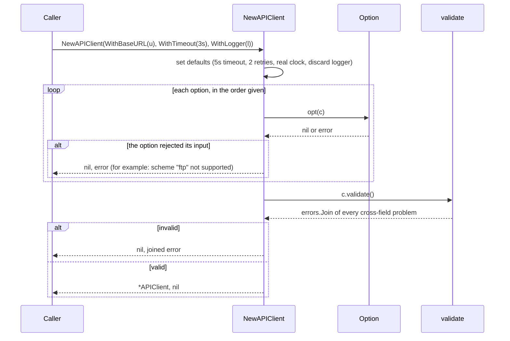
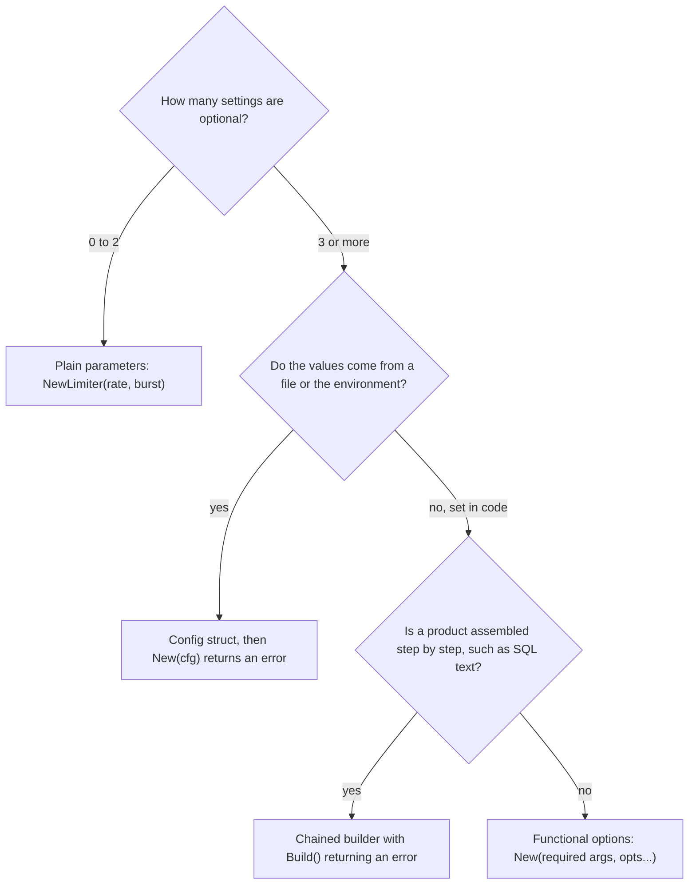

# Builder and Functional Options

> [!summary] TL;DR
> When an object has many optional settings, Go gives you three shapes: a **config struct** (`http.Server{Addr: ":8080"}`), **functional options** (`NewAPIClient(WithTimeout(3*time.Second))`), and a **chained builder** (`Select("id").From("shows").Build()`). All three do the same four things: start from defaults, apply the caller's choices, check the result once, and hand back a ready object or an error.

> [!abstract] Core idea
> - Many optional settings? Start from defaults and let the caller name only what differs.
> - Functional options are small functions (`WithTimeout(3*time.Second)`) that each change one field of the object being built.
> - The rule that matters: validate once, after all options are applied, and return an error instead of a half-built object.
> - Classic mistake: a positional constructor like `New("", 0, 3, nil)` where nobody can tell which zero means "default".

## 1. Why it exists

An HTTP client for a payment provider needs a base URL, a timeout, a retry count, extra headers, a clock and a logger. The first version is a positional constructor with six parameters, and a typical call reads `NewAPIClient("", 0, 3, nil, nil, nil)`.

- A reader cannot tell which `0` or `nil` means "use the default" and which means "really zero".
- Adding a seventh setting changes the signature and breaks every call site.
- The classic fix, a **telescoping constructor** (`NewAPIClient(url)`, `NewAPIClientWithTimeout(url, t)`, `NewAPIClientWithTimeoutAndRetries(url, t, n)`), does not scale: 6 optional settings have 2^6 = 64 combinations, and nobody writes 64 constructors.
- Nothing checks combinations. A 10-second timeout with 9 retries means a caller can wait 100 seconds for one payment call.

Functional options and builders let a caller name only what differs from the defaults, and let the constructor reject bad values and bad combinations before the object exists.

## 2. Mental model

Ordering a pizza: the menu pizza comes with defaults (medium, regular crust, cheese). You state only your changes ("large", "extra olives"). Before baking, the kitchen checks the combination ("a thin crust cannot be stuffed") and refuses the order instead of baking something broken.

- **Functional options** are the list of changes, applied in order to a default object.
- **Validate** is the kitchen's final check across all changes.
- **A chained builder** is a sandwich counter: you add one thing at a time, and you get the product only at the till (`Build`), which is also where any problem is reported.
- **A config struct** is a printed order form: every field is visible at once, and blank boxes mean "default".

## 3. How it works

### Functional options

1. `Option` is a function that changes the object under construction: `type Option func(*APIClient) error`. Returning an error lets an option reject its own input (`WithTimeout(-1s)`).
2. Each `WithX` function returns an `Option`, a closure over the value.
3. `NewAPIClient(opts ...Option)` first fills in **defaults**, then applies each option **in order**, then runs `validate` for rules that involve several fields, then returns the client.



The order of the steps is the design:

- **Defaults first**, so every option overrides them. Setting defaults after the loop would silently undo the caller's choices.
- **Options in order**, so for a scalar setting the last option wins (`WithTimeout(2s), WithTimeout(3s)` gives 3s), while accumulating options such as `WithHeader` add to a collection.
- **Validation last**, because a rule like "timeout × attempts ≤ 30s" involves two options that can arrive in any order. An option can check only its own value.

### Option as an interface

grpc-go, zap and the OpenTelemetry SDK define the option as an **interface with an unexported method** instead of a bare function, as `ServerOption` does in the example:

- Only the defining package can implement an unexported method, so the set of options is closed.
- An option can be a plain value with extra methods, such as `String()` for debug output (`MaxConns(500)` prints as `MaxConns(500)`).
- A small adapter (`funcOption`) still lets most options be written as closures.

### Chained builder

Each method records one part and returns the builder, so calls chain: `Select("id", "title").From("shows").Where("city = ?", "Pune").Limit(20).Build()`. Two rules keep a builder safe:

- **Sticky error:** a method that sees bad input stores the first error and keeps returning the builder; `Build` reports it. The chain never needs an `if err != nil` in the middle. `bufio.Writer` uses the same rule for write errors.
- **Build validates the whole:** required parts (`From`) are checked once, at the end.

### Which shape?



### Whiteboard version

The four steps are defaults, apply options, validate once, return. This is the bare idea you can draw in two minutes; the full version below adds production concerns.

```go
package main

import (
	"errors"
	"fmt"
	"time"
)

type Client struct {
	timeout time.Duration
	retries int
}

type Option func(*Client)

func WithTimeout(d time.Duration) Option { return func(c *Client) { c.timeout = d } }
func WithRetries(n int) Option           { return func(c *Client) { c.retries = n } }

func NewClient(opts ...Option) (*Client, error) {
	c := &Client{timeout: 5 * time.Second, retries: 2} // 1. defaults
	for _, o := range opts {                           // 2. caller's changes
		o(c)
	}
	if c.timeout <= 0 || c.retries < 0 { // 3. one final check
		return nil, errors.New("invalid client config")
	}
	return c, nil // 4. ready object
}

func main() {
	c, err := NewClient(WithTimeout(2 * time.Second))
	fmt.Println(c.timeout, c.retries, err) // 2s 2 <nil>
}
```

## 4. Worked example

One `package main` with an `APIClient` (`WithBaseURL`, `WithTimeout`, `WithRetries`, defaults in the constructor), options that can fail, a final `validate`, options for test injection, an interface-style option set and a small PostgreSQL query builder. Built with Go 1.24.4; `go vet` is clean and `go test -race` passes.

```go
package main

import (
	"errors"
	"fmt"
	"log/slog"
	"net/url"
	"os"
	"strconv"
	"strings"
	"time"
)

// ---------- Functional options with errors and a final validation ----------

type Clock interface{ Now() time.Time }

type realClock struct{}

func (realClock) Now() time.Time { return time.Now() }

type APIClient struct {
	baseURL string
	timeout time.Duration
	retries int
	headers map[string]string
	clock   Clock
	logger  *slog.Logger
}

// Option may fail, so a bad value is reported by the constructor instead of being ignored.
type Option func(*APIClient) error

func WithBaseURL(raw string) Option {
	return func(c *APIClient) error {
		u, err := url.Parse(raw)
		if err != nil {
			return fmt.Errorf("WithBaseURL: %w", err)
		}
		if u.Scheme != "https" && u.Scheme != "http" {
			return fmt.Errorf("WithBaseURL: scheme %q not supported", u.Scheme)
		}
		c.baseURL = strings.TrimSuffix(u.String(), "/")
		return nil
	}
}

func WithTimeout(d time.Duration) Option {
	return func(c *APIClient) error {
		if d <= 0 {
			return fmt.Errorf("WithTimeout: %v must be positive", d)
		}
		c.timeout = d
		return nil
	}
}

// WithRetries accepts any value; the range is checked once, in validate.
func WithRetries(n int) Option {
	return func(c *APIClient) error {
		c.retries = n
		return nil
	}
}

// WithHeader accumulates: each call adds a header instead of replacing the map.
func WithHeader(key, value string) Option {
	return func(c *APIClient) error {
		c.headers[key] = value
		return nil
	}
}

// WithClock and WithLogger exist mainly so tests can inject fakes.
func WithClock(clk Clock) Option {
	return func(c *APIClient) error {
		c.clock = clk
		return nil
	}
}

func WithLogger(l *slog.Logger) Option {
	return func(c *APIClient) error {
		c.logger = l
		return nil
	}
}

func NewAPIClient(opts ...Option) (*APIClient, error) {
	c := &APIClient{ // 1. defaults first, so every option overrides them
		baseURL: "https://api.example.com",
		timeout: 5 * time.Second,
		retries: 2,
		headers: map[string]string{},
		clock:   realClock{},
		logger:  slog.New(slog.DiscardHandler),
	}
	for _, opt := range opts { // 2. apply in order: the last write wins
		if err := opt(c); err != nil {
			return nil, err
		}
	}
	if err := c.validate(); err != nil { // 3. rules that involve several fields
		return nil, err
	}
	c.logger.Info("api client ready", "base_url", c.baseURL, "timeout", c.timeout, "retries", c.retries)
	return c, nil
}

func (c *APIClient) validate() error {
	var errs []error
	if c.retries < 0 || c.retries > 5 {
		errs = append(errs, fmt.Errorf("retries %d out of range 0..5", c.retries))
	}
	if total := c.timeout * time.Duration(c.retries+1); total > 30*time.Second {
		errs = append(errs, fmt.Errorf("timeout x attempts = %v exceeds the 30s budget", total))
	}
	return errors.Join(errs...)
}

// Deadline uses the injected clock, so a test can pin "now".
func (c *APIClient) Deadline() time.Time { return c.clock.Now().Add(c.timeout) }

// ---------- Option as an interface (the grpc-go and zap style) ----------

type serverConfig struct {
	name     string
	maxConns int
}

// ServerOption has an unexported method, so only this package can define options.
type ServerOption interface{ apply(*serverConfig) }

type maxConnsOption int

func (o maxConnsOption) apply(c *serverConfig) { c.maxConns = int(o) }
func (o maxConnsOption) String() string        { return "MaxConns(" + strconv.Itoa(int(o)) + ")" }

func MaxConns(n int) ServerOption { return maxConnsOption(n) }

type funcOption func(*serverConfig)

func (f funcOption) apply(c *serverConfig) { f(c) }

func Name(s string) ServerOption { return funcOption(func(c *serverConfig) { c.name = s }) }

func newServerConfig(opts ...ServerOption) serverConfig {
	c := serverConfig{name: "default", maxConns: 100}
	for _, o := range opts {
		o.apply(&c)
	}
	return c
}

// ---------- Chained builder: a small SQL query builder ----------

// Query builds PostgreSQL text with $n placeholders. Table and column names
// must be trusted constants; only values go through placeholders.
type Query struct {
	table string
	cols  []string
	where []string
	args  []any
	limit int
	err   error // the first error sticks and is reported by Build
}

func Select(cols ...string) *Query { return &Query{cols: cols} }

func (q *Query) From(table string) *Query {
	q.table = table
	return q
}

// Where takes one condition with exactly one "?" for its value.
func (q *Query) Where(cond string, arg any) *Query {
	if strings.Count(cond, "?") != 1 && q.err == nil {
		q.err = fmt.Errorf("where %q: need exactly one ?", cond)
	}
	q.args = append(q.args, arg)
	q.where = append(q.where, strings.Replace(cond, "?", "$"+strconv.Itoa(len(q.args)), 1))
	return q
}

func (q *Query) Limit(n int) *Query {
	if n <= 0 && q.err == nil {
		q.err = fmt.Errorf("limit %d must be positive", n)
	}
	q.limit = n
	return q
}

func (q *Query) Build() (string, []any, error) {
	if q.err != nil {
		return "", nil, q.err
	}
	if q.table == "" || len(q.cols) == 0 {
		return "", nil, errors.New("query: Select columns and From are required")
	}
	var b strings.Builder
	b.WriteString("SELECT " + strings.Join(q.cols, ", ") + " FROM " + q.table)
	if len(q.where) > 0 {
		b.WriteString(" WHERE " + strings.Join(q.where, " AND "))
	}
	if q.limit > 0 {
		fmt.Fprintf(&b, " LIMIT %d", q.limit)
	}
	return b.String(), q.args, nil
}

func main() {
	logger := slog.New(slog.NewTextHandler(os.Stdout, &slog.HandlerOptions{
		ReplaceAttr: func(_ []string, a slog.Attr) slog.Attr {
			if a.Key == slog.TimeKey {
				return slog.Attr{} // drop the timestamp so the output is stable
			}
			return a
		},
	}))

	c, err := NewAPIClient(
		WithBaseURL("https://payments.example.com/"),
		WithTimeout(2*time.Second),
		WithTimeout(3*time.Second), // overrides the previous one
		WithHeader("X-Client", "checkout"),
		WithLogger(logger),
	)
	if err != nil {
		fmt.Println("error:", err)
		return
	}
	fmt.Println("client:", c.baseURL, c.timeout, c.retries, c.headers)

	_, err = NewAPIClient(WithBaseURL("ftp://files.example.com"))
	fmt.Println("option error:", err)

	_, err = NewAPIClient(WithRetries(9), WithTimeout(10*time.Second))
	fmt.Println("validate error:", strings.ReplaceAll(err.Error(), "\n", "; "))

	fmt.Printf("grpc style: %+v\n", newServerConfig(Name("booking"), MaxConns(500)))

	sql, args, err := Select("id", "title").From("shows").
		Where("city = ?", "Pune").
		Where("starts_at > ?", "2026-11-02T18:00:00Z").
		Limit(20).Build()
	fmt.Println(sql, args, err)
}
```

```go
package main

import (
	"bytes"
	"log/slog"
	"strings"
	"testing"
	"time"
)

func TestDefaults(t *testing.T) {
	c, err := NewAPIClient()
	if err != nil {
		t.Fatal(err)
	}
	if c.baseURL != "https://api.example.com" || c.timeout != 5*time.Second || c.retries != 2 {
		t.Fatalf("defaults = %q %v %d", c.baseURL, c.timeout, c.retries)
	}
}

func TestOrderAndOverride(t *testing.T) {
	c, err := NewAPIClient(
		WithTimeout(time.Second), WithTimeout(3*time.Second), // scalar: last wins
		WithHeader("A", "1"), WithHeader("B", "2"), // accumulating: both kept
		WithRetries(0), // explicit zero overrides the default 2
	)
	if err != nil {
		t.Fatal(err)
	}
	if c.timeout != 3*time.Second || len(c.headers) != 2 || c.retries != 0 {
		t.Fatalf("got timeout=%v headers=%v retries=%d", c.timeout, c.headers, c.retries)
	}
}

func TestOptionErrors(t *testing.T) {
	for name, opt := range map[string]Option{
		"bad scheme":       WithBaseURL("ftp://x"),
		"negative timeout": WithTimeout(-time.Second),
	} {
		if c, err := NewAPIClient(opt); err == nil || c != nil {
			t.Errorf("%s: got (%v, %v), want (nil, error)", name, c, err)
		}
	}
}

func TestValidateReportsAllProblems(t *testing.T) {
	_, err := NewAPIClient(WithRetries(9), WithTimeout(10*time.Second))
	if err == nil || !strings.Contains(err.Error(), "out of range") || !strings.Contains(err.Error(), "budget") {
		t.Fatalf("err = %v, want both validation errors", err)
	}
}

type fixedClock struct{ t time.Time }

func (f fixedClock) Now() time.Time { return f.t }

func TestInjectedClockAndLogger(t *testing.T) {
	now := time.Date(2026, 11, 2, 9, 0, 0, 0, time.UTC)
	var buf bytes.Buffer
	c, err := NewAPIClient(
		WithClock(fixedClock{now}),
		WithLogger(slog.New(slog.NewTextHandler(&buf, nil))),
	)
	if err != nil {
		t.Fatal(err)
	}
	if got := c.Deadline(); !got.Equal(now.Add(5 * time.Second)) {
		t.Fatalf("deadline = %v", got)
	}
	if !strings.Contains(buf.String(), "base_url=https://api.example.com") {
		t.Fatalf("log = %q", buf.String())
	}
}

func TestInterfaceOptions(t *testing.T) {
	c := newServerConfig(MaxConns(5))
	if c.name != "default" || c.maxConns != 5 {
		t.Fatalf("got %+v", c)
	}
}

func TestQueryBuilder(t *testing.T) {
	sql, args, err := Select("id").From("shows").Where("city = ?", "Pune").Limit(5).Build()
	if err != nil || sql != "SELECT id FROM shows WHERE city = $1 LIMIT 5" || len(args) != 1 {
		t.Fatalf("got %q %v %v", sql, args, err)
	}
	if _, _, err := Select("id").From("shows").Limit(0).Where("a = ?", 1).Build(); err == nil {
		t.Fatal("the Limit error must stick until Build")
	}
	if _, _, err := Select("id").Build(); err == nil {
		t.Fatal("missing From must fail")
	}
}
```

Output of `go run .` (measured, Go 1.24.4, darwin/arm64):

```text
level=INFO msg="api client ready" base_url=https://payments.example.com timeout=3s retries=2
client: https://payments.example.com 3s 2 map[X-Client:checkout]
option error: WithBaseURL: scheme "ftp" not supported
validate error: retries 9 out of range 0..5; timeout x attempts = 1m40s exceeds the 30s budget
grpc style: {name:booking maxConns:500}
SELECT id, title FROM shows WHERE city = $1 AND starts_at > $2 LIMIT 20 [Pune 2026-11-02T18:00:00Z] <nil>
```

What to notice:

- The second `WithTimeout` wins (`3s`), and the trailing `/` of the base URL was normalized by the option.
- `ftp://` is rejected by the option itself; the constructor returns `nil` and the error.
- `validate` reports **both** problems at once (`errors.Join`, since Go 1.20), so the caller fixes the config in one round.
- `WithRetries(0)` in the test gives 0 retries, not the default 2: an explicit zero survives because defaults are set before options.
- The query builder emits `$1` and `$2` placeholders, the PostgreSQL style, and returns the values separately for the driver.

## 5. Variants and comparison

| Option | How it works | Use when | Cost |
| --- | --- | --- | --- |
| Plain parameters | `NewLimiter(rate, burst)` | Up to 2 or 3 settings, all required | Breaks callers when a parameter is added |
| Config struct | `http.Server{Addr: ":8080", ReadHeaderTimeout: 5 * time.Second}` | Values loaded from YAML, JSON or env; many settings shown at once | Zero value is ambiguous: "unset" and "0" look the same |
| Functional options (func) | `New(opts ...Option)`, each option a closure | Libraries and clients with sensible defaults and few overrides | Options are scattered in docs; cannot be loaded from a file |
| Functional options (interface) | `Option` interface with an unexported `apply` | Public libraries that want a closed option set and printable options (grpc-go, zap, OpenTelemetry) | More types per option |
| Chained builder | Methods return the builder; `Build()` returns the product and an error | Step-by-step products: SQL text, documents, test fixtures | Mutable builder; misuse if reused after `Build` |
| Accumulator (`strings.Builder`) | Appends bytes; `String()` returns the result without copying | Building a large string in a loop | Must not be copied after first use |

**Config struct versus options, on zero values.** `http.Server.ReadTimeout` and `http.Client.Timeout` both document that zero means **no timeout**, not "a sensible default". A config struct cannot tell `Retries: 0` from "not set" without a pointer field or a sentinel. With options, defaults are written first and `WithRetries(0)` overwrites them, so an explicit zero is expressible. A common production design uses both: load a config struct from the environment, then translate it into options for each library.

## 6. Trade-offs and when not to use

- **Two or three fields:** use parameters. `NewAPIClient(WithBaseURL(u), WithTimeout(t))` is longer and less checked than `NewAPIClient(u, t)` when both values are always needed.
- **Required values never go into options.** If the client cannot work without a base URL, make it a positional parameter (`New(baseURL, opts...)`), so the compiler enforces it.
- **Values from a config file** fit a struct better: you can decode YAML or JSON into it, print it and diff it. Closures cannot be serialized.
- **Discoverability:** a reader finds options by scanning for `With...` functions in the docs. Keep them next to the constructor and document each default.
- **Allocation:** each option is a closure, usually allocated once at construction. This matters only for per-call options in hot paths, such as per-RPC call options (an estimate; measure before optimizing).
- **A builder is mutable.** Sharing one between goroutines, or reusing it after `Build`, carries state into the next product.

## 7. In production

**Real systems:**

- **grpc-go:** `grpc.NewClient(target, grpc.WithTransportCredentials(creds))` (`NewClient` since v1.63, replacing the deprecated `Dial`) and `grpc.NewServer(grpc.UnaryInterceptor(f), grpc.MaxRecvMsgSize(n))`. `DialOption` and `ServerOption` are interfaces with an unexported `apply` method.
- **zap:** `zap.NewProduction(zap.AddCaller(), zap.Fields(...))` and `logger.WithOptions(...)`. `zap.Option` is an interface with an unexported `apply(*Logger)`.
- **OpenTelemetry Go:** `sdktrace.NewTracerProvider(sdktrace.WithBatcher(exporter), sdktrace.WithResource(res), sdktrace.WithSampler(sampler))`.
- **Config structs in the standard library:** `http.Server`, `tls.Config`, `slog.HandlerOptions`.
- **Builders:** `strings.Builder` and `bytes.Buffer` for text; query builders such as `github.com/Masterminds/squirrel` for SQL.

**Where it shows up in LLD problems:**

- [[Logging Library]]: `NewLogger(WithLevel(...), WithOutput(w), WithFormat(...))`.
- [[Rate Limiter]] and [[Circuit Breaker]]: thresholds as options, and `WithClock` so tests can move time.
- [[Task Scheduler (delayed and recurring jobs)]]: `WithClock` and worker-count options.
- [[Notification Service]]: per-channel clients built with retries, timeouts and a logger.

**Failure modes and fixes:**

- An option ignores bad input (negative timeout becomes 0, which means "no timeout"). Fix: options return errors.
- Cross-field rules checked inside options pass or fail depending on option order. Fix: check them in one `validate` after the loop.
- Defaults are written after the options. Fix: defaults first, always; a test such as `TestOrderAndOverride` pins it.
- Every client shares one default `map` or slice from a package variable, so `WithHeader` on one client changes all of them. Fix: allocate collections per client inside the constructor, and copy slices that callers pass in.
- A builder interpolates identifiers or values into SQL text. Fix: values always go through placeholders; identifiers come from an allowlist or are quoted with `pgx.Identifier{...}.Sanitize()`.

**What to monitor:** log the effective configuration once at startup, as the example does with `api client ready`, and redact secrets such as API keys. When a production incident turns out to be "the timeout was zero", that log line is the evidence.

## 8. Deep dive

**Option order is part of the API.** Document, per option, whether it overrides (scalars: timeout, base URL) or accumulates (headers, interceptors, middleware). grpc-go, for example, chains interceptors passed with `grpc.ChainUnaryInterceptor`, so their order becomes call order. If two options conflict (say your own `WithPlaintext()` and `WithTLSConfig(cfg)`), reject the combination in `validate` instead of letting the later one win silently.

**Fail at the first option, or collect everything?** The example stops at the first failing option, because a later option may depend on an earlier value, then collects every cross-field problem in `validate` with `errors.Join`. That gives callers precise errors without cascades.

**Why an unexported method on the option interface?** An external package cannot implement `apply(*serverConfig)`, because the method name is unexported. The library can therefore change `serverConfig` freely, add options, and know every option that exists. The only way in from outside is to embed an exported type that already has the method, such as grpc-go's `EmptyDialOption`; that reuses the library's own `apply` (a no-op there), so it cannot touch the config. A bare `func(*Config)` type exposes `*Config` to everyone who writes an option, so `Config`'s fields become part of the public API.

**Self-referential options.** Rob Pike's 2014 design lets an option return the option that restores the previous value, so a test can apply `prev := c.Option(Verbosity(3))` and later `c.Option(prev)`. It is rare in application code but explains why some libraries return a value from applying an option.

**Generic options.** With generics a package can share one helper, `type Option[T any] func(*T) error` plus `Apply[T any](t *T, opts ...Option[T]) error`. It saves a few lines per type but makes godoc less readable; most libraries keep a concrete `Option` type per constructor. [[Generics and Iterators]] covers the syntax.

**Copying a `strings.Builder` panics.** A `strings.Builder` records its own address on first use. Copying it by value and writing to the copy panics with `strings: illegal use of non-zero Builder copied by value`. Pass builders by pointer, as `Query.Build` does with `&b`.

**Builder versus functional options.** A builder suits products assembled in steps where the steps have meaning (clauses of a query, sections of a document) and the product is different from the builder. Functional options suit a single object configured once. A builder can also enforce stages by returning different types per step (`SelectStep` → `FromStep` → `WhereStep`), so `Build` without `From` does not compile; it costs one type per stage.

## 9. Interview questions

> [!question]- What problem do functional options solve?
> Constructors with many optional settings. Callers name only what differs from the defaults (`WithTimeout(3*time.Second)`), adding a new option does not break existing calls, and the constructor can reject bad values and bad combinations before the object exists.

> [!question]- Config struct or functional options?
> A config struct when values come from a file or the environment, when you want to print or diff the whole configuration, or when the zero value is a fine default. Functional options for library constructors with good defaults and few overrides, when "explicitly zero" must differ from "unset", or when the option set should stay closed.

> [!question]- Trap: a config struct has `Retries int` with a documented default of 2. A caller sets `Retries: 0` to disable retries. What happens?
> The constructor cannot tell "0" from "not set", so a typical `if cfg.Retries == 0 { cfg.Retries = 2 }` turns the caller's 0 into 2 retries. Fix it with a pointer field, a sentinel such as -1, or functional options that set the default first and let `WithRetries(0)` overwrite it.

> [!question]- Should options be able to fail, and where do cross-field checks go?
> Yes: `type Option func(*Client) error`, so `WithTimeout(-1)` is rejected instead of silently meaning "no timeout". Rules that involve several options go into one `validate` after all options are applied, because options can arrive in any order.

> [!question]- Why do grpc-go and zap use an Option interface instead of a function type?
> The interface has an unexported method, so only the library can define options and its config struct stays private. Options can also be values with methods, for example a `String()` for debugging, while a `funcOption` adapter keeps most options as simple closures.

> [!question]- How do you make a client built with options testable?
> Add options for the dependencies that tests need to control, such as `WithClock`, `WithLogger` or `WithHTTPClient`. Tests pass a fixed clock and a buffer-backed logger and assert on exact deadlines and log lines, as `TestInjectedClockAndLogger` does.

> [!question]- When is a chained builder better than functional options?
> When the product is assembled in meaningful steps and is a different thing from the builder, such as a SQL statement or a document. Store the first error in the builder and return it from `Build`, so the chain needs no error checks in the middle.

## 10. Cheat sheet

- Telescoping constructors do not scale: 6 optional settings are 64 combinations.
- Constructor order: defaults, then options in order, then one `validate`, then return.
- `type Option func(*T) error`: options can fail; cross-field rules go in `validate` with `errors.Join`.
- Scalars: last option wins. Collections: options accumulate. Document which is which.
- Required values are positional parameters, never options.
- Config struct for file or env config; remember that zero often means "none" (`http.Client.Timeout`).
- Interface options with an unexported method (grpc-go, zap, OpenTelemetry) keep the set closed.
- Builder: sticky first error, `Build` validates; never copy a used `strings.Builder`.

## Links

- **Before this:** [[Structs, Methods and Embedding]], [[Error Handling]], [[Factory and Abstract Factory]]
- **Next:** [[Singleton and sync.Once]]
- **Compare with:** [[Configuration and Secrets]], [[Calling External APIs]], [[Testing in Go]]
