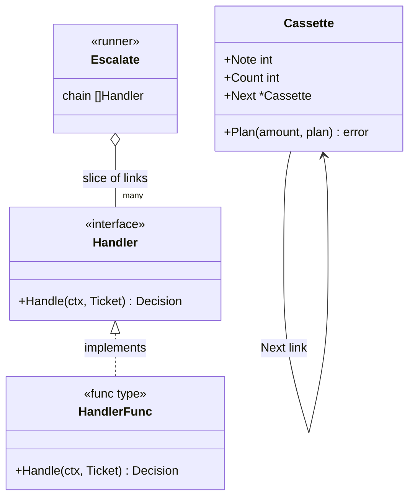
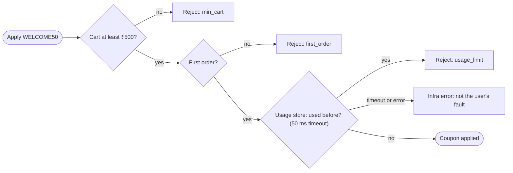
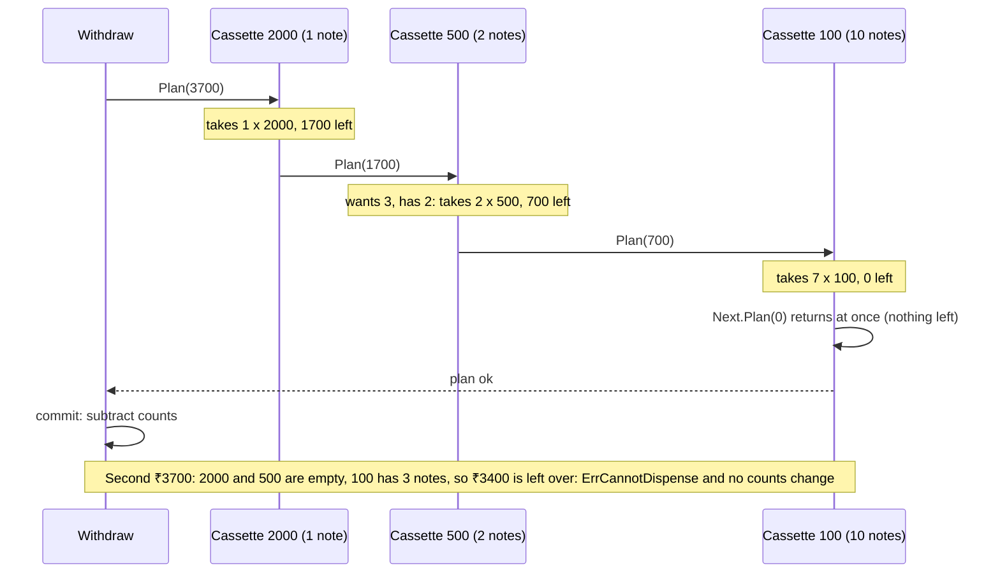

# Chain of Responsibility and Pipelines

> [!summary] TL;DR
> A request walks down an ordered list of small handlers (the **chain**). In classic **Chain of Responsibility**, each handler either handles the request and stops the chain, refuses it, or passes it to the next one, so the first handler that can deal with it wins. In a **pipeline**, every step must pass and any step can stop the request; most Go code (validation, HTTP middleware) is this second kind.

> [!abstract] Core idea
> - Both are an ordered list of small handlers that a request walks through.
> - **Chain of Responsibility:** the first handler that can handle the request wins, and the rest never run.
> - **Pipeline:** every step must pass; any step can stop the request (validation, HTTP middleware).
> - Classic mistake: doing irreversible work (dispensing cash, charging a card) while the chain is still running. Plan the whole result first, then commit it.

## 1. Why it exists

Take the checkout of a food-delivery app. Before the coupon `WELCOME50` is applied, five rules must hold: the cart is at least ₹500, it is the user's first order, the user has not used the coupon before, the city is eligible, and the payment method is allowed. The first version is one function with five nested `if` blocks. Then three problems show up:

- **Every new rule edits the same function.** A sixth rule (block coupon stacking) means touching code that already works and retesting all five rules.
- **The order is buried.** The usage check calls a remote store. If it runs first, every ₹300 cart pays for a network call it never needed. In an estimate where a field check costs well under a microsecond and the remote call costs about 20 ms, checking cheap rules first saves the full 20 ms on every cart rejected early.
- **Rules cannot be reused.** A second coupon needs three of the five rules, so the function gets copied.

Support desks have the mirror-image problem. A refund ticket must go to the **cheapest person allowed to approve it**: a bot answers questions with no refund, an agent approves up to ₹2,000, a supervisor approves up to ₹20,000. The sender should not need to know who that is.

The chain turns each rule or approver into its own small unit and turns the order into data: a slice you can read, reorder and test.

## 2. Mental model

Every link in a chain answers one question about the request, and has exactly three possible answers:

| Answer | Meaning | What the chain does next |
| --- | --- | --- |
| **Accept** | "I handled it." | Stops with success. Later links never run. |
| **Reject** | "This must not go on." | Stops with failure (an error). |
| **Pass** | "Not mine, or fine by me." | Offers the request to the next link. |

The two flavours differ in which answers a link may give:

- **Classic Chain of Responsibility** uses all three. It is a support escalation: the bot, then the agent, then the supervisor; the first person allowed to approve the refund approves it, and nobody after them sees the ticket. If the request falls off the end, nobody handled it, and that is an error.
- **A pipeline** (validation chain) uses only **reject** and **pass**. It is airport security: the ID check, the bag scan and the body scan must all pass. Any checkpoint can stop you; none can wave you through the rest early. Falling off the end means success.

> [!tip] Say which one you mean
> If no link can stop the chain with a success, you have a pipeline, not classic Chain of Responsibility. Both are useful; they just answer different questions ("who handles this?" vs "is this allowed?").

## 3. How it works

### Structure



There are two ways to connect the links:

- **A slice of handlers plus a runner** (`Escalate`, `Validate`). The runner owns the loop, so it can log which link decided, time each link, check `ctx.Err()` between links, and no link can forget to call the next one. This is the default in Go.
- **Linked handlers**, where each link holds a `Next` field and calls it itself (`Cassette`, and every HTTP middleware). Each link controls whether and when the next one runs, and can do work after it returns. The price is that a link can forget to call `Next`, and the order is spread across constructors.

**Func-typed handlers.** A one-method interface plus a function type that implements it (`HandlerFunc`, like `http.HandlerFunc`) lets a closure be a link. Most links are a few lines, so most links are functions, and a struct is used only when a link carries configuration or dependencies.

### The run, step by step

1. Build the chain once at startup, in order: cheap, local checks first; remote calls last.
2. The runner offers the request to link 0.
3. The link returns a decision (and, in a pipeline, an error when it rejects).
4. **Accept** returns success at once. **Reject** returns the error at once (fail-fast), or records it and continues (collect-all).
5. **Pass** moves to the next link, after checking that the context is not cancelled.
6. Falling off the end means `ErrUnhandled` in a classic chain and success in a pipeline.

### The coupon pipeline



The two cheap checks run first, so a ₹300 cart never reaches the remote store. The remote check has two different failure exits: "the coupon was used" is a validation result the user should see, while "the store did not answer" is an infrastructure error that the checkout must handle differently (retry, or fail open or closed by policy).

### Whiteboard version

The bare idea: a slice of functions walked in order, once as a pipeline and once as a first-wins chain. The full version in section 4 adds the production concerns.

```go
package main

import (
	"errors"
	"fmt"
)

type Cart struct{ Total, Items int }

// Pipeline: every rule must pass; the first failure stops it.
type Rule func(Cart) error

func Validate(c Cart, rules ...Rule) error {
	for _, r := range rules {
		if err := r(c); err != nil {
			return err
		}
	}
	return nil
}

func minTotal(c Cart) error {
	if c.Total < 500 {
		return errors.New("total below 500")
	}
	return nil
}

func notEmpty(c Cart) error {
	if c.Items == 0 {
		return errors.New("cart is empty")
	}
	return nil
}

// Classic chain: the first handler that can handle it wins.
type Handler func(amount int) (handledBy string, ok bool)

func Approve(amount int, chain ...Handler) string {
	for _, h := range chain {
		if who, ok := h(amount); ok {
			return who
		}
	}
	return "nobody"
}

func main() {
	fmt.Println(Validate(Cart{Total: 300, Items: 2}, notEmpty, minTotal)) // total below 500
	lead := func(a int) (string, bool) { return "lead", a <= 1000 }
	manager := func(a int) (string, bool) { return "manager", a <= 10000 }
	fmt.Println(Approve(5000, lead, manager)) // manager
}
```

## 4. Worked example

One package with all four forms: a classic escalation chain, a coupon pipeline (three of the five rules from section 1) with fail-fast and collect-all, the ATM dispenser as linked handlers, and HTTP middleware.

```go
// main.go
package main

import (
	"context"
	"errors"
	"fmt"
	"net/http"
	"time"
)

// ---------- 1. Classic chain: the first handler that accepts wins ----------

type Ticket struct {
	ID      string
	Refund  int  // rupees the customer wants back
	Blocked bool // account is on the fraud blocklist
}

// Decision is what one link says about a ticket.
type Decision int

const (
	Pass   Decision = iota // not mine: offer it to the next link
	Accept                 // I handled it: stop with success
	Reject                 // refused: stop with failure
)

// Handler is one link. HandlerFunc turns a plain function into a link,
// the same trick as http.HandlerFunc.
type Handler interface {
	Handle(ctx context.Context, t Ticket) Decision
}

type HandlerFunc func(ctx context.Context, t Ticket) Decision

func (f HandlerFunc) Handle(ctx context.Context, t Ticket) Decision { return f(ctx, t) }

var (
	ErrRejected  = errors.New("ticket rejected")
	ErrUnhandled = errors.New("no handler accepted the ticket")
)

// Escalate offers the ticket to each link in order and returns the index
// of the link that decided. Links after it never run.
func Escalate(ctx context.Context, t Ticket, chain []Handler) (int, error) {
	for i, h := range chain {
		if err := ctx.Err(); err != nil {
			return i, err
		}
		switch h.Handle(ctx, t) {
		case Accept:
			return i, nil
		case Reject:
			return i, ErrRejected
		}
	}
	return len(chain), ErrUnhandled
}

func fraudGate(_ context.Context, t Ticket) Decision {
	if t.Blocked {
		return Reject
	}
	return Pass
}

// approveUpTo builds a link that accepts refunds up to limit rupees.
func approveUpTo(limit int) HandlerFunc {
	return func(_ context.Context, t Ticket) Decision {
		if t.Refund <= limit {
			return Accept
		}
		return Pass
	}
}

// supportChain: fraud gate, bot (no refund), agent, supervisor.
var supportChain = []Handler{
	HandlerFunc(fraudGate),
	approveUpTo(0),
	approveUpTo(2_000),
	approveUpTo(20_000),
}

// ---------- 2. Pipeline: every rule must pass (coupon validation) ----------

type Order struct {
	UserID     string
	Coupon     string
	CartValue  int // rupees
	FirstOrder bool
}

// RuleError is a structured validation failure the API can show to the user.
type RuleError struct {
	Rule string
	Msg  string
}

func (e *RuleError) Error() string { return e.Rule + ": " + e.Msg }

type Rule struct {
	Name  string
	Check func(ctx context.Context, o Order) error
}

// Validate runs the rules in order. failFast stops at the first error;
// otherwise every rule runs and the errors are joined.
func Validate(ctx context.Context, o Order, rules []Rule, failFast bool) error {
	var errs []error
	for _, r := range rules {
		if err := ctx.Err(); err != nil {
			return err
		}
		if err := r.Check(ctx, o); err != nil {
			if failFast {
				return err
			}
			errs = append(errs, err)
		}
	}
	return errors.Join(errs...) // nil when no rule failed
}

// WithTimeout gives one slow rule its own deadline.
func WithTimeout(d time.Duration, r Rule) Rule {
	return Rule{Name: r.Name, Check: func(ctx context.Context, o Order) error {
		ctx, cancel := context.WithTimeout(ctx, d)
		defer cancel()
		return r.Check(ctx, o)
	}}
}

// UsageLookup asks a remote store how many times a user used the coupon.
type UsageLookup func(ctx context.Context, userID string) (int, error)

// couponRules are ordered cheapest first: two field checks, then one remote call.
func couponRules(lookup UsageLookup) []Rule {
	return []Rule{
		{Name: "min_cart", Check: func(_ context.Context, o Order) error {
			if o.CartValue < 500 {
				return &RuleError{"min_cart", fmt.Sprintf("cart ₹%d is below ₹500", o.CartValue)}
			}
			return nil
		}},
		{Name: "first_order", Check: func(_ context.Context, o Order) error {
			if !o.FirstOrder {
				return &RuleError{"first_order", "WELCOME50 is for the first order only"}
			}
			return nil
		}},
		WithTimeout(50*time.Millisecond, Rule{Name: "usage_limit", Check: func(ctx context.Context, o Order) error {
			n, err := lookup(ctx, o.UserID)
			if err != nil { // infrastructure failure, not a broken rule
				return fmt.Errorf("usage_limit lookup: %w", err)
			}
			if n >= 1 {
				return &RuleError{"usage_limit", "coupon already used"}
			}
			return nil
		}}),
	}
}

// ---------- 3. Partial handling: the ATM cash dispenser ----------

var ErrCannotDispense = errors.New("cannot dispense amount")

// Cassette is one linked link: it pays what it can and passes the rest on.
type Cassette struct {
	Note  int // 2000, 500 or 100
	Count int // notes left
	Next  *Cassette
}

// Plan works out the notes without moving any. It stops as soon as nothing
// is left (short-circuit on success). A nil *Cassette is the end of the chain.
func (c *Cassette) Plan(amount int, plan map[int]int) error {
	if amount == 0 {
		return nil
	}
	if c == nil {
		return fmt.Errorf("%w: ₹%d left over", ErrCannotDispense, amount)
	}
	if n := min(amount/c.Note, c.Count); n > 0 {
		plan[c.Note] = n
		amount -= n * c.Note
	}
	return c.Next.Plan(amount, plan)
}

// Withdraw plans first and only then takes notes out, so a failed
// withdrawal changes nothing.
func Withdraw(head *Cassette, amount int) (map[int]int, error) {
	plan := map[int]int{}
	if err := head.Plan(amount, plan); err != nil {
		return nil, err
	}
	for c := head; c != nil; c = c.Next {
		c.Count -= plan[c.Note]
	}
	return plan, nil
}

// ---------- 4. HTTP middleware: Go's everyday chain ----------

type Middleware func(http.Handler) http.Handler

// Chain wraps h so that mws[0] runs first.
func Chain(h http.Handler, mws ...Middleware) http.Handler {
	for i := len(mws) - 1; i >= 0; i-- {
		h = mws[i](h)
	}
	return h
}

// Health answers /healthz itself (accept) and passes everything else.
func Health(next http.Handler) http.Handler {
	return http.HandlerFunc(func(w http.ResponseWriter, r *http.Request) {
		if r.URL.Path == "/healthz" {
			w.WriteHeader(http.StatusOK)
			return
		}
		next.ServeHTTP(w, r)
	})
}

// RequireKey refuses requests without the API key (reject) and passes the rest.
func RequireKey(key string) Middleware {
	return func(next http.Handler) http.Handler {
		return http.HandlerFunc(func(w http.ResponseWriter, r *http.Request) {
			if r.Header.Get("X-API-Key") != key {
				http.Error(w, "unauthorized", http.StatusUnauthorized)
				return
			}
			next.ServeHTTP(w, r)
		})
	}
}

func main() {
	ctx := context.Background()
	for _, t := range []Ticket{{ID: "T1", Refund: 1_500}, {ID: "T2", Refund: 50_000}} {
		i, err := Escalate(ctx, t, supportChain)
		fmt.Println(t.ID, "decided by link", i, "err:", err)
	}

	used := func(context.Context, string) (int, error) { return 1, nil }
	o := Order{UserID: "u1", Coupon: "WELCOME50", CartValue: 300}
	fmt.Println("fail-fast:", Validate(ctx, o, couponRules(used), true))
	fmt.Println("collect-all:", Validate(ctx, o, couponRules(used), false))

	atm := &Cassette{Note: 2000, Count: 1, Next: &Cassette{Note: 500, Count: 2, Next: &Cassette{Note: 100, Count: 10}}}
	plan, err := Withdraw(atm, 3_700)
	fmt.Println("₹3700:", plan, err)
	_, err = Withdraw(atm, 3_700)
	fmt.Println("again:", err)
}
```

```go
// main_test.go
package main

import (
	"context"
	"errors"
	"maps"
	"net/http"
	"net/http/httptest"
	"testing"
)

func TestEscalate(t *testing.T) {
	cases := []struct {
		name    string
		ticket  Ticket
		wantIdx int
		wantErr error
	}{
		{"blocked is rejected first", Ticket{Refund: 100, Blocked: true}, 0, ErrRejected},
		{"bot answers no-refund tickets", Ticket{Refund: 0}, 1, nil},
		{"agent approves up to 2000", Ticket{Refund: 1_500}, 2, nil},
		{"supervisor approves up to 20000", Ticket{Refund: 15_000}, 3, nil},
		{"nobody can approve 50000", Ticket{Refund: 50_000}, 4, ErrUnhandled},
	}
	for _, c := range cases {
		t.Run(c.name, func(t *testing.T) {
			i, err := Escalate(context.Background(), c.ticket, supportChain)
			if i != c.wantIdx || !errors.Is(err, c.wantErr) {
				t.Fatalf("got (%d, %v), want (%d, %v)", i, err, c.wantIdx, c.wantErr)
			}
		})
	}
}

func TestEscalateStopsAtFirstAccept(t *testing.T) {
	calls := 0
	count := HandlerFunc(func(context.Context, Ticket) Decision { calls++; return Pass })
	chain := []Handler{count, approveUpTo(10), count}
	if _, err := Escalate(context.Background(), Ticket{Refund: 5}, chain); err != nil {
		t.Fatal(err)
	}
	if calls != 1 {
		t.Fatalf("links after the accepting one ran: calls=%d", calls)
	}
}

func TestValidateFailFastVersusCollectAll(t *testing.T) {
	used := func(context.Context, string) (int, error) { return 1, nil }
	o := Order{UserID: "u1", Coupon: "WELCOME50", CartValue: 300}

	err := Validate(context.Background(), o, couponRules(used), true)
	var re *RuleError
	if !errors.As(err, &re) || re.Rule != "min_cart" {
		t.Fatalf("fail-fast: want min_cart, got %v", err)
	}

	err = Validate(context.Background(), o, couponRules(used), false)
	joined, ok := err.(interface{ Unwrap() []error })
	if !ok || len(joined.Unwrap()) != 3 {
		t.Fatalf("collect-all: want 3 joined errors, got %v", err)
	}
}

func TestValidatePasses(t *testing.T) {
	unused := func(context.Context, string) (int, error) { return 0, nil }
	o := Order{UserID: "u2", Coupon: "WELCOME50", CartValue: 800, FirstOrder: true}
	if err := Validate(context.Background(), o, couponRules(unused), true); err != nil {
		t.Fatalf("want nil, got %v", err)
	}
}

func TestSlowRuleTimesOut(t *testing.T) {
	slow := func(ctx context.Context, _ string) (int, error) {
		<-ctx.Done() // a well-behaved remote call gives up when ctx ends
		return 0, ctx.Err()
	}
	o := Order{UserID: "u3", CartValue: 800, FirstOrder: true}
	err := Validate(context.Background(), o, couponRules(slow), true)
	var re *RuleError
	if !errors.Is(err, context.DeadlineExceeded) || errors.As(err, &re) {
		t.Fatalf("want a wrapped DeadlineExceeded, not a RuleError; got %v", err)
	}
}

func TestWithdraw(t *testing.T) {
	atm := &Cassette{Note: 2000, Count: 1, Next: &Cassette{Note: 500, Count: 2, Next: &Cassette{Note: 100, Count: 10}}}
	plan, err := Withdraw(atm, 3_700)
	if err != nil || !maps.Equal(plan, map[int]int{2000: 1, 500: 2, 100: 7}) {
		t.Fatalf("got %v, %v", plan, err)
	}
	// Only three ₹100 notes are left, so ₹3700 must fail and change nothing.
	if _, err := Withdraw(atm, 3_700); !errors.Is(err, ErrCannotDispense) {
		t.Fatalf("want ErrCannotDispense, got %v", err)
	}
	if got := atm.Next.Next.Count; got != 3 {
		t.Fatalf("failed withdrawal moved notes: ₹100 count=%d", got)
	}
}

func TestMiddlewareAcceptRejectPass(t *testing.T) {
	final := http.HandlerFunc(func(w http.ResponseWriter, _ *http.Request) { w.WriteHeader(http.StatusTeapot) })
	h := Chain(final, Health, RequireKey("k1"))

	cases := []struct {
		path, key string
		want      int
	}{
		{"/healthz", "", http.StatusOK},          // Health accepts
		{"/orders", "", http.StatusUnauthorized}, // RequireKey rejects
		{"/orders", "k1", http.StatusTeapot},     // both pass, final runs
	}
	for _, c := range cases {
		req := httptest.NewRequest(http.MethodGet, c.path, nil)
		if c.key != "" {
			req.Header.Set("X-API-Key", c.key)
		}
		rec := httptest.NewRecorder()
		h.ServeHTTP(rec, req)
		if rec.Code != c.want {
			t.Errorf("%s key=%q: got %d, want %d", c.path, c.key, rec.Code, c.want)
		}
	}
}
```

`go vet` is clean and `go test -race` passes (Go 1.24.4). Output of `go run .`, measured:

```text
T1 decided by link 2 err: <nil>
T2 decided by link 4 err: no handler accepted the ticket
fail-fast: min_cart: cart ₹300 is below ₹500
collect-all: min_cart: cart ₹300 is below ₹500
first_order: WELCOME50 is for the first order only
usage_limit: coupon already used
₹3700: map[100:7 500:2 2000:1] <nil>
again: cannot dispense amount: ₹3400 left over
```

What the code shows:

- **Accept, reject and pass are all real.** `fraudGate` rejects, `approveUpTo` accepts, and both pass otherwise. `TestEscalateStopsAtFirstAccept` proves that links after the accepting one never run.
- **Fail-fast vs collect-all.** The same ₹300 order gives one error in fail-fast mode and three joined errors in collect-all mode.
- **Structured errors.** `RuleError` carries the rule name, so an API can map it to a field. The usage lookup wraps infrastructure errors with `%w` instead, and `TestSlowRuleTimesOut` checks that a timeout is `context.DeadlineExceeded` and not a `RuleError`.
- **Partial handling plans before it acts.** The ATM run below is traced step by step.

### The ATM dispenser, traced

The ATM holds one ₹2,000 note, two ₹500 notes and ten ₹100 notes. A customer asks for ₹3,700.



The plan stops as soon as the amount reaches zero: that is the **short-circuit on success**. Withdrawing while walking the chain would be a bug: on the second request the ₹100 cassette would hand out three notes before the chain discovered it could not pay the rest.

## 5. Variants and comparison

| Variant | How it works | Stops when | Use when | Cost |
| --- | --- | --- | --- | --- |
| Classic CoR | Each link accepts, rejects or passes | First accept or reject | "Who should handle this?" (approvals, escalation, fallbacks) | Unhandled requests need an explicit error |
| Partial handling | Each link handles a share and passes the rest | Nothing left, or end of chain | Splitting work: ATM notes, tiered discounts | Must plan before committing; greedy by nature |
| Pipeline, fail-fast | Every link must pass | First reject | Dependent checks, expensive later steps | User sees one error at a time |
| Pipeline, collect-all | Every link runs; errors joined with `errors.Join` | End of chain | Independent checks (form fields) | Runs every rule, including slow ones |
| HTTP middleware | Linked: each wraps `next` and decides to call it | A link writes a response without calling `next` | Cross-cutting request concerns | Order bugs; a link can forget `next` |
| Map dispatch (not a chain) | Look up the one handler by key | Always one step | Exactly one handler per known key | Not a chain: no fallbacks or ordering |

**Slice vs linked, in one line:** use a slice and a runner when links are independent checks; use linked handlers when a link must run code both before and after the rest of the chain (timing, recovery, transactions).

## 6. Trade-offs and when not to use

- **Three fixed checks do not need a chain.** A function with three `if` statements is easier to read than a slice of rules and a runner. Reach for the chain when rules are added often, reused across flows, or reordered per configuration.
- **Exactly one handler per key is a map, not a chain.** Routing an event by its type to one handler is `handlers[event.Type]`: O(1), and no ordering bugs. A chain earns its place when several handlers could match and order decides.
- **Hidden order dependencies.** If rule 3 silently relies on rule 1 having run (for example, it assumes the coupon exists), reordering breaks it. Make such dependencies explicit, or keep those rules in fail-fast mode.
- **"Who handled this?" is harder to answer.** The decision is spread over links. Return or log the deciding link's name and index, as `Escalate` does.
- **Business-editable rules want data, not code.** When marketing defines coupon conditions, a rule expression evaluated by an interpreter fits better than compiled links (see [[Rare GoF Patterns in Go]]).

## 7. In production

- **Real systems:**
	- `net/http` middleware is Go's everyday chain: `func(http.Handler) http.Handler`. A recovery, logging, auth or rate-limit link either calls `next.ServeHTTP` or writes a response and returns. See [[Middleware]] for the backend view and [[Decorator and Middleware]] for the wrapping structure.
	- gRPC-Go chains unary interceptors with `grpc.ChainUnaryInterceptor`; each interceptor calls `handler` to continue or returns an error to stop.
	- `log/slog`: a `Handler.Enabled` check runs before the record is built and formatted, which is the level filter in the [[Logging Library]] practice problem (LevelFilter → FormatHandler).
	- The coupon chain in [[Cart Checkout with Coupons]] and the note dispenser in [[ATM]] are the interview versions of this note.
- **Failure modes → fixes:**
	- A middleware forgets `next.ServeHTTP` and writes nothing → `net/http` sends `200 OK` with an empty body. Fix: a test per middleware for its pass path, like the `k1` case above.
	- Recovery middleware placed inside other middleware → a panic in an outer link is not recovered. Fix: put recovery first in `Chain`.
	- A remote rule with no deadline stalls checkout → wrap it with a per-step timeout (`WithTimeout`) and make the rule honour `ctx`. A rule that ignores `ctx` keeps running past the deadline.
	- "Could not check" reported as "coupon invalid" → keep validation results (`RuleError`) separate from infrastructure errors (`%w`), and decide fail-open or fail-closed per rule.
	- A partial-handling chain commits as it walks → plan first, commit after the plan succeeds.
	- A link mutates the shared request (for example, it upper-cases the coupon code in place) → later links, logs and retries see a request the caller never sent. Fix: pass the request by value, as `Escalate` and `Validate` do, and make any normalisation an explicit first step of the chain.
- **What to monitor:** decisions per link (accept, reject, pass) as counters labelled with the link name, latency per link as a histogram, the `ErrUnhandled` rate, and timeouts per step.

## 8. Deep dive

- **Why the greedy ATM chain is safe here and not everywhere.** A partial-handling chain is a greedy algorithm: each link takes as much as it can. Greedy always finds a solution when one exists for ₹2,000/₹500/₹100, because each note value divides the next larger one. With ₹500 and ₹200 notes it fails: for ₹600 it takes one ₹500 and cannot pay ₹100, although three ₹200 notes work. For non-divisible denominations, plan with dynamic programming instead of a chain.
- **`errors.Join` behaviour (since Go 1.20).** It drops nil errors and returns nil if all are nil. Its message joins the messages with newlines. `errors.Is` and `errors.As` search every joined error, but `As` stops at the first match, so to list every `RuleError`, range over `Unwrap() []error`, as the test does.
- **Middleware is an onion.** `Chain(h, A, B)` runs A's before-code, then B's, then `h`, then B's after-code, then A's. Code after `next.ServeHTTP` sees the response being written, which is why timing and logging links wrap the whole chain. The ordering rules and the status-capturing wrapper belong to [[Decorator and Middleware]].
- **A nil receiver ends the linked chain.** `(*Cassette)(nil).Plan(...)` is a legal call because `Plan` checks `c == nil` before touching any field. It removes the "is there a next link?" check from every link.
- **Cancellation between links.** The runners check `ctx.Err()` before each link, so a client that hung up stops the chain at the next boundary. A link that blocks still needs to honour `ctx` itself (see [[Context Package]]).
- **Concurrency.** A chain built at startup is shared by every request goroutine. Keep links stateless or guard their state; `Cassette` counts are mutable, so a real ATM serialises withdrawals (one customer at a time per machine, or a mutex). Read-only chains need no locking.
- **Depth.** A linked chain adds one stack frame per link. Goroutine stacks grow on demand, so tens or hundreds of links are fine; a slice runner has constant depth.

## 9. Interview questions

> [!question]- What is the difference between Chain of Responsibility and a validation pipeline?
> In classic CoR the first link that can handle the request handles it and stops the chain with success; falling off the end is an error. In a pipeline every link must pass; any link can reject, none can accept early, and reaching the end is success. Code that can only reject or pass is a pipeline.

> [!question]- Is HTTP middleware Chain of Responsibility or Decorator? (trap)
> Both, from different angles. Structurally it is a Decorator: each link wraps `next` behind the same `http.Handler` interface. Behaviourally it is CoR when a link can stop the request (auth returns 401, a cache serves the response) instead of calling `next`. A pure logging middleware that always calls `next` is just a decorator.

> [!question]- Fail-fast or collect-all?
> Fail-fast for dependent or expensive checks: there is no point checking usage limits for an unknown coupon. Collect-all for independent checks, such as form fields, so the user fixes everything in one round trip; join the errors with `errors.Join` and return structured errors the client can map to fields.

> [!question]- One rule calls a slow remote service. How do you keep it from stalling checkout?
> Put it last so cheap rules reject first, give it its own deadline with `context.WithTimeout`, and make the call honour `ctx`. Return its failure as an infrastructure error (wrapped with `%w`), not a validation error, and decide per rule whether a timeout fails open or closed.

> [!question]- Design an ATM cash dispenser. What goes wrong if each cassette dispenses as the chain runs?
> Link one cassette per denomination, largest first; each takes `min(amount/note, count)` and passes the remainder, stopping at zero. Dispensing while walking means a request that cannot be completed has already moved notes. Plan the whole withdrawal first, then commit. Greedy works for 2000/500/100 but not for every denomination set.

> [!question]- When would you use a map instead of a chain?
> When exactly one handler matches a known key, such as an event type or a command name. A map lookup is O(1) and has no ordering bugs. A chain is for fallbacks and overlapping conditions, where order decides who handles the request.

## 10. Cheat sheet

- Three answers per link: accept (stop, success), reject (stop, failure), pass (next).
- Classic CoR: the first accepting link wins; the end of the chain means unhandled. Pipeline: every link must pass; the end means success.
- Slice + runner by default; linked handlers when a link needs before-and-after code.
- `HandlerFunc` adapters make closures into links.
- Cheap local checks first; remote checks last, each with its own timeout.
- Fail-fast for dependent checks, collect-all with `errors.Join` for independent ones.
- Keep validation errors (`RuleError`) apart from infrastructure errors (`%w`).
- Partial handling (ATM): plan, then commit.

## Links

- **Before this:** [[Interfaces]], [[Error Handling]], [[Design Patterns Overview and Chooser]]
- **Next:** [[Command, Undo and Memento]], [[Decorator and Middleware]]
- **Compare with:** [[Decorator and Middleware]] (wraps and always delegates), [[Strategy and Template Method]] (one algorithm chosen up front, not many tried in turn), [[Observer and Event Bus]] (every subscriber gets the event; none can stop it), [[Rate Limiting - Algorithms and Distributed Design]] (a rate limiter is often one middleware link)
- **Practice:** [[Cart Checkout with Coupons]], [[ATM]], [[Logging Library]]
