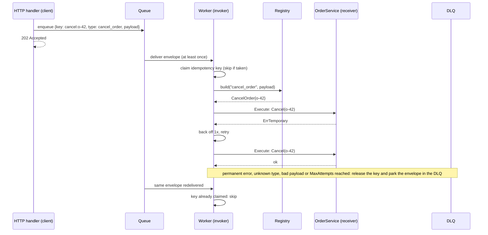
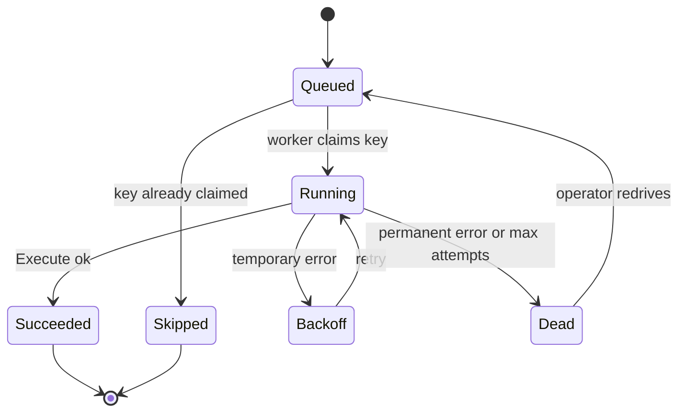
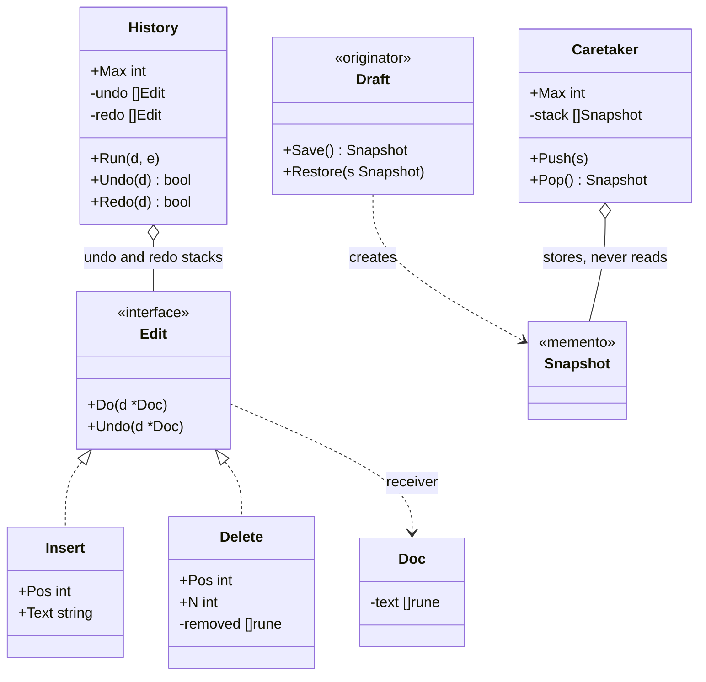

# Command, Undo and Memento

> [!summary] TL;DR
> **Command** turns "do this" into a value that can be stored, queued, retried, logged and undone. In Go it is often just a closure, `func(ctx context.Context) error`; a struct with a type name and a JSON payload is used when the command must survive a restart. **Undo** comes from one of two places: inverse commands (each command knows how to reverse itself) or **Memento** snapshots (save the whole state before the change and restore it later).

## 1. Why it exists

Two problems that a direct function call cannot solve:

- **"Do it later, somewhere else, maybe twice."** In a movie booking system, a user holds 2 seats for 10 minutes. If they do not pay, the hold must be released at 10:10. The request that created the hold cannot wait 10 minutes. It has to write down "release hold `h-91`" so that a worker runs it later, after a deploy if necessary, and the worker may receive that message twice because queues deliver at least once.
- **"Take it back."** A text editor offers 100 levels of undo on a 1 MB document. Saving a full copy before every edit costs about 100 × 1 MB = 100 MB (a calculation, not a measurement). Recording only each change and how to reverse it costs a few bytes per keystroke.

Command solves the first problem by making the request a value. Undo solves the second, either with commands that carry their own inverse or with Memento snapshots when no cheap inverse exists.

## 2. Mental model

A restaurant order ticket. The waiter writes the order on a ticket and clips it to the rail. The cook picks it up when free. The ticket can wait in line, be read by anyone, be voided, and be kept for the end-of-day audit. Nobody needs the waiter and the cook to be in the same place at the same time.

| Role | In the restaurant | In Go |
| --- | --- | --- |
| Client | The waiter, who builds the ticket | The HTTP handler that builds `CancelOrder{OrderID: "o-42"}` |
| Command | The ticket | A value with `Execute(ctx) error`, or a `func(ctx) error` |
| Invoker | The rail and whoever picks tickets off it | The worker loop, scheduler or undo history |
| Receiver | The cook, who knows how to cook | The service that does the work (`OrderService.Cancel`) |

**Memento** is a save-game. Before the boss fight you save; if it goes badly you load the save. The game (the **originator**) writes the save file (the **memento**), and the menu that lists save slots (the **caretaker**) stores the files without reading them.

## 3. How it works

### Object or closure

A closure is a command: it captures its data and its receiver, and it runs when called. `errgroup.Group.Go(func() error)` and `time.AfterFunc(d, f)` both take closure commands. Use a **struct** instead when the command must be:

- **serialized** (a closure cannot be written to a queue or a database),
- **inspected** (logging the order ID, deduplicating on a key),
- **undone** (it needs a second method, `Undo`).

### Queueing, retries and the dead-letter queue



Step by step:

1. The client wraps the request in an **envelope**: an idempotency key, a type name and a JSON payload. This is the serializable form of a command.
2. The worker **claims the key** atomically. A second delivery of the same envelope finds the key taken and does nothing.
3. A **registry** maps the type name to a factory that rebuilds the command from its payload. Unknown types and payloads that fail to decode go straight to the dead-letter queue (DLQ), because retrying cannot fix them.
4. The worker **executes** the command. A temporary error (timeout, lock conflict) is retried with a growing back-off. A permanent error is not retried.
5. After `MaxAttempts`, the envelope goes to the DLQ with its key released, so an operator can fix the cause and redrive it.



### Undo and redo with two stacks



The rules of the two stacks:

- **Run** executes the edit and pushes it on the undo stack. It also **clears the redo stack**, because the redo entries describe a future that no longer exists.
- **Undo** pops from the undo stack, calls `Undo`, and pushes onto the redo stack.
- **Redo** pops from the redo stack, calls `Do` again, and pushes onto the undo stack.
- Both stacks are **capped** (`Max`). When the undo stack is full, the oldest edit is forgotten.

An inverse command must record, at `Do` time, everything its `Undo` needs. `Delete` cannot be undone from its position and length alone, so it saves the removed text.

### Memento: snapshot instead of inverse

When an operation has no cheap inverse ("apply this template", "reformat the document"), save the state before it and restore it on undo. `Draft.Save` returns a `Snapshot` whose fields are unexported, so code outside the package can store it but not read or change it. The `Caretaker` keeps a capped stack of snapshots.

The one rule that matters in Go: **a snapshot must not share storage with the live object.** Assigning a struct copies its slice headers and map references, not their contents. `Save` therefore clones the slice and the map; `slices.Clone` and `maps.Clone` are shallow, which is deep enough here only because the elements are strings.

## 4. Worked example

The code keeps the old notes' `CancelOrder` command and `Draft` memento, and adds the worker, the undo history and the caretaker.

```go
// main.go
package main

import (
	"context"
	"encoding/json"
	"errors"
	"fmt"
	"maps"
	"slices"
	"sync"
	"time"
)

// ---------- 1. Command as an object and as a closure ----------

// Command is a request turned into a value: build it now, run it later.
type Command interface {
	Execute(ctx context.Context) error
}

// CommandFunc lets a closure be a Command. This is the usual Go form.
type CommandFunc func(ctx context.Context) error

func (f CommandFunc) Execute(ctx context.Context) error { return f(ctx) }

// OrderService is the receiver: it knows how to do the work.
type OrderService interface {
	Cancel(ctx context.Context, orderID string) error
}

// CancelOrder is a command object: it carries the data and the receiver.
type CancelOrder struct {
	OrderID string `json:"order_id"`
	svc     OrderService
}

func (c CancelOrder) Execute(ctx context.Context) error { return c.svc.Cancel(ctx, c.OrderID) }

// ---------- 2. Durable commands: envelope, registry, worker ----------

// Envelope is what goes on the queue: a type name plus a JSON payload.
// Key is the idempotency key that makes redelivery safe.
type Envelope struct {
	Key     string          `json:"key"`
	Type    string          `json:"type"`
	Payload json.RawMessage `json:"payload"`
}

// Factory rebuilds a command from its payload.
type Factory func(payload json.RawMessage) (Command, error)

var (
	ErrTemporary   = errors.New("temporary failure") // worth retrying
	ErrUnknownType = errors.New("unknown command type")
)

// Worker is the invoker. It knows nothing about orders, only about commands.
type Worker struct {
	Registry    map[string]Factory
	MaxAttempts int
	Backoff     time.Duration // multiplied by the attempt number

	mu   sync.Mutex
	keys map[string]bool // claimed idempotency keys (a table in production)
	DLQ  []Envelope      // dead-letter queue
}

// claim atomically reserves a key so two deliveries cannot both run.
func (w *Worker) claim(key string) bool {
	w.mu.Lock()
	defer w.mu.Unlock()
	if w.keys == nil {
		w.keys = map[string]bool{}
	}
	if w.keys[key] {
		return false
	}
	w.keys[key] = true
	return true
}

// deadLetter parks the envelope and frees its key so a redrive can run it.
func (w *Worker) deadLetter(e Envelope) {
	w.mu.Lock()
	defer w.mu.Unlock()
	delete(w.keys, e.Key)
	w.DLQ = append(w.DLQ, e)
}

// Process runs one envelope: dedupe, decode, execute with retries, or dead-letter.
func (w *Worker) Process(ctx context.Context, e Envelope) error {
	if !w.claim(e.Key) {
		return nil // duplicate delivery: someone already ran or is running it
	}
	build, ok := w.Registry[e.Type]
	if !ok {
		w.deadLetter(e)
		return fmt.Errorf("%w: %q", ErrUnknownType, e.Type)
	}
	cmd, err := build(e.Payload)
	if err != nil { // a bad payload will not get better with retries
		w.deadLetter(e)
		return err
	}
	for attempt := 1; ; attempt++ {
		err = cmd.Execute(ctx)
		if err == nil {
			return nil
		}
		if !errors.Is(err, ErrTemporary) || attempt >= w.MaxAttempts { // >= so a zero MaxAttempts cannot retry forever
			w.deadLetter(e)
			return fmt.Errorf("attempt %d: %w", attempt, err)
		}
		select {
		case <-time.After(time.Duration(attempt) * w.Backoff):
		case <-ctx.Done():
			w.deadLetter(e)
			return ctx.Err()
		}
	}
}

// Run is the worker loop: it drains the queue until the channel closes.
func (w *Worker) Run(ctx context.Context, queue <-chan Envelope) {
	for e := range queue {
		_ = w.Process(ctx, e) // errors are already in the DLQ; log them in production
	}
}

// ---------- 3. Undo and redo with inverse commands ----------

// Doc is the receiver of edit commands.
type Doc struct{ text []rune }

func (d *Doc) String() string { return string(d.text) }

// Edit is a command that knows how to reverse itself.
type Edit interface {
	Do(d *Doc)
	Undo(d *Doc)
}

type Insert struct {
	Pos  int
	Text string
}

func (c *Insert) Do(d *Doc) { d.text = slices.Insert(d.text, c.Pos, []rune(c.Text)...) }
func (c *Insert) Undo(d *Doc) {
	d.text = slices.Delete(d.text, c.Pos, c.Pos+len([]rune(c.Text)))
}

// Delete remembers what it removed, because the inverse needs it.
type Delete struct {
	Pos, N  int
	removed []rune
}

func (c *Delete) Do(d *Doc) {
	c.removed = slices.Clone(d.text[c.Pos : c.Pos+c.N])
	d.text = slices.Delete(d.text, c.Pos, c.Pos+c.N)
}
func (c *Delete) Undo(d *Doc) { d.text = slices.Insert(d.text, c.Pos, c.removed...) }

// History holds the undo and redo stacks, capped at Max entries.
type History struct {
	Max        int
	undo, redo []Edit
}

func (h *History) Run(d *Doc, e Edit) {
	e.Do(d)
	h.undo = append(h.undo, e)
	if len(h.undo) > h.Max {
		h.undo = slices.Delete(h.undo, 0, 1) // forget the oldest edit
	}
	h.redo = nil // a new edit invalidates the redo branch
}

func (h *History) Undo(d *Doc) bool {
	if len(h.undo) == 0 {
		return false
	}
	e := h.undo[len(h.undo)-1]
	h.undo = h.undo[:len(h.undo)-1]
	e.Undo(d)
	h.redo = append(h.redo, e)
	return true
}

func (h *History) Redo(d *Doc) bool {
	if len(h.redo) == 0 {
		return false
	}
	e := h.redo[len(h.redo)-1]
	h.redo = h.redo[:len(h.redo)-1]
	e.Do(d)
	h.undo = append(h.undo, e)
	return true
}

// ---------- 4. Memento: snapshots instead of inverses ----------

// Draft is the originator. Its fields stay unexported.
type Draft struct {
	title string
	tags  []string
	meta  map[string]string
}

// Snapshot is the memento: opaque outside this package.
type Snapshot struct {
	title string
	tags  []string
	meta  map[string]string
}

// Save deep-copies the slice and the map. A plain struct copy would share
// their backing storage, and later edits would leak into the snapshot.
// Clone is shallow, which is deep enough here because elements are strings.
func (d *Draft) Save() Snapshot {
	return Snapshot{title: d.title, tags: slices.Clone(d.tags), meta: maps.Clone(d.meta)}
}

func (d *Draft) Restore(s Snapshot) {
	d.title, d.tags, d.meta = s.title, slices.Clone(s.tags), maps.Clone(s.meta)
}

// Caretaker stores snapshots without looking inside them, and keeps at most Max.
type Caretaker struct {
	Max   int
	stack []Snapshot
}

func (c *Caretaker) Push(s Snapshot) {
	c.stack = append(c.stack, s)
	if len(c.stack) > c.Max {
		c.stack = slices.Delete(c.stack, 0, 1)
	}
}

func (c *Caretaker) Pop() (Snapshot, bool) {
	if len(c.stack) == 0 {
		return Snapshot{}, false
	}
	s := c.stack[len(c.stack)-1]
	c.stack = c.stack[:len(c.stack)-1]
	return s, true
}

type printCanceller struct{}

func (printCanceller) Cancel(_ context.Context, id string) error {
	fmt.Println("cancelled", id)
	return nil
}

func main() {
	ctx := context.Background()
	w := &Worker{MaxAttempts: 3, Backoff: time.Millisecond, Registry: map[string]Factory{
		"cancel_order": func(p json.RawMessage) (Command, error) {
			c := CancelOrder{svc: printCanceller{}}
			if err := json.Unmarshal(p, &c); err != nil {
				return nil, err
			}
			return c, nil
		},
	}}
	e := Envelope{Key: "cancel:o-42", Type: "cancel_order", Payload: json.RawMessage(`{"order_id":"o-42"}`)}
	fmt.Println(w.Process(ctx, e), w.Process(ctx, e)) // the second delivery is skipped

	d, h := &Doc{}, &History{Max: 100}
	h.Run(d, &Insert{Pos: 0, Text: "hello world"})
	h.Run(d, &Delete{Pos: 5, N: 6})
	fmt.Printf("%q ", d)
	h.Undo(d)
	fmt.Printf("%q ", d)
	h.Redo(d)
	fmt.Printf("%q\n", d)
}
```

```go
// main_test.go
package main

import (
	"context"
	"encoding/json"
	"errors"
	"slices"
	"sync"
	"sync/atomic"
	"testing"
	"time"
)

type countingCanceller struct{ n atomic.Int32 }

func (c *countingCanceller) Cancel(context.Context, string) error { c.n.Add(1); return nil }

func TestCommandObjectAndClosure(t *testing.T) {
	svc := &countingCanceller{}
	ran := false
	cmds := []Command{
		CancelOrder{OrderID: "o-1", svc: svc},
		CommandFunc(func(context.Context) error { ran = true; return nil }),
	}
	for _, c := range cmds {
		if err := c.Execute(context.Background()); err != nil {
			t.Fatal(err)
		}
	}
	if svc.n.Load() != 1 || !ran {
		t.Fatalf("object ran %d times, closure ran=%v", svc.n.Load(), ran)
	}
}

// worker builds a Worker whose only command type runs fn.
func worker(fn CommandFunc) *Worker {
	return &Worker{MaxAttempts: 3, Backoff: time.Millisecond, Registry: map[string]Factory{
		"job": func(json.RawMessage) (Command, error) { return fn, nil },
	}}
}

func TestRetryTemporaryThenSucceed(t *testing.T) {
	attempts := 0
	w := worker(func(context.Context) error {
		attempts++
		if attempts < 3 {
			return ErrTemporary
		}
		return nil
	})
	if err := w.Process(context.Background(), Envelope{Key: "k1", Type: "job"}); err != nil {
		t.Fatal(err)
	}
	if attempts != 3 || len(w.DLQ) != 0 {
		t.Fatalf("attempts=%d dlq=%d", attempts, len(w.DLQ))
	}
}

func TestPermanentErrorGoesToDLQAtOnce(t *testing.T) {
	attempts := 0
	boom := errors.New("order not found")
	w := worker(func(context.Context) error { attempts++; return boom })
	err := w.Process(context.Background(), Envelope{Key: "k2", Type: "job"})
	if !errors.Is(err, boom) || attempts != 1 || len(w.DLQ) != 1 {
		t.Fatalf("err=%v attempts=%d dlq=%d", err, attempts, len(w.DLQ))
	}
	// The key was released, so a redrive from the DLQ can run it again.
	if !w.claim("k2") {
		t.Fatal("dead-lettered key is still claimed")
	}
}

func TestUnknownTypeAndBadPayload(t *testing.T) {
	svc := &countingCanceller{}
	w := &Worker{MaxAttempts: 3, Registry: map[string]Factory{
		"cancel_order": func(p json.RawMessage) (Command, error) {
			c := CancelOrder{svc: svc}
			if err := json.Unmarshal(p, &c); err != nil {
				return nil, err
			}
			return c, nil
		},
	}}
	ctx := context.Background()
	if err := w.Process(ctx, Envelope{Key: "a", Type: "refund"}); !errors.Is(err, ErrUnknownType) {
		t.Fatalf("want ErrUnknownType, got %v", err)
	}
	if err := w.Process(ctx, Envelope{Key: "b", Type: "cancel_order", Payload: json.RawMessage(`{`)}); err == nil {
		t.Fatal("want a JSON error")
	}
	if len(w.DLQ) != 2 || svc.n.Load() != 0 {
		t.Fatalf("dlq=%d cancels=%d", len(w.DLQ), svc.n.Load())
	}
}

func TestDuplicateDeliveriesRunOnce(t *testing.T) {
	var runs atomic.Int32
	w := worker(func(context.Context) error { runs.Add(1); return nil })
	queue := make(chan Envelope)
	var wg sync.WaitGroup
	for range 4 { // four workers share one queue
		wg.Add(1)
		go func() { defer wg.Done(); w.Run(context.Background(), queue) }()
	}
	for i := range 20 { // keys k0..k4, each delivered four times
		queue <- Envelope{Key: "k" + string(rune('0'+i%5)), Type: "job"}
	}
	close(queue)
	wg.Wait()
	if got := runs.Load(); got != 5 {
		t.Fatalf("want 5 executions, got %d", got)
	}
}

func TestUndoRedo(t *testing.T) {
	d, h := &Doc{}, &History{Max: 100}
	h.Run(d, &Insert{Pos: 0, Text: "hello world"})
	h.Run(d, &Delete{Pos: 5, N: 6})
	steps := []struct {
		op   func(*Doc) bool
		want string
	}{
		{h.Undo, "hello world"},
		{h.Undo, ""},
		{h.Redo, "hello world"},
		{h.Redo, "hello"},
	}
	for i, s := range steps {
		if !s.op(d) || d.String() != s.want {
			t.Fatalf("step %d: got %q, want %q", i, d, s.want)
		}
	}
	h.Undo(d)
	h.Run(d, &Insert{Pos: 11, Text: "!"}) // a new edit clears redo
	if h.Redo(d) || d.String() != "hello world!" {
		t.Fatalf("redo after a new edit: %q", d)
	}
}

func TestHistoryCap(t *testing.T) {
	d, h := &Doc{}, &History{Max: 2}
	for _, s := range []string{"a", "b", "c"} {
		h.Run(d, &Insert{Pos: len(d.text), Text: s})
	}
	for h.Undo(d) {
	}
	if d.String() != "a" { // the first edit fell off the capped stack
		t.Fatalf("got %q, want %q", d, "a")
	}
}

func TestSnapshotIsDeepEnough(t *testing.T) {
	d := &Draft{title: "v1", tags: []string{"go"}, meta: map[string]string{"lang": "en"}}
	snap := d.Save()
	shallow := Snapshot{title: d.title, tags: d.tags, meta: d.meta} // the bug to avoid

	d.title, d.tags[0], d.meta["lang"] = "v2", "rust", "fr" // edit in place

	if shallow.tags[0] != "rust" || shallow.meta["lang"] != "fr" {
		t.Fatal("expected the shallow copy to share storage")
	}
	d.Restore(snap)
	if d.title != "v1" || !slices.Equal(d.tags, []string{"go"}) || d.meta["lang"] != "en" {
		t.Fatalf("restore gave %+v", d)
	}
}

func TestCaretakerCap(t *testing.T) {
	d := &Draft{}
	c := &Caretaker{Max: 2}
	for _, title := range []string{"t1", "t2", "t3"} {
		d.title = title
		c.Push(d.Save())
	}
	var got []string
	for s, ok := c.Pop(); ok; s, ok = c.Pop() {
		got = append(got, s.title)
	}
	if !slices.Equal(got, []string{"t3", "t2"}) {
		t.Fatalf("got %v", got)
	}
}
```

`go vet` is clean and `go test -race` passes (Go 1.24.4). `TestDuplicateDeliveriesRunOnce` runs four workers on one queue under the race detector: 20 deliveries of 5 distinct keys execute exactly 5 times. Output of `go run .`, measured:

```text
cancelled o-42
<nil> <nil>
"hello" "hello world" "hello"
```

The second `Process` call printed nothing because the key `cancel:o-42` was already claimed. The undo trace from `TestUndoRedo`:

| Step | Undo stack (top last) | Redo stack | Text |
| --- | --- | --- | --- |
| Run Insert "hello world" | Insert | — | `hello world` |
| Run Delete(5, 6) | Insert, Delete | — | `hello` |
| Undo | Insert | Delete | `hello world` |
| Undo | — | Delete, Insert | (empty) |
| Redo | Insert | Delete | `hello world` |
| Redo | Insert, Delete | — | `hello` |

## 5. Variants and comparison

| Variant | How it works | Use when | Cost |
| --- | --- | --- | --- |
| Closure `func(ctx) error` | Captures data and receiver | In-process work: `errgroup.Go`, `time.AfterFunc`, a worker pool | Cannot be serialized, inspected or undone |
| Command struct | Data fields + receiver + `Execute` | You need to log, dedupe or undo it | One type per action |
| Durable envelope | Key + type + JSON payload + registry | Jobs that survive restarts (queues, outbox) | Payload versioning, a registry to maintain |
| Inverse-command undo | Each command stores what `Undo` needs | Small, reversible edits (text, moves) | Every command needs a correct inverse |
| Memento undo | Snapshot the state before the change | No cheap inverse, or state is small | Memory per snapshot; deep-copy rules |
| DB savepoint | `SAVEPOINT s1` … `ROLLBACK TO SAVEPOINT s1` | Undo part of a transaction | Only inside one open transaction |
| Event-sourcing snapshot | Persist aggregate state every N events | Long event streams | Snapshot schema must evolve with the aggregate |

**Command log.** Appending every executed envelope (who, when, type, payload) to an append-only table gives an audit trail for free. It records **intents**, which may have been rejected; [[Event Sourcing]] records **facts** that already happened. A [[CQRS]] command is the same idea at the architecture level: a named, serializable request to change state, handled by exactly one handler.

## 6. Trade-offs and when not to use

- **A direct call that runs now, once, in process, needs no command.** Wrapping `svc.Cancel(ctx, id)` in a struct and an invoker adds a type and an indirection for nothing.
- **Do not reach for a struct when a closure works.** If the work never leaves the process and is never inspected, `func(ctx) error` is the whole pattern.
- **Durable commands are a contract.** Once envelopes sit in a queue, renaming a JSON field or a type name breaks every job already queued. Version the type (`cancel_order.v2`) or keep decoders tolerant.
- **Inverse commands vs Memento is memory vs complexity.** Inverses are cheap to store but every command needs a correct inverse, and a bug in one corrupts every later undo. Snapshots are trivially correct but cost the size of the state each time. Many editors mix them: inverses for keystrokes, snapshots for bulk operations.
- **Undo across systems is not undo.** Once a command has sent an email or charged a card, the "inverse" is a new compensating action (a refund), with its own failure modes. That is the [[Saga Pattern]], not an undo stack.

## 7. In production

- **Real systems:**
	- `os/exec.Cmd` is a command object: you configure `Path`, `Args`, `Env` and `Dir`, then call `Run` or `Start`. The docs say a `Cmd` cannot be reused after `Run`, `Output` or `CombinedOutput`.
	- `errgroup.Group.Go(func() error)` runs each closure command in its own goroutine (blocking while a `SetLimit` cap is reached), and `Wait` returns the first non-nil error.
	- Job libraries use the durable envelope: asynq builds a task from a type name and a payload, and River jobs declare a `Kind()` string that the worker registry maps to a handler.
	- [[Movie Ticket Booking]]: a background sweeper runs `ReleaseExpiredLocks` (and `ProcessRefunds`) as scheduled jobs that are safe to run twice. [[Delivery Partner Assignment]]: an order nobody could take is parked and becomes a retry job that a 30–60 s ticker runs again, and the third-party booking carries an idempotency key. [[Elevator System]]: in the event-loop alternative, button presses are request commands sent on a channel to the one goroutine that owns the cars, which serves stops in LOOK order, not in arrival order.
	- PostgreSQL savepoints are a database Memento; in pgx v5, calling `Begin` on an open `Tx` creates a savepoint.
- **Failure modes → fixes:**
	- Retried command charges twice → an idempotency key claimed in the same transaction as the side effect (see section 8 and [[Idempotency and Idempotency Keys]]).
	- A poison message is retried forever and blocks the queue → `MaxAttempts`, then the DLQ ([[Dead Letter Queues and Poison Messages]]).
	- Queued closures all see the last loop value → fixed by the language since Go 1.22 for modules whose `go.mod` declares `go 1.22` or later (each iteration has its own variable); with an older `go` line, copy the variable inside the loop.
	- A snapshot changes after it was taken → it shared a slice or map with the live object; clone them in `Save` and again in `Restore`.
	- Unbounded undo history eats memory in a long session → cap both stacks.
- **What to monitor:** queue depth and the age of the oldest job, retries and DLQ arrivals per command type, duplicate deliveries skipped, and execution latency per type.

## 8. Deep dive

**Making the idempotency claim real.** The in-memory `claim` is atomic within one process. Across processes, store the key in the same database transaction as the side effect, so either both happen or neither does (PostgreSQL 17):

```sql
BEGIN;
INSERT INTO processed_commands (key, processed_at)
VALUES ('cancel:o-42', now())
ON CONFLICT (key) DO NOTHING;
-- 0 rows inserted: a duplicate. ROLLBACK and acknowledge the message.
UPDATE orders SET status = 'cancelled' WHERE id = 'o-42' AND status <> 'cancelled';
COMMIT;
```

If the side effect lives in another system (a payment provider), pass the same key to that system instead, because no local transaction can cover it. A claim that is taken before a long-running execution needs a lease (a `claimed_at` column and a timeout) so that a crashed worker's job can be picked up again.

**Retrying only what can succeed.** `Process` retries only errors that wrap `ErrTemporary`. A "not found" or a validation error fails the same way every time; retrying it only delays the DLQ and adds load. The back-off grows with the attempt number and stops early when `ctx` is cancelled. The sketch dead-letters a job whose back-off is cut short by cancellation; on a graceful shutdown a production worker would rather release the key and leave the message unacknowledged, so the queue redelivers it to another worker. Production back-off adds jitter so that many failed jobs do not retry in lock-step ([[Timeouts, Retries and Backoff]]).

**Macro commands.** Typing a word is many `Insert` commands, but the user expects one undo. Group them into a composite command whose `Do` runs the children in order and whose `Undo` reverses them in reverse order ([[Composite]]).

**Deep-copy rules for snapshots.**
- Plain assignment (`snap := *d`) is a correct memento only if the struct has no slices, maps, pointers or channels.
- `Draft` and `Snapshot` have identical fields, so the conversion `Snapshot(*d)` compiles, and staticcheck (S1016) prefers it to a field-by-field literal. For the old two-string draft that conversion is the whole `Save`. Here it would share the slice and the map, which is why `Save` clones them instead.
- `slices.Clone` and `maps.Clone` copy one level. A `[]Item` whose `Item` holds a map needs a loop that clones each element.
- A JSON round-trip copies only exported fields, so it silently drops unexported state.
- Go 1.22 made `slices.Delete` zero the vacated tail elements, so dropping the oldest entry from a capped stack no longer keeps it reachable from the backing array. Setting `h.redo = nil` releases the redo entries at once.

**Encapsulation in Go is per package.** Unexported `Snapshot` fields hide the state from other packages, but any code in the same package can read them. Keep the originator and its memento in a small package of their own if that boundary matters.

**Undo assumes one writer.** Inverse commands replay against the state they were recorded on. With concurrent editors, an undo can reverse someone else's later change; collaborative editors transform operations against each other (operational transforms or CRDTs) instead of using a plain stack.

## 9. Interview questions

> [!question]- When is Command worth it instead of calling the function directly?
> When the call must happen later, elsewhere, more than once, or be reversible: queues, schedulers, retries, audit logs, undo. If it runs now, once, in process, call the function. In Go, a closure is already a command; use a struct when you must serialize, inspect or undo it.

> [!question]- Can you put a closure on a durable queue? (trap)
> No. A closure is code plus captured variables in memory; it cannot be serialized and does not survive a restart. Durable commands are data: a type name, a JSON payload and an idempotency key, plus a registry that maps the type back to a factory on the worker side.

> [!question]- The queue delivers at least once. How do you make a refund command safe?
> Give each command an idempotency key, claim it atomically (an `INSERT … ON CONFLICT DO NOTHING` in the same transaction as the side effect), and skip it when the claim fails. Pass the same key to external systems. Retry only temporary errors, and send the rest to a DLQ after a fixed number of attempts.

> [!question]- Undo with inverse commands or with Memento snapshots?
> Inverse commands store only the change, so they are cheap, but every command needs a correct inverse that records what it destroyed. Snapshots are always correct but cost the state's size per step. Use inverses for small reversible edits, snapshots for bulk or irreversible ones, and cap both histories.

> [!question]- Why does a new edit clear the redo stack?
> Redo entries were recorded against the state before the undo. A new edit creates a different history, so replaying them would apply changes to a document they were never computed for.

> [!question]- Is `snap := *draft` a valid memento? (trap)
> Only if `Draft` has no slices, maps or pointers. Struct assignment copies the slice header and the map reference, so later in-place edits show up in the "snapshot". Clone them, and remember that `slices.Clone` and `maps.Clone` are shallow.

## 10. Cheat sheet

- Command = a request as a value; roles: client, command, invoker, receiver.
- In Go, start with `func(ctx) error`; use a struct to serialize, inspect or undo.
- Durable command = idempotency key + type + JSON payload + registry.
- Claim the key atomically with the side effect; retry only temporary errors; DLQ after N attempts.
- Undo/redo = two capped stacks; a new edit clears redo.
- Inverse commands save memory; Memento saves complexity.
- Snapshots must clone slices and maps; `slices.Clone` and `maps.Clone` are shallow.
- Real Go: `exec.Cmd`, `errgroup.Go`, `time.AfterFunc`, asynq tasks, River jobs, PostgreSQL savepoints.

## Links

- **Before this:** [[Interfaces]], [[Chain of Responsibility and Pipelines]], [[Design Patterns Overview and Chooser]]
- **Next:** [[Iterator and range-over-func]], [[Background Workers and Job Queues]]
- **Compare with:** [[Strategy and Template Method]] (a strategy is *how* to do something; a command is *what* to do, stored for later), [[CQRS]] and [[Event Sourcing]] (commands and events at the architecture level), [[Saga Pattern]] (compensation instead of undo), [[Case Study - Ticket Booking]] (seat holds and expiry at system scale)
- **Practice:** [[Movie Ticket Booking]], [[Delivery Partner Assignment]], [[Elevator System]], [[Task Scheduler (delayed and recurring jobs)]]
