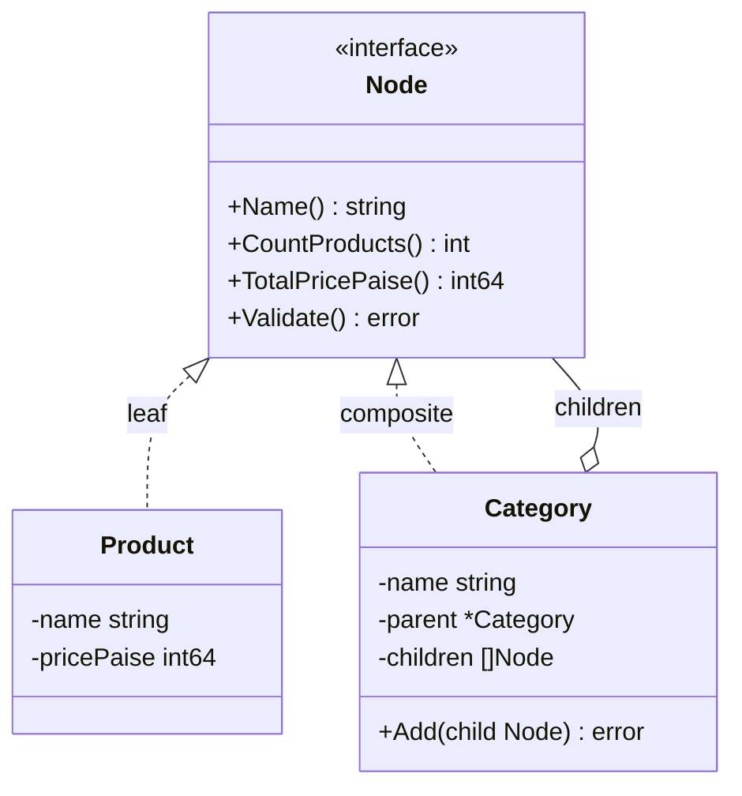
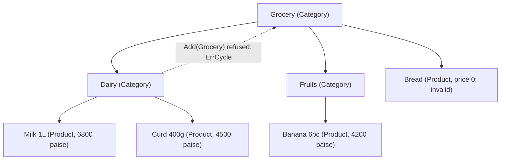

# Composite

> [!summary] TL;DR
> Composite lets you treat **one item and a group of items the same way**. A *leaf* (a product) and a *composite* (a category that holds products and other categories) implement one interface, so `CountProducts()` works on either, and the category answers by asking its children. Use it whenever your data is a tree: catalogs, folders, org charts, comment threads.

> [!abstract] Core idea
> - A leaf (one product) and a composite (a category) implement the **same interface**, so callers never check which one they hold.
> - The composite answers by **looping over its children** and combining their answers; the recursion stops at leaves.
> - The one rule: the tree must really be a tree. Guard against cycles and very deep input before recursing.
> - Classic mistake: recomputing a whole subtree on every page view (for example product counts) instead of caching or precomputing it.

## 1. Why it exists

A grocery catalog has 3 levels of categories and about 20,000 products (an estimate for a mid-size store). The home page needs "Dairy (124)", the admin needs the stock value of "Beverages", and search needs every product under "Fruits".

Without Composite, every caller writes the same nested loops: for each category, for each subcategory, for each product, and the code breaks the day someone adds a fourth level. With Composite, the caller asks the root node once. Each category sums its children's answers, whatever their depth, and a product answers for itself. A new level needs no code change.

Trees also bring two failure modes:

- **Cycles.** If "Grocery" is added under its own child "Dairy", a recursive count never ends. Go's stack grows until the 1 GB limit (on 64-bit systems) and the process dies with a fatal stack overflow that `recover` cannot catch.
- **Unbounded depth.** A bad import creates a 10,000-level chain, and every page that renders breadcrumbs slows to a crawl.

The code below refuses both when a child is added, so every later walk can trust the shape.

## 2. Mental model

A **box of boxes**. A box can hold items or smaller boxes. To weigh any box you weigh what is inside; an item just reports its own weight. You never need to know in advance how deep the boxes go.

The pattern has three roles:

- **Component**: the shared interface (`Node`).
- **Leaf**: has no children and answers directly (`*Product`).
- **Composite**: holds children of type `Node` and answers by combining their answers (`*Category`).

## 3. How it works



The tree used in the worked example:



Step by step:

1. **Recursive operations.** `Category.CountProducts()` loops over its children and adds up their counts; `Product.CountProducts()` returns 1. `TotalPricePaise` and `Validate` follow the same shape.
2. **The mutation API lives on the composite only.** `Add` is a method of `*Category`, not of `Node`, so `product.Add(x)` does not compile. GoF calls this choosing *safety* over *transparency*.
3. **Guards in `Add`.** Walk up the parent pointers from the new parent: if you meet the child, adding it would close a cycle. Refuse a category that already has a parent (this is a tree, not a graph). Refuse the child if `depth(parent) + height(child)` exceeds `MaxDepth`.
4. **Iterative traversal.** `All` walks the tree with an explicit stack and yields each node with its depth as a Go 1.23 iterator, so callers can `break` early. Swap the stack for a queue to get level order (breadth first).
5. **Composites of errors.** `Validate` returns `errors.Join` of the children's errors, and `errors.Is` searches that error tree, so one call reports every bad product.

### Whiteboard version

The bare idea: one interface, a leaf that answers directly, and a group that sums its children. The full version in section 4 adds the production concerns.

```go
package main

import "fmt"

// Node is what leaves and groups share.
type Node interface{ Count() int }

type Product struct{ Name string }

func (Product) Count() int { return 1 } // a leaf answers directly

type Category struct {
	Name     string
	Children []Node
}

// A composite answers by asking its children.
func (c *Category) Count() int {
	n := 0
	for _, ch := range c.Children {
		n += ch.Count()
	}
	return n
}

func main() {
	books := &Category{"Books", []Node{Product{"Go"}, Product{"SQL"}}}
	root := &Category{"All", []Node{Product{"Pen"}, books}}
	fmt.Println(root.Count(), books.Count()) // 3 2
}
```

## 4. Worked example

One `package main` with the catalog tree, the guards, an iterator, search, validation and `io.MultiWriter`. It compiles with Go 1.24 and passes `go vet` and `go test -race`, using only the standard library.

```go
// Command catalog models a category tree with the Composite pattern:
// products (leaves) and categories (composites) share one interface.
package main

import (
	"errors"
	"fmt"
	"io"
	"iter"
	"os"
	"strings"
)

var (
	ErrCycle     = errors.New("adding this category would create a cycle")
	ErrHasParent = errors.New("category already has a parent")
	ErrTooDeep   = errors.New("category tree too deep")
	ErrBadPrice  = errors.New("price must be positive")
	ErrNilChild  = errors.New("child is nil")
)

// MaxDepth bounds the number of category levels from the root.
const MaxDepth = 6

// Node is the component: callers treat a product and a category alike.
type Node interface {
	Name() string
	CountProducts() int
	TotalPricePaise() int64
	Validate() error
}

// Product is a leaf.
type Product struct {
	name       string
	pricePaise int64
}

func NewProduct(name string, pricePaise int64) *Product {
	return &Product{name: name, pricePaise: pricePaise}
}

func (p *Product) Name() string           { return p.name }
func (p *Product) CountProducts() int     { return 1 }
func (p *Product) TotalPricePaise() int64 { return p.pricePaise }

func (p *Product) Validate() error {
	if p.pricePaise <= 0 {
		return fmt.Errorf("%s: %w", p.name, ErrBadPrice)
	}
	return nil
}

// Category is the composite. Add lives here, not on Node, so the
// compiler stops anyone from adding a child to a product.
type Category struct {
	name     string
	parent   *Category
	children []Node
}

func NewCategory(name string) *Category { return &Category{name: name} }

func (c *Category) Name() string { return c.name }

func (c *Category) CountProducts() int {
	n := 0
	for _, ch := range c.children {
		n += ch.CountProducts()
	}
	return n
}

func (c *Category) TotalPricePaise() int64 {
	var sum int64
	for _, ch := range c.children {
		sum += ch.TotalPricePaise()
	}
	return sum
}

// Validate checks the whole subtree and reports every problem, not only the first.
func (c *Category) Validate() error {
	var errs []error
	for _, ch := range c.children {
		errs = append(errs, ch.Validate())
	}
	return errors.Join(errs...) // nil when every child returned nil
}

// Add attaches a child. It refuses nil, cycles, a second parent and
// trees deeper than MaxDepth, so every later walk can trust the shape.
func (c *Category) Add(child Node) error {
	switch n := child.(type) {
	case nil:
		return ErrNilChild
	case *Product:
		if n == nil {
			return ErrNilChild // a typed nil is a non-nil interface
		}
	case *Category:
		if n == nil {
			return ErrNilChild
		}
		if err := c.canAdopt(n); err != nil {
			return err
		}
		n.parent = c
	}
	c.children = append(c.children, child)
	return nil
}

func (c *Category) canAdopt(sub *Category) error {
	for a := c; a != nil; a = a.parent {
		if a == sub {
			return ErrCycle // sub is c itself or one of its ancestors
		}
	}
	if sub.parent != nil {
		return ErrHasParent
	}
	if c.depth()+height(sub) > MaxDepth {
		return ErrTooDeep
	}
	return nil
}

// depth is 1 for a root category.
func (c *Category) depth() int {
	d := 0
	for a := c; a != nil; a = a.parent {
		d++
	}
	return d
}

// height counts the category levels in c's subtree, c included.
func height(c *Category) int {
	h := 0
	for _, ch := range c.children {
		if sub, ok := ch.(*Category); ok {
			h = max(h, height(sub))
		}
	}
	return h + 1
}

// All yields every node and its depth (root = 0) in depth-first order.
// It uses an explicit stack, not recursion, and stops when the loop breaks.
func All(root Node) iter.Seq2[Node, int] {
	return func(yield func(Node, int) bool) {
		type item struct {
			n Node
			d int
		}
		stack := []item{{root, 0}}
		for len(stack) > 0 {
			it := stack[len(stack)-1]
			stack = stack[:len(stack)-1]
			if !yield(it.n, it.d) {
				return
			}
			if c, ok := it.n.(*Category); ok {
				for i := len(c.children) - 1; i >= 0; i-- { // reverse keeps child order
					stack = append(stack, item{c.children[i], it.d + 1})
				}
			}
		}
	}
}

// Search returns the names of products whose name contains q.
func Search(root Node, q string) []string {
	var out []string
	for n := range All(root) {
		if p, ok := n.(*Product); ok && strings.Contains(strings.ToLower(p.name), strings.ToLower(q)) {
			out = append(out, p.name)
		}
	}
	return out
}

// Print writes an indented tree to w.
func Print(w io.Writer, root Node) {
	for n, d := range All(root) {
		indent := strings.Repeat("  ", d)
		if _, ok := n.(*Category); ok {
			fmt.Fprintf(w, "%s%s/ (products: %d)\n", indent, n.Name(), n.CountProducts())
			continue
		}
		p := n.TotalPricePaise()
		fmt.Fprintf(w, "%s%s ₹%d.%02d\n", indent, n.Name(), p/100, p%100)
	}
}

func must(err error) {
	if err != nil {
		panic(err)
	}
}

func main() {
	grocery, dairy, fruits := NewCategory("Grocery"), NewCategory("Dairy"), NewCategory("Fruits")
	must(dairy.Add(NewProduct("Milk 1L", 6800)))
	must(dairy.Add(NewProduct("Curd 400g", 4500)))
	must(fruits.Add(NewProduct("Banana 6pc", 4200)))
	must(grocery.Add(dairy))
	must(grocery.Add(fruits))
	must(grocery.Add(NewProduct("Bread", 0))) // bad price, caught by Validate

	var report strings.Builder
	Print(io.MultiWriter(os.Stdout, &report), grocery) // one call, two sinks
	fmt.Println("products:", grocery.CountProducts(), "| total paise:", grocery.TotalPricePaise())
	fmt.Println("search milk:", Search(grocery, "milk"))
	fmt.Println("add Grocery under Dairy:", dairy.Add(grocery))
	err := grocery.Validate()
	fmt.Println("validate:", err, "| errors.Is ErrBadPrice:", errors.Is(err, ErrBadPrice))
	fmt.Println("report bytes:", report.Len())
}
```

Output of `go run .` (Go 1.24.4):

```text
Grocery/ (products: 4)
  Dairy/ (products: 2)
    Milk 1L ₹68.00
    Curd 400g ₹45.00
  Fruits/ (products: 1)
    Banana 6pc ₹42.00
  Bread ₹0.00
products: 4 | total paise: 15500
search milk: [Milk 1L]
add Grocery under Dairy: adding this category would create a cycle
validate: Bread: price must be positive | errors.Is ErrBadPrice: true
report bytes: 154
```

`Print` wrote once and `io.MultiWriter` sent the same bytes to the terminal and to a buffer: a composite of writers. Adding the root under its own child was refused before it could create a cycle.

The tests are table-driven and cover the aggregates on every kind of node, every guard in `Add`, the depth limit, iteration order with early `break`, search, and validation that reports all bad leaves:

```go
package main

import (
	"errors"
	"strings"
	"testing"
)

// sampleTree: Grocery{Dairy{Milk, Curd}, Fruits{Banana}, Bread}
func sampleTree(t *testing.T) (grocery, dairy, fruits *Category) {
	t.Helper()
	grocery, dairy, fruits = NewCategory("Grocery"), NewCategory("Dairy"), NewCategory("Fruits")
	for _, err := range []error{
		dairy.Add(NewProduct("Milk 1L", 6800)),
		dairy.Add(NewProduct("Curd 400g", 4500)),
		fruits.Add(NewProduct("Banana 6pc", 4200)),
		grocery.Add(dairy),
		grocery.Add(fruits),
		grocery.Add(NewProduct("Bread", 4000)),
	} {
		if err != nil {
			t.Fatal(err)
		}
	}
	return grocery, dairy, fruits
}

func TestRecursiveOperations(t *testing.T) {
	grocery, dairy, fruits := sampleTree(t)
	tests := []struct {
		node      Node
		wantCount int
		wantTotal int64
	}{
		{grocery, 4, 19500},
		{dairy, 2, 11300},
		{fruits, 1, 4200},
		{NewProduct("Eggs", 900), 1, 900},
		{NewCategory("Empty"), 0, 0},
	}
	for _, tt := range tests {
		t.Run(tt.node.Name(), func(t *testing.T) {
			if got := tt.node.CountProducts(); got != tt.wantCount {
				t.Errorf("count = %d, want %d", got, tt.wantCount)
			}
			if got := tt.node.TotalPricePaise(); got != tt.wantTotal {
				t.Errorf("total = %d, want %d", got, tt.wantTotal)
			}
		})
	}
}

func TestAddRejectsBadShapes(t *testing.T) {
	grocery, dairy, fruits := sampleTree(t)
	tests := []struct {
		name   string
		parent *Category
		child  Node
		want   error
	}{
		{"self", dairy, dairy, ErrCycle},
		{"ancestor under descendant", dairy, grocery, ErrCycle},
		{"second parent", fruits, dairy, ErrHasParent},
		{"nil child", fruits, nil, ErrNilChild},
		{"typed nil product", fruits, (*Product)(nil), ErrNilChild},
		{"fresh category", fruits, NewCategory("Exotic"), nil},
	}
	for _, tt := range tests {
		t.Run(tt.name, func(t *testing.T) {
			if err := tt.parent.Add(tt.child); !errors.Is(err, tt.want) {
				t.Fatalf("err = %v, want %v", err, tt.want)
			}
		})
	}
}

func TestAddEnforcesMaxDepth(t *testing.T) {
	root := NewCategory("L1")
	leaf := root
	for i := 2; i <= MaxDepth; i++ {
		next := NewCategory("L")
		if err := leaf.Add(next); err != nil {
			t.Fatalf("level %d: %v", i, err)
		}
		leaf = next
	}
	if err := leaf.Add(NewCategory("too deep")); !errors.Is(err, ErrTooDeep) {
		t.Fatalf("err = %v, want ErrTooDeep", err)
	}
	if err := leaf.Add(NewProduct("leaf product", 100)); err != nil {
		t.Fatalf("a product adds no category level: %v", err)
	}
}

func TestAllWalksEveryNodeInOrderAndStopsEarly(t *testing.T) {
	grocery, _, _ := sampleTree(t)
	var names []string
	for n, d := range All(grocery) {
		names = append(names, strings.Repeat(".", d)+n.Name())
	}
	want := "Grocery .Dairy ..Milk 1L ..Curd 400g .Fruits ..Banana 6pc .Bread"
	if got := strings.Join(names, " "); got != want {
		t.Fatalf("order:\n got %s\nwant %s", got, want)
	}
	visited := 0
	for range All(grocery) {
		visited++
		if visited == 3 {
			break
		}
	}
	if visited != 3 {
		t.Fatalf("visited = %d after break, want 3", visited)
	}
}

func TestSearch(t *testing.T) {
	grocery, _, _ := sampleTree(t)
	if got := Search(grocery, "MILK"); len(got) != 1 || got[0] != "Milk 1L" {
		t.Fatalf("Search = %v", got)
	}
}

func TestValidateReportsEveryBadLeaf(t *testing.T) {
	grocery, dairy, fruits := sampleTree(t)
	if err := grocery.Validate(); err != nil {
		t.Fatalf("valid tree: %v", err)
	}
	if err := errors.Join(dairy.Add(NewProduct("Paneer", 0)), fruits.Add(NewProduct("Mango", -5))); err != nil {
		t.Fatal(err) // Add checks the shape only; prices are checked by Validate
	}
	err := grocery.Validate()
	if !errors.Is(err, ErrBadPrice) {
		t.Fatalf("err = %v, want ErrBadPrice inside", err)
	}
	for _, name := range []string{"Paneer", "Mango"} {
		if !strings.Contains(err.Error(), name) {
			t.Errorf("error %q does not mention %s", err, name)
		}
	}
}
```

`go test -race -count=1 -v` passes all six tests and their subtests.

### Persisting the tree (PostgreSQL 17)

The in-memory tree is usually loaded from a table. Three common schemas:

| Schema | How a subtree is read | Moving a subtree | Cost |
| --- | --- | --- | --- |
| Adjacency list (`parent_id`) | `WITH RECURSIVE` query | Update one row | Recursive query for every subtree read |
| Closure table (`ancestor_id, descendant_id, depth`) | One indexed lookup on `ancestor_id` | Delete and re-insert many rows | About `n × average depth` rows |
| Materialized path (`ltree` or text `'1.2.9'`) | Prefix match: `path <@ '1.2'` with a GiST index | Rewrite the path of every node in the subtree | Path length limits depth; renumbering on moves |

The adjacency list is the simplest. The `CYCLE` clause (PostgreSQL 14 and later) stops the recursion if bad data contains a loop, and the depth filter enforces the same limit as `MaxDepth`:

```sql
CREATE TABLE category (
    id        bigint GENERATED ALWAYS AS IDENTITY PRIMARY KEY,
    parent_id bigint REFERENCES category (id),
    name      text   NOT NULL,
    CHECK (parent_id <> id)
);
CREATE INDEX category_parent_idx ON category (parent_id);

WITH RECURSIVE subtree AS (
    SELECT id, name, 0 AS depth
    FROM category
    WHERE id = 1
  UNION ALL
    SELECT c.id, c.name, s.depth + 1
    FROM category AS c
    JOIN subtree AS s ON c.parent_id = s.id
    WHERE s.depth < 5
) CYCLE id SET is_cycle USING path
SELECT id, name, depth
FROM subtree
WHERE NOT is_cycle
ORDER BY depth, id;
```

Representative output (PostgreSQL 17), for the categories of the example tree:

```text
 id |  name   | depth
----+---------+-------
  1 | Grocery |     0
  2 | Dairy   |     1
  3 | Fruits  |     1
(3 rows)
```

A closure table trades write cost for one-lookup reads. Inserting category 9 under category 2 copies the parent's ancestor rows and adds a self row:

```sql
CREATE TABLE category_closure (
    ancestor_id   bigint NOT NULL REFERENCES category (id),
    descendant_id bigint NOT NULL REFERENCES category (id),
    depth         int    NOT NULL CHECK (depth >= 0),
    PRIMARY KEY (ancestor_id, descendant_id)
);

INSERT INTO category_closure (ancestor_id, descendant_id, depth)
SELECT ancestor_id, 9, depth + 1
FROM category_closure
WHERE descendant_id = 2
UNION ALL
SELECT 9, 9, 0;

-- every category under Grocery (id 1), at any depth
SELECT descendant_id, depth
FROM category_closure
WHERE ancestor_id = 1 AND depth > 0;
```

## 5. Variants and comparison

| Variant | How it works | Use when | Cost |
| --- | --- | --- | --- |
| Interface + leaf and composite types (this note) | `Node` interface; `*Category` holds `[]Node` | Node kinds behave differently (product vs category, file vs folder) | A type switch whenever you need the children |
| One struct type for every node | `type Node struct { Kind NodeKind; Children []*Node }`, or linked children as in `golang.org/x/net/html`, whose `Node` has a `Type` field and `FirstChild` and `NextSibling` pointers | Parsers and documents where all nodes share fields | Checks on `Kind` replace polymorphism |
| Transparent composite | `Add` and `Children` on the interface; leaves return an error | Generic tree tools that must edit any node | A leaf exposes methods it cannot honour |
| Composite of behaviour | One value fans a call out to many of the same interface: `io.MultiWriter`, `errors.Join`, a multi-handler for `log/slog` | Several sinks or results must look like one | Error policy: stop at the first failure or collect all |

**Composite vs Decorator.** Both build a recursive structure of one interface. A decorator wraps **one** object and adds behaviour to its calls; a composite holds **many** children and combines their results. See [[Decorator and Middleware]].

## 6. Trade-offs and when not to use

**When not to use it in Go:**

- **Flat data.** A list of products with a `category` string needs a `map[string][]Product`, not a tree.
- **A graph, not a tree.** If a product can sit in three categories, a recursive count counts it three times. Either count distinct ids with a visited set or model it as a graph.
- **The tree lives only in the database.** If all you need is "products under Dairy", one recursive SQL query beats loading thousands of nodes into memory.
- **Operations differ wildly by node type.** If every new operation needs a different branch per node kind, a type switch in one function (or the Visitor pattern in [[Rare GoF Patterns in Go]]) keeps the node types small.

**Pitfalls:**

- **No cycle check.** A cycle turns every recursive method into an infinite recursion and a fatal stack overflow. Check in `Add`, and use `CYCLE` or a visited set when the tree comes from outside.
- **No depth limit.** Deep trees make every walk and breadcrumb expensive. Enforce a limit at write time.
- **Quadratic aggregates.** Printing the count next to every category calls `CountProducts` on every subtree, which is `O(n × depth)`. For big trees, cache the aggregate on each category and mark ancestors dirty on change, using the parent pointers.
- **Concurrent mutation.** The tree is not safe for concurrent `Add` and reads. Build it once and share it read-only, guard the whole tree with one `sync.RWMutex`, or swap in a new immutable tree through an `atomic.Pointer`.
- **Typed nil children.** A nil `*Product` stored in a `Node` is a non-nil interface; calling a method on it panics if the method reads a field. `Add` rejects both a nil interface and a typed nil.

## 7. In production

- **Real systems:**
	- `go/ast`: `ast.Node` is the component, and `ast.Inspect` walks the tree of declarations, statements and expressions. `text/template/parse` has a `ListNode` holding `[]Node`.
	- `io/fs.WalkDir` walks directories (composites) and files (leaves) through `fs.DirEntry.IsDir()`. The vault's full worked problem on this is [[File Search (Unix find)]].
	- `errors.Join` (Go 1.20+) builds a tree of errors; `errors.Is` and `errors.As` search it depth first.
	- `io.MultiWriter` and `io.MultiReader` make many writers or readers look like one.
	- Category trees in e-commerce catalogs, org charts (headcount and salary cost per manager), comment threads (a reply is a node with replies), menus, and nested permission groups (a group contains users and groups).
- **Failure modes → fixes:**
	- A bad import creates a loop → write-time cycle check, plus `CYCLE` in recursive SQL.
	- Category pages slow down as the catalog grows → cached aggregates, or counts precomputed by a job.
	- A product appears twice in a count → it was placed in two categories; count distinct product ids.
- **What to monitor:** maximum depth and node count per tree, time to load and build the tree, rejected `Add` calls by reason, and the latency of subtree queries.

## 8. Deep dive

- **Transparency vs safety.** GoF discusses putting `Add` and `Remove` on the component (transparent: any node can be edited the same way) or only on the composite (safe: a leaf cannot be given children). Go's small interfaces push you to the safe side; when generic code needs the children, a type assertion or a small `interface{ Children() []Node }` does it.
- **Why an explicit stack.** Go grows goroutine stacks on demand, so recursion is fine for a 6-level catalog. The explicit stack matters for untrusted or very deep input, and as a Go 1.23 iterator it gives callers early exit (`break`) and lets the same walk feed search, printing and export.
- **Depth-first vs breadth-first.** A stack gives depth-first order, which is what a printed tree needs. A queue gives level order, which is what "show the first two levels" or "find the nearest matching category" needs.
- **Guard cost.** The cycle check walks up the parent chain (`O(depth)`), and `height(child)` walks the child's subtree once. Both are cheap at write time and remove whole classes of bugs from every read.
- **Comment threads in SQL.** A materialized path such as `0001.0007.0003` sorted with `ORDER BY path` returns a thread in display order without recursion; zero-padding keeps text sorting correct.

## 9. Interview questions

> [!question]- What problem does Composite solve?
> It lets callers treat a single item and a group of items through one interface. A composite answers by combining its children's answers, so code that asks the root works for any depth and any mix of leaves and groups.

> [!question]- Should `Add` be on the component interface or only on the composite?
> In Go, usually only on the composite. That is the "safe" design: a leaf cannot be given children, and the compiler enforces it. The "transparent" design puts `Add` on the interface so generic tools can edit any node, at the cost of leaves that must reject the call at run time.

> [!question]- Trap: the tree comes from user input. Can a recursive `CountProducts` take the service down?
> Yes. A cycle makes the recursion infinite, and Go's stack grows until the 1 GB limit on 64-bit systems, then the runtime kills the process with a fatal error that `recover` cannot catch. Check for cycles and depth when adding children, and use a visited set or the SQL `CYCLE` clause when loading.

> [!question]- How would you store a category tree in PostgreSQL and read a subtree?
> Adjacency list (`parent_id`) with `WITH RECURSIVE` is the simple default. A closure table makes subtree reads one indexed lookup at the cost of more rows and harder moves. A materialized path (`ltree`) makes subtree reads a prefix match. Pick by how often you read subtrees versus move them.

> [!question]- Where is Composite in the Go standard library?
> `go/ast` (every node implements `ast.Node`; `ast.Inspect` walks them), `io/fs.WalkDir` over directories and files, `errors.Join` with `errors.Is` searching the error tree, and `io.MultiWriter`, which makes many writers act as one.

> [!question]- Category pages show a product count next to every category, and they got slow. Why, and what do you do?
> Each count re-walks the whole subtree, so showing every category's count costs about `n × depth`. Cache the count on each category and mark it and its ancestors dirty when a child changes, or precompute the counts in a background job or a SQL aggregate.

> [!question]- How is Composite different from Decorator?
> Both are recursive structures over one interface. A decorator wraps exactly one object and adds behaviour to its calls. A composite holds many children and aggregates their results.

## 10. Cheat sheet

- One interface for leaf and composite; the composite combines its children's answers.
- `Add` only on the composite (safe design); reject nil, cycles, second parents and excess depth.
- Recursion is fine for shallow trees; use an explicit stack or queue for deep or untrusted trees.
- A Go 1.23 iterator (`iter.Seq2[Node, int]`) gives one walk with early `break`.
- Composites of behaviour: `io.MultiWriter`, `errors.Join` (searched by `errors.Is`), multi-handlers.
- In PostgreSQL: adjacency list + `WITH RECURSIVE ... CYCLE`, closure table, or `ltree` path.
- Cache aggregates for big trees; share built trees read-only.

## Links

- **Before this:** [[Interfaces]], [[Trees, BSTs and Balanced Trees]], [[Design Patterns Overview and Chooser]]
- **Next:** [[Observer and Event Bus]], [[Iterator and range-over-func]], [[File Search (Unix find)]]
- **Compare with:** [[Decorator and Middleware]] (wraps one object, not many), [[Chain of Responsibility and Pipelines]] (a linear chain of handlers instead of a tree), [[Rare GoF Patterns in Go]] (Visitor for operations over a composite)
