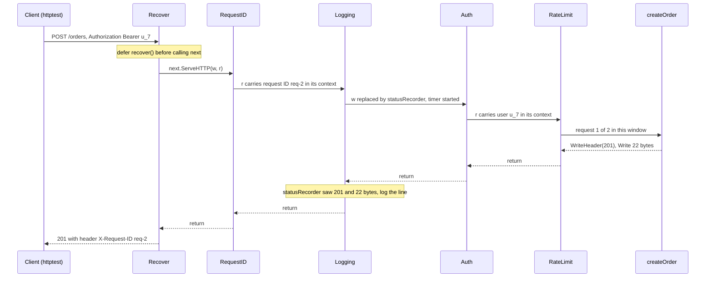
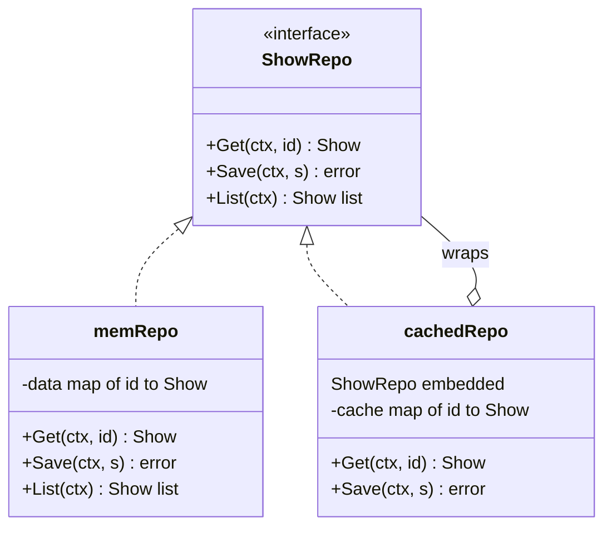

# Decorator and Middleware

> [!summary] TL;DR
> A **decorator** wraps an object and exposes the **same interface**, adding behaviour before or after it passes the call on: logging, auth, retries, caching, compression. In Go, HTTP **middleware** is the best-known decorator: a function of type `func(http.Handler) http.Handler`. The same idea wraps `io.Reader`/`io.Writer` streams, `http.RoundTripper` clients and repositories.

> [!abstract] Core idea
> - A decorator wraps something and exposes the same interface, adding work before or after passing the call on.
> - Go HTTP middleware is `func(http.Handler) http.Handler`, so wrappers stack in any combination.
> - The rule that matters: order is outside-in on the way in and inside-out on the way back, so `Logging(Auth(h))` runs Logging first.
> - Classic mistake: putting business rules in middleware, or logging before the status code is known.

## 1. Why it exists

An order API has 30 handlers. Each one needs panic recovery, a request ID, an access log line with status and latency, an auth check and a rate limit. Written inline, that is 5 concerns × 30 handlers = 150 copies of cross-cutting code, and each copy can drift: one handler forgets the auth check, another logs before the status is known.

Decorators move each concern into one wrapper that has the same interface as what it wraps. A handler stays a handler, so wrappers stack in any combination: `Chain(createOrder, Recover, RequestID, Logging, Auth, RateLimit)`. Adding a concern edits one line of wiring, not 30 handlers.

Three things to get right, all shown below:

- The diagram and the code must describe the same chain, in the same order.
- A logging middleware can only log the status code if a `ResponseWriter` wrapper captures status and bytes.
- An example that calls `http.ListenAndServe` blocks forever and produces nothing to check; running the chain through `httptest` does.

## 2. Mental model

Gift wrapping. The gift (the handler) is wrapped in paper (logging), then a box (auth), then more paper (recover). Each layer has the same outside shape, "a parcel", so you can add or remove layers without the gift knowing. Opening the parcel goes from the outside in; the layers you pass on the way in are passed again on the way out, in reverse order. That return trip is where an outer layer sees what an inner layer did, such as the status code the handler wrote.

## 3. How it works

1. **Same interface in and out.** A decorator accepts an `http.Handler` and returns an `http.Handler`. Go names this shape `type Middleware func(http.Handler) http.Handler`.
2. **Before and after.** Inside, the wrapper runs code, calls `next.ServeHTTP(w, r)`, then runs more code. It may also **not** call `next` (Auth returns 401), which makes that layer a short-circuit.
3. **Chaining order.** `Chain(h, a, b, c)` builds `a(b(c(h)))`, so the first middleware listed is the outermost and runs first on the way in. Writing `Chain` once avoids the error-prone nesting `Logging(Auth(final))`.
4. **Passing data inward.** A layer adds request-scoped values (request ID, user) with `context.WithValue` and passes `r.WithContext(ctx)` inward. Keys are an unexported type (`ctxKey`), so no other package can collide with them.
5. **Seeing results outward.** To see the status code, a layer passes inner layers a **decorated `ResponseWriter`** (`statusRecorder`) that records `WriteHeader` and counts bytes in `Write`.

One successful request through the exact chain in the worked example:



### Why this order

- **Recover outermost**, so a panic in any layer, including other middleware, becomes a 500 instead of a dropped connection (as long as nothing was written before the panic).
- **RequestID next**, so every inner layer can log the same ID.
- **Logging outside Auth and RateLimit**, so rejected requests (401, 429) are logged with their real status.
- **Auth before RateLimit**, because a per-user limit needs the user that Auth puts in the context. (The demo's limit is global for brevity.) An IP-based limit that protects the login endpoint from brute force would go before Auth instead.

### The same pattern outside HTTP

Streams in the standard library are decorators of `io.Reader` and `io.Writer`. The worked example builds this stack:


Order matters here too: with the counter outside gzip, it would count 1,200 plain bytes; inside, it counts the 46 compressed bytes.

A repository decorator uses **struct embedding** to override only some methods:



`cachedRepo` writes `Get` (cache first) and `Save` (write, then invalidate). `List` is promoted from the embedded `ShowRepo` and passes straight through.

### Whiteboard version

Two middlewares wrap one handler; a request without an `Authorization` header is stopped by Auth and never reaches the handler. This is the bare idea you can draw in two minutes; the full version below adds production concerns.

```go
package main

import (
	"fmt"
	"net/http"
	"net/http/httptest"
)

// A middleware takes a handler and returns a handler of the same type.
func Logging(next http.Handler) http.Handler {
	return http.HandlerFunc(func(w http.ResponseWriter, r *http.Request) {
		fmt.Println("->", r.URL.Path) // before
		next.ServeHTTP(w, r)
		fmt.Println("<-", r.URL.Path) // after
	})
}

func Auth(next http.Handler) http.Handler {
	return http.HandlerFunc(func(w http.ResponseWriter, r *http.Request) {
		if r.Header.Get("Authorization") == "" {
			http.Error(w, "unauthorized", http.StatusUnauthorized)
			return // stop: next is never called
		}
		next.ServeHTTP(w, r)
	})
}

func main() {
	hello := http.HandlerFunc(func(w http.ResponseWriter, r *http.Request) { fmt.Fprint(w, "ok") })
	h := Logging(Auth(hello)) // Logging runs first, Auth second
	rec := httptest.NewRecorder()
	h.ServeHTTP(rec, httptest.NewRequest("GET", "/orders", nil))
	fmt.Println(rec.Code) // 401
}
```

## 4. Worked example

One `package main` with `Logging` and `Auth` middleware (Logging captures status and bytes; Auth passes the user in the context), plus `Recover`, `RequestID`, `RateLimit`, a `Chain` helper, an `io.Writer` decorator, two `http.RoundTripper` decorators and an embedded repository decorator. `main` drives the handler chain with `httptest.NewRecorder`, so nothing listens on a port and the program ends. Built with Go 1.24.4; `go vet` is clean and `go test -race` passes.

```go
package main

import (
	"bytes"
	"compress/gzip"
	"context"
	"fmt"
	"io"
	"log/slog"
	"net/http"
	"net/http/httptest"
	"os"
	"runtime/debug"
	"strings"
	"sync"
	"sync/atomic"
	"time"
)

// ---------- HTTP middleware: decorators of http.Handler ----------

type Middleware func(http.Handler) http.Handler

// Chain wraps h so that the FIRST middleware listed is the OUTERMOST.
func Chain(h http.Handler, mws ...Middleware) http.Handler {
	for i := len(mws) - 1; i >= 0; i-- {
		h = mws[i](h)
	}
	return h
}

// statusRecorder decorates http.ResponseWriter to capture status and bytes.
type statusRecorder struct {
	http.ResponseWriter
	status int
	bytes  int
}

func (r *statusRecorder) WriteHeader(code int) {
	if r.status == 0 {
		r.status = code
	}
	r.ResponseWriter.WriteHeader(code)
}

func (r *statusRecorder) Write(b []byte) (int, error) {
	if r.status == 0 {
		r.status = http.StatusOK // Write without WriteHeader means 200
	}
	n, err := r.ResponseWriter.Write(b)
	r.bytes += n
	return n, err
}

// Unwrap lets http.ResponseController reach Flush and Hijack on the real writer.
func (r *statusRecorder) Unwrap() http.ResponseWriter { return r.ResponseWriter }

// Recover turns a panic in any inner layer into a 500.
func Recover(log *slog.Logger) Middleware {
	return func(next http.Handler) http.Handler {
		return http.HandlerFunc(func(w http.ResponseWriter, r *http.Request) {
			rec := &statusRecorder{ResponseWriter: w} // to know whether the response has started
			defer func() {
				if v := recover(); v != nil {
					if v == http.ErrAbortHandler {
						panic(v) // the server's own signal to abort: let it through
					}
					log.Error("panic recovered", "err", v, "path", r.URL.Path, "stack", string(debug.Stack()))
					if rec.status != 0 {
						// Status and part of the body are already sent; a 500 now would be
						// appended to a 200. Abort, so the client sees a broken response.
						panic(http.ErrAbortHandler)
					}
					http.Error(w, "internal error", http.StatusInternalServerError)
				}
			}()
			next.ServeHTTP(rec, r)
		})
	}
}

type ctxKey int

const (
	requestIDKey ctxKey = iota
	userKey
)

func RequestIDFrom(ctx context.Context) string {
	id, _ := ctx.Value(requestIDKey).(string)
	return id
}

// RequestID reuses the caller's X-Request-ID or creates one, and stores it in the context.
func RequestID(next http.Handler) http.Handler {
	var n atomic.Int64
	return http.HandlerFunc(func(w http.ResponseWriter, r *http.Request) {
		id := r.Header.Get("X-Request-ID")
		if id == "" {
			id = fmt.Sprintf("req-%d", n.Add(1))
		}
		w.Header().Set("X-Request-ID", id)
		next.ServeHTTP(w, r.WithContext(context.WithValue(r.Context(), requestIDKey, id)))
	})
}

// Logging logs each request with its status and size.
func Logging(log *slog.Logger) Middleware {
	return func(next http.Handler) http.Handler {
		return http.HandlerFunc(func(w http.ResponseWriter, r *http.Request) {
			start := time.Now()
			rec := &statusRecorder{ResponseWriter: w}
			next.ServeHTTP(rec, r)
			if rec.status == 0 {
				rec.status = http.StatusOK // the handler wrote nothing at all
			}
			log.Info("request", "id", RequestIDFrom(r.Context()), "method", r.Method,
				"path", r.URL.Path, "status", rec.status, "bytes", rec.bytes,
				"duration", time.Since(start))
		})
	}
}

// Auth checks the caller and passes the user on in the context.
func Auth(next http.Handler) http.Handler {
	return http.HandlerFunc(func(w http.ResponseWriter, r *http.Request) {
		token := strings.TrimPrefix(r.Header.Get("Authorization"), "Bearer ")
		if token == "" {
			http.Error(w, "missing token", http.StatusUnauthorized)
			return
		}
		// A real service verifies the token; the demo treats it as the user ID.
		next.ServeHTTP(w, r.WithContext(context.WithValue(r.Context(), userKey, token)))
	})
}

// RateLimit allows n requests per fixed window (the Rate Limiter note has better algorithms).
func RateLimit(n int, window time.Duration, now func() time.Time) Middleware {
	var mu sync.Mutex
	var start time.Time
	var count int
	return func(next http.Handler) http.Handler {
		return http.HandlerFunc(func(w http.ResponseWriter, r *http.Request) {
			mu.Lock()
			if t := now(); t.Sub(start) >= window {
				start, count = t, 0
			}
			count++
			over := count > n
			mu.Unlock()
			if over {
				http.Error(w, "rate limited", http.StatusTooManyRequests)
				return
			}
			next.ServeHTTP(w, r)
		})
	}
}

func createOrder(w http.ResponseWriter, r *http.Request) {
	if r.URL.Query().Get("boom") == "1" {
		panic("nil map in pricing")
	}
	user, _ := r.Context().Value(userKey).(string)
	w.WriteHeader(http.StatusCreated)
	fmt.Fprintf(w, "order created for %s\n", user)
}

// ---------- io.Writer decorators ----------

// countingWriter is a hand-written io.Writer decorator.
type countingWriter struct {
	w io.Writer
	n int64
}

func (c *countingWriter) Write(p []byte) (int, error) {
	n, err := c.w.Write(p)
	c.n += int64(n)
	return n, err
}

// ---------- http.RoundTripper decorators (client side) ----------

type RoundTripperFunc func(*http.Request) (*http.Response, error)

func (f RoundTripperFunc) RoundTrip(r *http.Request) (*http.Response, error) { return f(r) }

func WithAuth(token string, next http.RoundTripper) http.RoundTripper {
	return RoundTripperFunc(func(r *http.Request) (*http.Response, error) {
		r = r.Clone(r.Context()) // a RoundTripper must not modify the caller's request
		r.Header.Set("Authorization", "Bearer "+token)
		return next.RoundTrip(r)
	})
}

// WithRetry retries GET requests that get a 503, up to attempts in total.
func WithRetry(attempts int, next http.RoundTripper) http.RoundTripper {
	return RoundTripperFunc(func(r *http.Request) (*http.Response, error) {
		for i := 1; ; i++ {
			resp, err := next.RoundTrip(r)
			retry := err == nil && resp.StatusCode == http.StatusServiceUnavailable &&
				r.Method == http.MethodGet && i < attempts
			if !retry {
				return resp, err
			}
			io.Copy(io.Discard, resp.Body) // drain so the connection can be reused
			resp.Body.Close()
		}
	})
}

// ---------- Repository decorator through interface embedding ----------

type Show struct{ ID, Title string }

type ShowRepo interface {
	Get(ctx context.Context, id string) (Show, error)
	Save(ctx context.Context, s Show) error
	List(ctx context.Context) ([]Show, error)
}

type memRepo struct {
	mu    sync.Mutex
	data  map[string]Show
	reads int
}

func (m *memRepo) Get(_ context.Context, id string) (Show, error) {
	m.mu.Lock()
	defer m.mu.Unlock()
	m.reads++
	s, ok := m.data[id]
	if !ok {
		return Show{}, fmt.Errorf("show %s not found", id)
	}
	return s, nil
}

func (m *memRepo) Save(_ context.Context, s Show) error {
	m.mu.Lock()
	defer m.mu.Unlock()
	m.data[s.ID] = s
	return nil
}

func (m *memRepo) List(_ context.Context) ([]Show, error) {
	m.mu.Lock()
	defer m.mu.Unlock()
	out := make([]Show, 0, len(m.data))
	for _, s := range m.data {
		out = append(out, s)
	}
	return out, nil
}

// cachedRepo overrides Get and Save; List is promoted from the embedded ShowRepo unchanged.
type cachedRepo struct {
	ShowRepo
	mu    sync.Mutex
	cache map[string]Show
}

func NewCachedRepo(inner ShowRepo) *cachedRepo {
	return &cachedRepo{ShowRepo: inner, cache: map[string]Show{}}
}

func (c *cachedRepo) Get(ctx context.Context, id string) (Show, error) {
	c.mu.Lock()
	s, ok := c.cache[id]
	c.mu.Unlock()
	if ok {
		return s, nil
	}
	s, err := c.ShowRepo.Get(ctx, id)
	if err != nil {
		return Show{}, err
	}
	c.mu.Lock()
	c.cache[id] = s
	c.mu.Unlock()
	return s, nil
}

// Save must be overridden too: a promoted Save would leave a stale cache entry.
func (c *cachedRepo) Save(ctx context.Context, s Show) error {
	if err := c.ShowRepo.Save(ctx, s); err != nil {
		return err
	}
	c.mu.Lock()
	delete(c.cache, s.ID)
	c.mu.Unlock()
	return nil
}

func main() {
	log := slog.New(slog.NewTextHandler(os.Stdout, &slog.HandlerOptions{
		ReplaceAttr: func(_ []string, a slog.Attr) slog.Attr {
			if a.Key == slog.TimeKey || a.Key == "duration" || a.Key == "stack" {
				return slog.Attr{} // drop changing values so the output is stable
			}
			return a
		},
	}))
	h := Chain(http.HandlerFunc(createOrder),
		Recover(log), RequestID, Logging(log), Auth, RateLimit(2, time.Minute, time.Now))

	for _, c := range []struct{ token, query string }{
		{"", ""}, {"u_7", ""}, {"u_7", "?boom=1"}, {"u_7", ""},
	} {
		req := httptest.NewRequest(http.MethodPost, "/orders"+c.query, nil)
		if c.token != "" {
			req.Header.Set("Authorization", "Bearer "+c.token)
		}
		rec := httptest.NewRecorder()
		h.ServeHTTP(rec, req)
		fmt.Printf("-> %d %s", rec.Code, rec.Body.String())
	}

	var compressed bytes.Buffer
	cw := &countingWriter{w: &compressed}
	zw := gzip.NewWriter(cw) // gzip decorates the counting writer
	io.Copy(zw, strings.NewReader(strings.Repeat("seat booked;", 100)))
	zw.Close()
	zr, _ := gzip.NewReader(&compressed)
	head, _ := io.ReadAll(io.LimitReader(zr, 11)) // LimitReader decorates gzip.Reader
	fmt.Printf("io stack: 1200 bytes -> %d gzip bytes, first 11 back: %q\n", cw.n, head)

	var hits atomic.Int32
	srv := httptest.NewServer(http.HandlerFunc(func(w http.ResponseWriter, r *http.Request) {
		if hits.Add(1) == 1 {
			w.WriteHeader(http.StatusServiceUnavailable)
			return
		}
		fmt.Fprint(w, r.Header.Get("Authorization"))
	}))
	defer srv.Close()
	client := &http.Client{Timeout: 2 * time.Second, Transport: WithRetry(3, WithAuth("t0k", http.DefaultTransport))}
	resp, err := client.Get(srv.URL)
	if err != nil {
		fmt.Println("client error:", err)
		return
	}
	body, _ := io.ReadAll(resp.Body)
	resp.Body.Close()
	fmt.Printf("round tripper: %d %q after %d attempts\n", resp.StatusCode, body, hits.Load())

	inner := &memRepo{data: map[string]Show{"s1": {"s1", "Hamlet"}}}
	repo := NewCachedRepo(inner)
	ctx := context.Background()
	repo.Get(ctx, "s1")
	repo.Get(ctx, "s1")
	repo.Save(ctx, Show{"s1", "Hamlet (matinee)"})
	s, _ := repo.Get(ctx, "s1")
	all, _ := repo.List(ctx)
	fmt.Printf("repo: %q, inner reads %d, list %d\n", s.Title, inner.reads, len(all))
}
```

The tests use `httptest.NewRecorder` for middleware (no network) and `httptest.NewServer` for the client-side decorators (a real loopback server):

```go
package main

import (
	"bytes"
	"compress/gzip"
	"context"
	"io"
	"log/slog"
	"net/http"
	"net/http/httptest"
	"strings"
	"sync/atomic"
	"testing"
	"time"
)

func TestChainFirstIsOutermost(t *testing.T) {
	var order []string
	mark := func(name string) Middleware {
		return func(next http.Handler) http.Handler {
			return http.HandlerFunc(func(w http.ResponseWriter, r *http.Request) {
				order = append(order, name)
				next.ServeHTTP(w, r)
			})
		}
	}
	h := Chain(http.HandlerFunc(func(http.ResponseWriter, *http.Request) { order = append(order, "handler") }),
		mark("recover"), mark("logging"), mark("auth"))
	h.ServeHTTP(httptest.NewRecorder(), httptest.NewRequest(http.MethodGet, "/", nil))
	if got := strings.Join(order, " "); got != "recover logging auth handler" {
		t.Fatalf("order = %q", got)
	}
}

func newStack(logs *bytes.Buffer, limit int) http.Handler {
	log := slog.New(slog.NewTextHandler(logs, nil))
	return Chain(http.HandlerFunc(createOrder),
		Recover(log), RequestID, Logging(log), Auth, RateLimit(limit, time.Minute, time.Now))
}

func do(h http.Handler, token, query string) *httptest.ResponseRecorder {
	req := httptest.NewRequest(http.MethodPost, "/orders"+query, nil)
	if token != "" {
		req.Header.Set("Authorization", "Bearer "+token)
	}
	rec := httptest.NewRecorder()
	h.ServeHTTP(rec, req)
	return rec
}

func TestStackWithHTTPTest(t *testing.T) {
	var logs bytes.Buffer
	h := newStack(&logs, 2)
	if rec := do(h, "", ""); rec.Code != http.StatusUnauthorized {
		t.Fatalf("no token: %d", rec.Code)
	}
	if !strings.Contains(logs.String(), "status=401") {
		t.Fatalf("logging must see the 401 written by Auth: %s", logs.String())
	}
	rec := do(h, "u1", "")
	if rec.Code != http.StatusCreated || rec.Body.String() != "order created for u1\n" {
		t.Fatalf("got %d %q", rec.Code, rec.Body.String())
	}
	if !strings.Contains(logs.String(), "status=201 bytes=21") {
		t.Fatalf("status and bytes not captured: %s", logs.String())
	}
	if rec := do(h, "u1", "?boom=1"); rec.Code != http.StatusInternalServerError {
		t.Fatalf("panic: %d", rec.Code)
	}
	if rec := do(h, "u1", ""); rec.Code != http.StatusTooManyRequests {
		t.Fatalf("third authorized request: %d, want 429", rec.Code)
	}
}

func TestRecoverAfterPartialWrite(t *testing.T) {
	h := Recover(slog.New(slog.DiscardHandler))(http.HandlerFunc(func(w http.ResponseWriter, _ *http.Request) {
		io.WriteString(w, "partial")
		panic("late failure")
	}))
	defer func() {
		if v := recover(); v != http.ErrAbortHandler {
			t.Fatalf("recovered %v, want http.ErrAbortHandler so the server aborts the response", v)
		}
	}()
	h.ServeHTTP(httptest.NewRecorder(), httptest.NewRequest(http.MethodGet, "/", nil))
}

func TestRequestIDReusedAndInContext(t *testing.T) {
	var seen string
	h := RequestID(http.HandlerFunc(func(_ http.ResponseWriter, r *http.Request) {
		seen = RequestIDFrom(r.Context())
	}))
	req := httptest.NewRequest(http.MethodGet, "/", nil)
	req.Header.Set("X-Request-ID", "abc")
	rec := httptest.NewRecorder()
	h.ServeHTTP(rec, req)
	if seen != "abc" || rec.Header().Get("X-Request-ID") != "abc" {
		t.Fatalf("seen=%q header=%q", seen, rec.Header().Get("X-Request-ID"))
	}
}

func TestWrapperHidesFlusher(t *testing.T) {
	inner := httptest.NewRecorder() // implements http.Flusher
	var w http.ResponseWriter = &statusRecorder{ResponseWriter: inner}
	if _, ok := w.(http.Flusher); ok {
		t.Fatal("expected the wrapper to hide Flush from a type assertion")
	}
	if err := http.NewResponseController(w).Flush(); err != nil || !inner.Flushed {
		t.Fatalf("ResponseController should reach Flush through Unwrap: err=%v", err)
	}
}

func TestRoundTripperDecorators(t *testing.T) {
	var hits atomic.Int32
	srv := httptest.NewServer(http.HandlerFunc(func(w http.ResponseWriter, r *http.Request) {
		if hits.Add(1) < 3 {
			w.WriteHeader(http.StatusServiceUnavailable)
			return
		}
		io.WriteString(w, r.Header.Get("Authorization"))
	}))
	defer srv.Close()
	client := &http.Client{Transport: WithRetry(3, WithAuth("k", http.DefaultTransport))}
	req, _ := http.NewRequest(http.MethodGet, srv.URL, nil)
	resp, err := client.Do(req)
	if err != nil {
		t.Fatal(err)
	}
	defer resp.Body.Close()
	body, _ := io.ReadAll(resp.Body)
	if resp.StatusCode != 200 || string(body) != "Bearer k" || hits.Load() != 3 {
		t.Fatalf("status=%d body=%q hits=%d", resp.StatusCode, body, hits.Load())
	}
	if req.Header.Get("Authorization") != "" {
		t.Fatal("WithAuth modified the caller's request")
	}
}

func TestCachedRepo(t *testing.T) {
	ctx := context.Background()
	inner := &memRepo{data: map[string]Show{"s1": {"s1", "Hamlet"}}}
	repo := NewCachedRepo(inner)
	repo.Get(ctx, "s1")
	repo.Get(ctx, "s1")
	if inner.reads != 1 {
		t.Fatalf("inner reads = %d, want 1 (second Get served from cache)", inner.reads)
	}
	if err := repo.Save(ctx, Show{"s1", "Macbeth"}); err != nil {
		t.Fatal(err)
	}
	if s, _ := repo.Get(ctx, "s1"); s.Title != "Macbeth" {
		t.Fatalf("stale cache: %q", s.Title)
	}
	if all, _ := repo.List(ctx); len(all) != 1 {
		t.Fatal("promoted List must pass through")
	}
}

func TestWriterStack(t *testing.T) {
	var buf bytes.Buffer
	cw := &countingWriter{w: &buf}
	zw := gzip.NewWriter(cw)
	if _, err := io.WriteString(zw, strings.Repeat("a", 1000)); err != nil {
		t.Fatal(err)
	}
	if err := zw.Close(); err != nil {
		t.Fatal(err)
	}
	if cw.n != int64(buf.Len()) || cw.n >= 1000 {
		t.Fatalf("counted %d, buffer %d", cw.n, buf.Len())
	}
	zr, err := gzip.NewReader(&buf)
	if err != nil {
		t.Fatal(err)
	}
	got, _ := io.ReadAll(zr)
	if len(got) != 1000 {
		t.Fatalf("round trip lost data: %d bytes", len(got))
	}
}
```

Output of `go run .` (measured, Go 1.24.4, darwin/arm64; the time, duration and stack fields are dropped by `ReplaceAttr` so the output is stable):

```text
level=INFO msg=request id=req-1 method=POST path=/orders status=401 bytes=14
-> 401 missing token
level=INFO msg=request id=req-2 method=POST path=/orders status=201 bytes=22
-> 201 order created for u_7
level=ERROR msg="panic recovered" err="nil map in pricing" path=/orders
-> 500 internal error
level=INFO msg=request id=req-4 method=POST path=/orders status=429 bytes=13
-> 429 rate limited
io stack: 1200 bytes -> 46 gzip bytes, first 11 back: "seat booked"
round tripper: 200 "Bearer t0k" after 2 attempts
repo: "Hamlet (matinee)", inner reads 2, list 1
```

What to notice:

- **401 is logged with `status=401`**: Logging wraps Auth, so it sees Auth's rejection on the way out.
- **There is no `req-3` access log line.** The panic unwound through Logging before it could log, and Recover logged `panic recovered` instead. Section 8 shows how to get one line for every request.
- **Recover sends the 500 only because nothing was written yet.** It logs the stack (`debug.Stack()`, hidden in this output) and, if the handler had already started the response, panics with `http.ErrAbortHandler` instead, so the client sees a broken response rather than `internal error` appended to a 200 body (`TestRecoverAfterPartialWrite`). [[Middleware]] has the full production version.
- **The fourth request gets 429**: only authenticated requests reach RateLimit, and the panicking request counted as the second one.
- **The round tripper** added the token and retried one 503, so the server saw 2 attempts; the caller's own request was not modified (the test checks this).
- **The repository** read the inner store twice: once to fill the cache, once after `Save` invalidated it. The second `Get` was a cache hit.

## 5. Variants and comparison

**Where decorators appear in Go:**

| Variant | Interface wrapped | Typical layers | Watch out for |
| --- | --- | --- | --- |
| HTTP middleware | `http.Handler` | recover, request ID, logging, auth, rate limit, CORS, gzip | Order; hidden `Flusher`/`Hijacker` on wrapped writers |
| `ResponseWriter` wrapper | `http.ResponseWriter` | status and byte capture, compression | Must forward `Unwrap`; first `WriteHeader` wins |
| Stream decorators | `io.Reader`, `io.Writer` | `bufio`, `gzip`, `io.LimitReader`, `io.TeeReader`, `io.MultiWriter`, hashing | Flush and close the outer layer first (`gzip.Writer.Close` writes the footer) |
| Client decorators | `http.RoundTripper` | auth headers, retries, tracing, metrics | Never mutate the caller's request; drain bodies before retrying |
| Repository decorators | Your own interface | cache, metrics, tracing, retries | Promoted methods bypass the decorator |
| Strategy decorators | A strategy interface | surcharges around base pricing | Order changes the result (see [[Strategy and Template Method]]) |

**Decorator versus its look-alikes:**

| Pattern | Same interface as the wrapped object? | Purpose | Go example |
| --- | --- | --- | --- |
| Decorator | Yes | Add behaviour; layers stack freely | `Logging(next)`, `bufio.NewReader(r)` |
| Proxy | Yes | Control access to one object: lazy creation, remote access, permissions | `httputil.ReverseProxy`, a lazy-loading client |
| Adapter | No: it converts to an interface you own | Make an incompatible API fit | `RazorpayAdapter`, `http.HandlerFunc` |
| Chain of Responsibility | Yes | Each link may handle the request and stop the chain | Auth returning 401 without calling `next` |

Pure decorators always call `next`. Middleware that may stop the chain (Auth, RateLimit) is also a chain of responsibility; see [[Chain of Responsibility and Pipelines]], [[Proxy]] and [[Adapter]].

## 6. Trade-offs and when not to use

- **No business logic in middleware**. "Orders over ₹10,000 need a second approval" belongs in the order service, where it is visible and tested with the order logic. Middleware is for cross-cutting concerns that apply to many endpoints in the same way.
- **One concern used by one handler** does not need middleware: call a function inside that handler.
- **Deep stacks hide control flow.** Ten layers make "why did this request get a 403?" a debugging session. Keep the chain in one place (`Chain(...)` in `main` or the router setup) and log which layer rejected a request.
- **Each layer costs a function call, and sometimes an allocation** (a wrapped writer, a derived context). That is small next to network I/O, but a context value lookup walks the chain of parent contexts, so do not stack dozens of `WithValue` layers.
- **Decorators that need more than the interface** (a cache that must invalidate on writes) must override every method that matters. Forgetting one, such as `Save`, produces stale data that tests rarely catch.

## 7. In production

**Real systems:**

- `net/http` itself: `http.StripPrefix`, `http.TimeoutHandler` and `http.MaxBytesHandler` are standard-library middleware.
- Routers such as chi apply middleware with `r.Use(...)`; chi's docs ask for its `Logger` to come before its `Recoverer`, the opposite trade-off from this note's order (see section 8).
- OpenTelemetry: `otelhttp.NewHandler` decorates a server handler, and `otelhttp.NewTransport` decorates a client `RoundTripper`, to create spans and propagate trace context.
- Streams: `gzip.NewWriter(w)`, `bufio.NewWriter(w)`, `io.TeeReader(r, hash)` to hash a body while reading it, `io.LimitReader` to cap input size.

**Where it shows up in LLD problems:**

- [[Rate Limiter]]: the limiter as HTTP middleware; the algorithms and the distributed design live in [[Rate Limiting - Algorithms and Distributed Design]].
- [[Logging Library]]: handlers that wrap other handlers (add fields, filter levels).
- [[LRU Cache with TTL]]: the cache placed in front of a repository as a decorator.
- [[Circuit Breaker]]: a breaker wrapped around a client, often as a `RoundTripper`.
- [[Notification Service]]: retry and metrics decorators around each `Sender`.

**Failure modes and fixes:**

- Wrong order: logging inside auth never logs 401s; recover inside logging misses panics in logging. Fix: define the chain once with `Chain`, and test the order (`TestChainFirstIsOutermost`).
- The status wrapper breaks streaming or WebSockets, because inner code type-asserts `w.(http.Flusher)` or `w.(http.Hijacker)` and the wrapper does not have those methods. Fix: implement `Unwrap` and have handlers use `http.NewResponseController(w).Flush()` (Go 1.20+), or forward `Flush`/`Hijack` explicitly in the wrapper.
- A RoundTripper sets headers on the caller's request, which races when the request is reused. Fix: `r.Clone(r.Context())` before changing it; the `http.RoundTripper` contract forbids modifying the request.
- Retrying requests with bodies resends an empty body. Fix: retry only idempotent requests without bodies, or requests whose `GetBody` is set.
- A panic in a goroutine started by a handler crashes the whole process; no middleware can recover it. Fix: recover inside that goroutine.

**What to monitor:** request count, latency histogram and status class per route, all emitted by one metrics middleware; the count of recovered panics; 401 and 429 rates (a spike means a broken client or an attack); and for client decorators, retries per request.

## 8. Deep dive

**Capturing the status correctly.** A handler can call `WriteHeader(code)` explicitly, call `Write` without `WriteHeader` (an implicit 200), or write nothing at all (also 200). `statusRecorder` handles all three: it records only the first `WriteHeader`, sets 200 on the first `Write` if no status was set, and `Logging` treats 0 as 200. A second `WriteHeader` call has no effect on the response; `net/http` logs `http: superfluous response.WriteHeader call`.

**What a `ResponseWriter` wrapper hides.** Embedding the `http.ResponseWriter` interface promotes only `Header`, `Write` and `WriteHeader`. The concrete HTTP/1.x writer underneath also implements `http.Flusher`, `http.Hijacker` and `io.ReaderFrom` (used by `io.Copy` to send files efficiently), but none of those survive the wrapper. `TestWrapperHidesFlusher` shows both sides: the type assertion fails, while `http.NewResponseController(w).Flush()` succeeds because it follows `Unwrap`. Code that still type-asserts directly will break; libraries such as `httpsnoop` generate wrappers that keep every optional interface.

**One access log line per request, panics included.** With Recover outermost, a panicking request skips Logging's log line, as the output shows for `req-3`. Two fixes:

- Put Logging outside Recover (chi's recommended order). Recover then writes the 500 inside Logging's wrapper, and Logging logs it like any other response; a panic inside Logging itself is then not recovered.
- Keep Recover outermost and log in a `defer` inside Logging that calls `recover()`, logs status 500, and panics again for Recover. This keeps one line per request but re-panicking loses the original stack trace unless Logging captures it first.

Both are valid; choose one and test it.

**What `net/http` already does with panics.** If a handler panics, the server recovers it, logs a stack trace to its error log, and closes the connection (or resets the HTTP/2 stream). The process survives, but the client gets no response. Recover middleware turns that into a proper 500 with a request ID. A handler that wants to abort a response silently panics with `http.ErrAbortHandler`; the server does not log a stack trace for it, which is why `Recover` re-panics that value instead of swallowing it.

**Context values: what belongs there.** Request-scoped data that crosses API boundaries: request ID, authenticated user, trace span. Not optional parameters, and not dependencies such as a database handle, which hide what a function needs. Use an unexported key type (`type ctxKey int`) and a typed accessor (`RequestIDFrom`), so callers never touch raw keys. [[Context Package]] covers cancellation and values in depth.

**Partial decorators through embedding.** `type cachedRepo struct{ ShowRepo }` satisfies the whole interface while you write only the methods you change. That convenience is also the trap: every method you do not write is promoted and bypasses your decorator. Here `List` passing through is intended, but a promoted `Save` would leave stale cache entries. Even with `Save` overridden, a `Get` that read the old row just before a concurrent `Save` can store it in the cache after the invalidation; production caches add a TTL or a version check (see [[Proxy]]). A second trap: a zero `cachedRepo{}` has a nil embedded interface, so calling a promoted method panics. Always build decorators through a constructor (`NewCachedRepo`).

**Decorator versus Proxy in practice.** The code shape is identical: a struct holding the same interface it implements. The difference is intent and lifecycle. A decorator is chosen by the caller and stacked with others; a proxy usually stands in for one specific object and controls access to it, for example creating it lazily or forwarding to a remote copy. Some layers are both: a caching repository is a decorator by construction and a proxy by intent.

## 9. Interview questions

> [!question]- What makes something a decorator rather than just a wrapper?
> It implements the same interface as the object it wraps and adds behaviour while delegating the core work. Because the interface is the same, decorators stack in any order and callers cannot tell a decorated object from a plain one. A wrapper that changes the interface is an adapter.

> [!question]- In `Chain(h, Recover, RequestID, Logging, Auth, RateLimit)`, which runs first, and why does that order make sense?
> Recover runs first on the way in and last on the way out, so it catches panics from every inner layer. RequestID comes next so everything logs the same ID; Logging wraps Auth and RateLimit so their 401 and 429 responses are logged; Auth precedes a per-user RateLimit because the limit needs the user.

> [!question]- How does logging middleware learn the response status code?
> It passes the inner handlers a decorated `http.ResponseWriter` that records the first `WriteHeader` call, treats a `Write` without `WriteHeader` as 200, and counts bytes. After `next.ServeHTTP` returns, the middleware reads the recorded values.

> [!question]- Trap: after adding a status-capturing middleware, server-sent events stop streaming and WebSocket upgrades fail. Why?
> The wrapper embeds only the `http.ResponseWriter` interface, so the inner handler's `w.(http.Flusher)` and `w.(http.Hijacker)` assertions fail. Add `Unwrap()` and use `http.NewResponseController` in handlers (Go 1.20+), or forward `Flush` and `Hijack` explicitly in the wrapper.

> [!question]- How do you test middleware without starting a server?
> Build the chain around a small handler and call `ServeHTTP` with `httptest.NewRequest` and `httptest.NewRecorder`, then assert on the recorder's status, headers and body, and on a logger writing into a buffer. Use `httptest.NewServer` only for client-side code such as `RoundTripper` decorators.

> [!question]- What rules must an `http.RoundTripper` decorator follow?
> Do not modify the caller's request (clone it first), drain and close response bodies before retrying, retry only requests that are safe to resend (idempotent, no body or a `GetBody`), and respect the request's context. Tracing and auth decorators are common examples.

> [!question]- How do you decorate one method of a three-method repository interface?
> Embed the interface in a struct and write only the methods you change; the rest are promoted. Check every promoted method: a caching decorator must also override writes to invalidate the cache, or reads go stale. Build it through a constructor so the embedded interface is never nil.

## 10. Cheat sheet

- Decorator = same interface + added behaviour; layers stack because the interface does not change.
- HTTP middleware: `type Middleware func(http.Handler) http.Handler`; `Chain(h, a, b, c)` makes `a` outermost.
- Order: recover → request ID → logging → auth → rate limit → handler.
- Capture status and bytes with a `ResponseWriter` wrapper; add `Unwrap` and use `http.ResponseController` for `Flush` and `Hijack`.
- Request-scoped values go in the context with unexported key types; dependencies do not.
- Streams: `gzip`, `bufio`, `io.LimitReader`, `io.TeeReader` are decorators; the order of layers changes what each sees.
- RoundTripper decorators: clone the request, drain bodies, retry only safe requests.
- Embedded partial decorators: promoted methods bypass you; test with `httptest`, never `ListenAndServe`.

## Links

- **Before this:** [[Interfaces]], [[Context Package]], [[Adapter]]
- **Next:** [[Proxy]]
- **Compare with:** [[Middleware]], [[Chain of Responsibility and Pipelines]], [[Proxy]], [[Rate Limiting - Algorithms and Distributed Design]]
