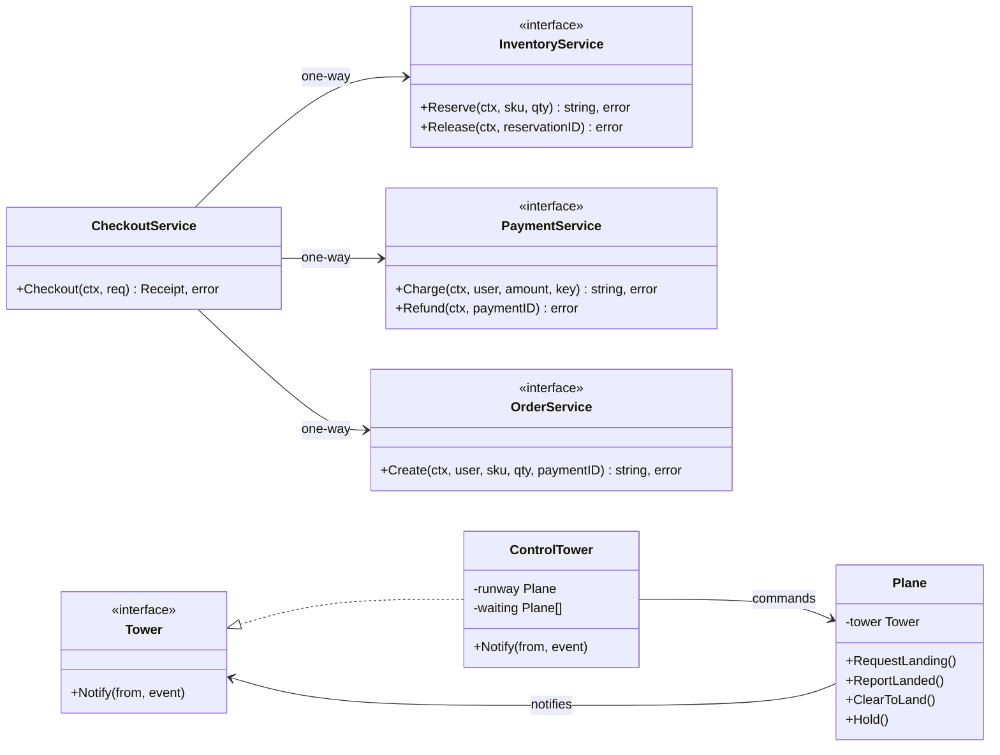
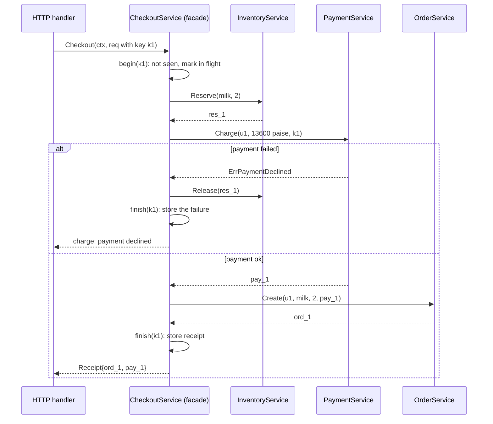
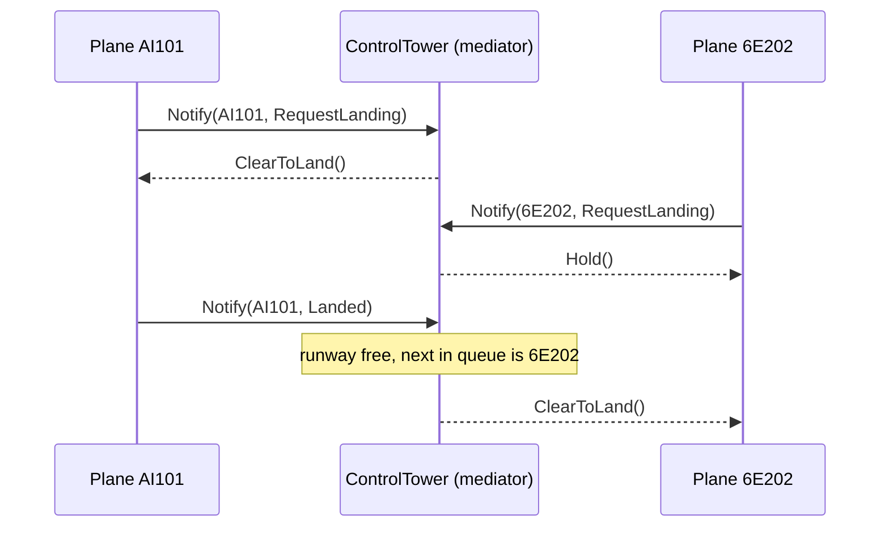

# Facade (vs Mediator)

> [!summary] TL;DR
> A **Facade** gives callers one simple method, such as `Checkout`, over several lower-level services and calls them in the right order. A **Mediator** is different: several peer objects (*colleagues*) send events to one coordinator, and the coordinator decides which other colleague to call. A facade talks one way, down to its parts; a mediator talks both ways, between its colleagues. If it only simplifies a public API, call it Facade.

> [!abstract] Core idea
> - A **Facade** is one simple method (`Checkout`) over several services, calling them in the right order and undoing earlier steps if a later one fails.
> - A **Mediator** is a coordinator that peer objects report to; it decides which other peer to call.
> - The rule that matters: a facade talks one way (down to its parts); a mediator talks both ways (between its colleagues).
> - Classic mistake: forgetting compensation, so a declined payment leaves stock reserved forever.

## 1. Why it exists

**Facade.** Placing an order touches three services: reserve 2 units of milk in inventory, charge ₹136 through payments, create the order. If the HTTP handler, the mobile BFF and the admin tool each make those three calls themselves, each one must also get the order right and undo the earlier steps when a later one fails. One of them will forget: the payment is declined, the 2 reserved units are never released, and the product shows "out of stock" while 2 units sit in a dead reservation. A facade puts the sequence and its undo logic in one place, so every caller makes one call.

**Mediator.** Thirty planes approach one runway. If each plane talks to every other plane to agree who lands next, that is 30 × 29 = 870 one-way links, and the landing rule is copied into every plane. With a control tower, each plane talks only to the tower (30 links) and the rule lives in one object. The mediator turns many-to-many coupling into many-to-one.

## 2. Mental model

- **Facade = a hotel concierge.** You say "book me dinner and a taxi at 8". The concierge calls the restaurant and the taxi firm; they never call you or the concierge back with their own requests. You could still call the restaurant yourself; the concierge is a convenience, not a wall.
- **Mediator = an air-traffic control tower.** Pilots never talk to each other. Each one reports to the tower ("requesting landing", "landed"), and the tower tells the others what to do ("hold", "cleared to land"). The pilots know the tower; the tower knows all the pilots.

## 3. How it works



**Facade steps (`CheckoutService.Checkout`):**

1. Check the idempotency key (a client-chosen ID that makes a retried request return the first result instead of running again; see [[Idempotency and Idempotency Keys]]). A finished key returns the stored outcome (the receipt, or the error of the first attempt); a key still running returns `ErrInProgress`.
2. `Reserve` stock. On failure, nothing needs undoing.
3. `Charge` the payment, passing the idempotency key down so a retried charge is not taken twice. On failure, `Release` the reservation.
4. `Create` the order. On failure, `Refund` the payment and `Release` the reservation.
5. Store the outcome under the key, failures included, and return it.

Compensations run under `context.WithoutCancel(ctx)` with their own 2-second timeout, created at the moment the undo starts. A step may have failed precisely because the caller's context was cancelled or timed out, and that context would make the `Release` fail too.



**Mediator steps (`ControlTower.Notify`):** a colleague calls `Notify(self, event)`. Under its lock, the tower updates its state (who holds the runway, who waits) and decides which colleague to call. It makes that call **after unlocking**, so a colleague that reacts by notifying the tower again cannot deadlock it.



### Whiteboard version

Reserve, charge, and release the reservation when the charge fails. This is the bare idea you can draw in two minutes; the full version below adds production concerns.

```go
package main

import (
	"errors"
	"fmt"
)

type Inventory struct{}

func (Inventory) Reserve(sku string, n int) error { return nil }
func (Inventory) Release(sku string, n int)       { fmt.Println("released", n, sku) }

type Payments struct{}

func (Payments) Charge(paise int64) error { return errors.New("card declined") }

// Facade: one method that calls the parts in order and undoes on failure.
type Checkout struct {
	inv Inventory
	pay Payments
}

func (c Checkout) PlaceOrder(sku string, n int, paise int64) error {
	if err := c.inv.Reserve(sku, n); err != nil {
		return err
	}
	if err := c.pay.Charge(paise); err != nil {
		c.inv.Release(sku, n) // compensate the earlier step
		return fmt.Errorf("checkout: %w", err)
	}
	return nil
}

func main() {
	fmt.Println(Checkout{}.PlaceOrder("milk", 2, 13600))
}
```

## 4. Worked example

One `package main` with both patterns and distinct code: the checkout facade with compensation, idempotency and in-memory fakes, and the control-tower mediator. It compiles with Go 1.24 and passes `go vet` and `go test -race`, with no dependencies outside the standard library.

```go
// Command checkout contrasts two patterns. CheckoutService is a Facade:
// one call over inventory, payment and orders, with compensation.
// ControlTower is a Mediator: planes notify it, and it decides which
// plane may use the runway and tells the others to hold.
package main

import (
	"context"
	"errors"
	"fmt"
	"slices"
	"sync"
	"time"
)

// ---- Facade: the subsystem interfaces it hides ----

type InventoryService interface {
	Reserve(ctx context.Context, sku string, qty int) (reservationID string, err error)
	Release(ctx context.Context, reservationID string) error
}

type PaymentService interface {
	// Charge is idempotent per key: a retry returns the first payment.
	Charge(ctx context.Context, userID string, amountPaise int64, key string) (paymentID string, err error)
	Refund(ctx context.Context, paymentID string) error
}

type OrderService interface {
	Create(ctx context.Context, userID, sku string, qty int, paymentID string) (orderID string, err error)
}

var (
	ErrOutOfStock      = errors.New("out of stock")
	ErrPaymentDeclined = errors.New("payment declined")
	ErrInProgress      = errors.New("checkout with this idempotency key is in progress")
)

type CheckoutRequest struct {
	IdempotencyKey string
	UserID         string
	SKU            string
	Qty            int
	AmountPaise    int64
}

type Receipt struct {
	OrderID   string
	PaymentID string
}

// CheckoutService is the facade: callers make one call instead of
// driving three services in the right order and undoing failures.
type CheckoutService struct {
	inventory InventoryService
	payment   PaymentService
	orders    OrderService

	mu       sync.Mutex
	done     map[string]outcome // idempotency key -> first outcome; a table in production
	inflight map[string]bool
}

type outcome struct {
	r   Receipt
	err error
}

func NewCheckoutService(i InventoryService, p PaymentService, o OrderService) *CheckoutService {
	return &CheckoutService{
		inventory: i, payment: p, orders: o,
		done: make(map[string]outcome), inflight: make(map[string]bool),
	}
}

func (s *CheckoutService) Checkout(ctx context.Context, req CheckoutRequest) (Receipt, error) {
	if r, ok, err := s.begin(req.IdempotencyKey); ok || err != nil {
		return r, err // a retry gets the first outcome, or ErrInProgress
	}
	r, err := s.checkout(ctx, req)
	s.finish(req.IdempotencyKey, r, err)
	return r, err
}

func (s *CheckoutService) checkout(ctx context.Context, req CheckoutRequest) (Receipt, error) {
	resID, err := s.inventory.Reserve(ctx, req.SKU, req.Qty)
	if err != nil {
		return Receipt{}, fmt.Errorf("reserve: %w", err)
	}
	payID, err := s.payment.Charge(ctx, req.UserID, req.AmountPaise, req.IdempotencyKey)
	if err != nil {
		uctx, cancel := undoContext(ctx)
		defer cancel()
		return Receipt{}, errors.Join(fmt.Errorf("charge: %w", err),
			s.inventory.Release(uctx, resID))
	}
	orderID, err := s.orders.Create(ctx, req.UserID, req.SKU, req.Qty, payID)
	if err != nil {
		uctx, cancel := undoContext(ctx)
		defer cancel() // undo in reverse order: refund, then release
		return Receipt{}, errors.Join(fmt.Errorf("create order: %w", err),
			s.payment.Refund(uctx, payID), s.inventory.Release(uctx, resID))
	}
	return Receipt{OrderID: orderID, PaymentID: payID}, nil
}

// undoContext gives compensations their own budget. It is created when the
// undo starts, so slow forward steps cannot use it up, and it ignores the
// caller's cancellation, so the undo still runs after the client gives up.
func undoContext(ctx context.Context) (context.Context, context.CancelFunc) {
	return context.WithTimeout(context.WithoutCancel(ctx), 2*time.Second)
}

// begin returns the stored outcome for a retried key, or marks the key in flight.
func (s *CheckoutService) begin(key string) (Receipt, bool, error) {
	s.mu.Lock()
	defer s.mu.Unlock()
	if o, ok := s.done[key]; ok {
		return o.r, true, o.err
	}
	if s.inflight[key] {
		return Receipt{}, false, ErrInProgress
	}
	s.inflight[key] = true
	return Receipt{}, false, nil
}

func (s *CheckoutService) finish(key string, r Receipt, err error) {
	s.mu.Lock()
	defer s.mu.Unlock()
	delete(s.inflight, key)
	// Failures are stored too. After a refund the payment key is spent: the
	// provider would replay the refunded payment for it, so a retry with the
	// same key must get the same failure. A new attempt needs a new key.
	s.done[key] = outcome{r: r, err: err}
}

// ---- in-memory fakes, used by main and by the tests ----

type hold struct {
	sku string
	qty int
}

type fakeInventory struct {
	mu    sync.Mutex
	stock map[string]int
	holds map[string]hold
	next  int
}

func newFakeInventory(stock map[string]int) *fakeInventory {
	return &fakeInventory{stock: stock, holds: make(map[string]hold)}
}

func (f *fakeInventory) Reserve(_ context.Context, sku string, qty int) (string, error) {
	f.mu.Lock()
	defer f.mu.Unlock()
	if f.stock[sku] < qty {
		return "", ErrOutOfStock
	}
	f.stock[sku] -= qty
	f.next++
	id := fmt.Sprintf("res_%d", f.next)
	f.holds[id] = hold{sku: sku, qty: qty}
	return id, nil
}

func (f *fakeInventory) Release(_ context.Context, id string) error {
	f.mu.Lock()
	defer f.mu.Unlock()
	if h, ok := f.holds[id]; ok { // releasing twice is a no-op
		delete(f.holds, id)
		f.stock[h.sku] += h.qty
	}
	return nil
}

func (f *fakeInventory) Stock(sku string) int {
	f.mu.Lock()
	defer f.mu.Unlock()
	return f.stock[sku]
}

type fakePayment struct {
	mu       sync.Mutex
	limit    int64             // charges above this are declined
	byKey    map[string]string // idempotency key -> payment id
	refunded map[string]bool
}

func newFakePayment(limitPaise int64) *fakePayment {
	return &fakePayment{limit: limitPaise, byKey: make(map[string]string), refunded: make(map[string]bool)}
}

func (f *fakePayment) Charge(_ context.Context, _ string, amount int64, key string) (string, error) {
	f.mu.Lock()
	defer f.mu.Unlock()
	if id, ok := f.byKey[key]; ok {
		return id, nil
	}
	if amount > f.limit {
		return "", ErrPaymentDeclined
	}
	id := fmt.Sprintf("pay_%d", len(f.byKey)+1)
	f.byKey[key] = id
	return id, nil
}

func (f *fakePayment) Refund(_ context.Context, id string) error {
	f.mu.Lock()
	defer f.mu.Unlock()
	f.refunded[id] = true
	return nil
}

type fakeOrders struct {
	mu   sync.Mutex
	fail error // when set, Create returns it
	n    int
}

func (f *fakeOrders) Create(context.Context, string, string, int, string) (string, error) {
	f.mu.Lock()
	defer f.mu.Unlock()
	if f.fail != nil {
		return "", f.fail
	}
	f.n++
	return fmt.Sprintf("ord_%d", f.n), nil
}

// ---- Mediator: colleagues talk only to the tower ----

type Event int

const (
	RequestLanding Event = iota
	Landed
)

// Tower is the mediator interface; colleagues know only this.
type Tower interface {
	Notify(from *Plane, e Event)
}

// Plane is a colleague: it holds the mediator, never another plane.
type Plane struct {
	ID    string
	tower Tower
	radio *Log
}

func (p *Plane) RequestLanding() { p.tower.Notify(p, RequestLanding) }
func (p *Plane) ReportLanded()   { p.tower.Notify(p, Landed) }

// ClearToLand and Hold are called by the tower, never by other planes.
func (p *Plane) ClearToLand() { p.radio.Add(p.ID + " cleared to land") }
func (p *Plane) Hold()        { p.radio.Add(p.ID + " holding") }

// ControlTower is the concrete mediator. The runway rule lives here,
// not in the planes: one plane on the runway, the rest wait in order.
type ControlTower struct {
	mu      sync.Mutex
	runway  *Plane // nil when free
	waiting []*Plane
}

func (t *ControlTower) Notify(from *Plane, e Event) {
	t.mu.Lock()
	var tell func() // runs after Unlock, so a colleague may call Notify again
	switch e {
	case RequestLanding:
		if t.runway == nil {
			t.runway, tell = from, from.ClearToLand
		} else {
			t.waiting, tell = append(t.waiting, from), from.Hold
		}
	case Landed:
		if t.runway == from {
			t.runway = nil
			if len(t.waiting) > 0 {
				t.runway, t.waiting = t.waiting[0], t.waiting[1:]
				tell = t.runway.ClearToLand
			}
		}
	}
	t.mu.Unlock()
	if tell != nil {
		tell()
	}
}

func (t *ControlTower) OnRunway() *Plane {
	t.mu.Lock()
	defer t.mu.Unlock()
	return t.runway
}

// Log collects radio messages; safe for concurrent use.
type Log struct {
	mu    sync.Mutex
	lines []string
}

func (l *Log) Add(s string) {
	l.mu.Lock()
	defer l.mu.Unlock()
	l.lines = append(l.lines, s)
}

func (l *Log) Lines() []string {
	l.mu.Lock()
	defer l.mu.Unlock()
	return slices.Clone(l.lines)
}

func main() {
	ctx := context.Background()
	inv := newFakeInventory(map[string]int{"milk": 10})
	shop := NewCheckoutService(inv, newFakePayment(50_000), &fakeOrders{})

	req := CheckoutRequest{IdempotencyKey: "k1", UserID: "u1", SKU: "milk", Qty: 2, AmountPaise: 13_600}
	r, err := shop.Checkout(ctx, req)
	fmt.Println("checkout:", r.OrderID, r.PaymentID, err)
	r, err = shop.Checkout(ctx, req) // the client retries after a timeout
	fmt.Println("retry:   ", r.OrderID, r.PaymentID, err)
	big := CheckoutRequest{IdempotencyKey: "k2", UserID: "u1", SKU: "milk", Qty: 3, AmountPaise: 99_000}
	_, err = shop.Checkout(ctx, big)
	fmt.Println("declined:", err, "| stock left:", inv.Stock("milk"))

	radio := &Log{}
	tower := &ControlTower{}
	a := &Plane{ID: "AI101", tower: tower, radio: radio}
	b := &Plane{ID: "6E202", tower: tower, radio: radio}
	a.RequestLanding()
	b.RequestLanding()
	a.ReportLanded()
	for _, line := range radio.Lines() {
		fmt.Println("tower:", line)
	}
}
```

Output of `go run .` (Go 1.24.4):

```text
checkout: ord_1 pay_1 <nil>
retry:    ord_1 pay_1 <nil>
declined: charge: payment declined | stock left: 8
tower: AI101 cleared to land
tower: 6E202 holding
tower: 6E202 cleared to land
```

The retry with key `k1` returns the first receipt without a second charge. The declined checkout reserved 3 units and released them, so stock is 8 (10 minus the 2 that were sold), not 5.

The tests drive the facade through fakes: one table covers every failure branch and checks the compensation, and three more check retries, a retry after a refund, and concurrent duplicates. The mediator tests check that 30 concurrent landing requests leave exactly one plane cleared:

```go
package main

import (
	"context"
	"errors"
	"strings"
	"sync"
	"testing"
)

func newShop(limitPaise int64, orderErr error) (*CheckoutService, *fakeInventory, *fakePayment) {
	inv := newFakeInventory(map[string]int{"milk": 10})
	pay := newFakePayment(limitPaise)
	return NewCheckoutService(inv, pay, &fakeOrders{fail: orderErr}), inv, pay
}

func req(key string, qty int, amount int64) CheckoutRequest {
	return CheckoutRequest{IdempotencyKey: key, UserID: "u1", SKU: "milk", Qty: qty, AmountPaise: amount}
}

func TestCheckoutCompensation(t *testing.T) {
	errDB := errors.New("orders db down")
	tests := []struct {
		name         string
		limit        int64
		orderErr     error
		qty          int
		wantErr      error
		wantStock    int
		wantRefunded int
	}{
		{"happy path", 50_000, nil, 2, nil, 8, 0},
		{"out of stock", 50_000, nil, 11, ErrOutOfStock, 10, 0},
		{"payment declined releases stock", 1_000, nil, 2, ErrPaymentDeclined, 10, 0},
		{"order failure refunds and releases", 50_000, errDB, 2, errDB, 10, 1},
	}
	for _, tt := range tests {
		t.Run(tt.name, func(t *testing.T) {
			shop, inv, pay := newShop(tt.limit, tt.orderErr)
			_, err := shop.Checkout(context.Background(), req("k1", tt.qty, 13_600))
			if !errors.Is(err, tt.wantErr) {
				t.Fatalf("err = %v, want %v", err, tt.wantErr)
			}
			if got := inv.Stock("milk"); got != tt.wantStock {
				t.Errorf("stock = %d, want %d", got, tt.wantStock)
			}
			if got := len(pay.refunded); got != tt.wantRefunded {
				t.Errorf("refunds = %d, want %d", got, tt.wantRefunded)
			}
		})
	}
}

func TestRetryWithSameKeyChargesOnce(t *testing.T) {
	shop, inv, pay := newShop(50_000, nil)
	first, err1 := shop.Checkout(context.Background(), req("k1", 2, 13_600))
	second, err2 := shop.Checkout(context.Background(), req("k1", 2, 13_600))
	if err1 != nil || err2 != nil || first != second {
		t.Fatalf("first=%v,%v second=%v,%v", first, err1, second, err2)
	}
	if len(pay.byKey) != 1 || inv.Stock("milk") != 8 {
		t.Fatalf("charges=%d stock=%d, want 1 and 8", len(pay.byKey), inv.Stock("milk"))
	}
}

func TestRetryAfterRefundReplaysTheFailure(t *testing.T) {
	inv, pay := newFakeInventory(map[string]int{"milk": 10}), newFakePayment(50_000)
	orders := &fakeOrders{fail: errors.New("orders db down")}
	shop := NewCheckoutService(inv, pay, orders)
	_, err1 := shop.Checkout(context.Background(), req("k1", 2, 13_600))
	orders.fail = nil // the orders database is back
	r, err2 := shop.Checkout(context.Background(), req("k1", 2, 13_600))
	if err1 == nil || err2 == nil || r.OrderID != "" {
		t.Fatalf("retry got %v, %v; want the stored failure, not an order paid by a refunded charge", r, err2)
	}
	if got := inv.Stock("milk"); got != 10 {
		t.Fatalf("stock = %d, want 10", got)
	}
}

func TestConcurrentSameKeyRunsCheckoutOnce(t *testing.T) {
	shop, inv, _ := newShop(50_000, nil)
	var wg sync.WaitGroup
	for range 20 {
		wg.Add(1)
		go func() {
			defer wg.Done()
			_, err := shop.Checkout(context.Background(), req("k1", 1, 6_800))
			if err != nil && !errors.Is(err, ErrInProgress) {
				t.Errorf("unexpected err: %v", err)
			}
		}()
	}
	wg.Wait()
	if got := inv.Stock("milk"); got != 9 {
		t.Fatalf("stock = %d, want 9 (one reservation)", got)
	}
}

func TestTowerKeepsOnePlaneOnRunway(t *testing.T) {
	radio, tower := &Log{}, &ControlTower{}
	planes := make([]*Plane, 30)
	var wg sync.WaitGroup
	for i := range planes {
		planes[i] = &Plane{ID: string(rune('A' + i)), tower: tower, radio: radio}
		wg.Add(1)
		go func(p *Plane) { defer wg.Done(); p.RequestLanding() }(planes[i])
	}
	wg.Wait()
	if c := count(radio, "cleared"); c != 1 {
		t.Fatalf("cleared = %d before any landing, want 1", c)
	}
	for range planes { // each plane on the runway lands in turn
		tower.OnRunway().ReportLanded()
	}
	if c := count(radio, "cleared"); c != len(planes) {
		t.Fatalf("cleared = %d, want %d", c, len(planes))
	}
	if tower.OnRunway() != nil {
		t.Fatal("runway should be free")
	}
}

func TestLandedFromWrongPlaneIsIgnored(t *testing.T) {
	radio, tower := &Log{}, &ControlTower{}
	a := &Plane{ID: "A", tower: tower, radio: radio}
	b := &Plane{ID: "B", tower: tower, radio: radio}
	a.RequestLanding()
	b.RequestLanding()
	b.ReportLanded() // B was never cleared
	if tower.OnRunway() != a {
		t.Fatal("A must keep the runway")
	}
}

func count(l *Log, word string) int {
	n := 0
	for _, line := range l.Lines() {
		if strings.Contains(line, word) {
			n++
		}
	}
	return n
}
```

`go test -race -count=1 -v` passes all six tests and the four subtests.

## 5. Variants and comparison

| Pattern | Who knows whom | Direction | Owns logic? | Use when |
| --- | --- | --- | --- | --- |
| Facade | The facade knows the subsystems; they do not know it | One way, down | Only sequencing, compensation and idempotency | Many callers need the same multi-step use case |
| Mediator | Colleagues know the mediator; the mediator knows every colleague | Both ways | Yes: the coordination rule (runway, form validity, chat routing) | Peers would otherwise call each other many-to-many |
| [[Observer and Event Bus]] | Publishers know only the bus; the bus knows only topic → handlers | Publisher → subscribers | No: it delivers by topic and never decides | Fan-out of facts to listeners you do not want to know about |
| [[Adapter]] | The adapter knows one adaptee | One way | No | One existing type has the wrong interface |
| [[Proxy]] | The proxy knows one subject with the same interface | One way | Access control only | Caching, auth, lazy or remote access to one object |

**Facade vs application service vs orchestrator.** These words overlap in Go backends:

- An **application service** is the layer that implements one use case (`Checkout`, `CancelOrder`) for the transport layer. It is usually built as a facade.
- A **facade** is the structural idea: a simpler interface over several parts. It runs in-process and finishes within one request.
- An **orchestrator** (saga orchestrator) drives a long-running, multi-service workflow with its state **persisted**, so it can resume after a crash and retry steps for minutes or days. When the checkout above must survive the process dying between `Charge` and `Create`, it has outgrown a facade; see [[Saga Pattern]] and the coupon checkout in [[Cart Checkout with Coupons]].

## 6. Trade-offs and when not to use

**When not to use a Facade in Go:**

- **There is only one caller and one step.** Wrapping a single repository call in a "service" adds a type and nothing else.
- **Callers need the full power of the subsystem.** A facade over `http.Client` that hides timeouts and headers forces people around it. GoF facades do not forbid direct access to the parts, so keep that door open.
- **The steps cross processes and must survive crashes.** In-memory compensation is lost if the process dies mid-checkout; use a persisted saga or an outbox.

**When not to use a Mediator in Go:**

- **Two or three objects with a stable relationship.** Direct calls are clearer than a hub.
- **Pure fan-out of facts.** If the "mediator" has no rule and only forwards events by type, it is an event bus; use [[Observer and Event Bus]].

**Pitfalls:**

- **No compensation.** Returning straight after a failed payment leaks the reservation. Every step after the first needs an undo path, and the undo must be idempotent (`Release` twice is a no-op in the fake).
- **Compensating with a dead context.** Use `context.WithoutCancel(ctx)` plus a timeout, as above. Create that context when the undo starts: a timeout created before the forward steps can expire while they run, leaving the undo no time at all.
- **A fat facade.** Business rules (coupon maths, stock policy) belong in the domain services; HTTP parsing and status codes belong in the handler. The facade only sequences, compensates and de-duplicates.
- **The god facade.** One `OrderFacade` with 25 methods and 9 constructor arguments. Split it by use case: `CheckoutService`, `CancellationService`, `RefundService`, each taking only the interfaces it calls. A constructor with more than 4 or 5 dependencies is the usual warning sign (a rule of thumb, not a law).
- **The god mediator.** All rules of the system drift into one `Notify` switch. Keep one mediator per interaction (one runway, one form), and move rules that are not about coordination back into the colleagues.
- **Calling colleagues while holding the mediator's lock.** A colleague that notifies again deadlocks on a non-reentrant `sync.Mutex`. Decide under the lock, call after unlocking.

## 7. In production

- **Real systems:**
	- `http.Get(url)` is a facade: it calls `DefaultClient.Get`, which builds the request and runs it through `http.DefaultTransport` (connection pooling, proxy settings from the environment, TLS, HTTP/2). Most callers never touch `Transport`; those who need timeouts build their own `http.Client`.
	- `os.ReadFile(name)` is a facade over `os.Open`, a size hint from `Stat`, a read loop until `io.EOF`, and `Close`.
	- In Go backends the facade is the application service that an HTTP or gRPC handler calls: the handler decodes, the service runs the use case, the handler maps errors to status codes.
	- Mediators appear where peers must coordinate: chat rooms that route messages between members, form widgets that enable or disable each other through a dialog (GoF's own example), and schedulers that hand a shared resource to waiting clients.
- **Failure modes → fixes:**
	- Reservation leaked after a failed charge → compensation on every failure branch, plus a reservation TTL in inventory as a safety net.
	- Double charge on client retry → idempotency key checked at the facade and passed to the payment provider; see [[Idempotency and Idempotency Keys]].
	- Two concurrent requests with the same key → the in-flight marker returns `ErrInProgress` (in SQL: a unique key on the idempotency table).
	- Compensation itself fails → return both errors with `errors.Join` (Go 1.20+), log them, and queue a retry or alert; never swallow them.
- **What to monitor:** checkout latency per step, the compensation rate and compensation failures, idempotent replays, `ErrInProgress` counts, and for a mediator, queue length and time waiting (planes holding).

## 8. Deep dive

- **Why the facade receives interfaces.** The constructor takes `InventoryService`, `PaymentService` and `OrderService` interfaces declared next to the facade (the consumer side), which is what makes the fake-driven tests possible. The interface mechanics are in [[Interfaces]].
- **Ordering the steps.** Put the step that is easiest to undo first and the hardest last. Reserving stock is cheap to release; a charge needs a refund that the customer sees; an order row may already have triggered emails. That is why the order is reserve → charge → create.
- **Idempotency at the right layer.** The facade checks the key before doing anything and passes it to the payment provider, so even if the facade's own record is lost, the provider will not charge twice. The facade stores the first outcome, failures included, as payment providers such as Stripe do. Storing only successes looks friendlier but is a bug: after a refund, a retry with the same key would get the refunded payment back from the provider and create an order nobody paid for (`TestRetryAfterRefundReplaysTheFailure`). A production table also stores a hash of the request body, so a key reused with a different body is rejected instead of returning the wrong receipt.
- **errors.Join and errors.Is.** `errors.Join(err1, nil, err2)` drops the nil values, so the code can pass the results of compensations directly. `errors.Is(joined, ErrPaymentDeclined)` still matches, which is what the table test checks.
- **The mediator's lock discipline.** `Notify` computes `tell` under the lock and runs it after `Unlock`. Without that, `ClearToLand` calling back into `Notify` would block forever, because `sync.Mutex` is not reentrant. The price is ordering: when two notifications race, their commands can reach a colleague out of order (a plane could log "cleared to land" before its own "holding"). When order matters, deliver each colleague's commands through one goroutine or queue.
- **Mediator vs event bus, precisely.** Both decouple senders from receivers. The bus is generic: it routes by topic and has no idea what the events mean. The mediator is specific: `ControlTower` knows that only one plane may hold the runway. The full Mediator form, including UI and chat examples, lives in [[Rare GoF Patterns in Go]].

## 9. Interview questions

> [!question]- What is the difference between a Facade and a Mediator?
> A facade is one-way: callers use it, it calls the subsystem, and the subsystem never knows it exists. A mediator is two-way: colleagues hold a reference to it, notify it of events, and it calls other colleagues back based on its rules. If it only simplifies a public API, call it Facade.

> [!question]- Trap: a `CheckoutMediator` calls inventory, then payment, then orders. Is that a mediator?
> No. That is a facade with a different name: one-way orchestration, and the services never notify it. A mediator needs colleagues that know the mediator and send it events, with the mediator routing between them.

> [!question]- Payment fails after you reserved stock. What does the facade do?
> It releases the reservation, then returns the payment error joined with any error from the release. If order creation fails after the charge, it refunds the payment and releases the stock. Compensations run with a context that ignores the caller's cancellation but has its own timeout.

> [!question]- Where does the idempotency key belong in a checkout?
> At the facade, the entry point of the use case: check it before any side effect, store the first outcome (failures included), and pass it to the payment provider as well. Concurrent requests with the same key must not both run, so mark the key in flight (in a database, a unique constraint).

> [!question]- Your checkout facade has grown to 25 methods and 9 dependencies. What do you do?
> Split it by use case into small services that each take only the interfaces they call. Push business rules into domain services and keep the facades to sequencing, compensation and idempotency. If a workflow must survive crashes, move it to a persisted saga orchestrator.

> [!question]- How is a mediator different from an event bus?
> An event bus delivers events to whoever subscribed to a topic and contains no domain logic. A mediator owns the coordination rule, such as "one plane on the runway", and decides who gets told what. A bus decouples by not knowing; a mediator decouples by knowing everything.

> [!question]- Name two facades in the Go standard library.
> `http.Get` hides the client, the request and the transport behind one call. `os.ReadFile` hides open, stat, the read loop and close. Both leave the full API available for callers who need control.

## 10. Cheat sheet

- Facade: one simple method over several services; one-way; the parts do not know it.
- Keep it thin: sequence, compensate, de-duplicate. No business rules, no HTTP.
- Compensate every failed step in reverse order; run undo with `context.WithoutCancel` + timeout.
- Idempotency key at the facade, passed down to the payment provider; store the first outcome, failures included.
- Split a god facade by use case; a persisted saga replaces it when steps must survive crashes.
- Mediator: colleagues notify one coordinator that owns the rule and commands the others; two-way.
- Decide under the mediator's lock, call colleagues after unlocking.
- Event bus routes by topic with no rule; mediator routes by rule.

## Links

- **Before this:** [[Interfaces]], [[Design Patterns Overview and Chooser]], [[Proxy]]
- **Next:** [[Composite]], [[Observer and Event Bus]], [[Cart Checkout with Coupons]]
- **Compare with:** [[Adapter]] (changes one interface), [[Observer and Event Bus]] (routing without rules), [[Saga Pattern]] (a persisted orchestrator for multi-service workflows), [[Rare GoF Patterns in Go]] (the full Mediator form), [[Idempotency and Idempotency Keys]]
