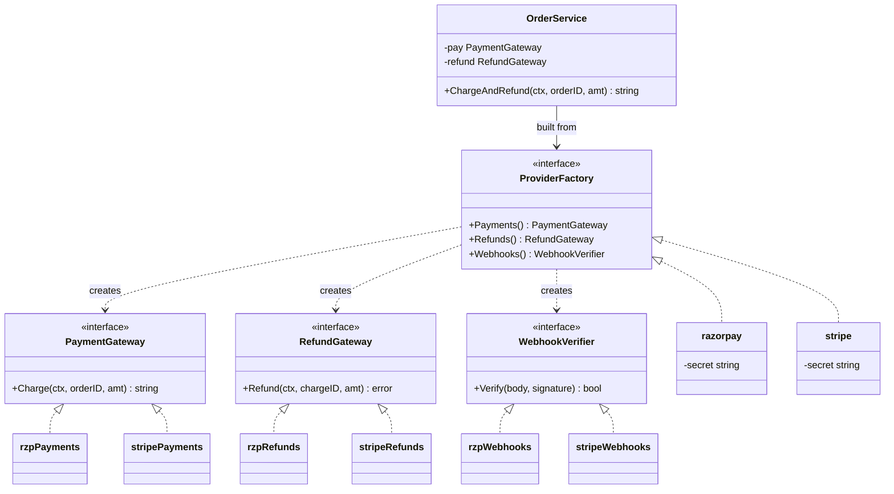
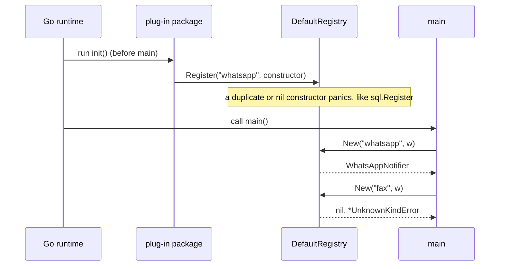

# Factory and Abstract Factory

> [!summary] TL;DR
> A **factory** is a function that decides which concrete type to build and hands it back behind an interface, so callers never write `&SMSNotifier{...}` themselves. An **abstract factory** builds a whole family of related objects (charge, refund and webhook check for one payment provider) from one choice, so pieces from different families cannot be mixed. In Go both are usually just functions and small interfaces.

## 1. Why it exists

An order service notifies users on four events: placed, shipped, delivered and refunded. Each user picks a channel: email, SMS, push or WhatsApp.

- Without a factory, each of the 4 handlers contains `if channel == "sms" { ... } else if ...` with the construction details (sender ID, API key, writer). That is 4 events × 4 channels = 16 construction sites. Adding WhatsApp edits all 4 handlers, and one forgets.
- With a factory, each handler calls `NewNotifier(channel, cfg, w)`, and adding a channel edits one function.

Payments show the second problem. Checkout charges through Razorpay. Months later, someone writes the refund path and builds a Stripe client from a different config key. Every refund now fails with "unknown payment intent", because a Razorpay payment can only be refunded by Razorpay. An **abstract factory** removes the possibility: the service receives one `ProviderFactory`, and every product it gets (payments, refunds, webhook verification) comes from the same provider.

## 2. Mental model

- **Factory: an order counter.** You ask for "a coffee"; the kitchen decides the machine, beans and cup. You get something that behaves like a coffee and never touch the kitchen. In Go: `NewNotifier("sms", ...)` returns a `Notifier`.
- **Abstract factory: a furniture collection.** You choose the "Oslo" collection and receive a table, chairs and a lamp that match. You cannot get an Oslo table with a Milano chair. In Go: `NewProviderFactory(cfg)` returns a `ProviderFactory`, and its `Payments()`, `Refunds()` and `Webhooks()` all belong to one provider.

The point of both is that **the choice of concrete type is made in one place**, usually from config, and everything else depends on interfaces.

## 3. How it works

Go has four common forms, from lightest to heaviest:

1. **Simple factory function.** `NewNotifier(channel, cfg, w) (Notifier, error)` is a `switch` over a string. It returns the interface, and a typed error for an unknown name.
2. **Factory method.** In the GoF book, a base class declares an overridable `create` method and subclasses decide the product. Go has no subclasses, so a factory method is either a method on an interface that returns a product (`ProviderFactory.Payments()`) or a constructor passed as a value (`Constructor func(io.Writer) Notifier`).
3. **Abstract factory.** An interface whose methods are factory methods, one per product in the family. Each provider implements the whole interface.
4. **Registry factory.** A map from name to constructor. Plug-in packages add entries from `init()`, so the factory learns new kinds without being edited. `database/sql` works this way.

The payment family from the worked example:



`NewProviderFactory(cfg)` reads `cfg.Provider` once and returns `razorpay{...}` or `stripe{...}`. From then on, `OrderService` cannot pair a Stripe refund with a Razorpay charge, because it never names a provider.

A registry factory has a different timeline: registration happens before `main` runs, and lookup happens later by name.



## 4. Worked example

One `package main` with the owner's notifier factory (fixed so it compiles: the old note declared `EmailNotifier.Send` twice, which fails with `method EmailNotifier.Send already declared`), a typed error, the typed-nil trap, a registry and the Razorpay and Stripe families. The provider calls are in-memory stand-ins for the SDKs; the webhook checks use each provider's documented HMAC-SHA256 scheme, simplified for Stripe (no timestamp tolerance check). Built with Go 1.24.4; `go vet` is clean and `go test -race` passes.

```go
package main

import (
	"context"
	"crypto/hmac"
	"crypto/sha256"
	"encoding/hex"
	"errors"
	"fmt"
	"io"
	"os"
	"strconv"
	"strings"
	"sync"
)

// UnknownKindError is the typed error every factory returns for a name it does not know.
type UnknownKindError struct{ Kind, Name string }

func (e *UnknownKindError) Error() string {
	return "unknown " + e.Kind + " " + strconv.Quote(e.Name)
}

// ---------- Simple factory: one product, chosen by a string ----------

type Notifier interface {
	Send(ctx context.Context, to, msg string) error
}

type EmailNotifier struct{ w io.Writer }

func (n EmailNotifier) Send(_ context.Context, to, msg string) error {
	_, err := fmt.Fprintf(n.w, "email to %s: %s\n", to, msg)
	return err
}

type PushNotifier struct{ w io.Writer }

func (n PushNotifier) Send(_ context.Context, to, msg string) error {
	_, err := fmt.Fprintf(n.w, "push to %s: %s\n", to, msg)
	return err
}

// SMSNotifier needs config, so it has its own constructor that returns the concrete type.
type SMSNotifier struct {
	w        io.Writer
	senderID string
}

func NewSMSNotifier(senderID string, w io.Writer) (*SMSNotifier, error) {
	if senderID == "" {
		return nil, errors.New("sms: sender id missing")
	}
	return &SMSNotifier{w: w, senderID: senderID}, nil
}

func (n *SMSNotifier) Send(_ context.Context, to, msg string) error {
	_, err := fmt.Fprintf(n.w, "sms from %s to %s: %s\n", n.senderID, to, msg)
	return err
}

type Config struct {
	SMSSenderID   string
	Provider      string // "razorpay" or "stripe"
	WebhookSecret string
}

// NewNotifier is a simple factory: it hides which concrete type is built.
func NewNotifier(channel string, cfg Config, w io.Writer) (Notifier, error) {
	switch channel {
	case "email":
		return EmailNotifier{w: w}, nil
	case "push":
		return PushNotifier{w: w}, nil
	case "sms":
		sms, err := NewSMSNotifier(cfg.SMSSenderID, w)
		if err != nil {
			return nil, err // a literal nil, never the nil *SMSNotifier
		}
		return sms, nil
	default:
		return nil, &UnknownKindError{Kind: "notifier channel", Name: channel}
	}
}

// BuggyNotifier shows the typed-nil trap: it returns the nil *SMSNotifier
// inside a Notifier, and that interface value is not nil.
func BuggyNotifier(cfg Config, w io.Writer) Notifier {
	sms, _ := NewSMSNotifier(cfg.SMSSenderID, w)
	return sms
}

// ---------- Registry factory: plug-ins register themselves ----------

type Constructor func(w io.Writer) Notifier

type Registry struct {
	mu   sync.RWMutex
	ctor map[string]Constructor
}

func NewRegistry() *Registry { return &Registry{ctor: map[string]Constructor{}} }

// Register panics on a nil or duplicate constructor, like database/sql.Register.
func (r *Registry) Register(name string, c Constructor) {
	r.mu.Lock()
	defer r.mu.Unlock()
	if c == nil {
		panic("notify: Register constructor is nil")
	}
	if _, dup := r.ctor[name]; dup {
		panic("notify: Register called twice for " + name)
	}
	r.ctor[name] = c
}

func (r *Registry) New(name string, w io.Writer) (Notifier, error) {
	r.mu.RLock()
	c, ok := r.ctor[name]
	r.mu.RUnlock()
	if !ok {
		return nil, &UnknownKindError{Kind: "notifier channel", Name: name}
	}
	return c(w), nil
}

// DefaultRegistry is the global one that plug-in packages fill from init().
var DefaultRegistry = NewRegistry()

type WhatsAppNotifier struct{ w io.Writer }

func (n WhatsAppNotifier) Send(_ context.Context, to, msg string) error {
	_, err := fmt.Fprintf(n.w, "whatsapp to %s: %s\n", to, msg)
	return err
}

func init() {
	DefaultRegistry.Register("whatsapp", func(w io.Writer) Notifier { return WhatsAppNotifier{w: w} })
}

// ---------- Abstract factory: a family of payment products ----------

type Paise int64

type PaymentGateway interface {
	Charge(ctx context.Context, orderID string, amt Paise) (chargeID string, err error)
}

type RefundGateway interface {
	Refund(ctx context.Context, chargeID string, amt Paise) error
}

type WebhookVerifier interface {
	Verify(body []byte, signature string) bool
}

// ProviderFactory builds one consistent family. Each method is a factory method.
type ProviderFactory interface {
	Payments() PaymentGateway
	Refunds() RefundGateway
	Webhooks() WebhookVerifier
}

func hmacHex(secret, msg string) string {
	m := hmac.New(sha256.New, []byte(secret))
	m.Write([]byte(msg))
	return hex.EncodeToString(m.Sum(nil))
}

// Razorpay family (in-memory stand-in for the SDK calls).
type razorpay struct{ secret string }
type rzpPayments struct{}
type rzpRefunds struct{}
type rzpWebhooks struct{ secret string }

func (f razorpay) Payments() PaymentGateway  { return rzpPayments{} }
func (f razorpay) Refunds() RefundGateway    { return rzpRefunds{} }
func (f razorpay) Webhooks() WebhookVerifier { return rzpWebhooks{secret: f.secret} }

func (rzpPayments) Charge(_ context.Context, orderID string, _ Paise) (string, error) {
	return "pay_" + orderID, nil
}

func (rzpRefunds) Refund(_ context.Context, chargeID string, _ Paise) error {
	if !strings.HasPrefix(chargeID, "pay_") {
		return fmt.Errorf("razorpay: unknown payment %q", chargeID)
	}
	return nil
}

// Razorpay signs the raw body: hex(HMAC-SHA256(secret, body)).
func (v rzpWebhooks) Verify(body []byte, sig string) bool {
	return hmac.Equal([]byte(sig), []byte(hmacHex(v.secret, string(body))))
}

// Stripe family.
type stripe struct{ secret string }
type stripePayments struct{}
type stripeRefunds struct{}
type stripeWebhooks struct{ secret string }

func (f stripe) Payments() PaymentGateway  { return stripePayments{} }
func (f stripe) Refunds() RefundGateway    { return stripeRefunds{} }
func (f stripe) Webhooks() WebhookVerifier { return stripeWebhooks{secret: f.secret} }

func (stripePayments) Charge(_ context.Context, orderID string, _ Paise) (string, error) {
	return "pi_" + orderID, nil
}

func (stripeRefunds) Refund(_ context.Context, chargeID string, _ Paise) error {
	if !strings.HasPrefix(chargeID, "pi_") {
		return fmt.Errorf("stripe: unknown payment intent %q", chargeID)
	}
	return nil
}

// Stripe signs "timestamp.body" and sends "t=<ts>,v1=<hex>".
// Simplified: the real check also rejects old timestamps (Stripe's libraries
// default to a 5-minute tolerance) and accepts any of several v1 signatures.
func (v stripeWebhooks) Verify(body []byte, header string) bool {
	var ts, sig string
	for _, part := range strings.Split(header, ",") {
		k, val, _ := strings.Cut(part, "=")
		switch k {
		case "t":
			ts = val
		case "v1":
			sig = val
		}
	}
	return ts != "" && hmac.Equal([]byte(sig), []byte(hmacHex(v.secret, ts+"."+string(body))))
}

// NewProviderFactory is the config-driven selector for the whole family.
func NewProviderFactory(cfg Config) (ProviderFactory, error) {
	if cfg.WebhookSecret == "" {
		return nil, errors.New("payments: webhook secret missing")
	}
	switch cfg.Provider {
	case "razorpay":
		return razorpay{secret: cfg.WebhookSecret}, nil
	case "stripe":
		return stripe{secret: cfg.WebhookSecret}, nil
	default:
		return nil, &UnknownKindError{Kind: "payment provider", Name: cfg.Provider}
	}
}

// OrderService depends only on the abstract family, never on a provider.
type OrderService struct {
	pay    PaymentGateway
	refund RefundGateway
}

func NewOrderService(f ProviderFactory) *OrderService {
	return &OrderService{pay: f.Payments(), refund: f.Refunds()}
}

// ChargeAndRefund exercises two products of the same family.
func (s *OrderService) ChargeAndRefund(ctx context.Context, orderID string, amt Paise) (string, error) {
	id, err := s.pay.Charge(ctx, orderID, amt)
	if err != nil {
		return "", err
	}
	return id, s.refund.Refund(ctx, id, amt)
}

func main() {
	ctx := context.Background()
	cfg := Config{SMSSenderID: "BMSHOW", Provider: "razorpay", WebhookSecret: "whsec_demo"}

	for _, ch := range []string{"email", "sms", "fax"} {
		n, err := NewNotifier(ch, cfg, os.Stdout)
		if err != nil {
			fmt.Println("error:", err)
			continue
		}
		_ = n.Send(ctx, "user-42", "order placed")
	}

	if n, err := DefaultRegistry.New("whatsapp", os.Stdout); err == nil {
		_ = n.Send(ctx, "user-42", "order shipped")
	}

	bad := BuggyNotifier(Config{}, os.Stdout)
	fmt.Println("typed nil: bad == nil is", bad == nil)

	f, err := NewProviderFactory(cfg)
	if err != nil {
		fmt.Println("error:", err)
		return
	}
	id, err := NewOrderService(f).ChargeAndRefund(ctx, "order_7", 49900)
	fmt.Println("charged and refunded:", id, err)

	body := []byte(`{"event":"payment.captured"}`)
	fmt.Println("webhook valid:", f.Webhooks().Verify(body, hmacHex("whsec_demo", string(body))))

	_, err = NewProviderFactory(Config{Provider: "paypal", WebhookSecret: "x"})
	fmt.Println("error:", err)
}
```

The tests cover each kind, the typed error, the trap, a registry that is isolated per test, both families, the mixed-family failure and a fake family:

```go
package main

import (
	"bytes"
	"context"
	"errors"
	"io"
	"testing"
)

func TestNewNotifierKinds(t *testing.T) {
	tests := []struct {
		channel string
		want    string
	}{
		{"email", "email to u1: hi\n"},
		{"push", "push to u1: hi\n"},
		{"sms", "sms from BMSHOW to u1: hi\n"},
	}
	for _, tc := range tests {
		t.Run(tc.channel, func(t *testing.T) {
			var buf bytes.Buffer
			n, err := NewNotifier(tc.channel, Config{SMSSenderID: "BMSHOW"}, &buf)
			if err != nil {
				t.Fatal(err)
			}
			if err := n.Send(context.Background(), "u1", "hi"); err != nil {
				t.Fatal(err)
			}
			if buf.String() != tc.want {
				t.Fatalf("got %q, want %q", buf.String(), tc.want)
			}
		})
	}
}

func TestUnknownChannelIsTyped(t *testing.T) {
	_, err := NewNotifier("fax", Config{}, io.Discard)
	var u *UnknownKindError
	if !errors.As(err, &u) || u.Name != "fax" {
		t.Fatalf("err = %v, want *UnknownKindError", err)
	}
}

func TestFactoryReturnsLiteralNil(t *testing.T) {
	n, err := NewNotifier("sms", Config{}, io.Discard) // sender id missing
	if err == nil || n != nil {
		t.Fatalf("got (%v, %v), want (nil, error)", n, err)
	}
}

func TestTypedNilTrap(t *testing.T) {
	if n := BuggyNotifier(Config{}, io.Discard); n == nil {
		t.Fatal("expected the trap: a nil *SMSNotifier inside an interface is not nil")
	}
}

func TestRegistryIsolatedPerTest(t *testing.T) {
	r := NewRegistry() // no global state: each test builds its own
	r.Register("fake", func(w io.Writer) Notifier { return EmailNotifier{w: w} })
	if _, err := r.New("fake", io.Discard); err != nil {
		t.Fatal(err)
	}
	if _, err := r.New("whatsapp", io.Discard); err == nil {
		t.Fatal("a fresh registry must not see DefaultRegistry entries")
	}
	defer func() {
		if recover() == nil {
			t.Fatal("duplicate Register must panic")
		}
	}()
	r.Register("fake", func(w io.Writer) Notifier { return PushNotifier{w: w} })
}

func TestProviderFamilies(t *testing.T) {
	for _, p := range []string{"razorpay", "stripe"} {
		f, err := NewProviderFactory(Config{Provider: p, WebhookSecret: "s"})
		if err != nil {
			t.Fatal(err)
		}
		if _, err := NewOrderService(f).ChargeAndRefund(context.Background(), "o1", 100); err != nil {
			t.Fatalf("%s: %v", p, err)
		}
	}
}

func TestMixingFamiliesFails(t *testing.T) {
	ctx := context.Background()
	id, _ := stripe{}.Payments().Charge(ctx, "o1", 100)
	if err := (razorpay{}).Refunds().Refund(ctx, id, 100); err == nil {
		t.Fatal("a Razorpay refund of a Stripe payment must fail")
	}
}

func TestWebhookVerifiers(t *testing.T) {
	body := []byte(`{"id":"evt_1"}`)
	rzp := razorpay{secret: "s"}.Webhooks()
	if !rzp.Verify(body, hmacHex("s", string(body))) || rzp.Verify(body, "bad") {
		t.Fatal("razorpay verifier")
	}
	st := stripe{secret: "s"}.Webhooks()
	header := "t=1700000000,v1=" + hmacHex("s", "1700000000."+string(body))
	if !st.Verify(body, header) || st.Verify(body, "v1=abc") {
		t.Fatal("stripe verifier")
	}
}

// fakeFamily is one struct that is the factory and all three products.
type fakeFamily struct{ calls []string }

func (f *fakeFamily) Payments() PaymentGateway  { return f }
func (f *fakeFamily) Refunds() RefundGateway    { return f }
func (f *fakeFamily) Webhooks() WebhookVerifier { return f }
func (f *fakeFamily) Charge(_ context.Context, id string, _ Paise) (string, error) {
	f.calls = append(f.calls, "charge "+id)
	return "fake_" + id, nil
}
func (f *fakeFamily) Refund(_ context.Context, id string, _ Paise) error {
	f.calls = append(f.calls, "refund "+id)
	return nil
}
func (f *fakeFamily) Verify([]byte, string) bool { return true }

func TestOrderServiceWithFakeFamily(t *testing.T) {
	f := &fakeFamily{}
	if _, err := NewOrderService(f).ChargeAndRefund(context.Background(), "o9", 500); err != nil {
		t.Fatal(err)
	}
	if len(f.calls) != 2 || f.calls[0] != "charge o9" || f.calls[1] != "refund fake_o9" {
		t.Fatalf("calls = %v", f.calls)
	}
}
```

Output of `go run .` (measured, Go 1.24.4, darwin/arm64):

```text
email to user-42: order placed
sms from BMSHOW to user-42: order placed
error: unknown notifier channel "fax"
whatsapp to user-42: order shipped
typed nil: bad == nil is false
charged and refunded: pay_order_7 <nil>
webhook valid: true
error: unknown payment provider "paypal"
```

What to notice:

- `fax` produces a typed `*UnknownKindError`, so callers can use `errors.As` and read the bad name instead of matching an error string.
- `bad == nil is false`: `BuggyNotifier` returned a nil `*SMSNotifier` inside a non-nil `Notifier`. Calling `Send` on it would panic with a nil pointer dereference when `Send` reads `n.w`.
- `TestMixingFamiliesFails` shows the bug the abstract factory prevents: a Razorpay refund of a Stripe payment.

## 5. Variants and comparison

| Option | How it works | Use when | Cost |
| --- | --- | --- | --- |
| Plain constructor `NewSMSNotifier` | Returns the concrete type | The caller knows which type it wants | None; this is the default in Go |
| Simple factory function | `switch` on a name, returns the interface | 2 to 6 kinds, all in one package, chosen from config | One function to edit per new kind |
| Local `map[string]func(io.Writer) Notifier` | A map literal built in `main` and passed in | Same as above, and tests want to swap entries | No plug-in story; nothing global |
| Registry with `init()` | Global map; packages call `Register` from `init()` | Kinds live in packages you do not own (drivers, formats) | Global state, import side effects, panics on duplicates |
| Factory method | Interface method or func value that creates a product | A collaborator must create objects whose type the caller chooses | One more indirection |
| Abstract factory | Interface with one factory method per product | Several products must come from the same family | A family interface to keep in sync; every new product touches every family |

The textbook abstract factory is a UI toolkit: a `LightTheme` factory makes a light button and a light checkbox, and a `DarkTheme` factory makes dark ones. The old note used that example; it shows the idea, but backend code meets the pattern in provider families, cloud SDKs and database drivers instead.

**Return an interface or a concrete type?** A common Go proverb is "accept interfaces, return structs": `NewSMSNotifier` returns `*SMSNotifier`, so callers see its whole API and the type can gain methods without breaking anyone. A factory is the exception: its whole job is to choose among types, so it must return the interface. If a "factory" always returns the same type, it is a constructor and should return that type.

## 6. Trade-offs and when not to use

- **One concrete type:** call its constructor. A factory that can only return one thing is ceremony.
- **The caller already knows the type:** `NewSMSNotifier(...)` is clearer than `NewNotifier("sms", ...)`, and the compiler checks it.
- **Kinds that never leave one package:** a `switch` or a local map is enough. A global registry with `init()` adds hidden state and import side effects for no gain.
- **Abstract factory with one product:** it is just a factory. The family interface earns its cost only when two or more products must match.
- **Every new product edits every family.** Adding `Payouts()` to `ProviderFactory` forces Razorpay, Stripe and every test fake to implement it. Keep the family small, or add capabilities as optional interfaces (see section 8).
- **Factories must not run business logic.** A factory builds and validates; it does not charge, send or decide pricing.

## 7. In production

**Real systems:**

- `database/sql`: `sql.Register(name, driver)` is a registry factory. A driver package calls it from `init()`, the program imports the package for its side effect (for pgx v5: `import _ "github.com/jackc/pgx/v5/stdlib"`), and `sql.Open("pgx", dsn)` looks the driver up by name. The pgx v5 `stdlib` package registers itself as `"pgx/v5"`, and also as `"pgx"` unless another pgx major version already took that name; it checks `sql.Drivers()` first precisely because a duplicate `Register` would panic. `sql.Register` panics if it is called twice with the same name or with a nil driver; `sql.Drivers()` lists the registered names.
- `database/sql/driver` is an abstract factory: a `driver.Driver` opens a `driver.Conn`, and the `Conn` creates its own `driver.Stmt` and `driver.Tx`. A statement from one driver can never run on another driver's connection.
- `image.RegisterFormat`: `import _ "image/png"` registers the PNG decoder from `init()`, and `image.Decode` then picks the decoder by the file's magic bytes.
- `crypto.Hash.New()`: `crypto.SHA256.New()` works only if `crypto/sha256` is linked into the binary, because that package registers itself with `crypto.RegisterHash`; otherwise `New` panics.

**Where it shows up in LLD problems:**

- [[Splitwise Expense Sharing]]: `NewSplitStrategy("equal" | "exact" | "percent")` is a factory that returns a strategy (see [[Strategy and Template Method]]).
- [[Notification Service]]: a `SenderFactory` per channel, often a registry so new channels (WhatsApp, RCS) are added as packages. The system-level design is in [[Case Study - Notification System]].
- [[Parking Lot]]: `NewSpot(vehicleType)` and pricing by vehicle type.
- Payment providers in [[Movie Ticket Booking]] and [[Food Ordering System]]: one provider family per region or merchant.

**Failure modes and fixes:**

- Unknown kind returned as `errors.New("unsupported")`. Fix: a typed `*UnknownKindError` with the name, so callers can branch with `errors.As` and logs show the bad value.
- Typed nil returned as an interface. Fix: return a literal `nil` on every error path (`return nil, err`), never a nil pointer variable.
- Config names a provider that is not compiled in (the blank import was removed). Fix: validate every configured name at startup and fail to boot, rather than failing the first payment.
- Registry tests interfere with each other. Fix: give the registry a type (`NewRegistry()`) so tests build their own, and keep the global one only for `init()` plug-ins.

**What to monitor:** log the chosen kind at startup (provider, channel set), count `UnknownKindError`s if names come from requests, and alert when a provider's error rate diverges from the others after a config change.

## 8. Deep dive

**The typed-nil trap, mechanically.** An interface value is a pair: (dynamic type, dynamic value). `return sms` where `sms` is a nil `*SMSNotifier` stores the pair `(*SMSNotifier, nil)`. An interface is `nil` only when both halves are nil, so the comparison `n == nil` is false. The same trap produces non-nil `error` values: a function declared to return `error` that returns a nil `*MyError` variable returns a non-nil error. The fix is the same: return the literal `nil`. [[Interfaces]] and [[Error Handling]] cover the representation.

**Why `init()` registration costs more than it looks.**

- It is global, process-wide state. Tests cannot reset `database/sql`'s driver list, and two tests that register the same name panic.
- Registration is a side effect of an import. Deleting a blank import compiles fine and breaks the program at run time with "unknown driver" (`sql: unknown driver "pgx" (forgotten import?)`).
- Each `init()` function runs once, before `main`, after every package it imports is initialized (a package may declare several). You cannot pass config or return an error from it, so a registered constructor must be cheap and must not do I/O.
- A lock is still needed. `init()` functions run in one goroutine, but nothing stops a later `Register` call from another goroutine. `database/sql` guards its driver map with a `sync.RWMutex`, and `Registry` here does the same.

**Evolving a family with optional interfaces.** `database/sql/driver` added context support without breaking old drivers. The core `driver.Conn` interface stayed small; new abilities are separate interfaces such as `driver.ConnBeginTx` and `driver.QueryerContext`. `database/sql` checks them with a type assertion and falls back when a driver lacks them. Apply the same trick to a payment family: keep `ProviderFactory` small and let a provider optionally implement `PayoutGateway`, checked with `if p, ok := f.(PayoutGateway); ok`.

**Errors or panics.** A factory that reads config at run time returns an error. A factory called with constant input at startup can offer a `Must` form that panics, like `regexp.MustCompile` and `template.Must`, because a failure there is a programming error.

**Factories and dependency injection.** In a service, the composition root (`main`) is the natural factory: it reads config, builds the family once and passes products into the services. If you find factories called deep inside request handlers, the construction is probably happening too late and too often.

## 9. Interview questions

> [!question]- What is the difference between a constructor, a factory and an abstract factory?
> A constructor (`NewSMSNotifier`) builds one known type and returns it as that type. A factory chooses among several types from input such as a config name and returns an interface. An abstract factory is an interface with several factory methods that build a matching family of products, such as payments, refunds and webhook verification for one provider.

> [!question]- Should a factory return an interface or a concrete type?
> Constructors return concrete types ("accept interfaces, return structs"), so callers get the full API and the type can grow. A factory returns the interface, because choosing among types is its purpose. A "factory" that always returns one type is a constructor in disguise.

> [!question]- Trap: `NewNotifier` returns `(Notifier, error)`. On a config error it does `return sms, err` where `sms` is a nil `*SMSNotifier`. What goes wrong?
> The returned `Notifier` holds the pair `(*SMSNotifier, nil)`, which is not equal to `nil`. A caller that checks `if n != nil` instead of `err` will call `Send` and panic on the nil pointer. Always `return nil, err` with a literal nil.

> [!question]- How does `database/sql` find the driver for `sql.Open("pgx", dsn)`?
> The driver package calls `sql.Register("pgx", driver)` in its `init()`, which runs because the program imports it with a blank import. `sql.Open` looks the name up in a mutex-guarded global map and fails with `unknown driver` if nobody registered it. The cost is global state and an import that exists only for its side effect.

> [!question]- When is an abstract factory worth it instead of separate factories?
> When products must match. A Razorpay payment can only be refunded and its webhooks verified by Razorpay code, so `Payments()`, `Refunds()` and `Webhooks()` should come from one object chosen once. If the products are independent, separate factories are simpler.

> [!question]- How do you test a service built on an abstract factory?
> Pass a fake family. One struct can implement the factory and all products, record calls and return canned results, as `fakeFamily` does. Test each real family separately, including that mixing families fails.

> [!question]- When is `map[string]func() Notifier` enough?
> When every kind lives in your own package and nobody outside needs to add kinds. Build the map in `main` or a constructor and pass it in; it is easy to test and has no global state. Reach for an `init()` registry only for real plug-ins, such as drivers in other modules.

## 10. Cheat sheet

- Constructor returns a concrete type; a factory chooses among types and returns an interface.
- Unknown kind: return a typed error (`*UnknownKindError`), not a string error.
- On error, `return nil, err` with a literal nil: a nil pointer inside an interface is not nil.
- Abstract factory = interface of factory methods, so one choice yields a matching family.
- Registry with `init()` (`sql.Register`, `image.RegisterFormat`) = plug-ins at the cost of global state and import side effects.
- A local map or `switch` is enough when all kinds live in one package.
- Grow a family with optional interfaces checked by type assertion, like `database/sql/driver`.
- Test with a fake family; validate configured names at startup.

## Links

- **Before this:** [[Interfaces]], [[Error Handling]], [[Strategy and Template Method]]
- **Next:** [[Builder and Functional Options]]
- **Compare with:** [[Builder and Functional Options]], [[Singleton and sync.Once]], [[Rare GoF Patterns in Go]], [[Case Study - Notification System]]
