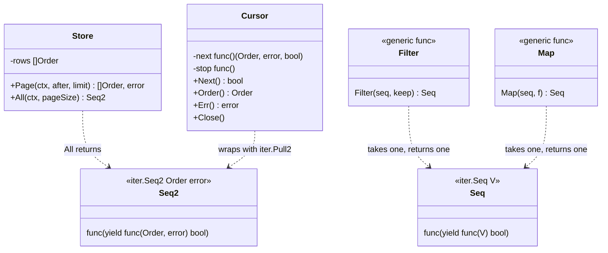
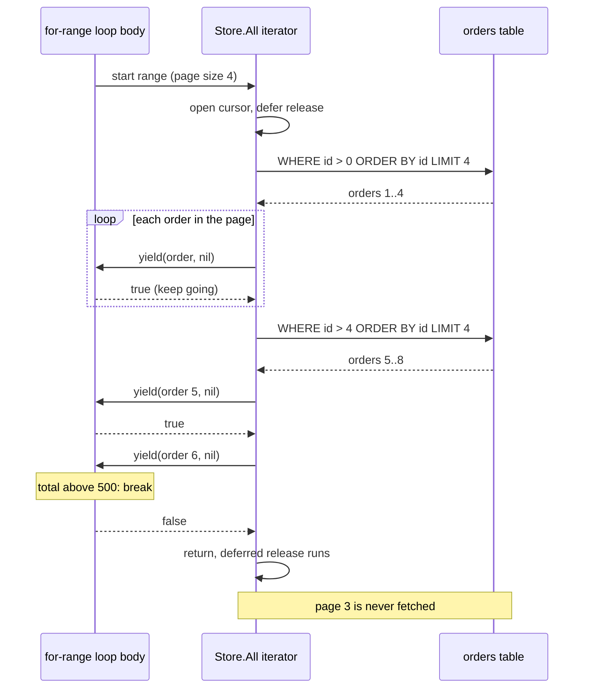

# Iterator and range-over-func

> [!summary] TL;DR
> An **iterator** hands out the items of a collection one at a time, so the caller never needs to know whether they come from a slice, a tree or pages of a database table. Since Go 1.23 the idiomatic Go iterator is a function you can `range` over: an `iter.Seq[V]` or `iter.Seq2[K, V]` that calls `yield` for each item and stops as soon as `yield` returns `false`. Older styles (`Next`/`Err`/`Close`, callbacks) are still everywhere in the standard library; channel-based iterators are a trap.

> [!abstract] Core idea
> - An iterator hands out items one at a time, hiding where they come from (slice, tree, database pages).
> - In Go 1.23+ an iterator is a function `func(yield func(V) bool)` that you can `range` over.
> - The one rule: when `yield` returns `false` (the caller broke out of the loop), stop immediately and clean up.
> - Classic mistake: a channel fed by a goroutine as an iterator. If the caller stops early, the goroutine blocks forever and leaks.

## 1. Why it exists

An admin tool must find the first order above ₹500 in an `orders` table that may hold millions of rows. Three bad options:

- **Load everything into a slice.** Millions of rows in memory, and almost all of them thrown away when the answer is the sixth row.
- **Expose the paging to every caller.** Each caller writes the same loop: fetch a page, scan it, remember the last ID, fetch again, stop when a page comes back short. Each copy gets the edge cases slightly wrong.
- **Return a channel from a goroutine.** It reads nicely in a `for range` loop, but if the caller stops early, the goroutine blocks forever (section 8).

An iterator gives the caller a plain loop and keeps three things inside it:

- **Storage is hidden.** The same loop works over a slice in tests and over database pages in production.
- **Evaluation is lazy.** Nothing is fetched until the loop asks for it. In the worked example, finding the sixth order with a page size of 4 costs **2** page fetches out of 3.
- **Paging and cleanup live in one place.** The iterator knows the keyset (the last ID seen, used as `WHERE id > $last` for the next page), the page size and when to release the cursor.

## 2. Mental model

A card dealer. You do not get the deck; you get one card each time you ask, and you can say "stop" at any point. The dealer knows whether the cards come from one deck or six, and puts the shoe away when you stop.

Go has two ways to hold that conversation:

- **Push** (`iter.Seq`, callbacks): the dealer drives. It calls your code (`yield`) once per card; you answer `true` for "keep going" or `false` for "stop". A `for range` loop over a function is written like a normal loop, but the loop body is the `yield` function.
- **Pull** (`Next`/`Err`/`Close`, `iter.Pull`): you drive. You call `Next()` whenever you want the next card. That is what you need to walk two sequences in step, such as merging two sorted streams.

## 3. How it works

### The four Go styles

| Style | Shape | Stops early by | Errors | Standard library examples |
| --- | --- | --- | --- | --- |
| Next/Err/Close (pull) | `for r.Next() { r.Scan(…) }` then `r.Err()` | Not calling `Next`; then `Close` | `Err()` after the loop | `database/sql.Rows`, `bufio.Scanner` |
| Callback (push) | `fs.WalkDir(fsys, ".", fn)` | Returning `fs.SkipAll` / `false` | Returned from the callback | `fs.WalkDir`, `filepath.WalkDir`, `sync.Map.Range` |
| Range-over-func (push, since Go 1.23) | `for k, v := range seq` | `break` (yield returns `false`) | Second value of an `iter.Seq2[T, error]` | `maps.Keys`, `slices.Values`, `strings.Lines` (Go 1.24) |
| `iter.Pull` / `Pull2` (pull over push) | `next, stop := iter.Pull(seq)` | Calling `stop()` | Whatever the sequence yields | Adapting a `Seq` to a `Next` API |

The language rules for range-over-func belong to [[Generics and Iterators]]. The parts a design needs are:

- `iter.Seq[V]` is `func(yield func(V) bool)`, and `iter.Seq2[K, V]` is `func(yield func(K, V) bool)`.
- The compiler turns the loop body into the `yield` function. A `break` or `return` in the body makes `yield` return `false`; a panic in the body unwinds through the iterator.
- After `yield` returns `false`, the iterator **must return** without calling `yield` again. Calling it again panics at run time.
- Because the iterator function returns (or unwinds), its `defer` statements run on every exit: the last item, a `break`, an error, a panic.

### Structure



### A paginated iterator, step by step



1. The `for range` starts the iterator function, which opens its cursor and defers the release.
2. It fetches one page with **keyset pagination** (`WHERE id > $last ORDER BY id LIMIT $n`) and yields each row.
3. If `yield` returns `false` (the loop body hit `break`), the iterator returns at once: no more pages, and the deferred release runs.
4. A page shorter than the page size is the last one. A failed fetch is yielded as `(Order{}, err)` and ends the iteration.

### Whiteboard version

The bare idea: a function that yields matching items and stops when `yield` returns false. The full version in section 4 adds the production concerns.

```go
package main

import (
	"fmt"
	"iter"
)

// Evens yields the even numbers of xs, one at a time.
func Evens(xs []int) iter.Seq[int] {
	return func(yield func(int) bool) {
		for _, x := range xs {
			if x%2 == 0 && !yield(x) {
				return // the caller broke out of the loop: stop now
			}
		}
	}
}

func main() {
	for x := range Evens([]int{1, 2, 3, 4, 6, 8}) {
		if x > 4 {
			break // yield returns false, Evens returns
		}
		fmt.Println(x) // 2, then 4
	}
}
```

## 4. Worked example

`Store.All` is the paginated iterator, `Cursor` adapts it to the `sql.Rows` style with `iter.Pull2`, `Filter` and `Map` compose iterators, and `ChanOrders` is the channel style kept only to show its leak.

```go
// main.go
package main

import (
	"context"
	"errors"
	"fmt"
	"iter"
	"maps"
	"slices"
	"sort"
)

type Order struct {
	ID    int64
	Total int // rupees
}

// Store stands in for the orders table. It counts open cursors so the
// tests can prove that every way out of a loop releases them.
type Store struct {
	rows    []Order // sorted by ID
	FailAt  int64   // if > 0, fetching a page after this ID fails
	Fetches int
	open    int
}

var ErrConnReset = errors.New("connection reset")

// Page is keyset pagination:
// SELECT id, total FROM orders WHERE id > $1 ORDER BY id LIMIT $2
func (s *Store) Page(ctx context.Context, after int64, limit int) ([]Order, error) {
	if err := ctx.Err(); err != nil {
		return nil, err
	}
	s.Fetches++
	if s.FailAt > 0 && after >= s.FailAt {
		return nil, ErrConnReset
	}
	i := sort.Search(len(s.rows), func(i int) bool { return s.rows[i].ID > after })
	return slices.Clone(s.rows[i:min(i+limit, len(s.rows))]), nil
}

// All is a range-over-func iterator (Go 1.23+). It fetches one page at a
// time, only when the loop needs more, and yields an error as the second value.
func (s *Store) All(ctx context.Context, pageSize int) iter.Seq2[Order, error] {
	return func(yield func(Order, error) bool) {
		s.open++                    // acquire a cursor
		defer func() { s.open-- }() // runs on the last row, on break and on error
		var after int64
		for {
			page, err := s.Page(ctx, after, pageSize)
			if err != nil {
				yield(Order{}, err)
				return
			}
			for _, o := range page {
				if !yield(o, nil) {
					return // the loop body broke out: stop fetching
				}
			}
			if len(page) == 0 || len(page) < pageSize {
				return // a short (or empty) page is the last page; also stops pageSize <= 0
			}
			after = page[len(page)-1].ID
		}
	}
}

// Cursor adapts the push iterator to the Next/Err/Close style of sql.Rows,
// using iter.Pull2.
type Cursor struct {
	next func() (Order, error, bool)
	stop func()
	cur  Order
	err  error
}

func NewCursor(seq iter.Seq2[Order, error]) *Cursor {
	next, stop := iter.Pull2(seq)
	return &Cursor{next: next, stop: stop}
}

func (c *Cursor) Next() bool {
	if c.err != nil {
		return false
	}
	o, err, ok := c.next()
	if !ok {
		return false
	}
	if err != nil {
		c.err = err
		c.stop()
		return false
	}
	c.cur = o
	return true
}

func (c *Cursor) Order() Order { return c.cur }
func (c *Cursor) Err() error   { return c.err }
func (c *Cursor) Close()       { c.stop() } // safe to call more than once

// Filter and Map compose iterators lazily: nothing runs until a loop pulls.
func Filter[V any](seq iter.Seq[V], keep func(V) bool) iter.Seq[V] {
	return func(yield func(V) bool) {
		for v := range seq {
			if keep(v) && !yield(v) {
				return
			}
		}
	}
}

func Map[V, W any](seq iter.Seq[V], f func(V) W) iter.Seq[W] {
	return func(yield func(W) bool) {
		for v := range seq {
			if !yield(f(v)) {
				return
			}
		}
	}
}

// ChanOrders is the pre-Go 1.23 style. If the consumer stops early, the
// goroutine blocks on its next send forever: a goroutine leak.
func ChanOrders(orders []Order) <-chan Order {
	ch := make(chan Order)
	go func() {
		defer close(ch)
		for _, o := range orders {
			ch <- o
		}
	}()
	return ch
}

func newStore(n int) *Store {
	s := &Store{}
	for i := 1; i <= n; i++ {
		s.rows = append(s.rows, Order{ID: int64(i), Total: i * 100})
	}
	return s
}

func main() {
	ctx := context.Background()
	s := newStore(10)
	for o, err := range s.All(ctx, 4) {
		if err != nil {
			fmt.Println("error:", err)
			break
		}
		if o.Total > 500 {
			fmt.Println("first order above ₹500:", o.ID, "fetches:", s.Fetches)
			break
		}
	}

	s.FailAt = 4
	c := NewCursor(s.All(ctx, 4))
	defer c.Close()
	n := 0
	for c.Next() {
		n++
	}
	fmt.Println("rows before failure:", n, "err:", c.Err())

	big := Filter(slices.Values(s.rows), func(o Order) bool { return o.Total >= 800 })
	fmt.Println(slices.Collect(Map(big, func(o Order) int64 { return o.ID })))
	fmt.Println(slices.Sorted(maps.Keys(map[string]int{"b": 2, "a": 1})))
}
```

```go
// main_test.go
package main

import (
	"context"
	"errors"
	"io/fs"
	"iter"
	"runtime"
	"slices"
	"sync"
	"testing"
	"testing/fstest"
	"time"
)

func TestAllFetchesPagesLazily(t *testing.T) {
	s := newStore(10)
	var ids []int64
	for o, err := range s.All(context.Background(), 4) {
		if err != nil {
			t.Fatal(err)
		}
		ids = append(ids, o.ID)
	}
	if len(ids) != 10 || s.Fetches != 3 || s.open != 0 { // pages of 4, 4, 2
		t.Fatalf("ids=%v fetches=%d open=%d", ids, s.Fetches, s.open)
	}
}

func TestEvenSplitCostsOneEmptyFetch(t *testing.T) {
	s := newStore(8)
	n := 0
	for range s.All(context.Background(), 4) {
		n++
	}
	if n != 8 || s.Fetches != 3 { // 4, 4, then an empty page
		t.Fatalf("n=%d fetches=%d", n, s.Fetches)
	}
}

func TestEarlyBreakStopsFetchingAndCleansUp(t *testing.T) {
	s := newStore(10)
	for o := range s.All(context.Background(), 4) {
		if o.ID == 2 {
			break
		}
	}
	if s.Fetches != 1 || s.open != 0 {
		t.Fatalf("fetches=%d open=%d", s.Fetches, s.open)
	}
}

func TestErrorIsYieldedAndStops(t *testing.T) {
	s := newStore(10)
	s.FailAt = 4
	var got []int64
	var gotErr error
	for o, err := range s.All(context.Background(), 4) {
		if err != nil {
			gotErr = err
			break
		}
		got = append(got, o.ID)
	}
	if !errors.Is(gotErr, ErrConnReset) || len(got) != 4 || s.open != 0 {
		t.Fatalf("got=%v err=%v open=%d", got, gotErr, s.open)
	}
}

func TestCursorNextErrClose(t *testing.T) {
	s := newStore(10)
	s.FailAt = 4
	c := NewCursor(s.All(context.Background(), 4))
	n := 0
	for c.Next() {
		n++
	}
	if n != 4 || !errors.Is(c.Err(), ErrConnReset) || s.open != 0 {
		t.Fatalf("n=%d err=%v open=%d", n, c.Err(), s.open)
	}
	c.Close() // a second stop is allowed
}

func TestCursorCloseEarlyReleases(t *testing.T) {
	s := newStore(10)
	c := NewCursor(s.All(context.Background(), 4))
	c.Next()
	if s.open != 1 {
		t.Fatalf("open=%d while suspended, want 1", s.open)
	}
	c.Close() // like rows.Close(): ends the iterator, so its defer runs
	if s.open != 0 || c.Next() {
		t.Fatalf("after Close: open=%d", s.open)
	}
}

func TestFilterMapCollect(t *testing.T) {
	even := Filter(slices.Values([]int{1, 2, 3, 4, 5, 6}), func(n int) bool { return n%2 == 0 })
	got := slices.Collect(Map(even, func(n int) int { return n * n }))
	if !slices.Equal(got, []int{4, 16, 36}) {
		t.Fatalf("got %v", got)
	}
}

func TestCallbackIteratorsStopEarly(t *testing.T) {
	fsys := fstest.MapFS{
		"a/1.txt": {}, "a/2.go": {}, "b/3.go": {}, "b/4.go": {},
	}
	var visited []string
	err := fs.WalkDir(fsys, ".", func(p string, d fs.DirEntry, err error) error {
		if err != nil {
			return err
		}
		visited = append(visited, p)
		if p == "a/2.go" {
			return fs.SkipAll // stop the whole walk: the first .go file is enough
		}
		return nil
	})
	if err != nil || slices.Contains(visited, "b") {
		t.Fatalf("err=%v visited=%v", err, visited)
	}

	var m sync.Map
	for i := range 10 {
		m.Store(i, i)
	}
	calls := 0
	m.Range(func(_, _ any) bool { calls++; return calls < 3 }) // false stops Range
	if calls != 3 {
		t.Fatalf("Range called f %d times, want 3", calls)
	}
}

func goroutinesSettleAt(want int) bool {
	for range 100 {
		if runtime.NumGoroutine() == want {
			return true
		}
		time.Sleep(time.Millisecond)
	}
	return false
}

func TestChannelIteratorLeaksOnBreak(t *testing.T) {
	base := runtime.NumGoroutine()
	ch := ChanOrders(newStore(10).rows)
	for o := range ch {
		if o.ID == 2 {
			break
		}
	}
	if goroutinesSettleAt(base) {
		t.Fatal("expected the producer goroutine to be stuck after break")
	}
	for range ch { // drain so the producer can finish
	}
	if !goroutinesSettleAt(base) {
		t.Fatal("producer still running after drain")
	}
}

// Benchmarks: sum 1,000 ints through each iterator style.
const benchN = 1000

func seqInts(n int) iter.Seq[int] {
	return func(yield func(int) bool) {
		for i := range n {
			if !yield(i) {
				return
			}
		}
	}
}

func BenchmarkRangeOverFunc(b *testing.B) {
	for b.Loop() {
		sum := 0
		for v := range seqInts(benchN) {
			sum += v
		}
		_ = sum
	}
}

func BenchmarkPull(b *testing.B) {
	for b.Loop() {
		next, stop := iter.Pull(seqInts(benchN))
		sum := 0
		for v, ok := next(); ok; v, ok = next() {
			sum += v
		}
		stop()
		_ = sum
	}
}

func BenchmarkChannel(b *testing.B) {
	for b.Loop() {
		ch := make(chan int)
		go func() {
			defer close(ch)
			for i := range benchN {
				ch <- i
			}
		}()
		sum := 0
		for v := range ch {
			sum += v
		}
		_ = sum
	}
}
```

`go vet` is clean and `go test -race` passes (Go 1.24.4). Output of `go run .`, measured:

```text
first order above ₹500: 6 fetches: 2
rows before failure: 4 err: connection reset
[8 9 10]
[a b]
```

The tests check every way out of a loop, because that is where iterators break:

- **Normal end:** 10 rows with a page size of 4 take 3 fetches (4, 4, 2). With 8 rows the third fetch returns an empty page: a short page is the only end signal, so an exact multiple costs one extra query.
- **Early break:** breaking at order 2 makes 1 fetch, and the cursor count returns to 0, so the `defer` ran.
- **Error:** a fetch failure after 4 rows is yielded once, and the loop sees it as the second value.
- **Pull style:** `Cursor.Next` returns `false` on the error, `Err()` reports it, and `Close` after an early stop runs the iterator's `defer`.
- **Callbacks:** `fs.WalkDir` stops at once on `fs.SkipAll`, and `sync.Map.Range` stops when the function returns `false`.
- **Leak:** after a `break`, the channel producer is still blocked; it only exits when the test drains the channel.

**Measured cost** (`go test -bench . -benchmem -count 3`, Apple M4, Go 1.24.4, summing 1,000 ints, on a quiet machine where the 3 runs agree within about 10%). A re-run while the machine was heavily loaded measured `iter.Pull` at about twice the time below, so read the rows as ratios, not as fixed costs:

| Style | Time per 1,000 items | Per item | Allocations |
| --- | --- | --- | --- |
| Range-over-func | 2.5 µs | ≈ 2.5 ns | 4 (56 B) |
| `iter.Pull` | 73 µs | ≈ 73 ns | 13 (368 B) |
| Unbuffered channel + goroutine | 180 µs | ≈ 180 ns | 2 (128 B) |

A push iterator is a function call per item. `iter.Pull` switches between two stacks on every item, and a channel adds a goroutine handoff on top. For a database iterator these costs vanish next to the query; for an in-memory hot loop they do not.

## 5. Variants and comparison

| Option | How it works | Use when | Cost |
| --- | --- | --- | --- |
| Return a slice | Build everything, return it | Small, bounded results; caller needs `len` or indexing | Memory for all items; no early stop |
| `iter.Seq` / `Seq2` | Push: call `yield` per item | Default for new Go APIs since 1.23 | One call per item; errors need `Seq2` or an `Err` method |
| Next/Err/Close | Pull: the caller drives | Resources that must be closed (`sql.Rows`) | The caller must check `Err` and call `Close` |
| Callback with stop signal | Push via a named callback | APIs older than 1.23 (`fs.WalkDir`, `sync.Map.Range`) | Cannot use `break`; stop values differ per API |
| `iter.Pull` | Turns a push iterator into `next`/`stop` | Zipping or merging two sequences | Roughly 30× slower per item than range-over-func in the measurement above (exact ns depend on the machine); must call `stop` |
| Channel + goroutine | Producer sends on a channel | Real concurrency: a producer that should run ahead | Leaks on early stop unless cancelled; roughly 70× slower per item than range-over-func in the measurement above |

**Composing.** `slices.Values`, `slices.All`, `maps.Keys` and `maps.Values` produce iterators; `slices.Collect`, `slices.Sorted` and `maps.Collect` consume them. Generic adapters such as `Filter` and `Map` (about 10 lines each) sit in between and stay lazy: `slices.Collect(Map(Filter(seq, keep), f))` touches each item once and builds only the final slice.

## 6. Trade-offs and when not to use

- **A small, bounded result should be a slice.** A function returning 20 config entries as `[]Entry` is simpler to call, test and print than an iterator. Use an iterator when the result is large, unbounded, lazily fetched, or likely to be cut short.
- **A range loop hides I/O.** `for o := range store.All(ctx, 100)` looks as cheap as a slice loop but runs queries. Ranging over it twice runs the queries twice. Name such iterators clearly and document whether a sequence can be ranged more than once.
- **Errors need a decision.** `iter.Seq[T]` has no place for an error. Use `iter.Seq2[T, error]`, or keep the error in the iterator's owner and expose `Err()` as `bufio.Scanner` does. Never drop it.
- **Do not use channels as iterators.** Use a channel only when producer and consumer really should run concurrently, and then pass a `ctx` so the producer can stop ([[Goroutines and Channels]]).
- **Iterators are not goroutine-safe.** A sequence is driven by one loop. Two goroutines ranging over the same `Store.All` would race on its counters, and `yield` must never be called from another goroutine without synchronisation.

## 7. In production

- **Real systems:**
	- `database/sql.Rows`: `for rows.Next() { rows.Scan(…) }`, then `rows.Err()`, with `defer rows.Close()`. An unclosed `Rows` holds a pooled connection.
	- `bufio.Scanner`: `Scan()` returns `false` at EOF and on error; only `Err()` tells them apart.
	- `fs.WalkDir` and `filepath.WalkDir`: callbacks that stop with `fs.SkipDir` or `fs.SkipAll` (the latter since Go 1.20). [[File Search (Unix find)]] is built on this.
	- `slices.All`, `slices.Values`, `slices.Backward`, `maps.Keys`, `maps.All` (Go 1.23) and `strings.Lines`, `strings.SplitSeq`, `strings.FieldsSeq` (Go 1.24) return `iter.Seq` values.
	- Paginated order exports and admin scans: the `Store.All` shape, with the keyset query of [[Pagination, Filtering and Sorting]].
- **Failure modes → fixes:**
	- `Err()` never checked → a truncated result looks complete. Check `Err` after every `Next` loop, or handle the error value in every `Seq2` loop.
	- `Rows` never closed → the connection pool runs dry. `defer rows.Close()` right after the query; inside an iterator, the `defer` sits in the iterator function.
	- An iterator ignores `yield` returning `false` → a run-time panic. Return immediately after a `false`.
	- `iter.Pull` without `stop` → the suspended iterator and its resources are never released. `defer stop()` right after `iter.Pull`.
	- Channel iterator abandoned after `break` → one leaked goroutine per call. Switch to `iter.Seq`, or select on `ctx.Done()` in the producer.
- **What to monitor:** connections in use (`sql.DB.Stats().InUse`), goroutine count over time (a slow climb points at abandoned producers), and queries per request for iterator-backed endpoints.

## 8. Deep dive

**Why the channel iterator leaks.** `ChanOrders` starts a goroutine that sends each order on an unbuffered channel. When the consumer breaks out after order 2, nobody will ever receive order 3, so the goroutine blocks on that send forever. It is never collected, and neither is anything it references. A buffered channel only moves the block a few items later. The fix is a `ctx` or a `done` channel that the producer selects on, and a consumer that always cancels. Range-over-func has no second goroutine, so it has nothing to leak.

**What `iter.Pull` costs.** It runs the push iterator on a separate goroutine stack and switches to it on each `next()` call. The runtime hands control over directly with a coroutine switch instead of parking one goroutine on a channel and waking the other through the scheduler, which is why it measured faster than the channel version above but far slower than a plain range. Until `stop()` is called or the sequence ends, that suspended iterator holds whatever it opened.

**Keyset vs offset paging inside an iterator.** With `LIMIT 100 OFFSET 100000`, PostgreSQL still computes and discards the 100,000 skipped rows, so every page gets slower as the scan advances. Keyset paging remembers the last key and seeks to it through the index:

```sql
-- PostgreSQL 17: keyset page, needs an index whose leading column is id
SELECT id, total
FROM orders
WHERE id > $1          -- last id of the previous page
ORDER BY id
LIMIT $2;
```

Sorting by a non-unique column needs a tie-breaker in both the `ORDER BY` and the condition: `WHERE (created_at, id) > ($1, $2) ORDER BY created_at, id`.

**A paged scan is not a snapshot.** Each page is a separate query. Rows inserted behind the cursor are skipped, and rows updated between pages can be seen in their newer state. If the export must be consistent, run all pages inside one `REPEATABLE READ` transaction (which keeps one snapshot open for the whole scan) or accept and document the drift.

**Single-use and reusable sequences.** `slices.Values(s)` can be ranged many times. A sequence that reads from a network stream can be ranged once. The `iter` package docs ask each API to document which it is. `Store.All` re-runs its queries on every range.

**Testing the exits.** Most iterator bugs sit on the exits that the happy path never takes. Test three paths for every iterator: run to the end, `break` early, and fail midway. In each case assert that the cleanup ran, as the `open` counter does here. Run them with `-race`.

## 9. Interview questions

> [!question]- Why not return a channel from a goroutine as an iterator? (trap)
> If the consumer stops early, the producer blocks on its next send forever: a goroutine leak per call. It is also slow: in the measurement above it cost roughly 70 times more per item than range-over-func (absolute numbers depend on the machine). Use `iter.Seq`; use a channel only for real concurrency, with a `ctx` to stop the producer.

> [!question]- What must an iterator do when `yield` returns false?
> Return immediately without calling `yield` again; calling it again panics at run time. Returning also runs the iterator's `defer` statements, which is where cursors and files are released.

> [!question]- How do you report errors from an iterator?
> Either `iter.Seq2[T, error]` and handle the error inside the loop, or the `Next`/`Err` style where the caller checks `Err()` after the loop. `bufio.Scanner.Scan` returns `false` both at EOF and on error, so skipping `Err()` turns a failure into a silently short result.

> [!question]- When would you use `iter.Pull`?
> When you need to drive two sequences in step, such as merging two sorted streams or comparing them item by item, or to adapt a push iterator to a `Next()` API. Always `defer stop()`. Each step costs a goroutine stack switch (roughly 30 times the per-item cost of a plain range-over-func loop in the measurement above), so do not use it where a plain range works.

> [!question]- Design an iterator over a large orders table.
> `iter.Seq2[Order, error]` that fetches pages with keyset pagination (`WHERE id > $last ORDER BY id LIMIT $n`), yields each row, stops on a short page, yields the fetch error as the second value, and releases its cursor in a `defer`. Test the full run, an early break and a mid-scan failure.

> [!question]- Is it safe to share one iterator between goroutines?
> No. A sequence is driven by a single loop, its state is unsynchronised, and `yield` must not be called concurrently. Give each goroutine its own sequence, or fan the items out through a channel deliberately.

## 10. Cheat sheet

- Iterators hide storage, evaluate lazily and own paging and cleanup.
- `iter.Seq[V]` = `func(yield func(V) bool)`; `iter.Seq2[K, V]` for pairs or `(T, error)`.
- After `yield` returns `false`: return at once. Cleanup goes in a `defer`.
- `Next`/`Err`/`Close`: always check `Err()` after the loop and `Close` the source.
- `iter.Pull` for zipping and merging only; `defer stop()`.
- Measured on 1,000 ints: range-over-func 2.5 µs, `iter.Pull` 73 µs, channel 180 µs.
- Channel iterators leak on early stop; keyset paging beats `OFFSET`.
- Test full run, early break and error, and assert the cleanup.

## Links

- **Before this:** [[Generics and Iterators]], [[Interfaces]], [[Error Handling]]
- **Next:** [[Repository and Unit of Work]]
- **Compare with:** [[Composite]] (walking a tree is the classic place for an iterator), [[Rare GoF Patterns in Go]] (Visitor and `fs.WalkDir` callbacks), [[Goroutines and Channels]] (when a channel really is the right tool), [[Pagination, Filtering and Sorting]] (keyset paging at the API level), [[Database Access (database-sql, pgx, sqlc)]] (`Rows` in depth)
- **Practice:** [[File Search (Unix find)]]
