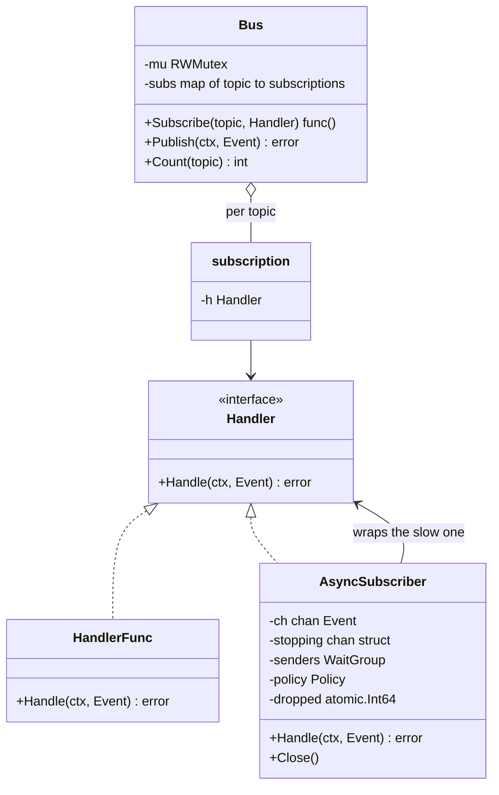
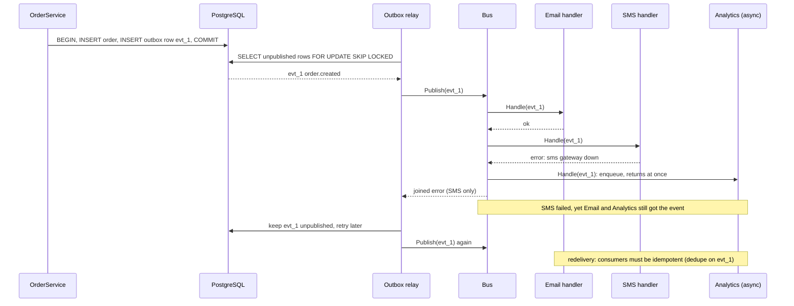

# Observer and Event Bus

> [!summary] TL;DR
> In the Observer pattern a *subject* keeps a list of *observers* and calls each of them when something happens, without knowing what they do. An **event bus** is the same idea with topics: code publishes `order.created`, and every handler subscribed to that topic runs. The hard parts in Go are concurrency (a locked handler list), failures (one bad handler must not stop the rest), slow handlers, unsubscribing, and not announcing events that were never committed.

> [!abstract] Core idea
> - A publisher announces "this happened" on a topic; every subscriber to that topic gets called. The publisher does not know who listens.
> - Copy the handler list under the lock, then call handlers **outside** the lock, so a slow or re-entrant handler cannot block the bus.
> - One failing or panicking handler must not stop the others.
> - Classic mistake: publishing an event inside a database transaction that later rolls back. Publish after commit, through the **transactional outbox** (an event row saved in the same transaction and sent later by a relay; see [[Transactional Outbox and CDC]]).

## 1. Why it exists

`CreateOrder` saves an order and then must send an email, send an SMS, update analytics and warm a cache. Written inline, `CreateOrder` imports four packages, takes about 4 × 50 ms = 200 ms longer (an estimate: 50 ms per remote call), and fails the whole order when the SMS gateway is down. Every new reaction means editing the order code again.

With an event bus, `CreateOrder` publishes one `order.created` event. Email, SMS and analytics subscribe on their own, and the order code never changes when a fourth reaction is added.

The obvious first version, a plain map from topic to handlers with `Subscribe` and `Publish`, has three bugs, all fixed below:

- **An unguarded handler map.** `Subscribe` running during `Publish` is a data race, and two concurrent `Subscribe` calls can crash the process with `fatal error: concurrent map writes`.
- **`Publish` returns on the first error.** When SMS fails, analytics never hears about the order.
- **No unsubscribe, no async delivery.** A handler can never be removed, and one slow handler slows every publisher.

## 2. Mental model

A **newsletter**. The publisher keeps a mailing list (the subscriptions). When an issue is out, it is sent to everyone on the list. The publisher does not know or care what readers do with it, readers can unsubscribe, and one reader's full mailbox must not stop delivery to the others.

The roles:

- **Subject (publisher):** owns the list and announces events. Here, `Bus`.
- **Observer (subscriber):** reacts to an event. Here, anything with `Handle(ctx, Event) error`.
- **Event:** a fact that already happened, named in the past tense (`order.created`), with an ID so consumers can spot duplicates.

## 3. How it works



**Publishing (synchronous):**

1. Take the read lock, **copy** the topic's subscription slice, release the lock. Handlers never run under the lock, so a handler may subscribe or unsubscribe without deadlocking, and `Subscribe` never waits for a slow handler.
2. Call each handler in subscription order on the publisher's goroutine, through `safeCall`, which turns a panic into an error.
3. Collect every error and return `errors.Join(errs...)`: `nil` if all succeeded, otherwise all failures, each still matchable with `errors.Is`.

**Subscribing:** `Subscribe` appends a new `*subscription` under the write lock and returns an `unsubscribe` function wrapped in `sync.OnceFunc`, so calling it twice is harmless. Each subscription is a distinct pointer, which matters because a `HandlerFunc` value cannot be compared with `==`.

**Asynchronous delivery:** wrap a slow handler in an `AsyncSubscriber`. It is itself a `Handler`, so it plugs into the same bus. `Handle` only puts the event on a buffered channel; one goroutine per subscriber drains it in order. When the buffer is full, the policy decides: **Block** (the publisher waits: back-pressure) or **DropNewest** (the event is dropped and counted). A blocked publisher waits **without holding any lock**, so `Close` can always stop intake: it wakes every blocked sender with `ErrClosed`, drains what was already accepted, and returns once the handler has finished those events.

**Publish after commit.** An in-process bus forgets everything when the process dies, and publishing inside a database transaction announces orders that may roll back. The fix is the transactional outbox: write the event row in the **same transaction** as the order, and let a relay publish committed rows.



### Whiteboard version

The bare idea: a map from topic to handlers, and `Publish` calls each one. The full version in section 4 adds the production concerns.

```go
package main

import (
	"fmt"
	"slices"
	"sync"
)

type Handler func(payload string)

type Bus struct {
	mu   sync.RWMutex
	subs map[string][]Handler
}

func NewBus() *Bus { return &Bus{subs: map[string][]Handler{}} }

func (b *Bus) Subscribe(topic string, h Handler) {
	b.mu.Lock()
	defer b.mu.Unlock()
	b.subs[topic] = append(b.subs[topic], h)
}

func (b *Bus) Publish(topic, payload string) {
	b.mu.RLock()
	hs := slices.Clone(b.subs[topic]) // copy the list under the lock
	b.mu.RUnlock()
	for _, h := range hs { // call handlers outside the lock
		h(payload)
	}
}

func main() {
	bus := NewBus()
	bus.Subscribe("order.created", func(p string) { fmt.Println("email:", p) })
	bus.Subscribe("order.created", func(p string) { fmt.Println("analytics:", p) })
	bus.Publish("order.created", "order 42")
}
```

## 4. Worked example

One `package main`: the bus with a guarded subscription map, error and panic isolation, unsubscribe, an async subscriber with Block and DropNewest policies, and an idempotent-consumer wrapper. It compiles with Go 1.24 and passes `go vet` and `go test -race`, using only the standard library.

```go
// Command events shows an in-process event bus (the Observer pattern):
// synchronous delivery with error isolation, unsubscribe, an async
// subscriber with a slow-subscriber policy, and an idempotent consumer.
package main

import (
	"context"
	"errors"
	"fmt"
	"slices"
	"sync"
	"sync/atomic"
)

type Event struct {
	ID      string // unique; consumers de-duplicate on it
	Name    string // topic, e.g. "order.created"
	OrderID string
}

// Handler is the observer interface.
type Handler interface {
	Handle(ctx context.Context, e Event) error
}

// HandlerFunc lets a plain function be a Handler, like http.HandlerFunc.
type HandlerFunc func(ctx context.Context, e Event) error

func (f HandlerFunc) Handle(ctx context.Context, e Event) error { return f(ctx, e) }

type subscription struct{ h Handler }

// Bus is the subject. Safe for concurrent Subscribe, unsubscribe and Publish.
type Bus struct {
	mu   sync.RWMutex
	subs map[string][]*subscription
}

func NewBus() *Bus { return &Bus{subs: make(map[string][]*subscription)} }

// Subscribe registers h for topic and returns the function that removes it.
// Calling the returned function more than once is safe.
func (b *Bus) Subscribe(topic string, h Handler) (unsubscribe func()) {
	s := &subscription{h: h}
	b.mu.Lock()
	b.subs[topic] = append(b.subs[topic], s)
	b.mu.Unlock()
	return sync.OnceFunc(func() {
		b.mu.Lock()
		defer b.mu.Unlock()
		b.subs[topic] = slices.DeleteFunc(b.subs[topic], func(x *subscription) bool { return x == s })
	})
}

func (b *Bus) Count(topic string) int {
	b.mu.RLock()
	defer b.mu.RUnlock()
	return len(b.subs[topic])
}

// Publish calls every handler for e.Name, in subscription order, on the
// caller's goroutine. A failing or panicking handler does not stop the
// others; every error comes back joined.
func (b *Bus) Publish(ctx context.Context, e Event) error {
	b.mu.RLock()
	subs := slices.Clone(b.subs[e.Name]) // never call handlers under the lock
	b.mu.RUnlock()
	var errs []error
	for _, s := range subs {
		errs = append(errs, safeCall(ctx, s.h, e))
	}
	return errors.Join(errs...)
}

func safeCall(ctx context.Context, h Handler, e Event) (err error) {
	defer func() {
		if r := recover(); r != nil {
			err = fmt.Errorf("handler panicked on %s: %v", e.ID, r)
		}
	}()
	return h.Handle(ctx, e)
}

// ---- async delivery: one buffered channel and goroutine per subscriber ----

type Policy int

const (
	Block      Policy = iota // publisher waits for room: back-pressure
	DropNewest               // event is dropped and counted; publisher never waits
)

var ErrClosed = errors.New("subscriber closed")

// AsyncSubscriber is a Handler that queues events for its own goroutine,
// so a slow handler cannot slow the publisher (with DropNewest) and
// events reach it in publish order.
type AsyncSubscriber struct {
	mu       sync.RWMutex // guards closed and senders.Add; never held while waiting
	closed   bool
	senders  sync.WaitGroup // Handle calls that may still send on ch
	stopping chan struct{}  // closed by Close: wakes every blocked sender
	ch       chan Event
	policy   Policy
	done     chan struct{} // closed when the worker has drained ch
	dropped  atomic.Int64
}

func NewAsync(h Handler, buffer int, p Policy, onErr func(error)) *AsyncSubscriber {
	a := &AsyncSubscriber{ch: make(chan Event, buffer), policy: p,
		stopping: make(chan struct{}), done: make(chan struct{})}
	go func() {
		defer close(a.done)
		for e := range a.ch {
			if err := safeCall(context.Background(), h, e); err != nil {
				onErr(err)
			}
		}
	}()
	return a
}

func (a *AsyncSubscriber) Handle(ctx context.Context, e Event) error {
	// Register as a sender under the lock, then send WITHOUT the lock: a sender
	// blocked on a full buffer must not stop Close or other callers.
	a.mu.RLock()
	if a.closed {
		a.mu.RUnlock()
		return ErrClosed
	}
	a.senders.Add(1)
	a.mu.RUnlock()
	defer a.senders.Done()

	if a.policy == DropNewest {
		select {
		case a.ch <- e:
		default:
			a.dropped.Add(1)
		}
		return nil
	}
	select {
	case a.ch <- e:
		return nil
	case <-a.stopping: // Close was called: give up instead of waiting for room
		return ErrClosed
	case <-ctx.Done():
		return ctx.Err()
	}
}

// Close stops intake at once (blocked senders get ErrClosed), lets the worker
// drain what was already accepted, and waits for it. Safe to call twice.
func (a *AsyncSubscriber) Close() {
	a.mu.Lock()
	first := !a.closed
	a.closed = true
	a.mu.Unlock()
	if first {
		close(a.stopping) // wake every sender blocked on a full buffer
		a.senders.Wait()  // no Handle can still send on ch after this
		close(a.ch)       // so closing it cannot panic a sender
	}
	<-a.done
}

func (a *AsyncSubscriber) Dropped() int64 { return a.dropped.Load() }

// Idempotent wraps h so that a redelivered event ID is handled once.
// In production the seen set is a table written in the handler's own
// transaction; the lock here also serialises this handler's calls.
func Idempotent(h Handler) Handler {
	var mu sync.Mutex
	seen := make(map[string]bool)
	return HandlerFunc(func(ctx context.Context, e Event) error {
		mu.Lock()
		defer mu.Unlock()
		if seen[e.ID] {
			return nil
		}
		if err := h.Handle(ctx, e); err != nil {
			return err // not marked: a retry will run it again
		}
		seen[e.ID] = true
		return nil
	})
}

func main() {
	ctx := context.Background()
	bus := NewBus()

	bus.Subscribe("order.created", HandlerFunc(func(_ context.Context, e Event) error {
		fmt.Println("email sent for", e.OrderID)
		return nil
	}))
	bus.Subscribe("order.created", HandlerFunc(func(context.Context, Event) error {
		return errors.New("sms gateway down")
	}))
	var analytics atomic.Int64
	async := NewAsync(Idempotent(HandlerFunc(func(context.Context, Event) error {
		analytics.Add(1)
		return nil
	})), 64, DropNewest, func(err error) { fmt.Println("async error:", err) })
	unsubscribe := bus.Subscribe("order.created", async)

	e := Event{ID: "evt_1", Name: "order.created", OrderID: "ord_1"}
	fmt.Println("publish:", bus.Publish(ctx, e))
	fmt.Println("redeliver:", bus.Publish(ctx, e)) // the outbox relay retries

	unsubscribe()
	async.Close() // drains the buffer before returning
	fmt.Println("analytics handled:", analytics.Load(), "| subscribers left:", bus.Count("order.created"))
}
```

Output of `go run .` (Go 1.24.4):

```text
email sent for ord_1
publish: sms gateway down
email sent for ord_1
redeliver: sms gateway down
analytics handled: 1 | subscribers left: 2
```

Read it closely. The SMS failure did not stop the other handlers. On redelivery the email handler, which is **not** idempotent, sent a second email, while analytics, wrapped in `Idempotent`, counted the order once. That is the whole argument for idempotent consumers in one run.

The tests check error and panic isolation, unsubscribing from inside a handler, concurrent subscribe and publish under the race detector, both slow-subscriber policies, idempotent redelivery, a closed subscriber, and `Close` releasing a sender that is blocked on a full buffer with a context that never ends:

```go
package main

import (
	"context"
	"errors"
	"sync"
	"sync/atomic"
	"testing"
	"time"
)

var errBoom = errors.New("boom")

func TestPublishIsolatesFailingAndPanickingHandlers(t *testing.T) {
	bus := NewBus()
	var calls atomic.Int64
	ok := HandlerFunc(func(context.Context, Event) error { calls.Add(1); return nil })
	bus.Subscribe("t", ok)
	bus.Subscribe("t", HandlerFunc(func(context.Context, Event) error { return errBoom }))
	bus.Subscribe("t", HandlerFunc(func(context.Context, Event) error { panic("bad handler") }))
	bus.Subscribe("t", ok)

	err := bus.Publish(context.Background(), Event{ID: "e1", Name: "t"})
	if !errors.Is(err, errBoom) {
		t.Fatalf("err = %v, want errBoom inside", err)
	}
	if calls.Load() != 2 {
		t.Fatalf("healthy handlers called %d times, want 2", calls.Load())
	}
}

func TestUnsubscribeIsIdempotentAndWorksFromInsideAHandler(t *testing.T) {
	bus := NewBus()
	var once func()
	var calls atomic.Int64
	once = bus.Subscribe("t", HandlerFunc(func(context.Context, Event) error {
		calls.Add(1)
		once() // a one-shot handler removes itself; no deadlock
		return nil
	}))
	for range 3 {
		if err := bus.Publish(context.Background(), Event{Name: "t"}); err != nil {
			t.Fatal(err)
		}
	}
	once()
	if calls.Load() != 1 || bus.Count("t") != 0 {
		t.Fatalf("calls=%d subscribers=%d, want 1 and 0", calls.Load(), bus.Count("t"))
	}
}

func TestConcurrentSubscribeAndPublish(t *testing.T) {
	bus := NewBus()
	noop := HandlerFunc(func(context.Context, Event) error { return nil })
	var wg sync.WaitGroup
	for range 8 {
		wg.Add(2)
		go func() {
			defer wg.Done()
			for range 200 {
				bus.Subscribe("t", noop)()
			}
		}()
		go func() {
			defer wg.Done()
			for range 200 {
				_ = bus.Publish(context.Background(), Event{Name: "t"})
			}
		}()
	}
	wg.Wait()
	if n := bus.Count("t"); n != 0 {
		t.Fatalf("leaked %d subscriptions", n)
	}
}

func TestDropPolicyNeverBlocksThePublisher(t *testing.T) {
	gate := make(chan struct{})
	var handled atomic.Int64
	slow := HandlerFunc(func(context.Context, Event) error { <-gate; handled.Add(1); return nil })
	a := NewAsync(slow, 1, DropNewest, func(error) {})
	bus := NewBus()
	bus.Subscribe("t", a)

	for range 10 { // returns at once although the handler is stuck
		if err := bus.Publish(context.Background(), Event{Name: "t"}); err != nil {
			t.Fatal(err)
		}
	}
	close(gate)
	a.Close()
	if d, h := a.Dropped(), handled.Load(); d+h != 10 || d < 8 {
		t.Fatalf("dropped=%d handled=%d, want a sum of 10 and at least 8 dropped", d, h)
	}
}

func TestBlockPolicyAppliesBackPressure(t *testing.T) {
	gate := make(chan struct{})
	a := NewAsync(HandlerFunc(func(context.Context, Event) error { <-gate; return nil }), 1, Block, func(error) {})
	defer a.Close()
	defer close(gate)

	if err := a.Handle(context.Background(), Event{}); err != nil {
		t.Fatalf("first event: %v", err)
	}
	// At most 2 events fit while the handler is stuck: 1 in hand, 1 buffered.
	var err error
	for range 2 {
		ctx, cancel := context.WithTimeout(context.Background(), 20*time.Millisecond)
		err = a.Handle(ctx, Event{})
		cancel()
		if err != nil {
			break
		}
	}
	if !errors.Is(err, context.DeadlineExceeded) {
		t.Fatalf("err = %v, want DeadlineExceeded", err)
	}
}

func TestIdempotentConsumerHandlesRedeliveryOnce(t *testing.T) {
	var effects atomic.Int64
	fail := true
	h := Idempotent(HandlerFunc(func(context.Context, Event) error {
		if fail {
			fail = false
			return errBoom // first attempt fails, so it must run again
		}
		effects.Add(1)
		return nil
	}))
	e := Event{ID: "evt_1"}
	for range 4 {
		_ = h.Handle(context.Background(), e)
	}
	if effects.Load() != 1 {
		t.Fatalf("side effects = %d, want 1", effects.Load())
	}
}

func TestClosedSubscriberRejectsEvents(t *testing.T) {
	a := NewAsync(HandlerFunc(func(context.Context, Event) error { return nil }), 1, Block, func(error) {})
	a.Close()
	if err := a.Handle(context.Background(), Event{}); !errors.Is(err, ErrClosed) {
		t.Fatalf("err = %v, want ErrClosed", err)
	}
}

// A Block-policy sender is stuck: the handler is stuck and the buffer is full,
// and its context never ends. Close must still stop intake at once: the stuck
// sender and any new sender get ErrClosed, and Close returns once the handler
// finishes the event it holds and the buffered one.
func TestCloseReturnsWhileASendIsBlocked(t *testing.T) {
	gate := make(chan struct{})
	var handled atomic.Int64
	a := NewAsync(HandlerFunc(func(context.Context, Event) error { <-gate; handled.Add(1); return nil }), 1, Block, func(error) {})
	released := false
	defer func() {
		if !released {
			close(gate) // let a failing run clean up
		}
	}()
	for range 2 { // 1 in the handler's hand, 1 in the buffer
		if err := a.Handle(context.Background(), Event{}); err != nil {
			t.Fatal(err)
		}
	}
	for len(a.ch) != 1 { // wait until the worker took the first event
		time.Sleep(time.Millisecond)
	}
	stuck := make(chan error, 1)
	go func() { stuck <- a.Handle(context.Background(), Event{}) }() // blocks: no room, no deadline
	time.Sleep(20 * time.Millisecond)

	closed := make(chan struct{})
	go func() { a.Close(); close(closed) }()
	select {
	case err := <-stuck:
		if !errors.Is(err, ErrClosed) {
			t.Fatalf("blocked sender got %v, want ErrClosed", err)
		}
	case <-time.After(time.Second):
		t.Fatal("Close did not release the blocked sender")
	}
	late := make(chan error, 1)
	go func() { late <- a.Handle(context.Background(), Event{}) }()
	select {
	case err := <-late:
		if !errors.Is(err, ErrClosed) {
			t.Fatalf("new sender got %v, want ErrClosed", err)
		}
	case <-time.After(time.Second):
		t.Fatal("a new Handle call is blocked behind Close")
	}
	released = true
	close(gate)
	select {
	case <-closed:
	case <-time.After(time.Second):
		t.Fatal("Close did not return after the handler finished")
	}
	if h := handled.Load(); h != 2 {
		t.Fatalf("handled %d events, want the 2 accepted before Close", h)
	}
}
```

`go test -race -count=3` passes all eight tests on every run. The last test is a regression test: an earlier version held the read lock while blocked on `a.ch <- e`, so with a stuck handler and a context that never ends, `Close` (which needs the write lock) waited forever, and the waiting writer also blocked every new `Handle`. Against that version the test fails with "Close did not release the blocked sender".

### The outbox rows (PostgreSQL 17)

The outbox itself is explained in [[Transactional Outbox and CDC]]; this is only the part the bus depends on:

```sql
BEGIN;
INSERT INTO orders (id, user_id, total_paise, status)
VALUES ('ord_1', 'u1', 13600, 'created');
INSERT INTO outbox (id, topic, payload)
VALUES ('evt_1', 'order.created', '{"order_id": "ord_1"}');
COMMIT;

-- relay loop: claim a batch without blocking other relay instances
BEGIN;
SELECT id, topic, payload
FROM outbox
WHERE published_at IS NULL
ORDER BY created_at
LIMIT 100
FOR UPDATE SKIP LOCKED;
-- publish each row to the bus, then mark the ones whose Publish succeeded
UPDATE outbox SET published_at = now() WHERE id = ANY ($1);
COMMIT;
```

The row locks taken by `FOR UPDATE SKIP LOCKED` last only until the transaction ends, so the claim, the publishing and the `UPDATE` must share one transaction; in autocommit mode another relay could claim the same rows at once. `$1` is the array of ids whose `Publish` returned `nil`; the rest stay unpublished and are retried.

## 5. Variants and comparison

| Delivery style | How it works | Ordering | Use when | Cost |
| --- | --- | --- | --- | --- |
| Synchronous (this bus's `Publish`) | Handlers run one after another on the publisher's goroutine | Subscription order, publish order | Handlers are fast and the caller should see their errors | The publisher waits for the slowest handler |
| Goroutine per handler per event | `go h.Handle(ctx, e)` for each | None | Rarely; quick fire-and-forget | Unbounded goroutines, no back-pressure, errors lost |
| Buffered channel per subscriber (`AsyncSubscriber`) | One queue and one worker per subscriber | Per subscriber, in publish order | A handler is slow or calls the network | A policy for full buffers; events in the buffer are lost on crash |
| Outbox + relay | Event row committed with the data; a relay publishes it | Per relay, by `created_at` | The event must not be lost or announced before commit | Extra table, polling or CDC, at-least-once delivery |
| Message broker (Kafka, Redis Streams) | Events leave the process | Per partition or stream | Other services subscribe | Operations, schemas, consumer groups |

**Slow-subscriber policies:**

| Policy | What happens when the buffer is full | Pick it for |
| --- | --- | --- |
| Block | The publisher waits until there is room, its context ends, or the subscriber is closed (`ErrClosed`) | Events that must not be lost in process; back-pressure is acceptable |
| Drop newest | The new event is discarded and a counter goes up | Metrics, analytics, UI refresh hints |
| Drop oldest | The oldest queued event is discarded for the new one | "Latest state wins" feeds such as live location |
| Bigger buffer | More memory absorbs bursts | Short bursts only; it postpones the choice |

**Observer vs Mediator:** an event bus routes by topic and knows nothing about the events. A mediator owns a coordination rule. See [[Facade (vs Mediator)]].

## 6. Trade-offs and when not to use

**When not to use it in Go:**

- **The reaction is part of the operation.** If the order is invalid without the stock reservation, call inventory directly and handle the error; do not hide a required step behind an event.
- **One publisher, one listener, and it will stay that way.** A direct method call is easier to follow and to debug.
- **Across services.** An in-process bus cannot deliver to another process. Use the outbox and a broker ([[Kafka and Event Streaming]], [[Redis as a Queue - Lists, Streams and Pub-Sub]]).

**Pitfalls:**

- **No retry handling.** A failed handler needs a retry path: the relay keeps the outbox row, or the async worker retries with backoff.
- **Event published before the transaction commits.** Listeners act on an order that may roll back. Publish after commit, through the outbox.
- **Handlers doing too much synchronously.** A 2-second handler makes every publish take 2 seconds. Move it behind an `AsyncSubscriber`.
- **No idempotency in consumers.** Outbox delivery is at-least-once, so every consumer must de-duplicate on the event ID, as the run above shows.
- **Calling handlers under the lock.** A handler that subscribes or unsubscribes deadlocks, and a slow handler blocks every `Subscribe`.
- **Blocking on a channel under a lock.** The same mistake in the async subscriber: a sender waiting for buffer room while holding a read lock stops `Close` and, behind the waiting writer, every new sender. Never wait under a lock; select on a stop channel instead.
- **Leaking subscribers.** A request-scoped object that subscribes and never unsubscribes stays reachable from the bus forever, along with everything it references. Call `unsubscribe` with `defer`, or tie it to a context with `context.AfterFunc`.
- **Goroutine per event.** It looks asynchronous and free, but it has no ordering, no limit and no place for errors to go.

## 7. In production

- **Real systems:**
	- `os/signal.Notify(c, os.Interrupt)` subscribes a channel to signals, and `signal.Stop(c)` unsubscribes it. The package **does not block** when `c` is full, so it drops signals: a drop policy, which is why the docs ask for a buffered channel.
	- `context.AfterFunc(ctx, f)` (Go 1.21+) registers `f` to run in its own goroutine when `ctx` is done, and returns a `stop` function that unregisters it: an observer with unsubscribe.
	- In the practice problems: the order status listener in [[Food Ordering System]], the member notifier in [[Library Management]], and the inventory event publisher in [[Inventory Order Assignment (Dark Store)]].
	- At system scale, the same shape becomes a notification fan-out: compare [[Case Study - Notification System]].
- **Failure modes → fixes:**
	- Data race or `concurrent map writes` crash → `sync.RWMutex` around the map, copy the slice before calling handlers.
	- One handler's error hides the event from the others → call them all and `errors.Join` the errors.
	- A panicking handler takes down the publisher → `recover` in `safeCall`, report it as an error.
	- Slow handler stalls publishers → `AsyncSubscriber` with an explicit policy and a dropped-events counter.
	- Events lost on crash or announced before commit → transactional outbox and idempotent consumers.
- **What to monitor:** publish latency, handler errors and panics by handler, queue length and dropped events per async subscriber, subscriber count per topic (a count that only grows is a leak), outbox lag (age of the oldest unpublished row).

## 8. Deep dive

- **Why copy the slice, not just read it.** `slices.DeleteFunc` shifts elements inside the same backing array (and, since Go 1.22, zeroes the tail). If `Publish` ranged over the shared slice after unlocking, an unsubscribe could rewrite it mid-loop. `slices.Clone` under the read lock gives `Publish` a private snapshot. The cost is one small allocation per publish; copy-on-write (build a new slice on every subscribe or unsubscribe and swap it) moves that cost to the rare writes.
- **Snapshot semantics.** A handler that unsubscribes during a publish still receives the event in flight, because the snapshot was taken before. A handler subscribed during a publish receives only later events. State this guarantee; tests rely on it.
- **Ordering guarantees.** The synchronous bus gives subscription order per event and publish order per publishing goroutine. Two goroutines publishing at once have no defined order between their events. `AsyncSubscriber` keeps publish order per subscriber because one goroutine drains one FIFO channel. There is no order across subscribers.
- **Close without a panic, and without a hang.** Sending on a closed channel panics, so `Close` must never close `ch` under a sender. The tempting fix, holding a read lock for the whole send and taking the write lock to close, hangs: a Block-policy sender waiting for room keeps the read lock, `Close` waits for the write lock forever if the handler is stuck and the sender's context never ends, and because Go's `RWMutex` makes new readers queue behind a waiting writer, every new `Handle` blocks too. Instead, `Handle` holds the read lock only to check `closed` and register itself in a `sync.WaitGroup`, then sends with `select` on `ch`, a `stopping` channel and `ctx.Done()`. `Close` sets `closed` under the write lock (so no new sender can register), closes `stopping` (every blocked sender returns `ErrClosed`), waits for the registered senders, and only then closes `ch`. An event that wins the race into the buffer just before `stopping` fires is still handled, because the worker drains `ch` until it is closed. `Close` itself still waits for the worker to finish the accepted events; a handler that never returns needs its own timeout.
- **Idempotency belongs to the consumer.** The outbox guarantees at-least-once delivery, not exactly-once. The `Idempotent` wrapper keeps the seen set in memory; in production it is a `processed_events` table with a unique key, written in the same transaction as the handler's side effect. See [[Idempotency and Idempotency Keys]].
- **Typed events.** Topics as strings are flexible but unchecked. A generic `Bus[T any]` per event type catches a handler of the wrong event type at compile time. A `switch e := ev.(type)` over event structs is the weaker option: it replaces string topics with types, but a mismatch shows up only at run time. Generics are covered in [[Generics and Iterators]].

## 9. Interview questions

> [!question]- When should an order service publish `order.created`?
> After the transaction commits, never inside it. The reliable way is the transactional outbox: insert the event row in the same transaction as the order, and let a relay publish committed rows. Delivery is then at-least-once, so consumers must be idempotent.

> [!question]- One of five handlers returns an error. What should `Publish` do?
> Still call the other four, then return all errors joined with `errors.Join`. Returning on the first error silently hides the event from every later subscriber. Also recover panics per handler so one bug cannot crash the publisher.

> [!question]- Trap: you hold the bus's read lock while calling handlers, to keep the list stable. What goes wrong?
> A handler that calls `Subscribe` or `unsubscribe` asks for the write lock while its own goroutine holds the read lock, so it deadlocks. A slow handler also blocks every `Subscribe` call. Copy the slice under the lock and call handlers after releasing it.

> [!question]- A subscriber is much slower than the publisher. What are your options?
> Give it its own buffered channel and goroutine, then choose what happens when the buffer fills: block the publisher (back-pressure), drop the newest, drop the oldest, or grow the buffer for bursts. Count drops. With blocking, the publisher must wait with `select` on the channel, its context and a stop channel, never while holding a lock, or closing the subscriber can hang. For events that must never be lost, move them out of process to the outbox and a broker.

> [!question]- How do you avoid leaking subscribers in Go?
> `Subscribe` returns an `unsubscribe` function; call it with `defer` or tie it to a context with `context.AfterFunc`. Monitor subscriber counts per topic: a number that only grows is a leak.

> [!question]- What ordering does an in-process bus guarantee?
> Synchronous delivery: subscription order for each event and publish order per publishing goroutine. A per-subscriber channel keeps publish order for that subscriber only. Goroutine-per-handler gives no ordering at all.

> [!question]- Name observer-style APIs in the Go standard library.
> `signal.Notify` and `signal.Stop` subscribe and unsubscribe a channel to OS signals, dropping signals when the channel is full. `context.AfterFunc` registers a callback for when a context ends and returns a `stop` function.

## 10. Cheat sheet

- Subject keeps observers; publishes facts in the past tense, each with a unique ID.
- Guard the map with `sync.RWMutex`; clone the slice, then call handlers outside the lock.
- Call every handler; `errors.Join` the errors; recover panics per handler.
- `Subscribe` returns `unsubscribe` (`sync.OnceFunc`); call it or leak.
- Slow handlers: buffered channel per subscriber + policy (block, drop newest, drop oldest) + drop counter; a blocked send selects on the channel, `ctx.Done()` and a stop channel, outside any lock.
- Order: per subscriber at best; never across goroutines or subscribers.
- Publish after commit through the transactional outbox; consumers de-duplicate on event ID.

## Links

- **Before this:** [[Interfaces]], [[Goroutines and Channels]], [[sync Primitives and Atomics]]
- **Next:** [[State Machines in Go]] (emit an event on every transition), [[Transactional Outbox and CDC]], [[Pub-Sub Message Queue]]
- **Compare with:** [[Facade (vs Mediator)]] (a mediator owns routing rules), [[Case Study - Notification System]] (fan-out at system scale), [[Event-Driven Architecture Basics]], [[Kafka and Event Streaming]]
