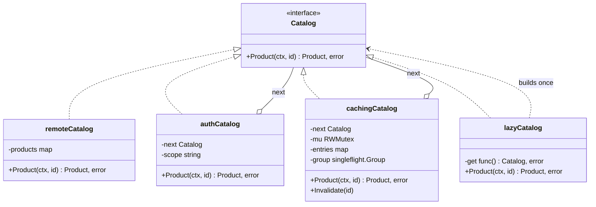
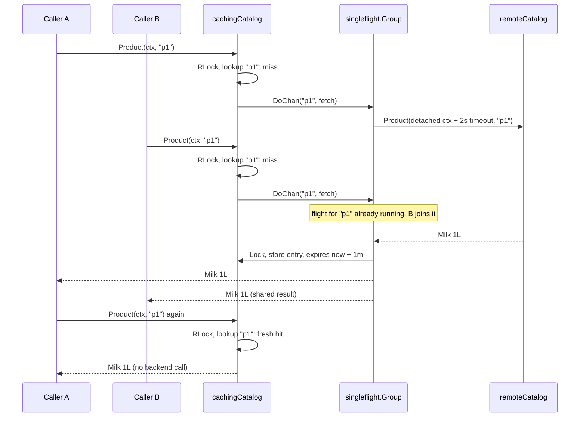

# Proxy

> [!summary] TL;DR
> A proxy is an object with **the same interface as the real object** (the *subject*) that stands in front of it and decides **whether, when and how** a call reaches it. In Go it is a struct that implements the subject's interface and holds the real implementation in a field. Typical jobs: caching, access checks, lazy creation, calling a remote service, and limiting load.

> [!abstract] Core idea
> - A proxy has the same interface as the real object and stands in front of it.
> - It decides whether, when and how a call reaches the real object: caching, access checks, lazy creation, remote calls.
> - The rule that matters: the caller cannot tell a proxy from the real thing, so it is added at wiring time without changing callers.
> - Classic mistake: a cache proxy that lets many concurrent misses all hit the backend at once (a cache stampede).

## 1. Why it exists

A cart service shows 8 products per cart and calls the catalog service for each one. At an estimated 2,000 cart views per second that is 16,000 catalog calls per second, each about 40 ms over the network (estimate). The catalog data changes a few times a day, so almost all of those calls fetch the same answers again.

You want three controls without touching either service's business code:

- **Cache** answers for a minute, so 95% hits (estimate) cut 16,000 calls/s to about 800.
- **Collapse concurrent misses.** When a popular product's entry expires, 300 requests can miss at the same moment. Without help they make 300 identical backend calls (a cache stampede). The test below starts **100 concurrent misses and measures exactly 1 backend call**.
- **Check access** before any of that happens.

The cart code depends on a `Catalog` interface. If every control implements that same interface, the cart code never changes: the composition root decides what sits in front of the real client.

## 2. Mental model

A proxy is a **receptionist in front of an expert**. You ask the receptionist exactly the question you would ask the expert. The receptionist may answer from a sheet of recent answers (caching), refuse you because you have no badge (protection), call the expert only once the first question arrives (lazy), or phone an expert in another city (remote). You cannot tell from the answer which of these happened.

Two rules define it:

1. **Same interface as the subject.** The caller cannot tell the proxy from the real thing.
2. **The proxy controls access to the subject.** It does not add new features to the answer; that is a decorator's job (see section 5).

## 3. How it works



The auth and caching proxies hold a `next Catalog`, and the lazy proxy builds its subject on first use, so proxies stack: `auth → cache → lazy → remote client`. A call to the caching proxy runs these steps:

1. Read the map under `RLock`. A fresh entry (positive or negative) is a **hit**: return it.
2. On a **miss**, call `singleflight.Group.DoChan(id, fn)` (`singleflight` from `golang.org/x/sync` makes concurrent calls for the same key share one execution and its result). If a flight for `id` is already running, this caller joins it instead of starting a new one.
3. Inside the flight: look again (a flight that just finished may have filled the entry), then call the backend with a detached context and a timeout.
4. Store the answer with a TTL: found products for 1 minute, "not found" for 10 seconds. Never cache timeouts or 5xx errors.
5. Every waiter receives the same result. A waiter whose own context ends returns early; the flight keeps going for the others.



### Whiteboard version

A caching proxy with a map and a mutex; the second call is a hit and never reaches the real catalog. This is the bare idea you can draw in two minutes; the full version below adds production concerns.

```go
package main

import (
	"fmt"
	"sync"
)

type Catalog interface{ Name(id string) string }

type RealCatalog struct{ calls int }

func (r *RealCatalog) Name(id string) string { r.calls++; return "product-" + id }

// CachingProxy has the same interface and holds the real subject.
type CachingProxy struct {
	mu    sync.Mutex
	real  Catalog
	cache map[string]string
}

func (p *CachingProxy) Name(id string) string {
	p.mu.Lock()
	defer p.mu.Unlock()
	if v, ok := p.cache[id]; ok {
		return v // hit: the real catalog is never called
	}
	v := p.real.Name(id)
	p.cache[id] = v
	return v
}

func main() {
	real := &RealCatalog{}
	var c Catalog = &CachingProxy{real: real, cache: map[string]string{}}
	c.Name("42")
	c.Name("42")
	fmt.Println(real.calls) // 1
}
```

## 4. Worked example

One `package main` with three proxies over one subject: protection (scope check from the context), caching (RWMutex, TTL, negative caching, which also caches "not found" for a short time, singleflight, invalidation, hit and miss counters) and virtual (lazy creation with `sync.OnceValues`, Go 1.21+). It compiles with Go 1.24 and passes `go vet` and `go test -race`. The only dependency is `golang.org/x/sync`. On Go 1.24 pin the version you tested with, `go get golang.org/x/sync@v0.19.0`: newer x/sync releases can raise their minimum Go version (as of November 2026 they require Go 1.25+), and then a bare `go get` makes the go command switch to a newer toolchain.

```go
// Command proxy puts three proxies in front of one product catalog:
// protection (auth), caching (TTL, negative caching, singleflight)
// and virtual (lazy init). All of them implement the same interface.
package main

import (
	"context"
	"errors"
	"fmt"
	"slices"
	"sync"
	"sync/atomic"
	"time"

	"golang.org/x/sync/singleflight"
)

type Product struct {
	ID         string
	Name       string
	PricePaise int64
}

var (
	ErrNotFound  = errors.New("product not found")
	ErrForbidden = errors.New("forbidden")
)

// Catalog is the subject interface. The real client and every proxy
// implement it, so a caller cannot tell which one it holds.
type Catalog interface {
	Product(ctx context.Context, id string) (Product, error)
}

// remoteCatalog stands in for the catalog-service client. In production
// it is an HTTP or gRPC stub, which is itself a remote proxy.
type remoteCatalog struct {
	products map[string]Product // read-only after construction
	delay    time.Duration      // simulated network latency
	calls    atomic.Int64
}

func (r *remoteCatalog) Product(ctx context.Context, id string) (Product, error) {
	r.calls.Add(1)
	select {
	case <-time.After(r.delay):
	case <-ctx.Done():
		return Product{}, ctx.Err()
	}
	p, ok := r.products[id]
	if !ok {
		return Product{}, ErrNotFound
	}
	return p, nil
}

// ---- protection proxy ----

type principalKey struct{}

type Principal struct {
	User   string
	Scopes []string
}

func WithPrincipal(ctx context.Context, p Principal) context.Context {
	return context.WithValue(ctx, principalKey{}, p)
}

// authCatalog forwards a call only if the caller holds the scope.
type authCatalog struct {
	next  Catalog
	scope string
}

func (a authCatalog) Product(ctx context.Context, id string) (Product, error) {
	p, ok := ctx.Value(principalKey{}).(Principal)
	if !ok || !slices.Contains(p.Scopes, a.scope) {
		return Product{}, ErrForbidden
	}
	return a.next.Product(ctx, id)
}

// ---- caching proxy ----

type entry struct {
	p       Product
	err     error // ErrNotFound marks a negative entry
	expires time.Time
}

type cachingCatalog struct {
	next    Catalog
	ttl     time.Duration // for found products
	negTTL  time.Duration // for "not found" answers
	timeout time.Duration // budget for one backend call
	now     func() time.Time

	mu      sync.RWMutex
	entries map[string]entry // unbounded here; production bounds it (LRU)
	gen     uint64           // bumped by Invalidate
	group   singleflight.Group

	hits, misses atomic.Int64 // export these as metrics
}

func newCachingCatalog(next Catalog, ttl, negTTL time.Duration) *cachingCatalog {
	return &cachingCatalog{
		next: next, ttl: ttl, negTTL: negTTL, timeout: 2 * time.Second,
		now: time.Now, entries: make(map[string]entry),
	}
}

// lookup returns a fresh entry and the current generation.
func (c *cachingCatalog) lookup(id string) (entry, bool, uint64) {
	c.mu.RLock()
	defer c.mu.RUnlock()
	e, ok := c.entries[id]
	return e, ok && c.now().Before(e.expires), c.gen
}

func (c *cachingCatalog) Product(ctx context.Context, id string) (Product, error) {
	if e, ok, _ := c.lookup(id); ok {
		c.hits.Add(1)
		return e.p, e.err // hit, positive or negative
	}
	c.misses.Add(1)
	// Miss: concurrent misses for the same id share one backend call.
	ch := c.group.DoChan(id, func() (any, error) {
		e, ok, gen := c.lookup(id)
		if ok { // a flight that finished a moment ago already filled it
			return e, nil
		}
		// The shared call must not die with the caller that happened to start it.
		cctx, cancel := context.WithTimeout(context.WithoutCancel(ctx), c.timeout)
		defer cancel()
		p, err := c.next.Product(cctx, id)
		switch {
		case err == nil:
			return c.store(id, entry{p: p}, c.ttl, gen), nil
		case errors.Is(err, ErrNotFound):
			return c.store(id, entry{err: ErrNotFound}, c.negTTL, gen), nil
		default:
			return nil, err // timeouts and 5xx are never cached
		}
	})
	select {
	case r := <-ch:
		if r.Err != nil {
			return Product{}, r.Err
		}
		e := r.Val.(entry)
		return e.p, e.err
	case <-ctx.Done():
		return Product{}, ctx.Err() // this caller gives up; the flight goes on
	}
}

// store caches e unless Invalidate ran while the backend call was in flight.
func (c *cachingCatalog) store(id string, e entry, ttl time.Duration, gen uint64) entry {
	e.expires = c.now().Add(ttl)
	c.mu.Lock()
	defer c.mu.Unlock()
	if c.gen == gen {
		c.entries[id] = e
	}
	return e
}

// Invalidate drops id, for example on a product.updated event.
func (c *cachingCatalog) Invalidate(id string) {
	c.mu.Lock()
	delete(c.entries, id)
	c.gen++ // fills that started before now must not write back old data
	c.mu.Unlock()
	c.group.Forget(id) // the next miss starts a fresh backend call
}

// ---- virtual proxy ----

// lazyCatalog builds the expensive subject on first use, exactly once.
type lazyCatalog struct {
	get func() (Catalog, error)
}

func newLazyCatalog(build func() (Catalog, error)) lazyCatalog {
	return lazyCatalog{get: sync.OnceValues(build)}
}

func (l lazyCatalog) Product(ctx context.Context, id string) (Product, error) {
	c, err := l.get()
	if err != nil {
		return Product{}, fmt.Errorf("catalog unavailable: %w", err)
	}
	return c.Product(ctx, id)
}

func main() {
	backend := &remoteCatalog{products: map[string]Product{
		"p1": {ID: "p1", Name: "Milk 1L", PricePaise: 6800},
	}}
	lazy := newLazyCatalog(func() (Catalog, error) {
		fmt.Println("connecting to catalog service")
		return backend, nil
	})
	// Composition root: auth outside, cache in the middle, lazy client inside.
	cache := newCachingCatalog(lazy, time.Minute, 10*time.Second)
	var catalog Catalog = authCatalog{scope: "catalog:read", next: cache}

	ctx := WithPrincipal(context.Background(),
		Principal{User: "u1", Scopes: []string{"catalog:read"}})
	for _, id := range []string{"p1", "p1", "p404", "p404"} {
		p, err := catalog.Product(ctx, id)
		fmt.Printf("%s -> %q err=%v\n", id, p.Name, err)
	}
	_, err := catalog.Product(context.Background(), "p1")
	fmt.Println("anonymous -> err =", err)
	fmt.Printf("backend calls=%d hits=%d misses=%d\n",
		backend.calls.Load(), cache.hits.Load(), cache.misses.Load())
}
```

Output of `go run .` (Go 1.24.4):

```text
connecting to catalog service
p1 -> "Milk 1L" err=<nil>
p1 -> "Milk 1L" err=<nil>
p404 -> "" err=product not found
p404 -> "" err=product not found
anonymous -> err = forbidden
backend calls=2 hits=2 misses=2
```

The lazy proxy connects once, on the first call. The second `p1` and the second `p404` are hits, so the backend sees 2 calls for 4 requests. The anonymous request never reaches the cache.

The tests cover the stampede, TTL expiry, negative caching, invalidation, a cancelled caller, the auth rules and lazy creation:

```go
package main

import (
	"context"
	"errors"
	"sync"
	"sync/atomic"
	"testing"
	"time"
)

var milk = Product{ID: "p1", Name: "Milk 1L", PricePaise: 6800}

func newBackend(delay time.Duration) *remoteCatalog {
	return &remoteCatalog{products: map[string]Product{"p1": milk}, delay: delay}
}

type fakeClock struct {
	mu sync.Mutex
	t  time.Time
}

func (f *fakeClock) Now() time.Time      { f.mu.Lock(); defer f.mu.Unlock(); return f.t }
func (f *fakeClock) Add(d time.Duration) { f.mu.Lock(); f.t = f.t.Add(d); f.mu.Unlock() }

func TestConcurrentMissesShareOneBackendCall(t *testing.T) {
	backend := newBackend(20 * time.Millisecond)
	c := newCachingCatalog(backend, time.Minute, time.Second)
	var wg sync.WaitGroup
	for range 100 {
		wg.Add(1)
		go func() {
			defer wg.Done()
			if p, err := c.Product(context.Background(), "p1"); err != nil || p != milk {
				t.Errorf("got %v, %v", p, err)
			}
		}()
	}
	wg.Wait()
	if n := backend.calls.Load(); n != 1 {
		t.Fatalf("backend calls = %d, want 1", n)
	}
}

func TestTTLAndNegativeCaching(t *testing.T) {
	backend := newBackend(0)
	clock := &fakeClock{t: time.Unix(0, 0)}
	c := newCachingCatalog(backend, time.Minute, 10*time.Second)
	c.now = clock.Now
	ctx := context.Background()

	steps := []struct {
		advance   time.Duration
		id        string
		wantErr   error
		wantCalls int64
	}{
		{0, "p1", nil, 1},                         // cold miss
		{30 * time.Second, "p1", nil, 1},          // hit within TTL
		{31 * time.Second, "p1", nil, 2},          // expired after 61s
		{0, "p404", ErrNotFound, 3},               // negative miss
		{5 * time.Second, "p404", ErrNotFound, 3}, // negative hit
		{6 * time.Second, "p404", ErrNotFound, 4}, // negative entry expired
	}
	for i, s := range steps {
		clock.Add(s.advance)
		_, err := c.Product(ctx, s.id)
		if !errors.Is(err, s.wantErr) {
			t.Fatalf("step %d: err = %v, want %v", i, err, s.wantErr)
		}
		if n := backend.calls.Load(); n != s.wantCalls {
			t.Fatalf("step %d: backend calls = %d, want %d", i, n, s.wantCalls)
		}
	}
}

func TestInvalidateForcesRefetch(t *testing.T) {
	backend := newBackend(0)
	c := newCachingCatalog(backend, time.Minute, time.Second)
	ctx := context.Background()
	if _, err := c.Product(ctx, "p1"); err != nil {
		t.Fatal(err)
	}
	c.Invalidate("p1")
	if _, err := c.Product(ctx, "p1"); err != nil {
		t.Fatal(err)
	}
	if n := backend.calls.Load(); n != 2 {
		t.Fatalf("backend calls = %d, want 2", n)
	}
}

func TestCallerCancelDoesNotFailOtherWaiters(t *testing.T) {
	backend := newBackend(50 * time.Millisecond)
	c := newCachingCatalog(backend, time.Minute, time.Second)

	impatient, cancel := context.WithTimeout(context.Background(), 5*time.Millisecond)
	defer cancel()
	errA := make(chan error, 1)
	go func() { _, err := c.Product(impatient, "p1"); errA <- err }()
	time.Sleep(time.Millisecond) // let the impatient caller start the flight

	p, err := c.Product(context.Background(), "p1")
	if err != nil || p != milk {
		t.Fatalf("patient caller got %v, %v", p, err)
	}
	if err := <-errA; err != nil && !errors.Is(err, context.DeadlineExceeded) {
		t.Fatalf("impatient caller err = %v", err)
	}
}

func TestAuthProxy(t *testing.T) {
	c := authCatalog{next: newBackend(0), scope: "catalog:read"}
	tests := []struct {
		name    string
		ctx     context.Context
		wantErr error
	}{
		{"no principal", context.Background(), ErrForbidden},
		{"wrong scope", WithPrincipal(context.Background(), Principal{User: "u", Scopes: []string{"orders:read"}}), ErrForbidden},
		{"allowed", WithPrincipal(context.Background(), Principal{User: "u", Scopes: []string{"catalog:read"}}), nil},
	}
	for _, tt := range tests {
		t.Run(tt.name, func(t *testing.T) {
			if _, err := c.Product(tt.ctx, "p1"); !errors.Is(err, tt.wantErr) {
				t.Fatalf("err = %v, want %v", err, tt.wantErr)
			}
		})
	}
}

func TestLazyProxyBuildsOnce(t *testing.T) {
	var builds atomic.Int64
	l := newLazyCatalog(func() (Catalog, error) {
		builds.Add(1)
		return newBackend(0), nil
	})
	var wg sync.WaitGroup
	for range 50 {
		wg.Add(1)
		go func() { defer wg.Done(); l.Product(context.Background(), "p1") }()
	}
	wg.Wait()
	if n := builds.Load(); n != 1 {
		t.Fatalf("builds = %d, want 1", n)
	}
}
```

`go test -race -count=1 -v` passes all six tests. `TestConcurrentMissesShareOneBackendCall` is the measurement quoted in section 1: 100 goroutines, 1 backend call.

## 5. Variants and comparison

**Kinds of proxy:**

| Kind | What it controls | Go shape | Cost |
| --- | --- | --- | --- |
| Caching | Whether the call reaches the subject at all | `RWMutex` + map + TTL, plus `singleflight` for misses | Stale reads up to the TTL; memory; invalidation work |
| Protection (auth) | Who may call | Read the principal from `ctx`, check scope or ownership, then forward | Must sit outside any shared cache |
| Remote | Where the subject runs | gRPC client stub, HTTP client wrapper, `httputil.ReverseProxy` | Network failures become your errors; needs timeouts and retries |
| Virtual (lazy) | When the subject is created | `sync.OnceValues(build)` | First caller pays the latency; a build error is cached forever |
| Rate or concurrency limited | How fast or how many at once | `rate.Limiter.Wait(ctx)` from `golang.org/x/time/rate`, or a buffered-channel semaphore | Added queueing latency; callers must handle rejection |

**Proxy vs Decorator vs Adapter.** In Go all three are "a struct that wraps an interface value", so tell them apart by intent:

| Pattern | Interface it exposes | Intent | Who creates the wrapped object |
| --- | --- | --- | --- |
| Proxy | The same as the subject | Control access: cache, guard, defer, relocate, throttle | Often the proxy or the composition root; a virtual proxy creates it itself |
| [[Decorator and Middleware]] | The same as the component | Add behaviour to every call: logging, metrics, retries, headers | The caller or composition root, which passes in an existing object and chooses which decorators to stack and in what order |
| [[Adapter]] | A different one, the one the client expects | Convert an incompatible interface | The caller passes in the adaptee |
| [[Facade (vs Mediator)]] | A new, simpler one | Hide a whole subsystem behind one API | The facade's constructor receives the parts |

The line between Proxy and Decorator is blurry in real code. A logging wrapper is a decorator; a wrapper that may skip the call (cache hit, access denied) is a proxy.

## 6. Trade-offs and when not to use

**When not to use it in Go:**

- **One call site, no reuse.** A three-line `if cached { return }` inside the only function that needs it is easier to read than a new type.
- **The data must be fresh.** Account balances, stock that is being reserved, prices at checkout: read from the source of truth, or cache with explicit invalidation and accept the cost.
- **You need a different API.** That is an [[Adapter]] or a [[Facade (vs Mediator)]], not a proxy.
- **The concern belongs in the network layer.** TLS, retries and load balancing across hosts often belong in a sidecar or the HTTP transport, not in an application struct.

**Pitfalls:**

- **Unguarded map.** With a plain map, two concurrent misses can write it at once and the runtime aborts with `fatal error: concurrent map writes`. Guard it with `sync.RWMutex`, as above.
- **Wrong stacking order.** A cache placed **outside** the auth proxy serves a cached product to a caller who would have been refused. Put auth outside, or include the principal in the cache key.
- **Caching errors.** Caching a timeout turns a 40 ms blip into a minute of failures. Cache only definite answers (found, not found).
- **First caller's context.** A shared flight that uses the starter's `ctx` fails for everyone when that one caller cancels. Detach with `context.WithoutCancel` and add the proxy's own timeout.
- **Unbounded cache.** A map that only grows is a memory leak with a hit rate. Bound it with an LRU (see [[LRU Cache with TTL]]).
- **Hidden latency.** A proxy that looks like a local call but goes over the network surprises callers. Make every method take a `ctx` so deadlines flow through.

## 7. In production

- **Real systems:**
	- `net/http/httputil.ReverseProxy` is an `http.Handler` that forwards each request to another server: the network form of a remote proxy. Since Go 1.20 its `Rewrite` hook is the recommended way to change the outbound request; `Director` is the older hook. The network-level picture is in [[Forward and Reverse Proxies - L4 vs L7]].
	- A **gRPC generated client** (`pb.NewCatalogClient(conn)`) returns an interface whose methods marshal the request and call `conn.Invoke` over HTTP/2. Your code calls it like a local object: a remote proxy. See [[gRPC]].
	- `golang.org/x/sync/singleflight` came from groupcache, which uses it so that concurrent loads of the same key share one fetch.
	- `sync.OnceValue` and `sync.OnceValues` (Go 1.21+) are the standard building block for virtual proxies and lazily opened clients.
- **Failure modes → fixes:**
	- Hot key expires and the backend sees a spike → `singleflight`, plus TTL jitter so many keys do not expire together; see [[Cache Failure Modes - Stampede, Avalanche, Penetration, Hot and Big Keys]].
	- Many lookups of ids that do not exist (scrapers, bad links) → negative caching with a short TTL.
	- Stale data after an update → `Invalidate` on the update event; the generation counter stops a fill that started before the update from writing the old value back.
	- Backend hangs → the proxy's own timeout bounds the flight; callers' deadlines bound their wait.
- **What to monitor:** hit ratio (`hits / (hits + misses)`), backend calls per second, the share of results with `Shared == true` from singleflight, backend latency and timeout rate, cache size, and denied calls from the auth proxy.

## 8. Deep dive

- **What singleflight does and does not do.** `Do` and `DoChan` deduplicate only calls that **overlap in time** for the same key. Once a flight returns, the key is forgotten and the next miss starts a new flight. That is why the flight re-checks the cache first: a caller that missed just before the previous flight stored its value would otherwise trigger a second backend call.
- **`Forget(key)`.** It makes the next call for the key start a fresh flight even if one is still running. `Invalidate` calls it so that readers after an update do not join a flight that is fetching pre-update data.
- **Why the generation counter.** Timeline: flight F starts and reads version 1, an update arrives and `Invalidate` deletes the key, F finishes and stores version 1 for a whole TTL. Recording `gen` before the fetch and storing only if it is unchanged closes that window. It is coarse (one counter for all keys); per-key versions are finer but need more memory.
- **Negative caching.** The "not found" answer is cached as a sentinel error with a shorter TTL (10 s here versus 1 minute) so a product created right after a miss shows up quickly.
- **Lazy proxy details.** `sync.OnceValues` runs `build` once even under concurrent first calls, and every later call returns the same `(Catalog, error)`. If `build` fails, the error is cached for the life of the process. When a retry is needed, write the lazy proxy with a mutex and a nil check instead of `OnceValues`.
- **Proxy and context values.** The protection proxy reads the principal from `ctx` (set by authentication middleware). Use an unexported key type such as `principalKey{}` so no other package can collide with or forge the key. Context mechanics are in [[Context Package]].

## 9. Interview questions

> [!question]- What makes something a Proxy rather than a Decorator, when both wrap the same interface in Go?
> Intent. A proxy controls access to the subject: it may skip the call (cache hit, denied), delay creating it (lazy) or send it elsewhere (remote). A decorator always calls through and adds behaviour such as logging or retries. In GoF terms, a proxy often manages its subject's life cycle, while decorators are given an existing object and stacked by the caller.

> [!question]- Your caching proxy uses a map. What breaks under load, and how do you fix it?
> Concurrent writes to a Go map crash the process with `fatal error: concurrent map writes`, and a read during a write is a data race. Guard it with `sync.RWMutex` (or use `sync.Map` for mostly-disjoint keys), bound its size, and give entries a TTL.

> [!question]- 300 requests miss the same key at once. What happens with and without singleflight?
> Without it, 300 identical backend calls: a stampede that can take the backend down. With `singleflight` keyed by the id, one caller runs the fetch and the other 299 wait for the same result. Add a re-check inside the flight and TTL jitter so neighbouring keys do not expire together.

> [!question]- Trap: should the cache sit inside or outside the auth proxy?
> Inside, unless the cache key includes the principal. A cache outside the auth check serves a cached product to a caller the auth proxy would have refused. The order of proxies is a security decision, not a style choice.

> [!question]- Should a caching proxy cache errors?
> Only definite answers. "Not found" is worth caching briefly (negative caching) to absorb lookups of missing ids. Timeouts, 5xx errors and cancelled contexts must not be cached, or a short outage becomes a TTL-long one.

> [!question]- Is a gRPC client a proxy?
> Yes, a remote proxy. The generated client implements the service interface, marshals each call and sends it over the connection, so callers use it like a local object. That is also why every method takes a `ctx`: the deadline must travel with the call.

> [!question]- How do you build a lazy proxy in Go 1.24?
> Store `sync.OnceValues(build)` and call it at the top of every method. It runs `build` exactly once even when many goroutines call at the same time. The catch: an error from `build` is also remembered forever, so use a mutex and retry logic when the dependency can come back.

## 10. Cheat sheet

- Proxy = same interface as the subject + control over whether, when or where the call happens.
- Kinds: caching, protection, remote, virtual (lazy), rate or concurrency limited.
- Caching proxy: `RWMutex` map + TTL + negative caching + `singleflight` + invalidation with a generation check.
- Detach the shared flight from the first caller: `context.WithoutCancel(ctx)` plus the proxy's own timeout.
- Never cache timeouts or 5xx errors; cache "not found" briefly.
- Auth outside the cache, or put the principal in the cache key.
- Lazy proxy: `sync.OnceValues` (Go 1.21+); it caches the build error too.
- Proxy controls access, Decorator adds behaviour, Adapter changes the interface.

## Links

- **Before this:** [[Interfaces]], [[Design Patterns Overview and Chooser]], [[Decorator and Middleware]]
- **Next:** [[Facade (vs Mediator)]], [[Caching Patterns]], [[Cache Failure Modes - Stampede, Avalanche, Penetration, Hot and Big Keys]]
- **Compare with:** [[Decorator and Middleware]] (adds behaviour, never skips the call), [[Adapter]] (changes the interface), [[Forward and Reverse Proxies - L4 vs L7]] (the network-level proxy), [[Singleton and sync.Once]] (the once-only building block)
