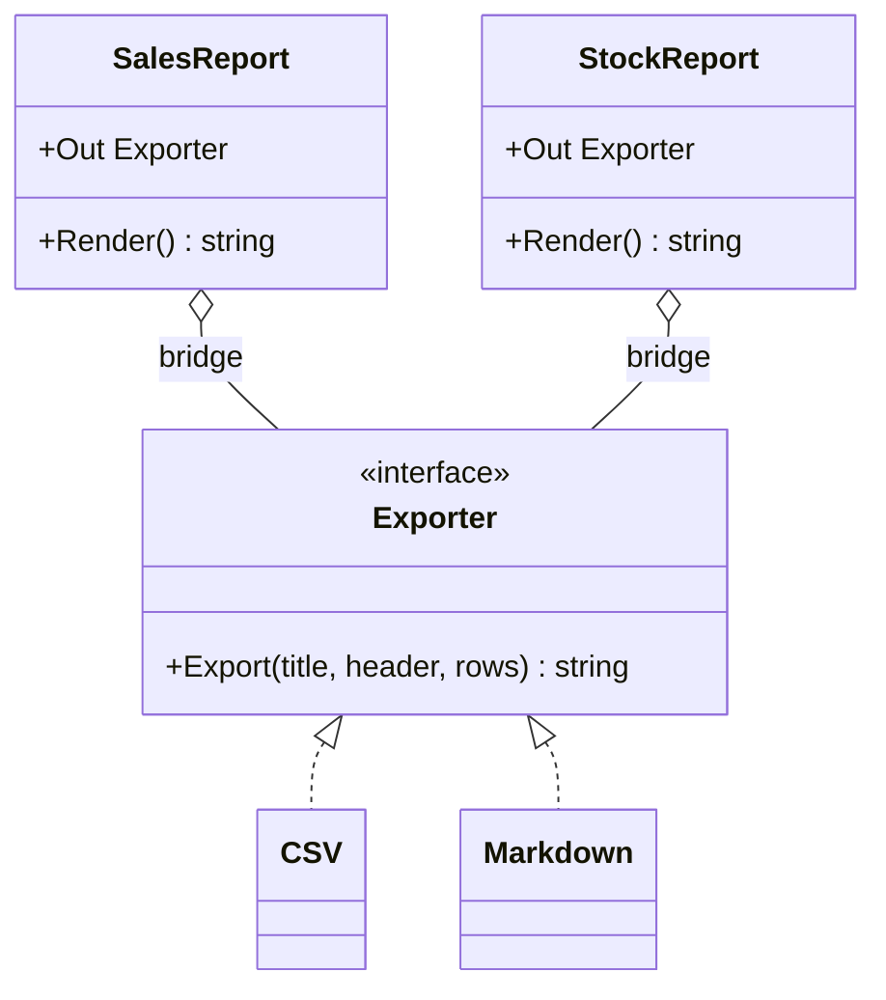
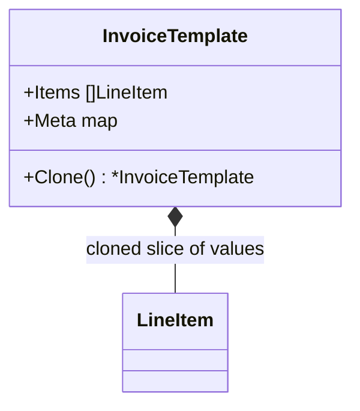
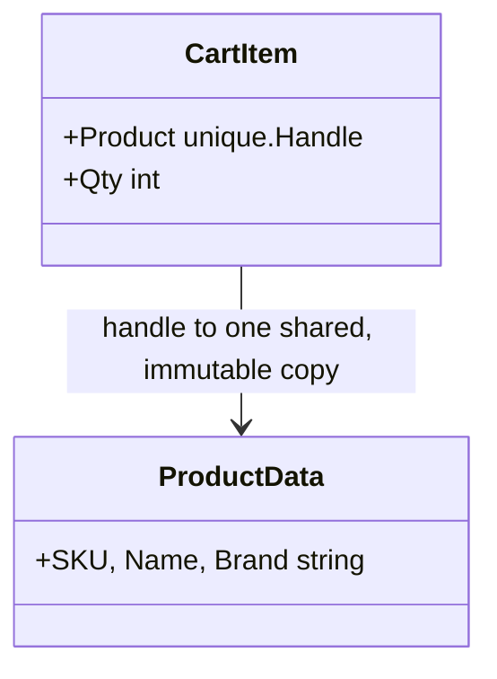
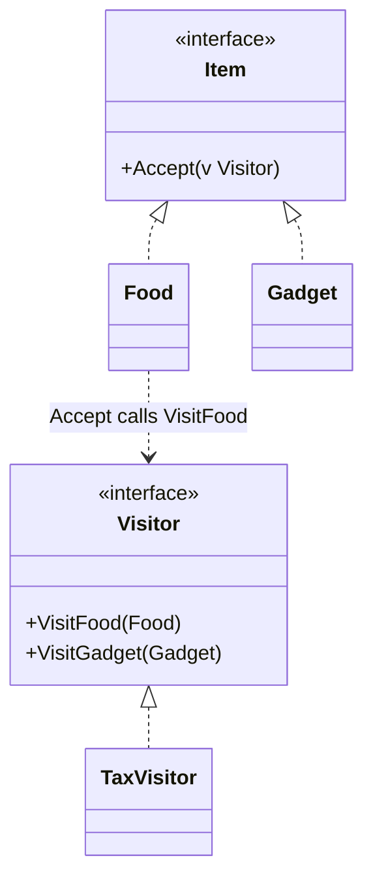
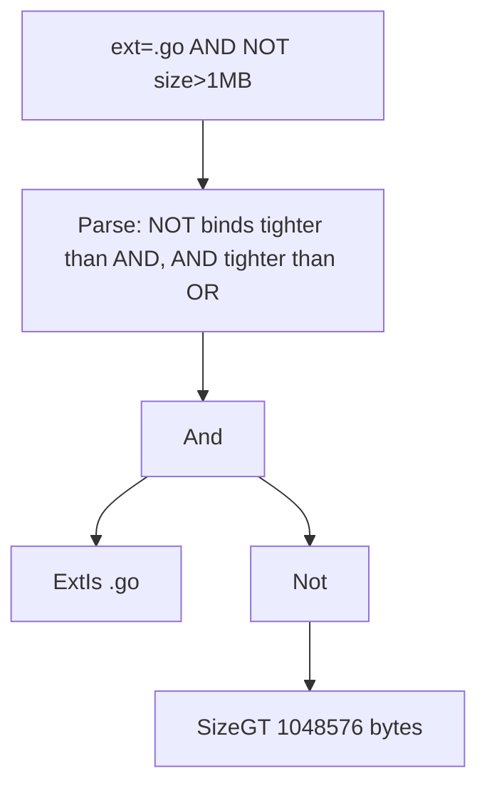
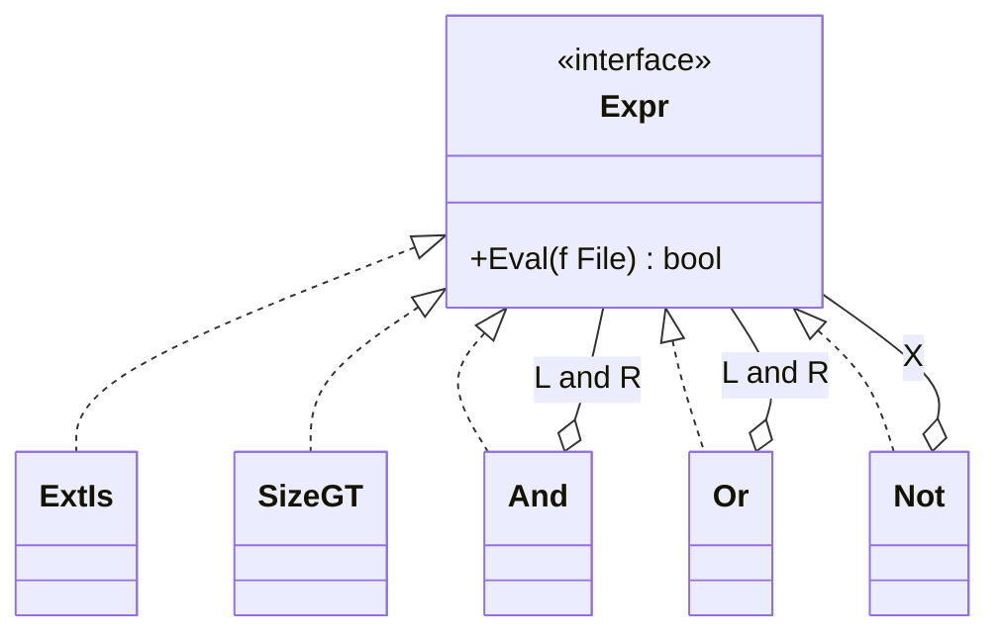
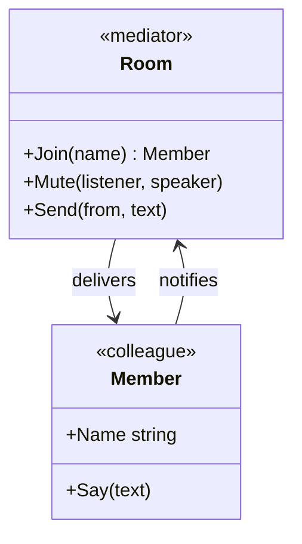
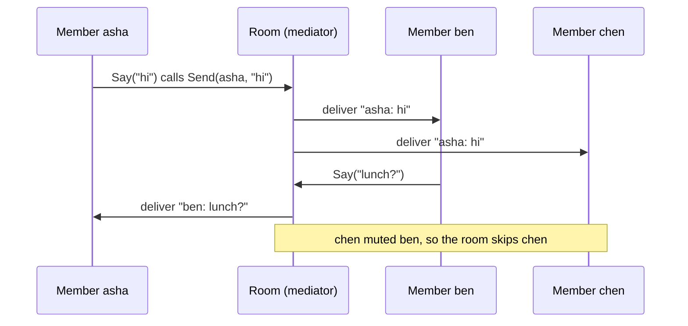

# Rare GoF Patterns in Go

> [!summary] TL;DR
> Several Gang of Four patterns (1994) were shaped by the C++ of that time, which had no closures and only inheritance-based interfaces. Go's first-class functions, type switches, value copies and implicit interfaces cover much of what they do. **Bridge, Prototype, Flyweight, Visitor, Interpreter and Mediator** are rare in Go backends, but each still has one situation where the full pattern pays off. This note gives each one its intent, that situation, a real example (from the standard library wherever one exists) and a short tested Go form.

> [!abstract] Core idea
> - These six patterns exist mostly because 1994 C++ lacked closures, type switches and implicit interfaces; Go often needs only a function or a switch.
> - Bridge = two independent hierarchies joined by a field; Prototype = copy then fix shared slices/maps; Flyweight = share the immutable part.
> - Visitor = a type switch in Go; Interpreter = parse to a tree of nodes, each with `Eval`; Mediator = colleagues talk only to a hub.
> - Classic mistake: reaching for the full pattern when a function value or a `switch` does the job.

## 1. Why it exists

Interviewers still ask "implement Visitor in Go" or "what is Flyweight?". Writing the 1994 C++ shape in Go gives code that reviewers would reject, and declaring the pattern useless misses the case where it is the best tool. The useful answer has two halves: what Go does instead, and when the full pattern still wins.

Section 5 puts the six coded patterns (plus Memento, as a table row only) side by side: the problem, the Go answer, a standard-library example, and when the full pattern still pays.

## 2. Mental model

- **Bridge:** a TV remote and the TV. Remote models and TV brands vary independently; the infrared protocol between them is the bridge.
- **Prototype:** a photocopier. Fill in one form, then copy it instead of filling in each copy.
- **Flyweight:** a font. A page shows "e" thousands of times; the glyph is stored once and each position stores only where it is drawn.
- **Visitor:** a tax inspector who visits each kind of business and applies the rule for that kind, without the businesses changing their own books.
- **Interpreter:** a calculator that reads `2 + 3 × 4`, builds a tree that respects precedence, and evaluates it.
- **Mediator:** an air-traffic controller. Pilots talk to the tower, never to each other; the tower decides who lands.

## 3. How it works

### Bridge: two hierarchies joined by a field

**Intent:** split an abstraction (what a report contains) from its implementation (how it is written out) so that each side varies on its own. With 5 report kinds and 4 formats, combined types need 5 × 4 = 20 types; a bridge needs 5 + 4 = 9.

The old version had one report type holding an `Exporter`: that is Strategy. A Bridge needs **both** sides to vary. Here `SalesReport` and `StockReport` decide the rows, `CSV` and `Markdown` decide the format, and the `Out` field joins them.



```go
// bridge.go
package main

import (
	"fmt"
	"maps"
	"slices"
	"strconv"
	"strings"
)

// Implementation axis: how a table is written out.
type Exporter interface {
	Export(title string, header []string, rows [][]string) string
}

type CSV struct{}

func (CSV) Export(_ string, header []string, rows [][]string) string {
	var b strings.Builder
	b.WriteString(strings.Join(header, ",") + "\n")
	for _, r := range rows {
		b.WriteString(strings.Join(r, ",") + "\n")
	}
	return b.String()
}

type Markdown struct{}

func (Markdown) Export(title string, header []string, rows [][]string) string {
	var b strings.Builder
	fmt.Fprintf(&b, "%s\n| %s |\n|%s\n", title, strings.Join(header, " | "), strings.Repeat(" --- |", len(header)))
	for _, r := range rows {
		fmt.Fprintf(&b, "| %s |\n", strings.Join(r, " | "))
	}
	return b.String()
}

// Abstraction axis: what a report contains. The Out field is the bridge.
type SalesReport struct {
	Out   Exporter
	Sales map[string]int // city -> rupees
}

func (r SalesReport) Render() string {
	var rows [][]string
	for _, city := range slices.Sorted(maps.Keys(r.Sales)) {
		rows = append(rows, []string{city, strconv.Itoa(r.Sales[city])})
	}
	return r.Out.Export("Sales", []string{"city", "revenue"}, rows)
}

type StockReport struct {
	Out Exporter
	Low map[string]int // sku -> units left
}

func (r StockReport) Render() string {
	var rows [][]string
	for _, sku := range slices.Sorted(maps.Keys(r.Low)) {
		rows = append(rows, []string{sku, strconv.Itoa(r.Low[sku]), "reorder"})
	}
	return r.Out.Export("Low stock", []string{"sku", "left", "action"}, rows)
}
```

- **Real examples:** `slog.Logger` (the front end: `Info`, `With`, `WithGroup`) over `slog.Handler` (the back end: `TextHandler`, `JSONHandler`, third-party handlers). `database/sql.DB` (pooling and the public API) over `database/sql/driver` (one driver per database).
- **Worth it when:** both axes have at least two variants and grow independently: report kinds × export formats, or notification content (OTP, order update, promotion) × delivery channel (SMS, email, push). With one abstraction, call it Strategy ([[Strategy and Template Method]]).

### Prototype: copy, then fix the shared parts

**Intent:** make new objects by copying a configured one. In Go, `c := *t` already copies every value field. A `Clone` method exists only for fields that a copy would share: slices, maps, pointers and channels.



```go
// prototype.go
package main

import (
	"maps"
	"slices"
)

type LineItem struct { // value fields only, so copying it copies everything
	Desc   string
	Amount int
}

type InvoiceTemplate struct {
	Customer string
	Items    []LineItem
	Meta     map[string]string
}

// Clone starts from a struct copy, which copies every value field, then
// replaces the slice and the map, which a struct copy would share.
func (t *InvoiceTemplate) Clone() *InvoiceTemplate {
	c := *t
	c.Items = slices.Clone(t.Items) // deep here only because LineItem has no pointers or maps
	c.Meta = maps.Clone(t.Meta)
	return &c
}
```

- **Deep-copy rules:** `slices.Clone` and `maps.Clone` are shallow. `slices.Clone(t.Items)` gives a deep copy here only because `LineItem` has no pointers or maps; a `[]*LineItem` would still share every item. The test proves the clone has its own copied item slice, and that a plain struct copy does not.
- **Real examples:** `http.Request.Clone(ctx)` (documented as a deep copy, except that the `Body` is shared), `http.Header.Clone`, and `tls.Config.Clone` (documented as a shallow clone, so slices such as `Certificates` stay shared).
- **Worth it when:** an object is costly to configure and is copied per use, such as a base `tls.Config` cloned per client, or a recurring invoice template cloned each month and given a new number and dates.

### Flyweight: share the immutable part

**Intent:** keep the intrinsic state (the same for many objects, never changing) in one shared copy, and keep the extrinsic state (different per object) in each object. Since Go 1.23, `unique.Make` interns any comparable value and returns a `unique.Handle`; equal values give equal handles, and comparing handles is a pointer comparison.



```go
// flyweight.go
package main

import "unique"

// ProductData is the intrinsic state: immutable, comparable, shared.
type ProductData struct {
	SKU, Name, Brand string
}

// CartItem keeps a handle to the shared data plus its own extrinsic state.
type CartItem struct {
	Product unique.Handle[ProductData]
	Qty     int
}

// NewItem interns the full intrinsic value (Go 1.23 unique package), so a
// different name or brand gives a different handle instead of a stale one.
func NewItem(sku, name, brand string, qty int) CartItem {
	return CartItem{Product: unique.Make(ProductData{sku, name, brand}), Qty: qty}
}
```

- **Fixes to the old factory:** its map was not goroutine-safe, and `Get(sku, name, brand)` returned the cached product even when the name or brand differed. Interning the whole value fixes both: `unique.Make` is safe for concurrent use (the test calls it from 8 goroutines under `-race`), and a different brand is a different value.
- **`sync.Pool` is not a flyweight.** A pool hands an object to one user at a time so it can be reused, and may drop it at any garbage collection. A flyweight is shared by many users at once and must be immutable.
- **Real example:** `net/netip` interns IPv6 zone names with `unique` handles.
- **Worth it when:** millions of objects repeat a few distinct values, such as service names on log records. For a few thousand objects, plain strings are fine.

### Visitor: a type switch first

**Intent:** add operations over a fixed set of types without changing them. The classic form uses double dispatch: `item.Accept(v)` calls back `v.VisitFood(item)`.



```go
// visitor.go
package main

import (
	"go/ast"
	"go/parser"
	"go/token"
)

// Classic double dispatch, kept to show the shape.
type Item interface{ Accept(v Visitor) }

type Visitor interface {
	VisitFood(Food)
	VisitGadget(Gadget)
}

type Food struct{ Paise int64 }
type Gadget struct{ Paise int64 }

func (f Food) Accept(v Visitor)   { v.VisitFood(f) }
func (g Gadget) Accept(v Visitor) { v.VisitGadget(g) }

// Rates are illustrative, in basis points (500 = 5.00%).
const foodBP, gadgetBP = 500, 1800

// pct applies a rate and rounds half up to the nearest paisa instead of
// truncating: 5% of 999 paise is 49.95, which becomes 50, not 49.
func pct(paise, bp int64) int64 { return (paise*bp + 5_000) / 10_000 }

type TaxVisitor struct{ Paise int64 }

func (t *TaxVisitor) VisitFood(f Food)     { t.Paise += pct(f.Paise, foodBP) }
func (t *TaxVisitor) VisitGadget(g Gadget) { t.Paise += pct(g.Paise, gadgetBP) }

// TaxSwitch is the usual Go answer: one type switch, no Accept methods.
func TaxSwitch(items []Item) int64 {
	var total int64
	for _, it := range items {
		switch it := it.(type) {
		case Food:
			total += pct(it.Paise, foodBP)
		case Gadget:
			total += pct(it.Paise, gadgetBP)
		}
	}
	return total
}

// CountFuncs is the standard library's visitor: ast.Inspect walks the tree
// and the callback type-switches on each node.
func CountFuncs(src string) (int, error) {
	f, err := parser.ParseFile(token.NewFileSet(), "x.go", src, 0)
	if err != nil {
		return 0, err
	}
	n := 0
	ast.Inspect(f, func(node ast.Node) bool {
		if _, ok := node.(*ast.FuncDecl); ok {
			n++
		}
		return true // keep walking into children
	})
	return n, nil
}
```

- **In Go, a type switch usually replaces it.** `TaxSwitch` computes the same tax with no `Accept` methods. The cost: Go does not check that a type switch covers every type, while a `Visitor` interface makes a missing `VisitX` method a compile error.
- **Money:** the old code truncated integer tax. Here prices are integer paise, rates are basis points, and `pct` rounds half up, so 5% of 999 paise is 50, not 49. Pick the rounding rule on purpose; do not inherit integer division's.
- **Real examples:** `go/ast.Walk` takes an `ast.Visitor`; `ast.Inspect` takes a callback that type-switches on each node, as `CountFuncs` does. `fs.WalkDir` is a visitor over files.
- **Worth it when:** many operations run over a stable set of types (compilers, linters, AST tools) and each operation must handle every type.

### Interpreter: parser, AST, Eval

**Intent:** represent a small language as types and evaluate its sentences. The expression types are the easy half; the **parser** that turns text into a tree with the right precedence is the hard half. Here the language is the [[File Search (Unix find)]] filter: `ext=.go AND NOT size>1MB`.





```go
// interpreter.go
package main

import (
	"fmt"
	"path"
	"strconv"
	"strings"
)

type File struct {
	Name string
	Size int64 // bytes
}

// The AST: each node knows how to evaluate itself.
type Expr interface{ Eval(f File) bool }

type ExtIs string
type SizeGT int64 // strictly greater than, in bytes
type And struct{ L, R Expr }
type Or struct{ L, R Expr }
type Not struct{ X Expr }

func (e ExtIs) Eval(f File) bool  { return path.Ext(f.Name) == string(e) }
func (e SizeGT) Eval(f File) bool { return f.Size > int64(e) }
func (e And) Eval(f File) bool    { return e.L.Eval(f) && e.R.Eval(f) }
func (e Or) Eval(f File) bool     { return e.L.Eval(f) || e.R.Eval(f) }
func (e Not) Eval(f File) bool    { return !e.X.Eval(f) }

// Parse is a recursive-descent parser. Precedence: NOT, then AND, then OR.
//
//	or   = and { "OR" and }
//	and  = not { "AND" not }
//	not  = "NOT" not | atom
//	atom = "ext=" EXT | "size>" N [ "KB" | "MB" ]
func Parse(s string) (Expr, error) {
	p := &queryParser{toks: strings.Fields(s)}
	e, err := p.or()
	if err == nil && p.pos < len(p.toks) {
		err = fmt.Errorf("unexpected %q", p.toks[p.pos])
	}
	return e, err
}

type queryParser struct {
	toks []string
	pos  int
}

func (p *queryParser) accept(word string) bool {
	if p.pos < len(p.toks) && p.toks[p.pos] == word {
		p.pos++
		return true
	}
	return false
}

func (p *queryParser) or() (Expr, error) {
	l, err := p.and()
	for err == nil && p.accept("OR") {
		var r Expr
		if r, err = p.and(); err == nil {
			l = Or{l, r}
		}
	}
	return l, err
}

func (p *queryParser) and() (Expr, error) {
	l, err := p.not()
	for err == nil && p.accept("AND") {
		var r Expr
		if r, err = p.not(); err == nil {
			l = And{l, r}
		}
	}
	return l, err
}

func (p *queryParser) not() (Expr, error) {
	if p.accept("NOT") {
		x, err := p.not()
		return Not{x}, err
	}
	return p.atom()
}

func (p *queryParser) atom() (Expr, error) {
	if p.pos == len(p.toks) {
		return nil, fmt.Errorf("unexpected end of query")
	}
	t := p.toks[p.pos]
	p.pos++
	if ext, ok := strings.CutPrefix(t, "ext="); ok {
		return ExtIs(ext), nil
	}
	if size, ok := strings.CutPrefix(t, "size>"); ok {
		unit := int64(1)
		if n, ok := strings.CutSuffix(size, "MB"); ok {
			size, unit = n, 1<<20
		} else if n, ok := strings.CutSuffix(size, "KB"); ok {
			size, unit = n, 1<<10
		}
		n, err := strconv.ParseInt(size, 10, 64)
		if err != nil {
			return nil, fmt.Errorf("bad size in %q: %w", t, err)
		}
		return SizeGT(n * unit), nil
	}
	return nil, fmt.Errorf("unknown term %q", t)
}
```

- **Consistency:** `size>1MB` means strictly greater than 1,048,576 bytes, and the code uses `>`. A file of exactly 1 MB passes `NOT size>1MB` (tested).
- **Real examples:** `text/template` parses a template into a tree and `Execute` walks it; `regexp/syntax` parses a pattern into a syntax tree before compiling it; `go/parser` builds `go/ast` trees. For business rules, embed CEL (`cel-go`) or `expr-lang/expr` instead of writing a language.
- **Worth it when:** users or configuration write the rules (search filters, coupon conditions, alert rules) and the language is small. Add parentheses and a depth limit before exposing it to users.

### Mediator: colleagues talk only to the hub

**Intent:** objects (colleagues) hold a reference to a mediator and notify it; the mediator owns the rules for who hears what. No colleague references another.





```go
// mediator.go
package main

import (
	"maps"
	"slices"
)

// Member is a colleague: it knows the room, never the other members.
type Member struct {
	Name  string
	Inbox []string
	room  *Room
}

func (m *Member) Say(text string) { m.room.Send(m, text) }

// Room is the mediator: it owns who hears whom.
type Room struct {
	members map[string]*Member
	muted   map[pair]bool
}

type pair struct{ listener, speaker string }

func NewRoom() *Room {
	return &Room{members: map[string]*Member{}, muted: map[pair]bool{}}
}

func (r *Room) Join(name string) *Member {
	m := &Member{Name: name, room: r}
	r.members[name] = m
	return m
}

func (r *Room) Mute(listener, speaker string) { r.muted[pair{listener, speaker}] = true }

func (r *Room) Send(from *Member, text string) {
	for _, name := range slices.Sorted(maps.Keys(r.members)) {
		if name != from.Name && !r.muted[pair{name, from.Name}] {
			to := r.members[name]
			to.Inbox = append(to.Inbox, from.Name+": "+text)
		}
	}
}
```

- **Not a Facade:** a facade is one-way; it simplifies a subsystem's API for callers, and the subsystem does not know it exists. A mediator is two-way: colleagues call it and it calls them back. If it only simplifies a public API, call it Facade ([[Facade (vs Mediator)]]).
- **Not an event bus:** a bus delivers by topic and knows no rules. A mediator owns the routing logic, such as the mute list here ([[Observer and Event Bus]]).
- **The risk:** every new interaction rule lands in the mediator until it becomes a god object. Split it by concern (one mediator per form, per room) when it grows.
- **Concurrency:** the sketch runs on one goroutine. In a server, members speak from different goroutines, so the room must guard its maps and inboxes with a mutex, or run as one goroutine that reads messages from a channel. A mediator that calls colleagues back must not hold its lock during the call; the lock discipline is in [[Facade (vs Mediator)]].
- **Worth it when:** many components interact through rules that change together: form widgets that enable each other, a game lobby, a chat room. The standard library has no clear example.

### Whiteboard version

The bare idea of the Interpreter used in the worked example: a tiny AST where each node evaluates itself (here built by hand, not parsed). The full version in section 4 adds the production concerns.

```go
package main

import "fmt"

type File struct {
	Name string
	Size int64
}

// Interpreter: each AST node evaluates itself against a file.
type Expr interface{ Eval(File) bool }

type SizeGT struct{ N int64 }
type Not struct{ X Expr }
type And struct{ L, R Expr }

func (e SizeGT) Eval(f File) bool { return f.Size > e.N }
func (e Not) Eval(f File) bool    { return !e.X.Eval(f) }
func (e And) Eval(f File) bool    { return e.L.Eval(f) && e.R.Eval(f) }

func main() {
	// "size>1KB AND NOT size>1MB", built by hand instead of parsed
	q := And{SizeGT{1 << 10}, Not{SizeGT{1 << 20}}}
	for _, f := range []File{{"a.txt", 512}, {"b.log", 4096}, {"c.iso", 1 << 30}} {
		fmt.Println(f.Name, q.Eval(f)) // a false, b true, c false
	}
}
```

## 4. Worked example

The six files above form one package with this `main` and one test file. `main` runs the File Search query; the tests cover all six patterns.

```go
// main.go
package main

import "fmt"

func main() {
	q, err := Parse("ext=.go AND NOT size>1MB")
	fmt.Printf("%+v %v\n", q, err)
	for _, f := range []File{{"main.go", 4 << 10}, {"vendor.go", 3 << 20}, {"notes.md", 100}} {
		fmt.Println(f.Name, q.Eval(f))
	}
}
```

```go
// rare_test.go
package main

import (
	"reflect"
	"slices"
	"sync"
	"testing"
	"unique"
)

func TestBridgeCombinesBothAxes(t *testing.T) {
	got := []string{
		SalesReport{Out: CSV{}, Sales: map[string]int{"Pune": 1200, "Delhi": 3400}}.Render(),
		StockReport{Out: Markdown{}, Low: map[string]int{"sku-9": 2}}.Render(),
	}
	want := []string{
		"city,revenue\nDelhi,3400\nPune,1200\n",
		"Low stock\n| sku | left | action |\n| --- | --- | --- |\n| sku-9 | 2 | reorder |\n",
	}
	if !slices.Equal(got, want) {
		t.Fatalf("got %q", got)
	}
}

func TestPrototypeCloneIsIndependent(t *testing.T) {
	tpl := &InvoiceTemplate{Customer: "Acme", Items: []LineItem{{"Hosting", 900}}, Meta: map[string]string{"gst": "yes"}}
	shallow := *tpl // the bug: shares Items' array and the Meta map
	c := tpl.Clone()
	c.Customer, c.Items[0].Amount, c.Meta["gst"] = "Beta", 1, "no"
	if tpl.Customer != "Acme" || tpl.Items[0].Amount != 900 || tpl.Meta["gst"] != "yes" {
		t.Fatalf("clone leaked into the prototype: %+v", tpl)
	}
	shallow.Items[0].Amount = 5
	if tpl.Items[0].Amount != 5 {
		t.Fatal("expected the struct copy to share the slice")
	}
}

func TestFlyweightInterning(t *testing.T) {
	a := NewItem("sku-1", "Tea", "Leaf", 2)
	b := NewItem("sku-1", "Tea", "Leaf", 5)
	c := NewItem("sku-1", "Tea", "Other", 1)
	if a.Product != b.Product || a.Qty == b.Qty {
		t.Fatal("equal intrinsic data must share one handle; quantities stay separate")
	}
	if a.Product == c.Product || c.Product.Value().Brand != "Other" {
		t.Fatal("different brand must not return the cached product")
	}
	var wg sync.WaitGroup
	handles := make([]unique.Handle[ProductData], 8)
	for i := range handles {
		wg.Add(1)
		go func() { defer wg.Done(); handles[i] = NewItem("sku-2", "Rice", "Farm", 1).Product }()
	}
	wg.Wait()
	for _, h := range handles {
		if h != handles[0] {
			t.Fatal("concurrent Make returned different handles")
		}
	}
}

func TestVisitorAndTypeSwitchAgree(t *testing.T) {
	items := []Item{Food{999}, Gadget{10_000}}
	v := &TaxVisitor{}
	for _, it := range items {
		it.Accept(v)
	}
	// 5% of 999 = 49.95 -> 50 (truncation would give 49); 18% of 10,000 = 1,800.
	if v.Paise != 1_850 || TaxSwitch(items) != 1_850 {
		t.Fatalf("visitor=%d switch=%d", v.Paise, TaxSwitch(items))
	}
}

func TestInspectCountsFuncs(t *testing.T) {
	n, err := CountFuncs("package p\nfunc A() {}\nfunc (T) B() {}\nvar f = func() {}\n")
	if err != nil || n != 2 { // the func literal is an *ast.FuncLit, not a FuncDecl
		t.Fatalf("n=%d err=%v", n, err)
	}
}

func TestInterpreter(t *testing.T) {
	q, err := Parse("ext=.go AND NOT size>1MB")
	if err != nil {
		t.Fatal(err)
	}
	want := And{ExtIs(".go"), Not{SizeGT(1 << 20)}}
	if !reflect.DeepEqual(q, want) {
		t.Fatalf("AST %+v", q)
	}
	cases := map[File]bool{
		{"main.go", 4 << 10}:   true,
		{"vendor.go", 3 << 20}: false,
		{"big.go", 1 << 20}:    true, // exactly 1MB is not > 1MB
		{"notes.md", 100}:      false,
	}
	for f, w := range cases {
		if q.Eval(f) != w {
			t.Errorf("%s: got %v", f.Name, !w)
		}
	}
	// AND binds tighter than OR.
	q2, _ := Parse("ext=.md OR ext=.go AND size>1KB")
	if !reflect.DeepEqual(q2, Or{ExtIs(".md"), And{ExtIs(".go"), SizeGT(1 << 10)}}) {
		t.Fatalf("precedence: %+v", q2)
	}
	for _, bad := range []string{"ext=.go AND", "size>abc", "colour=red", "ext=.go ext=.md"} {
		if _, err := Parse(bad); err == nil {
			t.Errorf("%q: want a parse error", bad)
		}
	}
}

func TestMediatorRoutesAndMutes(t *testing.T) {
	room := NewRoom()
	asha, ben, chen := room.Join("asha"), room.Join("ben"), room.Join("chen")
	room.Mute("chen", "ben")
	asha.Say("hi")
	ben.Say("lunch?")
	if !slices.Equal(ben.Inbox, []string{"asha: hi"}) ||
		!slices.Equal(chen.Inbox, []string{"asha: hi"}) ||
		!slices.Equal(asha.Inbox, []string{"ben: lunch?"}) {
		t.Fatalf("asha=%q ben=%q chen=%q", asha.Inbox, ben.Inbox, chen.Inbox) // chen muted ben
	}
}
```

`go vet` is clean and `go test -race` passes (Go 1.24.4). Output of `go run .`, measured:

```text
{L:.go R:{X:1048576}} <nil>
main.go true
vendor.go false
notes.md false
```

The query trace: `or` calls `and`, which calls `not`, which reads the atom `ext=.go`; `and` accepts `AND`, and `not` accepts `NOT` and reads `size>1MB` as `SizeGT(1048576)`. The tree is `And{ExtIs(".go"), Not{SizeGT(1048576)}}`, printed above. `main.go` (4 KB) matches, `vendor.go` (3 MB) fails the `NOT`, and `notes.md` fails the extension.

## 5. Variants and comparison

| Pattern | Problem it solves | Go's usual answer | Standard-library example | The full pattern still pays when |
| --- | --- | --- | --- | --- |
| Bridge | Two dimensions that vary independently | A struct field of interface type | `slog.Logger` → `slog.Handler`, `sql.DB` → driver | Both axes have several variants and keep growing |
| Prototype | Creating objects by copying a configured one | `c := *t`, then clone slices and maps | `http.Request.Clone`, `tls.Config.Clone` | A costly configured object is copied per use |
| Flyweight | Millions of objects repeating the same data | `unique.Make` (Go 1.23) | `net/netip` zone names | Many objects share few distinct immutable values |
| Visitor | New operations over a fixed set of types | A type switch | `ast.Walk`, `ast.Inspect`, `fs.WalkDir` | Many operations, each of which must handle every type |
| Interpreter | Evaluating sentences of a small language | Hard-coded rules, or CEL / expr-lang | `text/template`, `regexp/syntax`, `go/parser` | Users or configuration write the rules |
| Mediator | Many objects that would all reference each other | Direct calls, or an event bus | None clear | Interaction rules are many and change together |
| Memento | Restoring earlier state | A struct copy (only with no slices, maps or pointers) | Database savepoints | Always worth knowing: the full form (capped caretaker stack, deep-copied snapshots, savepoints) is in [[Command, Undo and Memento]] |

The costs: Bridge adds two hierarchies to name; Prototype's `Clone` must be updated for every new reference field; Flyweight data must stay immutable; Visitor needs `Accept` on every type and a change to every visitor per new type; Interpreter needs a parser, error messages and limits; Mediator is a central object that can grow into a god object.

## 6. Trade-offs and when not to use

Why each is rare in Go backends:

- **Bridge:** most services have one axis of variation, and an interface field already gives it. Two axes that both grow are uncommon.
- **Prototype:** value semantics make copying the default, and constructors or functional options build fresh objects cheaply.
- **Flyweight:** backend objects are short-lived (one request), so there is rarely a million of them alive at once. Measure the heap before interning.
- **Visitor:** a type switch is shorter and keeps the logic in one place. Most backends have no fixed tree of node types.
- **Interpreter:** most rules change with a deploy, not at run time. When they must change at run time, an embedded expression language beats a homemade one.
- **Mediator:** request-scoped services call each other directly; the many-to-many chatter that Mediator tames is mostly a UI problem.

## 7. In production

- **Real systems:** `slog` handlers and `database/sql` drivers (Bridge); `http.Request.Clone` in middleware that changes a request without touching the caller's copy (Prototype); `go vet` analyzers and code generators walking `go/ast` (Visitor); CEL in Kubernetes validation rules (CRD `x-kubernetes-validations` and ValidatingAdmissionPolicy) and `text/template` in Helm charts (Interpreter).
- **Failure modes → fixes:**
	- A flyweight is mutated through a pointer and every user changes at once → share only immutable values; `unique.Handle.Value()` returns a copy.
	- A clone shares a map with its prototype → clone each reference field, and add a test that edits the clone and checks the prototype.
	- A new node type is silently ignored by a type switch → add a `default` case that returns an error, or use a Visitor interface so the compiler forces the new method.
	- A user query with thousands of nested `NOT`s exhausts the stack or the CPU → limit the query length and nesting depth, and set a timeout on evaluation.
	- A user filter is translated to SQL by pasting its values into the query text → SQL injection. Compile the AST to a parameterised query: values become placeholders, and column names come from an allowlist.
	- A mediator becomes the place for every rule → split it per screen, room or workflow.
- **What to monitor:** for an interpreter, the parse error rate and the evaluation time per query; for interning, heap size before and after, with `pprof`.

## 8. Deep dive

- **The expression problem.** Visitor makes adding an operation easy (one new visitor) and adding a type hard (every visitor changes). Methods on an interface do the reverse. Choose by which side grows; a type switch sits with Visitor, minus the compile-time check.
- **How `unique` avoids leaks.** Interned values are held weakly: once no `Handle` refers to a value, the runtime can drop it from the intern table. A handwritten `map[string]*ProductData` cache keeps every entry forever unless you evict.
- **Bridge in `database/sql`.** Adding a database means writing a driver; adding an API feature such as `QueryContext` means changing `sql.DB` and, optionally, extending the driver interfaces. That independent growth is the reason for the split.
- **Parser design.** One function per precedence level (`or`, `and`, `not`, `atom`) is recursive descent; precedence comes from which function calls which. `ext=.md OR ext=.go AND size>1KB` parses as `Or{.md, And{.go, size}}` (tested). Add a tokenizer when values can contain spaces.
- **Deep copies through reflection or JSON** copy only what they can see: JSON drops unexported fields and turns pointers into new values. Prefer an explicit `Clone` per type, with a test.

## 9. Interview questions

> [!question]- How would you implement Visitor in Go? (trap)
> Usually with a type switch over a closed set of types, which is shorter and keeps the operation in one place. Use the double-dispatch form (`Accept` plus a `Visitor` interface) when there are many operations and each must handle every type, because then a missing method is a compile error. `go/ast` offers both: `ast.Walk` with a `Visitor`, `ast.Inspect` with a callback.

> [!question]- What is the difference between Bridge and Strategy?
> Strategy swaps one algorithm behind one abstraction. Bridge has two hierarchies that vary independently, report kinds and export formats, joined by a field, so N + M types replace N × M. One report type holding an exporter is Strategy.

> [!question]- Is `sync.Pool` a Flyweight? (trap)
> No. A pool lends a mutable object to one user at a time to save allocations, and may discard it at any GC. A flyweight is one immutable object shared by many users at the same time. In Go, `unique.Make` is the flyweight tool.

> [!question]- What does `slices.Clone` copy?
> The slice's elements, one level deep. If the elements are values with no pointers or maps, the copy is independent. If they are pointers, or structs holding maps or slices, the clone shares them, and you must copy each element. `maps.Clone` has the same rule.

> [!question]- Mediator, Facade or event bus?
> A facade is one-way: it simplifies a subsystem for callers. An event bus delivers messages by topic with no rules. A mediator is two-way and owns the rules: colleagues notify it, and it decides whom to call. Beware the mediator that absorbs every rule.

> [!question]- When would you write an interpreter instead of hard-coding rules?
> When people outside the deploy cycle write the rules: search filters, coupon conditions, alert expressions. Keep the language tiny, write a real parser with precedence and limits, and prefer embedding CEL or expr-lang once you need more than a handful of operators.

## 10. Cheat sheet

- These patterns are rare in Go because functions, type switches, value copies and implicit interfaces cover most of their cases.
- Bridge = two axes joined by an interface field: `slog.Logger` → `slog.Handler`.
- Prototype = `c := *t`, then clone slices and maps; `slices.Clone` and `maps.Clone` are shallow.
- Flyweight = `unique.Make` (Go 1.23); shared state must be immutable; `sync.Pool` is not one.
- Visitor = a type switch first; double dispatch when exhaustiveness matters; `ast.Inspect`.
- Interpreter = parser + AST + `Eval`; embed CEL or expr-lang for real rule engines.
- Mediator = colleagues talk only to the hub, which owns the rules; watch for god objects.

## Links

- **Before this:** [[Design Patterns Overview and Chooser]], [[Strategy and Template Method]], [[Interfaces]]
- **Next:** [[Concurrency for LLD]], [[Testing LLD Code]]
- **Compare with:** [[Command, Undo and Memento]] (Memento in full), [[Facade (vs Mediator)]], [[Observer and Event Bus]], [[Composite]] (the trees that visitors and interpreters walk), [[Iterator and range-over-func]] (`fs.WalkDir` and callbacks)
- **Practice:** [[File Search (Unix find)]]
