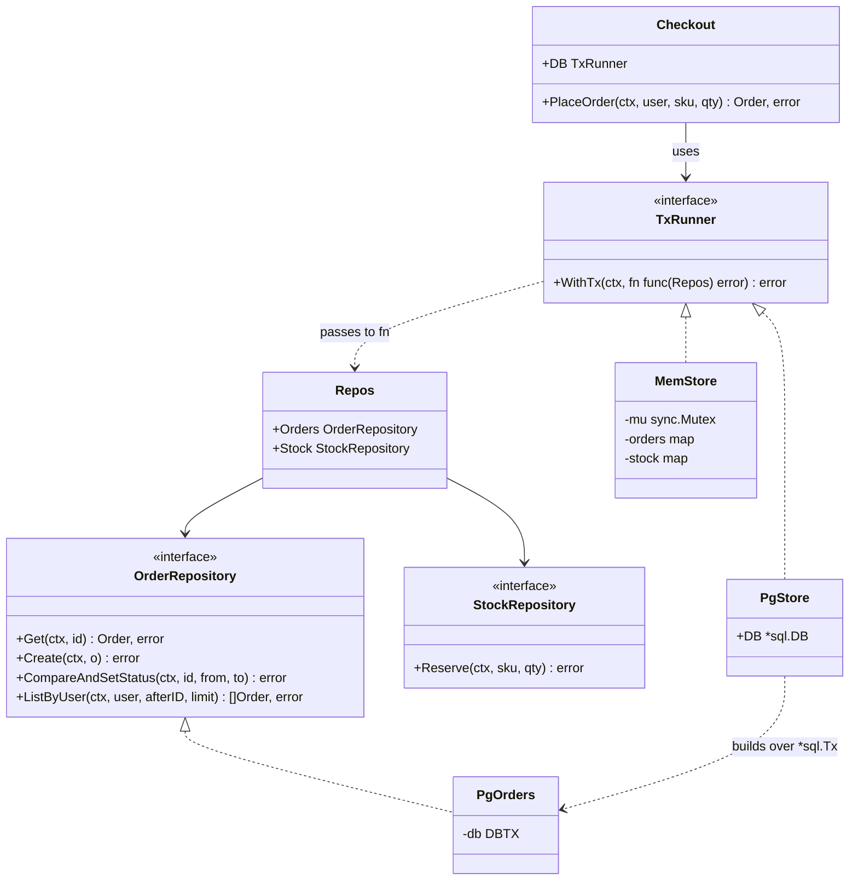
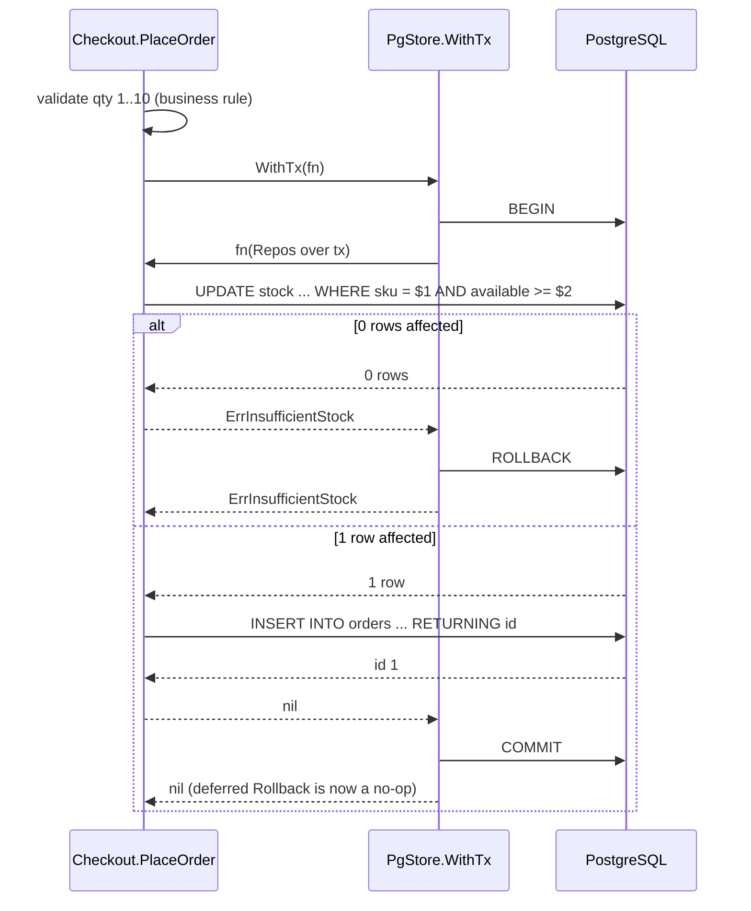

# Repository and Unit of Work

> [!summary] TL;DR
> A **repository** is a collection-like interface for one kind of domain object ("get order 42", "list this user's orders", "reserve 2 units") that hides how the objects are stored, so the service code is the same over PostgreSQL and over an in-memory map. A **unit of work** groups the changes of one business operation, across several repositories, into one transaction: they all commit or none do.

> [!abstract] Core idea
> - A repository is a collection-like interface (`Get`, `Save`, `ListByUser`) for one kind of domain object; the service never sees SQL.
> - Because it is an interface, tests use an in-memory version and production uses PostgreSQL.
> - A unit of work runs the changes of one business operation, across several repositories, in **one transaction**: all commit or none do.
> - Classic mistakes: a generic `Update(entity)` that hides what changed, and slow remote calls (payment provider) inside the transaction.

## 1. Why it exists

A checkout service places an order in two steps: reserve stock, then create the order. The first version writes SQL inline in the HTTP handler. Four problems follow:

- **Tests need a database.** Every test of the checkout rules starts PostgreSQL, even a test of "quantity must be 1 to 10".
- **Storage errors leak.** `sql.ErrNoRows` reaches the HTTP layer and becomes a 500 instead of a 404. Each handler checks for it in its own way.
- **Half-done work.** If creating the order fails after stock was reserved, the stock is gone and no order exists. The two writes must be one transaction.
- **Overselling.** The handler reads `available = 5`, checks it, and writes `available = 4`. Twenty concurrent buyers all read 5. In the worked example's concurrency test, 20 goroutines buy from a stock of 5 through a conditional reserve, and **exactly 5 succeed** (measured by the test, under `-race`).

The old in-memory version had its own bug: an unguarded map. Two goroutines writing to a Go map at once crash the process with `fatal error: concurrent map writes`, which cannot be recovered.

## 2. Mental model

A **repository** is a librarian. You ask for "book 42" or "the next ten books by this author", and you hand books back. You never learn whether a book was on the shelf, in the basement or at another branch.

A **unit of work** is the checkout till. Everything in the basket is paid for together. If the card is declined, nothing leaves the shop, not even the items already scanned.

Three rules make the pattern work in Go:

1. **One repository per aggregate**: orders, stock. Not one per table, and not one generic repository for everything.
2. **The interface belongs to the consumer.** The checkout package declares the small `OrderRepository` it needs; the storage packages implement it ([[Interfaces]]).
3. **Repositories store and fetch; services decide.** "Quantity must be 1 to 10" is a business rule and lives in the service. "Never let `available` go below zero" must be enforced atomically where the data lives, so the repository exposes it as a named operation, `Reserve`.

## 3. How it works

### Structure



The pieces:

- **Sentinel errors.** `ErrNotFound`, `ErrConflict` and `ErrInsufficientStock` are part of the interface's contract. Each implementation maps its own errors to them: PostgreSQL's `sql.ErrNoRows` (or `pgx.ErrNoRows`) becomes `ErrNotFound`, so callers use `errors.Is` whatever the storage ([[Error Handling]]).
- **Conditional updates as methods.** `Reserve` is `UPDATE stock SET available = available - $2 WHERE sku = $1 AND available >= $2`. `CompareAndSetStatus` is `UPDATE … WHERE id = $1 AND status = $2`. The check and the write are one statement, so no other transaction can slip between them. Zero affected rows means the condition failed.
- **`DBTX`.** An interface with `ExecContext`, `QueryContext` and `QueryRowContext` that both `*sql.DB` and `*sql.Tx` satisfy. The same `PgOrders` type runs inside or outside a transaction. sqlc generates the same interface (its `database/sql` version also lists `PrepareContext`; its pgx version uses `Exec`, `Query` and `QueryRow`).
- **Keyset pagination.** `ListByUser(ctx, user, afterID, limit)` returns the next page after a known ID, which stays fast however deep the caller pages ([[Pagination, Filtering and Sorting]]).

### A unit of work, step by step



1. The service validates its own rules before touching storage.
2. `WithTx` begins a transaction and builds repositories bound to it.
3. The service calls the repositories inside `fn`. It never sees `*sql.Tx`.
4. If `fn` returns an error, the transaction rolls back and the error is returned unchanged, so `errors.Is(err, ErrInsufficientStock)` still works.
5. If `fn` returns nil, `WithTx` commits. A deferred `Rollback` covers panics and is a no-op after a successful commit (it returns `sql.ErrTxDone`).

### Three ways to span repositories

| Option | How it works | Strength | Weakness |
| --- | --- | --- | --- |
| `WithTx(ctx, func(Repos) error)` | A closure receives repositories bound to one transaction | Explicit: the signature shows what is transactional | One more parameter level in the service |
| Unit of Work object | Repositories register new, changed and removed objects; `Commit` writes them all in one transaction | Batches writes; tracks changes (ORMs do this) | Change tracking is heavy machinery for Go services |
| Transaction in `ctx` | `WithTx` stores the `*sql.Tx` in the context; repositories use it when present | No signature changes | Hidden: a repository call with the wrong `ctx` silently runs outside the transaction |

`WithTx` with a closure is the usual Go choice. It is a unit of work without change tracking: the closure is the unit, and the transaction is its boundary.

### Whiteboard version

The bare idea: a small interface, an in-memory implementation, and the shape of a unit of work. The full version in section 4 adds the production concerns.

```go
package main

import (
	"context"
	"errors"
	"fmt"
)

type Order struct {
	ID     int64
	Status string
}

var ErrNotFound = errors.New("order not found")

// The service depends on this interface, not on SQL.
type OrderRepository interface {
	Get(ctx context.Context, id int64) (Order, error)
	Save(ctx context.Context, o Order) error
}

// memRepo is the test double; a pgRepo would run SQL instead.
type memRepo struct{ rows map[int64]Order }

func (r *memRepo) Get(_ context.Context, id int64) (Order, error) {
	o, ok := r.rows[id]
	if !ok {
		return Order{}, ErrNotFound
	}
	return o, nil
}

func (r *memRepo) Save(_ context.Context, o Order) error { r.rows[o.ID] = o; return nil }

// Unit of work: run fn in one transaction; commit if it returns nil.
type UnitOfWork interface {
	WithTx(ctx context.Context, fn func(orders OrderRepository) error) error
}

func main() {
	var repo OrderRepository = &memRepo{rows: map[int64]Order{}}
	ctx := context.Background()
	_ = repo.Save(ctx, Order{ID: 42, Status: "paid"})
	o, _ := repo.Get(ctx, 42)
	_, err := repo.Get(ctx, 7)
	fmt.Println(o.Status, errors.Is(err, ErrNotFound)) // paid true
}
```

## 4. Worked example

The schema the PostgreSQL implementation expects (PostgreSQL 17):

```sql
CREATE TABLE stock (
    sku       text PRIMARY KEY,
    available int  NOT NULL CHECK (available >= 0)
);

CREATE TABLE orders (
    id      bigint GENERATED ALWAYS AS IDENTITY PRIMARY KEY,
    user_id text NOT NULL,
    sku     text NOT NULL REFERENCES stock (sku),
    qty     int  NOT NULL CHECK (qty > 0),
    status  text NOT NULL
);

-- serves ListByUser: WHERE user_id = $1 AND id > $2 ORDER BY id LIMIT $3
CREATE INDEX orders_user_id_id ON orders (user_id, id);
```

The code: interfaces owned by the service, the checkout service, the in-memory fake, and the PostgreSQL implementation.

```go
// main.go
package main

import (
	"context"
	"database/sql"
	"errors"
	"fmt"
	"maps"
	"slices"
	"sync"
)

type Status string

const (
	Pending   Status = "pending"
	Paid      Status = "paid"
	Cancelled Status = "cancelled"
)

type Order struct {
	ID     int64
	UserID string
	SKU    string
	Qty    int
	Status Status
}

// Sentinel errors: callers test them with errors.Is, whatever the storage.
var (
	ErrNotFound          = errors.New("not found")
	ErrConflict          = errors.New("conflict: state changed")
	ErrInsufficientStock = errors.New("insufficient stock")
)

// ---------- Interfaces owned by the consumer (the checkout service) ----------

type OrderRepository interface {
	Get(ctx context.Context, id int64) (Order, error)
	Create(ctx context.Context, o *Order) error // sets o.ID
	CompareAndSetStatus(ctx context.Context, id int64, from, to Status) error
	ListByUser(ctx context.Context, userID string, afterID int64, limit int) ([]Order, error)
}

type StockRepository interface {
	// Reserve takes qty units only if qty are available, in one atomic step.
	Reserve(ctx context.Context, sku string, qty int) error
}

// Repos is everything one unit of work may touch.
type Repos struct {
	Orders OrderRepository
	Stock  StockRepository
}

// TxRunner runs fn in one transaction: commit if fn returns nil, else roll back.
type TxRunner interface {
	WithTx(ctx context.Context, fn func(r Repos) error) error
}

// ---------- The service: business rules live here, not in repositories ----------

type Checkout struct{ DB TxRunner }

func (c Checkout) PlaceOrder(ctx context.Context, userID, sku string, qty int) (Order, error) {
	if qty < 1 || qty > 10 {
		return Order{}, fmt.Errorf("qty %d: must be between 1 and 10", qty)
	}
	o := Order{UserID: userID, SKU: sku, Qty: qty, Status: Pending}
	err := c.DB.WithTx(ctx, func(r Repos) error {
		if err := r.Stock.Reserve(ctx, sku, qty); err != nil {
			return err
		}
		return r.Orders.Create(ctx, &o)
	})
	return o, err
}

// ---------- In-memory implementation: the fake used by tests ----------

type MemStore struct {
	mu     sync.Mutex
	orders map[int64]Order
	stock  map[string]int
	nextID int64
}

func NewMemStore(stock map[string]int) *MemStore {
	s := &MemStore{orders: map[int64]Order{}, stock: map[string]int{}}
	maps.Copy(s.stock, stock) // never nil, so Reserve can always write
	return s
}

// WithTx holds the lock for the whole unit of work and restores a snapshot
// on error, so the fake is all-or-nothing like a real transaction.
func (s *MemStore) WithTx(_ context.Context, fn func(Repos) error) error {
	s.mu.Lock()
	defer s.mu.Unlock()
	orders, stock := maps.Clone(s.orders), maps.Clone(s.stock)
	r := memRepos{s}
	if err := fn(Repos{Orders: r, Stock: r}); err != nil {
		s.orders, s.stock = orders, stock // roll back; IDs are not reused, like a sequence
		return err
	}
	return nil
}

// memRepos works on the maps directly; WithTx holds s.mu around it.
type memRepos struct{ s *MemStore }

func (r memRepos) Get(_ context.Context, id int64) (Order, error) {
	o, ok := r.s.orders[id]
	if !ok {
		return Order{}, ErrNotFound
	}
	return o, nil
}

func (r memRepos) Create(_ context.Context, o *Order) error {
	r.s.nextID++
	o.ID = r.s.nextID
	r.s.orders[o.ID] = *o
	return nil
}

func (r memRepos) CompareAndSetStatus(_ context.Context, id int64, from, to Status) error {
	o, ok := r.s.orders[id]
	if !ok {
		return ErrNotFound
	}
	if o.Status != from {
		return ErrConflict
	}
	o.Status = to
	r.s.orders[id] = o
	return nil
}

func (r memRepos) ListByUser(_ context.Context, userID string, afterID int64, limit int) ([]Order, error) {
	var out []Order
	for _, id := range slices.Sorted(maps.Keys(r.s.orders)) {
		if o := r.s.orders[id]; id > afterID && o.UserID == userID {
			out = append(out, o)
			if len(out) == limit {
				break
			}
		}
	}
	return out, nil
}

func (r memRepos) Reserve(_ context.Context, sku string, qty int) error {
	if r.s.stock[sku] < qty { // an unknown SKU has 0 units, as in PgStock
		return ErrInsufficientStock
	}
	r.s.stock[sku] -= qty
	return nil
}

// ---------- PostgreSQL implementation (database/sql, PostgreSQL 17 SQL) ----------

// DBTX is satisfied by both *sql.DB and *sql.Tx, so the same repository
// type works inside and outside a transaction.
type DBTX interface {
	ExecContext(ctx context.Context, query string, args ...any) (sql.Result, error)
	QueryContext(ctx context.Context, query string, args ...any) (*sql.Rows, error)
	QueryRowContext(ctx context.Context, query string, args ...any) *sql.Row
}

type PgOrders struct{ db DBTX }

func (r PgOrders) Get(ctx context.Context, id int64) (Order, error) {
	var o Order
	err := r.db.QueryRowContext(ctx,
		`SELECT id, user_id, sku, qty, status FROM orders WHERE id = $1`, id).
		Scan(&o.ID, &o.UserID, &o.SKU, &o.Qty, &o.Status)
	if errors.Is(err, sql.ErrNoRows) {
		return Order{}, ErrNotFound // storage error mapped to the domain sentinel
	}
	return o, err
}

func (r PgOrders) Create(ctx context.Context, o *Order) error {
	return r.db.QueryRowContext(ctx,
		`INSERT INTO orders (user_id, sku, qty, status) VALUES ($1, $2, $3, $4) RETURNING id`,
		o.UserID, o.SKU, o.Qty, o.Status).Scan(&o.ID)
}

func (r PgOrders) CompareAndSetStatus(ctx context.Context, id int64, from, to Status) error {
	res, err := r.db.ExecContext(ctx,
		`UPDATE orders SET status = $3 WHERE id = $1 AND status = $2`, id, from, to)
	if err != nil {
		return err
	}
	n, err := res.RowsAffected()
	if err != nil {
		return err
	}
	if n == 0 { // missing row or a status that moved on: tell them apart
		if _, err := r.Get(ctx, id); err != nil {
			return err
		}
		return ErrConflict
	}
	return nil
}

func (r PgOrders) ListByUser(ctx context.Context, userID string, afterID int64, limit int) ([]Order, error) {
	rows, err := r.db.QueryContext(ctx,
		`SELECT id, user_id, sku, qty, status FROM orders
		 WHERE user_id = $1 AND id > $2 ORDER BY id LIMIT $3`, userID, afterID, limit)
	if err != nil {
		return nil, err
	}
	defer rows.Close()
	var out []Order
	for rows.Next() {
		var o Order
		if err := rows.Scan(&o.ID, &o.UserID, &o.SKU, &o.Qty, &o.Status); err != nil {
			return nil, err
		}
		out = append(out, o)
	}
	return out, rows.Err()
}

type PgStock struct{ db DBTX }

func (r PgStock) Reserve(ctx context.Context, sku string, qty int) error {
	res, err := r.db.ExecContext(ctx,
		`UPDATE stock SET available = available - $2 WHERE sku = $1 AND available >= $2`, sku, qty)
	if err != nil {
		return err
	}
	n, err := res.RowsAffected()
	if err != nil {
		return err
	}
	if n == 0 {
		return ErrInsufficientStock // or an unknown SKU; query again if callers must know
	}
	return nil
}

type PgStore struct{ DB *sql.DB }

func (s PgStore) WithTx(ctx context.Context, fn func(Repos) error) error {
	tx, err := s.DB.BeginTx(ctx, nil)
	if err != nil {
		return err
	}
	defer func() { _ = tx.Rollback() }() // no-op after Commit; also covers panics
	if err := fn(Repos{Orders: PgOrders{tx}, Stock: PgStock{tx}}); err != nil {
		return err
	}
	return tx.Commit()
}

func main() {
	ctx := context.Background()
	store := NewMemStore(map[string]int{"sku-1": 2})
	c := Checkout{DB: store}
	for range 3 {
		o, err := c.PlaceOrder(ctx, "u1", "sku-1", 1)
		fmt.Println(o.ID, o.Status, err)
	}
	err := store.WithTx(ctx, func(r Repos) error {
		return r.Orders.CompareAndSetStatus(ctx, 1, Paid, Cancelled)
	})
	fmt.Println("cancel a pending order as if paid:", err)
}
```

The tests: one **contract** suite that any `TxRunner` must pass, run here against the fake, plus a concurrency test and a test that the business rule runs before storage.

```go
// main_test.go
package main

import (
	"context"
	"errors"
	"sync"
	"testing"
)

// contract is the behaviour every TxRunner must have. The fake runs it here;
// in CI the same function runs against PgStore on a real PostgreSQL. Every
// order it creates is valid for the schema (an existing SKU, qty >= 1),
// because PostgreSQL enforces CHECK and REFERENCES constraints the fake skips.
func contract(t *testing.T, newStore func(stock map[string]int) TxRunner) {
	ctx := context.Background()
	create := func(t *testing.T, s TxRunner, o *Order) {
		t.Helper()
		if err := s.WithTx(ctx, func(r Repos) error { return r.Orders.Create(ctx, o) }); err != nil {
			t.Fatal(err)
		}
	}

	t.Run("missing order is ErrNotFound", func(t *testing.T) {
		s := newStore(nil)
		err := s.WithTx(ctx, func(r Repos) error { _, err := r.Orders.Get(ctx, 999); return err })
		if !errors.Is(err, ErrNotFound) {
			t.Fatalf("got %v", err)
		}
	})

	t.Run("reserve is conditional", func(t *testing.T) {
		s := newStore(map[string]int{"sku": 3})
		reserve := func(q int) error {
			return s.WithTx(ctx, func(r Repos) error { return r.Stock.Reserve(ctx, "sku", q) })
		}
		if err := reserve(2); err != nil {
			t.Fatal(err)
		}
		if err := reserve(2); !errors.Is(err, ErrInsufficientStock) {
			t.Fatalf("want ErrInsufficientStock, got %v", err)
		}
		err := s.WithTx(ctx, func(r Repos) error { return r.Stock.Reserve(ctx, "nope", 1) })
		if !errors.Is(err, ErrInsufficientStock) { // same answer as the SQL version
			t.Fatalf("unknown SKU: got %v", err)
		}
	})

	t.Run("compare and set status", func(t *testing.T) {
		s := newStore(map[string]int{"sku": 1})
		o := Order{UserID: "u", SKU: "sku", Qty: 1, Status: Pending}
		create(t, s, &o)
		cas := func(from, to Status) error {
			return s.WithTx(ctx, func(r Repos) error { return r.Orders.CompareAndSetStatus(ctx, o.ID, from, to) })
		}
		if err := cas(Pending, Paid); err != nil {
			t.Fatal(err)
		}
		if err := cas(Pending, Cancelled); !errors.Is(err, ErrConflict) {
			t.Fatalf("second writer: want ErrConflict, got %v", err)
		}
	})

	t.Run("an error rolls back every repository", func(t *testing.T) {
		s := newStore(map[string]int{"sku": 1})
		boom := errors.New("boom")
		err := s.WithTx(ctx, func(r Repos) error {
			if err := r.Stock.Reserve(ctx, "sku", 1); err != nil {
				return err
			}
			if err := r.Orders.Create(ctx, &Order{UserID: "u", SKU: "sku", Qty: 1, Status: Pending}); err != nil {
				return err
			}
			return boom
		})
		if !errors.Is(err, boom) {
			t.Fatal(err)
		}
		var page []Order
		err = s.WithTx(ctx, func(r Repos) error {
			var err error
			if page, err = r.Orders.ListByUser(ctx, "u", 0, 10); err != nil {
				return err
			}
			return r.Stock.Reserve(ctx, "sku", 1) // the unit must be back
		})
		if err != nil || len(page) != 0 {
			t.Fatalf("not rolled back: err=%v orders=%v", err, page)
		}
	})

	t.Run("keyset pagination", func(t *testing.T) {
		s := newStore(map[string]int{"sku": 0}) // the SKU row must exist for the foreign key
		for i := range 5 {
			create(t, s, &Order{UserID: "u1", SKU: "sku", Qty: 1, Status: Pending})
			if i%2 == 0 {
				create(t, s, &Order{UserID: "u2", SKU: "sku", Qty: 1, Status: Pending})
			}
		}
		var after int64
		var seen int
		for pages := 0; ; pages++ {
			var page []Order
			if err := s.WithTx(ctx, func(r Repos) error {
				var err error
				page, err = r.Orders.ListByUser(ctx, "u1", after, 2)
				return err
			}); err != nil {
				t.Fatal(err)
			}
			if len(page) == 0 {
				if pages != 3 || seen != 5 { // 2 + 2 + 1, then an empty page
					t.Fatalf("pages=%d seen=%d", pages, seen)
				}
				return
			}
			for _, o := range page {
				if o.UserID != "u1" || o.ID <= after {
					t.Fatalf("bad row %+v after %d", o, after)
				}
				after = o.ID
				seen++
			}
		}
	})
}

func TestMemStoreContract(t *testing.T) {
	contract(t, func(stock map[string]int) TxRunner { return NewMemStore(stock) })
}

func TestConcurrentCheckoutNeverOversells(t *testing.T) {
	c := Checkout{DB: NewMemStore(map[string]int{"sku": 5})}
	var wg sync.WaitGroup
	var mu sync.Mutex
	ok, sold := 0, 0
	for range 20 {
		wg.Add(1)
		go func() {
			defer wg.Done()
			_, err := c.PlaceOrder(context.Background(), "u", "sku", 1)
			mu.Lock()
			defer mu.Unlock()
			switch {
			case err == nil:
				ok++
			case errors.Is(err, ErrInsufficientStock):
				sold++
			default:
				t.Error(err)
			}
		}()
	}
	wg.Wait()
	if ok != 5 || sold != 15 {
		t.Fatalf("ok=%d sold out=%d", ok, sold)
	}
}

func TestBusinessRuleLivesInService(t *testing.T) {
	calls := 0
	spy := txFunc(func(context.Context, func(Repos) error) error { calls++; return nil })
	if _, err := (Checkout{DB: spy}).PlaceOrder(context.Background(), "u", "sku", 0); err == nil {
		t.Fatal("qty 0 must be rejected")
	}
	if calls != 0 {
		t.Fatal("the service touched storage before validating")
	}
}

type txFunc func(context.Context, func(Repos) error) error

func (f txFunc) WithTx(ctx context.Context, fn func(Repos) error) error { return f(ctx, fn) }

// Compile-time checks that both implementations satisfy the interfaces.
var (
	_ TxRunner        = (*MemStore)(nil)
	_ TxRunner        = PgStore{}
	_ OrderRepository = PgOrders{}
	_ StockRepository = PgStock{}
	_ OrderRepository = memRepos{}
)
```

`go vet` is clean and `go test -race` passes (Go 1.24.4). The PostgreSQL implementation compiles and is vetted, but it was not run against a database in this vault; in a real project the same `contract` function runs against `PgStore` on a test database in CI. Output of `go run .`, measured:

```text
1 pending <nil>
2 pending <nil>
0 pending insufficient stock
cancel a pending order as if paid: conflict: state changed
```

The stock holds 2 units, so the third order fails inside the transaction and is never created (its ID stays 0). The last line is the compare-and-set refusing to cancel order 1 "from paid", because the order is still pending.

## 5. Variants and comparison

| Variant | How it works | Use when | Cost |
| --- | --- | --- | --- |
| Repository per aggregate | Small interface with domain methods (`Reserve`, `ListByUser`) | Services with real business rules | One interface and two implementations per aggregate |
| Generic `Repository[T]` with CRUD | `Get`, `Save`, `Delete`, `List` for every type | Rarely: admin tools over many similar tables | Invites read-modify-write races; hides intent; every query gets bolted on |
| sqlc `Queries` used directly | Generated typed methods per SQL query, `DBTX`, `WithTx` | Thin services where SQL is the logic | The service depends on generated storage types |
| ORM unit of work | The ORM tracks changed objects and flushes them in one transaction | Teams already on an ORM | Hidden queries, N+1 risk, less control of SQL |
| Active record | Objects save themselves (`order.Save()`) | Simple CRUD apps | Domain types depend on the database |

## 6. Trade-offs and when not to use

- **Small CRUD with no business logic does not need it.** For tiny scripts or simple CRUD with no business logic, a repository layer may be extra ceremony. Call sqlc-generated queries directly.
- **Avoid the generic god-interface.** A `Repository[T]` with `Save(T)` makes the read-modify-write pattern the easy path: `Get`, change a field, `Save`. Two concurrent requests then overwrite each other. Name the operations the domain needs instead (`Reserve`, `CompareAndSetStatus`).
- **The abstraction leaks at the edges, and that is fine.** Isolation levels, locks and the cost of a query still matter. Do not pretend an in-memory map and PostgreSQL behave the same under concurrency; that is what the contract tests are for.
- **Do not put business rules in repositories.** A repository that decides who may cancel an order cannot be reused, and the rule cannot be tested without storage. Keep storage invariants (`available >= 0`) in the database and the repository, and policy in the service.
- **Do not mock what you can fake.** A mock of `OrderRepository` checks that methods were called; a fake checks behaviour. A fake that passes the same contract tests as PostgreSQL is worth more than a hundred mock expectations ([[Testing LLD Code]]).

## 7. In production

- **Real systems:**
	- sqlc generates a `DBTX` interface and a `Queries` type with `WithTx(tx)`, the same shape as `PgOrders` over `DBTX` here.
	- pgx v5 returns `pgx.ErrNoRows` (since v5.7.0 it wraps `sql.ErrNoRows`, so `errors.Is(err, sql.ErrNoRows)` matches both drivers) and offers `pgx.BeginFunc`, a ready-made "begin, run the function, commit or roll back" helper.
	- [[Inventory Order Assignment (Dark Store)]] and [[Movie Ticket Booking]] both need `Reserve`-style conditional updates inside a unit of work; [[Case Study - Ticket Booking]] shows the same seat-reservation problem at system scale.
	- The backend view of transactions and repositories, with pgx specifics, is in [[Transactions and the Repository Pattern]] and [[Database Access (database-sql, pgx, sqlc)]].
- **Failure modes → fixes:**
	- `fatal error: concurrent map writes` in the in-memory store → guard it with a `sync.Mutex`, and run tests with `-race`.
	- `sql.ErrNoRows` surfaces as a 500 → map it to `ErrNotFound` in the repository, and map `ErrNotFound` to 404 at the HTTP edge.
	- Overselling under load → conditional `UPDATE … WHERE available >= $2`, not read-check-write in the service.
	- A transaction left open → `defer tx.Rollback()` right after `BeginTx`; an open transaction holds a pooled connection and its row locks.
	- A remote call (payment provider) inside `WithTx` holds locks for its whole latency → do remote calls outside the transaction and use an outbox or a saga to tie them together.
	- N+1 queries: a loop calling `Get` per ID → add a batch method (`GetMany(ids)`) to the repository.
- **What to monitor:** `sql.DB.Stats()` (`InUse`, `WaitCount`, `WaitDuration`), transaction duration, rollback rate, and how often `ErrConflict` and `ErrInsufficientStock` are returned.

## 8. Deep dive

**Why the conditional update is safe at Read Committed.** PostgreSQL's default isolation level is Read Committed. When two transactions run `UPDATE stock SET available = available - 1 WHERE sku = 'sku' AND available >= 1` at once, the second one waits for the first to commit, then re-checks its `WHERE` clause against the newly committed row before updating it. With 1 unit left, the second update finds `available = 0`, matches no row, and reports 0 rows affected. A plain `SELECT` followed by an `UPDATE` in the service has no such re-check and loses updates. Other fixes for read-modify-write are `SELECT … FOR UPDATE` or an optimistic `version` column ([[Locking - Optimistic vs Pessimistic]]).

**Zero rows is ambiguous.** `RowsAffected() == 0` means "the row does not exist" or "the condition failed". `CompareAndSetStatus` runs one more query to tell them apart. Alternatives: `UPDATE … RETURNING status` combined with a lookup, or accept one error for both when callers react the same way. `Reserve` returns `ErrInsufficientStock` for an unknown SKU in both implementations, and the contract suite checks it: this is the kind of drift between a fake and PostgreSQL that the shared suite exists to catch.

**Sequences are not transactional.** A rolled-back `INSERT` still consumes its identity value, so IDs have gaps. The fake mirrors this by never reusing `nextID`. Tests must not depend on consecutive IDs.

**What a fake can and cannot prove.** `MemStore.WithTx` holds one mutex for the whole unit, which behaves like `SERIALIZABLE` with no concurrency at all. It proves the service logic and the all-or-nothing contract. It cannot prove anything about deadlocks, lock waits or isolation anomalies; only the contract suite against real PostgreSQL can. It also skips the schema's `CHECK` and `REFERENCES` constraints, which is why the contract suite creates only rows the real schema accepts: an order with no SKU would pass against the fake and fail against PostgreSQL.

**Repository vs DAO.** A data access object mirrors a table (`OrdersTable.Insert(row)`). A repository speaks in aggregates and domain operations, and may span several tables for one aggregate (an order and its line items, saved together).

**Iteration.** For exports over millions of rows, a repository can return an `iter.Seq2[Order, error]` that pages internally ([[Iterator and range-over-func]]) instead of a huge slice.

## 9. Interview questions

> [!question]- Where should the `OrderRepository` interface live, and why?
> In the package that uses it, such as the checkout service, declaring only the methods that service needs. The storage packages implement it without importing the service. Small consumer-owned interfaces keep fakes small and keep storage details out of the domain.

> [!question]- How do you run "reserve stock and create the order" as one transaction across two repositories?
> `WithTx(ctx, func(r Repos) error)`: begin a transaction, build both repositories over the same `*sql.Tx` (via a `DBTX` interface), run the closure, commit on nil and roll back on error, with a deferred `Rollback` for panics. The alternatives are a change-tracking Unit of Work object, or the transaction carried in `ctx`, which is implicit and easy to bypass by mistake.

> [!question]- Should a repository have a generic `Update(order)` method? (trap)
> Usually not. It encourages read, modify, `Update`, which loses updates when two requests race. Expose intent-revealing conditional operations, such as `CompareAndSetStatus(id, from, to)` and `Reserve(sku, qty)`, that check and write in one SQL statement and return `ErrConflict` when the condition fails.

> [!question]- What should `Get` return when the row does not exist?
> A domain sentinel, `ErrNotFound`, mapped from `sql.ErrNoRows` or `pgx.ErrNoRows` inside the repository. Callers then use `errors.Is` without knowing the driver, and the HTTP layer maps it to 404. An inline `errors.New("order not found")` cannot be matched.

> [!question]- How do you test code that uses repositories?
> Test the service against an in-memory fake guarded by a mutex. Write one contract test suite that takes a constructor, and run it against the fake in unit tests and against PostgreSQL in CI, so the fake cannot drift from the real behaviour. Prefer fakes to mocks.

> [!question]- Is a generic `Repository[T any]` with CRUD a good idea in Go? (trap)
> Rarely. It forces every aggregate into the same five methods, hides the queries the domain needs, and makes read-modify-write the default. Go generics are better spent on small helpers (scanning rows, pagination) than on a god-interface.

## 10. Cheat sheet

- Repository = collection-like interface per aggregate; the consumer owns the interface.
- Map storage errors to sentinels: `sql.ErrNoRows` → `ErrNotFound`.
- Conditional updates are repository methods: check and write in one statement; 0 rows = conflict.
- Business rules in the service; storage invariants in the database and repository.
- `WithTx(ctx, func(Repos) error)` + `DBTX` = a unit of work; `defer tx.Rollback()`.
- Keyset pagination in the method signature (`afterID`, `limit`).
- Fake with a mutex + one contract suite for fake and PostgreSQL.
- Avoid generic `Repository[T]` CRUD god-interfaces.

## Links

- **Before this:** [[Interfaces]], [[Error Handling]], [[Transactions and ACID]]
- **Next:** [[Rare GoF Patterns in Go]], [[Testing LLD Code]]
- **Compare with:** [[Transactions and the Repository Pattern]] (the backend view with pgx), [[Database Access (database-sql, pgx, sqlc)]], [[Locking - Optimistic vs Pessimistic]], [[Command, Undo and Memento]] (savepoints as a database memento), [[Case Study - Ticket Booking]] (reservations at system scale)
- **Practice:** [[Inventory Order Assignment (Dark Store)]], [[Movie Ticket Booking]], [[Library Management]]
