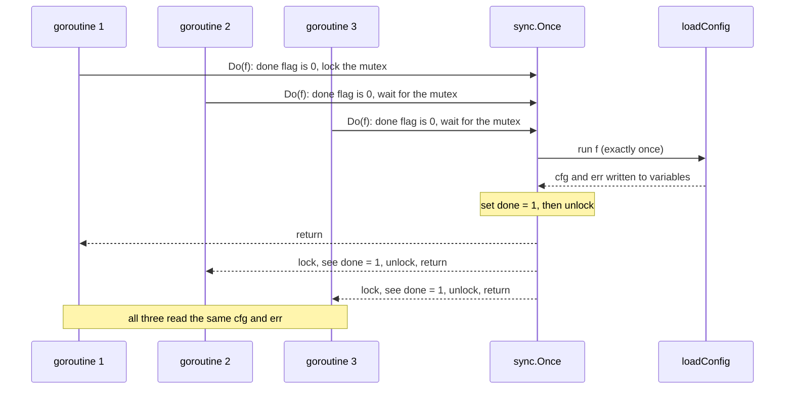
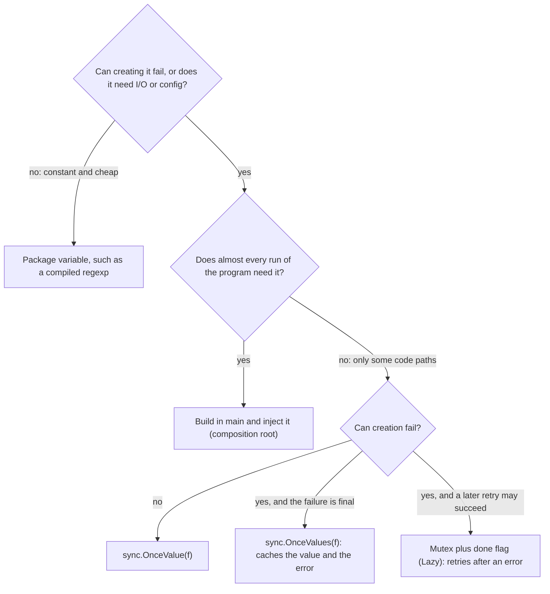

# Singleton and sync.Once

> [!summary] TL;DR
> A **singleton** is one shared instance of something for the whole program, such as the loaded config or a connection pool. In Go you rarely need the pattern: build the one instance in `main` and pass it to whoever needs it. When something really must be created lazily on first use, `sync.Once` (or `sync.OnceValue` / `sync.OnceValues`, since Go 1.21) runs the creation exactly once, even when many goroutines ask at the same moment.

## 1. Why it exists

A checkout service reads its config (database URL, worker count) and opens one connection pool. Two problems appear without a plan for "exactly one":

- **Duplicate expensive work.** If every handler calls `loadConfig()` and `sql.Open()`, 200 concurrent requests on a cold start create 200 pools. Each pool can open up to `MaxOpenConns` connections, so a limit of 10 per pool becomes up to 2,000 connections against a PostgreSQL server whose default `max_connections` is typically 100.
- **Races on lazy creation.** The naive lazy singleton, `if cfg == nil { cfg = load() }`, is a data race: two goroutines both see `nil`, both load, and one overwrites the other. `go test -race` reports it.

The GoF Singleton answers both with a class that controls its own single instance. In Go that answer brings the usual cost of globals: hidden dependencies and tests that cannot reset state. So the Go answer has two parts: **create once** with `sync.Once` when laziness is really needed, and **share by passing the instance** rather than by reaching for a global.

## 2. Mental model

A building has one main water tank. You could let every flat install a pipe to "the tank" hidden in the walls (a global): it works until someone needs to test a flat with a different tank, or replace the tank, and has to find every hidden pipe. Or the plumber connects each flat to the tank at construction time with a visible, labelled pipe (dependency injection from `main`). There is still exactly one tank; the difference is whether you can see who uses it.

`sync.Once` is the rule "the first person to arrive fills the tank; everyone else waits at the door until it is full, then uses the same water". Nobody fills it twice, and nobody drinks from a half-filled tank.

## 3. How it works

### The four ways to get "one instance"

1. **Package variable**, initialized when the package is initialized: `var digits = regexp.MustCompile("[0-9]+")`. Eager, cheap, cannot return an error.
2. **`init()` function**: runs after all package variables of that package are initialized, before `main`. Cannot take parameters or return an error, so failures can only panic or be stored.
3. **`sync.Once`**: `once.Do(f)` runs `f` the first time and never again. Use it for lazy creation; store the result and any error in variables next to it.
4. **`sync.OnceValue(f)` / `sync.OnceValues(f)`** (since Go 1.21): wrap `f` and return a function that runs `f` once and returns the cached result, or the cached result and error. Same guarantee as `Once`, no extra variables.

And the option that usually wins: **build it in `main` and inject it** (the composition root). Nothing is global; tests build their own instance.

### What happens when three goroutines arrive first

`sync.Once` keeps an atomic "done" flag and a mutex. The fast path is a single atomic load; only callers that arrive before `f` has finished touch the mutex.



The memory model guarantees that the writes made inside `f` are visible to every caller after its `Do` returns, so the callers can read `cfg` without another lock. A caller arriving after `done = 1` never touches the mutex.

### Choosing the form



## 4. Worked example

One `package main` with the owner's `GetConfig` on `sync.Once` (now returning its error instead of a silent `nil`), `sync.OnceValues`, a retrying `Lazy[T]`, the panic rules, a mutable shared `Flags` with its own lock, and a composition-root service. Built with Go 1.24.4; `go vet` is clean and `go test -race` passes.

```go
package main

import (
	"errors"
	"fmt"
	"os"
	"sync"
	"sync/atomic"
)

type Config struct {
	DBURL      string
	MaxWorkers int
}

var loads atomic.Int32 // counts real loads, to show how often init runs

// loadConfig takes the env lookup as a parameter so tests can control it.
func loadConfig(getenv func(string) string) (*Config, error) {
	loads.Add(1)
	url := getenv("DB_URL")
	if url == "" {
		return nil, errors.New("config: DB_URL is not set")
	}
	return &Config{DBURL: url, MaxWorkers: 8}, nil
}

// ---------- 1. The classic Go singleton: sync.Once, now returning the error ----------

var (
	cfgOnce sync.Once
	cfg     *Config
	cfgErr  error
)

func GetConfig() (*Config, error) {
	cfgOnce.Do(func() { cfg, cfgErr = loadConfig(os.Getenv) })
	return cfg, cfgErr
}

// ---------- 2. Since Go 1.21: sync.OnceValues keeps the value and the error together ----------

func NewConfigLoader(getenv func(string) string) func() (*Config, error) {
	return sync.OnceValues(func() (*Config, error) { return loadConfig(getenv) })
}

// ---------- 3. Retry after a failed init (sync.Once never retries) ----------

type Lazy[T any] struct {
	mu   sync.Mutex
	done bool
	val  T
	init func() (T, error)
}

func NewLazy[T any](init func() (T, error)) *Lazy[T] { return &Lazy[T]{init: init} }

func (l *Lazy[T]) Get() (T, error) {
	l.mu.Lock()
	defer l.mu.Unlock()
	if l.done {
		return l.val, nil
	}
	v, err := l.init()
	if err != nil {
		var zero T
		return zero, err // not cached: the next Get tries again
	}
	l.val, l.done = v, true
	return v, nil
}

// ---------- 4. A mutable shared instance needs its own lock ----------

type Flags struct {
	mu sync.RWMutex
	on map[string]bool
}

func NewFlags() *Flags { return &Flags{on: map[string]bool{}} }

func (f *Flags) Set(name string, v bool) {
	f.mu.Lock()
	defer f.mu.Unlock()
	f.on[name] = v
}

func (f *Flags) Enabled(name string) bool {
	f.mu.RLock()
	defer f.mu.RUnlock()
	return f.on[name]
}

// ---------- 5. "One per process", built in main and injected ----------

type Checkout struct {
	cfg   *Config
	flags *Flags
}

func NewCheckout(cfg *Config, flags *Flags) *Checkout { return &Checkout{cfg: cfg, flags: flags} }

func (c *Checkout) Workers() int {
	if c.flags.Enabled("double-workers") {
		return c.cfg.MaxWorkers * 2
	}
	return c.cfg.MaxWorkers
}

func main() {
	env := map[string]string{} // DB_URL is missing at first
	getenv := func(k string) string { return env[k] }

	load := NewConfigLoader(getenv)
	_, err := load()
	fmt.Println("first call:", err)
	env["DB_URL"] = "postgres://app@db:5432/shop"
	_, err = load()
	fmt.Println("after fixing env:", err)

	lazy := NewLazy(func() (*Config, error) { return loadConfig(getenv) })
	c, err := lazy.Get()
	fmt.Println("lazy retry:", c.DBURL, err)

	before := loads.Load()
	shared := NewConfigLoader(getenv)
	got := make([]*Config, 3)
	var wg sync.WaitGroup
	for i := range 3 {
		wg.Add(1)
		go func() {
			defer wg.Done()
			got[i], _ = shared()
		}()
	}
	wg.Wait()
	fmt.Println("3 concurrent callers, loads:", loads.Load()-before, "same pointer:", got[0] == got[1] && got[1] == got[2])

	var once sync.Once
	func() {
		defer func() { fmt.Println("recovered:", recover()) }()
		once.Do(func() { panic("init failed") })
	}()
	ran := false
	once.Do(func() { ran = true })
	fmt.Println("Once.Do ran f again after the panic:", ran)

	flags := NewFlags() // composition root: one instance, passed to whoever needs it
	flags.Set("double-workers", true)
	fmt.Println("workers:", NewCheckout(c, flags).Workers())
}
```

The tests never need to reset anything, except for the one test of the global `GetConfig`, which can run only once per process:

```go
package main

import (
	"sync"
	"sync/atomic"
	"testing"
)

// countingEnv returns a getenv func and a counter of how many loads happened.
func countingEnv(vals map[string]string) (func(string) string, *atomic.Int32) {
	var n atomic.Int32
	return func(k string) string {
		n.Add(1)
		return vals[k]
	}, &n
}

func TestOnceValuesConcurrentFirstCallers(t *testing.T) {
	getenv, n := countingEnv(map[string]string{"DB_URL": "postgres://x"})
	load := NewConfigLoader(getenv)
	const callers = 50
	got := make([]*Config, callers)
	var wg sync.WaitGroup
	for i := range callers {
		wg.Add(1)
		go func() {
			defer wg.Done()
			got[i], _ = load()
		}()
	}
	wg.Wait()
	if n.Load() != 1 {
		t.Fatalf("loaded %d times, want 1", n.Load())
	}
	for _, c := range got {
		if c != got[0] {
			t.Fatal("callers got different instances")
		}
	}
}

func TestOnceValuesCachesTheError(t *testing.T) {
	env := map[string]string{}
	getenv, n := countingEnv(env)
	load := NewConfigLoader(getenv)
	if _, err := load(); err == nil {
		t.Fatal("want an error while DB_URL is missing")
	}
	env["DB_URL"] = "postgres://x"
	if _, err := load(); err == nil || n.Load() != 1 {
		t.Fatalf("err=%v loads=%d: OnceValues must return the cached error without reloading", err, n.Load())
	}
}

func TestLazyRetriesUntilSuccess(t *testing.T) {
	env := map[string]string{}
	getenv, n := countingEnv(env)
	lazy := NewLazy(func() (*Config, error) { return loadConfig(getenv) })
	if _, err := lazy.Get(); err == nil {
		t.Fatal("want an error first")
	}
	env["DB_URL"] = "postgres://x"
	c1, err := lazy.Get()
	if err != nil {
		t.Fatal(err)
	}
	c2, _ := lazy.Get()
	if c1 != c2 || n.Load() != 2 {
		t.Fatalf("loads=%d, want 2 (one failure, one success, then cached)", n.Load())
	}
}

func TestOnceDoPanicIsFinal(t *testing.T) {
	var once sync.Once
	func() {
		defer func() { _ = recover() }()
		once.Do(func() { panic("boom") })
	}()
	ran := false
	once.Do(func() { ran = true })
	if ran {
		t.Fatal("Do must treat a panicking f as done")
	}
}

func TestOnceValueRepanicsEveryCall(t *testing.T) {
	var runs atomic.Int32
	f := sync.OnceValue(func() int {
		runs.Add(1)
		panic("boom")
	})
	for range 2 {
		func() {
			defer func() {
				if recover() == nil {
					t.Fatal("want a panic on every call")
				}
			}()
			f()
		}()
	}
	if runs.Load() != 1 {
		t.Fatalf("f ran %d times, want 1", runs.Load())
	}
}

func TestFlagsConcurrentUse(t *testing.T) {
	f := NewFlags()
	var wg sync.WaitGroup
	for i := range 20 {
		wg.Add(1)
		go func() {
			defer wg.Done()
			f.Set("x", i%2 == 0)
			_ = f.Enabled("x")
		}()
	}
	wg.Wait()
}

func TestCheckoutWithInjectedInstances(t *testing.T) {
	flags := NewFlags() // a fresh instance per test: nothing to reset
	svc := NewCheckout(&Config{MaxWorkers: 3}, flags)
	if svc.Workers() != 3 {
		t.Fatal("default workers")
	}
	flags.Set("double-workers", true)
	if svc.Workers() != 6 {
		t.Fatal("flag not applied")
	}
}

// The global GetConfig can be tested only once per process: its Once cannot be reset.
func TestGetConfigGlobal(t *testing.T) {
	t.Setenv("DB_URL", "postgres://test")
	c, err := GetConfig()
	if err != nil || c.DBURL != "postgres://test" {
		t.Fatalf("got %v, %v", c, err)
	}
}
```

Output of `go run .` (measured, Go 1.24.4, darwin/arm64):

```text
first call: config: DB_URL is not set
after fixing env: config: DB_URL is not set
lazy retry: postgres://app@db:5432/shop <nil>
3 concurrent callers, loads: 1 same pointer: true
recovered: init failed
Once.Do ran f again after the panic: false
workers: 16
```

What to notice:

- **`after fixing env` still fails.** `OnceValues` ran `f` once, got an error, and caches that error forever. Fixing the environment does not help until the process restarts.
- **`lazy retry` succeeds**, because `Lazy` caches only success.
- **`loads: 1`**: three concurrent first callers caused one load and got the same pointer.
- **`Once.Do ran f again after the panic: false`**: after a panic, `Once` counts `f` as done and later calls do nothing, so a value that `f` should have set stays at its zero value.
- **`workers: 16`**: `Checkout` got its config and flags as parameters; nothing in it is global.

## 5. Variants and comparison

| Option | How it works | Use when | Cost |
| --- | --- | --- | --- |
| Package variable | Initialized at package init, in dependency order | Constants, compiled regexps, lookup tables | Runs even if unused; cannot return an error |
| `init()` | Runs once before `main`, after the package's variables | Registering plug-ins (`sql.Register`) | Hidden side effect of an import; no parameters, no error |
| `sync.Once` + variables | `Do(f)` runs `f` once; results stored beside it | Lazy creation before Go 1.21, or when `f` sets several things | Easy to forget storing the error; no retry |
| `sync.OnceValue(f)` | Returns a func that runs `f` once and caches its value | Lazy, cannot fail | If `f` panics, every call panics again |
| `sync.OnceValues(f)` | Caches value and error together | Lazy, can fail, failure is final | A transient failure is cached for the process lifetime |
| Mutex + done flag (`Lazy`) | Locks, retries until the first success | Lazy, can fail, a retry may succeed | A lock on every call (add an atomic fast path if hot) |
| Build in `main`, inject | Constructed once at startup, passed as a parameter | Almost always for services, pools, clients, config | Constructors take more parameters |

## 6. Trade-offs and when not to use

Use a single shared instance for (from the owner's list): config loaded once, a shared logger, a metrics registry, an expensive immutable lookup table, and a connection pool.

Do **not** use a singleton for:

- request-scoped data (user, tenant, trace ID): it belongs in the request or its `context.Context` (see [[Context Package]]);
- database transactions: one transaction per unit of work, never shared;
- business services that need testing: inject them;
- anything that changes per tenant, user or request.

**Why globals hurt:**

- **Hidden dependencies.** `func Charge(o Order)` that calls `GetConfig()` inside does not say it needs config. You discover it when it fails in a test or a new binary.
- **Tests cannot reset them.** A `sync.Once` cannot be reset, so the first test that triggers it fixes the value for every later test in the package, and `t.Parallel()` tests share it. `TestGetConfigGlobal` works only because it is the only test that touches `GetConfig`.
- **Order coupling.** Code that reads a global during package initialization depends on initialization order across packages.

## 7. In production

**Standard library singletons and their pitfalls:**

- `http.DefaultClient` is `&http.Client{}`: its `Timeout` is zero, which means **no timeout**, so a stuck server can hang the caller indefinitely. Any package can also change `http.DefaultClient.Transport` and affect every other user. Build your own `*http.Client` with a timeout in `main` (see [[Calling External APIs]]).
- `http.DefaultTransport` is shared by every client that does not set `Transport`. Its idle pool keeps `DefaultMaxIdleConnsPerHost` = 2 connections per host, which is low for a service that calls one backend heavily.
- `http.DefaultServeMux`: importing `net/http/pprof` registers `/debug/pprof/` handlers on it from `init()`. Serving `DefaultServeMux` on a public port therefore exposes profiling endpoints. Use your own `http.NewServeMux()`.
- `slog.SetDefault(l)` replaces the process-wide default logger, and also routes the `log` package's default logger through `l`'s handler. A library that calls it hijacks the application's logging; only `main` should.

**Where it shows up in LLD problems:**

- [[Logging Library]]: a process-wide default logger, plus constructors for injected loggers.
- [[LRU Cache with TTL]] and [[In-memory KV Store with TTL and Transactions]]: one shared store guarded by a mutex, created in `main`.
- [[Parking Lot]]: the interview classic "the parking lot is a singleton". The better answer is one instance built in `main` and passed to the services, so tests can create a small lot.

**Failure modes and fixes:**

- First init fails (database not ready) and `Once` caches the failure or a nil value. Fix: return the error from `OnceValues` and let the process exit, or retry with `Lazy`, or better, build in `main` with a retry loop before serving traffic.
- Panic inside `Once.Do`: the value is never set and later calls see the zero value. Fix: never panic inside `f`; return an error.
- Calling `once.Do` again from inside `f` deadlocks, because the inner call waits for the outer one. Fix: keep `f` free of calls back into the same `Once`.
- Mutable singleton mutated from many goroutines. Fix: give it its own mutex (as `Flags` does); `Once` protects only creation.
- Request data stored in a singleton leaks between users. Fix: request-scoped values belong in the request or its context.

**What to monitor:** log once at startup that the shared resources were created (pool size, config source); export pool statistics such as `sql.DB.Stats()` open and in-use connection counts; alert when a lazy init error is logged, because with `Once` it will not heal by itself.

## 8. Deep dive

**Inside `sync.Once`.** `Do` first does an atomic load of the done flag. If it is set, it returns immediately: that fast path is why `Once` is cheap after initialization. Otherwise `doSlow` locks the mutex, checks the flag again (another goroutine may have finished meanwhile), runs `f`, and sets the flag with a deferred atomic store before unlocking. Because the store is deferred, it also runs when `f` panics, which is exactly why a panicking `f` counts as done. The Go memory model states the guarantee: the completion of the single call to `f` happens before any call to `Do` returns. [[sync Primitives and Atomics]] covers `Once` next to the other primitives.

**`OnceFunc`, `OnceValue`, `OnceValues` and panics.** The Go 1.21 helpers differ from `Once.Do` on panics: if `f` panics, the returned function panics with the same value **on every call** (the test `TestOnceValueRepanicsEveryCall` checks this, and that `f` ran only once). That is safer than `Once.Do`, where later callers silently see zero values.

**Why "double-checked locking" by hand is wrong.** The pattern `if inst == nil { mu.Lock(); if inst == nil { inst = build() }; mu.Unlock() }` reads `inst` without synchronization on the fast path. That is a data race in Go's memory model, even if it "works" on your machine. `sync.Once` is the correct version of this pattern: it uses an atomic flag for the fast path.

**Package initialization order.** Within a package, package-level variables are initialized in dependency order, then `init()` functions run in the order the files are presented to the compiler (the `go` tool sorts by file name). Across packages, a package is initialized after the packages it imports; since Go 1.21 the order among independent packages is specified exactly (by import path). Code that reads another package's global during initialization therefore depends on rules most readers do not know. Prefer explicit construction in `main`.

**The composition root.** `main` is the one place that knows about every concrete type: it reads config, opens the pool once, builds clients and services, and passes them down. This gives "one per process" without any global, and every test can build a fresh, small instance. [[Service Project Layout and Wiring]] shows the layout of a real service built this way.

**A singleton per key.** Sometimes you need "one per tenant" or "one client per region". A `map[string]*Client` behind a mutex, or a `sync.Map` of `sync.OnceValues` functions, gives lazy one-per-key creation. Bound the map, or it grows with every tenant ever seen.

## 9. Interview questions

> [!question]- How do you implement a thread-safe singleton in Go?
> Prefer building the instance in `main` and passing it in. If it must be created lazily, use `sync.OnceValue` or `sync.OnceValues` (Go 1.21+), or `sync.Once` with the result stored next to it. All of them run the constructor exactly once even with many concurrent first callers, and make its writes visible to all callers.

> [!question]- Trap: `GetDB()` uses `sync.Once` to open the database and ping it. The database is down for the first call. What happens when it comes back?
> Nothing gets better (and without the ping there would be no error at first, because `sql.Open` does not connect). `Once` (and `OnceValues`) never retries, so every later call returns the cached failure or a nil value until the process restarts. Either let the process fail fast and restart, or use a retrying lazy holder that caches only success, or connect in `main` with a retry loop before serving.

> [!question]- What happens if the function passed to `once.Do` panics?
> `Do` treats it as returned: the panic propagates to that caller, and later calls to `Do` do nothing, so anything `f` should have set stays at its zero value. `sync.OnceValue` and friends instead re-panic with the same value on every call.

> [!question]- Why are singletons considered harmful, and what do you do instead?
> They hide dependencies and make tests share state they cannot reset. Use dependency injection from a composition root: build one instance in `main` and pass it down. You keep "one per process" and lose the global.

> [!question]- Does `sync.Once` make the singleton itself thread-safe?
> No. It makes **creation** safe. If the shared object is mutable, such as a flags map or a cache, it needs its own mutex or atomics, as `Flags` has.

> [!question]- What is wrong with using `http.DefaultClient` in a service?
> It has no timeout, so a slow server can hang requests indefinitely, and it is a shared global that any package can modify. Create a client with an explicit `Timeout` and a tuned `Transport` in `main`, and inject it.

> [!question]- Package variable, `init()` or `sync.Once`?
> A package variable for cheap constants that cannot fail. `init()` only for registration side effects. `sync.Once` or `OnceValue(s)` for lazy creation that is expensive or rarely needed. For services, none of them: build in `main`.

## 10. Cheat sheet

- "One per process" in Go = build once in `main` and inject; globals are the exception.
- Lazy and safe: `sync.OnceValue(f)` / `sync.OnceValues(f)` (Go 1.21+), or `sync.Once` + variables.
- `Once` never retries: a failed init stays failed. Need retries? Cache only success (`Lazy`).
- Panic in `Once.Do` = done forever with zero values; `OnceValue` re-panics on every call.
- `Once` protects creation only; a mutable singleton needs its own lock.
- Hand-written double-checked locking is a data race.
- Stdlib globals to avoid in services: `http.DefaultClient` (no timeout), `DefaultServeMux` (pprof handlers), `slog.SetDefault` outside `main`.
- Tests: inject fresh instances; a global `Once` cannot be reset.

## Links

- **Before this:** [[sync Primitives and Atomics]], [[Goroutines and Channels]], [[Factory and Abstract Factory]]
- **Next:** [[Adapter]]
- **Compare with:** [[Service Project Layout and Wiring]], [[Memory Model and Data Races]], [[Builder and Functional Options]]
