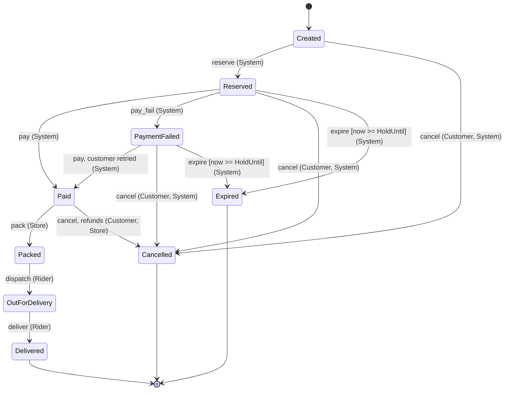
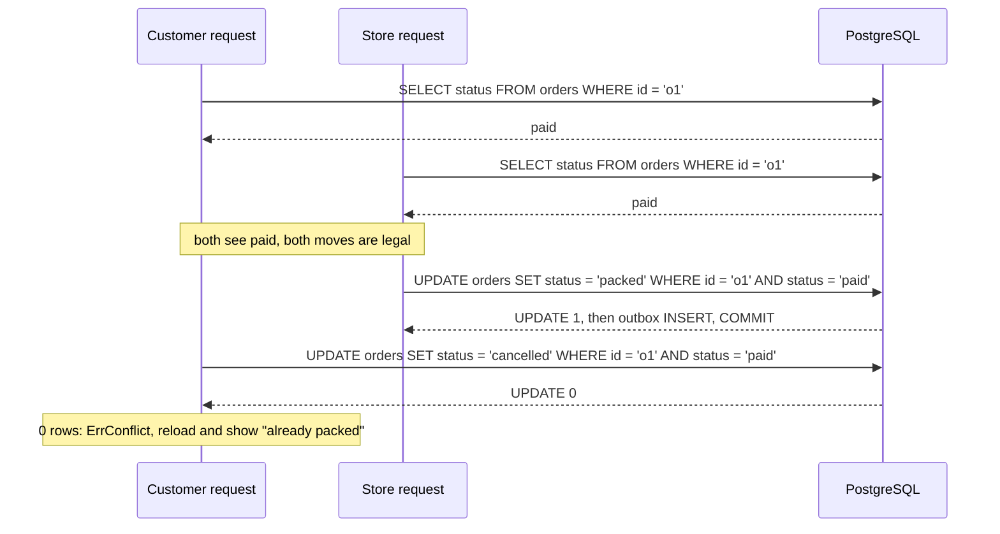
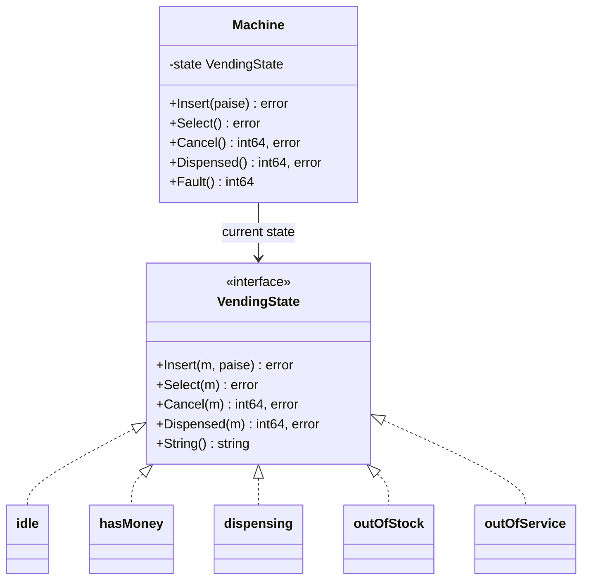

# State Machines in Go

> [!summary] TL;DR
> A state machine says which **states** an object can be in (an order is `paid`, `packed`, `delivered`) and which **events** move it from one state to another. Anything not listed is refused. In Go you build it either as **data** (an enum plus a transition table) or as **behaviour** (the GoF State pattern: one type per state behind an interface). In production you also need guards, permissions, a compare-and-set save and an event for every transition.

## 1. Why it exists

An order service without a state machine has checks like `if o.Status == "paid" || o.Status == "packed"` scattered across 15 handlers. Sooner or later one is missing: a rider app marks a `paid` order `delivered` without packing, or a customer cancels an order that is already `out_for_delivery` and gets a refund for food they also receive.

Concurrency makes it worse. The customer taps Cancel and the store taps Pack within the same 50 ms. Both handlers read `paid`, both decide their move is legal, and both write. The order ends up `packed` with a refund issued, or `cancelled` with a picker packing it.

A state machine fixes both problems in one place:

- **One table of legal moves.** Every handler calls `Fire(id, event, actor)`, and illegal moves fail the same way everywhere.
- **One atomic save.** The write says "move from `paid` to `packed` **only if it is still `paid`**". The test below runs that race 100 times; exactly one side wins every time.

## 2. Mental model

A **board game**. The squares are the states, the arrows printed on the board are the transitions, and a move is only legal along an arrow. Some arrows have a condition printed next to them ("only if you rolled a six": a guard), some can only be used by a certain player (an actor rule), and some squares have no arrows out (terminal states: the game is over for that piece).

The two Go forms differ in where the rules live:

- **Data form:** the arrows are rows in a map. One generic `Next` function reads the map.
- **Behaviour form (GoF State):** each square is a type that knows what to do with every input. The object holds "the current square" and forwards each input to it.

## 3. How it works

The order lifecycle used in the worked example. Text in brackets is a guard; text in parentheses is who may fire the event.



`PaymentFailed` is an **error state**: something went wrong, but the order can still recover (`pay`) or end (`cancel`, `expire`). `Delivered`, `Cancelled` and `Expired` are **terminal**: no event leaves them.

**Data form, one transition (`OrderRepo.Fire`):**

1. Load the order.
2. Look up `(current status, event)` in the `transitions` map. No row means `ErrInvalidTransition`.
3. Check the actor against the rule's allowed roles (a bit set). Wrong role means `ErrForbidden`.
4. Run the guard, if any. `expire` checks that the hold time has passed.
5. Save with **compare-and-set**: update only if the status is still the one you read. If another request moved it first, return `ErrConflict`.
6. In the same atomic step, append an outbox event such as `order.pack o1: paid -> packed`.

Steps 5 and 6 decide races. Two requests that both pass the checks in steps 2–4 still produce exactly one winner:



**Behaviour form (GoF State).** A vending machine reacts to the same four inputs (insert coin, select, cancel, item dispensed) in completely different ways depending on its state. Each state is a type implementing `VendingState`; the `Machine` (the *context*) holds the current one and delegates:



Each state embeds `rejectAll`, which refuses every input (`Insert`, `Select` and `Cancel` with that state's error, `Dispensed` with `ErrNotDispensing`), and overrides only the inputs it accepts. Only `hasMoney` accepts `Cancel`, which refunds the balance and returns to `idle`. A state changes the machine's state by assigning `m.state`, so the transitions live inside the state types.

## 4. Worked example

One `package main` with both forms: the order lifecycle as a transition table (typed states with `String()`, guards, actor bit sets, terminal and error states, a compare-and-set repository with an outbox) and the vending machine as GoF State. It compiles with Go 1.24 and passes `go vet` and `go test -race`, using only the standard library.

```go
// Command fsm shows two ways to build a state machine in Go:
// an order lifecycle as data (a transition table with guards, actor
// permissions, compare-and-set saves and outbox events), and a vending
// machine as behaviour (the GoF State pattern: one type per state).
package main

import (
	"errors"
	"fmt"
	"sync"
	"time"
)

// ---- Form 1: enum + transition table (data) ----

type Status uint8

const (
	Created Status = iota
	Reserved
	PaymentFailed
	Paid
	Packed
	OutForDelivery
	Delivered // terminal
	Cancelled // terminal
	Expired   // terminal
)

var statusNames = [...]string{"created", "reserved", "payment_failed", "paid", "packed",
	"out_for_delivery", "delivered", "cancelled", "expired"}

func (s Status) String() string {
	if int(s) < len(statusNames) {
		return statusNames[s]
	}
	return fmt.Sprintf("Status(%d)", s)
}

func (s Status) Terminal() bool { return s == Delivered || s == Cancelled || s == Expired }

type Event uint8

const (
	Reserve Event = iota
	PayFail
	Pay
	Pack
	Dispatch
	Deliver
	Cancel
	Expire
)

var eventNames = [...]string{"reserve", "pay_fail", "pay", "pack", "dispatch", "deliver", "cancel", "expire"}

func (e Event) String() string {
	if int(e) < len(eventNames) {
		return eventNames[e]
	}
	return fmt.Sprintf("Event(%d)", e)
}

// Actor is a bit set, so one rule can allow several roles.
type Actor uint8

const (
	Customer Actor = 1 << iota
	Store
	Rider
	System
)

type Order struct {
	ID        string
	Status    Status
	HoldUntil time.Time // stock is held for the customer until then
}

var (
	ErrInvalidTransition = errors.New("invalid transition")
	ErrForbidden         = errors.New("actor may not fire this event")
	ErrHoldActive        = errors.New("hold has not expired yet")
	ErrConflict          = errors.New("status changed concurrently")
	ErrNotFound          = errors.New("order not found")
)

type edge struct {
	from Status
	ev   Event
}

type rule struct {
	to     Status
	actors Actor                              // who may fire it
	guard  func(o Order, now time.Time) error // nil: always allowed
}

// transitions is built once, at package initialisation, not per call.
var transitions = map[edge]rule{
	{Created, Reserve}:        {Reserved, System, nil},
	{Reserved, Pay}:           {Paid, System, nil},
	{Reserved, PayFail}:       {PaymentFailed, System, nil},
	{PaymentFailed, Pay}:      {Paid, System, nil}, // the customer retried
	{Paid, Pack}:              {Packed, Store, nil},
	{Packed, Dispatch}:        {OutForDelivery, Rider, nil},
	{OutForDelivery, Deliver}: {Delivered, Rider, nil},
	{Created, Cancel}:         {Cancelled, Customer | System, nil},
	{Reserved, Cancel}:        {Cancelled, Customer | System, nil},
	{PaymentFailed, Cancel}:   {Cancelled, Customer | System, nil},
	{Paid, Cancel}:            {Cancelled, Customer | Store, nil}, // the action refunds
	{Reserved, Expire}:        {Expired, System, holdExpired},
	{PaymentFailed, Expire}:   {Expired, System, holdExpired},
}

func holdExpired(o Order, now time.Time) error {
	if now.Before(o.HoldUntil) {
		return ErrHoldActive
	}
	return nil
}

// Next checks a transition without side effects: table, actor, guard.
func Next(o Order, ev Event, by Actor, now time.Time) (Status, error) {
	r, ok := transitions[edge{o.Status, ev}]
	if !ok {
		return o.Status, fmt.Errorf("%w: %s from %s", ErrInvalidTransition, ev, o.Status)
	}
	if r.actors&by == 0 {
		return o.Status, fmt.Errorf("%w: %s", ErrForbidden, ev)
	}
	if r.guard != nil {
		if err := r.guard(o, now); err != nil {
			return o.Status, err
		}
	}
	return r.to, nil
}

// OrderRepo stands in for the orders table and its outbox. compareAndSet is
// the in-memory twin of
//
//	UPDATE orders SET status = $3 WHERE id = $1 AND status = $2
//
// plus an outbox INSERT in the same transaction.
type OrderRepo struct {
	mu     sync.Mutex
	orders map[string]Order
	outbox []string
}

func NewOrderRepo(orders ...Order) *OrderRepo {
	s := &OrderRepo{orders: make(map[string]Order)}
	for _, o := range orders {
		s.orders[o.ID] = o
	}
	return s
}

func (s *OrderRepo) compareAndSet(id string, from, to Status, event string) error {
	s.mu.Lock()
	defer s.mu.Unlock()
	o := s.orders[id]
	if o.Status != from {
		return ErrConflict // 0 rows updated: someone else moved it first
	}
	o.Status = to
	s.orders[id] = o
	s.outbox = append(s.outbox, event)
	return nil
}

// Fire loads, validates and saves one transition, emitting an outbox event.
func (s *OrderRepo) Fire(id string, ev Event, by Actor, now time.Time) (Status, error) {
	s.mu.Lock()
	o, ok := s.orders[id]
	s.mu.Unlock()
	if !ok {
		return 0, ErrNotFound
	}
	to, err := Next(o, ev, by, now)
	if err != nil {
		return o.Status, err
	}
	msg := fmt.Sprintf("order.%s %s: %s -> %s", ev, id, o.Status, to)
	if err := s.compareAndSet(id, o.Status, to, msg); err != nil {
		return o.Status, err
	}
	return to, nil
}

func (s *OrderRepo) Outbox() []string {
	s.mu.Lock()
	defer s.mu.Unlock()
	return append([]string(nil), s.outbox...)
}

// ---- Form 2: the State pattern (behaviour per state) ----

var (
	ErrNoCredit      = errors.New("insert money first")
	ErrNotEnough     = errors.New("not enough money")
	ErrBusy          = errors.New("dispensing, please wait")
	ErrSoldOut       = errors.New("sold out")
	ErrOutOfService  = errors.New("out of service")
	ErrNotDispensing = errors.New("nothing is being dispensed")
)

// VendingState is the State interface: one implementation per state.
type VendingState interface {
	Insert(m *Machine, paise int64) error
	Select(m *Machine) error
	Cancel(m *Machine) (refundPaise int64, err error)
	Dispensed(m *Machine) (changePaise int64, err error)
	String() string
}

// rejectAll refuses every input. States embed it and override only
// the inputs they accept.
type rejectAll struct{ err error }

func (r rejectAll) Insert(*Machine, int64) error      { return r.err }
func (r rejectAll) Select(*Machine) error             { return r.err }
func (r rejectAll) Cancel(*Machine) (int64, error)    { return 0, r.err }
func (r rejectAll) Dispensed(*Machine) (int64, error) { return 0, ErrNotDispensing }

type idle struct{ rejectAll }
type hasMoney struct{ rejectAll }
type dispensing struct{ rejectAll }
type outOfStock struct{ rejectAll }
type outOfService struct{ rejectAll }

var (
	stIdle         VendingState = idle{rejectAll{ErrNoCredit}}
	stHasMoney     VendingState = hasMoney{} // overrides Insert, Select and Cancel
	stDispensing   VendingState = dispensing{rejectAll{ErrBusy}}
	stOutOfStock   VendingState = outOfStock{rejectAll{ErrSoldOut}}
	stOutOfService VendingState = outOfService{rejectAll{ErrOutOfService}}
)

func (idle) String() string         { return "idle" }
func (hasMoney) String() string     { return "has_money" }
func (dispensing) String() string   { return "dispensing" }
func (outOfStock) String() string   { return "out_of_stock" }
func (outOfService) String() string { return "out_of_service" }

func (idle) Insert(m *Machine, paise int64) error {
	m.balance += paise
	m.state = stHasMoney
	return nil
}

func (hasMoney) Insert(m *Machine, paise int64) error {
	m.balance += paise
	return nil
}

func (hasMoney) Select(m *Machine) error {
	if m.balance < m.price {
		return ErrNotEnough
	}
	m.state = stDispensing // the motor runs; it calls Dispensed when done
	return nil
}

func (hasMoney) Cancel(m *Machine) (int64, error) {
	refund := m.balance
	m.balance = 0
	m.state = stIdle
	return refund, nil
}

func (dispensing) Dispensed(m *Machine) (int64, error) {
	change := m.balance - m.price
	m.balance = 0
	m.stock--
	m.state = stIdle
	if m.stock == 0 {
		m.state = stOutOfStock
	}
	return change, nil
}

// Machine is the context: it holds the current state and delegates to it.
type Machine struct {
	mu      sync.Mutex
	state   VendingState
	price   int64
	stock   int
	balance int64
}

func NewMachine(pricePaise int64, stock int) *Machine {
	m := &Machine{state: stIdle, price: pricePaise, stock: stock}
	if stock == 0 {
		m.state = stOutOfStock
	}
	return m
}

func (m *Machine) Insert(paise int64) error {
	m.mu.Lock()
	defer m.mu.Unlock()
	return m.state.Insert(m, paise)
}

func (m *Machine) Select() error {
	m.mu.Lock()
	defer m.mu.Unlock()
	return m.state.Select(m)
}

func (m *Machine) Cancel() (refundPaise int64, err error) {
	m.mu.Lock()
	defer m.mu.Unlock()
	return m.state.Cancel(m)
}

func (m *Machine) Dispensed() (int64, error) {
	m.mu.Lock()
	defer m.mu.Unlock()
	return m.state.Dispensed(m)
}

// Fault is an operator or sensor input valid in every state: refund and stop.
func (m *Machine) Fault() (refundPaise int64) {
	m.mu.Lock()
	defer m.mu.Unlock()
	refundPaise, m.balance = m.balance, 0
	m.state = stOutOfService
	return refundPaise
}

func (m *Machine) State() string {
	m.mu.Lock()
	defer m.mu.Unlock()
	return m.state.String()
}

func main() {
	now := time.Date(2026, 11, 2, 9, 0, 0, 0, time.UTC)
	store := NewOrderRepo(
		Order{ID: "o1", Status: Created, HoldUntil: now.Add(10 * time.Minute)},
		Order{ID: "o2", Status: Reserved, HoldUntil: now.Add(10 * time.Minute)},
	)
	steps := []struct {
		id string
		ev Event
		by Actor
		at time.Time
	}{
		{"o1", Reserve, System, now},
		{"o1", Pay, System, now},
		{"o1", Deliver, Rider, now}, // skips packing: invalid
		{"o1", Pack, Customer, now}, // wrong actor
		{"o1", Pack, Store, now},
		{"o2", Expire, System, now}, // guard: hold still active
		{"o2", Expire, System, now.Add(11 * time.Minute)},
		{"o2", Cancel, Customer, now}, // expired is terminal
	}
	for _, s := range steps {
		st, err := store.Fire(s.id, s.ev, s.by, s.at)
		fmt.Printf("%s %-8s -> %-14s err=%v\n", s.id, s.ev, st, err)
	}
	fmt.Println("outbox:", len(store.Outbox()), "events")

	m := NewMachine(2_000, 1)
	fmt.Println(m.State(), m.Select())
	fmt.Println(m.Insert(1_000), m.Select(), m.State())
	fmt.Println(m.Insert(1_500), m.Select(), m.State())
	change, err := m.Dispensed()
	fmt.Println("change:", change, err, "| state:", m.State())
	fmt.Println(m.Insert(500), "| refund:", m.Fault(), "| state:", m.State())
}
```

Output of `go run .` (Go 1.24.4):

```text
o1 reserve  -> reserved       err=<nil>
o1 pay      -> paid           err=<nil>
o1 deliver  -> paid           err=invalid transition: deliver from paid
o1 pack     -> paid           err=actor may not fire this event: pack
o1 pack     -> packed         err=<nil>
o2 expire   -> reserved       err=hold has not expired yet
o2 expire   -> expired        err=<nil>
o2 cancel   -> expired        err=invalid transition: cancel from expired
outbox: 4 events
idle insert money first
<nil> not enough money has_money
<nil> <nil> dispensing
change: 500 <nil> | state: out_of_stock
sold out | refund: 0 | state: out_of_service
```

Only the 4 successful transitions wrote outbox events. The vending machine sold its only item, returned ₹5 change (500 paise), refused the next coin because it was sold out, and went out of service on `Fault`.

The tests check every edge **and every non-edge** against a specification written separately from the `transitions` map, so an extra row added by mistake fails the build. They also cover terminal states, actor permissions, the expiry guard, a 100-round race between Cancel and Pack, the vending machine step by step, and its Cancel refund:

```go
package main

import (
	"errors"
	"sync"
	"testing"
	"time"
)

var t0 = time.Date(2026, 11, 2, 9, 0, 0, 0, time.UTC)

// The specification, written independently of the transitions map:
// every allowed edge and the actor who fires it.
var wantEdges = []struct {
	from Status
	ev   Event
	by   Actor
	to   Status
}{
	{Created, Reserve, System, Reserved},
	{Reserved, Pay, System, Paid},
	{Reserved, PayFail, System, PaymentFailed},
	{PaymentFailed, Pay, System, Paid},
	{Paid, Pack, Store, Packed},
	{Packed, Dispatch, Rider, OutForDelivery},
	{OutForDelivery, Deliver, Rider, Delivered},
	{Created, Cancel, Customer, Cancelled},
	{Reserved, Cancel, Customer, Cancelled},
	{PaymentFailed, Cancel, Customer, Cancelled},
	{Paid, Cancel, Customer, Cancelled},
	{Reserved, Expire, System, Expired},
	{PaymentFailed, Expire, System, Expired},
}

func TestEveryEdgeAndEveryNonEdge(t *testing.T) {
	allowed := map[edge]Status{}
	for _, w := range wantEdges {
		allowed[edge{w.from, w.ev}] = w.to
		o := Order{Status: w.from, HoldUntil: t0} // hold already expired at t0
		got, err := Next(o, w.ev, w.by, t0)
		if err != nil || got != w.to {
			t.Errorf("%s --%s--> got %s, %v; want %s", w.from, w.ev, got, err, w.to)
		}
	}
	all := Customer | Store | Rider | System
	for s := Created; s <= Expired; s++ {
		for ev := Reserve; ev <= Expire; ev++ {
			if _, ok := allowed[edge{s, ev}]; ok {
				continue
			}
			if _, err := Next(Order{Status: s}, ev, all, t0); !errors.Is(err, ErrInvalidTransition) {
				t.Errorf("%s --%s--> err = %v, want ErrInvalidTransition", s, ev, err)
			}
		}
	}
}

func TestTerminalStatesHaveNoExits(t *testing.T) {
	for e := range transitions {
		if e.from.Terminal() {
			t.Errorf("terminal %s has an outgoing edge on %s", e.from, e.ev)
		}
	}
}

func TestActorPermissions(t *testing.T) {
	tests := []struct {
		from Status
		ev   Event
		by   Actor
		want error
	}{
		{Paid, Cancel, Rider, ErrForbidden},
		{Paid, Pack, Customer, ErrForbidden},
		{Packed, Cancel, Customer, ErrInvalidTransition}, // too late to cancel
		{Reserved, Cancel, Customer, nil},
	}
	for _, tt := range tests {
		if _, err := Next(Order{Status: tt.from}, tt.ev, tt.by, t0); !errors.Is(err, tt.want) {
			t.Errorf("%s by %d on %s: err = %v, want %v", tt.ev, tt.by, tt.from, err, tt.want)
		}
	}
}

func TestExpiryIsAGuardedTransition(t *testing.T) {
	o := Order{Status: Reserved, HoldUntil: t0.Add(10 * time.Minute)}
	if _, err := Next(o, Expire, System, t0.Add(9*time.Minute)); !errors.Is(err, ErrHoldActive) {
		t.Fatalf("before expiry: err = %v, want ErrHoldActive", err)
	}
	if got, err := Next(o, Expire, System, t0.Add(10*time.Minute)); err != nil || got != Expired {
		t.Fatalf("at expiry: got %s, %v; want expired", got, err)
	}
}

func TestCompareAndSetLetsExactlyOneRacerWin(t *testing.T) {
	for range 100 {
		store := NewOrderRepo(Order{ID: "o1", Status: Paid})
		var wg sync.WaitGroup
		errs := make([]error, 2)
		for i, try := range []struct {
			ev Event
			by Actor
		}{{Cancel, Customer}, {Pack, Store}} {
			wg.Add(1)
			go func() {
				defer wg.Done()
				_, errs[i] = store.Fire("o1", try.ev, try.by, t0)
			}()
		}
		wg.Wait()
		wins := 0
		for _, err := range errs {
			switch {
			case err == nil:
				wins++
			case errors.Is(err, ErrConflict), errors.Is(err, ErrInvalidTransition):
			default:
				t.Fatalf("unexpected error: %v", err)
			}
		}
		if wins != 1 || len(store.Outbox()) != 1 {
			t.Fatalf("wins=%d outbox=%d, want 1 and 1", wins, len(store.Outbox()))
		}
	}
}

func TestVendingMachine(t *testing.T) {
	m := NewMachine(2_000, 1)
	steps := []struct {
		name      string
		do        func() error
		wantErr   error
		wantState string
	}{
		{"select without money", m.Select, ErrNoCredit, "idle"},
		{"insert 1000", func() error { return m.Insert(1_000) }, nil, "has_money"},
		{"select, too little", m.Select, ErrNotEnough, "has_money"},
		{"insert 1500", func() error { return m.Insert(1_500) }, nil, "has_money"},
		{"select", m.Select, nil, "dispensing"},
		{"insert while busy", func() error { return m.Insert(100) }, ErrBusy, "dispensing"},
		{"cancel while busy", func() error { _, err := m.Cancel(); return err }, ErrBusy, "dispensing"},
		{"dispensed", func() error {
			change, err := m.Dispensed()
			if change != 500 {
				t.Errorf("change = %d, want 500", change)
			}
			return err
		}, nil, "out_of_stock"},
		{"insert when sold out", func() error { return m.Insert(2_000) }, ErrSoldOut, "out_of_stock"},
		{"dispensed again", func() error { _, err := m.Dispensed(); return err }, ErrNotDispensing, "out_of_stock"},
	}
	for _, s := range steps {
		if err := s.do(); !errors.Is(err, s.wantErr) {
			t.Fatalf("%s: err = %v, want %v", s.name, err, s.wantErr)
		}
		if got := m.State(); got != s.wantState {
			t.Fatalf("%s: state = %s, want %s", s.name, got, s.wantState)
		}
	}
	m.Fault()
	if err := m.Select(); !errors.Is(err, ErrOutOfService) {
		t.Fatalf("after fault: err = %v, want ErrOutOfService", err)
	}
}

func TestCancelRefundsTheBalance(t *testing.T) {
	m := NewMachine(2_000, 1)
	if _, err := m.Cancel(); !errors.Is(err, ErrNoCredit) {
		t.Fatalf("cancel when idle: err = %v, want ErrNoCredit", err)
	}
	for _, coin := range []int64{1_000, 500} {
		if err := m.Insert(coin); err != nil {
			t.Fatal(err)
		}
	}
	refund, err := m.Cancel()
	if err != nil || refund != 1_500 || m.State() != "idle" {
		t.Fatalf("cancel: refund=%d err=%v state=%s; want 1500, nil, idle", refund, err, m.State())
	}
	if err := m.Select(); !errors.Is(err, ErrNoCredit) {
		t.Fatalf("select after cancel: err = %v, want ErrNoCredit", err)
	}
}
```

`go test -race -count=1 -v` passes all seven tests.

### Persisting transitions (PostgreSQL 17)

Store the state as its `String()` name in a `text` column with a `CHECK (status IN (...))` constraint, never as the iota number: reordering the Go constants would silently change the meaning of every stored row.

```sql
BEGIN;
UPDATE orders
SET status = 'packed', updated_at = now()
WHERE id = 'o1' AND status = 'paid';
-- UPDATE 1: this request won. UPDATE 0: someone moved it first; ROLLBACK and report a conflict.
INSERT INTO outbox (id, topic, payload)
VALUES ('evt_42', 'order.pack', '{"order_id": "o1", "from": "paid", "to": "packed"}');
COMMIT;
```

In Go, compare the command tag's rows affected with 1 (`RowsAffected()` in `database/sql` and pgx). A timeout transition can run as one set-based statement from a sweeper job, with the same compare-and-set predicate and the same guard as `holdExpired` (`hold_until <= now()`). A data-modifying CTE writes the outbox rows in the same statement, so expired orders announce themselves like every other transition:

```sql
WITH expired AS (
    UPDATE orders
    SET status = 'expired', updated_at = now()
    WHERE status IN ('reserved', 'payment_failed') AND hold_until <= now()
    RETURNING id
)
INSERT INTO outbox (id, topic, payload)
SELECT gen_random_uuid()::text, 'order.expire',
       jsonb_build_object('order_id', id, 'to', 'expired')
FROM expired;
```

## 5. Variants and comparison

| Form | How it works | Use when | Cost |
| --- | --- | --- | --- |
| `switch` on an enum | One `switch o.Status` per method | 2 to 4 states with simple rules | Rules spread across methods as they grow |
| Enum + transition table (data) | `map[edge]rule`; one generic `Next` | Many states, uniform behaviour, persisted status, rules you want to print, review and test exhaustively | Per-state behaviour beyond "allowed or not" goes into guards and actions |
| State interface (GoF State, behaviour) | One type per state; the context delegates every input | Few states that react very differently to the same inputs (vending, TCP connection, elevator) | More types; the full transition graph is not visible in one place |
| State functions | `type stateFn func(*lexer) stateFn`: each state returns the next | Lexers and parsers driven by input, as in `text/template/parse` | Hard to persist; only one goroutine runs it |
| FSM library (`github.com/looplab/fsm`) | Events and callbacks declared as data | You want enter and leave callbacks without writing the engine | A dependency and string-typed states |

The two main forms mix well: a table for the legal moves, and a small State interface for the per-state behaviour of a few complex states.

## 6. Trade-offs and when not to use

**When not to use it in Go:**

- **Two states and one flag.** `active bool` with `Activate()` and `Deactivate()` does not need a table.
- **States that are really independent attributes.** `paid` and `gift_wrapped` are not one state machine; combining them multiplies the states (2 × 2 = 4 here, and it grows fast). Use separate fields or separate machines.
- **Long-running, multi-service workflows.** A state machine in one service does not survive another service failing mid-way; that needs a persisted saga ([[Saga Pattern]]).

**Pitfalls:**

- **Rebuilding the table on every call.** A transition method that builds its `allowed` map inside the method allocates on every transition. Build it once, as a package-level variable.
- **Check, then write.** Reading the status, deciding, and then `UPDATE ... SET status` without the `AND status = $from` predicate is a time-of-check-to-time-of-use race. The compare-and-set is the actual lock.
- **Raw strings everywhere.** `"Paid"` versus `"paid"` compiles. Typed constants with `String()` do not drift; convert to text only at the edge (JSON, SQL).
- **Persisting iota values.** Insert a constant in the middle and every stored number now means a different state. Store names, or assign explicit numbers and never change them.
- **No terminal states, or terminal states with exits.** A diagram without end states hides which orders are finished. Make them explicit and test that no edge leaves them.
- **Permissions checked in handlers.** If only the rider handler checks the rider role, the next handler forgets. Put the allowed actors in the rule.
- **Rules only in the client.** An app that hides the Cancel button after packing gives a hint, not a rule. Old app versions and direct API calls still send `cancel`, so the server's table must refuse it.
- **In-memory timers for business timeouts.** `time.AfterFunc` per order is lost on restart. Drive expiry from a stored deadline with a sweeper or a delayed job ([[Task Scheduler (delayed and recurring jobs)]]).

## 7. In production

- **Real systems:**
	- `net/http` tracks every server connection with the typed state `http.ConnState` (`StateNew`, `StateActive`, `StateIdle`, `StateHijacked`, `StateClosed`). It has a `String()` method, the docs mark `StateHijacked` and `StateClosed` as terminal, and `Server.ConnState` is an observer hook called on each transition.
	- The `text/template/parse` lexer is a machine of state functions: each `stateFn` scans some input and returns the next state.
	- In the practice problems: [[Vending Machine]] (GoF State), [[Food Ordering System]] (order status with actor permissions and compare-and-set), [[Inventory Order Assignment (Dark Store)]] (pick and pack states), [[Delivery Partner Assignment]] (offers that expire), [[Elevator System]] (moving, doors open, idle), [[Library Management]] (a copy that is available, borrowed or lost), and seat holds in [[Movie Ticket Booking]].
- **Failure modes → fixes:**
	- Two requests both apply a move → compare-and-set predicate, check rows affected, return a conflict.
	- Transitions applied but nobody told → outbox row in the same transaction; listeners subscribe as in [[Observer and Event Bus]].
	- Orders stuck in `reserved` forever → a stored `hold_until` and a sweeper that fires `expire`; alert on the age of the oldest non-terminal order.
	- A new status added to the enum but not to the table → the every-edge test fails, which is the point of writing the spec separately.
- **What to monitor:** count of orders per state, time spent in each state (p50 and p99), rejected transitions by reason (invalid, forbidden, guard, conflict), and the age of the oldest order in each non-terminal state.

## 8. Deep dive

- **Guards vs actions.** A guard decides **whether** a transition may happen and must not have side effects (it may run and then lose the compare-and-set). An action is what happens **because** it happened (refund, email). Run actions after the commit, driven by the outbox event, so a lost race never refunds anyone.
- **Status predicate vs version column.** `WHERE status = $from` is enough when the machine has no cycles back to an earlier state. If an order could return to a state it was in before (for example, if a retry moved `payment_failed` back to `reserved`), an update could match the status it read even though other transitions happened in between (the ABA problem). A `version` column incremented on every write, with `WHERE version = $read_version`, closes that gap. It also protects guards that read other fields: if a support agent extends `hold_until` while the status stays `reserved`, a status-only predicate lets an `expire` decided on the old deadline go through. See [[Locking - Optimistic vs Pessimistic]].
- **Pessimistic alternative.** `SELECT ... FOR UPDATE` locks the row for the whole decision. It is simpler to reason about when the guard needs several reads, but it holds a lock across application code.
- **Embedding for default behaviour.** `rejectAll` uses struct embedding so each vending state writes only the inputs it accepts. The embedded methods are promoted, so `idle` satisfies `VendingState` with one override. The mechanics are in [[Structs, Methods and Embedding]].
- **Exhaustive tests stay cheap.** 9 states × 8 events = 72 pairs. Testing all 72 against an independent list costs microseconds and catches both missing and extra edges.

## 9. Interview questions

> [!question]- Transition table or State pattern: how do you choose?
> Use a table when the question is "is this move allowed?" and the state is persisted: orders, payments, tickets. Use the State pattern when each state reacts differently to the same inputs, as a vending machine does with a coin. A table keeps the whole graph visible and easy to test; the State pattern removes `switch` statements from every method.

> [!question]- Trap: the handler reads the status, checks the move is legal, then runs `UPDATE orders SET status = 'cancelled' WHERE id = $1`. What is wrong?
> It is a check-then-act race. Another request can move the order between the read and the write, and the update overwrites it. Add the expected old state to the predicate (`AND status = 'paid'`), check that exactly one row changed, and treat zero rows as a conflict.

> [!question]- How do you model "a seat hold expires after 10 minutes"?
> As a normal transition, `expire`, with a guard `now >= hold_until`, fired by the system actor. Store the deadline in the row and let a sweeper or a delayed job fire it with the same compare-and-set as every other transition. Do not rely on an in-memory timer.

> [!question]- How do other parts of the system find out about a transition?
> Write an outbox row in the same transaction as the status update, then let a relay publish it. Listeners such as notifications and analytics subscribe to `order.packed`. Writing the event and the status together means neither can exist without the other.

> [!question]- Where do role permissions belong?
> In the transition rule itself: each rule lists the actors who may fire it, and the single `Next` function checks it. If the check lives in each HTTP handler, the next handler someone writes will forget it.

> [!question]- How do you test a state machine thoroughly?
> Write the expected edges as a separate list, then test every listed edge succeeds and every other `(state, event)` pair fails. Add tests for guards, permissions and terminal states, and a concurrent test that two conflicting moves produce exactly one winner.

## 10. Cheat sheet

- States + events + a table of legal moves; everything else is refused.
- Typed states with `String()`; store names, not iota numbers.
- A rule = target state + allowed actors + optional guard (no side effects).
- Save with compare-and-set: `WHERE id = $1 AND status = $from`, then check rows affected.
- Emit an outbox event in the same transaction; run actions after commit.
- Timeouts are transitions with a stored deadline, fired by a sweeper.
- Terminal states have no exits; test every edge and every non-edge.
- Table for persisted lifecycles; GoF State when behaviour differs per state.

## Links

- **Before this:** [[Interfaces]], [[Strategy and Template Method]], [[Observer and Event Bus]]
- **Next:** [[Vending Machine]], [[Food Ordering System]], [[Transactional Outbox and CDC]]
- **Compare with:** [[Strategy and Template Method]] (the client picks a strategy; a state picks its successor), [[Locking - Optimistic vs Pessimistic]] (compare-and-set vs row locks), [[Saga Pattern]] (a state machine spread across services), [[Case Study - Ticket Booking]] (seat holds at system scale)
