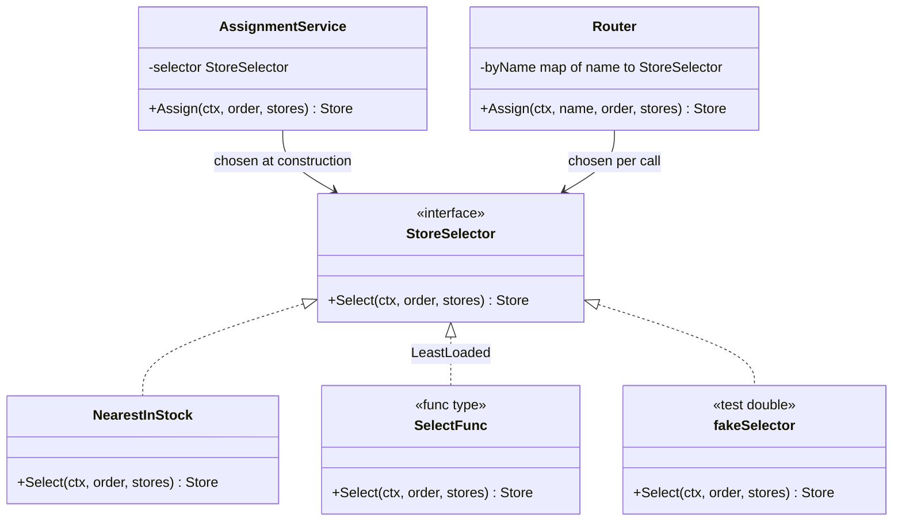
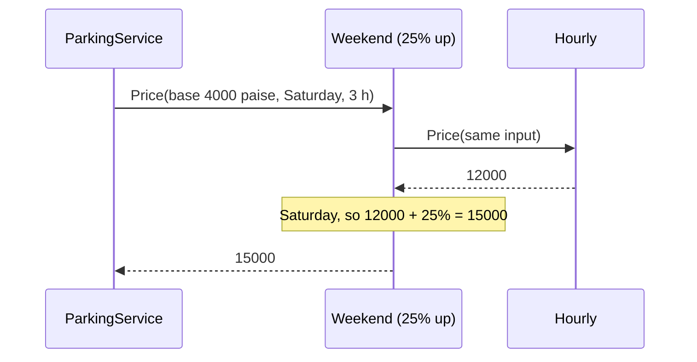
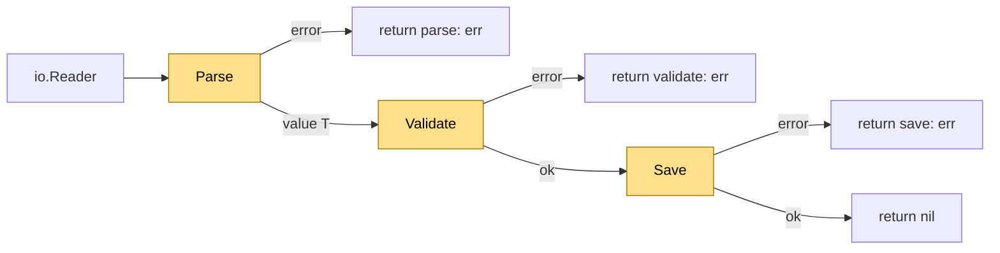
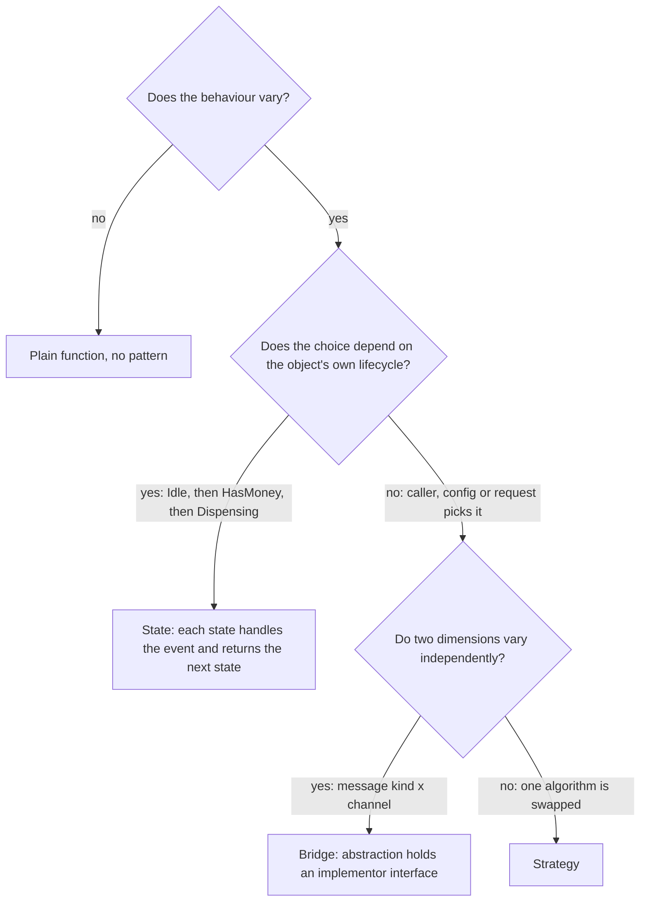

# Strategy and Template Method

> [!summary] TL;DR
> **Strategy** puts an algorithm that changes (how to pick a store, how to price a parking slot) behind a small interface or a function type, and hands it to the code that uses it. **Template Method** is the opposite split: a fixed workflow function runs the steps in order, and the caller supplies the steps through an interface. In Go both mean "pass behaviour in as a value"; neither needs inheritance.

> [!abstract] Core idea
> - **Strategy:** the part that varies (a pricing rule, a store-picking rule) becomes a value, an interface or a function, that the caller passes in.
> - **Template Method:** one function owns the fixed order of steps; the caller supplies only the steps.
> - The rule that matters: separate what stays fixed from what changes, and pass the changing part in as a value.
> - Classic mistake: a growing `switch city { ... }` inside the service, or (in Go) trying to fake inheritance with struct embedding, where the embedded type's method never calls your override.

## 1. Why it exists

A quick-commerce backend assigns each order to a dark store. Mumbai wants the **nearest store with stock**. Bengaluru, during the evening peak, wants the **least loaded store**. Product wants to try a third rule next month. Pricing for the parking feature has the same shape: an hourly base price, plus a weekend surcharge in some cities, plus a coupon in others.

Without Strategy, all of this becomes one function:

- `Assign` grows a `switch city { ... }` with one branch per rule. Every new rule edits the service, its tests and its review.
- Pricing multiplies: 2 base rules × 2 surcharges × 2 coupon rules is 8 branches in one `switch`, while composed strategies need only 2 + 2 + 2 = 6 small types.
- Each branch can only be tested by driving the whole service.

Template Method fixes a different duplication. Three importers (CSV payments, JSON refunds, bank statements) each repeat "parse, then validate, then save, wrap each error with the step name". One importer forgets `Validate`, and bad rows reach the database. A single skeleton function that owns the order of the steps makes skipping a step impossible.

## 2. Mental model

- **Strategy is a pluggable decision.** A maps app offers "fastest", "shortest" and "avoid tolls". The trip, the map and the turn-by-turn screen stay the same; only the rule that picks the route is swapped. In Go the rule is a value: an interface with one method, or a function.
- **Template Method is a recipe card with blanks.** "Make dough, add *your filling*, bake 20 minutes" fixes the order; the cook fills in one step. In Go the recipe is a plain function, and the blanks are the methods of a step interface it receives.

Both patterns separate **what stays fixed** from **what varies**. Strategy keeps the caller fixed and swaps the whole algorithm. Template Method keeps the algorithm's skeleton fixed and swaps individual steps.

## 3. How it works

### Strategy

1. Define the decision as a small interface, in the package that **uses** it: `StoreSelector` with one method `Select`.
2. Write each rule as its own type (`NearestInStock`) or as a function converted to an adapter type (`SelectFunc`, the same trick as `http.HandlerFunc`; see [[Adapter]]).
3. Pick the strategy at one of two moments:
	- **At construction**: `NewAssignmentService(NearestInStock{})`. The service never changes rule. This is plain dependency injection.
	- **Per call**: a registry `map[string]StoreSelector` chooses by name, for example from the city's config, and returns a typed error for an unknown name.
4. Pass everything the strategy reads as arguments or in an input struct (`PriceInput`). A strategy that calls `time.Now()` or reads a global config cannot be tested on "a Saturday".
5. Compose strategies by wrapping: `Weekend{Next: Hourly}` is itself a `Pricer`, so the service cannot tell one pricer from a stack of them. This is the [[Decorator and Middleware]] idea applied to a strategy.



Every `Select` also returns an `error` (left out of the diagram for space). A test can drop in any third implementation, such as a fake that always returns one store, without touching the service.

Composition is a call chain: the outer pricer asks the inner one first and then adjusts the answer.



### Template Method

Classic object-oriented languages put the skeleton in an abstract base class and let subclasses override the steps. Go has no inheritance, so the skeleton becomes a **function** and the steps become an **interface** it receives:

1. `Steps[T]` declares `Parse`, `Validate` and `Save`. The type parameter `T` carries the parsed value from step to step with full type safety (the old version passed `any` and type-asserted inside every step).
2. `Import[T]` calls the steps in a fixed order, stops at the first error, and wraps it with the step name.
3. Each importer (`CSVPayments`) implements only the steps.



The highlighted boxes are the variable steps that `CSVPayments` supplies. Everything else, the order and the error wrapping, belongs to `Import` and is identical for every importer.

**The embedding trap.** It is tempting to write a `BaseJob` struct with a `Run` method that calls `b.Validate()`, embed it in `StrictJob`, and "override" `Validate`. It does not work: `Run` is promoted, but its receiver is the embedded `BaseJob`, which has no link back to the outer struct, so `Run` still calls `BaseJob.Validate`. Go method calls through embedding are resolved statically; there is no virtual dispatch. The test `TestEmbeddingDoesNotOverride` below proves it. [[Structs, Methods and Embedding]] explains promotion in full.

### Whiteboard version

Strategy is a one-method interface plus types that implement it; Template Method is a plain function that runs the steps of an interface in a fixed order. This is the bare idea you can draw in two minutes; the full version below adds production concerns.

```go
package main

import "fmt"

// Strategy: the varying rule is a value the caller passes in.
type Pricer interface{ Price(hours int) int }

type Hourly struct{ Rate int }

func (h Hourly) Price(hours int) int { return h.Rate * hours }

type FlatDay struct{ Fee int }

func (f FlatDay) Price(int) int { return f.Fee }

// Template Method: a fixed skeleton; the steps come from an interface.
type Importer interface {
	Parse() error
	Validate() error
	Save() error
}

func Run(im Importer) error {
	for _, step := range []func() error{im.Parse, im.Validate, im.Save} {
		if err := step(); err != nil {
			return err
		}
	}
	return nil
}

func main() {
	for _, p := range []Pricer{Hourly{Rate: 40}, FlatDay{Fee: 300}} {
		fmt.Println(p.Price(5)) // 200, then 300
	}
}
```

## 4. Worked example

One `package main` with store-selection code, a function strategy, a per-call registry, a composed pricer, a generic Template Method and the embedding trap. Built with Go 1.24.4; `go vet` is clean and `go test -race` passes.

```go
package main

import (
	"bufio"
	"cmp"
	"context"
	"errors"
	"fmt"
	"io"
	"slices"
	"strconv"
	"strings"
	"time"
)

// ---------- Strategy: store selection ----------

type Store struct {
	ID       string
	Distance float64 // km from the customer
	HasStock bool
	Load     int // orders the store is already picking
}

type Order struct{ ID string }

var ErrNoStore = errors.New("no store has stock")

// StoreSelector is the strategy interface: one method, one decision.
type StoreSelector interface {
	Select(ctx context.Context, o Order, stores []Store) (Store, error)
}

// NearestInStock picks the closest store that has stock.
type NearestInStock struct{}

func (NearestInStock) Select(_ context.Context, _ Order, stores []Store) (Store, error) {
	var best *Store
	for i := range stores {
		s := &stores[i]
		if s.HasStock && (best == nil || s.Distance < best.Distance) {
			best = s
		}
	}
	if best == nil {
		return Store{}, ErrNoStore
	}
	return *best, nil
}

// SelectFunc lets a plain function act as a StoreSelector,
// the same trick as http.HandlerFunc.
type SelectFunc func(ctx context.Context, o Order, stores []Store) (Store, error)

func (f SelectFunc) Select(ctx context.Context, o Order, stores []Store) (Store, error) {
	return f(ctx, o, stores)
}

// LeastLoaded is a strategy written as a function.
var LeastLoaded = SelectFunc(func(_ context.Context, _ Order, stores []Store) (Store, error) {
	var best *Store
	for i := range stores {
		s := &stores[i]
		if s.HasStock && (best == nil || s.Load < best.Load) {
			best = s
		}
	}
	if best == nil {
		return Store{}, ErrNoStore
	}
	return *best, nil
})

// AssignmentService fixes its strategy at construction time.
type AssignmentService struct{ selector StoreSelector }

func NewAssignmentService(s StoreSelector) *AssignmentService {
	return &AssignmentService{selector: s}
}

func (a *AssignmentService) Assign(ctx context.Context, o Order, stores []Store) (Store, error) {
	return a.selector.Select(ctx, o, stores)
}

// ---------- Strategy chosen per call from a registry ----------

type UnknownStrategyError struct{ Name string }

func (e *UnknownStrategyError) Error() string { return "unknown strategy " + strconv.Quote(e.Name) }

// Router picks the strategy per call, by name (for example from a city's config).
type Router struct{ byName map[string]StoreSelector }

func (r Router) Assign(ctx context.Context, name string, o Order, stores []Store) (Store, error) {
	s, ok := r.byName[name]
	if !ok {
		return Store{}, &UnknownStrategyError{Name: name}
	}
	return s.Select(ctx, o, stores)
}

// ---------- Composing strategies: pricing ----------

// PriceInput carries everything a pricing strategy may read,
// so no strategy reaches for globals such as time.Now().
type PriceInput struct {
	BasePaise int64 // rate per started hour
	At        time.Time
	Hours     int
}

type Pricer interface {
	Price(in PriceInput) int64
}

type PricerFunc func(PriceInput) int64

func (f PricerFunc) Price(in PriceInput) int64 { return f(in) }

// Hourly charges the base rate for every started hour.
var Hourly = PricerFunc(func(in PriceInput) int64 { return in.BasePaise * int64(in.Hours) })

// Weekend wraps another pricer and adds a surcharge on Saturday and Sunday.
type Weekend struct {
	Next      Pricer
	PercentUp int64
}

func (w Weekend) Price(in PriceInput) int64 {
	p := w.Next.Price(in)
	if d := in.At.Weekday(); d == time.Saturday || d == time.Sunday {
		p += p * w.PercentUp / 100
	}
	return p
}

// ---------- Template Method: skeleton function + step interface ----------

type Steps[T any] interface {
	Parse(r io.Reader) (T, error)
	Validate(v T) error
	Save(v T) error
}

// Import is the fixed skeleton: the order of the steps and the error wrapping never change.
func Import[T any](r io.Reader, s Steps[T]) error {
	v, err := s.Parse(r)
	if err != nil {
		return fmt.Errorf("parse: %w", err)
	}
	if err := s.Validate(v); err != nil {
		return fmt.Errorf("validate: %w", err)
	}
	if err := s.Save(v); err != nil {
		return fmt.Errorf("save: %w", err)
	}
	return nil
}

type Payment struct {
	ID          string
	AmountPaise int64
}

// CSVPayments implements the three steps for "id,amount" lines.
type CSVPayments struct{ Saved []Payment }

func (c *CSVPayments) Parse(r io.Reader) ([]Payment, error) {
	var out []Payment
	sc := bufio.NewScanner(r)
	for sc.Scan() {
		id, amt, ok := strings.Cut(sc.Text(), ",")
		if !ok {
			return nil, fmt.Errorf("bad line %q", sc.Text())
		}
		n, err := strconv.ParseInt(amt, 10, 64)
		if err != nil {
			return nil, err
		}
		out = append(out, Payment{ID: id, AmountPaise: n})
	}
	return out, sc.Err()
}

func (c *CSVPayments) Validate(ps []Payment) error {
	for _, p := range ps {
		if p.AmountPaise <= 0 {
			return fmt.Errorf("payment %s: amount must be positive", p.ID)
		}
	}
	return nil
}

func (c *CSVPayments) Save(ps []Payment) error {
	c.Saved = append(c.Saved, ps...)
	return nil
}

// ---------- The embedding trap ----------

type BaseJob struct{}

func (BaseJob) Validate() string { return "base" }
func (b BaseJob) Run() string    { return "validated by " + b.Validate() }

// StrictJob "overrides" Validate, but BaseJob.Run still calls BaseJob.Validate:
// embedding promotes methods, it does not give virtual dispatch.
type StrictJob struct{ BaseJob }

func (StrictJob) Validate() string { return "strict" }

func main() {
	stores := []Store{
		{ID: "far", Distance: 5.2, HasStock: true, Load: 1},
		{ID: "near", Distance: 1.1, HasStock: true, Load: 9},
		{ID: "empty", Distance: 0.5, HasStock: false, Load: 0},
	}
	ctx := context.Background()

	svc := NewAssignmentService(NearestInStock{})
	s, _ := svc.Assign(ctx, Order{ID: "o1"}, stores)
	fmt.Println("construction-time strategy:", s.ID)

	r := Router{byName: map[string]StoreSelector{"nearest": NearestInStock{}, "least-loaded": LeastLoaded}}
	s, _ = r.Assign(ctx, "least-loaded", Order{ID: "o2"}, stores)
	fmt.Println("per-call strategy:", s.ID)
	_, err := r.Assign(ctx, "cheapest", Order{ID: "o3"}, stores)
	fmt.Println("unknown:", err)

	sat := time.Date(2026, 11, 7, 10, 0, 0, 0, time.UTC) // a Saturday
	p := Weekend{Next: Hourly, PercentUp: 25}
	fmt.Println("weekend price (paise):", p.Price(PriceInput{BasePaise: 4000, At: sat, Hours: 3}))

	imp := &CSVPayments{}
	err = Import(strings.NewReader("p1,1500\np2,0\n"), imp)
	fmt.Println("import:", err)

	names := []string{"pear", "fig", "banana"}
	slices.SortFunc(names, func(a, b string) int { return cmp.Compare(len(a), len(b)) })
	fmt.Println("slices.SortFunc by length:", names)

	fmt.Println("embedding trap:", StrictJob{}.Run())
}
```

The tests check each strategy alone, with no service around it, and check the service with a fake strategy. That split is the main payoff of the pattern.

```go
package main

import (
	"context"
	"errors"
	"strings"
	"testing"
	"time"
)

func TestEachSelectorAlone(t *testing.T) {
	stores := []Store{
		{ID: "far", Distance: 5.2, HasStock: true, Load: 1},
		{ID: "near", Distance: 1.1, HasStock: true, Load: 9},
		{ID: "empty", Distance: 0.5, HasStock: false},
	}
	tests := []struct {
		name string
		s    StoreSelector
		want string
	}{
		{"nearest skips the empty store", NearestInStock{}, "near"},
		{"least loaded", LeastLoaded, "far"},
	}
	for _, tc := range tests {
		t.Run(tc.name, func(t *testing.T) {
			got, err := tc.s.Select(context.Background(), Order{ID: "o"}, stores)
			if err != nil || got.ID != tc.want {
				t.Fatalf("got %q, %v; want %q", got.ID, err, tc.want)
			}
		})
	}
}

// fakeSelector is a test double: service tests do not depend on any real rule.
type fakeSelector struct{ id string }

func (f fakeSelector) Select(context.Context, Order, []Store) (Store, error) {
	return Store{ID: f.id}, nil
}

func TestServiceUsesInjectedStrategy(t *testing.T) {
	svc := NewAssignmentService(fakeSelector{id: "s-42"})
	got, err := svc.Assign(context.Background(), Order{ID: "o"}, nil)
	if err != nil || got.ID != "s-42" {
		t.Fatalf("got %q, %v; want s-42", got.ID, err)
	}
}

func TestNoStock(t *testing.T) {
	_, err := NearestInStock{}.Select(context.Background(), Order{}, []Store{{ID: "x"}})
	if !errors.Is(err, ErrNoStore) {
		t.Fatalf("err = %v, want ErrNoStore", err)
	}
}

func TestRouterUnknownName(t *testing.T) {
	r := Router{byName: map[string]StoreSelector{"nearest": NearestInStock{}}}
	_, err := r.Assign(context.Background(), "cheapest", Order{}, nil)
	var u *UnknownStrategyError
	if !errors.As(err, &u) || u.Name != "cheapest" {
		t.Fatalf("err = %v, want *UnknownStrategyError", err)
	}
}

func TestWeekendWrapsBase(t *testing.T) {
	p := Weekend{Next: Hourly, PercentUp: 25}
	mon := time.Date(2026, 11, 2, 10, 0, 0, 0, time.UTC)
	sat := time.Date(2026, 11, 7, 10, 0, 0, 0, time.UTC)
	if got := p.Price(PriceInput{BasePaise: 4000, At: mon, Hours: 3}); got != 12000 {
		t.Errorf("monday = %d, want 12000", got)
	}
	if got := p.Price(PriceInput{BasePaise: 4000, At: sat, Hours: 3}); got != 15000 {
		t.Errorf("saturday = %d, want 15000", got)
	}
}

func TestImportSkeleton(t *testing.T) {
	imp := &CSVPayments{}
	if err := Import(strings.NewReader("p1,1500\np2,700\n"), imp); err != nil {
		t.Fatal(err)
	}
	if len(imp.Saved) != 2 {
		t.Fatalf("saved %d rows, want 2", len(imp.Saved))
	}
	err := Import(strings.NewReader("p3,0\n"), imp)
	if err == nil || !strings.HasPrefix(err.Error(), "validate:") {
		t.Fatalf("err = %v, want a validate error", err)
	}
	if len(imp.Saved) != 2 {
		t.Fatal("Save must not run after a failed Validate")
	}
}

func TestEmbeddingDoesNotOverride(t *testing.T) {
	if got := (StrictJob{}).Run(); got != "validated by base" {
		t.Fatalf("got %q", got)
	}
}
```

Output of `go run .` (measured, Go 1.24.4, darwin/arm64):

```text
construction-time strategy: near
per-call strategy: far
unknown: unknown strategy "cheapest"
weekend price (paise): 15000
import: validate: payment p2: amount must be positive
slices.SortFunc by length: [fig pear banana]
embedding trap: validated by base
```

Reading the output:

- The same three stores give `near` under one rule and `far` under the other: the data did not change, only the injected decision did.
- `p2,0` stops at `validate:` and `Save` never runs, because the skeleton owns the order of the steps.
- `slices.SortFunc` takes a comparison function: that function is a strategy in one line.
- `validated by base` is the embedding trap: `StrictJob.Validate` was never called.

## 5. Variants and comparison

| Option | How it works | Use when | Cost |
| --- | --- | --- | --- |
| Interface strategy | A one-method interface; each rule is a type | Rules carry config or state (weights, a cache) or need more than one method | One type per rule |
| Function strategy | `type SelectFunc func(...)`, optionally with a method so it satisfies the interface | Stateless rules, closures, one-off rules in tests | Functions cannot be compared or used as map keys |
| Chosen at construction | Constructor parameter | One rule per service instance, for example per deployment | Changing the rule means building a new service |
| Chosen per call (registry) | `map[string]Strategy` looked up by name from config or request | Per city, per tenant, A/B tests | Unknown names must become a typed error; validate config at startup |
| Composed strategy | A strategy that wraps another of the same interface | Surcharges, discounts, caching, logging around a rule | Order matters; deep stacks are harder to read |
| Template Method (Go form) | Skeleton function + step interface, generic over the data type | Several variants share the order of steps, error wrapping, metrics or a transaction | One more interface; little gain with a single variant |
| Template via embedding | Base struct method calls its own "hook" methods | Never for overriding: it silently calls the base hook | Bugs that look correct in review |

### Strategy, State or Bridge?

All three look the same in Go (a struct holding an interface field). The question is who decides which implementation runs and why.



| | Strategy | State | Bridge |
| --- | --- | --- | --- |
| Who picks the implementation | The caller, config or request | The object itself, as events arrive | Wiring code, once |
| Do implementations know each other | No | Yes: a state returns the next state | No |
| Typical Go shape | `selector StoreSelector` field or func argument | `state State` field replaced on every transition | `sender Sender` field inside a `Notification` hierarchy |
| Example | Nearest vs least-loaded store | Vending machine, order lifecycle | Urgent/digest notifications × SMS/email senders |

See [[State Machines in Go]] for State and [[Rare GoF Patterns in Go]] for the full Bridge.

## 6. Trade-offs and when not to use

- **One rule and no expected second rule:** write a function. An interface with one implementation is indirection with no payoff (YAGNI, see [[Design Principles - DRY, KISS, YAGNI, Coupling and Cohesion]]).
- **Two fixed cases:** an `if` is clearer than two types and a registry.
- **A strategy interface with four or five methods** is usually two decisions glued together. Split it, or it stops being swappable.
- **Template Method with one variant** adds an interface and a generic function to save nothing. Introduce the skeleton when the second variant appears and the shared order of steps or error handling is real.
- **Indirect calls:** an interface or function-value call usually cannot be inlined by the compiler. That costs nanoseconds per call (an estimate) and matters only in tight loops, such as a comparator called millions of times.
- **Hidden control flow:** a reader of `Assign` cannot see which rule runs without finding the wiring. Name strategies well and log the chosen name.

## 7. In production

**Real systems in the standard library:**

- `slices.SortFunc(s, cmp)` (since Go 1.21): the comparison function is a strategy; the sorting algorithm stays fixed.
- `sort.Sort(sort.Interface)`: the closest thing to Template Method in the standard library. `sort.Sort` owns the algorithm (pattern-defeating quicksort since Go 1.19) and calls your `Len`, `Less` and `Swap` steps.
- `bufio.Scanner.Split(bufio.SplitFunc)`: the tokenizing rule (`ScanLines`, `ScanWords`, `ScanRunes`, or your own) is a function strategy; the buffering loop is fixed.
- `http.Client.CheckRedirect`: the redirect policy is a function field. When it is nil the client uses its default policy, which stops after 10 consecutive requests.
- `http.Client.Transport` (`http.RoundTripper`): the strategy for actually sending a request. Tests swap in a fake transport; wrappers add retries or auth (see [[Decorator and Middleware]]).

**Where it shows up in LLD problems:**

- [[Parking Lot]]: the spot allocation rule (nearest to the gate, by vehicle size) and the pricing rule (hourly, flat, weekend surcharge).
- [[Rate Limiter]]: token bucket, fixed window and sliding window behind one `Limiter` interface. The system-level view is in [[Rate Limiting - Algorithms and Distributed Design]].
- [[Splitwise Expense Sharing]]: equal, exact-amount and percentage splits.
- [[Meeting Room Scheduler]]: room selection, for example the smallest free room that fits.
- [[Delivery Partner Assignment]] and [[Inventory Order Assignment (Dark Store)]]: ranking partners or stores by distance, load or rating.
- [[Cart Checkout with Coupons]]: each discount rule is a strategy, and stacked coupons are composed strategies.

**Failure modes and fixes:**

- A strategy reads `time.Now()` or a global config, so the weekend rule cannot be tested. Fix: pass time and inputs in an input struct, or inject a clock.
- A typo in a config name reaches the registry at request time. Fix: return a typed `*UnknownStrategyError`, and check every configured name once at startup so the service fails to boot instead of failing requests.
- A nil strategy is passed to the constructor and the service panics on the first request. Fix: reject nil in the constructor or substitute a default.
- Strategies disagree on errors (one returns `nil, nil` for "no match"). Fix: define sentinel errors such as `ErrNoStore` next to the interface and test each strategy against them.
- A shared, stateful strategy (a round-robin selector with a counter) races when many goroutines call it. Fix: make it stateless, or protect the state with an atomic or a mutex, and run tests with `-race`.

**What to monitor:** record the chosen strategy name as a log field or a low-cardinality metric label (for example `assign_strategy="least-loaded"`), count unknown-name errors, and compare outcome metrics (delivery time, price paid) per strategy when you A/B test rules.

## 8. Deep dive

**Why embedding is not overriding.** A promoted method is just shorthand: `StrictJob{}.Run()` means `StrictJob{}.BaseJob.Run()`. Inside `Run`, the receiver is a `BaseJob` value. It has no pointer to the struct that contains it, so `b.Validate()` can only mean `BaseJob.Validate`. Two working alternatives:

- The skeleton function shown above: `Import(r, steps)` calls the steps through an interface, so dynamic dispatch happens on the interface.
- A "hook field": the base struct holds a `steps Steps` field that the outer type sets to itself. This works but couples the two types in both directions; prefer the function.

**Function or interface?** A function type is lighter, and a closure can capture configuration. But Go functions are not comparable (only to `nil`), so you cannot deduplicate them, use them as map keys or compare them in a test. A struct type with a method can carry named configuration and can be compared if its fields are comparable. The adapter type `SelectFunc` with a `Select` method gives both: callers depend on the interface, and simple rules stay simple functions.

**Comparing interface values can panic.** Two interface values are equal when their dynamic types and values are equal. If both hold the same non-comparable dynamic type, such as two `SelectFunc` values (a function type), `==` panics at run time with `comparing uncomparable type`. Do not compare strategies with `==`; compare their names.

**Generics and inference.** `Import[T]` keeps the parsed type through all three steps, so `Validate` receives `[]Payment`, not `any`. The call site needs no type argument: since Go 1.21, type inference also looks at methods when a value is passed to an interface-typed parameter, so `Import(r, &CSVPayments{})` infers `T = []Payment` from the result type of `CSVPayments.Parse`. With Go 1.20 or older you had to write `Import[[]Payment](r, imp)`. [[Generics and Iterators]] covers the inference rules.

**Composition order changes results.** Composed strategies do not commute. Take an hourly total of ₹120, a 25% weekend surcharge and a ₹50 coupon:

- Surcharge first, then coupon: `120 × 1.25 − 50 = 100`.
- Coupon first, then surcharge: `(120 − 50) × 1.25 = 87.5`.

The business must decide which one is right, and the wiring code must make the order visible in one place.

**Rounding in money strategies.** The example keeps money in integer paise and uses integer division, which rounds down. With many stacked percentage rules, decide where rounding happens (per rule or once at the end) and test the boundaries, because each `p * percent / 100` truncates.

## 9. Interview questions

> [!question]- When is a `switch` better than a Strategy?
> When there are two or three cases that rarely change, live in one place, and need no separate tests. Strategy pays off when new rules arrive over time, when rules are chosen from config or per request, or when each rule needs its own tests. A `switch` that is copied into several functions is the signal to extract a strategy.

> [!question]- Interface strategy or function strategy?
> A function when the rule is stateless and small, or for one-off rules in tests. An interface when the rule carries configuration, needs more than one method, or must be comparable. The `http.HandlerFunc` trick (a func type with a method) lets callers depend on the interface while simple rules stay functions.

> [!question]- Trap: can you build Template Method by embedding a base struct and overriding a step in the outer struct?
> No. The promoted `Run` method receives the embedded base value and calls the base's own `Validate`; Go has no virtual dispatch through embedding, so the "override" is silently ignored. Write the skeleton as a function that takes a step interface, such as `Import[T](r, steps)`.

> [!question]- What is the difference between Strategy and State?
> In Strategy, someone outside (caller, config, request) picks the algorithm, and the strategies do not know each other. In State, the object's own lifecycle picks the behaviour, and each state decides the next state, as in a vending machine. If running the behaviour moves the object to a new mode, it is State.

> [!question]- Strategy and Bridge both hold an interface field. How are they different?
> The intent. Strategy swaps one algorithm. Bridge separates two dimensions that vary independently, such as notification kind (urgent, digest) and delivery channel (SMS, email), so you avoid a class for every combination.

> [!question]- How do you pick a strategy at run time without crashing on bad config?
> Keep a registry `map[string]Strategy`, return a typed error such as `*UnknownStrategyError` for an unknown name, and validate every configured name at startup so a typo stops the deployment instead of failing requests. Log the chosen name with each decision.

> [!question]- Which pattern is `sort.Sort`, and which is `slices.SortFunc`?
> `sort.Sort` is Template Method: the library owns the algorithm and calls your `Len`, `Less` and `Swap` steps. `slices.SortFunc` is Strategy in its lightest form: you pass one comparison function, and the algorithm and the data access stay inside the library.

> [!question]- How do you test code that uses strategies?
> Test each strategy alone with a table of inputs and expected choices, including the "no match" error. Test the service with a fake strategy that returns a fixed answer, so service tests do not depend on any real rule. Pass time and other inputs explicitly so cases like "Saturday" are reproducible.

## 10. Cheat sheet

- Strategy: one-method interface or func type, injected; the caller never branches on the rule.
- Pick at construction (dependency injection) or per call (registry map plus typed unknown-name error).
- Pass inputs in a struct, never read globals or `time.Now()` inside a strategy.
- Compose by wrapping: `Weekend{Next: Hourly}`. Order changes the result.
- Template Method in Go = skeleton function + step interface, generic over the data: `Import[T](r, Steps[T])`.
- Embedding does not override: the base method calls the base hook.
- Strategy (outside chooses) vs State (lifecycle chooses, states know the next) vs Bridge (two independent dimensions).
- Standard library: `slices.SortFunc`, `sort.Sort`, `bufio.Scanner.Split`, `http.Client.CheckRedirect`, `http.RoundTripper`.

## Links

- **Before this:** [[Interfaces]], [[Structs, Methods and Embedding]], [[Design Patterns Overview and Chooser]], [[SOLID in Go]]
- **Next:** [[Factory and Abstract Factory]]
- **Compare with:** [[State Machines in Go]], [[Decorator and Middleware]], [[Rare GoF Patterns in Go]], [[Rate Limiting - Algorithms and Distributed Design]]
