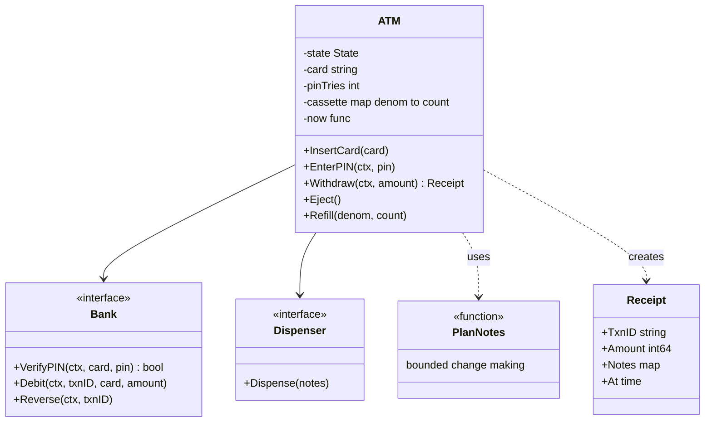
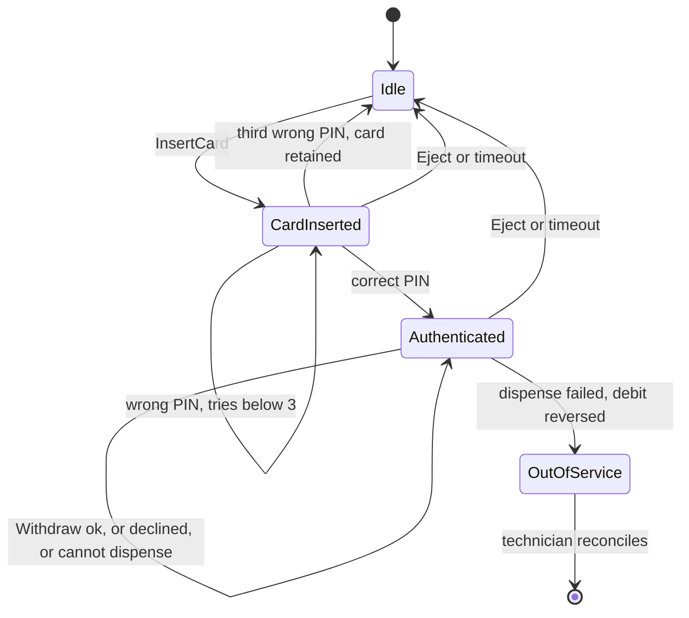
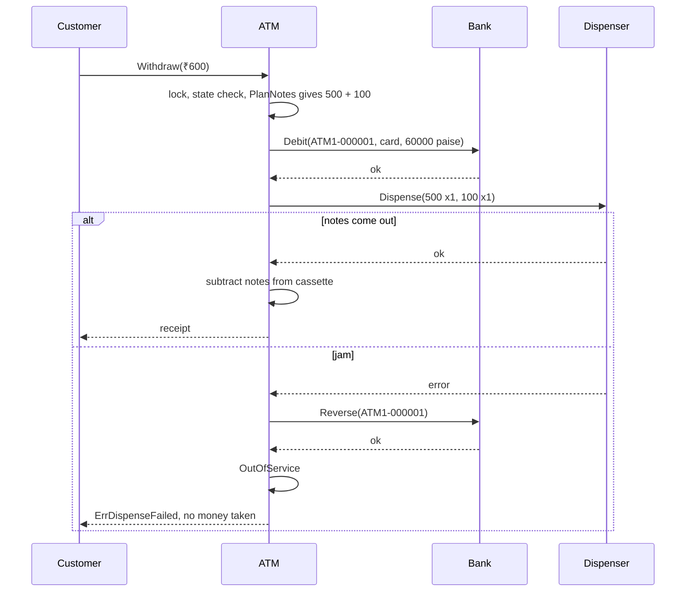

# ATM

> [!summary] TL;DR
> An ATM is a small state machine (idle, card inserted, authenticated, out of service) wrapped around one dangerous step: giving out cash. The design has three hard parts: the session states and their guards, a cash dispenser that must hit the amount exactly with a limited number of notes of each denomination (bounded change-making, where greedy fails), and making "debit the account" and "push out the notes" behave atomically, with a reversal when the hardware fails after the debit.

> [!abstract] Core idea
> - States: `Idle -> CardInserted -> Authenticated -> Idle`, plus `OutOfService` after a hardware fault. Every method checks the state first.
> - Three wrong PINs retain the card; an idle session times out using an injected clock.
> - Dispensing is bounded change-making: use at most `have[d]` notes of each denomination, hit the amount exactly, use the fewest notes. Greedy is wrong with limited notes (₹600 from one ₹500 and three ₹200 notes needs 3 × ₹200). A small dynamic programme solves it.
> - Order of the withdrawal: plan the notes, debit the bank with an idempotent transaction ID, dispense, and only then subtract the notes from the cassette. If the dispense fails, reverse the debit and go out of service.
> - Money is `int64` paise; the bank and the hardware are interfaces, so every failure is testable.

## Problem statement

```text
Design an ATM. A customer inserts a card, enters a PIN, and withdraws cash.
The ATM holds a limited number of notes of several denominations (for example
₹500, ₹200, ₹100) and must give the exact amount or refuse. The bank verifies the PIN and
debits the account. Handle wrong PINs, session timeouts, insufficient funds,
amounts the ATM cannot make with its notes, and a cash jam after the account was debited.
```

- It tests a state machine with guards, an algorithm that interviewers expect you to get right (bounded change-making), and the most important consistency idea in payments: a two-step operation across two systems (the bank and the cash hardware) needs an idempotent first step and a compensating action. Time box: 10 minutes for Steps 1-4, 10 for Steps 5-7, 30 for the code, 10 for edge cases.

### Solving path

1. Ask the clarifying questions: denominations, per-transaction limit, PIN retries, what happens on a jam.
2. Draw the states and transitions first; they decide every method's guard.
3. Put the bank and the cash hardware behind interfaces.
4. Write the dispense planner as bounded change-making; show why greedy fails with one example.
5. Write `Withdraw` in the safe order: plan, debit (idempotent ID), dispense, commit the cassette; reverse on failure.
6. Test the planner table, wrong PINs, timeout, a declined debit, a jam, and concurrent withdrawals; then discuss the bank-side ledger and reconciliation.

## Step 1: Clarify requirements

### Questions to ask (with assumed answers)

- Which operations? *Assume: withdraw cash; balance enquiry, deposit and PIN change are extensions.*
- Which denominations? *Assume: ₹500, ₹200 and ₹100, configurable; each has a limited count in the cassette.*
- Which notes should a withdrawal use? *Assume: any exact combination, preferring the fewest notes. Real ATMs often also want a mix of small notes; that is a different objective function.*
- Limit per withdrawal? *Assume: ₹20,000 per transaction (an example limit; real limits are set by the issuing bank).*
- How many wrong PINs? *Assume: three, then the card is retained.*
- Session timeout? *Assume: 2 minutes of inactivity ejects the card; the clock is injected.*
- What if the notes jam after the bank debited the account? *Assume: reverse the debit, put the ATM out of service, and let a technician reconcile the cassette.*
- One customer at a time? *Assume: yes for the session, but an operator can refill while a session is open, so the code must be concurrency-safe.*

### Functional

- Insert card, enter PIN (three tries), withdraw, eject.
- Withdraw validates the amount, plans notes from the cassette, debits the bank, dispenses, and returns a receipt.
- Refill the cassette (operator).
- Time out an inactive session.

### Non-functional

- Never give cash without a debit, and never keep a debit without giving cash: the withdrawal behaves atomically across the bank and the hardware.
- A retried debit never charges twice: the transaction ID is the idempotency key.
- The planner never fails when an exact combination exists.
- Money is `int64` paise; time comes from an injected clock; state is guarded by one mutex.

### Out of scope

- The card network protocol (ISO 8583 messages), EMV chip cryptography and PIN block encryption.
- The bank's ledger (see [[Digital Wallet and Ledger]]).
- Physical security, cameras, receipts printing.

## Step 2: Actors and use cases

| Actor | Use case |
|---|---|
| Customer | Insert card, enter PIN, withdraw, eject |
| Bank (card issuer) | Verify PIN, debit the account, reverse a debit |
| Cash dispenser hardware | Push out a set of notes, or report a fault |
| Operator | Refill notes, bring the ATM back into service |
| Clock | Decide whether the session has timed out |

The hardest use case is **Withdraw**: it crosses two systems that can each fail, and the customer must end up with either both cash and debit, or neither.

## Step 3: Entities

| Entity | Key fields | Why it exists |
|---|---|---|
| `ATM` | state, card, pinTries, lastActive, cassette, limit, timeout, seq | The facade and the state machine; owns the lock |
| `State` | Idle, CardInserted, Authenticated, OutOfService | Decides which actions are allowed |
| Cassette | `map[int64]int` denomination to count | The limited resource the planner draws from |
| `Bank` | `VerifyPIN`, `Debit`, `Reverse` | The external system of record for money |
| `Dispenser` | `Dispense(notes)` | The hardware; all notes or none |
| `Receipt` | TxnID, Card, Amount, Notes, At | What a successful withdrawal returns |
| Transaction ID | `ATM1-000042` | Idempotency key for debit and reversal |

Modelling insight: the **ATM does not own money**; the bank does. The ATM owns only the physical notes. That is why the debit happens at the bank with an idempotency key and the ATM's own state (the cassette count) changes only after the hardware succeeds.

## Step 4: Relationships



## Step 5: APIs and public methods

The ATM is a device, so its "API" is the method set the screen controller calls. The bank side is a remote API:

```text
Device (in process)
  InsertCard(card) / EnterPIN(ctx, pin) / Withdraw(ctx, amount) / Eject() / Refill(denom, count)

Bank switch (remote, idempotent by txnId)
  POST /authorizations/pin      {card, pinBlock}                -> 200 {ok}
  POST /debits                  {txnId, card, amount}           -> 200 | 402 insufficient funds
  POST /debits/{txnId}/reversal                                 -> 200 (also 200 if already reversed)
```

```go
type Bank interface {
	VerifyPIN(ctx context.Context, card, pin string) (bool, error)
	Debit(ctx context.Context, txnID, card string, amount int64) error
	Reverse(ctx context.Context, txnID string) error
}

type Dispenser interface {
	Dispense(notes map[int64]int) error
}
```

Errors the screen maps to messages: `ErrWrongState`, `ErrWrongPIN`, `ErrCardRetained`, `ErrSessionTimeout`, `ErrInvalidAmount`, `ErrCannotDispense`, `ErrDispenseFailed`, and the bank's own decline.

## Step 6: Storage and repositories

The ATM keeps very little: the cassette counts and a local journal. The bank keeps the money.

```sql
-- On the bank side: one row per ATM transaction, keyed by the ATM's ID.
CREATE TABLE atm_debits (
    txn_id      TEXT PRIMARY KEY,                 -- 'ATM1-000042': idempotency key
    card_ref    TEXT        NOT NULL,
    amount      BIGINT      NOT NULL CHECK (amount > 0),   -- paise
    status      TEXT        NOT NULL CHECK (status IN ('debited', 'reversed')),
    created_at  TIMESTAMPTZ NOT NULL DEFAULT now()
);

-- Debit: the insert and the balance update are one database transaction.
-- A retry with the same txn_id hits the primary key and changes nothing.
INSERT INTO atm_debits (txn_id, card_ref, amount, status)
VALUES ($1, $2, $3, 'debited')
ON CONFLICT (txn_id) DO NOTHING;

-- Reversal: only a debited row can be reversed, and only once.
UPDATE atm_debits SET status = 'reversed'
WHERE txn_id = $1 AND status = 'debited';
```

- **The ATM journal** (on local disk) records "planned notes, txn ID, debit OK, dispense OK or failed" before each step. After a power cut, the ATM reads the journal: a debit with no dispense record is reversed. This is a write-ahead log, the same idea as a database WAL.
- **Reconciliation:** at the end of the day, the notes physically counted in the cassette must equal the loaded notes minus the notes dispensed in the journal. A mismatch after a jam is why the ATM goes out of service.
- Account balance locking on the bank side belongs to [[Locking - Optimistic vs Pessimistic]].

## Step 7: Patterns

| Pattern | Where | Why here |
|---|---|---|
| [[State Machines in Go]] | `State` with a guard at the start of every method | Each action is legal in only some states |
| [[Chain of Responsibility and Pipelines]] | The classic textbook dispenser: ₹500 handler, then ₹200, then ₹100 | Worth naming, but the chain is greedy and fails with limited notes (see the trap question); `PlanNotes` replaces it |
| [[Strategy and Template Method]] | The planner objective: fewest notes, or a mix of small notes | The note selection rule changes per bank |
| [[Facade (vs Mediator)]] | `ATM` | The screen calls one object; it hides the bank, the hardware and the lock |
| [[Idempotency and Idempotency Keys]] | The transaction ID on `Debit` and `Reverse` | A network retry must not debit twice |
| Compensating action ([[Saga Pattern]]) | `Reverse` after a failed dispense | Two systems cannot share one database transaction |

Patterns not used, and why:

- No State pattern objects (one struct per state): four states and short guards; a `switch` on a field reads better. Use state objects when each state carries a lot of behaviour, as discussed in [[Vending Machine]].
- No two-phase commit with the hardware: a cash dispenser cannot "prepare" and wait; it can only dispense or fail. A compensating reversal is the realistic choice.

## Folder structure

```text
atm/
  state.go      -> State, errors
  ports.go      -> Bank, Dispenser interfaces, Receipt
  planner.go    -> PlanNotes, gcd (pure function, its own table test)
  atm.go        -> ATM: New, InsertCard, EnterPIN, Withdraw, Eject, Refill, expire
  atm_test.go   -> fake bank, fake hardware, fake clock, all tests
cmd/atm/main.go -> wires the real bank client, the hardware driver and time.Now
```

## Step 8: Core code

> [!tip] What to code in a 60-minute round
> Aim for about 200 lines in the room.
> - **Write:** `State`, the `Bank` and `Dispenser` interfaces, `ATM` with `InsertCard`, `EnterPIN` (three tries), `Withdraw` in the safe order, and `PlanNotes`.
> - **Add if time remains:** the session timeout with the injected clock, `ErrDispenseFailed` with the reversal, and the concurrent-withdrawal test.
> - **Talk only:** the journal and crash recovery, reconciliation, the bank-side SQL, deposits and the small-notes objective.

### Walkthrough

`PlanNotes(amount, have)`, bounded change-making:

1. Collect the denominations with notes left and their greatest common divisor `g` (₹100 for ₹500, ₹200, ₹100). An amount that is not a multiple of `g` is impossible at once.
2. Work in units of `g`, so ₹600 is 6 units and the table has 7 entries, not 60,001.
3. `best[x]` is the fewest notes that make `x` units with the denominations seen so far. For each denomination `d` with `c` notes, `next[x] = min over k = 0..c of best[x - k·d] + k`. Remember the chosen `k` per denomination and amount.
4. If `best[n]` is still infinite, no exact combination exists. Otherwise walk back through the remembered choices to get the notes.

Why greedy fails, worked through: amount ₹600, cassette {₹500: 1, ₹200: 3}. Greedy takes ₹500, leaving ₹100, and there is no ₹100 note: it refuses a withdrawal that is possible. The table finds 3 × ₹200. With ₹100 notes also loaded, the fewest-notes answer for ₹600 is ₹500 + ₹100 (2 notes), which `TestWithdrawHappyPath` asserts.

Cost: the table has `amount/g + 1` entries, and each denomination tries up to `min(count, amount/d) + 1` values of `k` per entry. For ₹20,000 with ₹100 as the unit that is 201 entries and at most 41 + 101 + 201 tries per entry across the three denominations, about 70,000 steps, which is negligible (an estimate by counting, not a benchmark).

`Withdraw(ctx, amount)`:

1. Lock. Expire the session if idle too long. Require `Authenticated`. Validate `0 < amount <= limit`.
2. Plan the notes from the current cassette. No plan: `ErrCannotDispense`, and nothing was debited.
3. New transaction ID, `Debit`. A decline or error: call `Reverse(txnID)` anyway, because a timeout can hide a debit the bank applied (for a plain decline the reversal is a no-op), then return the error; the cassette is untouched and the session continues. The bank must remember a reversal for a txn ID it has not seen yet, so a debit that arrives late is refused rather than applied.
4. `Dispense(notes)`. On failure: `Reverse(txnID)` using `context.WithoutCancel` (Go 1.21+) plus its own timeout, so a cancelled request cannot skip the refund; go `OutOfService` because the cassette count is now uncertain.
5. On success: subtract the notes from the cassette, return the receipt.

The order matters. Dispensing before the debit would give away cash when the bank later declines. Subtracting from the cassette before the dispense would lose notes on a jam.

> [!tip] Exercise: a "mix of small notes" objective
> Customers often prefer a ₹100 note in the bundle. Change the planner so that, among exact plans, it maximises the number of ₹100 notes up to two, then minimises total notes. Hint: run the same table but with a cost tuple, or post-process: plan `amount - 2 × ₹100` first when two ₹100 notes are available, and fall back to the plain plan.

```go
package atm

import (
	"context"
	"errors"
	"fmt"
	"slices"
	"sync"
	"time"
)

// State is the ATM session lifecycle.
type State int

const (
	Idle State = iota
	CardInserted
	Authenticated
	OutOfService
)

func (s State) String() string {
	return [...]string{"idle", "card inserted", "authenticated", "out of service"}[s]
}

var (
	ErrWrongState     = errors.New("action not allowed in current state")
	ErrWrongPIN       = errors.New("wrong PIN")
	ErrCardRetained   = errors.New("too many wrong PINs: card retained")
	ErrSessionTimeout = errors.New("session timed out: card ejected")
	ErrInvalidAmount  = errors.New("invalid amount")
	ErrCannotDispense = errors.New("cannot dispense this amount with the notes loaded")
	ErrDispenseFailed = errors.New("dispense failed: debit reversed, ATM out of service")
)

// Bank is the card issuer's switch. Debit and Reverse are idempotent by txnID.
type Bank interface {
	VerifyPIN(ctx context.Context, card, pin string) (bool, error)
	Debit(ctx context.Context, txnID, card string, amount int64) error
	Reverse(ctx context.Context, txnID string) error
}

// Dispenser is the cash hardware; it pushes out all the notes or none.
type Dispenser interface {
	Dispense(notes map[int64]int) error
}

// Receipt is returned on a successful withdrawal. Money is int64 paise.
type Receipt struct {
	TxnID  string
	Card   string
	Amount int64
	Notes  map[int64]int // denomination (paise) -> count
	At     time.Time
}

const maxPINTries = 3

// ATM is one machine. One mutex guards the state, the session and the cassette.
type ATM struct {
	mu         sync.Mutex
	id         string
	state      State
	card       string
	pinTries   int
	lastActive time.Time
	cassette   map[int64]int // denomination (paise) -> notes loaded
	limit      int64         // max per withdrawal, paise
	timeout    time.Duration
	seq        int
	bank       Bank
	hw         Dispenser
	now        func() time.Time
}

func New(id string, bank Bank, hw Dispenser, now func() time.Time, limit int64, timeout time.Duration) *ATM {
	return &ATM{id: id, bank: bank, hw: hw, now: now, limit: limit, timeout: timeout,
		cassette: map[int64]int{}}
}

// Refill adds notes (operator action). Allowed in any state.
func (a *ATM) Refill(denom int64, count int) {
	a.mu.Lock()
	defer a.mu.Unlock()
	a.cassette[denom] += count
}

func (a *ATM) State() State {
	a.mu.Lock()
	defer a.mu.Unlock()
	return a.state
}

// Cash returns a copy of the cassette.
func (a *ATM) Cash() map[int64]int {
	a.mu.Lock()
	defer a.mu.Unlock()
	out := make(map[int64]int, len(a.cassette))
	for d, c := range a.cassette {
		out[d] = c
	}
	return out
}

func (a *ATM) InsertCard(card string) error {
	a.mu.Lock()
	defer a.mu.Unlock()
	if a.state != Idle {
		return ErrWrongState
	}
	a.state, a.card, a.pinTries, a.lastActive = CardInserted, card, 0, a.now()
	return nil
}

func (a *ATM) EnterPIN(ctx context.Context, pin string) error {
	a.mu.Lock()
	defer a.mu.Unlock()
	if err := a.expire(); err != nil {
		return err
	}
	if a.state != CardInserted {
		return ErrWrongState
	}
	ok, err := a.bank.VerifyPIN(ctx, a.card, pin)
	if err != nil {
		return err
	}
	a.lastActive = a.now()
	if !ok {
		a.pinTries++
		if a.pinTries >= maxPINTries {
			a.reset()
			return ErrCardRetained
		}
		return ErrWrongPIN
	}
	a.state = Authenticated
	return nil
}

// Withdraw is the atomic step: plan notes, debit, dispense, and only then
// take the notes out of the cassette. A dispense failure reverses the debit.
func (a *ATM) Withdraw(ctx context.Context, amount int64) (Receipt, error) {
	a.mu.Lock()
	defer a.mu.Unlock()
	if err := a.expire(); err != nil {
		return Receipt{}, err
	}
	if a.state != Authenticated {
		return Receipt{}, ErrWrongState
	}
	if amount <= 0 || amount > a.limit {
		return Receipt{}, ErrInvalidAmount
	}
	notes, ok := PlanNotes(amount, a.cassette)
	if !ok {
		return Receipt{}, ErrCannotDispense
	}
	a.seq++
	txnID := fmt.Sprintf("%s-%06d", a.id, a.seq)
	if err := a.bank.Debit(ctx, txnID, a.card, amount); err != nil {
		// A timeout may hide a debit the bank did apply. No cash will come out,
		// so reverse by txnID; for a plain decline the reversal is a no-op.
		if rerr := a.reverse(ctx, txnID); rerr != nil {
			err = errors.Join(err, fmt.Errorf("reverse %s: %w", txnID, rerr))
		}
		return Receipt{}, fmt.Errorf("debit %s: %w", txnID, err)
	}
	if err := a.hw.Dispense(notes); err != nil {
		// The customer has no cash, so the money must come back.
		if rerr := a.reverse(ctx, txnID); rerr != nil {
			err = errors.Join(err, fmt.Errorf("reverse %s: %w", txnID, rerr))
		}
		a.state = OutOfService // cassette count is now uncertain
		a.card = ""
		return Receipt{}, errors.Join(ErrDispenseFailed, err)
	}
	for d, c := range notes {
		a.cassette[d] -= c
	}
	a.lastActive = a.now()
	return Receipt{TxnID: txnID, Card: a.card, Amount: amount, Notes: notes, At: a.lastActive}, nil
}

// Eject ends the session from CardInserted or Authenticated.
func (a *ATM) Eject() error {
	a.mu.Lock()
	defer a.mu.Unlock()
	if a.state != CardInserted && a.state != Authenticated {
		return ErrWrongState
	}
	a.reset()
	return nil
}

// reverse uses a fresh context: the caller's may already be cancelled,
// and a cancelled request must not skip the refund.
func (a *ATM) reverse(ctx context.Context, txnID string) error {
	rctx, cancel := context.WithTimeout(context.WithoutCancel(ctx), 5*time.Second)
	defer cancel()
	return a.bank.Reverse(rctx, txnID)
}

func (a *ATM) expire() error {
	if (a.state == CardInserted || a.state == Authenticated) && a.now().Sub(a.lastActive) > a.timeout {
		a.reset()
		return ErrSessionTimeout
	}
	return nil
}

func (a *ATM) reset() { a.state, a.card, a.pinTries = Idle, "", 0 }

// PlanNotes solves bounded change-making: use at most have[d] notes of each
// denomination d, hit amount exactly, and use the fewest notes.
// Greedy fails with limited notes: 600 from {500:1, 200:3} needs 3 x 200.
// Cost: O(amount/g x sum over d of min(have[d], amount/d)), g = gcd of the denominations.
func PlanNotes(amount int64, have map[int64]int) (map[int64]int, bool) {
	var denoms []int64
	g := int64(0)
	for d, c := range have {
		if d > 0 && c > 0 {
			denoms = append(denoms, d)
			g = gcd(g, d)
		}
	}
	if len(denoms) == 0 || amount%g != 0 {
		return nil, false
	}
	slices.Sort(denoms)
	n := int(amount / g)
	const inf = int(^uint(0) >> 1)
	best := make([]int, n+1) // best[x] = fewest notes for x*g
	for i := 1; i <= n; i++ {
		best[i] = inf
	}
	take := make([][]int, len(denoms)) // take[i][x] = notes of denoms[i] used for x
	for i, d := range denoms {
		unit := int(d / g)
		next := make([]int, n+1)
		take[i] = make([]int, n+1)
		for x := 0; x <= n; x++ {
			next[x] = inf
			for k := 0; k <= have[d] && k*unit <= x; k++ {
				if prev := best[x-k*unit]; prev != inf && prev+k < next[x] {
					next[x], take[i][x] = prev+k, k
				}
			}
		}
		best = next
	}
	if best[n] == inf {
		return nil, false
	}
	out := map[int64]int{}
	for i, x := len(denoms)-1, n; i >= 0; i-- {
		if k := take[i][x]; k > 0 {
			out[denoms[i]] = k
			x -= k * int(denoms[i]/g)
		}
	}
	return out, true
}

func gcd(a, b int64) int64 {
	for b != 0 {
		a, b = b, a%b
	}
	return a
}
```

## Test cases

Fakes for the bank, the hardware and the clock make every path deterministic. Run with `go test -race ./...` (Go 1.24.4, all pass).

```go
package atm

import (
	"context"
	"errors"
	"maps"
	"sync"
	"testing"
	"time"
)

const rupee = 100 // paise

type fakeBank struct {
	mu       sync.Mutex
	pin      string
	balance  int64
	debits   map[string]int64
	reversed map[string]bool
}

func newBank(pin string, balance int64) *fakeBank {
	return &fakeBank{pin: pin, balance: balance, debits: map[string]int64{}, reversed: map[string]bool{}}
}

func (b *fakeBank) VerifyPIN(_ context.Context, _, pin string) (bool, error) {
	return pin == b.pin, nil
}

func (b *fakeBank) Debit(_ context.Context, txnID, _ string, amount int64) error {
	b.mu.Lock()
	defer b.mu.Unlock()
	if _, done := b.debits[txnID]; done {
		return nil // idempotent retry
	}
	if amount > b.balance {
		return errors.New("insufficient funds")
	}
	b.balance -= amount
	b.debits[txnID] = amount
	return nil
}

func (b *fakeBank) Reverse(_ context.Context, txnID string) error {
	b.mu.Lock()
	defer b.mu.Unlock()
	if amt, ok := b.debits[txnID]; ok && !b.reversed[txnID] {
		b.balance += amt
		b.reversed[txnID] = true
	}
	return nil
}

type fakeHW struct{ fail bool }

func (h *fakeHW) Dispense(map[int64]int) error {
	if h.fail {
		return errors.New("note jam")
	}
	return nil
}

type clock struct{ t time.Time }

func (c *clock) now() time.Time { return c.t }

func setup(t *testing.T, balance int64) (*ATM, *fakeBank, *fakeHW, *clock) {
	t.Helper()
	b, hw := newBank("1234", balance), &fakeHW{}
	c := &clock{t: time.Date(2026, 11, 4, 10, 0, 0, 0, time.UTC)}
	a := New("ATM1", b, hw, c.now, 20000*rupee, 2*time.Minute)
	a.Refill(500*rupee, 1)
	a.Refill(200*rupee, 3)
	a.Refill(100*rupee, 2)
	return a, b, hw, c
}

func login(t *testing.T, a *ATM) {
	t.Helper()
	if err := a.InsertCard("card-1"); err != nil {
		t.Fatal(err)
	}
	if err := a.EnterPIN(context.Background(), "1234"); err != nil {
		t.Fatal(err)
	}
}

func TestPlanNotes(t *testing.T) {
	tests := []struct {
		name   string
		amount int64
		have   map[int64]int
		want   map[int64]int
		ok     bool
	}{
		{"greedy would fail", 600, map[int64]int{500: 1, 200: 3}, map[int64]int{200: 3}, true},
		{"fewest notes", 700, map[int64]int{500: 1, 200: 3, 100: 2}, map[int64]int{500: 1, 200: 1}, true},
		{"limited big notes", 1500, map[int64]int{500: 2, 100: 10}, map[int64]int{500: 2, 100: 5}, true},
		{"not a multiple", 250, map[int64]int{100: 5}, nil, false},
		{"not enough notes", 1000, map[int64]int{200: 2, 100: 1}, nil, false},
		{"empty cassette", 100, map[int64]int{}, nil, false},
	}
	for _, tc := range tests {
		t.Run(tc.name, func(t *testing.T) {
			got, ok := PlanNotes(tc.amount, tc.have)
			if ok != tc.ok || !maps.Equal(got, tc.want) {
				t.Fatalf("got %v %v, want %v %v", got, ok, tc.want, tc.ok)
			}
		})
	}
}

func TestWithdrawHappyPath(t *testing.T) {
	a, b, _, _ := setup(t, 10000*rupee)
	login(t, a)
	r, err := a.Withdraw(context.Background(), 600*rupee)
	if err != nil {
		t.Fatal(err)
	}
	// fewest notes for 600 from {500:1, 200:3, 100:2} is 500+100
	if !maps.Equal(r.Notes, map[int64]int{500 * rupee: 1, 100 * rupee: 1}) {
		t.Fatalf("notes %v", r.Notes)
	}
	if b.balance != 9400*rupee {
		t.Fatalf("balance %d", b.balance)
	}
	if got := a.Cash(); got[500*rupee] != 0 || got[100*rupee] != 1 {
		t.Fatalf("cassette %v", got)
	}
	if err := a.Eject(); err != nil || a.State() != Idle {
		t.Fatalf("eject: %v %v", err, a.State())
	}
}

func TestWrongPINRetainsCard(t *testing.T) {
	a, _, _, _ := setup(t, 0)
	a.InsertCard("card-1")
	ctx := context.Background()
	for i := 0; i < 2; i++ {
		if err := a.EnterPIN(ctx, "0000"); !errors.Is(err, ErrWrongPIN) {
			t.Fatalf("try %d: %v", i, err)
		}
	}
	if err := a.EnterPIN(ctx, "0000"); !errors.Is(err, ErrCardRetained) {
		t.Fatalf("want ErrCardRetained, got %v", err)
	}
	if a.State() != Idle {
		t.Fatalf("state %v", a.State())
	}
}

func TestWrongStateAndTimeout(t *testing.T) {
	a, _, _, c := setup(t, 10000*rupee)
	ctx := context.Background()
	if _, err := a.Withdraw(ctx, 100*rupee); !errors.Is(err, ErrWrongState) {
		t.Fatalf("withdraw before card: %v", err)
	}
	login(t, a)
	c.t = c.t.Add(3 * time.Minute)
	if _, err := a.Withdraw(ctx, 100*rupee); !errors.Is(err, ErrSessionTimeout) {
		t.Fatalf("want timeout, got %v", err)
	}
	if a.State() != Idle {
		t.Fatalf("state %v", a.State())
	}
}

func TestInsufficientFundsKeepsCash(t *testing.T) {
	a, _, _, _ := setup(t, 100*rupee)
	login(t, a)
	if _, err := a.Withdraw(context.Background(), 500*rupee); err == nil {
		t.Fatal("expected debit error")
	}
	if a.Cash()[500*rupee] != 1 {
		t.Fatal("cassette must not change when the debit fails")
	}
	if a.State() != Authenticated {
		t.Fatal("session continues after a declined debit")
	}
}

func TestDispenseFailureReversesDebit(t *testing.T) {
	a, b, hw, _ := setup(t, 10000*rupee)
	login(t, a)
	hw.fail = true
	_, err := a.Withdraw(context.Background(), 500*rupee)
	if !errors.Is(err, ErrDispenseFailed) {
		t.Fatalf("want ErrDispenseFailed, got %v", err)
	}
	if b.balance != 10000*rupee {
		t.Fatalf("debit not reversed: balance %d", b.balance)
	}
	if a.State() != OutOfService {
		t.Fatalf("state %v", a.State())
	}
	if err := a.InsertCard("card-2"); !errors.Is(err, ErrWrongState) {
		t.Fatal("out-of-service ATM must refuse cards")
	}
}

// The bank applies the debit but the reply times out: no cash, so no charge.
func TestDebitTimeoutIsReversed(t *testing.T) {
	a, b, _, _ := setup(t, 10000*rupee)
	login(t, a)
	tb := &timeoutBank{fakeBank: b}
	a.bank = tb
	if _, err := a.Withdraw(context.Background(), 500*rupee); err == nil {
		t.Fatal("expected debit error")
	}
	if b.balance != 10000*rupee || a.Cash()[500*rupee] != 1 {
		t.Fatalf("balance %d, cassette %v", b.balance, a.Cash())
	}
}

type timeoutBank struct{ *fakeBank }

func (b *timeoutBank) Debit(ctx context.Context, txnID, card string, amount int64) error {
	if err := b.fakeBank.Debit(ctx, txnID, card, amount); err != nil {
		return err
	}
	return context.DeadlineExceeded // applied, but the reply was lost
}

// 20 concurrent withdrawals of 500 against 3 x 500 loaded: exactly 3 succeed,
// and the bank is debited exactly 3 times.
func TestConcurrentWithdrawals(t *testing.T) {
	b, hw := newBank("1234", 100000*rupee), &fakeHW{}
	c := &clock{t: time.Date(2026, 11, 4, 10, 0, 0, 0, time.UTC)}
	a := New("ATM1", b, hw, c.now, 20000*rupee, time.Hour)
	a.Refill(500*rupee, 3)
	login(t, a)
	var wg sync.WaitGroup
	for i := 0; i < 20; i++ {
		wg.Add(1)
		go func() {
			defer wg.Done()
			_, _ = a.Withdraw(context.Background(), 500*rupee)
		}()
	}
	wg.Add(1)
	go func() { defer wg.Done(); _ = a.Cash() }()
	wg.Wait()
	if len(b.debits) != 3 || a.Cash()[500*rupee] != 0 || b.balance != 98500*rupee {
		t.Fatalf("debits %d, cassette %v, balance %d", len(b.debits), a.Cash(), b.balance)
	}
}
```

- `TestPlanNotes` is the table that proves the planner beats greedy and refuses impossible amounts.
- `TestDebitTimeoutIsReversed`: the bank applies the debit but the reply is lost; the reversal restores the balance.
- `TestDispenseFailureReversesDebit` proves atomicity: after a jam the balance is unchanged and the ATM refuses new cards.
- `TestConcurrentWithdrawals`: 20 goroutines withdraw ₹500 with three ₹500 notes loaded; exactly three debits happen and the cassette ends at zero. Without the mutex, two goroutines could plan from the same note.

## Step 9: Edge cases

| Edge case | What happens | How the design handles it |
|---|---|---|
| Amount the ATM cannot make (₹250, or notes run out) | Exact amount impossible | `ErrCannotDispense` before any debit |
| Greedy dead end (₹600 from ₹500 × 1, ₹200 × 3) | Wrong refusal | Bounded DP finds 3 × ₹200 |
| Insufficient funds | Bank declines | Debit error returned; cassette and session unchanged |
| Notes jam after the debit | Customer debited without cash | `Reverse(txnID)`; ATM goes `OutOfService` |
| Reversal call fails too | Debit stuck | Error joined into the result; the journal retries the reversal later; the bank's idempotent `Reverse` makes the retry safe |
| Debit times out but actually succeeded | Unknown outcome | `Withdraw` reverses by txn ID on any debit error, so no cash means no charge; the bank records the reversal even before it sees the debit, so a late debit is refused |
| Request context cancelled mid-withdrawal | Reversal skipped | `context.WithoutCancel` for the reversal |
| Three wrong PINs | Brute force | Card retained, session reset |
| Customer walks away | Card left in the machine | Timeout via the injected clock ejects and resets |
| Withdraw before PIN, or a second card | Wrong state | `ErrWrongState` from the guard |
| Operator refills during a session | Race on the cassette | Same mutex as `Withdraw` |
| Amount zero, negative, above limit | Invalid | `ErrInvalidAmount` |

### Common mistakes

- Greedy dispensing with a chain of handlers and no fallback, which refuses possible amounts once notes run low.
- Dispensing first and debiting second.
- Subtracting notes before the hardware confirms.
- A debit without an idempotency key, so a network retry charges twice.
- `float64` rupees, and `time.Now()` inside the timeout check.

## Step 10: Tradeoffs and extensions

| Follow-up | Design change |
|---|---|
| Balance enquiry | A `Bank.Balance` call allowed only in `Authenticated` |
| Cash deposit | A note acceptor counts notes; credit only after counting; a new state `CountingDeposit` |
| Daily withdrawal limit | Enforced by the bank per card (the ATM cannot see other ATMs) |
| Prefer small notes | A different planner objective (Strategy) |
| Very large cassettes or amounts | The DP is bounded by `amount / g`, small for ATM limits; binary splitting of counts cuts the inner loop from `c` to `log c` |
| Power cut mid-withdrawal | Local journal (write-ahead), replayed on boot: debit without dispense means reverse |
| Several ATMs, one account | The bank's row lock or conditional update on the balance; not the ATM's job |
| Fraud checks | A pipeline of checks before `Debit` ([[Chain of Responsibility and Pipelines]]) |

Tradeoffs chosen:

- **Hold the mutex across the bank call.** An ATM serves one customer at a time, so this costs only refill latency, and it makes "plan from this cassette" and "subtract from this cassette" one critical section. A server handling many devices would not hold a lock across network calls.
- **Compensation instead of a distributed transaction.** The hardware cannot prepare; a reversal is how real ATM networks recover, and it needs the idempotent transaction ID.
- **Out of service after a jam.** Safer than guessing which notes came out; a person counts the cassette.
- **Fewest notes.** Simple to state and test; a real bank may weigh note mix and remaining stock.

## Drawing





Redraw it from memory:

- [ ] The four states and every transition with its trigger
- [ ] The withdrawal order: plan, debit, dispense, subtract, with the reversal branch
- [ ] The DP table for ₹600 from {₹500 × 1, ₹200 × 3}
- [ ] The idempotent `atm_debits` row

## Interview questions

> [!question]- Trap: the textbook ATM uses a Chain of Responsibility, ₹500 then ₹200 then ₹100. What is wrong with it?
> Each handler takes as many notes as it can, which is greedy. With limited notes, greedy refuses amounts it could make: ₹600 from one ₹500 and three ₹200 takes the ₹500 and is stuck with ₹100. With unlimited notes of ₹500, ₹200 and ₹100 greedy happens to work, which is why the bug hides. Use bounded change-making (a small DP), or at least backtracking in the chain.

> [!question]- In what order do you debit and dispense, and why?
> Plan, debit, dispense, then update the cassette. Debit first because a declined debit must not give cash. Update the cassette last because a jam must not lose notes. The one gap, debited but not dispensed, is closed by reversing the debit.

> [!question]- Why does the debit need a transaction ID?
> Networks time out after the bank has applied the debit. The ATM must retry or reverse without knowing the outcome. With the transaction ID as the primary key on the bank side, a retried debit is a no-op and a reversal hits exactly one row, once. Without it, a retry charges twice.

> [!question]- Why not a two-phase commit between the bank and the dispenser?
> Two-phase commit needs every participant to promise in a prepare phase that it can commit later. A cash dispenser cannot hold notes half-dispensed and wait; it dispenses or jams. So the realistic design is a forward step with a compensating action (reverse the debit) plus a journal to finish the compensation after a crash.

> [!question]- What is the complexity of your planner, and is it fast enough?
> O(amount/g × Σ min(count, amount/d)) time and O(amount/g × denominations) memory for the choice table. For a ₹20,000 limit with ₹100 units that is about 200 entries and tens of thousands of steps. ATM amounts are small, so the DP is cheap; for huge counts, binary splitting reduces the inner loop.

> [!question]- How do you test the timeout and the jam without real hardware?
> Inject everything that touches the world: `now func() time.Time` for the clock, a `Bank` fake that records debits and reversals, and a `Dispenser` fake with a `fail` flag. The timeout test moves the fake clock forward three minutes; the jam test flips the flag and checks that the balance is restored.

> [!question]- The ATM loses power after the debit and before the dispense. What happens on boot?
> The ATM writes a journal entry before and after each step. On boot it finds a transaction with "debit ok" but no "dispense ok" and calls `Reverse` with the same transaction ID until the bank confirms. The bank's idempotent reversal makes repeated attempts safe.

## Cheat sheet

- States: Idle, CardInserted, Authenticated, OutOfService; guard every method on the state.
- Three wrong PINs retain the card; an injected clock drives the timeout.
- Bounded change-making, not greedy: work in units of the gcd, `best[x] = min over k ≤ count of best[x - k·d] + k`.
- Order: plan, debit (idempotent txn ID), dispense, subtract notes. Jam: reverse with `context.WithoutCancel`, go out of service.
- The bank owns money; the ATM owns notes; a journal plus reconciliation closes crash gaps.
- One mutex covers session, cassette and refill; `int64` paise.

## Links

- **Before this:** [[State Machines in Go]], [[Tic-Tac-Toe and Snake and Ladder]], [[Concurrency for LLD]]
- **Next:** [[In-memory KV Store with TTL and Transactions]]
- **Compare with:** [[Vending Machine]] (the same state-machine-plus-cash shape), [[Case Study - Payment System]] (money movement at system scale), [[Saga Pattern]], [[Two-Phase Commit]], [[Locking - Optimistic vs Pessimistic]]
