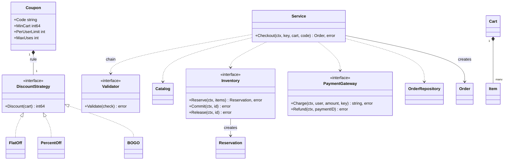
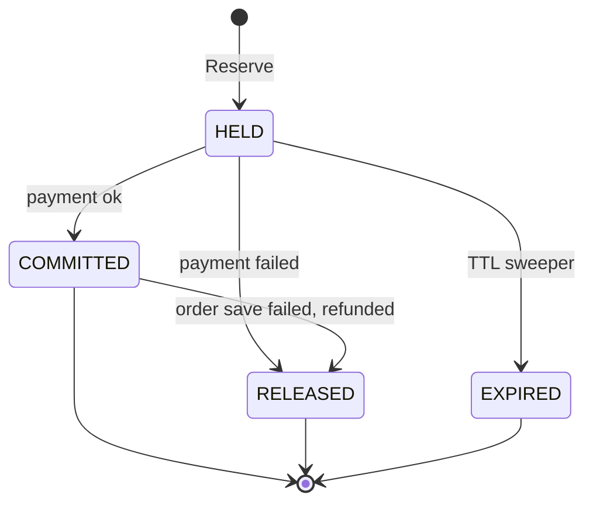
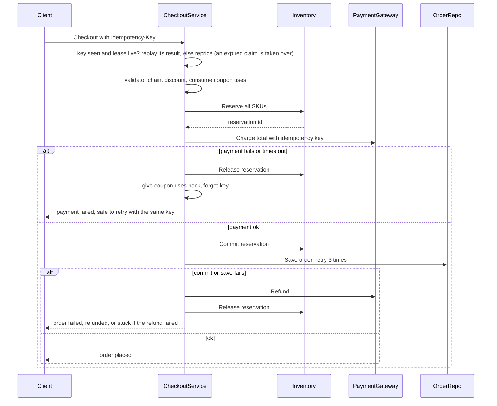

# Cart Checkout with Coupons

> [!summary] TL;DR
> Checkout prices the cart from the catalog, validates and consumes a coupon, reserves stock all-or-nothing, charges the payment gateway and saves the order. Each step after a side effect has an undo (a saga with compensation), an idempotency key makes retries safe, and money is `int64` paise with a stated rounding rule.

> [!abstract] Core idea
> - Prices come from the catalog, never the client; money is `int64` paise.
> - Checkout is a saga: a sequence of steps where every step with a side effect has an undo (compensation) that runs if a later step fails.
> - An idempotency key (a client-chosen ID for one checkout attempt) makes a retry return the first result instead of charging twice.
> - The one rule: check and consume the coupon in the same critical section, before payment.
> - Classic mistake: holding a mutex during the slow payment call, or incrementing coupon use only after payment.

## Problem statement

```text
Design the cart and checkout of a Zepto / Swiggy Instamart style app.
A user has items in a cart and may apply one coupon. Checkout must price the cart,
validate the coupon (expiry, minimum cart, per-user limit, global cap), reserve
inventory, charge payment, and create the order. If payment fails, the reserved
stock must be released. A retried checkout must not charge twice. Code Checkout.
```

It tests a pricing pipeline (Strategy plus Chain of Responsibility), atomic stock reservation, and a Facade that runs a small saga. The senior signal is the failure cases: payment fails after reserve, payment succeeds but the order save fails, the payment response is lost, the price changed, and duplicate retries.

### Solving path

1. Clarify coupon rules, stock reservation, payment failures and retries.
2. Model `Item`, `Cart`, `Coupon` and the discount strategies (flat, percent, BOGO).
3. Write the validator chain for coupon checks.
4. Write `Checkout`: idempotency check, reprice, coupon, reserve, pay, save.
5. Add the undo for each step that has a side effect.
6. Test payment failure, save failure, retries and the coupon cap.

## Step 1: Clarify requirements

- **Reserve when?** *At checkout, with a 10-minute TTL so abandoned holds come back.*
- **Prices:** *Recompute at checkout; any change stops with `ErrPriceChanged` and the client shows the new total.*
- **Coupons:** *One per order: FLAT, PERCENT with a cap, BOGO on one SKU. Limits: per user and a global cap ("first 1,000 orders").*
- **Rounding:** *Percent discounts round down to whole paise, then the cap applies. 7.5% of 300 paise is 22.5, so the discount is 22 and the customer pays 278. The shop never gives more than the advertised percent.*
- **Payment:** *A sync call that returns a payment ID or an error; the gateway dedupes on our idempotency key. Webhooks are an extension.*
- **Paid but no order?** *Retry the save; then refund and release. If the refund fails too, mark the key stuck for reconciliation and never charge again.*

**Non-functional:** money in `int64` paise and percentages in basis points; the discount never exceeds the subtotal; no double charge on retry; two parallel checkouts cannot both pass a usage limit; two buyers cannot both get the last unit; no lock held during the payment call; new coupon types and rules are additive.

**Out of scope:** delivery fee, tax, coupon stacking, cart CRUD, async payment.

## Step 2: Actors and use cases

The **customer** edits the cart, previews a coupon and checks out (and may double tap). The **payment gateway** charges and refunds. **Inventory** reserves, commits and releases stock. A **sweeper** releases expired holds after crashes. **Ops** reconcile "paid but no order" cases. The hardest use case, and the one to code: **Checkout**, because it touches four systems and each failure point needs a different undo.

## Step 3: Entities

| Entity | Key fields | Why it exists |
|---|---|---|
| `Cart`, `Item` | UserID; SKU, Qty, UnitPrice (the price the user saw) | Input; UnitPrice detects price changes |
| `Coupon` | Code, Rule, ExpiresAt, MinCart, PerUserLimit, MaxUses | "When it applies" plus "how much off" |
| `DiscountStrategy` | `Discount(cart) int64` | FlatOff, PercentOff (bps plus cap), BOGO |
| `Validator` chain | `Validate(CouponCheck) error` | Expiry, then min cart, per-user limit, global cap |
| `Reservation` | ID, Items, ExpiresAt; HELD, COMMITTED, RELEASED, EXPIRED | A hold that is committed or undone by ID |
| `Order` | opaque ID, totals, PaymentID, ReservationID | Links payment and stock for reconciliation |
| Idempotency entry | `userID|key`, state in progress, done or stuck; attempt number and lease expiry | Makes retries safe; the lease lets a retry recover a key whose claimer crashed |

Modelling insight: **separate "how much" from "may I"**. A coupon's `DiscountStrategy` computes the amount; the validator chain decides whether it may be used. And a **reservation is an entity with a lifecycle**, not a number: you need its ID to commit or release exactly that hold, and its expiry to clean up after crashes.

## Step 4: Relationships





`Service` is the Facade; every dependency is an interface faked in tests. The idempotency entry has its own small lifecycle: **in progress** until the saga ends, then **done** (replay the order), **forgotten** after a clean failure (the user may retry), or **stuck** when money was taken and the refund failed. An in-progress claim carries a **lease** (15 minutes, from the injected clock): if the process crashes after claiming, the key would otherwise stay in progress forever and every retry would get 409. A retry that finds an expired lease **takes the key over** with a higher attempt number, and the crashed or late attempt can no longer write a result.

## Step 5: APIs and public methods

```text
GET    /cart                                     -> items and the priced breakdown
POST   /cart/items          {sku, qty}
DELETE /cart/items/{sku}
POST   /cart/coupon         {code}               -> discount preview or the failing rule
POST   /checkout            Idempotency-Key: <uuid>
                            {coupon_code, payment_method}
       -> 200 {order_id, total_paise}
          409 price_changed {new_total} | 409 out_of_stock {sku}
          409 checkout_in_progress (same key still running, lease not expired) | 422 key reused with a different cart
          402 payment_failed
GET    /orders/{id}
```

The 409 for a key still in flight and the 422 for a key reused with a different body follow the IETF Idempotency-Key header draft.

In Go: `func (s *Service) Checkout(ctx context.Context, idemKey string, cart Cart, code string) (Order, error)`. The cart is passed in so the logic is testable; production loads it by user.

## Step 6: Storage and repositories

```sql
CREATE TABLE inventory (
    sku       TEXT PRIMARY KEY,
    available INT NOT NULL CHECK (available >= 0),
    reserved  INT NOT NULL DEFAULT 0 CHECK (reserved >= 0)
);
CREATE TABLE reservations (
    id         TEXT PRIMARY KEY,
    user_id    TEXT NOT NULL,
    status     TEXT NOT NULL,              -- HELD | COMMITTED | RELEASED | EXPIRED
    expires_at TIMESTAMPTZ NOT NULL
);
CREATE INDEX reservations_sweep ON reservations (status, expires_at);
CREATE TABLE reservation_items (
    reservation_id TEXT REFERENCES reservations(id),
    sku            TEXT REFERENCES inventory(sku),
    qty            INT NOT NULL CHECK (qty > 0),
    PRIMARY KEY (reservation_id, sku)
);
CREATE TABLE coupons (
    code           TEXT PRIMARY KEY,
    type           TEXT NOT NULL,          -- flat | percent | bogo
    value          BIGINT NOT NULL,        -- paise or basis points
    max_discount   BIGINT,                 -- cap for percent
    min_cart_paise BIGINT NOT NULL DEFAULT 0,
    per_user_limit INT NOT NULL DEFAULT 1,
    max_uses       INT,                    -- global cap; NULL = unlimited
    used           INT NOT NULL DEFAULT 0, -- global uses so far
    expires_at     TIMESTAMPTZ NOT NULL
);
CREATE TABLE coupon_usage (
    user_id TEXT,
    code    TEXT REFERENCES coupons(code),
    used    INT NOT NULL DEFAULT 0,
    PRIMARY KEY (user_id, code)
);
CREATE TABLE orders (
    id              TEXT PRIMARY KEY,      -- opaque, never derived from user_id
    user_id         TEXT NOT NULL,
    idempotency_key TEXT NOT NULL,
    status          TEXT NOT NULL,         -- pending | paid | failed | needs_reconcile
    subtotal_paise  BIGINT NOT NULL,
    discount_paise  BIGINT NOT NULL,
    total_paise     BIGINT NOT NULL,
    coupon_code     TEXT REFERENCES coupons(code),
    payment_id      TEXT UNIQUE,
    reservation_id  TEXT REFERENCES reservations(id),
    UNIQUE (user_id, idempotency_key)
);

-- Reserve each SKU in one transaction, SKUs sorted to avoid deadlocks; rows affected must be 1.
UPDATE inventory SET available = available - $1, reserved = reserved + $1
WHERE sku = $2 AND available >= $1;

-- Commit (held -> sold): first flip the reservation; 0 rows means it expired.
UPDATE reservations SET status = 'COMMITTED' WHERE id = $1 AND status = 'HELD';
-- then, per item in the same transaction:
UPDATE inventory SET reserved = reserved - $1 WHERE sku = $2;

-- Consume the coupon in the same transaction; each statement must affect 1 row.
INSERT INTO coupon_usage (user_id, code, used) VALUES ($1, $2, 1)
ON CONFLICT (user_id, code) DO UPDATE SET used = coupon_usage.used + 1
WHERE coupon_usage.used < $3;                                    -- 0 rows: per-user limit
UPDATE coupons SET used = used + 1
WHERE code = $1 AND (max_uses IS NULL OR used < max_uses);       -- 0 rows: global cap reached

-- Sweeper: expire stale holds and add their quantities back, in one statement.
WITH expired AS (
    UPDATE reservations SET status = 'EXPIRED'
    WHERE status = 'HELD' AND expires_at < now()
    RETURNING id
), freed AS (
    SELECT ri.sku, sum(ri.qty) AS qty
    FROM reservation_items ri JOIN expired e ON e.id = ri.reservation_id
    GROUP BY ri.sku
)
UPDATE inventory i
SET available = i.available + f.qty, reserved = i.reserved - f.qty
FROM freed f
WHERE i.sku = f.sku;
```

Each statement numbers its own placeholders from `$1`: PostgreSQL rejects a prepared statement that uses `$2` without `$1` ("could not determine data type of parameter $1").

The conditional `WHERE` clauses are the real guards in production: a row lock taken by `UPDATE` serialises concurrent checkouts on the same SKU or coupon (see [[Locking - Optimistic vs Pessimistic]]). The in-memory version below uses one mutex to show the same idea.

## Step 7: Patterns

| Pattern | Where | Why here |
|---|---|---|
| [[Facade (vs Mediator)]] | `Service.Checkout` | One call over catalog, coupons, inventory, payment, orders |
| [[Strategy and Template Method]] | FlatOff, PercentOff, BOGO | A new coupon type is a new struct, no `switch` |
| [[Chain of Responsibility and Pipelines]] | Validators: expiry, min cart, per-user, global cap | A new rule ("first order only") is one new link |
| [[Repository and Unit of Work]] | Inventory, OrderRepository | Swap in-memory for PostgreSQL |
| [[Adapter]] | Gateway SDK behind `PaymentGateway` | SDK types do not leak into the domain |
| [[Factory and Abstract Factory]] | Coupon row `type` to a `DiscountStrategy` | DB row to strategy in one place |
| [[Saga Pattern]] (compensation) | Each step after a side effect has an undo | No distributed transaction across payment and DB |

Not used: State-pattern objects for Reservation (four states, a status field with conditional updates is enough) and 2PC across payment and DB (the gateway cannot join it).

## Folder structure

```text
checkout/
  model.go        -> Item, Cart, Coupon, Order, Reservation, errors
  pricing.go      -> DiscountStrategy plus FlatOff, PercentOff, BOGO
  validator.go    -> Validator, ValidatorFunc, chain, DefaultChain
  inventory.go    -> Inventory interface plus MemInventory (reserve, commit, release, sweeper)
  ports.go        -> Catalog, PaymentGateway, OrderRepository, CouponRepository
  service.go      -> Service.Checkout (the saga), commitAndSave
  service_test.go -> table-driven failure cases plus concurrency tests
cmd/demo/main.go  -> wiring: real catalog, PostgreSQL repositories, the gateway adapter, the sweeper ticker
```

One file per concern, so a new coupon type touches only `pricing.go` and a new rule only `validator.go`. Below, `checkout.go` merges everything except the tests and `CouponRepository`, which has its own small `ports.go` block; together they compile as shown.

## Step 8: Core code

> [!tip] What to code in a 60-minute round
> Aim for about 150 lines in the room.
> - **Write:** `Item`, `Cart` with `Subtotal`, `DiscountStrategy` with `FlatOff` and `PercentOff`, `Coupon`, `Validator` with a `chain` and `DefaultChain`, the `Inventory`, `Catalog`, `PaymentGateway` and `OrderRepository` interfaces, a simple `MemInventory`, and `Service.Checkout` with a basic done/in-progress idempotency map.
> - **Add if time remains:** `BOGO`, `commitAndSave`, and releasing stock plus coupon use when payment fails.
> - **Talk only:** the idempotency lease with attempt numbers (fencing a late first attempt), `ErrNeedsReconcile`, reservation expiry, the SQL schema and the outbox.

`Checkout(ctx, idemKey, cart, code)`:

1. **Idempotency first**, key `userID|idemKey`: done replays the stored order; in progress within its lease is `ErrCheckoutPending`; stuck is `ErrNeedsReconcile`; in progress with an **expired lease** means the claimer crashed, so this request goes on and takes the key over. It runs before repricing, so a retry whose first attempt succeeded gets its order back even if a price changed in between.
2. **Reprice** from the catalog; missing is `ErrItemUnavailable`, different is `ErrPriceChanged`. Nothing has changed yet, so no undo. The key is checked again under the lock in step 3, in case the same key started meanwhile.
3. **Price and coupon under one lock:** validator chain, discount clamped with `min(discount, subtotal)`, and the per-user and global uses **consumed in the same critical section** as the check. Mark the key in progress with a lease (`now + 15 min`) and an attempt number, then unlock before slow I/O. A takeover first gives back the coupon use the crashed attempt consumed, and its attempt number is one higher, which fences the old attempt out.
4. **Reserve** all-or-nothing with a TTL. Failure runs `compensate()`: coupon uses back, key forgotten.
5. **Charge** with the idempotency key, so the gateway dedupes a retried charge. Failure releases the reservation and compensates. The error wraps both `ErrPaymentFailed` and the gateway error with two `%w` verbs (Go 1.20+), so callers can match either.
6. **Commit the hold, then save the order**, retrying the save 3 times (it is idempotent on the order ID).
7. If step 6 fails: refund. Refund ok: release (which also undoes a commit), compensate, return the cause. Refund failed: keep the stock and the key as **stuck**, return `ErrNeedsReconcile`.
8. Success: store the order under the key as done. The order ID comes from `crypto/rand.Text` (Go 1.24), so it reveals nothing about the user.
9. **Fencing.** After the charge, before a refund, in `compensate` and in the final write, the attempt checks that it still owns the key (same attempt number, still in progress). An attempt that was only slow, not dead, and lost the key to a takeover gives its own hold back and returns `ErrLeaseLost`. It never refunds, because both attempts sent the same key to the gateway, so the payment belongs to the attempt that took over, and it never overwrites that attempt's result.



```go
// File: checkout.go
package checkout

import (
	"context"
	"crypto/rand"
	"errors"
	"fmt"
	"sync"
	"time"
)

var (
	ErrEmptyCart          = errors.New("cart is empty")
	ErrItemUnavailable    = errors.New("item no longer sold")
	ErrPriceChanged       = errors.New("price changed since added to cart")
	ErrCouponNotFound     = errors.New("coupon not found")
	ErrCouponExpired      = errors.New("coupon expired")
	ErrMinCartValue       = errors.New("cart below coupon minimum")
	ErrUsageLimit         = errors.New("coupon usage limit reached")
	ErrCouponExhausted    = errors.New("coupon global redemption cap reached")
	ErrOutOfStock         = errors.New("out of stock")
	ErrReservationExpired = errors.New("reservation expired or not found")
	ErrPaymentFailed      = errors.New("payment failed")
	ErrOrderSaveFailed    = errors.New("order could not be saved")
	ErrNeedsReconcile     = errors.New("payment taken but order not saved and refund failed")
	ErrCheckoutPending    = errors.New("checkout already in progress")
	ErrLeaseLost          = errors.New("idempotency key lease expired and was taken over by a retry")
)

type Item struct {
	SKU       string
	Qty       int
	UnitPrice int64 // paise, the price the user SAW when adding to cart
}

type Cart struct {
	UserID string
	Items  []Item
}

func (c Cart) Subtotal() int64 {
	var s int64
	for _, it := range c.Items {
		s += int64(it.Qty) * it.UnitPrice
	}
	return s
}

// ---- Strategy: how much discount ----
type DiscountStrategy interface{ Discount(c Cart) int64 }

type FlatOff struct{ Amount int64 }

func (f FlatOff) Discount(Cart) int64 { return f.Amount }

type PercentOff struct{ BPS, Cap int64 } // 2000 bps = 20%

// Discount rounds DOWN to whole paise (integer division), then applies the cap:
// 7.5% of 300 paise is 22.5, so the discount is 22 and the shop never gives more
// than the advertised percent.
func (p PercentOff) Discount(c Cart) int64 {
	d := c.Subtotal() * p.BPS / 10000
	if p.Cap > 0 && d > p.Cap {
		d = p.Cap
	}
	return d
}

type BOGO struct{ SKU string }

func (b BOGO) Discount(c Cart) int64 {
	for _, it := range c.Items {
		if it.SKU == b.SKU {
			return int64(it.Qty/2) * it.UnitPrice
		}
	}
	return 0
}

type Coupon struct {
	Code         string
	Rule         DiscountStrategy
	ExpiresAt    time.Time
	MinCart      int64
	PerUserLimit int
	MaxUses      int // global cap across all users ("first 1000 orders"); 0 = no cap
}

// ---- Chain of Responsibility: may this coupon be used? ----
type CouponCheck struct {
	Cart   Cart
	Coupon Coupon
	Now    time.Time
	Used   int // uses by this user
	Total  int // uses by everyone
}

type Validator interface{ Validate(CouponCheck) error }

type ValidatorFunc func(CouponCheck) error

func (f ValidatorFunc) Validate(c CouponCheck) error { return f(c) }

type chain []Validator

func (ch chain) Validate(c CouponCheck) error {
	for _, v := range ch {
		if err := v.Validate(c); err != nil {
			return err // first failing link stops the chain
		}
	}
	return nil
}

func DefaultChain() Validator {
	return chain{
		ValidatorFunc(func(c CouponCheck) error {
			if !c.Now.Before(c.Coupon.ExpiresAt) {
				return ErrCouponExpired
			}
			return nil
		}),
		ValidatorFunc(func(c CouponCheck) error {
			if c.Cart.Subtotal() < c.Coupon.MinCart {
				return ErrMinCartValue
			}
			return nil
		}),
		ValidatorFunc(func(c CouponCheck) error {
			if c.Used >= c.Coupon.PerUserLimit {
				return ErrUsageLimit
			}
			return nil
		}),
		ValidatorFunc(func(c CouponCheck) error {
			if c.Coupon.MaxUses > 0 && c.Total >= c.Coupon.MaxUses {
				return ErrCouponExhausted
			}
			return nil
		}),
	}
}

// ---- Inventory reservation: HELD -> COMMITTED | RELEASED | EXPIRED ----
type Reservation struct {
	ID        string
	Items     []Item
	ExpiresAt time.Time
}

type Inventory interface {
	Reserve(ctx context.Context, items []Item) (Reservation, error) // all-or-nothing
	Commit(ctx context.Context, reservationID string) error         // held -> sold
	Release(ctx context.Context, reservationID string) error        // give stock back, idempotent
}

type resv struct {
	Reservation
	committed bool
}

// MemInventory: available is what can still be reserved; a reservation
// already took its units out of available, so two buyers can never get the last unit.
type MemInventory struct {
	mu        sync.Mutex
	available map[string]int
	resv      map[string]*resv
	ttl       time.Duration
	now       func() time.Time
	seq       int
}

func NewMemInventory(stock map[string]int, ttl time.Duration, now func() time.Time) *MemInventory {
	return &MemInventory{available: stock, resv: map[string]*resv{}, ttl: ttl, now: now}
}

func (m *MemInventory) Reserve(_ context.Context, items []Item) (Reservation, error) {
	m.mu.Lock()
	defer m.mu.Unlock()
	for _, it := range items { // check all first: all-or-nothing
		if m.available[it.SKU] < it.Qty {
			return Reservation{}, fmt.Errorf("%w: %s", ErrOutOfStock, it.SKU)
		}
	}
	for _, it := range items {
		m.available[it.SKU] -= it.Qty
	}
	m.seq++
	r := Reservation{ID: fmt.Sprintf("res-%d", m.seq), Items: append([]Item(nil), items...), ExpiresAt: m.now().Add(m.ttl)}
	m.resv[r.ID] = &resv{Reservation: r}
	return r, nil
}

func (m *MemInventory) Commit(_ context.Context, id string) error {
	m.mu.Lock()
	defer m.mu.Unlock()
	r, ok := m.resv[id]
	if !ok {
		return ErrReservationExpired // already released by the sweeper
	}
	r.committed = true
	return nil
}

// Release gives stock back for a held OR committed reservation (rollback after
// a failed order save). Releasing twice is a no-op.
func (m *MemInventory) Release(_ context.Context, id string) error {
	m.mu.Lock()
	defer m.mu.Unlock()
	r, ok := m.resv[id]
	if !ok {
		return nil // already released: idempotent
	}
	for _, it := range r.Items {
		m.available[it.SKU] += it.Qty
	}
	delete(m.resv, id)
	return nil
}

// ReleaseExpired is the sweeper for crashed/abandoned checkouts. Run on a ticker.
func (m *MemInventory) ReleaseExpired() int {
	m.mu.Lock()
	defer m.mu.Unlock()
	n, now := 0, m.now()
	for id, r := range m.resv {
		if !r.committed && !now.Before(r.ExpiresAt) {
			for _, it := range r.Items {
				m.available[it.SKU] += it.Qty
			}
			delete(m.resv, id)
			n++
		}
	}
	return n
}

func (m *MemInventory) Available(sku string) int {
	m.mu.Lock()
	defer m.mu.Unlock()
	return m.available[sku]
}

// ---- Other dependencies (Adapter / Repository) ----
type Catalog interface {
	Price(ctx context.Context, sku string) (int64, bool) // current price in paise
}

type PaymentGateway interface {
	Charge(ctx context.Context, userID string, amount int64, idemKey string) (paymentID string, err error)
	Refund(ctx context.Context, paymentID string) error
}

type Order struct {
	ID                        string
	UserID                    string
	Subtotal, Discount, Total int64
	PaymentID                 string
	ReservationID             string
}

type OrderRepository interface {
	Save(ctx context.Context, o Order) error
}

type state int

const (
	inProgress state = iota
	done
	stuck // money taken, no order, refund failed: ops must reconcile
)

// DefaultLease is how long an in-progress claim on a key is trusted. It must be
// longer than a healthy checkout can take (payment timeout included); after it
// a retry assumes the claimer crashed and takes the key over.
const DefaultLease = 15 * time.Minute

// entry is never changed after it is stored; a new state stores a new entry,
// so reading one after the unlock is race-free.
type entry struct {
	st         state
	order      Order
	attempt    int       // fencing token: +1 on every takeover
	leaseUntil time.Time // in progress only: after this a retry may take over
	code       string    // coupon this attempt consumed, given back on takeover
}

// expired reports whether an in-progress claim outlived its lease, which means
// the process that claimed it most likely crashed.
func (e *entry) expired(now time.Time) bool {
	return e.st == inProgress && !now.Before(e.leaseUntil)
}

// result is what a retry with an already-used key gets back.
func (e *entry) result() (Order, error) {
	switch e.st {
	case done:
		return e.order, nil // replay: same order, no second charge
	case stuck:
		return Order{}, ErrNeedsReconcile
	default:
		return Order{}, ErrCheckoutPending
	}
}

// ---- Facade ----
type Service struct {
	mu        sync.Mutex
	coupons   map[string]Coupon
	usage     map[string]int    // userID|code -> times used
	redeemed  map[string]int    // code -> times used by everyone (global cap)
	idem      map[string]*entry // userID|key -> result
	validator Validator
	catalog   Catalog
	inv       Inventory
	pay       PaymentGateway
	orders    OrderRepository
	now       func() time.Time
	lease     time.Duration // how long an in-progress key is trusted
}

func NewService(cat Catalog, inv Inventory, pay PaymentGateway, orders OrderRepository, now func() time.Time, coupons ...Coupon) *Service {
	s := &Service{coupons: map[string]Coupon{}, usage: map[string]int{}, redeemed: map[string]int{}, idem: map[string]*entry{},
		validator: DefaultChain(), catalog: cat, inv: inv, pay: pay, orders: orders, now: now, lease: DefaultLease}
	for _, c := range coupons {
		s.coupons[c.Code] = c
	}
	return s
}

// Checkout = reprice -> idempotency -> coupon -> reserve -> charge -> commit -> save.
// Every step after a side effect has an undo (saga with compensation).
func (s *Service) Checkout(ctx context.Context, idemKey string, cart Cart, code string) (Order, error) {
	if len(cart.Items) == 0 {
		return Order{}, ErrEmptyCart
	}
	key := cart.UserID + "|" + idemKey
	useKey := cart.UserID + "|" + code

	// A retry of a checkout that already ran replays its result before anything
	// else, even if prices changed since. The check is repeated under the lock below.
	s.mu.Lock()
	e, seen := s.idem[key]
	s.mu.Unlock()
	if seen && !e.expired(s.now()) {
		return e.result()
	}

	// 0. Price changed? Recompute from the catalog; never trust client prices.
	for _, it := range cart.Items {
		p, ok := s.catalog.Price(ctx, it.SKU)
		if !ok {
			return Order{}, fmt.Errorf("%w: %s", ErrItemUnavailable, it.SKU)
		}
		if p != it.UnitPrice {
			return Order{}, fmt.Errorf("%w: %s %d -> %d", ErrPriceChanged, it.SKU, it.UnitPrice, p)
		}
	}

	// 1. Idempotency + pricing + atomic coupon consume, all under one lock.
	s.mu.Lock()
	now := s.now()
	prev, ok := s.idem[key]
	if ok && !prev.expired(now) { // the same key started while we repriced
		s.mu.Unlock()
		return prev.result()
	}
	attempt := 1
	if ok {
		// Takeover: the claim outlived its lease, so its process most likely
		// crashed. Give back the coupon use it consumed (this attempt consumes
		// its own below) and fence it out with a higher attempt number.
		attempt = prev.attempt + 1
		if prev.code != "" {
			s.usage[cart.UserID+"|"+prev.code]--
			s.redeemed[prev.code]--
		}
		delete(s.idem, key) // free until this attempt claims it below
	}
	// An opaque ID: no user ID inside it to leak through URLs, logs or receipts.
	o := Order{ID: "ord_" + rand.Text(), UserID: cart.UserID, Subtotal: cart.Subtotal()}
	if code != "" {
		c, ok := s.coupons[code]
		if !ok {
			s.mu.Unlock()
			return Order{}, ErrCouponNotFound
		}
		chk := CouponCheck{Cart: cart, Coupon: c, Now: now, Used: s.usage[useKey], Total: s.redeemed[code]}
		if err := s.validator.Validate(chk); err != nil {
			s.mu.Unlock()
			return Order{}, err
		}
		o.Discount = min(c.Rule.Discount(cart), o.Subtotal) // never negative total
		s.usage[useKey]++                                   // consume now, undo on failure
		s.redeemed[code]++
	}
	o.Total = o.Subtotal - o.Discount
	s.idem[key] = &entry{st: inProgress, attempt: attempt, leaseUntil: now.Add(s.lease), code: code}
	s.mu.Unlock()

	// owns reports whether this attempt still holds the key: false once a retry
	// took it over after the lease ended. Call it with s.mu held.
	owns := func() bool {
		e, ok := s.idem[key]
		return ok && e.st == inProgress && e.attempt == attempt
	}
	stillOwns := func() bool {
		s.mu.Lock()
		defer s.mu.Unlock()
		return owns()
	}

	// undo coupon usage and free the key so the client can retry. After a
	// takeover it does nothing: the new attempt already gave this one's use back.
	compensate := func() {
		s.mu.Lock()
		defer s.mu.Unlock()
		if !owns() {
			return
		}
		if code != "" {
			s.usage[useKey]--
			s.redeemed[code]--
		}
		delete(s.idem, key)
	}

	// 2. Reserve stock (slow I/O, outside the lock).
	r, err := s.inv.Reserve(ctx, cart.Items)
	if err != nil {
		compensate()
		return Order{}, err
	}
	o.ReservationID = r.ID

	// 3. Charge. On failure: release stock, give coupon back.
	pid, err := s.pay.Charge(ctx, cart.UserID, o.Total, key)
	if err != nil {
		_ = s.inv.Release(ctx, r.ID) // if this fails, the TTL sweeper frees the hold
		compensate()
		return Order{}, fmt.Errorf("%w: %w", ErrPaymentFailed, err) // two %w (Go 1.20+): both stay matchable
	}
	o.PaymentID = pid

	// Fence: if a retry took the key over while we waited on the gateway, the
	// payment (same gateway key) now belongs to that attempt. Do not refund it
	// and do not save a second order; just give our own hold back.
	if !stillOwns() {
		_ = s.inv.Release(ctx, r.ID)
		return Order{}, fmt.Errorf("%w: payment %s", ErrLeaseLost, pid)
	}

	// 4. Money is taken. Turn the hold into a sale, then save the order.
	//    If either fails: refund, release stock, give the coupon back.
	if err := s.commitAndSave(ctx, o); err != nil {
		if !stillOwns() { // taken over meanwhile: the payment is not ours to refund
			_ = s.inv.Release(ctx, r.ID)
			return Order{}, fmt.Errorf("%w: payment %s: %w", ErrLeaseLost, pid, err)
		}
		if rerr := s.pay.Refund(ctx, pid); rerr != nil {
			// Do NOT release or forget the key: a retry must not charge again.
			s.mu.Lock()
			if owns() {
				s.idem[key] = &entry{st: stuck, order: o, attempt: attempt}
			}
			s.mu.Unlock()
			return Order{}, fmt.Errorf("%w: payment %s: %w", ErrNeedsReconcile, pid, rerr)
		}
		_ = s.inv.Release(ctx, r.ID) // also undoes a commit; a failure here goes to reconciliation
		compensate()
		return Order{}, fmt.Errorf("payment refunded: %w", err)
	}

	// The fenced write: a late attempt that lost the key never overwrites the
	// result of the attempt that took it over. Its saved order is a duplicate for
	// reconciliation (in PostgreSQL, UNIQUE (user_id, idempotency_key) on orders
	// rejects it in the same transaction as this write).
	s.mu.Lock()
	defer s.mu.Unlock()
	if !owns() {
		return Order{}, fmt.Errorf("%w: order %s", ErrLeaseLost, o.ID)
	}
	s.idem[key] = &entry{st: done, order: o, attempt: attempt}
	return o, nil
}

func (s *Service) commitAndSave(ctx context.Context, o Order) error {
	// Commit fails if the hold expired while the user was paying.
	if err := s.inv.Commit(ctx, o.ReservationID); err != nil {
		return err
	}
	var err error
	for attempt := 0; attempt < 3; attempt++ { // Save is idempotent on order ID
		if err = s.orders.Save(ctx, o); err == nil {
			return nil
		}
	}
	return fmt.Errorf("%w: %w", ErrOrderSaveFailed, err)
}
```

In production the coupon maps move behind a repository. `Consume` runs the conditional upsert and the global-cap `UPDATE` from Step 6 in one transaction:

```go
// File: ports.go
package checkout

import "context"

// CouponRepository is the production port for the in-memory coupons, usage and
// redeemed maps of Service.
type CouponRepository interface {
	Get(ctx context.Context, code string) (Coupon, error)
	Consume(ctx context.Context, userID, code string) error   // ErrUsageLimit or ErrCouponExhausted when 0 rows change
	Unconsume(ctx context.Context, userID, code string) error // the compensation
}
```

## Test cases

| Test | Proves |
|---|---|
| `TestCheckout` (16 cases) | Percent below and at its cap, BOGO, rounding down (7.5% of 300 = 22, total 278), expired, below minimum, unknown coupon, empty cart, price changed, delisted item, out of stock gives the coupon back, payment failure releases everything, save retry, refund path, stuck path, hold expired while paying; the gateway and DB causes stay matchable through `errors.Is` |
| `TestRetryIsIdempotent` | Replay returns the same order with one charge, even after a price change; a key retries after a clean failure; a stuck key never charges again; a second request with a key still in flight gets `ErrCheckoutPending` |
| `TestSweeperReleasesAbandonedHolds` | A hold survives 5 minutes and is released at 10 |
| `TestConcurrentLastUnits` | 20 buyers, 5 units: exactly 5 orders and 15 `ErrOutOfStock` |
| `TestConcurrentCouponLimits` | One user with 50 keys gets a 1-use coupon once; 50 users get a 10-use global coupon exactly 10 times |
| `TestLostPaymentResponseRetryChargesOnce` | The gateway charged but the response was lost; the retry with the same key returns the first payment, charges once, and the order ID does not contain the user ID |
| `TestCrashedCheckoutKeyIsTakenOverAfterLease` | The process dies after claiming the key and reserving (simulated with `runtime.Goexit` in the gateway hook). A retry inside the lease gets `ErrCheckoutPending`; after the lease and the sweeper, the retry succeeds and a second retry replays it: one charge, one hold, one coupon use. Without the lease this test fails with "checkout already in progress" |
| `TestLateOriginalCannotOverwriteTakeover` | The first attempt is slow, not dead: while it waits on the gateway a retry takes the key over and finishes. The original gets `ErrLeaseLost`, releases its hold and does not refund; the replay returns the retry's order |

Measured: `go test -race -cover` on Go 1.24.4 passes all 8 test functions with 96.1% statement coverage, and `go test -race -count=3` passes on every run. The uncovered lines are the two rare lease-lost branches (lost the key while the save failed, or just before the final write). The gateway fake now calls its `onCharge` hook before taking its own lock, so a hook can run a second checkout.

```go
// File: checkout_test.go
package checkout

import (
	"context"
	"errors"
	"fmt"
	"runtime"
	"strings"
	"sync"
	"sync/atomic"
	"testing"
	"time"
)

type catalog map[string]int64

func (c catalog) Price(_ context.Context, sku string) (int64, bool) { p, ok := c[sku]; return p, ok }

var (
	errDeclined   = errors.New("declined")
	errTimeout    = errors.New("gateway timeout")
	errRefundDown = errors.New("gateway down")
	errDBTimeout  = errors.New("db timeout")
)

type fakePay struct {
	mu           sync.Mutex
	fail         bool
	lostResponse bool // charge succeeds but the caller sees a timeout
	refundFail   bool
	charges      int
	refunds      int
	byKey        map[string]string // like a real gateway: dedupe on the idempotency key
	onCharge     func()            // hook to simulate time passing during payment
}

func (p *fakePay) Charge(_ context.Context, _ string, _ int64, k string) (string, error) {
	if p.onCharge != nil {
		p.onCharge() // outside the lock, so a hook may call Checkout
	}
	p.mu.Lock()
	defer p.mu.Unlock()
	if pid, ok := p.byKey[k]; ok {
		return pid, nil // same key: the earlier charge is returned, no new charge
	}
	if p.fail {
		return "", errDeclined
	}
	p.charges++
	p.byKey[k] = "pay-" + k
	if p.lostResponse {
		return "", errTimeout
	}
	return p.byKey[k], nil
}

func (p *fakePay) Refund(context.Context, string) error {
	p.mu.Lock()
	defer p.mu.Unlock()
	if p.refundFail {
		return errRefundDown
	}
	p.refunds++
	return nil
}

type fakeOrders struct {
	mu       sync.Mutex
	failLeft int // fail this many Save calls first
	saved    map[string]Order
}

func (r *fakeOrders) Save(_ context.Context, o Order) error {
	r.mu.Lock()
	defer r.mu.Unlock()
	if r.failLeft > 0 {
		r.failLeft--
		return errDBTimeout
	}
	r.saved[o.ID] = o
	return nil
}

type env struct {
	s      *Service
	inv    *MemInventory
	pay    *fakePay
	orders *fakeOrders
	now    *time.Time
}

func newEnv(stock int) *env {
	now := time.Unix(1000, 0)
	e := &env{now: &now, pay: &fakePay{byKey: map[string]string{}}, orders: &fakeOrders{saved: map[string]Order{}}}
	clock := func() time.Time { return *e.now }
	e.inv = NewMemInventory(map[string]int{"milk": stock, "bread": stock}, 10*time.Minute, clock)
	e.s = NewService(catalog{"milk": 6000, "bread": 100}, e.inv, e.pay, e.orders, clock,
		Coupon{Code: "P20", Rule: PercentOff{BPS: 2000, Cap: 5000}, ExpiresAt: now.Add(time.Hour), MinCart: 10000, PerUserLimit: 1},
		Coupon{Code: "BOGO", Rule: BOGO{SKU: "milk"}, ExpiresAt: now.Add(time.Hour), PerUserLimit: 5},
		Coupon{Code: "OLD", Rule: FlatOff{Amount: 100}, ExpiresAt: now.Add(-time.Hour), PerUserLimit: 5},
		Coupon{Code: "P7", Rule: PercentOff{BPS: 750}, ExpiresAt: now.Add(time.Hour), PerUserLimit: 5},
		Coupon{Code: "FIRST10", Rule: FlatOff{Amount: 2000}, ExpiresAt: now.Add(time.Hour), PerUserLimit: 1, MaxUses: 10})
	return e
}

func milk(user string, qty int) Cart {
	return Cart{UserID: user, Items: []Item{{SKU: "milk", Qty: qty, UnitPrice: 6000}}}
}

func TestCheckout(t *testing.T) {
	tests := []struct {
		name       string
		setup      func(e *env)
		cart       Cart
		code       string
		wantErr    error
		wantCause  error // the gateway or DB error must survive wrapping
		wantTotal  int64
		wantStock  int // milk left after the call
		wantCharge int
		wantRefund int
		wantUsage  int // uses of code by user u after the call
	}{
		{name: "percent coupon", cart: milk("u", 3), code: "P20",
			wantTotal: 14400, wantStock: 7, wantCharge: 1, wantUsage: 1},
		{name: "percent coupon hits its cap: 20% of 30000 is 6000, cap 5000", cart: milk("u", 5), code: "P20",
			wantTotal: 25000, wantStock: 5, wantCharge: 1, wantUsage: 1},
		{name: "bogo", cart: milk("u", 2), code: "BOGO",
			wantTotal: 6000, wantStock: 8, wantCharge: 1, wantUsage: 1},
		{name: "percent rounds down: 7.5% of 300 = 22", code: "P7",
			cart:      Cart{UserID: "u", Items: []Item{{SKU: "bread", Qty: 3, UnitPrice: 100}}},
			wantTotal: 278, wantStock: 10, wantCharge: 1, wantUsage: 1},
		{name: "expired coupon", cart: milk("u", 1), code: "OLD", wantErr: ErrCouponExpired, wantStock: 10},
		{name: "below min cart", cart: milk("u", 1), code: "P20", wantErr: ErrMinCartValue, wantStock: 10},
		{name: "unknown coupon", cart: milk("u", 1), code: "NOPE", wantErr: ErrCouponNotFound, wantStock: 10},
		{name: "empty cart", cart: Cart{UserID: "u"}, wantErr: ErrEmptyCart, wantStock: 10},
		{name: "price changed since add to cart",
			cart:    Cart{UserID: "u", Items: []Item{{SKU: "milk", Qty: 1, UnitPrice: 5500}}},
			wantErr: ErrPriceChanged, wantStock: 10},
		{name: "item delisted", cart: Cart{UserID: "u", Items: []Item{{SKU: "eggs", Qty: 1, UnitPrice: 10}}},
			wantErr: ErrItemUnavailable, wantStock: 10},
		{name: "out of stock gives coupon back", cart: milk("u", 11), code: "BOGO",
			wantErr: ErrOutOfStock, wantStock: 10},
		{name: "payment fails: release stock and coupon", setup: func(e *env) { e.pay.fail = true },
			cart: milk("u", 2), code: "BOGO", wantErr: ErrPaymentFailed, wantCause: errDeclined, wantStock: 10},
		{name: "save fails twice then ok (retry)", setup: func(e *env) { e.orders.failLeft = 2 },
			cart: milk("u", 1), wantTotal: 6000, wantStock: 9, wantCharge: 1},
		{name: "paid but save keeps failing: refund + release", setup: func(e *env) { e.orders.failLeft = 99 },
			cart: milk("u", 2), code: "BOGO", wantErr: ErrOrderSaveFailed, wantCause: errDBTimeout, wantStock: 10, wantCharge: 1, wantRefund: 1},
		{name: "paid but refund fails: keep stock, needs reconcile",
			setup: func(e *env) { e.orders.failLeft = 99; e.pay.refundFail = true },
			cart:  milk("u", 2), code: "BOGO", wantErr: ErrNeedsReconcile, wantCause: errRefundDown, wantStock: 8, wantCharge: 1, wantUsage: 1},
		{name: "hold expired while paying: refund",
			setup: func(e *env) {
				e.pay.onCharge = func() { *e.now = e.now.Add(11 * time.Minute); e.inv.ReleaseExpired() }
			},
			cart: milk("u", 2), wantErr: ErrReservationExpired, wantStock: 10, wantCharge: 1, wantRefund: 1},
	}
	for _, tc := range tests {
		t.Run(tc.name, func(t *testing.T) {
			e := newEnv(10)
			if tc.setup != nil {
				tc.setup(e)
			}
			o, err := e.s.Checkout(context.Background(), "k1", tc.cart, tc.code)
			if !errors.Is(err, tc.wantErr) || tc.wantCause != nil && !errors.Is(err, tc.wantCause) {
				t.Fatalf("err = %v, want %v wrapping %v", err, tc.wantErr, tc.wantCause)
			}
			if err == nil && o.Total != tc.wantTotal {
				t.Fatalf("total = %d, want %d", o.Total, tc.wantTotal)
			}
			if got := e.inv.Available("milk"); got != tc.wantStock {
				t.Fatalf("stock = %d, want %d", got, tc.wantStock)
			}
			if e.pay.charges != tc.wantCharge || e.pay.refunds != tc.wantRefund {
				t.Fatalf("charges=%d refunds=%d", e.pay.charges, e.pay.refunds)
			}
			if got := e.s.usage["u|"+tc.code]; tc.code != "" && (got != tc.wantUsage || e.s.redeemed[tc.code] != got) {
				t.Fatalf("usage = %d, global %d, want %d", got, e.s.redeemed[tc.code], tc.wantUsage)
			}
		})
	}
}

func TestRetryIsIdempotent(t *testing.T) {
	ctx := context.Background()
	e := newEnv(10)
	o1, err := e.s.Checkout(ctx, "k1", milk("u", 1), "")
	if err != nil {
		t.Fatal(err)
	}
	o2, err := e.s.Checkout(ctx, "k1", milk("u", 1), "") // double tap / network retry
	if err != nil || o1 != o2 || e.pay.charges != 1 || e.inv.Available("milk") != 9 {
		t.Fatalf("replay: %v %v charges=%d", o2, err, e.pay.charges)
	}
	// the price changes before the retry arrives: the retry still gets its order back
	e.s.catalog.(catalog)["milk"] = 6500
	if o3, err := e.s.Checkout(ctx, "k1", milk("u", 1), ""); err != nil || o3 != o1 {
		t.Fatalf("replay after a price change: %v %v", o3, err)
	}
	e.s.catalog.(catalog)["milk"] = 6000
	// after a payment failure the same key may be retried and succeed
	e.pay.fail = true
	if _, err := e.s.Checkout(ctx, "k2", milk("u", 1), ""); !errors.Is(err, ErrPaymentFailed) {
		t.Fatal(err)
	}
	e.pay.fail = false
	if _, err := e.s.Checkout(ctx, "k2", milk("u", 1), ""); err != nil {
		t.Fatal(err)
	}
	// stuck checkout never charges twice
	e.orders.failLeft, e.pay.refundFail = 99, true
	if _, err := e.s.Checkout(ctx, "k3", milk("u", 1), ""); !errors.Is(err, ErrNeedsReconcile) {
		t.Fatal(err)
	}
	if _, err := e.s.Checkout(ctx, "k3", milk("u", 1), ""); !errors.Is(err, ErrNeedsReconcile) || e.pay.charges != 3 {
		t.Fatalf("%v charges=%d", err, e.pay.charges)
	}
	// a second request with the same key arrives while the first is still paying
	e.orders.failLeft, e.pay.refundFail = 0, false
	var pendingErr error
	e.pay.onCharge = func() { _, pendingErr = e.s.Checkout(ctx, "k4", milk("u", 1), "") }
	if _, err := e.s.Checkout(ctx, "k4", milk("u", 1), ""); err != nil || !errors.Is(pendingErr, ErrCheckoutPending) {
		t.Fatalf("same key in flight: first %v, second %v", err, pendingErr)
	}
}

func TestSweeperReleasesAbandonedHolds(t *testing.T) {
	e := newEnv(10)
	if _, err := e.inv.Reserve(context.Background(), []Item{{SKU: "milk", Qty: 4}}); err != nil {
		t.Fatal(err)
	}
	*e.now = e.now.Add(5 * time.Minute)
	if n := e.inv.ReleaseExpired(); n != 0 || e.inv.Available("milk") != 6 {
		t.Fatal("released too early")
	}
	*e.now = e.now.Add(5 * time.Minute)
	if n := e.inv.ReleaseExpired(); n != 1 || e.inv.Available("milk") != 10 {
		t.Fatal("not released")
	}
}

func TestConcurrentLastUnits(t *testing.T) {
	e := newEnv(5)
	var wins, sold atomic.Int32
	var wg sync.WaitGroup
	for i := 0; i < 20; i++ {
		wg.Add(1)
		go func(i int) {
			defer wg.Done()
			_, err := e.s.Checkout(context.Background(), "k", milk(fmt.Sprint("user", i), 1), "")
			switch {
			case err == nil:
				wins.Add(1)
			case errors.Is(err, ErrOutOfStock):
				sold.Add(1)
			default:
				t.Error(err)
			}
		}(i)
	}
	wg.Wait()
	if wins.Load() != 5 || sold.Load() != 15 || e.inv.Available("milk") != 0 {
		t.Fatalf("wins=%d outOfStock=%d left=%d", wins.Load(), sold.Load(), e.inv.Available("milk"))
	}
}

func TestConcurrentCouponLimits(t *testing.T) {
	for _, tc := range []struct {
		name string
		user func(i int) string
		code string
		wins int32
	}{
		{"per-user limit 1: one user, 50 keys", func(int) string { return "u" }, "P20", 1},
		{"global cap 10: 50 users", func(i int) string { return fmt.Sprint("user", i) }, "FIRST10", 10},
	} {
		t.Run(tc.name, func(t *testing.T) {
			e := newEnv(1000)
			var ok atomic.Int32
			var wg sync.WaitGroup
			for i := range 50 {
				wg.Add(1)
				go func() {
					defer wg.Done()
					_, err := e.s.Checkout(context.Background(), fmt.Sprint(i), milk(tc.user(i), 2), tc.code)
					switch {
					case err == nil:
						ok.Add(1)
					case !errors.Is(err, ErrUsageLimit) && !errors.Is(err, ErrCouponExhausted):
						t.Error(err)
					}
				}()
			}
			wg.Wait()
			if ok.Load() != tc.wins {
				t.Fatalf("%d checkouts used the coupon, want %d", ok.Load(), tc.wins)
			}
		})
	}
}

// A charge succeeds but its response is lost. The retry reuses the key, so the
// gateway returns the first payment instead of charging again.
func TestLostPaymentResponseRetryChargesOnce(t *testing.T) {
	ctx := context.Background()
	e := newEnv(10)
	e.pay.lostResponse = true
	if _, err := e.s.Checkout(ctx, "k1", milk("alice", 1), ""); !errors.Is(err, ErrPaymentFailed) || !errors.Is(err, errTimeout) {
		t.Fatal(err)
	}
	e.pay.lostResponse = false
	o, err := e.s.Checkout(ctx, "k1", milk("alice", 1), "")
	if err != nil || e.pay.charges != 1 || o.PaymentID != "pay-alice|k1" || e.inv.Available("milk") != 9 {
		t.Fatalf("%+v %v charges=%d", o, err, e.pay.charges)
	}
	if strings.Contains(o.ID, "alice") {
		t.Fatalf("order ID %q leaks the user ID", o.ID)
	}
}

// The process dies after claiming the key and reserving stock, before the
// charge. Inside the lease a retry is told to wait; after the lease it takes
// the key over and succeeds exactly once: one charge, one hold, one coupon use.
func TestCrashedCheckoutKeyIsTakenOverAfterLease(t *testing.T) {
	ctx := context.Background()
	e := newEnv(10)
	e.pay.onCharge = runtime.Goexit // the goroutine stops here, like a crash
	crashed := make(chan struct{})
	go func() {
		defer close(crashed)
		_, _ = e.s.Checkout(ctx, "k1", milk("u", 2), "BOGO")
	}()
	<-crashed
	e.pay.onCharge = nil

	*e.now = e.now.Add(time.Minute) // inside the lease: the first attempt may still be running
	if _, err := e.s.Checkout(ctx, "k1", milk("u", 2), "BOGO"); !errors.Is(err, ErrCheckoutPending) {
		t.Fatalf("retry inside the lease: %v, want ErrCheckoutPending", err)
	}
	*e.now = e.now.Add(e.s.lease) // past the lease and the 10-minute hold
	e.inv.ReleaseExpired()        // the sweeper frees the crashed attempt's hold
	o, err := e.s.Checkout(ctx, "k1", milk("u", 2), "BOGO")
	if err != nil {
		t.Fatalf("retry after the lease: %v", err)
	}
	if again, err := e.s.Checkout(ctx, "k1", milk("u", 2), "BOGO"); err != nil || again != o {
		t.Fatalf("second retry: %+v %v, want the same order", again, err)
	}
	if e.pay.charges != 1 || e.inv.Available("milk") != 8 || e.s.usage["u|BOGO"] != 1 || e.s.redeemed["BOGO"] != 1 {
		t.Fatalf("charges=%d milk=%d usage=%d global=%d, want 1, 8, 1, 1",
			e.pay.charges, e.inv.Available("milk"), e.s.usage["u|BOGO"], e.s.redeemed["BOGO"])
	}
}

// The first attempt is only slow, not dead. While it waits on the gateway its
// lease ends and a retry takes the key over and finishes. The late original is
// fenced out: it must not overwrite the retry's result or charge again.
func TestLateOriginalCannotOverwriteTakeover(t *testing.T) {
	ctx := context.Background()
	e := newEnv(10)
	var retry Order
	var retryErr error
	e.pay.onCharge = func() {
		e.pay.onCharge = nil
		*e.now = e.now.Add(e.s.lease)
		retry, retryErr = e.s.Checkout(ctx, "k1", milk("u", 1), "BOGO")
	}
	if _, err := e.s.Checkout(ctx, "k1", milk("u", 1), "BOGO"); !errors.Is(err, ErrLeaseLost) {
		t.Fatalf("late original: %v, want ErrLeaseLost", err)
	}
	if retryErr != nil {
		t.Fatal(retryErr)
	}
	o, err := e.s.Checkout(ctx, "k1", milk("u", 1), "BOGO")
	if err != nil || o != retry {
		t.Fatalf("replay: %+v %v, want the takeover's order %+v", o, err, retry)
	}
	if e.pay.charges != 1 || e.pay.refunds != 0 || e.inv.Available("milk") != 9 || e.s.usage["u|BOGO"] != 1 {
		t.Fatalf("charges=%d refunds=%d milk=%d usage=%d, want 1, 0, 9, 1",
			e.pay.charges, e.pay.refunds, e.inv.Available("milk"), e.s.usage["u|BOGO"])
	}
}
```

## Step 9: Edge cases

| Edge case | Handling |
|---|---|
| Two users buy the last unit | Check and decrement under one lock; SQL: `WHERE available >= qty`, rows affected 1 |
| Same user, 1-use coupon, parallel checkouts | Check and increment in one critical section; SQL: conditional upsert |
| Global cap ("first 1,000 orders") | `MaxUses` link plus `UPDATE coupons SET used = used + 1 WHERE used < max_uses` |
| Double tap or network retry | `userID|idemKey` entry; `UNIQUE (user_id, idempotency_key)`; same key sent to the gateway |
| Retry arrives after a price change | The key is checked before repricing, so a finished checkout replays its order instead of failing with `ErrPriceChanged` |
| Same key, different cart | Store a hash of the request body with the key and reject a mismatch with 422 (gateways such as Stripe also reject a reused key with different parameters); the in-memory version trusts the client |
| Cart item price changed | Reprice from the catalog; `ErrPriceChanged` before any side effect; the client shows the new total |
| Payment timeout, outcome unknown | Treated as failed locally, but the retry reuses the key, so the gateway returns the first charge instead of a second one. A reconciler queries the gateway by key for users who never retry |
| Paid, order save fails | Retry the save; then refund, release, give the coupon back |
| ...and the refund fails | Key stays stuck, a committed hold stays committed, the coupon use stays consumed, `ErrNeedsReconcile`; a reconciler or ops create the order or refund later |
| Hold expires during a slow payment | Commit fails with `ErrReservationExpired`, then refund; set the TTL above the payment timeout |
| Crash between reserve and charge | TTL plus the `ReleaseExpired` sweeper frees the stock; the key's lease runs out and the next retry takes it over (one charge, because the gateway dedupes on the same key) |
| Crash after claiming the key, any step | The in-progress key has a 15-minute lease; a retry after it takes the key over with a higher attempt number and gives back the crashed attempt's coupon use. Keep the lease longer than a healthy checkout, or a slow live attempt is taken over |
| The "crashed" attempt was only slow | Fencing: it checks its attempt number before the save, before a refund and in the final write; on a mismatch it releases its own hold and returns `ErrLeaseLost` without refunding or overwriting |
| Discount above subtotal; float money | `min(discount, subtotal)`; `int64` paise and basis points |
| Order ID leaks the user | Random opaque ID; the user ID lives in its own column |

Common mistakes: an in-progress key with no lease, so one crash blocks the key forever; a takeover with no attempt number, so the late original overwrites the new result; float money; a discount larger than the subtotal (negative total); checking usage but incrementing after payment; no idempotency key, so a retry charges twice; checking the key only after repricing, so a retry of a finished checkout fails; no compensation; releasing stock and forgetting the key when the refund failed; holding a mutex during the payment call; trusting client prices; one giant `switch couponType`; wrapping the gateway error with `%v`, which drops it from `errors.Is`.

## Step 10: Tradeoffs and extensions

- **Reserve at checkout, not at add-to-cart:** abandoned carts would block other buyers; the cost is that an item can sell out before payment.
- **Saga vs one transaction:** the gateway cannot join a DB transaction, so each step has an undo.
- **Commit then save:** a saved order always has committed stock; a failed save is undone by `Release`.
- **Round down:** the customer may pay up to 1 paisa more than the exact percent, never the shop more than it promised. When an order is split or partly refunded, spread the discount over lines with the largest-remainder method so the parts sum to the total.
- **Refund on save failure vs pending order first:** at scale, write the order as `pending` before charging; a webhook (idempotent on `payment_id`) moves it to paid or failed, so no money moves without an order row.
- **Fail on a price change vs silently charge the new price:** failing is honest and avoids disputes; it costs the user one extra tap.
- **In-memory mutex vs database guards:** the mutex shows the idea in one process; in production the `WHERE available >= qty` and `WHERE used < limit` conditions are the real guards.

| Follow-up | Design change |
|---|---|
| Stacked coupons | An ordered pipeline of discount steps with rules for which types combine; clamp after each step |
| Delivery fee and tax | More pipeline steps after the discount: a fee strategy by distance or cart value, GST per item category |
| "First order only" or "one city only" | One new validator link; no change to existing links or strategies |
| Explain why a coupon failed | Each link returns a typed error that maps to a user-facing reason |
| Async payment with webhooks | Save the order as `pending` with its reservation ID before charging; the webhook commits or releases; a timeout job handles silence; a reconciler compares gateway payments with orders |
| Flash sale on one hot SKU | Count the stock in Redis with a Lua script that decrements only when enough is left (a bare `DECRBY` can go negative unless you check the result and add it back) and write to the database asynchronously, or queue orders per SKU |
| Notify delivery and email | Publish `OrderPlaced` through a [[Transactional Outbox and CDC]] in the same transaction as the order |

## Drawing

![[Cart Checkout LLD Drawing.excalidraw]]

The drawing shows the entities (Facade, Coupon with its strategies, the validator chain, ports), the saga with a red box for every failure and its undo, the reservation state machine and the tables with their key constraints. Redraw the saga from memory, including the stuck path. The drawing predates three changes: add the global cap link after the per-user link, move the idempotency check in front of repricing, and give the in-progress key a lease with an attempt number so a retry can take over a crashed claim.

Redraw it from memory: the checkout steps in order and the undo each failure runs; Strategy (how much) vs chain (may I); the reservation state machine with the sweeper; `UPDATE ... WHERE available >= qty` and `UNIQUE (user_id, idempotency_key)`; the "paid but the save failed" path and what happens when the refund fails too.

## Interview questions

> [!question]- Why consume the coupon before payment instead of after?
> Checking `used < limit` and incrementing after payment lets two parallel checkouts both pass. Consuming in the same critical section (or the same SQL statement) as the check closes the race; a failed checkout gives the use back as compensation.

> [!question]- Payment succeeded but saving the order failed. What now?
> Retry the save (idempotent on the order ID). If it still fails, refund, release the stock and give the coupon back. If the refund also fails, keep the key stuck and the stock held so a retry cannot charge again, and let reconciliation finish it.

> [!question]- The server crashed right after marking the key in progress. What do retries see?
> Without a lease, `409 checkout_in_progress` forever. So the claim stores a lease expiry from the injected clock; a retry that finds an expired in-progress claim takes it over, gives back the coupon use the dead attempt consumed, and runs with a higher attempt number. Every later write checks that number (a fencing token), so if the first attempt was only slow it cannot overwrite the result or refund the payment, which the gateway already tied to the shared key.

> [!question]- Trap: the payment call timed out. Release the stock and let the user retry?
> Only because the retry reuses the same idempotency key: the gateway then returns the original charge instead of charging twice. Without that key, a timeout must be resolved by querying the gateway first, never by charging again.

> [!question]- How do you enforce "first 1,000 orders only" across many app servers?
> One conditional statement: `UPDATE coupons SET used = used + 1 WHERE code = $1 AND used < max_uses`, and treat 0 rows affected as exhausted. The row lock serialises the increments, so the count can never pass the cap. Give the use back if the checkout fails later.

> [!question]- How do you round a 7.5% discount on 300 paise?
> State a policy. Here the discount rounds down to 22 paise and the cap applies after rounding, so the customer pays 278. Integer paise and basis points avoid float error; split or partial refunds use largest-remainder allocation.

> [!question]- Why wrap with two `%w` verbs?
> `fmt.Errorf("%w: %w", ErrPaymentFailed, err)` (Go 1.20+) keeps both errors in the chain, so the API layer maps `ErrPaymentFailed` to 402 and the payment layer can still match a gateway error such as a timeout. With `%v` the gateway error becomes plain text.

## Interview explanation

```text
Checkout is a Facade that runs a pricing pipeline and a small saga. First I look up the idempotency key and replay the stored result if the key was used before; an in-progress claim has a 15-minute lease, so if the process that claimed it crashed, a retry takes it over with a higher attempt number that fences the old attempt out; then I reprice from the catalog and stop with price-changed if anything differs. Under one lock I check the key again, run the coupon validator chain, compute the discount with the coupon's strategy in int64 paise, rounded down and clamped to the subtotal, and consume the per-user and global coupon uses atomically. Then I reserve all SKUs all-or-nothing with a TTL, charge with the same idempotency key, commit the reservation and save the order. If payment fails I release the reservation and give the coupon back; if payment succeeded but the commit or save fails I refund, release and give the coupon back; if even the refund fails I keep the key stuck so a retry can never charge twice, and reconciliation finishes it. In SQL the guards are UPDATE ... WHERE available >= qty with rows affected checked, a conditional upsert for the per-user limit, UPDATE ... WHERE used < max_uses for the global cap, UNIQUE (user_id, idempotency_key), and a sweeper for expired holds.
```

## Cheat sheet

- Replay a used idempotency key first (an in-progress claim with an expired lease is taken over, fenced by an attempt number), then reprice, then coupon (check plus consume atomically), reserve, charge, commit, save.
- Every step after a side effect has an undo; refund failure means stuck, never a second charge.
- Strategy for "how much", chain for "may I"; per-user limit and global cap are separate links.
- `int64` paise, basis points, round the discount down, clamp to the subtotal.
- Same idempotency key to the gateway makes lost responses safe to retry.
- SQL guards: `WHERE available >= qty`, conditional upserts, `UNIQUE (user_id, idempotency_key)`.

## Links

- **Before this:** [[Strategy and Template Method]], [[Chain of Responsibility and Pipelines]], [[Concurrency for LLD]], [[Idempotency and Idempotency Keys]]
- **Next:** [[Inventory Order Assignment (Dark Store)]], [[Food Ordering System]]
- **Compare with:** [[Case Study - Payment System]], [[Saga Pattern]], [[Locking - Optimistic vs Pessimistic]]
