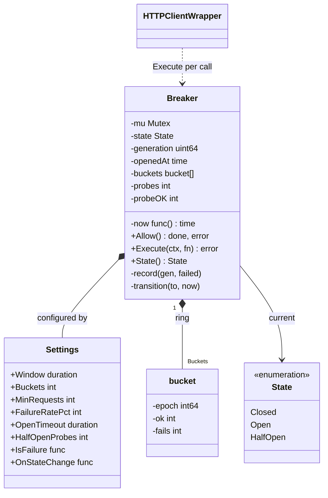
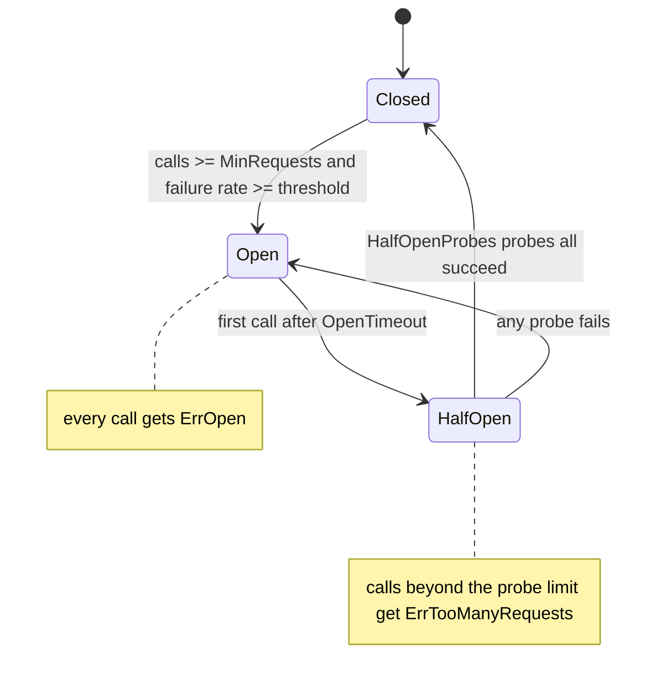
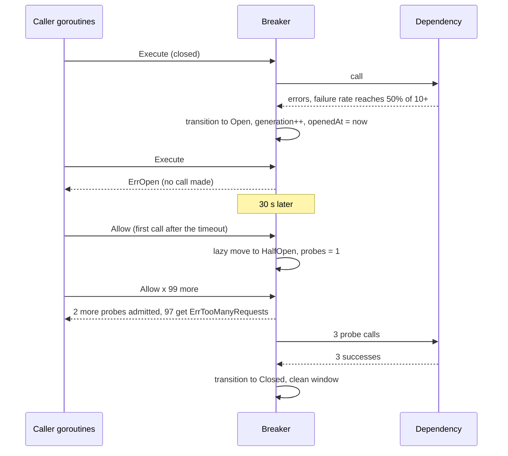

# Circuit Breaker

> [!summary] TL;DR
> A circuit breaker sits in front of one dependency and stops calling it after the recent failure rate crosses a threshold. While **open** it fails fast. After a cool-down it lets a few **half-open** probe calls through. If they succeed it **closes** again; if one fails it opens again. This note codes it as a thread-safe Go type with a sliding failure-rate window, a probe limit and an injected clock.

> [!abstract] Core idea
> - Three states: **closed** (calls flow, outcomes counted), **open** (fail fast with `ErrOpen`), **half-open** (at most N probes; all succeed: close, one fails: open).
> - The trip rule is a **failure rate over a sliding time window** with a **minimum number of calls**, not "5 failures in a row": 5 failures out of 10,000 calls is healthy, 5 out of 6 is not.
> - The move from open to half-open is **lazy**: the first call after the cool-down performs it, so there is no timer goroutine.
> - A **generation counter** drops results of calls admitted in an earlier state, so a slow call from before the trip cannot close or re-open the breaker.
> - Classic mistakes: one breaker for the whole process, counting the caller's own cancellation as a dependency failure, and letting unlimited traffic through in half-open.

## Problem statement

```text
Design a circuit breaker library that wraps calls to a remote dependency.
When the dependency fails too often, the breaker opens and rejects calls immediately.
After a timeout it lets a limited number of trial calls through and closes again
if they succeed. It must be safe for concurrent use and testable without sleeping.
```

- It tests a state machine with time in it, concurrency on a hot path, and judgement about what counts as a failure. Time box: 10 minutes for Steps 1-4, 5 for Steps 5-7, 25-30 for the code, 10 for edge cases and tuning.

### Solving path

1. Clarify: what trips it (rate or count, window), what counts as a failure, how many probes in half-open, one breaker per what.
2. Draw the state machine: closed, open, half-open, with the guard on each arrow.
3. Pick the window: time buckets in a ring, so old outcomes fall out without a goroutine.
4. Write `Allow` (admission) and the `done` callback (recording) under one mutex, then `Execute` on top.
5. Add the generation counter, the error classifier and panic handling.
6. Test every transition with a fake clock, then 100 goroutines in half-open under `-race`.

## Step 1: Clarify requirements

### Questions to ask (with assumed answers)

- What trips the breaker? *Assume: failure rate at or above 50% over the last 10 seconds, once at least 10 calls were seen in that window.*
- What is a failure? *Assume: any error except `context.Canceled` (the caller gave up). Timeouts count. A pluggable classifier lets a caller ignore, say, HTTP 404.*
- How long does it stay open? *Assume: 30 seconds, then half-open.*
- How many calls in half-open? *Assume: 3 probes; all 3 must succeed to close; the first failure re-opens.*
- One breaker per what? *Assume: per dependency (host or endpoint). A process-wide breaker would let one bad dependency block all the healthy ones.*
- Should it also limit concurrency or retry? *Assume: no. Those are separate wrappers ([[Bulkheads and Concurrency Limits]], [[Timeouts, Retries and Backoff]]).*

### Functional

- `Execute(ctx, fn)`: fail fast when open, otherwise run `fn` and record the outcome.
- `Allow()` returns a `done(err)` callback, for callers that cannot wrap the call in a function (streaming, callbacks).
- `State()` for metrics and health endpoints; an `OnStateChange` hook for logs and alerts.

### Non-functional

- Safe for many goroutines; the lock is held for microseconds and never during the call itself.
- No background goroutines: nothing to start, stop or leak.
- Deterministic tests: the clock is injected as `func() time.Time`.
- O(buckets) memory per breaker, independent of traffic.

### Out of scope

- Sharing breaker state across instances (each instance decides for itself; Step 10 explains why that is usually right).
- Fallback responses: the caller decides what to do with `ErrOpen`.

## Step 2: Actors and use cases

| Actor | Use case |
|---|---|
| Calling service (many goroutines) | Call the dependency through the breaker |
| The dependency | Succeeds, fails, or hangs until the timeout |
| Probe call | One of the limited half-open calls that tests recovery |
| Operator | Watch state changes and the reject rate, tune thresholds |

The hardest use case is **half-open under concurrency**: when the cool-down ends, hundreds of goroutines arrive at once, and exactly N may pass.

## Step 3: Entities

| Entity | Key fields | Why it exists |
|---|---|---|
| `State` | `Closed`, `Open`, `HalfOpen` with `String()` | The three modes |
| `Settings` | Window, Buckets, MinRequests, FailureRatePct, OpenTimeout, HalfOpenProbes, IsFailure, OnStateChange | All tuning in one value per dependency |
| `bucket` | epoch, ok, fails | One time slice of the sliding window |
| `Breaker` | mu, state, generation, openedAt, buckets, probes, probeOK, now | The state machine and its counters |
| `done func(error)` | captures the generation | Reports one call's outcome exactly once |

Modelling insight: **admission and recording are two steps**. `Allow` decides whether a call may start; `done` records how it ended, possibly seconds later and after the state has changed. The generation captured at admission ties the two together.

## Step 4: Relationships





- **Composition** (breaker to buckets and settings): owned, never shared.
- **Usage**: an HTTP client, gRPC interceptor or repository wraps each call with `Execute`; the breaker knows nothing about the transport.

## Step 5: APIs and public methods

A breaker is a library, not a service, so there is no HTTP API. It surfaces in two places: the error a caller maps to a response, and an admin or metrics endpoint.

```text
Caller mapping: ErrOpen or ErrTooManyRequests -> 503 Service Unavailable + Retry-After,
                or a fallback (cached value, default, degraded page)
GET /admin/breakers              -> 200 [{name: "payments-api", state: "open", openedAt, failureRate}]
Metrics: breaker_state{name}, breaker_transitions_total{name,from,to}, breaker_rejected_total{name}
```

```go
// CircuitBreaker is the surface callers depend on. *Breaker implements it.
type CircuitBreaker interface {
	Execute(ctx context.Context, fn func(context.Context) error) error
	Allow() (done func(error), err error)
	State() State
}

var _ CircuitBreaker = (*Breaker)(nil) // compile-time check
```

## Step 6: Storage and repositories

None. Breaker state is per process and in memory on purpose: it reflects what *this* instance sees, and it must answer in microseconds. Persisting it, or sharing it through Redis, adds a network call to the very path the breaker is meant to make cheap, and a shared breaker trips every instance when one instance has a bad network path. The only things that leave the process are metrics and the `OnStateChange` events.

## Step 7: Patterns

| Pattern | Where | Why here |
|---|---|---|
| [[State Machines in Go]] | closed, open, half-open with guarded transitions | Each state admits calls differently; the transitions carry rules |
| [[Proxy]] | the breaker stands in front of the dependency with the same call shape | Callers keep calling "the dependency" |
| [[Decorator and Middleware]] | an `http.RoundTripper` or gRPC interceptor that calls `Execute` | Adds the breaker without touching business code |
| [[Strategy and Template Method]] | `IsFailure` classifier | What counts as failure differs per dependency |
| [[Observer and Event Bus]] | `OnStateChange` | Logs, metrics and alerts react to transitions |

The resilience pattern itself (why it exists, how it combines with retries, timeouts and bulkheads at system level) is [[10 Distributed Systems & Resilience/Circuit Breaker|Circuit Breaker]] in 10. This note is the class design.

Patterns not used, and why:

- No state objects with one struct per state: three states with a few lines each read better as a `switch` on an enum.
- No timer goroutine for open to half-open: the lazy check costs one time comparison per call and removes start and stop lifecycle.

## Folder structure

```text
breaker/
  state.go        -> State, String
  settings.go     -> Settings, defaults, Err* errors
  window.go       -> bucket, bucketFor, windowCounts
  breaker.go      -> Breaker: New, State, Allow, Execute, record, transition
  breaker_test.go -> transitions, window, half-open limit, stale result, classifier, panic, concurrency
transport/
  roundtripper.go -> http.RoundTripper decorator: 5xx and timeouts count as failures
```

## Step 8: Core code

> [!tip] What to code in a 60-minute round
> Aim for about 140 lines in the room.
> - **Write:** `State`, `Settings`, `Breaker` with `Allow`, the `done` callback, `record`, `transition`, the lazy open-to-half-open check, and `Execute`.
> - **Add if time remains:** the bucketed time window (start with a count-based ring of the last N outcomes if short of time), the generation counter, and the half-open concurrency test.
> - **Talk only:** the HTTP decorator, per-endpoint breakers, the error classifier for HTTP status codes, and adaptive throttling.

### Walkthrough

`Allow()`:

1. Lock. Run `maybeHalfOpen(now)`: if open and `OpenTimeout` has passed, transition to half-open.
2. Open: return `ErrOpen`.
3. Half-open: if `probes` already reached `HalfOpenProbes`, return `ErrTooManyRequests`; otherwise count this probe.
4. Capture the current `generation` and return a `done` closure. The lock is released before the caller runs the call.

`done(err)` takes the lock and calls `record(gen, IsFailure(err))`, once:

1. If `gen` differs from the current generation, drop the result: the call was admitted in an earlier state.
2. Closed: add to the current bucket, sum the window; if `total >= MinRequests` and `fails*100 >= pct*total`, open.
3. Half-open: a failure opens again (and restarts the cool-down); a success counts, and `HalfOpenProbes` successes close.

The window has `Buckets` slots of `Window/Buckets` each. A time maps to `epoch = unixNanos / bucketLen` and slot `epoch % Buckets`. A slot with an old epoch is reset before use, and `windowCounts` sums only slots whose epoch is within the last `Buckets` epochs, so old outcomes fall out with no goroutine.

Integer arithmetic for the rate (`fails*100 >= pct*total`) avoids float rounding at the boundary: 5 failures out of 10 at 50% trips exactly.

```go
package breaker

import (
	"context"
	"errors"
	"fmt"
	"sync"
	"time"
)

var (
	ErrOpen            = errors.New("circuit breaker is open")
	ErrTooManyRequests = errors.New("circuit breaker is half-open: probe limit reached")
)

// CircuitBreaker is the surface callers depend on. *Breaker implements it.
type CircuitBreaker interface {
	Execute(ctx context.Context, fn func(context.Context) error) error
	Allow() (done func(error), err error)
	State() State
}

var _ CircuitBreaker = (*Breaker)(nil) // compile-time check

type State int

const (
	Closed State = iota
	Open
	HalfOpen
)

func (s State) String() string {
	switch s {
	case Closed:
		return "closed"
	case Open:
		return "open"
	case HalfOpen:
		return "half-open"
	}
	return fmt.Sprintf("State(%d)", int(s))
}

// Settings for one breaker. One breaker guards one dependency (per host or
// per endpoint), never the whole process.
type Settings struct {
	Window         time.Duration // length of the sliding failure window, e.g. 10s
	Buckets        int           // window resolution, e.g. 10 buckets of 1s
	MinRequests    int           // no decision below this many calls in the window
	FailureRatePct int           // open when failures*100 >= pct*total
	OpenTimeout    time.Duration // how long to fail fast before probing
	HalfOpenProbes int           // probes admitted in half-open; all must succeed to close
	// IsFailure classifies an error. nil means: any error except context.Canceled
	// (the caller gave up, the dependency did not fail).
	IsFailure     func(error) bool
	OnStateChange func(from, to State) // called with the lock held: keep it fast
}

type bucket struct {
	epoch     int64 // which bucket-length slot of time this bucket holds
	ok, fails int
}

type Breaker struct {
	mu         sync.Mutex
	cfg        Settings
	now        func() time.Time
	state      State
	generation uint64 // bumped on every transition; stale results are dropped
	openedAt   time.Time
	buckets    []bucket
	bucketLen  time.Duration
	probes     int // half-open: probes admitted so far
	probeOK    int // half-open: probes that succeeded
}

func New(cfg Settings, now func() time.Time) *Breaker {
	if cfg.Buckets < 1 {
		cfg.Buckets = 10
	}
	if cfg.Window < time.Duration(cfg.Buckets)*time.Millisecond {
		cfg.Window = 10 * time.Second // keeps bucketLen > 0
	}
	if cfg.HalfOpenProbes < 1 {
		cfg.HalfOpenProbes = 1
	}
	if cfg.IsFailure == nil {
		cfg.IsFailure = func(err error) bool {
			return err != nil && !errors.Is(err, context.Canceled)
		}
	}
	return &Breaker{
		cfg: cfg, now: now,
		buckets:   make([]bucket, cfg.Buckets),
		bucketLen: cfg.Window / time.Duration(cfg.Buckets),
	}
}

// State reports the current state, applying the lazy open -> half-open move.
func (b *Breaker) State() State {
	b.mu.Lock()
	defer b.mu.Unlock()
	b.maybeHalfOpen(b.now())
	return b.state
}

// Allow asks for permission to call the dependency. On success the caller
// must call done exactly once with the call's error (extra calls are ignored).
func (b *Breaker) Allow() (done func(error), err error) {
	b.mu.Lock()
	defer b.mu.Unlock()
	now := b.now()
	b.maybeHalfOpen(now)
	switch b.state {
	case Open:
		return nil, ErrOpen
	case HalfOpen:
		if b.probes >= b.cfg.HalfOpenProbes {
			return nil, ErrTooManyRequests
		}
		b.probes++
	}
	gen := b.generation
	reported := false
	return func(callErr error) {
		b.mu.Lock()
		defer b.mu.Unlock()
		if reported {
			return
		}
		reported = true
		b.record(gen, b.cfg.IsFailure(callErr))
	}, nil
}

// Execute wraps fn: fail fast when open, otherwise run and record the outcome.
// A panic in fn is recorded as a failure and then re-panics.
func (b *Breaker) Execute(ctx context.Context, fn func(context.Context) error) (err error) {
	done, err := b.Allow()
	if err != nil {
		return err
	}
	defer func() {
		if p := recover(); p != nil {
			done(fmt.Errorf("panic: %v", p))
			panic(p)
		}
	}()
	err = fn(ctx)
	done(err)
	return err
}

// maybeHalfOpen must be called with b.mu held. No timer goroutine: the
// move happens on the first call after OpenTimeout.
func (b *Breaker) maybeHalfOpen(now time.Time) {
	if b.state == Open && now.Sub(b.openedAt) >= b.cfg.OpenTimeout {
		b.transition(HalfOpen, now)
	}
}

// record must be called with b.mu held.
func (b *Breaker) record(gen uint64, failed bool) {
	if gen != b.generation {
		return // admitted in an earlier state: its outcome says nothing now
	}
	now := b.now()
	switch b.state {
	case Closed:
		bk := b.bucketFor(now)
		if failed {
			bk.fails++
		} else {
			bk.ok++
		}
		ok, fails := b.windowCounts(now)
		total := ok + fails
		if total >= b.cfg.MinRequests && fails*100 >= b.cfg.FailureRatePct*total {
			b.transition(Open, now)
		}
	case HalfOpen:
		if failed {
			b.transition(Open, now) // one failed probe re-opens for a full timeout
			return
		}
		b.probeOK++
		if b.probeOK >= b.cfg.HalfOpenProbes {
			b.transition(Closed, now)
		}
	}
}

func (b *Breaker) epoch(now time.Time) int64 {
	return now.UnixNano() / int64(b.bucketLen)
}

func (b *Breaker) bucketFor(now time.Time) *bucket {
	e := b.epoch(now)
	bk := &b.buckets[e%int64(len(b.buckets))]
	if bk.epoch != e { // this slot holds an expired bucket: reuse it
		*bk = bucket{epoch: e}
	}
	return bk
}

// windowCounts sums only the buckets that are still inside the window.
func (b *Breaker) windowCounts(now time.Time) (ok, fails int) {
	cur := b.epoch(now)
	for _, bk := range b.buckets {
		if cur-bk.epoch < int64(len(b.buckets)) {
			ok += bk.ok
			fails += bk.fails
		}
	}
	return ok, fails
}

func (b *Breaker) transition(to State, now time.Time) {
	from := b.state
	b.state = to
	b.generation++
	b.probes, b.probeOK = 0, 0
	switch to {
	case Open:
		b.openedAt = now
	case Closed:
		for i := range b.buckets {
			b.buckets[i] = bucket{} // start with a clean window
		}
	}
	if b.cfg.OnStateChange != nil {
		b.cfg.OnStateChange(from, to)
	}
}
```

## Test cases

| Test | Proves |
|---|---|
| `TestClosedToOpen` | 9 failures stay closed (below `MinRequests`), 40% stays closed, exactly 50% opens, 100% opens |
| `TestOpenFailsFast` | `fn` is not called while open; still open at 29 s, half-open at 30 s |
| `TestWindowSlides` | 9 old failures expire after 11 s, so 1 failure in 10 new calls keeps it closed |
| `TestHalfOpen` | 3 probes admitted, the 4th rejected; 3 successes close; one failed probe re-opens and restarts the 30 s timer; transition order via `OnStateChange` |
| `TestStaleResultIsIgnored` | A call admitted while closed and reported after the trip changes nothing; a second report is ignored |
| `TestCancelledCallsAreNotFailures` | `context.Canceled` does not trip it; `context.DeadlineExceeded` does |
| `TestPanicCountsAsFailure` | A panic is recorded as a failure and still propagates |
| `TestConcurrentHalfOpenAdmitsOnlyProbeLimit` | 100 goroutines arrive in half-open: exactly 3 admitted, 97 rejected, then closed |
| `TestConcurrentMixedTraffic` | 200 goroutines with 20% failures under `-race`: every call either ran or was rejected |

All tests pass under `go test -race -count=50` (Go 1.24.4).

The mixed-traffic test does not assert "stays closed at 20% failures". Such an assertion would be flaky: goroutine order is random, so 5 of the first 10 calls can be failures, and then the breaker correctly opens. The test checks accounting instead. The same thing happens in production right after a deploy, which is why `MinRequests` should be large enough to make an early burst unlikely.

```go
package breaker

import (
	"context"
	"errors"
	"sync"
	"sync/atomic"
	"testing"
	"time"
)

var errBoom = errors.New("dependency failed")

type clock struct {
	mu sync.Mutex
	t  time.Time
}

func (c *clock) Now() time.Time { c.mu.Lock(); defer c.mu.Unlock(); return c.t }
func (c *clock) Advance(d time.Duration) {
	c.mu.Lock()
	defer c.mu.Unlock()
	c.t = c.t.Add(d)
}

func newBreaker(changes *[]string) (*Breaker, *clock) {
	c := &clock{t: time.Unix(1_700_000_000, 0)}
	cfg := Settings{
		Window: 10 * time.Second, Buckets: 10, MinRequests: 10, FailureRatePct: 50,
		OpenTimeout: 30 * time.Second, HalfOpenProbes: 3,
	}
	if changes != nil {
		cfg.OnStateChange = func(from, to State) { *changes = append(*changes, from.String()+"->"+to.String()) }
	}
	return New(cfg, c.Now), c
}

// call runs n calls through the breaker; fail decides each outcome.
func call(t *testing.T, b *Breaker, n int, err error) {
	t.Helper()
	for i := 0; i < n; i++ {
		got := b.Execute(context.Background(), func(context.Context) error { return err })
		if !errors.Is(got, err) {
			t.Fatalf("call %d: got %v want %v", i, got, err)
		}
	}
}

func TestClosedToOpen(t *testing.T) {
	tests := []struct {
		name      string
		ok, fails int
		want      State
	}{
		{"below min requests even at 100% failures", 0, 9, Closed},
		{"at min requests, rate 40%", 6, 4, Closed},
		{"at min requests, rate exactly 50%", 5, 5, Open},
		{"all failures", 0, 10, Open},
	}
	for _, tc := range tests {
		t.Run(tc.name, func(t *testing.T) {
			b, _ := newBreaker(nil)
			call(t, b, tc.ok, nil)
			call(t, b, tc.fails, errBoom)
			if got := b.State(); got != tc.want {
				t.Fatalf("state %v want %v", got, tc.want)
			}
		})
	}
}

func TestOpenFailsFast(t *testing.T) {
	b, c := newBreaker(nil)
	call(t, b, 10, errBoom)
	var ran atomic.Bool
	err := b.Execute(context.Background(), func(context.Context) error { ran.Store(true); return nil })
	if !errors.Is(err, ErrOpen) || ran.Load() {
		t.Fatalf("err %v ran %v", err, ran.Load())
	}
	c.Advance(29 * time.Second)
	if b.State() != Open {
		t.Fatal("still open before the timeout")
	}
	c.Advance(time.Second)
	if b.State() != HalfOpen {
		t.Fatal("half-open at the timeout")
	}
}

func TestWindowSlides(t *testing.T) {
	b, c := newBreaker(nil)
	call(t, b, 9, errBoom) // below MinRequests: stays closed
	c.Advance(11 * time.Second)
	call(t, b, 9, nil)
	call(t, b, 1, errBoom) // 1 of 10 in the window; the old 9 have expired
	if b.State() != Closed {
		t.Fatal("old failures must slide out of the window")
	}
}

func TestHalfOpen(t *testing.T) {
	t.Run("probe limit, then all probes succeed: close", func(t *testing.T) {
		var changes []string
		b, c := newBreaker(&changes)
		call(t, b, 10, errBoom)
		c.Advance(30 * time.Second)
		var dones []func(error)
		for i := 0; i < 3; i++ {
			done, err := b.Allow()
			if err != nil {
				t.Fatalf("probe %d: %v", i, err)
			}
			dones = append(dones, done)
		}
		if _, err := b.Allow(); !errors.Is(err, ErrTooManyRequests) {
			t.Fatalf("4th probe: %v", err)
		}
		for _, d := range dones {
			d(nil)
		}
		want := []string{"closed->open", "open->half-open", "half-open->closed"}
		if b.State() != Closed || len(changes) != 3 || changes[2] != want[2] {
			t.Fatalf("changes %v", changes)
		}
	})
	t.Run("one probe fails: open again for a full timeout", func(t *testing.T) {
		b, c := newBreaker(nil)
		call(t, b, 10, errBoom)
		c.Advance(30 * time.Second)
		call(t, b, 1, nil)
		call(t, b, 1, errBoom)
		if b.State() != Open {
			t.Fatal("failed probe must re-open")
		}
		c.Advance(29 * time.Second)
		if b.State() != Open {
			t.Fatal("the open timer restarts at the failed probe")
		}
	})
}

func TestStaleResultIsIgnored(t *testing.T) {
	b, c := newBreaker(nil)
	slow, err := b.Allow() // admitted while closed
	if err != nil {
		t.Fatal(err)
	}
	call(t, b, 10, errBoom) // breaker opens meanwhile
	c.Advance(30 * time.Second)
	if b.State() != HalfOpen {
		t.Fatal("want half-open")
	}
	slow(errBoom) // generation changed: must not re-open the breaker
	slow(nil)     // a second report is ignored too
	if b.State() != HalfOpen {
		t.Fatalf("stale result changed state to %v", b.State())
	}
}

func TestCancelledCallsAreNotFailures(t *testing.T) {
	b, _ := newBreaker(nil)
	call(t, b, 10, context.Canceled)
	if b.State() != Closed {
		t.Fatal("caller cancellation must not open the breaker")
	}
	call(t, b, 10, context.DeadlineExceeded) // a timeout is the dependency's fault
	if b.State() != Open {
		t.Fatal("timeouts count as failures")
	}
}

func TestPanicCountsAsFailure(t *testing.T) {
	b, _ := newBreaker(nil)
	for i := 0; i < 10; i++ {
		func() {
			defer func() { _ = recover() }()
			_ = b.Execute(context.Background(), func(context.Context) error { panic("boom") })
		}()
	}
	if b.State() != Open {
		t.Fatal("panics must count as failures")
	}
}

func TestConcurrentHalfOpenAdmitsOnlyProbeLimit(t *testing.T) {
	b, c := newBreaker(nil)
	call(t, b, 10, errBoom)
	c.Advance(30 * time.Second)
	var (
		wg               sync.WaitGroup
		admitted, denied atomic.Int32
		release          = make(chan struct{})
	)
	for i := 0; i < 100; i++ {
		wg.Add(1)
		go func() {
			defer wg.Done()
			err := b.Execute(context.Background(), func(context.Context) error { <-release; return nil })
			switch {
			case err == nil:
				admitted.Add(1)
			case errors.Is(err, ErrTooManyRequests):
				denied.Add(1)
			default:
				t.Error(err)
			}
		}()
	}
	// Release the probes only after every goroutine has tried: a goroutine
	// that arrives after the breaker closes would be admitted normally.
	for b.probesAdmitted()+int(denied.Load()) < 100 {
		time.Sleep(time.Millisecond)
	}
	close(release)
	wg.Wait()
	if admitted.Load() != 3 || denied.Load() != 97 || b.State() != Closed {
		t.Fatalf("admitted %d denied %d state %v", admitted.Load(), denied.Load(), b.State())
	}
}

func (b *Breaker) probesAdmitted() int {
	b.mu.Lock()
	defer b.mu.Unlock()
	return b.probes
}

// Mixed traffic from 200 goroutines: run under -race to prove the state is
// guarded. Goroutine order is random, so an early burst of failures may open
// the breaker; the test checks accounting, not the final state.
func TestConcurrentMixedTraffic(t *testing.T) {
	b, _ := newBreaker(nil)
	var (
		wg                    sync.WaitGroup
		ran, rejected, others atomic.Int32
	)
	for i := 0; i < 200; i++ {
		wg.Add(1)
		go func(i int) {
			defer wg.Done()
			err := b.Execute(context.Background(), func(context.Context) error {
				ran.Add(1)
				if i%5 == 0 {
					return errBoom
				}
				return nil
			})
			switch {
			case errors.Is(err, ErrOpen), errors.Is(err, ErrTooManyRequests):
				rejected.Add(1)
			case err != nil && !errors.Is(err, errBoom):
				others.Add(1)
			}
		}(i)
	}
	wg.Wait()
	if ran.Load()+rejected.Load() != 200 || others.Load() != 0 {
		t.Fatalf("ran %d rejected %d others %d", ran.Load(), rejected.Load(), others.Load())
	}
}
```

## Step 9: Edge cases

| Edge case | What happens | How the design handles it |
|---|---|---|
| Very low traffic: 2 calls, both fail | 100% failure rate on no evidence | `MinRequests`: no decision below it |
| Thundering herd when the cool-down ends | Hundreds of calls hit a recovering dependency | Half-open admits only `HalfOpenProbes`; the rest get `ErrTooManyRequests` |
| Slow call admitted before the trip returns after it | Its result could close or re-open the breaker | Generation counter drops it |
| Caller cancels (user navigated away) | Would count as a dependency failure | Default `IsFailure` ignores `context.Canceled` |
| Dependency hangs | No result, breaker never learns | The caller must set a timeout; `DeadlineExceeded` counts as failure |
| Client errors (HTTP 400, 404) | Not the dependency's fault | A custom `IsFailure` that counts only 5xx, timeouts and connection errors |
| `done` called twice or never | Double count, or a probe slot held forever | Twice: ignored. Never: in half-open the slot stays used until the next transition, so always `defer done(err)` or use `Execute` |
| Panic inside `fn` | Outcome lost | `Execute` records it as a failure, then re-panics |
| One bad endpoint on a healthy host | Whole host blocked | One breaker per endpoint or per (host, operation) |
| `OnStateChange` is slow | Every call waits on the lock | Documented: called under the lock, keep it fast or hand off to a channel |
| Bucket boundary | A burst near the edge expires a little early or late | Error at most one bucket (1 s of a 10 s window); more buckets, finer edges |

### Common mistakes

- Tripping on consecutive failures only: one success resets the count, so a dependency failing 90% of calls never trips.
- One global breaker for all dependencies.
- Half-open that lets everything through.
- Running the call while holding the breaker's mutex: the breaker becomes a global lock around the dependency.
- Retrying inside the breaker so one logical call counts as five failures; retries go outside, and stop on `ErrOpen`.

## Step 10: Tradeoffs and extensions

| Follow-up | Design change |
|---|---|
| Count-based window | A ring of the last N outcomes instead of time buckets: simpler, but a quiet period never ages old failures out |
| Slow calls as failures | Record the call duration; a call over a threshold counts as a failure even if it succeeded (Resilience4j calls this the slow-call rate) |
| Exponential open timeout | Double `OpenTimeout` after each failed half-open, cap it, reset on close |
| Fallback | A wrapper that returns a cached value on `ErrOpen` ([[Load Shedding and Graceful Degradation]]) |
| Per-endpoint breakers | A map of breakers keyed by endpoint, created on first use with `sync.Map` or a mutex |
| HTTP integration | An `http.RoundTripper` decorator; 5xx, 429 and transport errors are failures |
| Adaptive throttling | Reject a fraction of calls proportional to the failure rate instead of all-or-nothing |

Tradeoffs chosen:

- **Rate over a time window, not consecutive failures.** Robust to scattered successes; costs a ring of buckets.
- **Per-instance state.** Fast and independent; each of 20 instances learns about an outage separately, which costs up to `MinRequests` failed calls per instance. Sharing state would make that cheaper and everything else worse.
- **Lazy half-open.** No goroutine; a breaker nobody calls stays "open" in metrics until the next call, so `State()` applies the check too.
- **All probes must succeed.** Conservative: it closes later but avoids flapping. A threshold (2 of 3) closes sooner.
- **One mutex.** The critical sections are a few comparisons; an atomics version is possible but hard to keep correct across the generation, probe count and window together.

## Drawing



Redraw it from memory:

- [ ] The three states with the guard on every arrow
- [ ] The bucket ring: epoch, slot index, reset of an old slot
- [ ] Admission (`Allow`) and recording (`done`) as two steps joined by the generation
- [ ] Half-open with 100 arrivals, 3 admitted

## Interview questions

> [!question]- Why a failure rate with a minimum number of calls instead of "N consecutive failures"?
> Consecutive counts reset on any success, so a dependency failing 90% of the time may never trip, and a quiet service trips on two unlucky calls. A rate over a window with `MinRequests` reflects how healthy the dependency is right now and needs enough evidence before acting.

> [!question]- What stops a stampede when the breaker goes half-open?
> The probe limit. `Allow` counts probes under the lock and rejects everything beyond `HalfOpenProbes` with `ErrTooManyRequests`. The test sends 100 goroutines at once and exactly 3 get through. Without the limit, half-open is just "closed again" and the recovering dependency gets the full load.

> [!question]- Trap: a call admitted while closed returns an error after the breaker has gone half-open. Should it re-open the breaker?
> No. That call tested the old situation, not the recovery. Each transition bumps a generation number, the `done` closure captured the old one, and `record` drops mismatched results. Without this, slow calls from before the outage can close or re-open the breaker at random.

> [!question]- Is `context.Canceled` a failure? Is `context.DeadlineExceeded`?
> Cancelled means the caller gave up (user left, parent request ended), which says nothing about the dependency, so it is not counted. A deadline means the dependency was too slow, which is exactly what the breaker protects against, so it counts. A classifier should also ignore client errors like 400 and 404.

> [!question]- Why is there no goroutine that moves the breaker from open to half-open?
> The first call after `OpenTimeout` does it, inside the lock it already takes. That keeps the breaker a plain value with no `Start` or `Stop` and nothing to leak. `State()` runs the same check so metrics are correct whenever they are read.

> [!question]- Should breaker state be shared across instances through Redis?
> Usually not. The breaker should answer in microseconds without a network call, and each instance has its own network path to the dependency. The cost of per-instance state is that every instance pays `MinRequests` failures to learn about an outage, which is small. Share only signals that are global by nature, like a dependency's own health endpoint.

> [!question]- How do the breaker, retries and timeouts fit together on one call?
> Timeout on each attempt, retries with backoff around the breaker, and the breaker around each attempt. A retry loop must stop on `ErrOpen` instead of retrying it. Concurrency limits ([[Bulkheads and Concurrency Limits]]) sit next to the breaker, because a slow dependency fills goroutines before it produces errors.

## Cheat sheet

- Closed, open, half-open; trip on failure rate >= threshold once calls >= `MinRequests` in the window.
- Time-bucket ring: slot = epoch % buckets, reset stale slots, sum only live epochs; no goroutine.
- Open to half-open lazily on the first call after `OpenTimeout`.
- Half-open: at most N probes; all succeed close, one failure re-opens and restarts the timer.
- Generation counter drops results from an earlier state; `done` reports once.
- `context.Canceled` is not a failure; timeouts are.
- One breaker per dependency or endpoint, per instance; never hold the lock during the call.

## Links

- **Before this:** [[LLD Interview Method]], [[State Machines in Go]], [[Concurrency for LLD]]
- **Next:** [[Pub-Sub Message Queue]]
- **Compare with:** [[10 Distributed Systems & Resilience/Circuit Breaker|Circuit Breaker]] (the resilience pattern at system level), [[Timeouts, Retries and Backoff]], [[Bulkheads and Concurrency Limits]], [[Rate Limiter]] (the other "admit or reject" class design)
