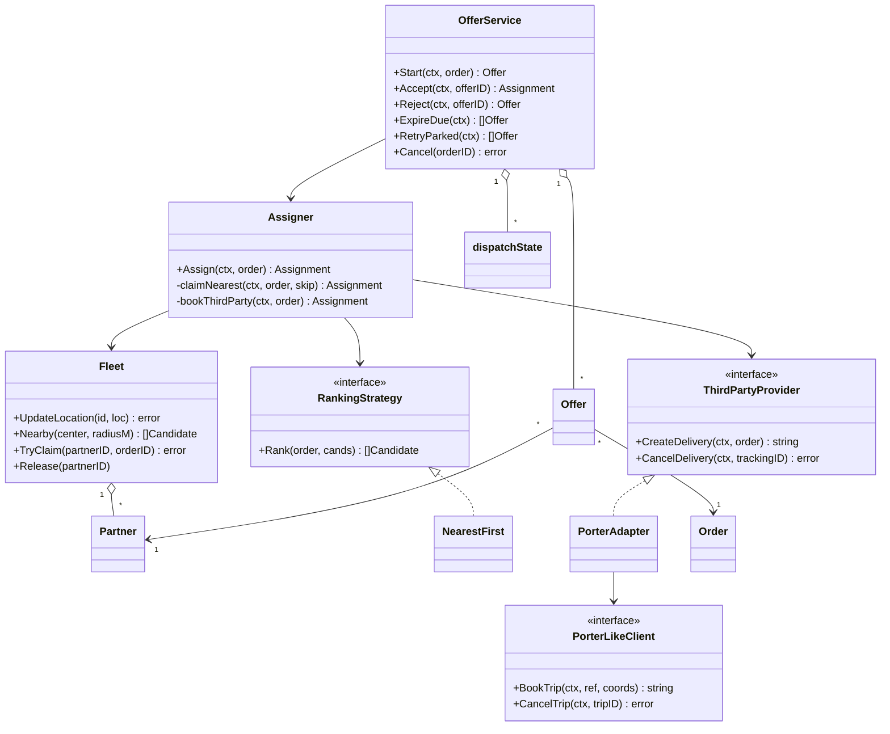
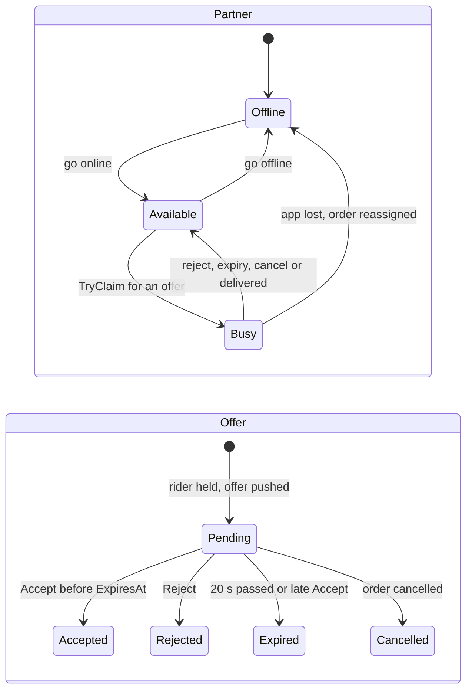
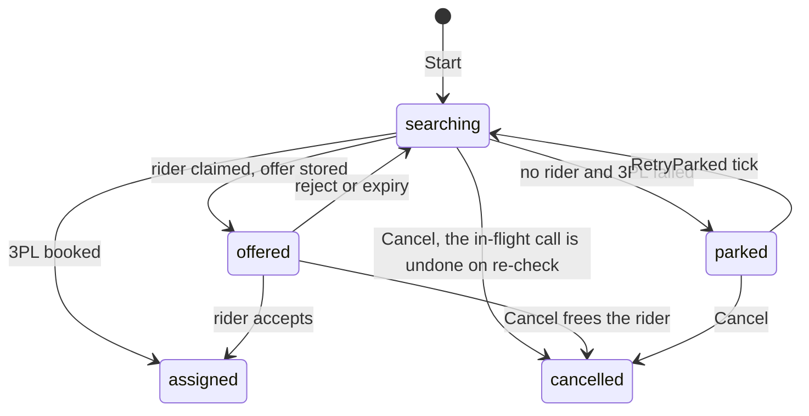
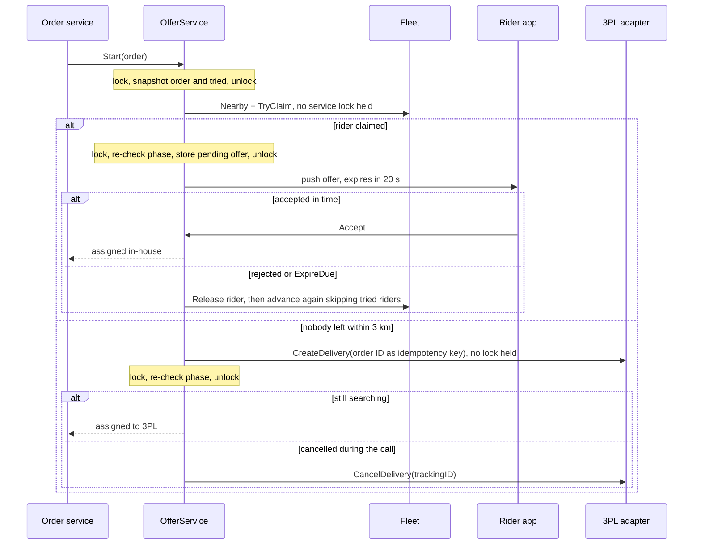
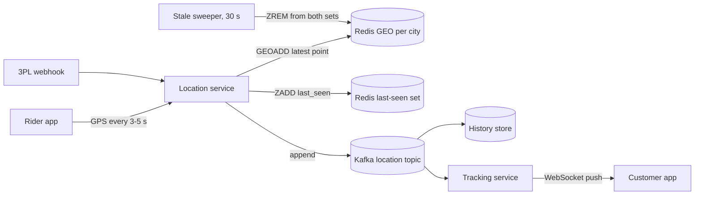

# Delivery Partner Assignment

> [!summary] TL;DR
> When an order is packed, find a free delivery rider near the store, **hold** them with an atomic compare-and-set (`available → busy`), and send an offer that expires in 20 seconds. On reject or timeout, free the rider and offer the next one; when nobody is left, widen the radius, then book a third-party logistics company (3PL), then park the order in a retry queue. The core rule for the code: decide under the lock, make network calls with no lock held, then re-check.

## Problem statement

```text
An order is ready at a dark store. Assign a delivery partner within 1 km of the store.
If nobody is free nearby, handle it gracefully. Some orders may go to a third-party
logistics company. The rider can accept or reject an offer, and an offer that is not
answered in time goes to the next rider. The customer must see the rider's live
location until delivery. Design the classes, relationships, patterns and DB schema.
Code the core assign method and Accept / Reject with a timeout.
```

What it really tests: a **race on a shared resource** (two orders must never get the same rider), a fallback chain with an external system behind an adapter, an offer state machine with deadlines, and **lock scope**: the old version of this solution called the 3PL while holding the service mutex, so one slow vendor call froze every accept and reject in the city.

## Step 1: Clarify requirements

Questions to ask, with the assumptions this design makes:

- 1 km from the store or from the customer? *From the store: the rider must reach the store first.*
- Straight-line or road distance? *Straight-line (Haversine) in v1; ETA ranking is a later strategy.*
- Assign directly or **offer** and wait? *Offer with a 20 s deadline, one rider at a time. Direct assign is also coded.*
- One active order per rider? *Yes in v1; batching is an extension.*
- Location rate and fleet size? *Every 3–5 s, about 10k riders in a big city (an estimate for sizing).*
- 3PL booking sync or async? *Sync booking API with an idempotency reference; status by webhook.*
- Nobody at all? *1 km → 2 km → 3 km, then 3PL, then a retry queue every 30–60 s and an ops alert.*

**Functional:** riders go online and offline and stream GPS; find the best available rider with a fresh location within 1 km, widening in steps; offer to one rider at a time and hold them meanwhile; on reject or timeout free the rider and never re-offer them this order; fall back to 3PL, then the retry queue; the customer cancels before assignment; the customer tracks the rider live.

**Non-functional:** never two orders on one rider; assignment under 1–2 s excluding think time; location writes are the hot path (estimate: 10k riders × 1 ping per 4 s = 2.5k writes/s per city); skip riders whose last ping is older than 30 s; 3PL calls have a timeout, an idempotency key and a circuit breaker; timeouts testable with an injected clock.

**Out of scope:** route optimisation, payouts, ratings, serviceability (checked at checkout), maps internals.

## Step 2: Actors and use cases

| Actor | Use case |
| --- | --- |
| Rider app | Go online or offline, stream location, accept or reject an offer |
| Order service | Ask for a rider when the order is packed; cancel before assignment |
| Dispatcher (system) | Search nearby, claim, offer, expire offers, fall back to 3PL, retry parked orders |
| 3PL provider | Book or cancel a trip; send status and location webhooks |
| Customer app | Track the rider live |
| Ops | See parked orders, get alerts |

The use case to code: **Start → offer → Accept / Reject / expire**, ending in a 3PL booking or the retry queue.

## Step 3: Entities

| Entity | Key fields | Why it exists |
| --- | --- | --- |
| `Partner` | ID, Status, Loc, LocatedAt, ActiveOrder | The rider and their live state |
| `Location` | Lat, Lng | Value object for store, customer and rider |
| `Order` | ID, Pickup, Drop | What to deliver, from where to where |
| `Candidate` | PartnerID, DistanceM | A search result before ranking |
| `Offer` | ID, OrderID, PartnerID, Status, ExpiresAt | One "will you take this order?" with a deadline |
| `Assignment` | OrderID, PartnerID or Provider + TrackingID, RadiusM | The result: in-house rider or 3PL |
| `dispatchState` | order, phase, offerID, tried | Where one order is in dispatch, and who already said no |
| `Fleet` | partners, staleAfter, clock | Live location and status (prod: Redis GEO + Postgres) |

Two modelling insights. **Offer is separate from Assignment**: an order can have many offers (A rejected, B timed out, C accepted) but one assignment, and the offer rows give the "who said no" history and a clean answer to a late accept. **The order has a phase**: only the goroutine that moved an order to `searching` may advance it, so a reject and the expiry sweeper can never run two searches for one order.

## Step 4: Relationships



- **Aggregation:** `Fleet` tracks `Partner`s that exist on their own; `OfferService` keeps `Offer`s and one `dispatchState` per order.
- **Dependency on interfaces:** `Assigner` depends on `RankingStrategy` and `ThirdPartyProvider`, so the ranking rule and the vendor can change without touching the claim loop.
- **Realization:** `NearestFirst` implements `RankingStrategy`; `PorterAdapter` implements `ThirdPartyProvider` by calling the vendor SDK.

Partner and offer lifecycles. The offer deadline is the timeout; the expiry sweeper and a late accept both end in `Expired`:



The order's dispatch phase, which the code uses to stop two goroutines from advancing one order:



## Step 5: APIs and public methods

```text
POST /partners/{id}/online | /offline
POST /partners/{id}/location      {lat, lng, ts}      (or a WebSocket or MQTT stream)
POST /offers/{offerId}/accept     -> 200 assignment | 409 offer closed | 410 offer expired
POST /offers/{offerId}/reject     -> 200
POST /deliveries                  {order_id, store_id, drop}   (order service, starts dispatch)
POST /deliveries/{orderId}/cancel -> 200 | 409 already assigned
GET  /deliveries/{orderId}/track  -> WebSocket pushing the rider location
POST /webhooks/3pl/{provider}     {tracking_id, status, lat, lng}   (verify the signature)
```

| Method | Contract |
| --- | --- |
| `(*OfferService).Start(ctx, order) (Offer, error)` | First offer, a 3PL booking, or a parked order; `ErrAlreadyStarted` on a duplicate |
| `Accept(ctx, offerID) (Assignment, error)` | `ErrOfferClosed` if answered, `ErrOfferExpired` if late (the order moves on) |
| `Reject(ctx, offerID) (Offer, error)` | Frees the rider and returns the next offer |
| `ExpireDue(ctx) ([]Offer, error)` | Run by a 1 s ticker: expire overdue offers, re-offer their orders |
| `RetryParked(ctx) ([]Offer, error)` | Run by a 30–60 s ticker: parked orders search again |
| `Cancel(orderID) error` | Before assignment only; `ErrAlreadyAssigned` after |
| `(*Assigner).Assign(ctx, order) (Assignment, error)` | Direct assignment without offers: nearest rider, else 3PL |

## Step 6: Storage and repositories

```sql
CREATE TABLE delivery_partners (
    id                 TEXT PRIMARY KEY,
    name               TEXT NOT NULL,
    phone              TEXT NOT NULL UNIQUE,
    vehicle_type       TEXT NOT NULL,
    status             TEXT NOT NULL CHECK (status IN ('offline', 'available', 'busy')),
    active_delivery_id TEXT NULL,
    updated_at         TIMESTAMPTZ NOT NULL DEFAULT now()
);

-- latest position only: hot data, mirrored in Redis GEO for radius search
CREATE TABLE partner_locations (
    partner_id  TEXT PRIMARY KEY REFERENCES delivery_partners (id),
    lat         DOUBLE PRECISION NOT NULL,
    lng         DOUBLE PRECISION NOT NULL,
    recorded_at TIMESTAMPTZ NOT NULL
);

-- full trail for disputes and analytics: partition by day, or keep it in a time-series store
CREATE TABLE partner_location_history (
    partner_id  TEXT NOT NULL,
    lat         DOUBLE PRECISION NOT NULL,
    lng         DOUBLE PRECISION NOT NULL,
    recorded_at TIMESTAMPTZ NOT NULL
);
CREATE INDEX plh_partner_time ON partner_location_history (partner_id, recorded_at);

CREATE TABLE deliveries (
    id                   TEXT PRIMARY KEY,
    order_id             TEXT NOT NULL UNIQUE,   -- one delivery per order: retries are no-ops
    store_id             TEXT NOT NULL,
    provider             TEXT NOT NULL,          -- inhouse | porter | ...
    partner_id           TEXT NULL REFERENCES delivery_partners (id),
    external_tracking_id TEXT NULL,
    status               TEXT NOT NULL,          -- searching | offered | parked | assigned | picked_up | delivered | cancelled
    radius_m             INT,                    -- the ring the rider was found in
    attempts             INT NOT NULL DEFAULT 0, -- offers made so far
    next_retry_at        TIMESTAMPTZ NULL,       -- the retry queue is just this column
    created_at           TIMESTAMPTZ NOT NULL DEFAULT now(),
    updated_at           TIMESTAMPTZ NOT NULL DEFAULT now()
);
CREATE UNIQUE INDEX one_active_per_rider ON deliveries (partner_id)
    WHERE status IN ('assigned', 'picked_up');
CREATE INDEX deliveries_retry_due ON deliveries (next_retry_at) WHERE status = 'parked';

CREATE TABLE offers (
    id           TEXT PRIMARY KEY,
    delivery_id  TEXT NOT NULL REFERENCES deliveries (id),
    partner_id   TEXT NOT NULL REFERENCES delivery_partners (id),
    status       TEXT NOT NULL,                  -- pending | accepted | rejected | expired | cancelled
    offered_at   TIMESTAMPTZ NOT NULL DEFAULT now(),
    expires_at   TIMESTAMPTZ NOT NULL,
    responded_at TIMESTAMPTZ NULL,
    UNIQUE (delivery_id, partner_id)             -- never offer one order to one rider twice
);
CREATE INDEX offers_pending_expiry ON offers (expires_at) WHERE status = 'pending';

CREATE TABLE third_party_requests (
    id              TEXT PRIMARY KEY,
    delivery_id     TEXT NOT NULL REFERENCES deliveries (id),
    provider        TEXT NOT NULL,
    idempotency_key TEXT NOT NULL UNIQUE,        -- the order ID: a retried booking is one trip
    request         JSONB,
    response        JSONB,
    status          TEXT NOT NULL,
    created_at      TIMESTAMPTZ NOT NULL DEFAULT now()
);
```

The claim and the accept are both conditional updates. The command tag `UPDATE 0` means someone else won, and the code moves on:

```sql
-- claim: two orders can never both hold one rider
UPDATE delivery_partners SET status = 'busy', active_delivery_id = $2, updated_at = now()
WHERE id = $1 AND status = 'available';

-- accept: a late answer loses to the deadline
UPDATE offers SET status = 'accepted', responded_at = now()
WHERE id = $1 AND status = 'pending' AND expires_at >= now();
```

Live positions do not go to Postgres on every ping. Redis keeps only the latest point per rider and answers radius queries; every ping also goes to a stream for history:

```text
GEOADD riders:available:blr 77.5946 12.9725 rider-42
GEOSEARCH riders:available:blr FROMLONLAT 77.5946 12.9716 BYRADIUS 1 km ASC COUNT 20 WITHDIST
```

A Redis sorted set holds no per-member TTL, so staleness needs its own record: a `rider:last_seen` sorted set scored by timestamp, trimmed by a sweeper that reads members older than 30 s with `ZRANGE ... BYSCORE` and `ZREM`s them from both sets. Alternatives are PostGIS `ST_DWithin` on a GiST index, or geohash or H3 cells where the search reads the store's cell plus its neighbours (see [[Geospatial Indexing]]). In the code below, `Fleet` plays both the partner repository and the location index in memory, and `OfferService` keeps offers in maps, the way [[Repository and Unit of Work]] swaps storage in tests. These are the production ports they stand in for (compiled with the package below):

```go
type PartnerRepository interface {
	TryClaim(ctx context.Context, partnerID, orderID string) error // the conditional UPDATE above
	Release(ctx context.Context, partnerID string) error
}

type LocationIndex interface { // Redis GEO plus the last-seen set
	Upsert(ctx context.Context, partnerID string, loc Location, at time.Time) error
	Nearby(ctx context.Context, center Location, radiusM float64) ([]Candidate, error)
}

type OfferRepository interface {
	Create(ctx context.Context, o Offer) error
	CompareAndSetStatus(ctx context.Context, id string, from, to OfferStatus) error // UPDATE ... WHERE status = from
	DuePending(ctx context.Context, now time.Time) ([]Offer, error)
	TriedPartners(ctx context.Context, orderID string) (map[string]bool, error)
}
```

Folder layout for the practice package:

```text
dispatch/
  model.go          -> Location, Partner, PartnerStatus, Order, Assignment, Offer, OfferStatus, errors
  fleet.go          -> Fleet: GoOnline, UpdateLocation, Nearby, TryClaim, Release (in-memory Redis/DB)
  strategy.go       -> RankingStrategy, NearestFirst, HaversineM
  thirdparty.go     -> ThirdPartyProvider, PorterLikeClient, PorterAdapter
  assigner.go       -> Assigner: Assign, claimNearest, bookThirdParty
  offer.go          -> OfferService: Start, Accept, Reject, ExpireDue, RetryParked, Cancel
  dispatch_test.go  -> tests
cmd/demo/main.go    -> wiring: Fleet (30 s stale), radii 1/2/3 km, PorterAdapter, 20 s offer TTL,
                       a 1 s ticker for ExpireDue and a 30-60 s ticker for RetryParked
```

- `fleet.go` is the only place that changes partner status, always under its lock (production: the conditional `UPDATE`).
- `assigner.go` knows the order of the fallback chain; `offer.go` adds the human-in-the-loop part.
- `thirdparty.go` is the only file that knows the vendor's API shape.

## Step 7: Patterns

| Pattern | Where | Why here |
| --- | --- | --- |
| [[Strategy and Template Method]] | `RankingStrategy`: nearest, least loaded, ETA based | Ranking rules change often; the claim loop does not |
| [[Adapter]] | `PorterAdapter` wraps the vendor SDK behind `ThirdPartyProvider` | Vendor types never leak into the domain |
| [[Facade (vs Mediator)]] | `Assigner.Assign`, `OfferService` | Geo search, claim, offer and fallback behind a few calls |
| [[State Machines in Go]] | partner status, offer status, dispatch phase | Blocks invalid moves such as accept after expiry |
| [[Chain of Responsibility and Pipelines]] | 1 km → 2 km → 3 km → 3PL → retry queue | Each step handles the order or passes it on |
| [[Decorator and Middleware]] | timeout, retry and [[Circuit Breaker]] around the 3PL client | Resilience without touching the adapter |
| [[Observer and Event Bus]] | `delivery.assigned` and location events to notifier and tracker | Tracking and notifications react without coupling |
| [[Command, Undo and Memento]] | the parked order as a retry job | A failed dispatch becomes work to run later |

Not used: a Singleton `Fleet` (it is injected, so each test builds a fresh one), and one struct per offer state (five statuses and a guard check are clearer).

## Step 8: Core code

> [!warning] The bug this version fixes
> The old `nextOffer` ran `claimNearest` and then `bookThirdParty` → `CreateDelivery` while holding `OfferService.mu`, on the Start, Reject, ExpireDue and late-Accept paths. A 3PL call that takes 3 seconds therefore blocked every Accept and Reject for every order for 3 seconds. Now every external call (the fleet claim, which is a DB update in production, and the 3PL call) runs with no lock held, in three steps: **decide** under the lock (snapshot the order and its tried set), **call** outside it, **re-check** under the lock (is the order still `searching`?) before storing the result. If the order was cancelled meanwhile, the code undoes its work: it frees the claimed rider or cancels the 3PL trip. See [[Concurrency for LLD]] for the general rule.

Complete package, Go 1.24, standard library only. `HaversineM` is the same function the [[Inventory Order Assignment (Dark Store)]] solution uses; in a real codebase both import it from one `geo` package instead of keeping two copies.

```go
package dispatch

import (
	"context"
	"errors"
	"fmt"
	"maps"
	"math"
	"slices"
	"sort"
	"sync"
	"time"
)

var (
	ErrNoPartner       = errors.New("no delivery partner available")
	ErrPartnerTaken    = errors.New("partner no longer available")
	ErrUnknownPartner  = errors.New("unknown partner")
	ErrUnknownOffer    = errors.New("unknown offer")
	ErrUnknownOrder    = errors.New("unknown order")
	ErrOfferClosed     = errors.New("offer already answered or expired")
	ErrOfferExpired    = errors.New("offer expired")
	ErrOrderCancelled  = errors.New("order cancelled")
	ErrAlreadyStarted  = errors.New("dispatch already started for this order")
	ErrAlreadyAssigned = errors.New("order already assigned")
)

type Location struct{ Lat, Lng float64 }

type PartnerStatus string

const (
	Offline   PartnerStatus = "offline"
	Available PartnerStatus = "available"
	Busy      PartnerStatus = "busy"
)

type Partner struct {
	ID          string
	Status      PartnerStatus
	Loc         Location
	LocatedAt   time.Time
	ActiveOrder string
}

type Order struct {
	ID           string
	Pickup, Drop Location // dark store, customer
}

type Assignment struct {
	OrderID    string
	PartnerID  string // empty when a 3PL took it
	Provider   string // "inhouse" or the 3PL name
	TrackingID string
	RadiusM    float64
}

type Candidate struct {
	PartnerID string
	DistanceM float64
}

// ---------- Fleet: live location + status (prod: Redis GEO + Postgres) ----------

type Fleet struct {
	mu         sync.Mutex
	partners   map[string]*Partner
	staleAfter time.Duration // ignore partners whose last ping is older
	now        func() time.Time
}

func NewFleet(staleAfter time.Duration, now func() time.Time) *Fleet {
	return &Fleet{partners: map[string]*Partner{}, staleAfter: staleAfter, now: now}
}

func (f *Fleet) GoOnline(id string, loc Location) {
	f.mu.Lock()
	defer f.mu.Unlock()
	f.partners[id] = &Partner{ID: id, Status: Available, Loc: loc, LocatedAt: f.now()}
}

// UpdateLocation is called every 3-5 s by the rider app.
func (f *Fleet) UpdateLocation(id string, loc Location) error {
	f.mu.Lock()
	defer f.mu.Unlock()
	p, ok := f.partners[id]
	if !ok {
		return ErrUnknownPartner
	}
	p.Loc, p.LocatedAt = loc, f.now()
	return nil
}

// Nearby returns available partners with a fresh location inside radiusM.
// O(n) scan here; production asks Redis GEOSEARCH or a geohash grid.
func (f *Fleet) Nearby(center Location, radiusM float64) []Candidate {
	f.mu.Lock()
	defer f.mu.Unlock()
	var out []Candidate
	for _, p := range f.partners {
		if p.Status != Available || f.now().Sub(p.LocatedAt) > f.staleAfter {
			continue
		}
		if d := HaversineM(center, p.Loc); d <= radiusM {
			out = append(out, Candidate{PartnerID: p.ID, DistanceM: d})
		}
	}
	return out
}

// TryClaim is the atomic available -> busy step, the in-memory twin of
// UPDATE delivery_partners SET status='busy' WHERE id=$1 AND status='available'.
func (f *Fleet) TryClaim(partnerID, orderID string) error {
	f.mu.Lock()
	defer f.mu.Unlock()
	p, ok := f.partners[partnerID]
	if !ok {
		return ErrUnknownPartner
	}
	if p.Status != Available {
		return ErrPartnerTaken
	}
	p.Status, p.ActiveOrder = Busy, orderID
	return nil
}

func (f *Fleet) Release(partnerID string) {
	f.mu.Lock()
	defer f.mu.Unlock()
	if p, ok := f.partners[partnerID]; ok {
		p.Status, p.ActiveOrder = Available, ""
	}
}

func (f *Fleet) Status(partnerID string) PartnerStatus {
	f.mu.Lock()
	defer f.mu.Unlock()
	if p, ok := f.partners[partnerID]; ok {
		return p.Status
	}
	return Offline
}

// ---------- Strategy: how to rank candidates ----------

type RankingStrategy interface {
	Rank(order Order, cands []Candidate) []Candidate
}

type NearestFirst struct{}

func (NearestFirst) Rank(_ Order, cands []Candidate) []Candidate {
	sort.Slice(cands, func(i, j int) bool { return cands[i].DistanceM < cands[j].DistanceM })
	return cands
}

// ---------- Adapter: third-party logistics fallback ----------

type ThirdPartyProvider interface {
	Name() string
	CreateDelivery(ctx context.Context, order Order) (trackingID string, err error)
	CancelDelivery(ctx context.Context, trackingID string) error
}

// PorterLikeClient is the vendor SDK with its own shape.
type PorterLikeClient interface {
	BookTrip(ctx context.Context, ref string, fromLat, fromLng, toLat, toLng float64) (tripID string, err error)
	CancelTrip(ctx context.Context, tripID string) error
}

type PorterAdapter struct{ Client PorterLikeClient }

func (a PorterAdapter) Name() string { return "porter" }

// CreateDelivery sends the order ID as the vendor reference, so a retried
// call finds the same trip instead of booking a second one.
func (a PorterAdapter) CreateDelivery(ctx context.Context, o Order) (string, error) {
	return a.Client.BookTrip(ctx, o.ID, o.Pickup.Lat, o.Pickup.Lng, o.Drop.Lat, o.Drop.Lng)
}

func (a PorterAdapter) CancelDelivery(ctx context.Context, trackingID string) error {
	return a.Client.CancelTrip(ctx, trackingID)
}

// ---------- Facade: direct assignment ----------

type Assigner struct {
	fleet      *Fleet
	rank       RankingStrategy
	radiiM     []float64 // e.g. 1000, 2000, 3000: expand step by step
	thirdParty ThirdPartyProvider
}

func NewAssigner(fleet *Fleet, rank RankingStrategy, radiiM []float64, tp ThirdPartyProvider) *Assigner {
	return &Assigner{fleet: fleet, rank: rank, radiiM: radiiM, thirdParty: tp}
}

// Assign is direct assignment: nearest free rider, else 3PL, else ErrNoPartner.
func (a *Assigner) Assign(ctx context.Context, order Order) (Assignment, error) {
	asg, err := a.claimNearest(ctx, order, nil)
	if !errors.Is(err, ErrNoPartner) {
		return asg, err // success, or ctx cancelled
	}
	return a.bookThirdParty(ctx, order) // the caller queues a retry if this fails too
}

// claimNearest walks the radii and claims the best free rider not in skip.
func (a *Assigner) claimNearest(ctx context.Context, order Order, skip map[string]bool) (Assignment, error) {
	for _, r := range a.radiiM {
		for _, c := range a.rank.Rank(order, a.fleet.Nearby(order.Pickup, r)) {
			if err := ctx.Err(); err != nil {
				return Assignment{}, err
			}
			if skip[c.PartnerID] {
				continue // already offered this order and said no
			}
			if a.fleet.TryClaim(c.PartnerID, order.ID) != nil {
				continue // another order won this partner; try the next one
			}
			return Assignment{OrderID: order.ID, PartnerID: c.PartnerID, Provider: "inhouse", RadiusM: r}, nil
		}
	}
	return Assignment{}, ErrNoPartner
}

func (a *Assigner) bookThirdParty(ctx context.Context, order Order) (Assignment, error) {
	if a.thirdParty == nil {
		return Assignment{}, ErrNoPartner
	}
	id, err := a.thirdParty.CreateDelivery(ctx, order)
	if err != nil {
		return Assignment{}, fmt.Errorf("%w: %s failed: %v", ErrNoPartner, a.thirdParty.Name(), err)
	}
	return Assignment{OrderID: order.ID, Provider: a.thirdParty.Name(), TrackingID: id}, nil
}

// ---------- Offer flow: Offer -> Accept / Reject / Expire ----------

type OfferStatus string

const (
	OfferPending    OfferStatus = "pending"
	OfferAccepted   OfferStatus = "accepted"
	OfferRejected   OfferStatus = "rejected"
	OfferExpired    OfferStatus = "expired"
	OfferCancelled  OfferStatus = "cancelled"
	OfferThirdParty OfferStatus = "third_party" // nobody in-house left, 3PL booked
)

type Offer struct {
	ID         string
	OrderID    string
	PartnerID  string
	Status     OfferStatus
	ExpiresAt  time.Time
	Assignment Assignment // filled when accepted or sent to 3PL
}

// phase is where one order is in dispatch. Only the goroutine that moved an
// order to searching may advance it, so one order never runs two searches.
type phase int

const (
	searching phase = iota // one goroutine is claiming a rider or calling the 3PL
	offered                // exactly one pending offer
	parked                 // in the retry queue
	assigned               // a rider accepted or the 3PL booked
	cancelled
)

type dispatchState struct {
	order   Order
	phase   phase
	offerID string          // the pending offer while phase == offered
	tried   map[string]bool // riders already offered this order
}

// OfferService offers an order to one rider at a time and holds that rider
// (claimed busy) while the offer is pending. Rule: decide under s.mu, make
// external calls (fleet claim, 3PL) with no lock held, then re-check under s.mu.
type OfferService struct {
	a   *Assigner
	ttl time.Duration // e.g. 20 s to accept
	now func() time.Time

	mu     sync.Mutex
	seq    int
	offers map[string]*Offer
	orders map[string]*dispatchState
}

func NewOfferService(a *Assigner, ttl time.Duration, now func() time.Time) *OfferService {
	return &OfferService{a: a, ttl: ttl, now: now,
		offers: map[string]*Offer{}, orders: map[string]*dispatchState{}}
}

// Start registers the order and makes the first offer.
func (s *OfferService) Start(ctx context.Context, order Order) (Offer, error) {
	s.mu.Lock()
	if _, ok := s.orders[order.ID]; ok {
		s.mu.Unlock()
		return Offer{}, ErrAlreadyStarted
	}
	s.orders[order.ID] = &dispatchState{order: order, phase: searching, tried: map[string]bool{}}
	s.mu.Unlock()
	return s.advance(ctx, order.ID)
}

// Accept by the rider. A late accept expires the offer and moves the order on.
func (s *OfferService) Accept(ctx context.Context, offerID string) (Assignment, error) {
	s.mu.Lock()
	o, err := s.pendingLocked(offerID)
	if err != nil {
		s.mu.Unlock()
		return Assignment{}, err
	}
	if s.now().After(o.ExpiresAt) { // the sweeper has not run yet: expire it here
		partner, orderID := s.closeLocked(o, OfferExpired)
		s.mu.Unlock()
		s.a.fleet.Release(partner)
		_, _ = s.advance(ctx, orderID) // a failure parks the order in the retry queue
		return Assignment{}, ErrOfferExpired
	}
	o.Status = OfferAccepted // the rider is already busy from the hold
	s.orders[o.OrderID].phase = assigned
	asg := o.Assignment
	s.mu.Unlock()
	return asg, nil
}

// Reject by the rider: free them and offer the order to the next untried rider.
func (s *OfferService) Reject(ctx context.Context, offerID string) (Offer, error) {
	s.mu.Lock()
	o, err := s.pendingLocked(offerID)
	if err != nil {
		s.mu.Unlock()
		return Offer{}, err
	}
	partner, orderID := s.closeLocked(o, OfferRejected)
	s.mu.Unlock()
	s.a.fleet.Release(partner)
	return s.advance(ctx, orderID)
}

// ExpireDue runs on a 1 s ticker: expire overdue offers, then re-offer those orders.
func (s *OfferService) ExpireDue(ctx context.Context) ([]Offer, error) {
	var partners, orderIDs []string
	s.mu.Lock()
	for _, o := range s.offers {
		if o.Status == OfferPending && s.now().After(o.ExpiresAt) {
			p, id := s.closeLocked(o, OfferExpired)
			partners, orderIDs = append(partners, p), append(orderIDs, id)
		}
	}
	s.mu.Unlock()
	for _, p := range partners {
		s.a.fleet.Release(p)
	}
	return s.advanceAll(ctx, orderIDs)
}

// RetryParked runs on a slower ticker (30-60 s): parked orders search again.
func (s *OfferService) RetryParked(ctx context.Context) ([]Offer, error) {
	var orderIDs []string
	s.mu.Lock()
	for id, d := range s.orders {
		if d.phase == parked {
			d.phase = searching
			orderIDs = append(orderIDs, id)
		}
	}
	s.mu.Unlock()
	return s.advanceAll(ctx, orderIDs)
}

// Cancel stops dispatch before assignment. A pending offer is closed and its
// rider freed; an advance in flight sees the cancelled phase when it re-checks.
func (s *OfferService) Cancel(orderID string) error {
	s.mu.Lock()
	d, ok := s.orders[orderID]
	if !ok {
		s.mu.Unlock()
		return ErrUnknownOrder
	}
	if d.phase == assigned {
		s.mu.Unlock()
		return ErrAlreadyAssigned // after assignment the delivery flow cancels
	}
	var free string
	if d.phase == offered {
		o := s.offers[d.offerID]
		o.Status, free = OfferCancelled, o.PartnerID
	}
	d.phase = cancelled
	s.mu.Unlock()
	if free != "" {
		s.a.fleet.Release(free)
	}
	return nil
}

// Parked lists the orders in the retry queue (the ops dashboard reads this).
func (s *OfferService) Parked() []string {
	s.mu.Lock()
	defer s.mu.Unlock()
	var ids []string
	for id, d := range s.orders {
		if d.phase == parked {
			ids = append(ids, id)
		}
	}
	slices.Sort(ids)
	return ids
}

// advance gives the order to the next untried rider, else the 3PL, else the
// retry queue. Only the goroutine that set phase = searching calls it.
func (s *OfferService) advance(ctx context.Context, orderID string) (Offer, error) {
	s.mu.Lock() // 1. decide: snapshot what the search needs
	d := s.orders[orderID]
	order, skip := d.order, maps.Clone(d.tried)
	s.mu.Unlock()

	// 2. call with no lock held; each TryClaim is atomic on its own
	asg, err := s.a.claimNearest(ctx, order, skip)
	if err == nil {
		if o, ok := s.recordOffer(d, asg); ok { // 3. re-check under the lock
			return o, nil // push the offer to the rider app here
		}
		s.a.fleet.Release(asg.PartnerID) // cancelled while we searched
		return Offer{}, ErrOrderCancelled
	}
	if !errors.Is(err, ErrNoPartner) {
		s.park(d)
		return Offer{}, err // ctx cancelled or timed out
	}
	asg, err = s.a.bookThirdParty(ctx, order) // network call, no lock held
	if err != nil {
		s.park(d)
		return Offer{}, err // wraps ErrNoPartner: retry queue + ops alert
	}
	if o, ok := s.recordThirdParty(d, asg); ok {
		return o, nil
	}
	// cancelled while the 3PL call was in flight: undo the booking
	return Offer{}, errors.Join(ErrOrderCancelled, s.a.thirdParty.CancelDelivery(ctx, asg.TrackingID))
}

// pendingLocked finds an offer that can still be answered. Caller holds s.mu.
func (s *OfferService) pendingLocked(offerID string) (*Offer, error) {
	o, ok := s.offers[offerID]
	if !ok {
		return nil, ErrUnknownOffer
	}
	if o.Status != OfferPending {
		return nil, ErrOfferClosed
	}
	return o, nil
}

// closeLocked ends a pending offer and puts its order back to searching.
// Caller holds s.mu; it frees the rider and calls advance after unlocking.
func (s *OfferService) closeLocked(o *Offer, st OfferStatus) (partnerID, orderID string) {
	o.Status = st
	s.orders[o.OrderID].phase = searching
	return o.PartnerID, o.OrderID
}

func (s *OfferService) recordOffer(d *dispatchState, asg Assignment) (Offer, bool) {
	s.mu.Lock()
	defer s.mu.Unlock()
	if d.phase != searching {
		return Offer{}, false
	}
	s.seq++
	o := &Offer{ID: fmt.Sprintf("off-%d", s.seq), OrderID: d.order.ID, PartnerID: asg.PartnerID,
		Status: OfferPending, ExpiresAt: s.now().Add(s.ttl), Assignment: asg}
	s.offers[o.ID] = o
	d.tried[asg.PartnerID] = true
	d.phase, d.offerID = offered, o.ID
	return *o, true
}

func (s *OfferService) recordThirdParty(d *dispatchState, asg Assignment) (Offer, bool) {
	s.mu.Lock()
	defer s.mu.Unlock()
	if d.phase != searching {
		return Offer{}, false
	}
	s.seq++
	d.phase = assigned
	return Offer{ID: fmt.Sprintf("off-%d", s.seq), OrderID: d.order.ID, Status: OfferThirdParty, Assignment: asg}, true
}

func (s *OfferService) park(d *dispatchState) {
	s.mu.Lock()
	defer s.mu.Unlock()
	if d.phase == searching {
		d.phase = parked
	}
}

func (s *OfferService) advanceAll(ctx context.Context, orderIDs []string) ([]Offer, error) {
	var next []Offer
	var errs []error
	for _, id := range orderIDs {
		n, err := s.advance(ctx, id)
		switch {
		case err == nil:
			next = append(next, n)
		case !errors.Is(err, ErrNoPartner): // ErrNoPartner: parked for the next retry
			errs = append(errs, err)
		}
	}
	return next, errors.Join(errs...)
}

// HaversineM is the great-circle distance in meters.
func HaversineM(a, b Location) float64 {
	const earthR = 6371000.0
	rad := func(d float64) float64 { return d * math.Pi / 180 }
	dLat, dLng := rad(b.Lat-a.Lat), rad(b.Lng-a.Lng)
	h := math.Sin(dLat/2)*math.Sin(dLat/2) +
		math.Cos(rad(a.Lat))*math.Cos(rad(b.Lat))*math.Sin(dLng/2)*math.Sin(dLng/2)
	return 2 * earthR * math.Asin(math.Sqrt(h))
}
```

Walkthrough of direct assignment, `Assign(ctx, order)`:

1. `claimNearest` walks the radii `[1000, 2000, 3000]` m and asks the fleet for **available** riders with a **fresh** location inside each one.
2. The strategy ranks the candidates (nearest first by default).
3. `TryClaim` runs on each candidate in order. It succeeds only if the rider is still `available`; if another order won that rider, the loop moves to the next candidate instead of failing.
4. The first successful claim returns an in-house assignment with the radius it was found in.
5. If every radius fails, `bookThirdParty` calls the 3PL through the adapter with the order ID as the idempotency reference.
6. If the 3PL fails too, the error wraps `ErrNoPartner`; the caller queues the order for a retry in 30–60 s and alerts ops.

Walkthrough of the offer flow:

1. `Start` registers a `dispatchState` in phase `searching` and calls `advance`. A second `Start` for the same order gets `ErrAlreadyStarted`.
2. `advance` snapshots the order and a clone of its tried set under the lock, then unlocks. `claimNearest` walks the radii, ranks candidates and calls `TryClaim` on each; the claim is atomic, so if another order won the rider, it tries the next one.
3. `recordOffer` re-checks the phase under the lock. Still `searching`: store a `pending` offer with `ExpiresAt = now + 20 s`, add the rider to `tried`, move to `offered`. Cancelled: release the rider.
4. `Accept` marks a pending, in-time offer `accepted` (the rider is already busy from the hold). A late accept expires the offer itself, frees the rider, advances the order and returns `ErrOfferExpired`, so a slow rider and the next rider can never both own the order.
5. `Reject` and `ExpireDue` move the offer to `rejected` or `expired` and the order back to `searching` under the lock, then free the rider and call `advance` after unlocking.
6. With no untried rider left, `advance` calls the 3PL with no lock held and re-checks with `recordThirdParty`. A failure parks the order; `RetryParked` picks it up on the next tick, and new riders may be online by then.



## Test cases

| Test | Proves |
| --- | --- |
| `TestAssignNearestThenExpandThen3PL` | nearest first, then the 2 km ring, then the 3PL with the order ID as reference, then `ErrNoPartner` when the 3PL is down |
| `TestStaleIgnored` | a rider with a 60 s old ping is not offered orders until the next ping |
| `TestConcurrentNoDoubleAssign` | 50 goroutines and 5 riders: 5 distinct riders, 45 go to the 3PL, nobody assigned twice |
| `TestOfferFlow` (table) | accept in time, reject → next rider, timeout → next rider, late accept refused, answer twice refused, two rejects widen the radius, all reject → 3PL |
| `TestRejectReleasesRider` | the rider is held during the offer, freed after reject, and can take a different order |
| `TestAllRejectParksThenRetry` | all reject and the 3PL is down → parked; a new rider comes online → `RetryParked` offers to them |
| `TestConcurrentOffersHoldDistinctRiders` | 20 concurrent `Start`s, 3 riders: 3 pending offers on 3 different riders, 17 to the 3PL |
| `TestNoLockHeldDuring3PLCall` | an `Accept` completes while another order is stuck inside a slow 3PL call (the audit bug) |
| `TestCancelDuring3PLCallUndoesBooking` | a cancel that lands during the 3PL call ends in `ErrOrderCancelled` and a `CancelTrip` |

All pass with `go vet` and `go test -race` on Go 1.24.4 (measured: 88.8% statement coverage).

```go
package dispatch

import (
	"context"
	"errors"
	"fmt"
	"slices"
	"sync"
	"sync/atomic"
	"testing"
	"time"
)

var store = Location{12.9716, 77.5946}

// 1 degree of latitude is about 111 km, so m/111000 degrees is about m meters north.
func offset(m float64) Location { return Location{store.Lat + m/111000, store.Lng} }

type fakePorter struct {
	n         atomic.Int32
	fail      bool
	mu        sync.Mutex
	cancelled []string
}

func (f *fakePorter) BookTrip(_ context.Context, ref string, _, _, _, _ float64) (string, error) {
	if f.fail {
		return "", errors.New("down")
	}
	f.n.Add(1)
	return "trip_" + ref, nil
}

func (f *fakePorter) CancelTrip(_ context.Context, tripID string) error {
	f.mu.Lock()
	defer f.mu.Unlock()
	f.cancelled = append(f.cancelled, tripID)
	return nil
}

// blockingPorter holds BookTrip open until release is closed: a slow vendor.
type blockingPorter struct {
	fakePorter
	entered, release chan struct{}
}

func (b *blockingPorter) BookTrip(ctx context.Context, ref string, a, c, d, e float64) (string, error) {
	close(b.entered)
	<-b.release
	return b.fakePorter.BookTrip(ctx, ref, a, c, d, e)
}

type clock struct{ t time.Time }

func (c *clock) now() time.Time { return c.t }

func newClock() *clock { return &clock{t: time.Date(2026, 1, 1, 10, 0, 0, 0, time.UTC)} }

func TestAssignNearestThenExpandThen3PL(t *testing.T) {
	ctx := context.Background()
	f := NewFleet(30*time.Second, newClock().now)
	f.GoOnline("far", offset(900))
	f.GoOnline("near", offset(200))
	f.GoOnline("ring2", offset(1800)) // only inside the 2 km radius
	p := &fakePorter{}
	a := NewAssigner(f, NearestFirst{}, []float64{1000, 2000}, PorterAdapter{p})
	for _, want := range []string{"near", "far", "ring2", "porter"} {
		got, err := a.Assign(ctx, Order{ID: "o-" + want, Pickup: store})
		if err != nil || (got.PartnerID != want && got.Provider != want) {
			t.Fatal(want, got, err)
		}
		if want == "porter" && got.TrackingID != "trip_o-porter" { // the order ID is the vendor reference
			t.Fatal("3PL reference", got.TrackingID)
		}
	}
	p.fail = true
	if _, err := a.Assign(ctx, Order{ID: "o5", Pickup: store}); !errors.Is(err, ErrNoPartner) {
		t.Fatal(err)
	}
}

func TestStaleIgnored(t *testing.T) {
	c := newClock()
	f := NewFleet(30*time.Second, c.now)
	f.GoOnline("p", offset(100))
	c.t = c.t.Add(time.Minute)
	if len(f.Nearby(store, 1000)) != 0 {
		t.Fatal("stale partner returned")
	}
	if err := f.UpdateLocation("p", offset(100)); err != nil {
		t.Fatal(err)
	}
	if len(f.Nearby(store, 1000)) != 1 {
		t.Fatal("fresh partner missing")
	}
}

func TestConcurrentNoDoubleAssign(t *testing.T) {
	f := NewFleet(time.Minute, time.Now)
	for i := range 5 {
		f.GoOnline(fmt.Sprint("p", i), offset(float64(100*i)))
	}
	p := &fakePorter{}
	a := NewAssigner(f, NearestFirst{}, []float64{1000}, PorterAdapter{p})
	var mu sync.Mutex
	seen := map[string]bool{}
	var wg sync.WaitGroup
	for i := range 50 {
		wg.Add(1)
		go func() {
			defer wg.Done()
			got, err := a.Assign(context.Background(), Order{ID: fmt.Sprint("o", i), Pickup: store})
			if err != nil || got.PartnerID == "" {
				return
			}
			mu.Lock()
			defer mu.Unlock()
			if seen[got.PartnerID] {
				t.Errorf("double assign %s", got.PartnerID)
			}
			seen[got.PartnerID] = true
		}()
	}
	wg.Wait()
	if len(seen) != 5 || p.n.Load() != 45 {
		t.Fatal(len(seen), p.n.Load())
	}
}

// Riders a (100 m) and b (300 m) are inside 1 km; c (1.5 km) only inside 2 km.
func newOfferSetup(tp ThirdPartyProvider) (*Fleet, *OfferService, *clock) {
	c := newClock()
	f := NewFleet(time.Hour, c.now)
	f.GoOnline("a", offset(100))
	f.GoOnline("b", offset(300))
	f.GoOnline("c", offset(1500))
	a := NewAssigner(f, NearestFirst{}, []float64{1000, 2000}, tp)
	return f, NewOfferService(a, 20*time.Second, c.now), c
}

func TestOfferFlow(t *testing.T) {
	ctx := context.Background()
	cases := []struct {
		name        string
		run         func(s *OfferService, c *clock, first Offer) (Offer, error)
		wantPartner string // partner on the offer returned by run
		wantStatus  OfferStatus
		wantErr     error
	}{
		{"accept in time", func(s *OfferService, c *clock, o Offer) (Offer, error) {
			c.t = c.t.Add(10 * time.Second)
			_, err := s.Accept(ctx, o.ID)
			return *s.offers[o.ID], err
		}, "a", OfferAccepted, nil},
		{"reject moves to next nearest", func(s *OfferService, c *clock, o Offer) (Offer, error) {
			return s.Reject(ctx, o.ID)
		}, "b", OfferPending, nil},
		{"timeout moves to next nearest", func(s *OfferService, c *clock, o Offer) (Offer, error) {
			c.t = c.t.Add(21 * time.Second)
			next, err := s.ExpireDue(ctx)
			if len(next) != 1 {
				return Offer{}, fmt.Errorf("want 1 new offer, got %d", len(next))
			}
			return next[0], err
		}, "b", OfferPending, nil},
		{"late accept is refused and order moves on", func(s *OfferService, c *clock, o Offer) (Offer, error) {
			c.t = c.t.Add(21 * time.Second)
			_, err := s.Accept(ctx, o.ID)
			return *s.offers[o.ID], err
		}, "a", OfferExpired, ErrOfferExpired},
		{"answer twice", func(s *OfferService, c *clock, o Offer) (Offer, error) {
			_, _ = s.Reject(ctx, o.ID)
			_, err := s.Accept(ctx, o.ID)
			return *s.offers[o.ID], err
		}, "a", OfferRejected, ErrOfferClosed},
		{"two rejects expand radius to 2 km", func(s *OfferService, c *clock, o Offer) (Offer, error) {
			o, _ = s.Reject(ctx, o.ID)
			return s.Reject(ctx, o.ID)
		}, "c", OfferPending, nil},
		{"everyone rejects then 3PL", func(s *OfferService, c *clock, o Offer) (Offer, error) {
			for range 3 {
				o, _ = s.Reject(ctx, o.ID)
			}
			return o, nil
		}, "", OfferThirdParty, nil},
	}
	for _, tc := range cases {
		t.Run(tc.name, func(t *testing.T) {
			_, s, c := newOfferSetup(PorterAdapter{&fakePorter{}})
			first, err := s.Start(ctx, Order{ID: "o1", Pickup: store})
			if err != nil || first.PartnerID != "a" {
				t.Fatal(first, err)
			}
			got, err := tc.run(s, c, first)
			if !errors.Is(err, tc.wantErr) || got.PartnerID != tc.wantPartner || got.Status != tc.wantStatus {
				t.Fatalf("got %+v err=%v", got, err)
			}
		})
	}
}

func TestRejectReleasesRider(t *testing.T) {
	ctx := context.Background()
	f, s, _ := newOfferSetup(nil)
	o, _ := s.Start(ctx, Order{ID: "o1", Pickup: store})
	if f.Status("a") != Busy {
		t.Fatal("rider must be held while the offer is pending")
	}
	next, _ := s.Reject(ctx, o.ID)
	if f.Status("a") != Available || f.Status("b") != Busy || next.PartnerID != "b" {
		t.Fatal("reject must free a and hold b")
	}
	if o2, _ := s.Start(ctx, Order{ID: "o2", Pickup: store}); o2.PartnerID != "a" {
		t.Fatal("a is free for other orders, just not o1", o2)
	}
}

func TestAllRejectParksThenRetry(t *testing.T) {
	ctx := context.Background()
	f, s, _ := newOfferSetup(PorterAdapter{&fakePorter{fail: true}})
	o, _ := s.Start(ctx, Order{ID: "o1", Pickup: store})
	var err error
	for i := 0; i < 3 && err == nil; i++ {
		o, err = s.Reject(ctx, o.ID)
	}
	if !errors.Is(err, ErrNoPartner) || !slices.Equal(s.Parked(), []string{"o1"}) {
		t.Fatal(err, s.Parked())
	}
	f.GoOnline("d", offset(50)) // a new rider comes online
	next, err := s.RetryParked(ctx)
	if err != nil || len(next) != 1 || next[0].PartnerID != "d" || len(s.Parked()) != 0 {
		t.Fatal(next, err)
	}
}

// 20 orders start at once with 3 riders: 3 pending offers on 3 different
// riders; the other 17 go to the 3PL.
func TestConcurrentOffersHoldDistinctRiders(t *testing.T) {
	p := &fakePorter{}
	_, s, _ := newOfferSetup(PorterAdapter{p})
	var wg sync.WaitGroup
	var mu sync.Mutex
	held := map[string]int{}
	for i := range 20 {
		wg.Add(1)
		go func() {
			defer wg.Done()
			o, err := s.Start(context.Background(), Order{ID: fmt.Sprint("o", i), Pickup: store})
			if err != nil {
				t.Error(err)
				return
			}
			if o.Status == OfferPending {
				mu.Lock()
				held[o.PartnerID]++
				mu.Unlock()
			}
		}()
	}
	wg.Wait()
	if len(held) != 3 || held["a"] != 1 || held["b"] != 1 || held["c"] != 1 || p.n.Load() != 17 {
		t.Fatal(held, p.n.Load())
	}
}

// The audit bug: the old nextOffer called the 3PL while holding s.mu, so every
// Accept and Reject in the city waited for one slow vendor call.
func TestNoLockHeldDuring3PLCall(t *testing.T) {
	ctx := context.Background()
	c := newClock()
	f := NewFleet(time.Hour, c.now)
	f.GoOnline("a", offset(100))
	bp := &blockingPorter{entered: make(chan struct{}), release: make(chan struct{})}
	s := NewOfferService(NewAssigner(f, NearestFirst{}, []float64{1000}, PorterAdapter{bp}), 20*time.Second, c.now)
	first, _ := s.Start(ctx, Order{ID: "o1", Pickup: store}) // holds rider a
	res := make(chan error, 1)
	go func() { _, err := s.Start(ctx, Order{ID: "o2", Pickup: store}); res <- err }()
	<-bp.entered // o2 is now inside the slow 3PL call
	accepted := make(chan error, 1)
	go func() { _, err := s.Accept(ctx, first.ID); accepted <- err }()
	select {
	case err := <-accepted:
		if err != nil {
			t.Fatal(err)
		}
	case <-time.After(2 * time.Second):
		t.Fatal("Accept waited for the 3PL call: the lock is held across network I/O")
	}
	close(bp.release)
	if err := <-res; err != nil {
		t.Fatal(err)
	}
}

// Re-check after the call: a cancel that lands during the 3PL call undoes the booking.
func TestCancelDuring3PLCallUndoesBooking(t *testing.T) {
	c := newClock()
	bp := &blockingPorter{entered: make(chan struct{}), release: make(chan struct{})}
	a := NewAssigner(NewFleet(time.Hour, c.now), NearestFirst{}, []float64{1000}, PorterAdapter{bp})
	s := NewOfferService(a, 20*time.Second, c.now)
	res := make(chan error, 1)
	go func() { _, err := s.Start(context.Background(), Order{ID: "o1", Pickup: store}); res <- err }()
	<-bp.entered
	if err := s.Cancel("o1"); err != nil {
		t.Fatal(err)
	}
	close(bp.release)
	if err := <-res; !errors.Is(err, ErrOrderCancelled) {
		t.Fatal(err)
	}
	if !slices.Equal(bp.cancelled, []string{"trip_o1"}) {
		t.Fatal("booking not cancelled:", bp.cancelled)
	}
}
```

## Step 9: Edge cases

| Edge case | Risk | Handling |
| --- | --- | --- |
| Two orders pick the same nearest rider | Both see "available" | Atomic `TryClaim` (conditional `UPDATE`); the loser tries the next candidate |
| Reject and the expiry sweeper race on one offer | Two searches for one order | Both close the offer under the lock; only the one that finds it `pending` advances |
| Slow or down 3PL | Dispatch for the whole city stalls | No lock held during the call; context timeout and a circuit breaker on the client |
| Cancel during the 3PL call | A paid trip for a cancelled order | Re-check after the call; `CancelDelivery` undoes it |
| Same order dispatched twice (duplicate event) | Two riders for one order | `ErrAlreadyStarted` in memory, `deliveries.order_id UNIQUE` in the DB |
| Late accept | Two riders think they own the order | `ExpiresAt` check; 410 and the order has moved on |
| Rider app answers twice (double tap) | The second answer changes state | Only `pending` offers take answers; the second gets `ErrOfferClosed` (409) |
| Rider rejects, then gets the same order again | Wasted time | `tried` set; `UNIQUE (delivery_id, partner_id)` |
| Stale GPS | Offline riders keep getting offers | Pings older than 30 s are excluded from search |
| Rider goes offline mid-delivery | Order stuck | Heartbeat timeout → back to `searching`, ops alert |
| 3PL booked twice on retry | Double cost | The order ID is the idempotency key |
| 3PL webhook spoofed or out of order | Wrong status shown | Verify the signature; apply only forward transitions |
| Nobody anywhere | Order waits forever | Parked with `next_retry_at`, ops dashboard, surge incentive |
| Customer far from the store | A very long trip | Serviceability is validated at checkout, not at dispatch |

## Step 10: Tradeoffs and extensions

| Follow-up | Design change |
| --- | --- |
| Broadcast to 3 riders, first accept wins | Hold nobody; `Accept` does the atomic claim; losers see "taken" |
| ETA instead of straight distance | A `RankingStrategy` that calls the maps service, ETAs cached per cell |
| Batching (one rider, two orders) | Capacity per rider; claim is `active_orders < capacity`; route-aware ranking |
| Many dispatcher instances | Offers in the DB; the sweeper uses `SELECT ... FOR UPDATE SKIP LOCKED` or a delay queue per offer |
| 100k riders | Shard Redis GEO by city or zone; the location service is stateless; Kafka keyed by rider ID |
| Several 3PL vendors | A list of adapters tried in cost order, with health-based routing |
| Fairness between riders | Ranking adds idle time and earnings so far today |
| Search latency | Precomputed geohash or H3 cells; query only the store's cell and its neighbours |

**Batched assignment rounds.** Greedy dispatch takes orders one at a time and gives each the nearest free rider. That is simple, but a single round can be poor: order 1 takes rider A at 300 m, and order 2, for which A was the only rider within 1 km, falls back to a 3PL, although giving order 1 rider B at 400 m would have served both. A batch dispatcher collects orders and free riders for a short window (an estimate: 2–5 s), builds a cost matrix (distance or ETA, with a large penalty for "too far"), and solves it as an assignment problem. The Hungarian algorithm (Kuhn 1955, refined by Munkres 1957) finds the minimum-cost matching for an n × n cost matrix; when orders and riders differ in number, the matrix is padded with dummy rows or columns. Munkres's original version runs in O(n⁴); the shortest-augmenting-path form that libraries implement today runs in O(n³) (Edmonds and Karp 1972, Tomizawa 1971). At a few hundred orders per zone per round that is a few million to a few tens of millions of steps, well under a second (an estimate). The cost is extra waiting before the first offer, and a solver that must still claim each matched rider atomically, because riders change state during the round.

Live location pipeline:



- The rider app sends pings over an HTTP batch, a WebSocket or MQTT. Drop a ping older than the last one stored, because mobile networks deliver out of order.
- Redis holds only the **latest** point, for fast geo queries; Kafka fans the stream out to history and to the live tracker.
- The customer gets a push every few seconds, and the app smooths movement between points.
- No ping for 30 s: the rider is stale, excluded from search, and ops is alerted if they are mid-delivery.

Tradeoffs chosen:

- **Sequential offers vs broadcast:** sequential is fair and simple but slower when riders reject; broadcast is faster but riders see orders vanish.
- **Redis GEO for the latest location, Postgres for status:** fast geo queries and cheap writes for the hot ping stream; status changes need the database's atomic conditional update.
- **One service mutex with short critical sections:** correct in one process and easy to reason about. Because no I/O happens under it, it is held only for map updates; production replaces it with conditional updates on offer rows.
- **Sync 3PL booking:** easy to reason about, and safe now that no lock is held; it still needs a short timeout so one vendor does not slow dispatch.
- **Straight-line distance:** good enough inside 1–3 km; ETA drops in as a strategy.

Common mistakes: checking "is the rider free?" and assigning in two separate steps; Haversine over every rider in the database per order instead of a geo index; one Postgres row per GPS ping; no staleness check; offers with no deadline, or accepting a late answer; a 3PL call with no timeout, idempotency key or circuit breaker; failing the order when nobody is within 1 km instead of widening; vendor SDK types leaking into the domain; and holding a lock across the 3PL call.

## Drawing

![[Delivery Partner Assignment LLD Drawing.excalidraw]]

The drawing has five sections: the entities and interfaces; the core flow (search 1 km → claim → offer → accept, with reject and timeout looping to the next rider, then the wider radius, the 3PL and the retry queue); the partner and offer state machines; the live location pipeline; and the storage tables with their key constraints. Redraw it from memory, then add the one thing it predates: the decide, call, re-check steps around the 3PL call.

- [ ] `Assigner` and `OfferService` in the middle, `Fleet` below, the two interfaces on the side
- [ ] The fallback chain 1 km → 2 km → 3 km → 3PL → retry queue, with the reject and timeout loop back to "next rider"
- [ ] Offer states and the late-accept arrow
- [ ] The live location pipeline with Redis GEO and Kafka
- [ ] The atomic claim SQL and `deliveries.order_id UNIQUE`
- [ ] The lock released before the 3PL call, and the re-check after it

## Interview questions

> [!question]- How do you stop two orders from getting the same rider?
> Make "is the rider free?" and "take the rider" one atomic step: `UPDATE ... SET status='busy' WHERE id=$1 AND status='available'`, or `TryClaim` under the fleet mutex. If the row count is 0, another order won, so try the next candidate instead of failing.

> [!question]- Trap: the service already has a mutex. Why not just call the 3PL inside it?
> Because the lock then covers network I/O. A 3 s vendor call blocks every Accept, Reject and expiry for all orders for 3 s, and a hung call without a timeout freezes dispatch. Decide under the lock, call outside it, then re-check under the lock and undo the work (free the rider, cancel the trip) if the state changed.

> [!question]- What happens when a rider accepts 1 second after the deadline?
> The offer is still `pending` but `now > ExpiresAt`, so `Accept` expires it, frees the rider, advances the order to the next rider and returns 410. In SQL the accept is `WHERE status='pending' AND expires_at >= now()`, so the late answer updates 0 rows.

> [!question]- A reject and the expiry ticker fire for the same offer at the same moment. What stops a double search?
> Both try to move the offer out of `pending` under the lock; only the first succeeds and moves the order to `searching`. The second sees `ErrOfferClosed` or skips the offer. Only the goroutine that set `searching` calls `advance`.

> [!question]- Where do live locations live, and how do you drop stale riders?
> Latest point per rider in Redis GEO (`GEOADD`, `GEOSEARCH ... BYRADIUS 1 km ASC`), history through Kafka, never one Postgres row per ping. A last-seen sorted set and a sweeper remove riders silent for 30 s, and the search also checks `LocatedAt`.

> [!question]- Greedy nearest-rider dispatch or a batched matching?
> Greedy is simple and has no waiting, but one round can strand an order that only one rider could serve. Batching collects orders for a few seconds and solves a minimum-cost assignment (the Hungarian algorithm, O(n³) in its modern form), trading a short delay for better global matches.

## Cheat sheet

- Claim = conditional update `available → busy`; 0 rows means try the next candidate.
- Offer = separate row with `expires_at`; accept only `WHERE status='pending' AND expires_at >= now()`.
- Fallback chain: 1 km → 2 km → 3 km → 3PL (idempotency key = order ID) → retry queue + ops alert.
- Never hold a lock across I/O: decide, call, re-check, and undo on conflict.
- One phase per order; only the goroutine that set `searching` advances it.
- Redis GEO for the latest point, a last-seen set for staleness, Kafka for history.
- Extensions: broadcast offers, ETA ranking, batching, Hungarian matching per round.

## Links

- **Before this:** [[Concurrency for LLD]], [[State Machines in Go]], [[Adapter]], [[Inventory Order Assignment (Dark Store)]]
- **Next:** [[Notification Service]], [[Testing LLD Code]]
- **Compare with:** [[Case Study - Ride Sharing and Proximity]] (the system-level design), [[Ride Sharing]], [[Locking - Optimistic vs Pessimistic]], [[Geospatial Indexing]]
