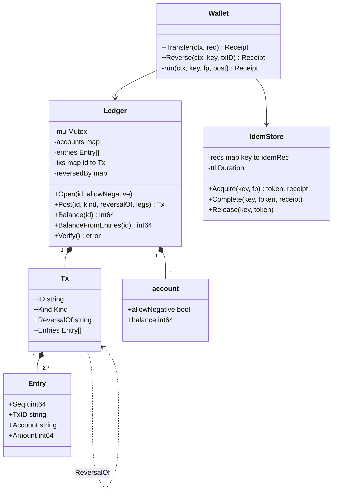
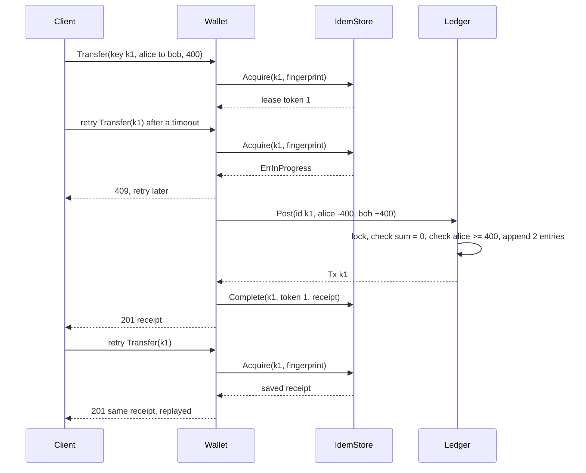
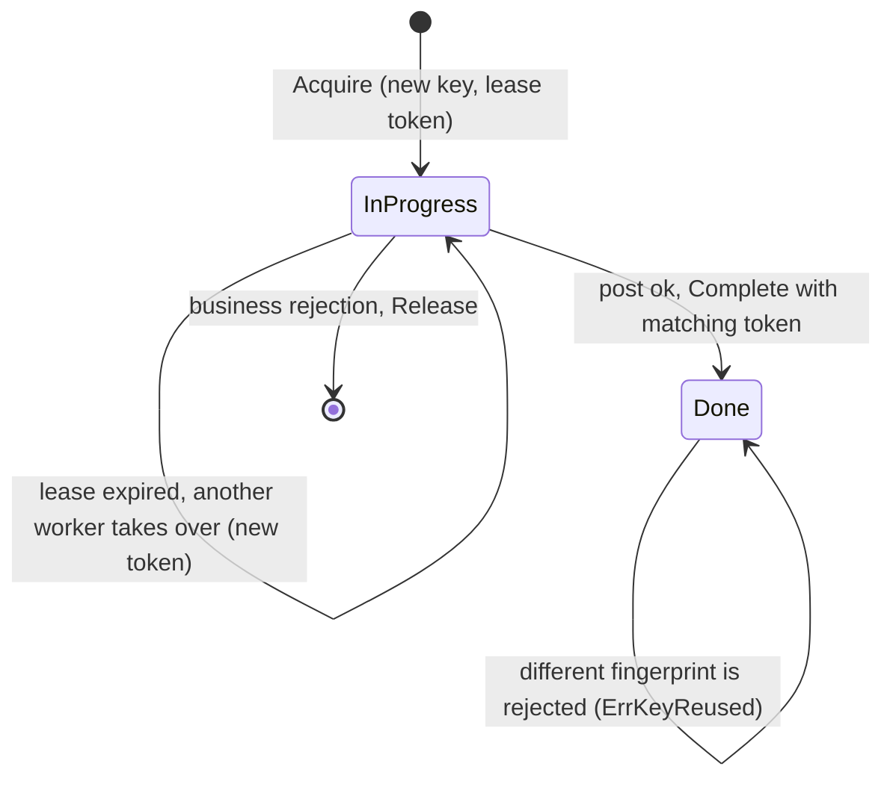

# Digital Wallet and Ledger

> [!summary] TL;DR
> A wallet is a set of accounts whose money moves only through **ledger transactions**: each transaction writes two or more immutable entries that sum to zero (double entry). The balance is the sum of an account's entries, kept as a cached number that a reconciliation job checks. Each transfer carries an idempotency key, guarded by a lease while it runs and by a unique transaction ID in the ledger, so a retry never moves money twice. The balance check and the append happen atomically, so concurrent transfers can never overdraw. Mistakes are fixed by posting a reversal, never by deleting or editing entries.

> [!abstract] Core idea
> - Money never appears or disappears: every transaction's entries sum to zero; top-ups come from a system account that may go negative.
> - Entries are append-only; the cached balance is a derived value that must equal the sum of entries.
> - "Check funds" and "write entries" are one atomic step (one lock in memory, a conditional `UPDATE` in Postgres).
> - Idempotency key: a lease while in progress, a saved receipt when done, and the key as the ledger transaction ID so even a stale worker cannot post twice.
> - A reversal is a new transaction with every leg negated and a link to the original.
> - Classic mistakes: `balance -= amount` without a check under concurrency, `float64` money, deleting a wrong entry, and an idempotency check that is not atomic with the write.

## Problem statement

```text
Design a digital wallet. Users can top up from a bank, pay another user, and see their balance
and statement. Every money movement must be auditable. Network retries must never charge twice.
Many payments for the same user can arrive at the same time; a balance must never go negative.
Support refunds of a past payment.
```

- It tests modelling money correctly (double entry, integer minor units, immutable entries), idempotency under retries and crashes, and the concurrency rule that the balance check and the debit are one atomic step. Time box: 10 minutes for Steps 1-4, 10 for Steps 5-7 (the SQL matters here), 30 for the code, 10 for edge cases.

### Solving path

1. Clarify currencies, overdraft, refunds and what a retry looks like.
2. Name the entities: `Account`, `Entry`, `Tx`, `Leg`, `Receipt`, `IdemStore`, `Ledger`, `Wallet`.
3. State the two invariants: entries of a transaction sum to zero; a user balance never goes below zero.
4. Write `Ledger.Post`: validate, check every account, then append all entries and update cached balances, under one lock.
5. Wrap it in `Wallet.Transfer` with the idempotency envelope (acquire lease, post with key as transaction ID, complete).
6. Add `Reverse`, then test replay, key reuse, lease expiry, crash after post, reversal rules, and 100 concurrent debits.

## Step 1: Clarify requirements

### Questions to ask (with assumed answers)

- One currency or many? *Assume: one currency (INR) in paise; multi-currency is a follow-up with one account per currency.*
- Can a user wallet go negative (overdraft)? *Assume: never. System accounts (bank settlement, fees) may.*
- How does a client retry safely? *Assume: the client sends an `Idempotency-Key` per logical payment and reuses it on every retry.*
- How is a refund done? *Assume: a full reversal of a past transaction, posted as a new transaction. Partial refunds are a follow-up.*
- Must the balance be read fast? *Assume: yes, O(1) cached balance, reconciled against entries by a job.*
- Holds (authorise now, capture later)? *Assume: follow-up in Step 10.*
- Fees? *Assume: out of scope for the code; a fee is just a third leg to a fee account.*

### Functional

- Open accounts (user or system).
- Transfer: move an amount between two accounts as one balanced transaction.
- Top-up: a transfer from the `bank-settlement` system account.
- Reverse: post the opposite of a past transaction; at most once per original.
- Balance and statement (entries for an account).
- Reconcile: verify that all entries sum to zero and each cached balance equals its entries.

### Non-functional

- Money is `int64` minor units (paise). No floats anywhere.
- Exactly-once effect per idempotency key, across retries, concurrent duplicates and a crashed worker.
- No user balance below zero under any interleaving.
- Entries are immutable; history is never rewritten.
- The clock is injected so leases and timestamps are testable.

### Out of scope

- Bank and card integration (the payment gateway side), KYC and limits.
- Currency conversion and interest.
- The system-level payment architecture: see [[Case Study - Payment System]].

## Step 2: Actors and use cases

| Actor | Use case |
|---|---|
| User | Top up, pay another user, view balance and statement, retry on timeout |
| Merchant | Receive payments, issue refunds |
| Support or ops | Reverse a wrong transaction |
| Reconciliation job | Check the ledger balances and match cached balances |
| Bank settlement (system account) | Source of top-ups, sink of withdrawals |

The hardest use case is **Transfer under retries and concurrency**: the same key arriving twice at once, a worker that dies after posting, and many different transfers draining one account. Code that first.

## Step 3: Entities

| Entity | Key fields | Why it exists |
|---|---|---|
| `account` | allowNegative, balance (cached) | Owner of money; system accounts may go negative so money can enter the system |
| `Leg` | Account, Amount (signed) | Input to a posting: negative debits, positive credits |
| `Entry` | Seq, TxID, Account, Amount, At | The immutable fact; the source of truth for balances |
| `Tx` | ID (= idempotency key), Kind, ReversalOf, Entries, At | One business event; entries sum to zero |
| `Receipt` | TxID, Kind, From, To, Amount, At, Replayed | API response; saved for replay |
| `idemRec` | fingerprint, done, receipt, leaseUntil, token | State of one idempotency key: in progress (leased) or done |
| `Ledger` | accounts, entries, txs, reversedBy, clock | Posts balanced transactions atomically |
| `IdemStore` | records by key, ttl, clock, token counter | Lease and replay for idempotency keys |
| `Wallet` | ledger, idem store | Facade: Transfer and Reverse with the idempotent envelope |

Sign convention: this note uses signed amounts from the account owner's view, `+` adds to the balance and `-` removes it. Accountants say debit and credit, and for a liability account like a user wallet a credit increases it; the signed form avoids that confusion in code while keeping the double-entry rule "sum of legs = 0".

## Step 4: Relationships



## Step 5: APIs and public methods

```text
POST /wallets/transfers      header: Idempotency-Key: <uuid>
                             body: {from, to, amount}           -> 201 {txId, from, to, amount, at}
                             retry with same key and body       -> 201 same body (+ Idempotent-Replayed: true)
POST /transactions/{id}/reversal  header: Idempotency-Key       -> 201 {txId, reversalOf, ...}
GET  /wallets/{id}/balance                                     -> 200 {balance}
GET  /wallets/{id}/entries?after=<seq>&limit=50                -> 200 [{seq, txId, amount, at}]

Errors: 400 invalid amount / same account / missing key, 404 unknown account or tx,
        409 key in progress, 422 key reused with a different body,
        409 insufficient funds, 409 already reversed
```

How the key states map to responses follows [[Idempotency and Idempotency Keys]]: a done key replays the saved receipt, an in-progress key returns 409 so the client retries later, and the same key with a different body is a client bug (422). The `Idempotent-Replayed` response header is this design's own choice, not a standard. The Go surface:

```go
type WalletService interface {
	Transfer(ctx context.Context, r TransferRequest) (Receipt, error)
	Reverse(ctx context.Context, key, txID string) (Receipt, error)
}

var _ WalletService = (*Wallet)(nil) // compile-time check
```

## Step 6: Storage and repositories

In production the ledger is in PostgreSQL 17, and the database enforces most invariants, not only the Go code: unique transaction IDs, at most one reversal, non-zero entries and no negative user balance. The rule that a transaction's entries sum to zero is not expressible as a plain `CHECK`; the posting code enforces it, and a deferred constraint trigger or the reconciliation query catches any violation.

```sql
CREATE TABLE accounts (
    id             TEXT PRIMARY KEY,
    allow_negative BOOLEAN NOT NULL DEFAULT false,
    balance        BIGINT  NOT NULL DEFAULT 0,          -- cached, paise
    CHECK (allow_negative OR balance >= 0)              -- last line of defence
);

CREATE TABLE transactions (
    id          TEXT PRIMARY KEY,                      -- = idempotency key: a second post fails
    kind        TEXT        NOT NULL,                  -- transfer | reversal
    reversal_of TEXT        UNIQUE REFERENCES transactions(id),  -- at most one reversal
    created_at  TIMESTAMPTZ NOT NULL DEFAULT now()
);

CREATE TABLE entries (
    seq        BIGINT GENERATED ALWAYS AS IDENTITY PRIMARY KEY,
    tx_id      TEXT   NOT NULL REFERENCES transactions(id),
    account_id TEXT   NOT NULL REFERENCES accounts(id),
    amount     BIGINT NOT NULL CHECK (amount <> 0),
    created_at TIMESTAMPTZ NOT NULL DEFAULT now()
);
CREATE INDEX entries_by_account ON entries (account_id, seq);
-- append-only: the app role gets INSERT and SELECT on entries, never UPDATE or DELETE
REVOKE UPDATE, DELETE ON entries FROM wallet_app;

CREATE TABLE idempotency_keys (
    key          TEXT PRIMARY KEY,
    fingerprint  TEXT        NOT NULL,
    status       TEXT        NOT NULL,                 -- in_progress | done
    lease_until  TIMESTAMPTZ NOT NULL,
    response     JSONB
);
```

One transfer is one database transaction:

```sql
-- $1 = idempotency key, $2 = from, $3 = to, $4 = amount in paise
BEGIN;
INSERT INTO transactions (id, kind) VALUES ($1, 'transfer');  -- duplicate key -> unique violation, roll back
-- debit with the funds check in the same statement: 0 rows means insufficient funds, so ROLLBACK
UPDATE accounts SET balance = balance - $4
WHERE id = $2 AND (allow_negative OR balance >= $4);
UPDATE accounts SET balance = balance + $4 WHERE id = $3;
INSERT INTO entries (tx_id, account_id, amount) VALUES ($1, $2, -$4), ($1, $3, $4);
COMMIT;
```

The conditional `UPDATE` takes a row lock on the `from` account, so two concurrent debits on the same account serialise: the second waits, then re-checks `balance >= $amount` against the committed value under READ COMMITTED. That is why the check and the debit must be in one statement, not a `SELECT` followed by an `UPDATE`. When a transfer touches two user accounts, lock them in a fixed order (for example by ID) to avoid deadlocks between A to B and B to A. The trade-offs of row locks versus version checks are in [[Locking - Optimistic vs Pessimistic]].

The reconciliation query. On a healthy ledger it returns no rows (representative output, PostgreSQL 17):

```sql
SELECT a.id, a.balance, COALESCE(SUM(e.amount), 0) AS from_entries
FROM accounts a LEFT JOIN entries e ON e.account_id = a.id
GROUP BY a.id, a.balance
HAVING a.balance <> COALESCE(SUM(e.amount), 0);
```

```text
 id | balance | from_entries
----+---------+--------------
(0 rows)
```

```go
type LedgerRepo interface {
	// Post runs the transaction above; ErrDuplicateTx on a unique violation of transactions.id.
	Post(ctx context.Context, id string, kind Kind, reversalOf string, legs []Leg) (Tx, error)
	Balance(ctx context.Context, account string) (int64, error)
	Entries(ctx context.Context, account string, afterSeq int64, limit int) ([]Entry, error)
}

type IdempotencyRepo interface {
	Acquire(ctx context.Context, key, fingerprint string, ttl time.Duration) (token uint64, saved *Receipt, err error)
	Complete(ctx context.Context, key string, token uint64, r Receipt) error
	Release(ctx context.Context, key string, token uint64) error
}
```

## Step 7: Patterns

| Pattern | Where | Why here |
|---|---|---|
| [[Facade (vs Mediator)]] | `Wallet` | Handlers call Transfer and Reverse; the lease, ledger and receipts are hidden |
| [[Repository and Unit of Work]] | `LedgerRepo`; one DB transaction per posting | All entries and balance updates commit together or not at all |
| [[Command, Undo and Memento]] | Reversal as a compensating command | "Undo" is a new command, never a delete, so history is kept |
| [[Decorator and Middleware]] | The idempotency envelope `run` | The same lease-post-complete wrapper serves Transfer and Reverse; in HTTP it is middleware |
| [[Observer and Event Bus]] | `wallet.transfer.posted` events (follow-up) | Notifications and analytics must not sit inside the money transaction; publish through [[Transactional Outbox and CDC]] |

Patterns not used, and why:

- No [[State Machines in Go]] for transactions in the code: a posted transaction is final. Holds (authorised, captured, voided) do need one; see Step 10.
- No per-account mutexes: one ledger mutex is simplest and correct. Per-account locks raise throughput but must be taken in sorted order (see [[Concurrency for LLD]]).

## Folder structure

```text
wallet/
  model.go        -> Kind, Leg, Entry, Tx, Receipt, TransferRequest, Err* errors
  ledger.go       -> Ledger: Open, Post, Balance, BalanceFromEntries, Tx, Verify
  idempotency.go  -> IdemStore: Acquire, Complete, Release
  wallet.go       -> Wallet: run (envelope), Transfer, Reverse
  wallet_test.go  -> table tests, replay, lease, crash, reversal, concurrency
```

The code below is printed as one file so it reads top to bottom.

## Step 8: Core code

> [!tip] What to code in a 60-minute round
> Aim for about 180 lines in the room.
> - **Write:** `Leg`, `Entry`, `Tx`, the `Ledger` with `Open`, `Post` (zero-sum check, funds check, then append) and `Balance`, and `Wallet.Transfer` with a simple key map that replays a saved receipt.
> - **Add if time remains:** the lease with expiry (`IdemStore`), `Reverse`, `Verify`, and the 100-goroutine overdraft test.
> - **Talk only:** the SQL schema and conditional `UPDATE`, lock ordering for per-account locks, holds, multi-currency and the outbox.

### Walkthrough

`Ledger.Post(id, kind, reversalOf, legs)` under one mutex:

1. If `id` was already posted, return the existing transaction with `ErrDuplicateTx`. This is the database unique key on `transactions.id`.
2. Validate: at least two legs, no zero legs, known accounts, legs sum to zero.
3. For a reversal: the original exists and has not been reversed.
4. Compute the net change per account and check every non-system account stays `>= 0`. **Nothing is written until every check passes**, so a posting is all or nothing.
5. Append entries with increasing sequence numbers, update cached balances, record the transaction.

`Wallet.run(ctx, key, fingerprint, post)`, the idempotent envelope:

1. `Acquire(key, fp)`: a new key gets a lease token; a done key returns the saved receipt (replay); a live lease returns `ErrInProgress`; a different fingerprint returns `ErrKeyReused`; an expired lease is taken over with a new token.
2. Call `post`, which uses the key as the ledger transaction ID. If it returns `ErrDuplicateTx`, an earlier holder posted and then died before saving the receipt, so adopt that transaction.
3. On a business rejection (insufficient funds), `Release` the key so the client may retry later with the same key. This is a policy choice; the alternative is to save the error as the final response.
4. `Complete(key, token, receipt)`. A token mismatch (`ErrLeaseLost`) means another worker took over; the ledger key already stopped a double post.

`Reverse(ctx, key, txID)`: read the original, negate every leg, post with `reversalOf = txID` through the same envelope.

### Worked example

Alice tops up 1000 paise, pays Bob 400, and the payment is reversed.

| Tx | Entries (account: amount) | Sum | alice | bob | bank-settlement |
|---|---|---|---|---|---|
| topup-1 | bank-settlement: -1000, alice: +1000 | 0 | 1000 | 0 | -1000 |
| k1 | alice: -400, bob: +400 | 0 | 600 | 400 | -1000 |
| rev-1 (reversal of k1) | bob: -400, alice: +400 | 0 | 1000 | 0 | -1000 |

All six entries stay in the ledger. The sum over every entry is 0, and each balance equals the sum of that account's entries. If Bob had spent 300 before the reversal, `rev-1` would fail with insufficient funds: a reversal follows the same no-negative rule (the product decides whether to allow a negative balance, recover the money, or absorb it).

```go
package wallet

import (
	"context"
	"errors"
	"fmt"
	"sync"
	"time"
)

var (
	ErrInvalidAmount     = errors.New("amount must be positive")
	ErrSameAccount       = errors.New("from and to must differ")
	ErrUnknownAccount    = errors.New("unknown account")
	ErrAccountExists     = errors.New("account already exists")
	ErrInsufficientFunds = errors.New("insufficient funds")
	ErrUnbalanced        = errors.New("entries must have at least two legs and sum to zero")
	ErrDuplicateTx       = errors.New("transaction id already posted")
	ErrTxNotFound        = errors.New("transaction not found")
	ErrAlreadyReversed   = errors.New("transaction already reversed")
	ErrEmptyKey          = errors.New("idempotency key required")
	ErrKeyReused         = errors.New("idempotency key reused with a different request")
	ErrInProgress        = errors.New("request with this key is in progress")
	ErrLeaseLost         = errors.New("idempotency lease lost")
)

// Kind labels a ledger transaction.
type Kind string

const (
	KindTransfer Kind = "transfer"
	KindReversal Kind = "reversal"
)

// Leg is one side of a posting: +Amount credits the account, -Amount debits it.
type Leg struct {
	Account string
	Amount  int64 // minor units (paise)
}

// Entry is an immutable ledger row. Entries are never updated or deleted.
type Entry struct {
	Seq     uint64
	TxID    string
	Account string
	Amount  int64
	At      time.Time
}

// Tx groups the entries of one business event; its entries sum to zero.
type Tx struct {
	ID         string
	Kind       Kind
	ReversalOf string
	Entries    []Entry
	At         time.Time
}

type account struct {
	allowNegative bool  // system accounts such as "bank-settlement"
	balance       int64 // cached; must always equal the sum of its entries
}

// Ledger is the double-entry book. One mutex makes "check balance" and
// "append entries" a single atomic step.
type Ledger struct {
	mu         sync.Mutex
	accounts   map[string]*account
	entries    []Entry
	txs        map[string]Tx
	reversedBy map[string]string
	now        func() time.Time
	seq        uint64
}

func NewLedger(now func() time.Time) *Ledger {
	return &Ledger{
		accounts:   map[string]*account{},
		txs:        map[string]Tx{},
		reversedBy: map[string]string{},
		now:        now,
	}
}

func (l *Ledger) Open(id string, allowNegative bool) error {
	l.mu.Lock()
	defer l.mu.Unlock()
	if _, ok := l.accounts[id]; ok {
		return ErrAccountExists
	}
	l.accounts[id] = &account{allowNegative: allowNegative}
	return nil
}

// Post appends one balanced transaction, all or nothing. A second Post with
// the same id returns the first transaction and ErrDuplicateTx.
func (l *Ledger) Post(id string, kind Kind, reversalOf string, legs []Leg) (Tx, error) {
	l.mu.Lock()
	defer l.mu.Unlock()
	if old, ok := l.txs[id]; ok {
		return old, ErrDuplicateTx
	}
	if len(legs) < 2 {
		return Tx{}, ErrUnbalanced
	}
	var sum int64
	net := map[string]int64{}
	for _, g := range legs {
		if g.Amount == 0 {
			return Tx{}, ErrInvalidAmount
		}
		if _, ok := l.accounts[g.Account]; !ok {
			return Tx{}, fmt.Errorf("%w: %s", ErrUnknownAccount, g.Account)
		}
		sum += g.Amount
		net[g.Account] += g.Amount
	}
	if sum != 0 {
		return Tx{}, ErrUnbalanced
	}
	if reversalOf != "" {
		if _, ok := l.txs[reversalOf]; !ok {
			return Tx{}, ErrTxNotFound
		}
		if _, done := l.reversedBy[reversalOf]; done {
			return Tx{}, ErrAlreadyReversed
		}
	}
	// check every account first, mutate nothing until all checks pass
	for id, d := range net {
		a := l.accounts[id]
		if !a.allowNegative && a.balance+d < 0 {
			return Tx{}, fmt.Errorf("%w: %s", ErrInsufficientFunds, id)
		}
	}
	at := l.now()
	tx := Tx{ID: id, Kind: kind, ReversalOf: reversalOf, At: at}
	for _, g := range legs {
		l.seq++
		e := Entry{Seq: l.seq, TxID: id, Account: g.Account, Amount: g.Amount, At: at}
		l.entries = append(l.entries, e)
		tx.Entries = append(tx.Entries, e)
		l.accounts[g.Account].balance += g.Amount
	}
	l.txs[id] = tx
	if reversalOf != "" {
		l.reversedBy[reversalOf] = id
	}
	return tx, nil
}

// Balance is the O(1) cached balance.
func (l *Ledger) Balance(id string) (int64, error) {
	l.mu.Lock()
	defer l.mu.Unlock()
	a, ok := l.accounts[id]
	if !ok {
		return 0, ErrUnknownAccount
	}
	return a.balance, nil
}

// BalanceFromEntries recomputes the balance from the source of truth.
func (l *Ledger) BalanceFromEntries(id string) int64 {
	l.mu.Lock()
	defer l.mu.Unlock()
	var s int64
	for _, e := range l.entries {
		if e.Account == id {
			s += e.Amount
		}
	}
	return s
}

func (l *Ledger) Tx(id string) (Tx, bool) {
	l.mu.Lock()
	defer l.mu.Unlock()
	tx, ok := l.txs[id]
	return tx, ok
}

// Verify is the reconciliation job: all entries sum to zero and every
// cached balance equals the sum of that account's entries.
func (l *Ledger) Verify() error {
	l.mu.Lock()
	defer l.mu.Unlock()
	var total int64
	per := map[string]int64{}
	for _, e := range l.entries {
		total += e.Amount
		per[e.Account] += e.Amount
	}
	if total != 0 {
		return fmt.Errorf("ledger does not balance: %d", total)
	}
	for id, a := range l.accounts {
		if a.balance != per[id] {
			return fmt.Errorf("account %s cached %d entries %d", id, a.balance, per[id])
		}
		if !a.allowNegative && a.balance < 0 {
			return fmt.Errorf("account %s negative: %d", id, a.balance)
		}
	}
	return nil
}

// Receipt is what the API returns and what the idempotency store replays.
type Receipt struct {
	TxID     string
	Kind     Kind
	From, To string
	Amount   int64
	At       time.Time
	Replayed bool
}

type idemRec struct {
	fingerprint string
	done        bool
	receipt     Receipt
	leaseUntil  time.Time
	token       uint64
}

// IdemStore maps an idempotency key to a lease (in progress) or a saved receipt (done).
type IdemStore struct {
	mu     sync.Mutex
	recs   map[string]*idemRec
	ttl    time.Duration
	now    func() time.Time
	tokens uint64
}

func NewIdemStore(ttl time.Duration, now func() time.Time) *IdemStore {
	return &IdemStore{recs: map[string]*idemRec{}, ttl: ttl, now: now}
}

// Acquire returns a lease token, or the saved receipt when the key is done.
func (s *IdemStore) Acquire(key, fingerprint string) (uint64, *Receipt, error) {
	s.mu.Lock()
	defer s.mu.Unlock()
	now := s.now()
	r, ok := s.recs[key]
	if ok {
		switch {
		case r.fingerprint != fingerprint:
			return 0, nil, ErrKeyReused
		case r.done:
			rc := r.receipt
			return 0, &rc, nil
		case now.Before(r.leaseUntil):
			return 0, nil, ErrInProgress
		}
		// lease expired: the old holder probably crashed, take over
	} else {
		r = &idemRec{fingerprint: fingerprint}
		s.recs[key] = r
	}
	s.tokens++
	r.token = s.tokens
	r.leaseUntil = now.Add(s.ttl)
	return r.token, nil, nil
}

// Complete saves the receipt, only if the caller still holds the lease.
func (s *IdemStore) Complete(key string, token uint64, rc Receipt) error {
	s.mu.Lock()
	defer s.mu.Unlock()
	r, ok := s.recs[key]
	if !ok || r.token != token || r.done {
		return ErrLeaseLost
	}
	r.done, r.receipt = true, rc
	return nil
}

// Release forgets the key so the client may retry (used after a business rejection).
func (s *IdemStore) Release(key string, token uint64) {
	s.mu.Lock()
	defer s.mu.Unlock()
	if r, ok := s.recs[key]; ok && r.token == token && !r.done {
		delete(s.recs, key)
	}
}

// TransferRequest moves Amount minor units from From to To.
type TransferRequest struct {
	Key      string // client-generated idempotency key; also the ledger tx id
	From, To string
	Amount   int64
}

// Wallet is the facade the API handlers call.
type Wallet struct {
	ledger *Ledger
	idem   *IdemStore
}

func NewWallet(l *Ledger, s *IdemStore) *Wallet { return &Wallet{ledger: l, idem: s} }

func receiptOf(tx Tx) Receipt {
	rc := Receipt{TxID: tx.ID, Kind: tx.Kind, At: tx.At}
	for _, e := range tx.Entries {
		if e.Amount < 0 {
			rc.From, rc.Amount = e.Account, -e.Amount
		} else {
			rc.To = e.Account
		}
	}
	return rc
}

// run is the idempotent envelope: lease, post once, save receipt.
func (w *Wallet) run(ctx context.Context, key, fp string, post func() (Tx, error)) (Receipt, error) {
	if err := ctx.Err(); err != nil {
		return Receipt{}, err
	}
	if key == "" {
		return Receipt{}, ErrEmptyKey
	}
	token, saved, err := w.idem.Acquire(key, fp)
	if err != nil {
		return Receipt{}, err
	}
	if saved != nil {
		saved.Replayed = true
		return *saved, nil
	}
	tx, err := post()
	if errors.Is(err, ErrDuplicateTx) {
		err = nil // an earlier holder posted, then died before Complete
	}
	if err != nil {
		w.idem.Release(key, token)
		return Receipt{}, err
	}
	rc := receiptOf(tx)
	if err := w.idem.Complete(key, token, rc); err != nil {
		return Receipt{}, err
	}
	return rc, nil
}

func (w *Wallet) Transfer(ctx context.Context, r TransferRequest) (Receipt, error) {
	if r.Amount <= 0 {
		return Receipt{}, ErrInvalidAmount
	}
	if r.From == r.To {
		return Receipt{}, ErrSameAccount
	}
	fp := fmt.Sprintf("transfer|%s|%s|%d", r.From, r.To, r.Amount)
	return w.run(ctx, r.Key, fp, func() (Tx, error) {
		return w.ledger.Post(r.Key, KindTransfer, "", []Leg{
			{Account: r.From, Amount: -r.Amount},
			{Account: r.To, Amount: r.Amount},
		})
	})
}

// Reverse posts a new transaction with every leg negated. The original stays.
func (w *Wallet) Reverse(ctx context.Context, key, txID string) (Receipt, error) {
	orig, ok := w.ledger.Tx(txID)
	if !ok {
		return Receipt{}, ErrTxNotFound
	}
	legs := make([]Leg, 0, len(orig.Entries))
	for _, e := range orig.Entries {
		legs = append(legs, Leg{Account: e.Account, Amount: -e.Amount})
	}
	return w.run(ctx, key, "reverse|"+txID, func() (Tx, error) {
		return w.ledger.Post(key, KindReversal, txID, legs)
	})
}

// WalletService is what the HTTP handlers call.
type WalletService interface {
	Transfer(ctx context.Context, r TransferRequest) (Receipt, error)
	Reverse(ctx context.Context, key, txID string) (Receipt, error)
}

var _ WalletService = (*Wallet)(nil) // compile-time check
```

## Test cases

`newEnv` opens alice, bob and the `bank-settlement` system account, and tops alice up with 1000 paise. The clock is a pointer that tests move forward to expire leases. `bal` asserts on every read that the cached balance equals the balance from entries.

```go
package wallet

import (
	"context"
	"errors"
	"fmt"
	"sync"
	"sync/atomic"
	"testing"
	"time"
)

const bank = "bank-settlement" // system account, may go negative

type env struct {
	now    *time.Time
	ledger *Ledger
	idem   *IdemStore
	w      *Wallet
}

// newEnv opens alice and bob and tops alice up with 1000 paise.
func newEnv(t *testing.T) env {
	t.Helper()
	now := time.Unix(1_700_000_000, 0)
	clock := func() time.Time { return now }
	l := NewLedger(clock)
	s := NewIdemStore(30*time.Second, clock)
	e := env{now: &now, ledger: l, idem: s, w: NewWallet(l, s)}
	for _, id := range []string{"alice", "bob"} {
		if err := l.Open(id, false); err != nil {
			t.Fatal(err)
		}
	}
	if err := l.Open(bank, true); err != nil {
		t.Fatal(err)
	}
	if _, err := e.w.Transfer(context.Background(), TransferRequest{"topup-1", bank, "alice", 1000}); err != nil {
		t.Fatal(err)
	}
	return e
}

func bal(t *testing.T, l *Ledger, id string) int64 {
	t.Helper()
	b, err := l.Balance(id)
	if err != nil {
		t.Fatal(err)
	}
	if b != l.BalanceFromEntries(id) {
		t.Fatalf("%s cached %d != entries %d", id, b, l.BalanceFromEntries(id))
	}
	return b
}

func TestTransfer(t *testing.T) {
	tests := []struct {
		name       string
		req        TransferRequest
		wantErr    error
		alice, bob int64
	}{
		{"moves money", TransferRequest{"k1", "alice", "bob", 300}, nil, 700, 300},
		{"exact balance", TransferRequest{"k1", "alice", "bob", 1000}, nil, 0, 1000},
		{"insufficient", TransferRequest{"k1", "alice", "bob", 1001}, ErrInsufficientFunds, 1000, 0},
		{"zero amount", TransferRequest{"k1", "alice", "bob", 0}, ErrInvalidAmount, 1000, 0},
		{"negative amount", TransferRequest{"k1", "alice", "bob", -5}, ErrInvalidAmount, 1000, 0},
		{"same account", TransferRequest{"k1", "alice", "alice", 5}, ErrSameAccount, 1000, 0},
		{"unknown account", TransferRequest{"k1", "alice", "carol", 5}, ErrUnknownAccount, 1000, 0},
		{"missing key", TransferRequest{"", "alice", "bob", 5}, ErrEmptyKey, 1000, 0},
	}
	for _, tc := range tests {
		t.Run(tc.name, func(t *testing.T) {
			e := newEnv(t)
			rc, err := e.w.Transfer(context.Background(), tc.req)
			if !errors.Is(err, tc.wantErr) {
				t.Fatalf("err %v want %v", err, tc.wantErr)
			}
			if a, b := bal(t, e.ledger, "alice"), bal(t, e.ledger, "bob"); a != tc.alice || b != tc.bob {
				t.Fatalf("alice %d bob %d", a, b)
			}
			if err == nil && (rc.From != "alice" || rc.To != "bob" || rc.Amount != tc.req.Amount) {
				t.Fatalf("receipt %+v", rc)
			}
			if err := e.ledger.Verify(); err != nil {
				t.Fatal(err)
			}
		})
	}
}

func TestIdempotentReplayAndKeyReuse(t *testing.T) {
	e := newEnv(t)
	ctx := context.Background()
	req := TransferRequest{"k1", "alice", "bob", 100}
	first, err := e.w.Transfer(ctx, req)
	if err != nil || first.Replayed {
		t.Fatal(first, err)
	}
	again, err := e.w.Transfer(ctx, req)
	if err != nil || !again.Replayed || again.TxID != first.TxID {
		t.Fatalf("retry must replay: %+v %v", again, err)
	}
	if bal(t, e.ledger, "alice") != 900 {
		t.Fatal("retry moved money twice")
	}
	if _, err := e.w.Transfer(ctx, TransferRequest{"k1", "alice", "bob", 999}); !errors.Is(err, ErrKeyReused) {
		t.Fatalf("key reuse: %v", err)
	}
}

func TestRejectedTransferReleasesKey(t *testing.T) {
	e := newEnv(t)
	ctx := context.Background()
	req := TransferRequest{"k1", "alice", "bob", 1500}
	if _, err := e.w.Transfer(ctx, req); !errors.Is(err, ErrInsufficientFunds) {
		t.Fatal(err)
	}
	e.w.Transfer(ctx, TransferRequest{"topup-2", bank, "alice", 500})
	if _, err := e.w.Transfer(ctx, req); err != nil {
		t.Fatalf("retry after top-up should succeed: %v", err)
	}
	if bal(t, e.ledger, "bob") != 1500 {
		t.Fatal("bob")
	}
}

func TestLeaseInProgressExpiryAndStaleHolder(t *testing.T) {
	e := newEnv(t)
	ctx := context.Background()
	req := TransferRequest{"k1", "alice", "bob", 100}
	fp := "transfer|alice|bob|100"

	// worker A takes the lease and stalls (GC pause, network hang)
	tokA, _, err := e.idem.Acquire("k1", fp)
	if err != nil {
		t.Fatal(err)
	}
	if _, err := e.w.Transfer(ctx, req); !errors.Is(err, ErrInProgress) {
		t.Fatalf("concurrent retry: %v", err)
	}
	*e.now = e.now.Add(31 * time.Second) // lease expires
	rc, err := e.w.Transfer(ctx, req)    // worker B takes over and finishes
	if err != nil {
		t.Fatal(err)
	}
	// worker A wakes up and posts: the ledger tx id (= key) stops a double debit
	if _, err := e.ledger.Post("k1", KindTransfer, "", []Leg{{"alice", -100}, {"bob", 100}}); !errors.Is(err, ErrDuplicateTx) {
		t.Fatalf("stale post: %v", err)
	}
	if err := e.idem.Complete("k1", tokA, rc); !errors.Is(err, ErrLeaseLost) {
		t.Fatalf("stale complete: %v", err)
	}
	if bal(t, e.ledger, "alice") != 900 {
		t.Fatal("double debit")
	}
}

func TestCrashAfterPostBeforeComplete(t *testing.T) {
	e := newEnv(t)
	// worker A leased and posted, then crashed before saving the receipt
	if _, _, err := e.idem.Acquire("k1", "transfer|alice|bob|100"); err != nil {
		t.Fatal(err)
	}
	if _, err := e.ledger.Post("k1", KindTransfer, "", []Leg{{"alice", -100}, {"bob", 100}}); err != nil {
		t.Fatal(err)
	}
	*e.now = e.now.Add(time.Minute)
	rc, err := e.w.Transfer(context.Background(), TransferRequest{"k1", "alice", "bob", 100})
	if err != nil || rc.TxID != "k1" || bal(t, e.ledger, "alice") != 900 {
		t.Fatalf("retry must adopt the posted tx: %+v %v", rc, err)
	}
}

func TestReverse(t *testing.T) {
	e := newEnv(t)
	ctx := context.Background()
	if _, err := e.w.Transfer(ctx, TransferRequest{"k1", "alice", "bob", 400}); err != nil {
		t.Fatal(err)
	}
	rc, err := e.w.Reverse(ctx, "rev-1", "k1")
	if err != nil || rc.From != "bob" || rc.To != "alice" || rc.Amount != 400 || rc.Kind != KindReversal {
		t.Fatalf("reverse: %+v %v", rc, err)
	}
	if bal(t, e.ledger, "alice") != 1000 || bal(t, e.ledger, "bob") != 0 {
		t.Fatal("balances not restored")
	}
	if _, ok := e.ledger.Tx("k1"); !ok {
		t.Fatal("original must stay in the ledger")
	}
	if _, err := e.w.Reverse(ctx, "rev-2", "k1"); !errors.Is(err, ErrAlreadyReversed) {
		t.Fatalf("second reversal: %v", err)
	}
	if again, err := e.w.Reverse(ctx, "rev-1", "k1"); err != nil || !again.Replayed {
		t.Fatalf("reversal retry must replay: %+v %v", again, err)
	}
	if _, err := e.w.Reverse(ctx, "rev-3", "nope"); !errors.Is(err, ErrTxNotFound) {
		t.Fatal(err)
	}
	if err := e.ledger.Verify(); err != nil {
		t.Fatal(err)
	}
}

func TestReverseAfterReceiverSpent(t *testing.T) {
	e := newEnv(t)
	ctx := context.Background()
	e.w.Transfer(ctx, TransferRequest{"k1", "alice", "bob", 400})
	e.ledger.Open("shop", false)
	e.w.Transfer(ctx, TransferRequest{"k2", "bob", "shop", 300})
	if _, err := e.w.Reverse(ctx, "rev-1", "k1"); !errors.Is(err, ErrInsufficientFunds) {
		t.Fatalf("reversal must not push bob negative: %v", err)
	}
}

func TestPostRejectsUnbalanced(t *testing.T) {
	e := newEnv(t)
	if _, err := e.ledger.Post("x", KindTransfer, "", []Leg{{"alice", -100}, {"bob", 90}}); !errors.Is(err, ErrUnbalanced) {
		t.Fatal(err)
	}
	if _, err := e.ledger.Post("y", KindTransfer, "", []Leg{{"alice", -100}}); !errors.Is(err, ErrUnbalanced) {
		t.Fatal(err)
	}
}

func TestConcurrentTransfersNeverOverdraw(t *testing.T) {
	e := newEnv(t) // alice has 1000
	var ok, broke atomic.Int64
	var wg sync.WaitGroup
	for i := 0; i < 100; i++ {
		wg.Add(1)
		go func(i int) {
			defer wg.Done()
			_, err := e.w.Transfer(context.Background(), TransferRequest{fmt.Sprint("k", i), "alice", "bob", 30})
			switch {
			case err == nil:
				ok.Add(1)
			case errors.Is(err, ErrInsufficientFunds):
				broke.Add(1)
			default:
				t.Error(err)
			}
		}(i)
	}
	wg.Wait()
	if ok.Load() != 33 || broke.Load() != 67 {
		t.Fatalf("ok %d broke %d", ok.Load(), broke.Load())
	}
	if bal(t, e.ledger, "alice") != 10 || bal(t, e.ledger, "bob") != 990 {
		t.Fatal("balances")
	}
	if err := e.ledger.Verify(); err != nil {
		t.Fatal(err)
	}
}

func TestConcurrentSameKeyPostsOnce(t *testing.T) {
	e := newEnv(t)
	req := TransferRequest{"dup", "alice", "bob", 100}
	var fresh, replay, busy atomic.Int64
	var wg sync.WaitGroup
	for i := 0; i < 50; i++ {
		wg.Add(1)
		go func() {
			defer wg.Done()
			rc, err := e.w.Transfer(context.Background(), req)
			switch {
			case errors.Is(err, ErrInProgress):
				busy.Add(1)
			case err != nil:
				t.Error(err)
			case rc.Replayed:
				replay.Add(1)
			default:
				fresh.Add(1)
			}
		}()
	}
	wg.Wait()
	if fresh.Load() != 1 || fresh.Load()+replay.Load()+busy.Load() != 50 {
		t.Fatalf("fresh %d replay %d busy %d", fresh.Load(), replay.Load(), busy.Load())
	}
	if bal(t, e.ledger, "alice") != 900 {
		t.Fatal("posted more than once")
	}
}
```

What the tests prove:

- **Double entry:** `Verify` after every table case; unbalanced and one-legged postings are rejected.
- **Idempotency:** a retry replays the same transaction ID and does not move money again; the same key with a different amount is `ErrKeyReused`.
- **Leases:** a duplicate during a live lease gets `ErrInProgress`; after expiry a new worker finishes; the stale worker's post fails with `ErrDuplicateTx` and its `Complete` with `ErrLeaseLost`.
- **Crash after post:** the retry adopts the already-posted transaction instead of failing or posting again.
- **Reversals:** the original stays, balances are restored, a second reversal is rejected, a reversal retry replays, and a reversal cannot push the receiver negative.
- **Concurrency under `-race`:** 100 goroutines each send 30 from an account holding 1000; exactly 33 succeed, 67 get insufficient funds, and the balance ends at 10, never negative. 50 goroutines with the same key post exactly once.

## Step 9: Edge cases

| Edge case | What happens | How the design handles it |
|---|---|---|
| Client times out and retries | Could debit twice | Same key: replay the saved receipt |
| Two copies of the same request at once | Both could post | The first holds the lease; the second gets `ErrInProgress` (409); the ledger key is the backstop |
| Worker crashes after posting, before saving the receipt | Key looks in progress forever | Lease expires; the next worker hits `ErrDuplicateTx` and adopts the posted transaction |
| Stale worker wakes up after its lease expired | Could post a second time | Ledger transaction ID = key: `ErrDuplicateTx`; `Complete` returns `ErrLeaseLost` |
| Same key, different amount | Ambiguous intent | Fingerprint mismatch: `ErrKeyReused` (422) |
| Many debits on one account at once | Check-then-act overdraft | Check and append under one lock; in SQL the conditional `UPDATE ... AND balance >= $amount` |
| Insufficient funds | Rejected | No entries written; key released so a retry after top-up can succeed |
| Zero, negative or same-account transfer | Invalid | Validated before the envelope |
| Wrong payment needs undoing | Temptation to delete | `Reverse` posts negated legs and links `ReversalOf`; at most once |
| Receiver already spent the money | Reversal would go negative | Rejected with insufficient funds; product policy decides recovery |
| Cached balance drifts from entries (a bug, a manual fix) | Wrong balance shown | `Verify` and the reconciliation query flag it; entries win |
| Overflow of `int64` | 9.2 x 10^18 paise is far above any wallet | Not a practical risk; per-transaction limits cap amounts anyway |

### Common mistakes

- `SELECT balance` then `UPDATE balance = balance - x` in two statements without a lock (lost update and overdraft).
- Storing only a balance column with no entries, so there is no audit trail and no way to reconcile.
- Deleting or editing an entry to fix a mistake.
- Checking the idempotency key and writing the record in two non-atomic steps.
- Saving the receipt before the ledger write commits.
- Using `float64` for money.

## Step 10: Tradeoffs and extensions

| Follow-up | Design change |
|---|---|
| Holds (authorise then capture) | A hold account per user: authorise moves money user -> hold; capture moves hold -> merchant; void moves it back. Each step is a balanced transaction with its own key |
| Partial refund | A new transfer merchant -> user with `ReversalOf` pointing at the original, plus a check that total refunds do not exceed the original amount |
| Fees | A third leg to a `fees` system account: user -400, merchant +390, fees +10 |
| Multi-currency | One account per (user, currency); a conversion is four legs through an FX system account |
| Higher throughput | Per-account locks in sorted order, or shard accounts; hot system accounts get several sub-accounts summed on read |
| Statement API | Keyset pagination on `(account_id, seq)` |
| Notifications and analytics | Write an outbox row in the same DB transaction ([[Transactional Outbox and CDC]]) |
| Cross-service money movement | A saga with compensations ([[Saga Pattern]]); at system scale see [[Case Study - Payment System]] |

Tradeoffs chosen:

- **Cached balance plus entries.** Summing entries on every read is always correct but O(entries); the cached column is O(1) but can drift if any path updates it outside the posting. Keep both, update both in one transaction, and reconcile. Some ledgers instead store a running balance on each entry, which makes "balance at time T" cheap.
- **One ledger mutex.** Simple and correct; throughput is limited to one posting at a time per process. In SQL the row locks on the touched accounts give per-account parallelism for free.
- **Release the key on a business rejection.** Lets a user retry the same payment after topping up. The alternative, saving the 409 as the final answer, is stricter: the client must use a new key. Both are valid; state which one you choose.
- **Lease TTL.** Too short and a slow but alive worker loses its lease (safe here, because the ledger key blocks a second post, but the response is lost); too long and a crashed request blocks retries. 30 seconds in the tests is an example value, not a recommendation.

## Drawing

A transfer with a retry that arrives while the first attempt is still running:



The life of an idempotency key:



## Interview questions

> [!question]- Why double entry instead of just a balance column?
> A balance column only says where you are, not how you got there. Entries that sum to zero per transaction make every paisa traceable: money moves between accounts, it is never created by an `UPDATE`. They also let you detect bugs, because the cached balance must equal the sum of entries and the ledger must sum to zero.

> [!question]- Trap: "I check the balance with SELECT, and if it is enough I run UPDATE balance = balance - x." What is wrong?
> Two concurrent requests both read 1000, both pass the check, both subtract 600, and the balance ends at -200. The check and the write must be one atomic step: `UPDATE ... SET balance = balance - x WHERE id = $1 AND balance >= x` and treat 0 rows as insufficient funds, or `SELECT ... FOR UPDATE` first. A `CHECK (balance >= 0)` constraint is the backstop.

> [!question]- Why does the idempotency key need a lease, and why is the lease not enough on its own?
> Without a lease, a crashed request would block its key forever, or two copies could both start. The lease makes duplicates wait (409) and lets a retry take over after expiry. But a stale worker can wake up after its lease expired and still post, so the key is also the ledger transaction ID with a unique constraint; that is the fencing that makes the effect exactly once.

> [!question]- A worker posts the transfer and crashes before saving the response. What does the retry see?
> The lease expires, the retry acquires a new token, and its post fails with a duplicate transaction ID. The wallet treats that as "already done", builds the receipt from the existing transaction and saves it. The client gets success, and money moved once.

> [!question]- How do you undo a wrong payment?
> Post a reversal: a new transaction with every leg negated, linked to the original, allowed at most once (a unique `reversal_of`). Never delete or edit entries; auditors and reconciliation need the full history. If the receiver already spent the money, the reversal fails the no-negative rule, and the business decides how to recover it.

> [!question]- Cached balance or sum of entries: which is the truth, and how do you keep them in sync?
> Entries are the truth; the cached balance is a derived value for O(1) reads. Both are written in the same database transaction by the only code path that posts, and a reconciliation job compares them. If they differ, you fix the cache from the entries and investigate the bug.

> [!question]- How do you avoid deadlocks when transfers lock two user accounts?
> Lock the accounts in a fixed global order, for example by account ID, regardless of transfer direction. Then A to B and B to A both lock A first, so neither can hold one lock while waiting for the other.

## Interview explanation

```text
I model money as a double-entry ledger: a transaction is two or more immutable entries that sum to zero, and a top-up comes from a system account that is allowed to go negative. Amounts are int64 paise. Posting checks every account's resulting balance and only then appends entries and updates cached balances, all under one lock, or in Postgres in one transaction with a conditional UPDATE that only debits if the balance is enough. Each request has an idempotency key: a lease while it runs, a saved receipt when done, and the key is also the ledger transaction ID with a unique constraint, so a stale or crashed worker can never post twice. Refunds are reversals, new transactions with negated legs linked to the original, never deletes. A reconciliation job checks that cached balances equal the sum of entries.
```

## Cheat sheet

- Every transaction: >= 2 legs, sum = 0. System accounts may go negative; user accounts never.
- Entries are append-only; balance = sum of entries; cached balance is reconciled.
- Check funds and append in one atomic step: mutex in memory, `UPDATE ... WHERE balance >= x` in SQL, plus `CHECK (balance >= 0)`.
- Idempotency: fingerprint + lease (409 while running) + saved receipt (replay) + key as unique transaction ID (fencing).
- Business rejection: release the key (or save the error; pick one and say it).
- Reversal = new negated transaction, unique `reversal_of`, same no-negative rule.
- Lock two accounts in ID order; `int64` paise; injected clock.

## Links

- **Before this:** [[LLD Interview Method]], [[Concurrency for LLD]], [[Idempotency and Idempotency Keys]]
- **Next:** [[LLD Problem Cheat Sheet]]
- **Compare with:** [[Case Study - Payment System]] (the system-level design), [[Locking - Optimistic vs Pessimistic]] (the database locking side), [[Splitwise Expense Sharing]] (balances without real money movement), [[Order Book Matching Engine]]
