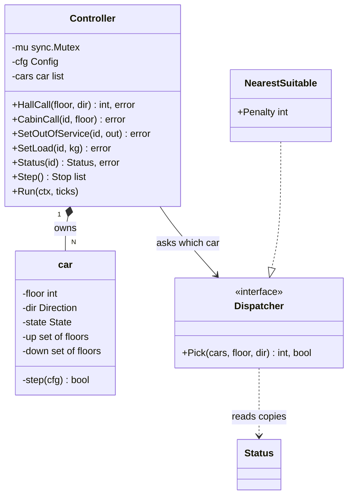
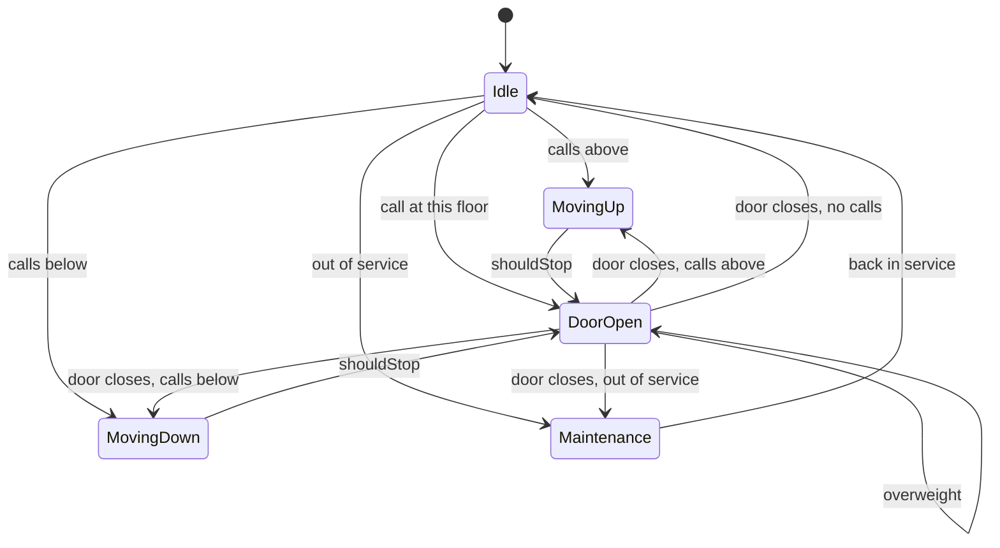
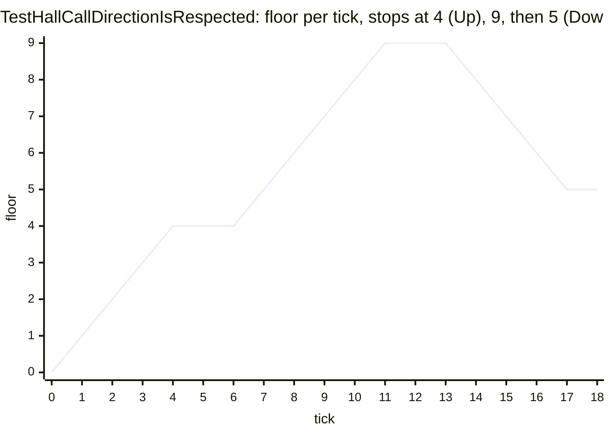

# Elevator System

> [!summary] TL;DR
> A controller owns N elevator cars. Hall buttons (floor plus up or down) go through a dispatcher that picks a car; cabin buttons go straight to their car. Each car keeps two stop sets, one for calls served going up and one going down, and serves them in LOOK order: keep going while calls remain ahead, then turn. A tick-based `Step()` makes the whole simulation deterministic to test.

## Problem statement

```text
Design the controller for N elevator cars in one building (floors MinFloor..MaxFloor).
Hall buttons send (floor, Up|Down); the controller assigns a car. Cabin buttons send
(car, floor). Cars must not pick up a "down" passenger while travelling up. Support
capacity (overweight), out-of-service cars and fire recall. Button presses arrive
concurrently with the controller loop.
```

## Step 1: Clarify requirements

- **Scale:** how many cars and floors, any basements? *Assume one group of N cars (say 2 to 8) in one building, floors `MinFloor..MaxFloor`, which may start below 0.*
- **Reassignment:** may a hall call move to a better car later? *Start with assign-once; reassignment is a Step 10 follow-up.*
- **Hall vs cabin calls:** a hall call carries a direction and needs dispatch; a cabin call belongs to one car. The top floor has no Up button and the bottom no Down.
- **Capacity:** a load sensor reports kg; over capacity the door stays open.
- **Special modes:** out of service (finish calls, then park in Maintenance) is coded; fire recall is designed in Step 9.
- **Simulation or hardware?** *A tick simulation; a ticker goroutine drives it in production.*

**Non-functional:** thread-safe under concurrent presses; bad input returns a typed error and never panics; the dispatch rule is swappable; tests never sleep.

## Step 2: Actors and use cases

A **passenger at a floor** presses Up or Down (hall call). A **passenger in a car** presses a floor (cabin call) or overloads the car. An **operator** takes a car out of service; a **fire panel** starts recall. The **tick loop** (one goroutine) advances every car and reports door openings. **Displays and tests** read `Status`. The hardest use case: a hall call while the chosen car is already moving.

## Step 3: Entities

| Entity | Fields | Why |
|---|---|---|
| `Controller` | mu, cfg, cars | The single entry point and the lock owner |
| `car` (unexported) | floor, dir, state, doorLeft, up, down, loadKg, outOfService | One elevator; all its fields change only under `Controller.mu` |
| `up`, `down` sets | `map[int]bool` | Direction-aware stops; a set makes duplicate presses free |
| `State` | Idle, MovingUp, MovingDown, DoorOpen, Maintenance | The lifecycle (diagram in Step 8) |
| `Dispatcher` | `Pick(cars []Status, floor, dir)` | The swappable "which car?" rule; it reads `Status` copies, so a strategy cannot corrupt a car |
| `Status`, `Stop` | read-only copies | Dispatchers and displays never touch live cars |

## Step 4: Relationships



## Step 5: APIs and public methods

`HallCall(floor, dir) (car, error)`, `CabinCall(car, floor) error`, `SetOutOfService`, `SetLoad`, `Status(car) (Status, error)`, `Step() []Stop`, `Run(ctx, ticks)`. Errors: `ErrInvalidFloor`, `ErrInvalidDirection`, `ErrUnknownCar`, `ErrOutOfService`, `ErrNoCar`, `ErrInvalidConfig`. Exposed to building panels over a network, the same methods map to:

```text
POST /buildings/{id}/hall-calls               body {floor, direction}  -> 202 {car}
POST /buildings/{id}/cars/{car}/cabin-calls   body {floor}             -> 202
GET  /buildings/{id}/cars                                              -> 200 [{id, floor, dir, state}]
```

## Step 6: Storage and repositories

None: car state changes every tick and lives in memory. A trip log for tuning dispatch could be appended to an analytics store asynchronously.

## Step 7: Patterns

| Pattern | Where |
|---|---|
| [[State Machines in Go]] | An enum plus one `switch` in `car.step`. Not the GoF State pattern with a type per state: five states with simple transitions read better in one place |
| [[Strategy and Template Method]] | `Dispatcher`: `NearestSuitable` here; least loaded, ETA and zoning in Step 10 |
| [[Facade (vs Mediator)]] | `Controller` is the one entry point for buttons, panels and the tick loop |
| [[Observer and Event Bus]] | Extension: publish `Stop` events to floor displays |
| [[Command, Undo and Memento]] | Extension: in the event-loop design, each press becomes a request object sent on a channel to the goroutine that owns the cars |

## Step 8: Core code

LOOK lives in `nextDir` and `shouldStop`. A common bug is to set Idle whenever the door closes, even with calls left; `settle` avoids it by choosing the next state from the remaining calls.



```go
// File: elevator.go
package elevator

import "errors"

var (
	ErrInvalidConfig    = errors.New("elevator: invalid config")
	ErrInvalidFloor     = errors.New("elevator: floor out of range")
	ErrInvalidDirection = errors.New("elevator: no such hall button")
	ErrUnknownCar       = errors.New("elevator: unknown car")
	ErrOutOfService     = errors.New("elevator: car is out of service")
	ErrNoCar            = errors.New("elevator: no car in service")
)

type Direction int

const (
	Down Direction = -1
	None Direction = 0
	Up   Direction = 1
)

type State int

const (
	Idle State = iota
	MovingUp
	MovingDown
	DoorOpen
	Maintenance
)

// Status is a read-only copy of one car, for dispatchers, displays and tests.
type Status struct {
	ID, Floor int
	Dir       Direction // committed travel direction; None while idle, including just after a call is added
	State     State
	Stops     int // pending calls in both stop sets
	InService bool
}

// Stop reports that a car opened its door at a floor during a tick.
type Stop struct{ Car, Floor int }

// car is one elevator. Controller.mu guards every field.
type car struct {
	id, floor    int
	dir          Direction
	state        State
	doorLeft     int          // ticks until the open door closes
	up, down     map[int]bool // calls to serve while travelling up / down
	loadKg       int
	outOfService bool // finish the remaining calls, then park in Maintenance
}

// addStop records a call. dir is the hall button's direction, or None for a
// cabin button, which goes into the set for the side of the car it is on.
func (c *car) addStop(floor int, dir Direction, doorTicks int) {
	if floor == c.floor && c.state == DoorOpen && (dir == None || dir == c.dir || c.dir == None) {
		c.doorLeft = doorTicks // already open here: hold the door instead
		return
	}
	if dir == None {
		switch {
		case floor > c.floor:
			dir = Up
		case floor < c.floor:
			dir = Down
		case c.dir != None:
			dir = c.dir
		default:
			dir = Up
		}
	}
	if dir == Up {
		c.up[floor] = true // a set: pressing twice is still one stop
	} else {
		c.down[floor] = true
	}
}

// step advances the car by one tick and reports whether its door opened.
func (c *car) step(cfg Config) bool {
	switch {
	case c.state == Maintenance:
		return false
	case c.state == DoorOpen:
		if c.loadKg > cfg.CapacityKg {
			return false // overweight: the door stays open until someone steps out
		}
		c.doorLeft--
		if c.doorLeft <= 0 {
			c.settle() // the door closes; the state follows the remaining work
		}
		return false
	case c.shouldStop():
		c.serve()
		c.state, c.doorLeft = DoorOpen, cfg.DoorTicks
		return true
	}
	if c.settle(); c.dir != None {
		c.floor += int(c.dir)
	}
	return false
}

// settle chooses the direction and state of a car whose door is closed.
func (c *car) settle() {
	c.dir = c.nextDir()
	switch {
	case c.dir == Up:
		c.state = MovingUp
	case c.dir == Down:
		c.state = MovingDown
	case c.outOfService:
		c.state = Maintenance
	default:
		c.state = Idle
	}
}

// nextDir is LOOK: keep going while calls remain ahead, else turn toward the
// remaining calls, else stop. An idle car with calls on both sides goes up.
func (c *car) nextDir() Direction {
	if c.dir != None && c.hasCallsBeyond(c.dir) {
		return c.dir
	}
	for _, d := range []Direction{Up, Down} {
		if c.hasCallsBeyond(d) {
			return d
		}
	}
	return None
}

// hasCallsBeyond reports whether any call lies strictly past this floor in direction d.
func (c *car) hasCallsBeyond(d Direction) bool {
	for _, set := range []map[int]bool{c.up, c.down} {
		for f := range set {
			if (f-c.floor)*int(d) > 0 {
				return true
			}
		}
	}
	return false
}

// shouldStop serves calls in the travel direction. A call for the other
// direction is served only at the turn-around floor, when nothing lies beyond it.
func (c *car) shouldStop() bool {
	f := c.floor
	switch c.dir {
	case Up:
		return c.up[f] || (c.down[f] && !c.hasCallsBeyond(Up))
	case Down:
		return c.down[f] || (c.up[f] && !c.hasCallsBeyond(Down))
	}
	return c.up[f] || c.down[f]
}

// serve clears the calls answered at this floor. At a turn-around floor the
// car flips direction, so the waiting passenger travels the way they asked.
func (c *car) serve() {
	f := c.floor
	if (c.dir == Up && !c.up[f]) || (c.dir == Down && !c.down[f]) {
		c.dir = -c.dir
	}
	switch c.dir {
	case Up:
		delete(c.up, f)
	case Down:
		delete(c.down, f)
	default:
		delete(c.up, f)
		delete(c.down, f)
	}
}

func (c *car) status() Status {
	return Status{ID: c.id, Floor: c.floor, Dir: c.dir, State: c.state,
		Stops: len(c.up) + len(c.down), InService: !c.outOfService}
}

// Dispatcher picks the car for a hall call (Strategy). ok is false when no
// car in service can take it.
type Dispatcher interface {
	Pick(cars []Status, floor int, dir Direction) (id int, ok bool)
}

// NearestSuitable: cost = distance in floors, plus Penalty for a busy car that
// is not already heading to the floor in the caller's direction. Ties go to the lower ID.
type NearestSuitable struct{ Penalty int }

func (n NearestSuitable) Pick(cars []Status, floor int, dir Direction) (int, bool) {
	best, bestCost := -1, 0
	for _, s := range cars {
		if !s.InService {
			continue
		}
		cost := max(s.Floor-floor, floor-s.Floor) // distance in floors
		onTheWay := s.Dir == dir && (floor-s.Floor)*int(dir) >= 0
		if s.Dir != None && !onTheWay {
			cost += n.Penalty
		}
		if best < 0 || cost < bestCost {
			best, bestCost = s.ID, cost
		}
	}
	return best, best >= 0
}
```

```go
// File: controller.go
package elevator

import (
	"context"
	"sync"
	"time"
)

// Config describes the building. DoorTicks is how many ticks a door stays open.
type Config struct {
	Cars, MinFloor, MaxFloor int
	DoorTicks, CapacityKg    int
	Dispatcher               Dispatcher
}

// Controller owns every car. Button presses (many goroutines) and the tick
// loop (one goroutine) share one mutex, so a stop set is never read while written.
type Controller struct {
	mu   sync.Mutex
	cfg  Config
	cars []*car
}

func NewController(cfg Config) (*Controller, error) {
	if cfg.Cars < 1 || cfg.MinFloor >= cfg.MaxFloor || cfg.DoorTicks < 1 || cfg.CapacityKg < 1 || cfg.Dispatcher == nil {
		return nil, ErrInvalidConfig
	}
	c := &Controller{cfg: cfg}
	for i := range cfg.Cars {
		c.cars = append(c.cars, &car{id: i, floor: cfg.MinFloor, up: map[int]bool{}, down: map[int]bool{}})
	}
	return c, nil
}

// HallCall handles a hall button and returns the car it assigned.
func (c *Controller) HallCall(floor int, dir Direction) (int, error) {
	if floor < c.cfg.MinFloor || floor > c.cfg.MaxFloor {
		return 0, ErrInvalidFloor
	}
	if (dir != Up && dir != Down) || (dir == Up && floor == c.cfg.MaxFloor) || (dir == Down && floor == c.cfg.MinFloor) {
		return 0, ErrInvalidDirection // the top floor has no Up button, the bottom no Down
	}
	c.mu.Lock()
	defer c.mu.Unlock()
	views := make([]Status, len(c.cars))
	for i, k := range c.cars {
		views[i] = k.status()
	}
	id, ok := c.cfg.Dispatcher.Pick(views, floor, dir)
	if !ok || id < 0 || id >= len(c.cars) || c.cars[id].outOfService {
		return 0, ErrNoCar // a buggy strategy must not panic the controller or wake a parked car
	}
	c.cars[id].addStop(floor, dir, c.cfg.DoorTicks)
	return id, nil
}

// CabinCall handles a floor button pressed inside car id.
func (c *Controller) CabinCall(id, floor int) error {
	if floor < c.cfg.MinFloor || floor > c.cfg.MaxFloor {
		return ErrInvalidFloor
	}
	return c.withCar(id, func(k *car) error {
		if k.outOfService {
			return ErrOutOfService
		}
		k.addStop(floor, None, c.cfg.DoorTicks)
		return nil
	})
}

// SetOutOfService drains a car: it gets no new calls, finishes the ones it
// has, then parks in Maintenance. Passing false puts it back in service.
func (c *Controller) SetOutOfService(id int, out bool) error {
	return c.withCar(id, func(k *car) error {
		k.outOfService = out
		if !out && k.state == Maintenance {
			k.state = Idle
		}
		return nil
	})
}

// SetLoad records the weight sensor reading for car id.
func (c *Controller) SetLoad(id, kg int) error {
	return c.withCar(id, func(k *car) error { k.loadKg = kg; return nil })
}

// Status returns a copy of car id, or ErrUnknownCar (never a panic).
func (c *Controller) Status(id int) (Status, error) {
	var s Status
	err := c.withCar(id, func(k *car) error { s = k.status(); return nil })
	return s, err
}

// Step advances every car by one tick and returns the doors that opened.
func (c *Controller) Step() []Stop {
	c.mu.Lock()
	defer c.mu.Unlock()
	var opened []Stop
	for _, k := range c.cars {
		if k.step(c.cfg) {
			opened = append(opened, Stop{Car: k.id, Floor: k.floor})
		}
	}
	return opened
}

// Run calls Step on every tick until ctx is done. Production passes
// time.NewTicker(d).C; tests feed the channel by hand.
func (c *Controller) Run(ctx context.Context, ticks <-chan time.Time) {
	for {
		select {
		case <-ctx.Done():
			return
		case <-ticks:
			c.Step()
		}
	}
}

func (c *Controller) withCar(id int, fn func(*car) error) error {
	c.mu.Lock()
	defer c.mu.Unlock()
	if id < 0 || id >= len(c.cars) {
		return ErrUnknownCar
	}
	return fn(c.cars[id])
}
```

**One tick of a car:** Maintenance does nothing; an open door counts down (held while overweight) and on close `settle` sets the state from the remaining calls; at a floor where `shouldStop` is true the car clears the answered set entry and opens; otherwise `settle` picks the LOOK direction and the car moves one floor. At the turn-around floor an opposite-direction call is served and the car flips `dir`, so the waiting passenger sees the arrow they asked for.

**Concurrency:** button goroutines and the `Run` loop share `Controller.mu`, so a stop set is never read while written (a plain Go map would crash with "concurrent map writes"). Two hall calls pressed at the same moment are dispatched one after the other: `HallCall` builds the `Status` copies, asks the dispatcher and adds the stop under the same lock, so the second call sees the first call's stop. The alternative is an event loop: one goroutine owns all cars and receives presses on a channel with a reply channel. It needs no mutex, but every `Status` read becomes a round trip. With short critical sections the mutex is simpler ([[Concurrency for LLD]]).

## Test cases



| Test | Proves |
|---|---|
| `TestLOOKOrderAndDoorCloseKeepsMoving` | Calls 5, 2, 8 are served 2, 5, 8 at ticks 3, 8, 13; after the door closes with calls left the state is MovingUp, not Idle |
| `TestHallCallDirectionIsRespected`, `TestTurnAroundFloorServesOppositeCall` | 4 Up is served going up; 5 Down is passed going up and served after the turn at 9; a lone 3 Down call is served at the turn and the car shows Down |
| `TestDuplicateAndCurrentFloorPresses` | Three presses for one floor make one stop; a current-floor call opens the door without moving; a press while open holds the door |
| `TestValidationNeverPanics` | Unknown or negative car IDs, bad floors, the missing top Up button, a bad config and a strategy that returns a nonexistent car all return typed errors |
| `TestNearestSuitable` | Cost picks the on-the-way car, penalises a car that passed the floor or goes the wrong way, skips out-of-service cars |
| `TestOutOfServiceDrainsThenParks` | A draining car refuses new calls, finishes its call, parks in Maintenance; with no car in service `HallCall` returns `ErrNoCar` |
| `TestOverweightHoldsDoor` | The door stays open while overweight and closes on the tick after the load drops |
| `TestConcurrentPressesWithTickLoop` | 8 goroutines press 400 buttons while `Run` ticks; under `-race` every call is still served |

Measured: `go test -race -cover` on Go 1.24.4 passes all 9 tests with 99.2% statement coverage.

```go
// File: elevator_test.go
package elevator

import (
	"context"
	"errors"
	"fmt"
	"strings"
	"sync"
	"testing"
	"time"
)

func newCtl(t *testing.T, cars int) *Controller {
	t.Helper()
	c, err := NewController(Config{Cars: cars, MinFloor: 0, MaxFloor: 20, DoorTicks: 1,
		CapacityKg: 800, Dispatcher: NearestSuitable{Penalty: 5}})
	if err != nil {
		t.Fatal(err)
	}
	return c
}

// run steps ticks from..from+n-1 and returns the door openings as "car:floor@tick".
func run(c *Controller, from, n int) string {
	var out []string
	for tick := from; tick < from+n; tick++ {
		for _, s := range c.Step() {
			out = append(out, fmt.Sprintf("%d:%d@%d", s.Car, s.Floor, tick))
		}
	}
	return strings.Join(out, " ")
}

func must(t *testing.T, err error) {
	t.Helper()
	if err != nil {
		t.Fatal(err)
	}
}

func status(t *testing.T, c *Controller, id int) Status {
	t.Helper()
	s, err := c.Status(id)
	must(t, err)
	return s
}

func TestLOOKOrderAndDoorCloseKeepsMoving(t *testing.T) {
	c := newCtl(t, 1)
	for _, f := range []int{5, 2, 8} {
		must(t, c.CabinCall(0, f))
	}
	if got := run(c, 1, 3); got != "0:2@3" {
		t.Fatalf("first stop %q", got)
	}
	c.Step() // tick 4: the door closes and calls remain above
	if s := status(t, c, 0); s.State != MovingUp || s.Dir != Up {
		t.Fatalf("after the door closed: %v %v, want MovingUp (the naive bug goes Idle)", s.State, s.Dir)
	}
	if got := run(c, 5, 10); got != "0:5@8 0:8@13" {
		t.Fatalf("stops %q", got)
	}
	if s := status(t, c, 0); s.State != Idle || s.Stops != 0 || s.Dir != None {
		t.Fatalf("end state %+v", s)
	}
}

func TestHallCallDirectionIsRespected(t *testing.T) {
	c := newCtl(t, 1)
	must(t, c.CabinCall(0, 9))
	_, err1 := c.HallCall(5, Down) // passed going up, served on the way down
	_, err2 := c.HallCall(4, Up)   // served on the way up
	must(t, errors.Join(err1, err2))
	if got := run(c, 1, 18); got != "0:4@5 0:9@12 0:5@18" {
		t.Fatalf("stops %q", got)
	}
}

func TestTurnAroundFloorServesOppositeCall(t *testing.T) {
	c := newCtl(t, 1)
	_, err := c.HallCall(3, Down) // nothing above 3, so the car turns there
	must(t, err)
	if got := run(c, 1, 4); got != "0:3@4" {
		t.Fatalf("stops %q", got)
	}
	if s := status(t, c, 0); s.Dir != Down || s.State != DoorOpen {
		t.Fatalf("passenger wants down, car shows %v %v", s.Dir, s.State)
	}
}

func TestDuplicateAndCurrentFloorPresses(t *testing.T) {
	c := newCtl(t, 1)
	must(t, c.CabinCall(0, 3))
	must(t, c.CabinCall(0, 3))
	_, err := c.HallCall(3, Up)
	must(t, err)
	if s := status(t, c, 0); s.Stops != 1 {
		t.Fatalf("three presses for floor 3 gave %d stops, want 1", s.Stops)
	}
	c2 := newCtl(t, 1)
	must(t, c2.CabinCall(0, 0)) // the floor the car is on
	if got := run(c2, 1, 1); got != "0:0@1" {
		t.Fatalf("current-floor call: %q, want the door to open without moving", got)
	}
	must(t, c2.CabinCall(0, 0)) // pressed again while open: holds the door, adds no stop
	if s := status(t, c2, 0); s.Stops != 0 || s.State != DoorOpen {
		t.Fatalf("got %+v", s)
	}
}

// badPick is a buggy strategy that returns a car ID that does not exist.
type badPick struct{}

func (badPick) Pick([]Status, int, Direction) (int, bool) { return 9, true }

func TestValidationNeverPanics(t *testing.T) {
	c := newCtl(t, 2)
	_, statusErr := c.Status(7) // indexing c.cars[7] without a bounds check would panic
	_, negErr := c.Status(-1)
	_, topUp := c.HallCall(20, Up)
	_, noDir := c.HallCall(4, None)
	_, cfgErr := NewController(Config{Cars: 1, MinFloor: 5, MaxFloor: 5})
	bad, err := NewController(Config{Cars: 1, MinFloor: 0, MaxFloor: 5, DoorTicks: 1, CapacityKg: 1, Dispatcher: badPick{}})
	must(t, err)
	_, badPickErr := bad.HallCall(2, Up)
	for i, tc := range []struct{ got, want error }{
		{statusErr, ErrUnknownCar}, {negErr, ErrUnknownCar}, {c.CabinCall(2, 3), ErrUnknownCar},
		{c.CabinCall(0, 21), ErrInvalidFloor}, {topUp, ErrInvalidDirection},
		{noDir, ErrInvalidDirection}, {cfgErr, ErrInvalidConfig}, {badPickErr, ErrNoCar},
	} {
		if !errors.Is(tc.got, tc.want) {
			t.Errorf("case %d: err = %v, want %v", i, tc.got, tc.want)
		}
	}
}

func TestNearestSuitable(t *testing.T) {
	cars := []Status{
		{ID: 0, Floor: 0, Dir: None, InService: true},
		{ID: 1, Floor: 6, Dir: Up, Stops: 3, InService: true},
		{ID: 2, Floor: 7, Dir: None, InService: false},
	}
	for _, tc := range []struct {
		floor int
		dir   Direction
		want  int
	}{
		{8, Up, 1},   // car 1 is on the way: cost 2 beats 8
		{4, Up, 0},   // car 1 has passed floor 4: 2+10 loses to 4
		{7, Down, 0}, // car 1 goes the wrong way; car 2 is out of service
	} {
		if id, ok := (NearestSuitable{Penalty: 10}).Pick(cars, tc.floor, tc.dir); !ok || id != tc.want {
			t.Errorf("call %d %v: got car %d, want %d", tc.floor, tc.dir, id, tc.want)
		}
	}
	if _, ok := (NearestSuitable{}).Pick(cars[2:], 9, Up); ok {
		t.Error("no car in service must report !ok")
	}
}

func TestOutOfServiceDrainsThenParks(t *testing.T) {
	c := newCtl(t, 2)
	must(t, c.CabinCall(1, 5))
	must(t, c.SetOutOfService(1, true))
	if err := c.CabinCall(1, 2); !errors.Is(err, ErrOutOfService) {
		t.Fatalf("new call to a draining car: %v", err)
	}
	if id, err := c.HallCall(6, Down); err != nil || id != 0 {
		t.Fatalf("hall call went to car %d (%v), want car 0", id, err)
	}
	run(c, 1, 30)
	if s := status(t, c, 1); s.State != Maintenance || s.Floor != 5 || s.Stops != 0 {
		t.Fatalf("car 1 should finish its call and park: %+v", s)
	}
	must(t, c.SetOutOfService(0, true))
	if _, err := c.HallCall(3, Up); !errors.Is(err, ErrNoCar) {
		t.Fatalf("all cars out: %v", err)
	}
	must(t, c.SetOutOfService(1, false))
	if s := status(t, c, 1); s.State != Idle || !s.InService {
		t.Fatalf("back in service: %+v", s)
	}
}

func TestOverweightHoldsDoor(t *testing.T) {
	c := newCtl(t, 1)
	must(t, c.CabinCall(0, 2))
	run(c, 1, 3) // door opens at floor 2 on tick 3
	must(t, c.SetLoad(0, 900))
	run(c, 4, 5)
	if s := status(t, c, 0); s.State != DoorOpen {
		t.Fatalf("overweight car closed its door: %v", s.State)
	}
	must(t, c.SetLoad(0, 700))
	c.Step()
	if s := status(t, c, 0); s.State != Idle {
		t.Fatalf("after unloading: %v", s.State)
	}
}

func TestConcurrentPressesWithTickLoop(t *testing.T) {
	c := newCtl(t, 3)
	ctx, cancel := context.WithCancel(context.Background())
	ticks, done := make(chan time.Time), make(chan struct{})
	go func() { c.Run(ctx, ticks); close(done) }()
	var wg sync.WaitGroup
	for g := range 8 {
		wg.Add(1)
		go func() {
			defer wg.Done()
			for i := range 50 {
				floor, dir := (g*7+i*3)%21, Up
				if floor == 20 {
					dir = Down // the top floor has only a Down button
				}
				var err error
				if i%2 == 0 {
					_, err = c.HallCall(floor, dir)
				} else {
					err = c.CabinCall(g%3, floor)
				}
				if err != nil {
					t.Error(err)
				}
			}
		}()
	}
	for range 200 {
		ticks <- time.Time{} // the tick loop runs while buttons are pressed
	}
	wg.Wait()
	cancel()
	<-done
	run(c, 0, 1000) // drain: every call must be served
	for id := range 3 {
		if s := status(t, c, id); s.Stops != 0 || s.State != Idle {
			t.Fatalf("car %d not drained: %+v", id, s)
		}
	}
}
```

## Step 9: Edge cases

| Case | Handling |
|---|---|
| Unknown car ID | `withCar` checks bounds and returns `ErrUnknownCar`; indexing `c.cars[id]` directly would panic |
| Dispatcher returns a bad or parked car | `HallCall` re-checks the ID and service flag and returns `ErrNoCar` |
| Duplicate press / press at the open door | Set semantics; holding the door resets `doorLeft` |
| Down call while the car goes up | Kept in `down`; served after the turn, or at the turn-around floor |
| Overweight | Door held open, car does not move until `SetLoad` reports the capacity or less |
| Out of service | No new calls (`ErrOutOfService`, dispatcher skips it); finishes calls, then Maintenance |
| Fire recall (designed, not coded) | `SetFireRecall(on)` clears both sets of every working car, adds the recall floor as the only stop, refuses calls with `ErrFireRecall`, and holds the door open at the recall floor (a `recalled` flag in the door branch). Real Phase I emergency recall (ASME A17.1) also reverses a car travelling away from the recall floor at its next landing without opening its doors |
| All cars unavailable | `ErrNoCar` |

## Step 10: Tradeoffs and extensions

**Scheduling.** For a car at 0 with calls 5, 2, 8: FCFS (first come, first served) travels 0→5→2→8 = 14 floors; LOOK travels 0→2→5→8 = 8 floors; SCAN serves the same stops but keeps going to the top floor (20 here) before turning. LOOK is the usual answer.

| Dispatcher | Cost | Use when |
|---|---|---|
| Nearest suitable (coded) | distance, plus a penalty if busy and not on the way | Default; cheap and predictable |
| Least loaded | fewest pending calls, distance breaks ties | Morning up-peak, when spreading work across cars matters more than distance |
| ETA | floors to travel plus door ticks for each stop on the way | Best waiting time; needs a travel model |
| Zoning | each car serves a floor band, the lobby is shared | Tall buildings, express cars |

**Follow-ups:**

| Follow-up | Design change |
|---|---|
| Reassign hall calls | Keep hall calls in the controller and re-run the dispatcher every tick until a car answers |
| Destination dispatch | Passengers enter the floor at a lobby keypad; the dispatcher groups them by destination |
| Full cars | Add the load to `Status`; the dispatcher skips or penalises cars near capacity |
| Many cars | A lock per car; the dispatcher reads `Status` snapshots |
| Floor displays | Observer: publish `Stop` and position events after each tick |
| Fire recall and other modes | New states (Step 9); fire recall clears calls and sends every car to the recall floor |
| Real hardware | A ticker goroutine calls `Step`; sensor events become messages to the controller |

**Common mistakes:** `time.Sleep` inside the move logic (slow, flaky tests); first-come order instead of LOOK; dispatch rules inside the car instead of a Strategy; no lock around the stop sets while buttons and the tick loop run; going Idle on every door close; one stop set that ignores the hall-call direction; modelling Button, Door, Display and Floor classes before the core loop works; forgetting the current-floor and duplicate-press cases.

## Drawing

No Excalidraw drawing exists for this problem yet. Until one is made, the class diagram (Step 4), the car state machine (Step 8) and the floor-per-tick chart (Test cases) are the drawing. When you sketch it, show the controller owning cars with up and down sets, the LOOK timeline across floors, the state machine and the dispatcher cost formula (cost = distance, plus the penalty for a busy car not on the way).

## Interview questions

> [!question]- Why two stop sets instead of one?
> A hall call has a direction. With one set, a car going up stops for a passenger who pressed Down, who must then ride up and back. With `up` and `down` sets the car serves the set for its direction and takes the other set after it turns.

> [!question]- LOOK vs SCAN vs FCFS?
> FCFS zig-zags in arrival order (14 floors for calls 5, 2, 8 from floor 0). SCAN sweeps to the end floor before turning. LOOK turns at the last pending call (8 floors), so it wastes no travel and is the standard answer.

> [!question]- Trap: is this the State pattern?
> Not the GoF form. It is a state machine: an enum plus one `switch`. A type per state pays off when each state has many behaviours; here five states with simple transitions are clearer in one function.

> [!question]- How do you test it without sleeping?
> `Step()` advances one tick, so a test asserts "door opens at floor 5 on tick 8". `Run(ctx, ticks)` reads ticks from a channel: production passes `time.NewTicker(d).C`, tests send ticks by hand and run under `-race`.

> [!question]- Mutex or event loop?
> Both work. The mutex lets callers read `Status` directly and suits short critical sections. An event loop goroutine owns all state with no lock, but every read and write is a channel round trip. Pick one owner either way.

> [!question]- Trap: a passenger presses the floor where the car stands with the door open. New stop?
> No. The car is already serving that floor, so the press holds the door open (resets `doorLeft`) and adds no stop. With the door closed, the call opens it on the next tick without moving.

## Interview explanation

```text
A Controller owns N cars and exposes HallCall, CabinCall, Status and a tick-based Step. Each car has a floor, a committed direction, a state (idle, moving up, moving down, door open, maintenance) and two stop sets, one for calls served going up and one going down. On every tick a car counts down its open door, or opens it at a floor where it should stop, or moves one floor in LOOK order: keep going while calls remain ahead, then turn, and serve an opposite-direction call only at the turn-around floor. When the door closes, the next state comes from the remaining calls, so the car never goes idle with work left. Hall calls go through a Dispatcher strategy that reads status copies; my default picks the nearest car that is idle or already heading to the floor in the caller's direction and penalises the rest. One mutex guards the cars because button presses and the tick loop run concurrently, bad IDs return typed errors instead of panicking, and the tick makes every test deterministic.
```

## Cheat sheet

- Controller owns cars, one mutex for button goroutines and the tick loop; each car has `up` and `down` sets, `dir`, `state`, `doorLeft`.
- LOOK: keep `dir` while calls lie beyond; else turn; serve the opposite set only at the turn-around floor.
- On door close, `settle` picks MovingUp, MovingDown, Maintenance or Idle from the remaining calls.
- Dispatcher Strategy reads `Status` copies: nearest suitable, least loaded, ETA, zoning.
- Typed errors, never panics; deterministic `Step()` tests plus a `-race` test.

## Links

- **Before this:** [[State Machines in Go]], [[Strategy and Template Method]], [[Concurrency for LLD]], [[Testing LLD Code]]
- **Next:** [[Tic-Tac-Toe and Snake and Ladder]], [[Task Scheduler (delayed and recurring jobs)]]
- **Compare with:** [[Case Study - Ride Sharing and Proximity]] (dispatching by cost at system scale)
