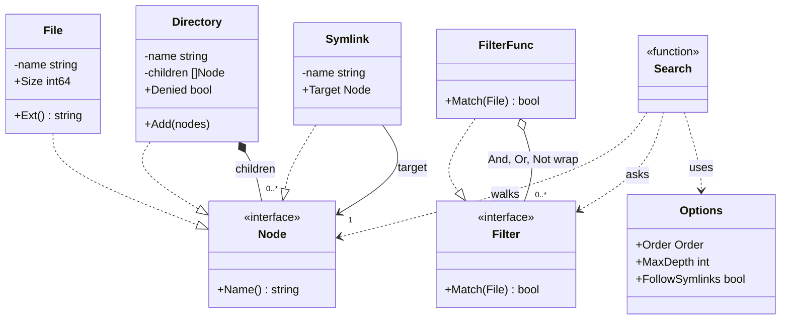
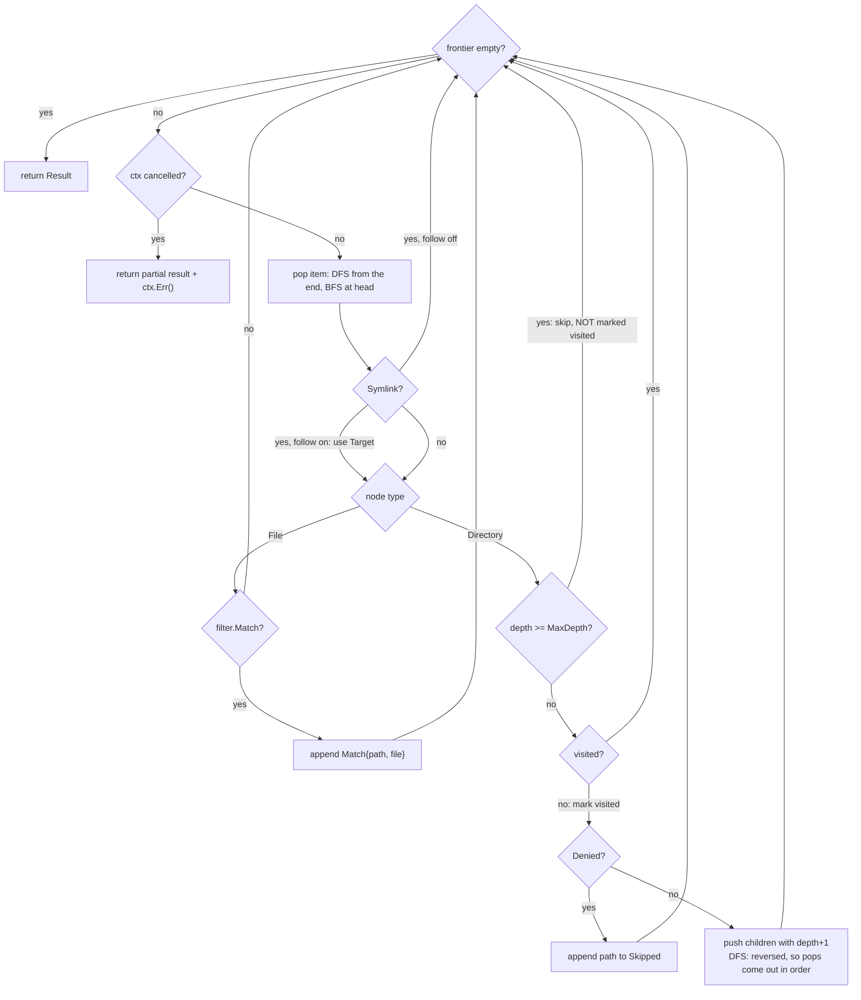
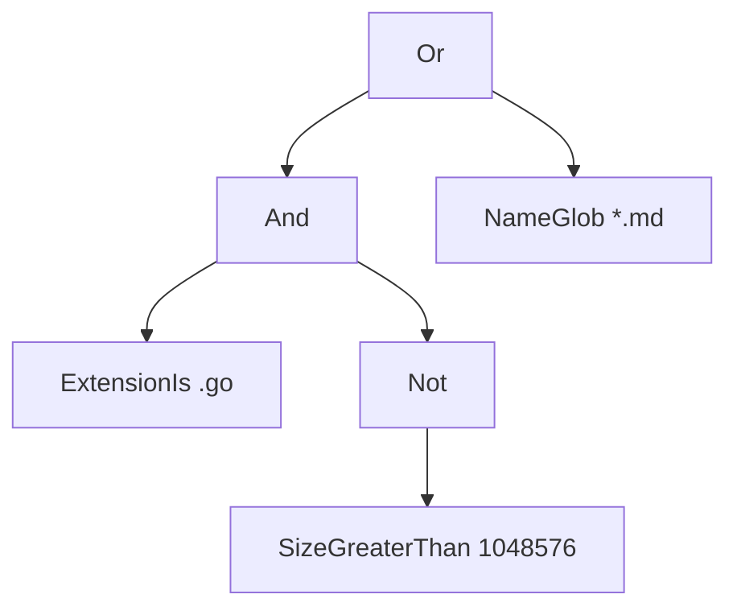

# File Search (Unix find)

> [!summary] TL;DR
> Model the file system as a **Composite** tree (File, Directory, Symlink all implement `Node`) and model the query as a second tree of small **filters** joined by AND, OR and NOT. One loop walks the first tree and asks the second tree about each file. Popping from the end of the frontier gives depth-first search (DFS), popping from the front gives breadth-first search (BFS), and a `visited` set stops symlink cycles.

## Problem statement

```text
Design a file search system like Unix `find`. Given a root directory, return all files
that match filters on name (glob), extension and size. Filters can be combined with
AND / OR / NOT, e.g. `ext=.go AND size<1048576`. Support DFS or BFS traversal, a max
depth, and do not loop forever on symlink cycles.
```

What it really tests: modeling a tree uniformly ([[Composite]]), modeling filter logic as composable objects (Specification and Interpreter) instead of a growing `if` chain, and safe traversal: cycles, depth limits, permission errors and cancellation. Time box: 10 minutes for requirements and entities, 10 for APIs, 25 to 40 for code, 10 for edge cases.

## Step 1: Clarify requirements

| Question to ask | Assumption |
| --- | --- |
| Real file system or an in-memory model? | An in-memory tree for deterministic tests. The real disk is an adapter over `io/fs.WalkDir` (shown in Step 8) |
| Which filters? | Name glob, extension, size less than or greater than, combined with AND, OR, NOT |
| A query language or only a Go API? | A Go API first. A small parser for `ext=.go AND size<1048576` is the bonus (no parentheses) |
| Return directories too? | Only files, like `find -type f` |
| Follow symlinks? | Off by default (`find -P`). With `FollowSymlinks` on (`find -L`), track visited directories to stop cycles |
| Max depth? | `MaxDepth`, where 0 means unlimited and the root's children are depth 1, so `MaxDepth: 1` behaves like `find -maxdepth 1` |
| Permission denied? | Skip that directory, list it in `Skipped`, keep going. `find` prints an error and continues too |

- **Functional:** build a tree of Directory, File and Symlink nodes; `Search(ctx, root, filter, options)` returns matching files with full paths; filters `NameGlob`, `ExtensionIs`, `SizeLessThan`, `SizeGreaterThan`, `And`, `Or`, `Not`; `Parse` turns a string into a filter; DFS or BFS order, `MaxDepth`, optional symlink following.
- **Non-functional:** never loop forever and never crash on bad input; cancellable through `ctx`; deterministic output order; safe for concurrent searches on one read-only tree; a parallel walk for huge trees whose output is still deterministic.
- **Out of scope:** content search (grep), indexes (`locate`), file watching, parentheses in queries, actions such as `-exec` and `-delete`.

## Step 2: Actors and use cases

| Actor | Use case |
| --- | --- |
| User or CLI | Search from a root with a filter expression; limit depth, choose DFS or BFS, follow symlinks |
| Code caller | Build filters in Go: `And(ExtensionIs(".go"), SizeLessThan(1<<20))` |
| File system | Supplies nodes. It may deny access or contain cycles |

The hardest use case, the one to code: **walk the tree with DFS or BFS, a max depth and symlink cycle protection, apply a composed filter to each file, and collect matches and skipped directories.**

## Step 3: Entities

| Entity | Key fields | Why it exists |
| --- | --- | --- |
| `Node` (interface) | `Name()` | The Composite component. The walker treats every entry the same |
| `File` | name, `Size`, `Ext()` | A leaf, and the only thing filters look at |
| `Directory` | name, children, `Denied` | A composite that holds files, directories and symlinks |
| `Symlink` | name, `Target` | A pointer to another node, and the only way to get a cycle |
| `Filter` (interface) | `Match(*File) bool` | A Specification: one small rule per constructor, combined into a tree |
| `Options` | `Order`, `MaxDepth`, `FollowSymlinks` | The traversal policy, kept apart from filter logic |
| `Result` | `Matches []Match{Path, File}`, `Skipped []string` | What matched, and what could not be read |

The modeling insight: **there are two trees.** The data tree (Directory to children) is a Composite. The query tree (`And(Ext, Not(Size))`) is also a Composite, of filters, which is the Interpreter pattern. The walker joins them. A new filter never touches traversal code, and a new traversal never touches filters.

## Step 4: Relationships



- **Composition** (`Directory *-- Node`): children belong to their directory.
- **Association** (`Symlink --> Node`): a link points at a node it does not own, and that node can be an ancestor, which makes a cycle.
- **Aggregation** (`And`, `Or`, `Not` over `Filter`): combinators hold sub-filters that could be reused. In Go every leaf and combinator is a `FilterFunc` closure, the idiomatic way to write small specifications.

## Step 5: APIs and public methods

As a service over an index (optional; this is mainly a library or CLI):

```text
GET /v1/search?root=/repo&q=ext%3D.go%20AND%20size%3C1048576&order=bfs&maxDepth=3&follow=false
  200 {"matches":[{"path":"repo/main.go","size":2000}], "skipped":["repo/secret"]}
  400 {"error":"invalid filter expression: unknown term \"color=red\""}
```

The Go API is the exported surface of the Step 8 code: constructors `NewDir`, `NewFile`, `NewSymlink`; filters `NameGlob`, `ExtensionIs`, `SizeLessThan`, `SizeGreaterThan`, `And`, `Or`, `Not`, and `Parse` (the Interpreter); walkers `Search` (in-memory tree), `SearchFS` (any `fs.FS`) and `ParallelSearch` (bounded workers). All walkers return `Result{Matches, Skipped}`.

## Step 6: Storage and repositories

Nothing is persisted: the "storage" is the file-system tree, and a search only reads it. The storage port is the tree source: the in-memory Composite for tests and `fs.FS` for real data. `SearchFS` accepts any `fs.FS`, so `os.DirFS("/repo")` (real disk), `fstest.MapFS` (tests) and a zip archive all work unchanged.

If the interviewer pushes toward `locate`-style indexed search, that is a different design: a `files(path PRIMARY KEY, name, ext, size, mtime)` table with indexes on `ext` and `size`, rebuilt by a crawler, where the filter tree is translated into a `WHERE` clause.

## Step 7: Patterns

| Pattern | Where | Why here |
| --- | --- | --- |
| [[Composite]] | `Node` = File, Directory, Symlink | The walker handles a leaf and a container through one interface |
| Specification and Interpreter ([[Rare GoF Patterns in Go]]) | `Filter`, `And/Or/Not`, `Parse` | Each rule is a tiny object; the parser builds the same tree from a string |
| [[Strategy and Template Method]] (light) | `Options.Order` | DFS and BFS differ only in which end of the frontier is popped |
| [[Iterator and range-over-func]] (extension) | An `iter.Seq[Match]` instead of a slice (since Go 1.23) | Streams results on huge trees and lets the caller stop early |

Not used, on purpose: a full Strategy interface with two traversal classes (DFS and BFS differ by one line; an enum keeps it simple until a third order appears), and Visitor (there is only one operation over the nodes; Visitor pays off with many, such as size totals, printing and deleting).

## Folder structure

The code in Step 8 is printed as two files so it reads top to bottom. In the round, split it like this:

```text
filesearch/
  node.go             -> Node, File, Directory, Symlink (data model only)
  filter.go           -> Filter, FilterFunc, NameGlob, ExtensionIs, Size*, MatchAll, And/Or/Not
  parser.go           -> Parse: tokens -> filter tree (recursive descent), ErrInvalidExpr
  search.go           -> Order, Options, Match, Result, Search (DFS/BFS, depth, cycles, ctx)
  walk_fs.go          -> SearchFS over any fs.FS (os.DirFS, fstest.MapFS, zip)
  parallel.go         -> ParallelSearch (fork-join with try-acquire tokens)
  filesearch_test.go  -> table tests, fuzz test, race tests
cmd/find/main.go      -> flags -> Parse -> SearchFS(os.DirFS(root)) -> print paths
```

- `filter.go` and `parser.go` hold all query logic: a new filter such as `ModifiedAfter` goes there.
- `search.go`, `walk_fs.go` and `parallel.go` are the only files that know about depth, cycles and order.

## Step 8: Core code



The walk in steps:

1. `Search` rejects a nil root, defaults a nil filter to `MatchAll`, and seeds the frontier with `{path: "root", depth: 0}`.
2. Each turn checks `ctx.Err()` first, so a huge walk can be cancelled. Then it pops: **DFS** from the end (a stack), **BFS** at `head` (a queue). That one line is the whole traversal strategy.
3. **BFS memory fix.** A naive queue pops with `frontier = frontier[1:]`. The popped slots stay in the backing array, still holding path strings and node pointers, until `append` happens to reallocate. Here each popped slot is zeroed, and once the dead prefix is over half the slice the live part is copied to the front. Memory stays proportional to the tree's widest level.
4. **Symlink:** skipped when `FollowSymlinks` is off (`find -P`); otherwise the node is swapped for its target and keeps the link's path.
5. **File:** `filter.Match(file)`. `And` short-circuits on the first false, `Or` on the first true.
6. **Directory:** three guards in order. Depth: a directory at `MaxDepth` is not expanded and **not** marked visited, because a shorter path may reach it later. Visited: breaks `loop -> root` and stops a second link to the same directory from producing duplicates. Denied: recorded in `Skipped`.
7. `Parse` is recursive descent with precedence `NOT > AND > OR`. Terms are validated once at parse time (bad glob, bad size, unknown key give `ErrInvalidExpr`), so `Match` can never fail later.



That is the filter tree `Parse` builds for `ext=.go AND NOT size>1048576 OR name=*.md`: OR binds loosest, so it is the root.

```go
package filesearch

import (
	"context"
	"errors"
	"fmt"
	"path"
	"strconv"
	"strings"
)

type Node interface {
	Name() string
}

type File struct {
	name string
	Size int64 // bytes
}

func NewFile(name string, size int64) *File { return &File{name: name, Size: size} }
func (f *File) Name() string                { return f.name }
func (f *File) Ext() string                 { return path.Ext(f.name) }

type Directory struct {
	name     string
	children []Node
	Denied   bool // simulates permission denied
}

func NewDir(name string, children ...Node) *Directory {
	return &Directory{name: name, children: children}
}
func (d *Directory) Name() string     { return d.name }
func (d *Directory) Add(n ...Node)    { d.children = append(d.children, n...) }
func (d *Directory) Children() []Node { return d.children }

// Symlink points at another node; it may create a cycle.
type Symlink struct {
	name   string
	Target Node
}

func NewSymlink(name string, target Node) *Symlink { return &Symlink{name: name, Target: target} }
func (s *Symlink) Name() string                    { return s.name }

type Filter interface {
	Match(f *File) bool
}

type FilterFunc func(f *File) bool

func (fn FilterFunc) Match(f *File) bool { return fn(f) }

func NameGlob(pattern string) Filter {
	return FilterFunc(func(f *File) bool {
		ok, _ := path.Match(pattern, f.Name()) // pattern validated by the parser
		return ok
	})
}
func ExtensionIs(ext string) Filter {
	return FilterFunc(func(f *File) bool { return strings.EqualFold(f.Ext(), ext) })
}
func SizeLessThan(n int64) Filter    { return FilterFunc(func(f *File) bool { return f.Size < n }) }
func SizeGreaterThan(n int64) Filter { return FilterFunc(func(f *File) bool { return f.Size > n }) }
func MatchAll() Filter               { return FilterFunc(func(*File) bool { return true }) }

func And(fs ...Filter) Filter {
	return FilterFunc(func(f *File) bool {
		for _, x := range fs {
			if !x.Match(f) {
				return false // short-circuit
			}
		}
		return true
	})
}
func Or(fs ...Filter) Filter {
	return FilterFunc(func(f *File) bool {
		for _, x := range fs {
			if x.Match(f) {
				return true
			}
		}
		return false
	})
}
func Not(x Filter) Filter { return FilterFunc(func(f *File) bool { return !x.Match(f) }) }

var ErrInvalidExpr = errors.New("invalid filter expression")

// Parse turns "ext=.go AND NOT size>1048576 OR name=*.md" into a Filter tree.
// Grammar (precedence NOT > AND > OR, no parentheses):
//
//	expr  := and { "OR" and }
//	and   := unary { "AND" unary }
//	unary := "NOT" unary | term
//	term  := name=GLOB | ext=.EXT | size<N | size>N
func Parse(expr string) (Filter, error) {
	p := &parser{toks: strings.Fields(expr)}
	if len(p.toks) == 0 {
		return nil, fmt.Errorf("%w: empty", ErrInvalidExpr)
	}
	f, err := p.or()
	if err != nil {
		return nil, err
	}
	if p.i != len(p.toks) {
		return nil, fmt.Errorf("%w: unexpected %q", ErrInvalidExpr, p.toks[p.i])
	}
	return f, nil
}

type parser struct {
	toks []string
	i    int
}

func (p *parser) accept(kw string) bool {
	if p.i < len(p.toks) && strings.EqualFold(p.toks[p.i], kw) {
		p.i++
		return true
	}
	return false
}

func (p *parser) or() (Filter, error)  { return p.list("OR", p.and, Or) }
func (p *parser) and() (Filter, error) { return p.list("AND", p.unary, And) }

func (p *parser) list(kw string, next func() (Filter, error), join func(...Filter) Filter) (Filter, error) {
	first, err := next()
	if err != nil {
		return nil, err
	}
	parts := []Filter{first}
	for p.accept(kw) {
		f, err := next()
		if err != nil {
			return nil, err
		}
		parts = append(parts, f)
	}
	if len(parts) == 1 {
		return first, nil
	}
	return join(parts...), nil
}

func (p *parser) unary() (Filter, error) {
	if p.accept("NOT") {
		f, err := p.unary()
		if err != nil {
			return nil, err
		}
		return Not(f), nil
	}
	if p.i >= len(p.toks) {
		return nil, fmt.Errorf("%w: missing term", ErrInvalidExpr)
	}
	tok := p.toks[p.i]
	p.i++
	return term(tok)
}

func term(tok string) (Filter, error) {
	switch {
	case strings.HasPrefix(tok, "name="):
		glob := strings.TrimPrefix(tok, "name=")
		if _, err := path.Match(glob, ""); err != nil { // since Go 1.16 Match checks the whole pattern
			return nil, fmt.Errorf("%w: bad glob %q", ErrInvalidExpr, glob)
		}
		return NameGlob(glob), nil
	case strings.HasPrefix(tok, "ext="):
		return ExtensionIs(strings.TrimPrefix(tok, "ext=")), nil
	case strings.HasPrefix(tok, "size<"), strings.HasPrefix(tok, "size>"):
		n, err := strconv.ParseInt(tok[5:], 10, 64)
		if err != nil || n < 0 {
			return nil, fmt.Errorf("%w: bad size in %q", ErrInvalidExpr, tok)
		}
		if tok[4] == '<' {
			return SizeLessThan(n), nil
		}
		return SizeGreaterThan(n), nil
	}
	return nil, fmt.Errorf("%w: unknown term %q", ErrInvalidExpr, tok)
}

type Order int

const (
	DFS Order = iota // stack: goes deep first, memory ~ depth x fanout
	BFS              // queue: nearest matches first, memory ~ tree width
)

type Options struct {
	Order          Order
	MaxDepth       int  // 0 = unlimited; root's children are depth 1
	FollowSymlinks bool // like find -L; false = find -P (skip links)
}

type Match struct {
	Path string
	File *File
}

type Result struct {
	Matches []Match
	Skipped []string // permission-denied directories, reported not fatal
}

var ErrNilRoot = errors.New("root directory is nil")

type item struct {
	path  string
	node  Node
	depth int
}

// Search walks the tree from root and returns files matching filter.
// The tree is read-only during a search, so concurrent searches are safe.
func Search(ctx context.Context, root *Directory, filter Filter, opt Options) (Result, error) {
	if root == nil {
		return Result{}, ErrNilRoot
	}
	if filter == nil {
		filter = MatchAll()
	}
	var res Result
	visited := map[*Directory]bool{} // real FS: key by (device, inode)
	frontier := []item{{path: root.Name(), node: root}}
	head := 0 // BFS reads at head; DFS pops from the end and head stays 0

	for head < len(frontier) {
		if err := ctx.Err(); err != nil { // huge tree: caller can cancel
			return res, err
		}
		var it item
		if opt.Order == BFS {
			it = frontier[head]
			frontier[head] = item{} // release the path and node for the GC
			head++
			if head > 64 && head*2 > len(frontier) { // dead prefix is over half: compact
				n := copy(frontier, frontier[head:])
				clear(frontier[n:])
				frontier, head = frontier[:n], 0
			}
		} else {
			it = frontier[len(frontier)-1]
			frontier = frontier[:len(frontier)-1]
		}

		node := it.node
		if link, ok := node.(*Symlink); ok {
			if !opt.FollowSymlinks || link.Target == nil {
				continue
			}
			node = link.Target
		}

		switch n := node.(type) {
		case *File:
			if filter.Match(n) {
				res.Matches = append(res.Matches, Match{Path: it.path, File: n})
			}
		case *Directory:
			if opt.MaxDepth > 0 && it.depth >= opt.MaxDepth {
				continue // do not mark visited: a shallower path may still expand it
			}
			if visited[n] { // symlink cycle or second link to same dir
				continue
			}
			visited[n] = true
			if n.Denied {
				res.Skipped = append(res.Skipped, it.path)
				continue
			}
			kids := n.Children()
			if opt.Order == DFS { // push reversed so we pop in natural order
				for i := len(kids) - 1; i >= 0; i-- {
					frontier = append(frontier, item{it.path + "/" + kids[i].Name(), kids[i], it.depth + 1})
				}
			} else {
				for _, k := range kids {
					frontier = append(frontier, item{it.path + "/" + k.Name(), k, it.depth + 1})
				}
			}
		}
	}
	return res, nil
}
```

**Real disk, parallel walk.** `SearchFS` maps the same filters onto `io/fs.WalkDir`: each `fs.DirEntry` gives the type, and `d.Info()` returns an `fs.FileInfo` with `Size()` (and `ModTime()` for a future mtime filter). `WalkDir` does not follow symlinks inside the tree (only a symlinked root is resolved) and reads each directory in lexical order, so output is deterministic. A failed `ReadDir` (permission denied) reaches the callback as a second call with `err` set, which becomes a `Skipped` entry. `ParallelSearch` is a fork-join walk: a directory gives each child one result slot, runs child directories on a free worker if a token is available and inline if not (it never blocks, so a bounded pool cannot deadlock), then joins the slots in child order. On a tree, where no directory was added under two parents, the result equals the sequential DFS result exactly, whatever the scheduling. `ParallelSearch` keeps no `visited` set, so a directory shared by two parents is listed under both, while `Search` lists it once.

```go
package filesearch

import (
	"context"
	"io/fs"
	"strings"
	"sync"
)

// SearchFS runs the same Filter over a real file system (os.DirFS) or a test
// one (fstest.MapFS). fs.WalkDir does not follow symlinks inside the tree
// (find -P) and reads each directory in lexical order, so output is deterministic.
func SearchFS(ctx context.Context, fsys fs.FS, root string, filter Filter, maxDepth int) (Result, error) {
	if filter == nil {
		filter = MatchAll()
	}
	var res Result
	err := fs.WalkDir(fsys, root, func(p string, d fs.DirEntry, err error) error {
		if ctxErr := ctx.Err(); ctxErr != nil {
			return ctxErr // stops the whole walk
		}
		if err != nil {
			if d == nil {
				return err // the root itself is missing
			}
			res.Skipped = append(res.Skipped, p) // ReadDir failed, e.g. permission denied
			return nil
		}
		if d.IsDir() {
			if maxDepth > 0 && p != root && depthOf(root, p) >= maxDepth {
				return fs.SkipDir
			}
			return nil
		}
		if !d.Type().IsRegular() {
			return nil // symlink, socket, device: like find -type f
		}
		info, err := d.Info() // fs.FileInfo: Size, Mode, ModTime
		if err != nil {
			return nil // the file vanished between ReadDir and Info
		}
		if f := NewFile(info.Name(), info.Size()); filter.Match(f) {
			res.Matches = append(res.Matches, Match{Path: p, File: f})
		}
		return nil
	})
	return res, err
}

func depthOf(root, p string) int {
	if root != "." {
		p = strings.TrimPrefix(p, root+"/")
	}
	return strings.Count(p, "/") + 1
}

// ParallelSearch reads directories on up to `workers` goroutines and returns
// exactly what Search returns with DFS and FollowSymlinks off, as long as no
// directory was added under two parents (there is no visited set). Each directory
// fills one slot per child and the parent joins the slots in child order, so
// the output does not depend on scheduling. Symlinks are skipped (find -P).
func ParallelSearch(ctx context.Context, root *Directory, filter Filter, opt Options, workers int) (Result, error) {
	if root == nil {
		return Result{}, ErrNilRoot
	}
	if filter == nil {
		filter = MatchAll()
	}
	if workers < 1 {
		workers = 1
	}
	w := &parWalker{ctx: ctx, filter: filter, maxDepth: opt.MaxDepth, sem: make(chan struct{}, workers-1)}
	res := w.walk(root.Name(), root, 0)
	if err := ctx.Err(); err != nil {
		return Result{}, err
	}
	return res, nil
}

type parWalker struct {
	ctx      context.Context
	filter   Filter
	maxDepth int
	sem      chan struct{} // tokens for extra goroutines; the caller is worker #1
}

func (w *parWalker) walk(p string, d *Directory, depth int) Result {
	var res Result
	if w.ctx.Err() != nil || (w.maxDepth > 0 && depth >= w.maxDepth) {
		return res
	}
	if d.Denied {
		res.Skipped = append(res.Skipped, p)
		return res
	}
	kids := d.Children()
	parts := make([]Result, len(kids)) // one slot per child keeps the order
	var wg sync.WaitGroup
	for i, k := range kids {
		kp := p + "/" + k.Name()
		switch n := k.(type) {
		case *File:
			if w.filter.Match(n) {
				parts[i].Matches = []Match{{Path: kp, File: n}}
			}
		case *Directory:
			select {
			case w.sem <- struct{}{}: // a worker is free: walk the subtree in parallel
				wg.Add(1)
				go func() {
					defer wg.Done()
					defer func() { <-w.sem }()
					parts[i] = w.walk(kp, n, depth+1)
				}()
			default: // all workers busy: walk it here, never block (no deadlock)
				parts[i] = w.walk(kp, n, depth+1)
			}
		}
	}
	wg.Wait()
	for _, part := range parts {
		res.Matches = append(res.Matches, part.Matches...)
		res.Skipped = append(res.Skipped, part.Skipped...)
	}
	return res
}
```

## Test cases

| Test | Proves |
| --- | --- |
| `TestSearch` (9 rows) | Filters and combinators; DFS vs BFS order; `MaxDepth` 1 and 2; following links ends the `loop -> root` cycle, gives no duplicate through `util-link` and reaches `vendor-link`; every unlimited row lists `root/secret` in `Skipped` |
| `TestFileReachedThroughTwoPathsIsReportedTwice` | A file reachable through a file symlink is reported under both paths, as `find -L` does |
| `TestBFSWideTreeCompactsQueue` | 300 sibling directories force several compactions; order is still correct |
| `TestParse`, `TestParseInvalid` | Precedence (`a AND b OR c`), case-insensitive keywords; 8 bad inputs all wrap `ErrInvalidExpr` |
| `FuzzParse` | Random input never panics, every error wraps `ErrInvalidExpr`, and `Not` flips any parsed filter |
| `TestErrors` | Nil root gives `ErrNilRoot`; a cancelled ctx gives `context.Canceled` for both walkers |
| `TestConcurrentSearchesOnSharedTree` | 50 goroutines, mixed DFS and BFS, on one tree: all find exactly 4, race-free |
| `TestParallelSearchEqualsSequentialDFS` | 1, 2 and 8 workers, 20 runs each, equal the sequential result for 3 depth settings |
| `TestSearchFS` | `fstest.MapFS` with and without a depth limit, a missing root, and a real temp directory through `os.DirFS` |

```go
package filesearch

import (
	"context"
	"errors"
	"fmt"
	"os"
	"path/filepath"
	"reflect"
	"sync"
	"testing"
	"testing/fstest"
)

// root/
//
//	src/ app.go(5000) big.go(2MB) util/ helper.go(100) notes.txt(50)
//	main.go(2000) README.md(500)
//	secret/ (permission denied)
//	loop -> root            (cycle)
//	util-link -> src/util   (second path to same dir)
//	vendor-link -> /ext     (only reachable through the link)
func buildTree() *Directory {
	util := NewDir("util", NewFile("helper.go", 100), NewFile("notes.txt", 50))
	src := NewDir("src", NewFile("app.go", 5000), NewFile("big.go", 2_000_000), util)
	secret := NewDir("secret", NewFile("key.pem", 10))
	secret.Denied = true
	ext := NewDir("ext", NewFile("lib.go", 300))
	root := NewDir("root", src, NewFile("main.go", 2000), NewFile("README.md", 500), secret)
	root.Add(NewSymlink("loop", root), NewSymlink("util-link", util), NewSymlink("vendor-link", ext))
	return root
}

func paths(r Result) []string {
	out := []string{}
	for _, m := range r.Matches {
		out = append(out, m.Path)
	}
	return out
}

func TestSearch(t *testing.T) {
	root := buildTree()
	tests := []struct {
		name   string
		filter Filter
		opt    Options
		want   []string
	}{
		{"ext .go dfs", ExtensionIs(".go"), Options{}, []string{
			"root/src/app.go", "root/src/big.go", "root/src/util/helper.go", "root/main.go"}},
		{"all files dfs", nil, Options{Order: DFS}, []string{
			"root/src/app.go", "root/src/big.go", "root/src/util/helper.go", "root/src/util/notes.txt",
			"root/main.go", "root/README.md"}},
		{"all files bfs", nil, Options{Order: BFS}, []string{
			"root/main.go", "root/README.md", "root/src/app.go", "root/src/big.go",
			"root/src/util/helper.go", "root/src/util/notes.txt"}},
		{"max depth 1", ExtensionIs(".go"), Options{MaxDepth: 1}, []string{"root/main.go"}},
		{"max depth 2", ExtensionIs(".go"), Options{MaxDepth: 2}, []string{
			"root/src/app.go", "root/src/big.go", "root/main.go"}},
		{"and + size", And(ExtensionIs(".go"), SizeLessThan(1<<20)), Options{}, []string{
			"root/src/app.go", "root/src/util/helper.go", "root/main.go"}},
		{"or", Or(ExtensionIs(".md"), ExtensionIs(".txt")), Options{}, []string{
			"root/src/util/notes.txt", "root/README.md"}},
		{"not + glob", And(NameGlob("*.go"), Not(NameGlob("big*"))), Options{}, []string{
			"root/src/app.go", "root/src/util/helper.go", "root/main.go"}},
		{"follow symlinks: no dup, no infinite loop, reaches ext", ExtensionIs(".go"),
			Options{FollowSymlinks: true}, []string{
				"root/src/app.go", "root/src/big.go", "root/src/util/helper.go", "root/main.go",
				"root/vendor-link/lib.go"}},
	}
	for _, tc := range tests {
		t.Run(tc.name, func(t *testing.T) {
			res, err := Search(context.Background(), root, tc.filter, tc.opt)
			if err != nil {
				t.Fatal(err)
			}
			if got := paths(res); !reflect.DeepEqual(got, tc.want) {
				t.Fatalf("got  %v\nwant %v", got, tc.want)
			}
			if tc.opt.MaxDepth == 0 && !reflect.DeepEqual(res.Skipped, []string{"root/secret"}) {
				t.Fatalf("skipped=%v", res.Skipped)
			}
		})
	}
}

func TestFileReachedThroughTwoPathsIsReportedTwice(t *testing.T) {
	a := NewFile("a.go", 1)
	root := NewDir("r", a, NewSymlink("b.go", a)) // like `ln -s a.go b.go`
	res, _ := Search(context.Background(), root, nil, Options{FollowSymlinks: true})
	if got := paths(res); !reflect.DeepEqual(got, []string{"r/a.go", "r/b.go"}) {
		t.Fatalf("got %v; find -L also prints both paths", got)
	}
}

func TestBFSWideTreeCompactsQueue(t *testing.T) {
	root := NewDir("w")
	for i := range 300 { // wide enough to trigger compaction several times
		root.Add(NewDir(fmt.Sprintf("d%03d", i), NewFile(fmt.Sprintf("f%03d.go", i), 1)))
	}
	res, err := Search(context.Background(), root, nil, Options{Order: BFS})
	if err != nil || len(res.Matches) != 300 {
		t.Fatalf("matches=%d err=%v", len(res.Matches), err)
	}
	if res.Matches[0].Path != "w/d000/f000.go" || res.Matches[299].Path != "w/d299/f299.go" {
		t.Fatalf("order broken: first=%s last=%s", res.Matches[0].Path, res.Matches[299].Path)
	}
}

func TestParse(t *testing.T) {
	root := buildTree()
	tests := []struct {
		expr string
		want []string
	}{
		{"ext=.go AND size<1048576", []string{"root/src/app.go", "root/src/util/helper.go", "root/main.go"}},
		{"ext=.md OR ext=.txt", []string{"root/src/util/notes.txt", "root/README.md"}},
		{"NOT ext=.go", []string{"root/src/util/notes.txt", "root/README.md"}},
		{"size>1000 AND ext=.go OR name=*.md", []string{"root/src/app.go", "root/src/big.go", "root/main.go", "root/README.md"}},
		{"name=*.go and not name=big*", []string{"root/src/app.go", "root/src/util/helper.go", "root/main.go"}},
	}
	for _, tc := range tests {
		t.Run(tc.expr, func(t *testing.T) {
			f, err := Parse(tc.expr)
			if err != nil {
				t.Fatal(err)
			}
			res, _ := Search(context.Background(), root, f, Options{})
			if got := paths(res); !reflect.DeepEqual(got, tc.want) {
				t.Fatalf("got  %v\nwant %v", got, tc.want)
			}
		})
	}
}

func TestParseInvalid(t *testing.T) {
	for _, expr := range []string{"", "ext=.go AND", "size<abc", "size<-5", "color=red", "name=[", "ext=.go ext=.md", "NOT"} {
		if _, err := Parse(expr); !errors.Is(err, ErrInvalidExpr) {
			t.Errorf("Parse(%q) err=%v, want ErrInvalidExpr", expr, err)
		}
	}
}

// FuzzParse: `go test` runs the seeds; `go test -fuzz=FuzzParse -fuzztime=30s` explores.
func FuzzParse(f *testing.F) {
	for _, s := range []string{"ext=.go AND size<1048576", "NOT name=*.md OR size>10", "name=[", "size<", "AND", ""} {
		f.Add(s)
	}
	file := NewFile("main.go", 2000)
	f.Fuzz(func(t *testing.T, expr string) {
		flt, err := Parse(expr)
		if err != nil {
			if !errors.Is(err, ErrInvalidExpr) {
				t.Fatalf("Parse(%q): %v does not wrap ErrInvalidExpr", expr, err)
			}
			return
		}
		if flt.Match(file) == Not(flt).Match(file) { // must not panic, NOT must flip
			t.Fatalf("Parse(%q): NOT did not flip the result", expr)
		}
	})
}

func TestErrors(t *testing.T) {
	if _, err := Search(context.Background(), nil, nil, Options{}); !errors.Is(err, ErrNilRoot) {
		t.Fatalf("want ErrNilRoot, got %v", err)
	}
	ctx, cancel := context.WithCancel(context.Background())
	cancel()
	if _, err := Search(ctx, buildTree(), nil, Options{}); !errors.Is(err, context.Canceled) {
		t.Fatalf("want context.Canceled, got %v", err)
	}
	if _, err := ParallelSearch(ctx, buildTree(), nil, Options{}, 4); !errors.Is(err, context.Canceled) {
		t.Fatalf("parallel: want context.Canceled, got %v", err)
	}
}

func TestConcurrentSearchesOnSharedTree(t *testing.T) {
	root := buildTree()
	f, _ := Parse("ext=.go AND size<1048576")
	const n = 50
	var wg sync.WaitGroup
	counts := make([]int, n)
	for i := 0; i < n; i++ {
		wg.Add(1)
		go func(i int) {
			defer wg.Done()
			opt := Options{Order: Order(i % 2), FollowSymlinks: true}
			res, err := Search(context.Background(), root, f, opt)
			if err == nil {
				counts[i] = len(res.Matches)
			}
		}(i)
	}
	wg.Wait()
	for i, c := range counts {
		if c != 4 { // app.go, helper.go, main.go, vendor-link/lib.go
			t.Fatalf("search %d found %d, want 4", i, c)
		}
	}
}

func TestParallelSearchEqualsSequentialDFS(t *testing.T) {
	root := buildTree()
	for _, opt := range []Options{{}, {MaxDepth: 1}, {MaxDepth: 2}} {
		want, _ := Search(context.Background(), root, nil, opt)
		for _, workers := range []int{1, 2, 8} {
			for range 20 { // repeat: scheduling must never change the output
				got, err := ParallelSearch(context.Background(), root, nil, opt, workers)
				if err != nil || !reflect.DeepEqual(got, want) {
					t.Fatalf("opt=%+v workers=%d\ngot  %+v\nwant %+v", opt, workers, got, want)
				}
			}
		}
	}
}

func TestSearchFS(t *testing.T) {
	fsys := fstest.MapFS{
		"main.go":            {Data: make([]byte, 2000)},
		"README.md":          {Data: make([]byte, 500)},
		"src/app.go":         {Data: make([]byte, 5000)},
		"src/util/helper.go": {Data: make([]byte, 100)},
		"src/util/notes.txt": {Data: make([]byte, 50)},
	}
	f, _ := Parse("ext=.go AND size<1048576")
	for _, tc := range []struct {
		depth int
		want  []string
	}{
		{0, []string{"main.go", "src/app.go", "src/util/helper.go"}},
		{2, []string{"main.go", "src/app.go"}},
	} {
		res, err := SearchFS(context.Background(), fsys, ".", f, tc.depth)
		if err != nil || !reflect.DeepEqual(paths(res), tc.want) {
			t.Fatalf("depth %d: got %v err=%v", tc.depth, paths(res), err)
		}
	}
	if _, err := SearchFS(context.Background(), fsys, "missing", f, 0); err == nil {
		t.Fatal("missing root must be an error")
	}

	dir := t.TempDir() // the same code on the real disk
	if err := os.WriteFile(filepath.Join(dir, "a.go"), []byte("package a"), 0o644); err != nil {
		t.Fatal(err)
	}
	res, err := SearchFS(context.Background(), os.DirFS(dir), ".", f, 0)
	if err != nil || !reflect.DeepEqual(paths(res), []string{"a.go"}) || res.Matches[0].File.Size != 9 {
		t.Fatalf("real disk: %+v err=%v", res, err)
	}
}
```

Run in a scratch module with Go 1.24.4: `go vet` clean, `go test -race` passes all tests. `go test -run='^$' -fuzz=FuzzParse -fuzztime=15s` found no failing input.

## Step 9: Edge cases

| Edge case | What happens | How the design handles it |
| --- | --- | --- |
| Symlink cycle (`loop -> root`) | A naive walk loops forever | `visited` set of directories (real disk: key by device and inode). Links are not followed by default |
| Two links to the same directory | Duplicate results | The same `visited` set skips the second visit. This is stricter than `find -L`, which detects loops by checking only the directories on the current path, so it lists a directory reached through two non-cyclic paths twice |
| DFS with `MaxDepth` and links: a directory first expanded through a long path, then reached through a shorter link | Its subtree was cut at the depth limit on the long path, and the short path is skipped as visited, so a file that `find -L -maxdepth N` prints is missed (checked: `root/a/y/z/f.go` plus `root/lnk -> y` with `MaxDepth: 3` gives no match under DFS and `root/lnk/z/f.go` under BFS) | BFS has no gap: it reaches every directory first by its shortest path. For DFS, store the depth each directory was expanded at and expand it again when a shorter path arrives, or detect loops with the current path's ancestors as `find` does |
| Two paths to the same **file** | Reported twice | Kept on purpose: `find -L` prints both paths too. Dedupe by (device, inode) if the caller wants unique files |
| Permission denied | A directory read fails mid-walk | Skip that subtree, record it in `Skipped`, keep going |
| Depth-pruned directory reached again by a shorter link | Could be wrongly skipped | Pruned directories are not marked visited |
| Huge tree | Slow, large memory | `ctx` cancellation, `MaxDepth`, BFS queue compaction, `ParallelSearch`, streaming as an extension |
| Invalid filter (`size<abc`, `name=[`) | Panic or silent no-match | `Parse` validates every term before any walk; the fuzz test guards the parser |
| Extension case (`.GO`) | Missed match | `strings.EqualFold` in `ExtensionIs` |
| Hidden files (`.env`) | `path.Ext(".env")` is `".env"` | Documented; `name=.*` finds hidden files |
| Concurrent searches | A race if the tree mutates | The tree is read-only during a search; each search owns its frontier and `visited`. Mutating the tree while searches run would need a `sync.RWMutex` on `Directory` |

## Step 10: Tradeoffs and extensions

| Follow-up | Design change |
| --- | --- |
| Follow symlinks on the real disk | `WalkDir` does not follow links inside the tree; use `os.ReadDir` plus `os.Stat`, with the visited key `(Dev, Ino)` from `info.Sys().(*syscall.Stat_t)` (Unix only) |
| Parentheses in queries | Tokenize character by character; `unary` gains a third case: `"(" expr ")"` |
| More filters (mtime, owner, `type=d`) | A new `Filter` constructor plus a parser term. Traversal does not change |
| Return directories too | Change `Filter.Match` to take a `Node`, or add a `TypeIs(dir)` filter and let directories reach the filter |
| Stream results or stop after N | Return `iter.Seq[Match]` (range-over-func, since Go 1.23); the caller's `break` stops the walk |
| Fast repeated searches | An index like `locate`: a table of files, with the filter tree translated to SQL |
| Parallel walk with symlinks | Needs a locked `visited` set, and then which path "wins" a shared directory depends on scheduling. Either drop determinism or sort the output |

Choices made: an in-memory tree in the core, so tests are deterministic; closures (`FilterFunc`) instead of one struct per filter, which is less code but cannot print or optimize the tree; DFS by default (it matches `find` and uses less memory on wide trees); results collected into a slice, which is simple for the interview, with streaming for production-sized trees; skip unreadable directories instead of failing the whole search.

## Drawing

![[File Search LLD Drawing.excalidraw]]

The drawing has three parts: the Composite (`Node` with File, Directory and Symlink, the link pointing back to make a cycle), the filter tree for `ext=.go AND NOT size>1048576`, and the core loop (pop, then the per-type branch with the three directory guards in red). Redraw it from memory: the interface and its three implementations (mark the one that can create a cycle), the expression tree for a three-term query, the loop with its guards in order (depth, visited, denied), and where `visited` lives (one per search) and why pruned directories are not marked.

## Interview questions

> [!question]- Why model filters as objects instead of one function with flags?
> Each rule is a `Filter`, and `And`, `Or`, `Not` combine them into a tree (Specification). A new rule is one constructor; traversal code never changes. The parser builds the same tree from a string, so the Go API and the query language share one evaluator.

> [!question]- How do you stop symlink cycles, and why is a depth-pruned directory not marked visited?
> Keep a `visited` set of directories per search; a second arrival is skipped. On a real disk the key is (device, inode), because two paths name the same directory. A directory pruned by `MaxDepth` was not expanded, so if it were marked visited, a shorter path reaching it later would wrongly skip it. One gap remains under DFS: a directory expanded through a long path had its subtree cut early, and the shorter path is skipped. BFS avoids it because it reaches every directory first by its shortest path.

> [!question]- Trap: with symlinks followed, can the same file appear twice? Is that a bug?
> Yes, if two paths lead to it (`b.go -> a.go`). It is not a bug: `find -L` prints both, because each path is a real way to reach the file. The visited set is for directories, to stop cycles, not for files. Dedupe by (device, inode) only if the caller asks for unique files.

> [!question]- DFS or BFS: which one, and what does each cost?
> DFS holds about depth times fan-out entries and matches `find`. BFS holds a whole level (the tree's width) but returns the shallowest matches first, which suits "nearest config file" searches. Both are the same loop; only the pop end changes. A BFS queue built with `s = s[1:]` must zero popped slots and compact, or it holds dead entries.

> [!question]- How would you search a huge tree faster?
> Directory reads dominate, so read directories in parallel with a bounded pool. A fork-join walk gives each child a result slot and joins slots in child order, so the output stays deterministic. Try-acquire a worker token and walk inline when none is free; blocking would deadlock a bounded pool. For repeated searches, build an index instead.

> [!question]- How do you make the parser safe against hostile input?
> Validate every term at parse time (glob syntax, size integer, known key) and return a wrapped `ErrInvalidExpr`, so evaluation can never fail. Then fuzz it: `FuzzParse` checks that no input panics and every error wraps the sentinel. Seeds run on every `go test`; `-fuzz` explores new inputs. Behind an HTTP API, also cap the query length, because each `NOT` adds one level of recursion in the parser and in `Match`.

## Interview explanation

```text
I model the file system as a Composite: File, Directory and Symlink all implement Node, so the walker treats them uniformly. Filters are Specifications with one Match(file) method: small leaves like ExtensionIs and SizeLessThan, plus And, Or and Not combinators, so "ext=.go AND size<1048576" is just a filter tree, and a small recursive-descent parser builds the same tree from a string and validates every term up front. The search is one loop over a frontier: popping from the end gives DFS, popping from the front gives BFS. It enforces the max depth, records permission-denied directories in a Skipped list and keeps going, and keeps a visited set of directories so symlink cycles end. On a real disk the same filters run over io/fs.WalkDir, which does not follow links inside the tree; following them needs os.ReadDir plus os.Stat, with the visited set keyed by device and inode.
```

## Cheat sheet

- Two trees: the data tree (Composite of Node) and the query tree (Specification and Interpreter of Filter).
- One loop: pop from the end for DFS, at `head` for BFS; zero popped slots and compact the queue.
- Directory guards in order: depth, visited, denied. Pruned directories are not marked visited.
- `visited` stops directory cycles; a file reached by two paths is reported twice, as with `find -L`.
- Real disk: `fs.WalkDir` plus `d.Info()` for `fs.FileInfo`; it does not follow links inside the tree and is lexically ordered.
- Parallel: fork-join with one slot per child, try-acquire tokens, join in child order for deterministic output.
- Parser: precedence NOT > AND > OR, validate terms up front, fuzz it.

## Links

- **Before this:** [[Composite]], [[Strategy and Template Method]], [[Logging Library]]
- **Next:** [[ATM]], [[Iterator and range-over-func]] for a streaming result, [[Concurrency for LLD]] for worker pools
- **Compare with:** [[Testing LLD Code]] (fuzzing and table tests), [[Chain of Responsibility and Pipelines]] (another way to chain filters)
