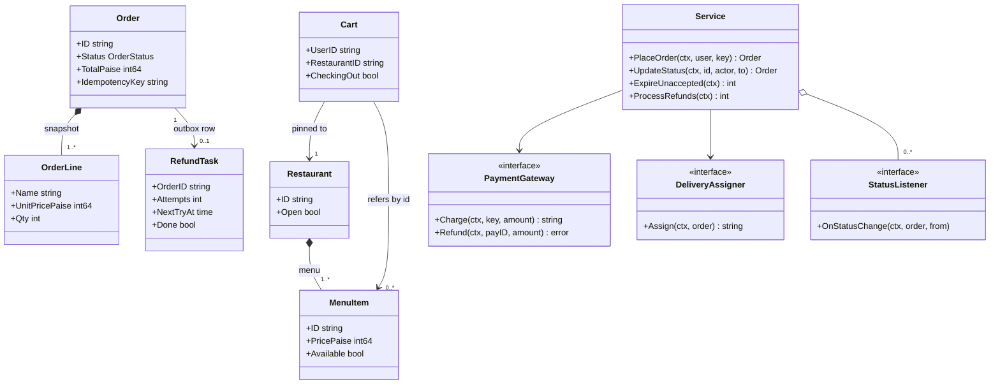
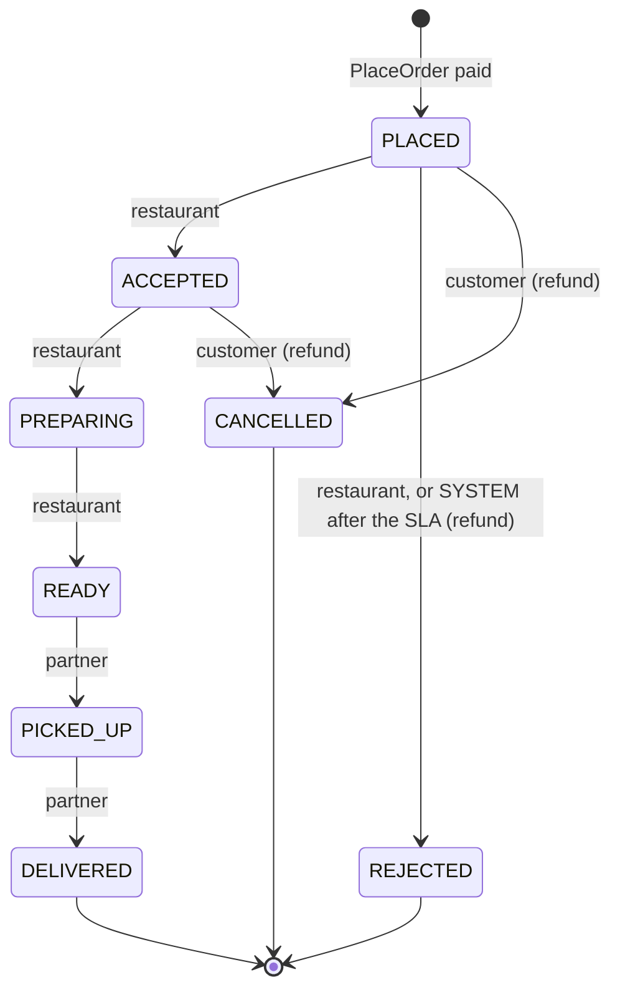
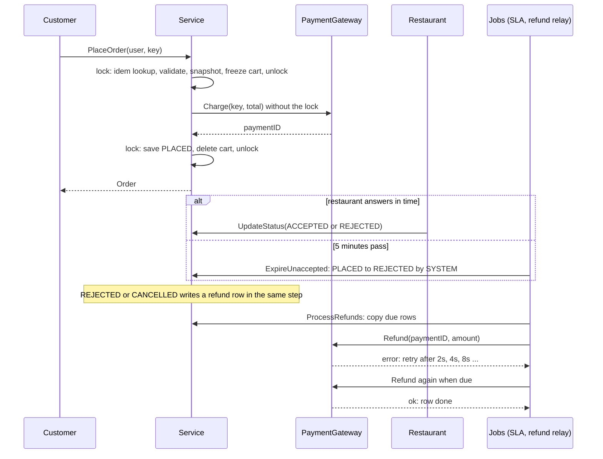

# Food Ordering System

> [!summary] TL;DR
> Separate the **cart** (a mutable draft pinned to one restaurant) from the **order** (created once at checkout, with a price snapshot). `PlaceOrder` takes an idempotency key, freezes the cart, charges outside the lock and saves the order, so double taps never charge twice and a failed payment never loses the cart. Status changes go through a **transition table that checks the actor**. Refunds are written to an **outbox** in the same step as the status change and sent by a relay with retries, and a timer job **auto-rejects** orders the restaurant did not accept in time.

> [!abstract] Core idea
> - The cart is a mutable draft pinned to one restaurant; the order is created once at checkout and keeps a snapshot of names and prices.
> - `PlaceOrder` takes an idempotency key, freezes the cart, charges outside the lock, then saves; a double tap charges once and a failed payment keeps the cart. See [[Idempotency and Idempotency Keys]].
> - Every status change goes through one transition table that also checks who is allowed to make it.
> - Refunds go into an outbox (a pending-work row written together with the status change, sent later by a relay with retries); a timer auto-rejects orders the restaurant ignores.
> - Classic mistakes: computing the total from the live menu, and calling the refund gateway inline right after setting `REJECTED`.

## Problem statement

```text
Design a food ordering app (Swiggy / Zomato style). Restaurants list menus. A user adds
items to a cart and places an order with payment. The restaurant accepts or rejects it,
then prepares it, and a delivery partner picks it up and delivers it. Users are notified
on every status change. Handle cancellation, payment failure and duplicate order retries.
```

**Solving path**

1. Clarify: one restaurant per cart, payment flow, who can change which status, cancellation and refund rules.
2. Separate `Cart` (draft) from `Order` (snapshot).
3. Write the transition table keyed by from, to and actor.
4. Code `PlaceOrder`: idempotency, freeze, charge outside the lock, save.
5. Code `UpdateStatus` with listeners for notifications.
6. Add the refund outbox and the auto-reject job.
7. Test double taps, payment failure, illegal transitions and refunds.

It tests an explicit order **state machine** with role-based transitions and a safe `PlaceOrder`: price snapshot, idempotency key, no double charge. It also tests whether payment, delivery and notifications stay behind interfaces instead of inside the order logic, and whether refunds survive a gateway outage. Time box: 10 minutes for requirements and entities, 10 for APIs and storage, 25 to 40 for code, 10 for edge cases.

## Step 1: Clarify requirements

| Question to ask | Assumption |
| --- | --- |
| Items from several restaurants in one cart? | No. Adding from another restaurant fails and the client asks "clear cart?" |
| When is payment taken? | Prepaid at `PlaceOrder`. Reject, cancel or timeout triggers a full refund |
| Until when can the user cancel? | In PLACED or ACCEPTED, before the kitchen starts PREPARING |
| What if the restaurant never answers? | After an acceptance SLA (5 minutes here, a product setting) the system rejects and refunds |
| Price changes after ordering? | The order keeps a price snapshot taken at checkout |
| Retries and double taps? | The client sends an idempotency key: same key, same order, one charge |
| Rider matching, coupons? | Out of scope: a `DeliveryAssigner` port ([[Delivery Partner Assignment]]) and [[Cart Checkout with Coupons]] |

- **Functional:** menus with availability and open hours; add to cart (single restaurant); place an order with an idempotency key; status updates checked by actor; refund on reject, cancel or timeout; assign a rider on accept; notify listeners on every change.
- **Non-functional:** no double order or double charge; no lock held during network calls; a refund is never lost, even if the gateway is down; one status at a time with atomic transitions; providers are swappable.
- **Out of scope:** search, ratings, taxes, live tracking, scheduled and group orders.

## Step 2: Actors and use cases

| Actor | Use case |
| --- | --- |
| Customer | Browse, add to cart, place an order, cancel before preparing, track |
| Restaurant | Manage menu and availability, accept or reject, mark preparing and ready |
| Delivery partner | Pick up, deliver |
| System (timers) | Auto-reject orders past the acceptance SLA; relay refunds with retries |
| Payment gateway | Charge, refund |
| Notification service | Receives status events (push, SMS, restaurant tablet) |

The hardest use cases: `PlaceOrder` (validate, snapshot, charge once under concurrent retries, never lose the cart) and `UpdateStatus` through the role-checked state machine, with the refund outbox behind it.

## Step 3: Entities

| Entity | Key fields | Why it exists |
| --- | --- | --- |
| `Restaurant` | ID, Name, Open | Owns the menu; `Open` is checked again at checkout |
| `MenuItem` | ID, RestaurantID, PricePaise, Available | The live, mutable price and availability |
| `Cart` | UserID, RestaurantID, Qty, CheckingOut | A draft pinned to one restaurant, frozen during payment |
| `Order` | ID, Lines, TotalPaise, Status, PaymentID, PartnerID, IdempotencyKey, CreatedAt | The source of truth after checkout |
| `OrderLine` | ItemID, Name, UnitPricePaise, Qty | **A snapshot** of a menu item at order time |
| `RefundTask` | OrderID, PaymentID, AmountPaise, Attempts, NextTryAt, Done | The refund outbox row |
| `PaymentGateway`, `DeliveryAssigner`, `StatusListener` | interfaces | Adapter, Strategy and Observer ports |

The modeling insight is **MenuItem versus OrderLine**. The menu item is live; the order line is a frozen copy of name and price. Computing an order total from the live menu would rewrite history and make refunds wrong. Likewise, **a cart is not an order**: the cart is a disposable draft, and the order is created once, atomically, at checkout.

## Step 4: Relationships



Composition: a restaurant owns its menu and an order owns its lines. Association: the cart refers to a restaurant and items by ID only, so checkout validates them again. Aggregation: listeners are registered from outside. The service depends on interfaces, so concrete adapters plug in.



## Step 5: APIs and public methods

```text
GET    /v1/restaurants/{id}/menu
POST   /v1/cart/items                 {"itemId":"biryani","qty":2}; 409 other restaurant or checkout in progress
POST   /v1/orders                     Idempotency-Key: 7f3c...  -> 201 {"orderId":"ord-1","status":"PLACED","totalPaise":54000}
                                      200 same body on a retry; 402 payment failed; 409 closed or unavailable; 400 empty cart
GET    /v1/orders/{id}
POST   /v1/orders/{id}/cancel                              (customer)
POST   /v1/restaurant/orders/{id}/status {"to":"ACCEPTED"}  (restaurant)
POST   /v1/partner/orders/{id}/status    {"to":"PICKED_UP"} (partner); 409 invalid transition
```

Go surface (full code in Step 8): `AddToCart`, `PlaceOrder(ctx, userID, idemKey)`, `UpdateStatus(ctx, orderID, by, to)`, `ExpireUnaccepted(ctx) int` (SLA job), `ProcessRefunds(ctx) int` (outbox relay), `GetOrder`, `RefundStatus`, `Subscribe`.

## Step 6: Storage and repositories

```sql
CREATE TABLE restaurants (
    id    VARCHAR(36) PRIMARY KEY,
    name  VARCHAR(200) NOT NULL,
    open  BOOLEAN NOT NULL DEFAULT false
);

CREATE TABLE menu_items (
    id            VARCHAR(36) PRIMARY KEY,
    restaurant_id VARCHAR(36) NOT NULL REFERENCES restaurants(id),
    name          VARCHAR(200) NOT NULL,
    price_paise   BIGINT NOT NULL CHECK (price_paise >= 0),
    available     BOOLEAN NOT NULL DEFAULT true
);
CREATE INDEX idx_menu_restaurant ON menu_items (restaurant_id);

-- one cart per user; restaurant_id enforces the single-restaurant rule
CREATE TABLE carts (
    user_id        VARCHAR(36) PRIMARY KEY,
    restaurant_id  VARCHAR(36) NOT NULL REFERENCES restaurants(id),
    checking_out   BOOLEAN NOT NULL DEFAULT false   -- frozen while a payment is in flight
);
CREATE TABLE cart_items (
    user_id VARCHAR(36) REFERENCES carts(user_id) ON DELETE CASCADE,
    item_id VARCHAR(36) REFERENCES menu_items(id),
    qty     INT NOT NULL CHECK (qty > 0),
    PRIMARY KEY (user_id, item_id)
);

CREATE TABLE orders (
    id              VARCHAR(36) PRIMARY KEY,
    user_id         VARCHAR(36) NOT NULL,
    restaurant_id   VARCHAR(36) NOT NULL REFERENCES restaurants(id),
    status          VARCHAR(20) NOT NULL,
    total_paise     BIGINT NOT NULL CHECK (total_paise >= 0),
    payment_id      VARCHAR(64),
    partner_id      VARCHAR(36),
    idempotency_key VARCHAR(64) NOT NULL,
    version         INT NOT NULL DEFAULT 0,
    created_at      TIMESTAMPTZ NOT NULL,
    updated_at      TIMESTAMPTZ NOT NULL,
    UNIQUE (user_id, idempotency_key)                -- duplicate retries cannot create 2 orders
);
CREATE INDEX idx_orders_user ON orders (user_id, created_at DESC);
CREATE INDEX idx_orders_restaurant_active ON orders (restaurant_id, status);    -- restaurant tablet
CREATE INDEX idx_orders_placed ON orders (created_at) WHERE status = 'PLACED';  -- SLA job

CREATE TABLE order_lines (                           -- price snapshot
    order_id         VARCHAR(36) REFERENCES orders(id),
    item_id          VARCHAR(36) NOT NULL,
    name             VARCHAR(200) NOT NULL,
    unit_price_paise BIGINT NOT NULL,
    qty              INT NOT NULL CHECK (qty > 0),
    PRIMARY KEY (order_id, item_id)
);

CREATE TABLE refund_outbox (                         -- written in the status-change transaction
    order_id     VARCHAR(36) PRIMARY KEY REFERENCES orders(id),  -- at most one refund per order
    payment_id   VARCHAR(64) NOT NULL,
    amount_paise BIGINT NOT NULL CHECK (amount_paise > 0),
    attempts     INT NOT NULL DEFAULT 0,
    next_try_at  TIMESTAMPTZ NOT NULL DEFAULT now(),
    last_error   TEXT,
    done_at      TIMESTAMPTZ
);
CREATE INDEX idx_refund_due ON refund_outbox (next_try_at) WHERE done_at IS NULL;

-- Status change and refund row in ONE transaction (compare-and-set on status):
--   UPDATE orders SET status = 'REJECTED', version = version + 1, updated_at = now()
--    WHERE id = $1 AND status = 'PLACED';            -- 0 rows: someone else moved it
--   INSERT INTO refund_outbox (order_id, payment_id, amount_paise) VALUES ($1, $2, $3);

-- SLA job: reject every stale PLACED order and queue its refund in one statement.
WITH expired AS (
    UPDATE orders
       SET status = 'REJECTED', version = version + 1, updated_at = now()
     WHERE status = 'PLACED'
       AND created_at <= now() - interval '5 minutes'
    RETURNING id, payment_id, total_paise
)
INSERT INTO refund_outbox (order_id, payment_id, amount_paise)
SELECT id, payment_id, total_paise FROM expired;
```

The repositories ([[Repository and Unit of Work]]); the unit of work wraps the status update and the outbox insert:

```go
package food

import "context"

type OrderRepository interface {
	// Insert fails with ErrDuplicate on UNIQUE (user_id, idempotency_key).
	Insert(ctx context.Context, o Order) error
	GetByIdemKey(ctx context.Context, userID, key string) (Order, error)
	Get(ctx context.Context, id string) (Order, error)
	// CompareAndSetStatus returns ErrConflict if the status is no longer `from`.
	CompareAndSetStatus(ctx context.Context, id string, from, to OrderStatus) error
}

type CartRepository interface {
	Get(ctx context.Context, userID string) (Cart, error)
	Save(ctx context.Context, c Cart) error
	Delete(ctx context.Context, userID string) error
}

type MenuRepository interface {
	Restaurant(ctx context.Context, id string) (Restaurant, error)
	Items(ctx context.Context, ids []string) (map[string]MenuItem, error)
}
```

The Step 8 code keeps these as maps inside `Service` behind one mutex, so the mutex plays the role of the unique key and the guarded update. The `WHERE status = $from` guard is optimistic concurrency control, compared in [[Locking - Optimistic vs Pessimistic]].

## Step 7: Patterns

| Pattern | Where | Why here |
| --- | --- | --- |
| [[State Machines in Go]] (table-driven) | `transitions map[edge][]Actor` | All legal moves and who may make them in one place |
| [[Adapter]] | `PaymentGateway` over each vendor SDK | The domain never imports a vendor SDK |
| [[Strategy and Template Method]] | `DeliveryAssigner` | Nearest rider, least loaded, or a third-party fallback |
| [[Observer and Event Bus]] | `StatusListener`, `notify` | Push, SMS, tablet and analytics react without the order code knowing them |
| [[Command, Undo and Memento]] | `ProcessRefunds`, `ExpireUnaccepted` | Scheduled, retryable jobs that are safe to run twice |
| [[Repository and Unit of Work]] | Order, cart, menu repositories | Status plus outbox row commit together |
| [[Facade (vs Mediator)]] | `Service` | One entry point per use case for the handlers |

Not used: a class per state (states have no behavior beyond "which edges, for whom", so a table is shorter and easier to review) and an async event bus in the core (synchronous listeners after unlock show the idea; production publishes through an outbox too).

## Folder structure

The code in Step 8 is printed as one file with `// ---- file.go ----` markers. In the round, split it like this:

```text
food/
  model.go         -> Restaurant, MenuItem, Cart, Order, OrderLine, RefundTask, OrderStatus, Actor, Err* errors
  state.go         -> transitions table, canMove, refundable
  ports.go         -> PaymentGateway, DeliveryAssigner, StatusListener interfaces
  repository.go    -> Order, Cart and Menu repository interfaces (+ in-memory version)
  service.go       -> AddToCart, PlaceOrder, UpdateStatus, notify
  jobs.go          -> ExpireUnaccepted (SLA) and ProcessRefunds (outbox relay), each on a time.Ticker
  service_test.go  -> fake gateway, fixed assigner, recorder listener, race tests
adapters/
  razorpay.go      -> RazorpayAdapter implements PaymentGateway
cmd/demo/main.go   -> wiring: repositories, adapter, assigner, listeners, HTTP handlers, jobs
```

- `model.go` and `state.go` are pure, with no I/O, so the transition table is tested alone.
- `ports.go` holds everything external, as interfaces.
- `service.go` and `jobs.go` are the only files that take locks, and neither calls a port while holding one.

## Step 8: Core code

> [!tip] What to code in a 60-minute round
> **Write in the room (about 150 lines):** `MenuItem`, `Cart`, `OrderStatus`, `Actor`, `OrderLine`, `Order`; the transition table with `canMove`; `PaymentGateway`; `Service` with `AddToCart`, `PlaceOrder`, `buildDraftLocked`, `chargeAndSave`, `transitionLocked` and `UpdateStatus`.
>
> **Talk through only (extensions):** The refund outbox (`RefundTask`, `ProcessRefunds`, `RefundStatus`), `ExpireUnaccepted`, `DeliveryAssigner`, `StatusListener` notifications, `SetItemPrice`, and the SQL schema.



How it works:

1. **Idempotency.** `PlaceOrder` builds `userID|idemKey` and locks. If the key is known, this is a retry or a concurrent double tap: it waits for that call's result (or `ctx`) and returns the same order or error. Only one caller does the work, like `singleflight`.
2. **Freeze, not take.** It validates the cart (not empty, restaurant open, items available), snapshots names and prices into `OrderLine`s and sets `CheckingOut`. Taking the cart out of the map instead would lose it: if the user started a new cart while the payment was in flight and the payment then failed, the old cart could only go back when no new cart existed, so it could vanish silently. With the freeze, `AddToCart` and a second checkout with another key get `ErrCheckoutInProgress`, and a failure simply unfreezes the same cart.
3. **Charge without the lock.** The gateway call is a network call, and it carries the idempotency key so a crash-and-retry is deduped there too. Success saves the order as PLACED and deletes the cart; failure releases the key so the client can retry.
4. **Transitions.** `transitionLocked` checks `canMove(from, to, by)`: the edge must exist and list the actor. For REJECTED or CANCELLED it writes the `RefundTask` in the same critical section, so the status and the promise to refund can never disagree. A best-effort `_ = s.pay.Refund(...)` after unlocking would drop the error, and the refund with it. Rider assignment after ACCEPTED runs without the lock, so the code re-checks that the order is still ACCEPTED before recording the rider: a customer cancel can land in between.
5. **Refund relay.** `ProcessRefunds` copies due rows under the lock, calls the gateway without it, then marks the row done or schedules a retry with exponential backoff. Delivery is at least once, so the refund call must be idempotent at the gateway (one full refund per payment ID).
6. **SLA auto-reject.** `ExpireUnaccepted` runs on a ticker and moves every order still PLACED after the SLA to REJECTED as the `SYSTEM` actor, using the same transition path, so the refund row comes for free. A restaurant accept and the expiry race under one lock (or the SQL status guard): whichever commits first wins and the other gets `ErrInvalidTransition`. A sweeper beats one `time.AfterFunc` per order because timers are lost on restart, while the `WHERE status = 'PLACED' AND created_at < ...` query is not.

```go
package food

import (
	"context"
	"errors"
	"fmt"
	"slices"
	"sort"
	"sync"
	"time"
)

// ---- model.go: entities, enums, errors ----

type Restaurant struct {
	ID   string
	Name string
	Open bool
}

type MenuItem struct {
	ID           string
	RestaurantID string
	Name         string
	PricePaise   int64
	Available    bool
}

// Cart belongs to one user and holds items from ONE restaurant only.
type Cart struct {
	UserID       string
	RestaurantID string
	Qty          map[string]int // itemID -> qty
	CheckingOut  bool           // frozen while PlaceOrder waits on the gateway
}

type OrderStatus string

const (
	Placed    OrderStatus = "PLACED"
	Accepted  OrderStatus = "ACCEPTED"
	Rejected  OrderStatus = "REJECTED"
	Preparing OrderStatus = "PREPARING"
	Ready     OrderStatus = "READY"
	PickedUp  OrderStatus = "PICKED_UP"
	Delivered OrderStatus = "DELIVERED"
	Cancelled OrderStatus = "CANCELLED"
)

type Actor string

const (
	Customer       Actor = "CUSTOMER"
	RestaurantRole Actor = "RESTAURANT"
	Partner        Actor = "PARTNER"
	System         Actor = "SYSTEM" // timers: the restaurant acceptance SLA
)

// OrderLine is a price SNAPSHOT: later menu price changes do not touch it.
type OrderLine struct {
	ItemID         string
	Name           string
	UnitPricePaise int64
	Qty            int
}

type Order struct {
	ID             string
	UserID         string
	RestaurantID   string
	Lines          []OrderLine
	TotalPaise     int64
	Status         OrderStatus
	PaymentID      string
	PartnerID      string
	IdempotencyKey string
	CreatedAt      time.Time
	UpdatedAt      time.Time
}

// RefundTask is a refund outbox row, written in the same critical section
// (in SQL: the same transaction) as the REJECTED or CANCELLED status.
type RefundTask struct {
	OrderID     string
	PaymentID   string
	AmountPaise int64
	Attempts    int
	NextTryAt   time.Time
	LastError   string
	Done        bool
}

var (
	ErrNotFound            = errors.New("not found")
	ErrInvalidQty          = errors.New("quantity must be positive")
	ErrDifferentRestaurant = errors.New("cart has items from another restaurant")
	ErrEmptyCart           = errors.New("cart is empty")
	ErrCheckoutInProgress  = errors.New("cart is being checked out")
	ErrRestaurantClosed    = errors.New("restaurant is closed")
	ErrItemUnavailable     = errors.New("item unavailable")
	ErrPaymentFailed       = errors.New("payment failed")
	ErrInvalidTransition   = errors.New("invalid status transition")
)

// ---- state.go: order state machine as a transition table ----

type edge struct{ from, to OrderStatus }

// who may move the order along each edge
var transitions = map[edge][]Actor{
	{Placed, Accepted}:    {RestaurantRole},
	{Placed, Rejected}:    {RestaurantRole, System}, // System: acceptance SLA expired
	{Placed, Cancelled}:   {Customer},               // free cancel before restaurant accepts
	{Accepted, Preparing}: {RestaurantRole},
	{Accepted, Cancelled}: {Customer}, // still allowed: food not started
	{Preparing, Ready}:    {RestaurantRole},
	{Ready, PickedUp}:     {Partner},
	{PickedUp, Delivered}: {Partner},
}

func canMove(from, to OrderStatus, by Actor) bool {
	return slices.Contains(transitions[edge{from, to}], by)
}

func refundable(to OrderStatus) bool { return to == Rejected || to == Cancelled }

// ---- ports.go: Adapter / Strategy / Observer interfaces ----

// PaymentGateway is the Adapter target. RazorpayAdapter, StripeAdapter implement it.
type PaymentGateway interface {
	Charge(ctx context.Context, idemKey string, amountPaise int64) (paymentID string, err error)
	Refund(ctx context.Context, paymentID string, amountPaise int64) error
}

// DeliveryAssigner is the Strategy for picking a rider.
type DeliveryAssigner interface {
	Assign(ctx context.Context, o Order) (partnerID string, err error)
}

// StatusListener is the Observer: push, SMS, restaurant tablet, analytics.
type StatusListener interface {
	OnStatusChange(ctx context.Context, o Order, from OrderStatus)
}

// ---- service.go ----

const DefaultAcceptSLA = 5 * time.Minute // product setting, not a law

type pending struct { // one in-flight or finished PlaceOrder per idempotency key
	done  chan struct{}
	order Order
	err   error
}

type Service struct {
	mu          sync.Mutex
	restaurants map[string]Restaurant
	items       map[string]MenuItem
	carts       map[string]*Cart
	orders      map[string]*Order
	idem        map[string]*pending    // userID|key -> result
	outbox      map[string]*RefundTask // orderID -> refund (at most one per order)
	relayMu     sync.Mutex             // one refund relay at a time
	seq         int

	pay       PaymentGateway
	assigner  DeliveryAssigner
	listeners []StatusListener
	now       func() time.Time
	acceptSLA time.Duration
}

func NewService(pay PaymentGateway, assigner DeliveryAssigner, now func() time.Time) *Service {
	return &Service{
		restaurants: map[string]Restaurant{}, items: map[string]MenuItem{},
		carts: map[string]*Cart{}, orders: map[string]*Order{}, idem: map[string]*pending{},
		outbox: map[string]*RefundTask{},
		pay:    pay, assigner: assigner, now: now, acceptSLA: DefaultAcceptSLA,
	}
}

func (s *Service) Subscribe(l StatusListener) {
	s.mu.Lock()
	defer s.mu.Unlock()
	s.listeners = append(s.listeners, l)
}

func (s *Service) UpsertRestaurant(r Restaurant, menu ...MenuItem) {
	s.mu.Lock()
	defer s.mu.Unlock()
	s.restaurants[r.ID] = r
	for _, m := range menu {
		m.RestaurantID = r.ID
		s.items[m.ID] = m
	}
}

func (s *Service) SetItemPrice(itemID string, pricePaise int64) {
	s.mu.Lock()
	defer s.mu.Unlock()
	m := s.items[itemID]
	m.PricePaise = pricePaise
	s.items[itemID] = m
}

func (s *Service) AddToCart(ctx context.Context, userID, itemID string, qty int) error {
	if qty <= 0 {
		return ErrInvalidQty
	}
	s.mu.Lock()
	defer s.mu.Unlock()
	item, ok := s.items[itemID]
	if !ok {
		return fmt.Errorf("item %s: %w", itemID, ErrNotFound)
	}
	if !item.Available {
		return fmt.Errorf("%s: %w", item.Name, ErrItemUnavailable)
	}
	c := s.carts[userID]
	if c != nil && c.CheckingOut {
		return ErrCheckoutInProgress // never replace a cart that a payment is in flight for
	}
	if c == nil || len(c.Qty) == 0 {
		c = &Cart{UserID: userID, RestaurantID: item.RestaurantID, Qty: map[string]int{}}
		s.carts[userID] = c
	}
	if c.RestaurantID != item.RestaurantID {
		return ErrDifferentRestaurant // client shows "clear cart?" dialog
	}
	c.Qty[itemID] += qty
	return nil
}

// PlaceOrder: freeze cart -> validate + snapshot prices -> charge (no lock) -> save order.
// Same (userID, idemKey) always returns the same order, even under concurrent retries.
func (s *Service) PlaceOrder(ctx context.Context, userID, idemKey string) (Order, error) {
	key := userID + "|" + idemKey

	s.mu.Lock()
	if p, ok := s.idem[key]; ok { // retry or concurrent duplicate
		s.mu.Unlock()
		select {
		case <-p.done:
			return p.order, p.err
		case <-ctx.Done():
			return Order{}, ctx.Err()
		}
	}
	p := &pending{done: make(chan struct{})}
	s.idem[key] = p
	cart := s.carts[userID]
	draft, err := s.buildDraftLocked(userID, cart)
	froze := err == nil
	if froze {
		cart.CheckingOut = true // a 2nd checkout or an AddToCart now fails instead of racing
	}
	s.mu.Unlock()

	var order Order
	if err == nil {
		draft.IdempotencyKey = idemKey
		order, err = s.chargeAndSave(ctx, draft)
	}

	s.mu.Lock()
	if froze {
		if err == nil {
			delete(s.carts, userID) // the order owns the lines now
		} else {
			cart.CheckingOut = false // unfreeze: the same cart is still there, nothing lost
		}
	}
	if err != nil {
		delete(s.idem, key) // failed attempt: let the client retry with the same key
	}
	p.order, p.err = order, err
	close(p.done)
	s.mu.Unlock()

	if err == nil {
		s.notify(ctx, order, "")
	}
	return order, err
}

// buildDraftLocked validates the cart and snapshots prices. Caller holds s.mu.
func (s *Service) buildDraftLocked(userID string, c *Cart) (Order, error) {
	if c == nil || len(c.Qty) == 0 {
		return Order{}, ErrEmptyCart
	}
	if c.CheckingOut {
		return Order{}, ErrCheckoutInProgress // another key is paying for this cart
	}
	r, ok := s.restaurants[c.RestaurantID]
	if !ok || !r.Open {
		return Order{}, ErrRestaurantClosed // closed after items were added
	}
	ids := make([]string, 0, len(c.Qty))
	for id := range c.Qty {
		ids = append(ids, id)
	}
	sort.Strings(ids) // deterministic line order
	o := Order{UserID: userID, RestaurantID: r.ID}
	for _, id := range ids {
		m := s.items[id]
		if !m.Available {
			return Order{}, fmt.Errorf("%s: %w", m.Name, ErrItemUnavailable)
		}
		o.Lines = append(o.Lines, OrderLine{ItemID: id, Name: m.Name, UnitPricePaise: m.PricePaise, Qty: c.Qty[id]})
		o.TotalPaise += m.PricePaise * int64(c.Qty[id])
	}
	return o, nil
}

// chargeAndSave calls the gateway WITHOUT holding the lock (network call).
func (s *Service) chargeAndSave(ctx context.Context, o Order) (Order, error) {
	payID, err := s.pay.Charge(ctx, o.UserID+"|"+o.IdempotencyKey, o.TotalPaise) // gateway dedups on key too
	if err != nil {
		return Order{}, fmt.Errorf("%w: %w", ErrPaymentFailed, err) // two %w (Go 1.20+): callers can match the gateway error too
	}
	s.mu.Lock()
	defer s.mu.Unlock()
	s.seq++
	o.ID = fmt.Sprintf("ord-%d", s.seq)
	o.PaymentID = payID
	o.Status = Placed
	o.CreatedAt, o.UpdatedAt = s.now(), s.now()
	s.orders[o.ID] = &o
	return o, nil
}

// transitionLocked applies one edge and, for REJECTED or CANCELLED, writes the
// refund outbox row in the same critical section. Caller holds s.mu.
func (s *Service) transitionLocked(o *Order, by Actor, to OrderStatus) error {
	if !canMove(o.Status, to, by) {
		return fmt.Errorf("%w: %s -> %s by %s", ErrInvalidTransition, o.Status, to, by)
	}
	o.Status, o.UpdatedAt = to, s.now()
	if refundable(to) {
		s.outbox[o.ID] = &RefundTask{OrderID: o.ID, PaymentID: o.PaymentID,
			AmountPaise: o.TotalPaise, NextTryAt: o.UpdatedAt}
	}
	return nil
}

// UpdateStatus moves the order along one edge of the state machine.
func (s *Service) UpdateStatus(ctx context.Context, orderID string, by Actor, to OrderStatus) (Order, error) {
	s.mu.Lock()
	o, ok := s.orders[orderID]
	if !ok {
		s.mu.Unlock()
		return Order{}, fmt.Errorf("order %s: %w", orderID, ErrNotFound)
	}
	from := o.Status
	if err := s.transitionLocked(o, by, to); err != nil {
		s.mu.Unlock()
		return Order{}, err
	}
	snap := *o
	s.mu.Unlock()

	// side effects outside the lock; the refund already sits in the outbox
	if to == Accepted && s.assigner != nil {
		if pid, err := s.assigner.Assign(ctx, snap); err == nil {
			s.mu.Lock()
			if o.Status == Accepted { // re-check: a cancel may have landed during Assign
				o.PartnerID = pid
				snap.PartnerID = pid
			}
			s.mu.Unlock()
		} // on error, or if the order moved on: a retry job reassigns or releases the rider
	}
	s.notify(ctx, snap, from) // reports the edge this call took, not a later one
	return snap, nil
}

// ExpireUnaccepted is the restaurant SLA job, run by a ticker. An order still
// PLACED acceptSLA after creation is REJECTED by the System actor; its refund
// is queued in the same critical section. Accept and expiry race under one lock.
func (s *Service) ExpireUnaccepted(ctx context.Context) int {
	s.mu.Lock()
	now := s.now()
	var expired []Order
	for _, o := range s.orders {
		if o.Status == Placed && now.Sub(o.CreatedAt) >= s.acceptSLA {
			if s.transitionLocked(o, System, Rejected) == nil {
				expired = append(expired, *o)
			}
		}
	}
	s.mu.Unlock()
	for _, o := range expired {
		s.notify(ctx, o, Placed)
	}
	return len(expired)
}

// ProcessRefunds is the outbox relay, run by a ticker. It copies due rows under
// the lock, calls the gateway without it, then marks each row done or schedules
// a retry with exponential backoff (2s, 4s, 8s ... capped at 256s).
func (s *Service) ProcessRefunds(ctx context.Context) int {
	s.relayMu.Lock()
	defer s.relayMu.Unlock()
	s.mu.Lock()
	now := s.now()
	var due []RefundTask
	for _, r := range s.outbox {
		if !r.Done && !now.Before(r.NextTryAt) {
			due = append(due, *r)
		}
	}
	s.mu.Unlock()

	sent := 0
	for _, r := range due {
		err := s.pay.Refund(ctx, r.PaymentID, r.AmountPaise)
		s.mu.Lock()
		row := s.outbox[r.OrderID]
		row.Attempts++
		if err == nil {
			row.Done = true
			sent++
		} else {
			row.LastError = err.Error()
			row.NextTryAt = s.now().Add(time.Second << min(row.Attempts, 8))
		}
		s.mu.Unlock()
	}
	return sent
}

func (s *Service) RefundStatus(orderID string) (RefundTask, bool) {
	s.mu.Lock()
	defer s.mu.Unlock()
	r, ok := s.outbox[orderID]
	if !ok {
		return RefundTask{}, false
	}
	return *r, true
}

func (s *Service) GetOrder(ctx context.Context, id string) (Order, error) {
	s.mu.Lock()
	defer s.mu.Unlock()
	o, ok := s.orders[id]
	if !ok {
		return Order{}, ErrNotFound
	}
	return *o, nil
}

func (s *Service) notify(ctx context.Context, o Order, from OrderStatus) {
	s.mu.Lock()
	ls := append([]StatusListener(nil), s.listeners...)
	s.mu.Unlock()
	for _, l := range ls {
		l.OnStatusChange(ctx, o, from)
	}
}
```

## Test cases

| Test | Proves |
| --- | --- |
| `TestAddToCart` (5 rows) | Bad quantity, unknown or unavailable item, a second restaurant: typed errors |
| `TestPlaceOrderSnapshotsPriceAndIsIdempotent` | Total 2 × 25000 + 4000 = 54000; a later price change does not touch the order; same key, same ID, one charge; cart cleared; listener sees `->PLACED` |
| `TestPlaceOrderFailures` | Restaurant closed after add; item unavailable; payment fails, then the same key succeeds |
| `TestCartFrozenDuringCheckoutIsNeverLost` | An add during payment gets `ErrCheckoutInProgress`; after the failed payment the original cart (50000 paise) checks out |
| `TestStateMachine` (8 rows) | Happy path; reject and cancel queue refunds the relay sends; no cancel after PREPARING; customer and SYSTEM cannot accept; no skipping; DELIVERED is terminal |
| `TestRefundOutboxRetriesWithBackoff` | A gateway timeout keeps the row pending; no retry before the 2-second backoff; then exactly one refund, 2 attempts |
| `TestRestaurantSLAAutoRejectsAndRefunds` | Nothing expires at 4 minutes; at 5 the order is REJECTED by SYSTEM; a late accept fails; one refund; listener sees `PLACED->REJECTED` |
| `TestAcceptAssignsRiderAndNotifies` | ACCEPTED calls the assigner and notifies `PLACED->ACCEPTED` |
| `TestCancelDuringAssignKeepsRiderOffCancelledOrder` | A cancel that lands while the rider is being assigned wins: no rider on the cancelled order, one refund, and the accept still reports its own edge |
| `TestConcurrentDoubleTapSameKey` | 50 goroutines, same key: one order ID, one charge |
| `TestConcurrentDifferentKeysOneCartOneWinner` | 50 goroutines, different keys, one cart: one order, 49 losers, one charge |

```go
package food

import (
	"context"
	"errors"
	"fmt"
	"sync"
	"testing"
	"time"
)

type fakeGateway struct {
	mu          sync.Mutex
	fail        bool
	onCharge    func()           // runs inside Charge, while the service lock is free
	charges     map[string]int64 // idemKey -> amount (dedup like a real gateway)
	refundFails int              // fail this many Refund calls first
	refunds     []string
}

func (g *fakeGateway) Charge(_ context.Context, key string, amt int64) (string, error) {
	if g.onCharge != nil {
		g.onCharge()
	}
	g.mu.Lock()
	defer g.mu.Unlock()
	if g.fail {
		return "", errors.New("card declined")
	}
	g.charges[key] = amt
	return "pay-" + key, nil
}

func (g *fakeGateway) Refund(_ context.Context, payID string, _ int64) error {
	g.mu.Lock()
	defer g.mu.Unlock()
	if g.refundFails > 0 {
		g.refundFails--
		return errors.New("gateway timeout")
	}
	g.refunds = append(g.refunds, payID)
	return nil
}

func (g *fakeGateway) chargeCount() int {
	g.mu.Lock()
	defer g.mu.Unlock()
	return len(g.charges)
}

type fixedAssigner struct{ id string }

func (a fixedAssigner) Assign(context.Context, Order) (string, error) { return a.id, nil }

type recorder struct {
	mu     sync.Mutex
	events []string
}

func (r *recorder) OnStatusChange(_ context.Context, o Order, from OrderStatus) {
	r.mu.Lock()
	defer r.mu.Unlock()
	r.events = append(r.events, fmt.Sprintf("%s->%s", from, o.Status))
}

var t0 = time.Date(2026, 10, 10, 12, 0, 0, 0, time.UTC)

func setup() (*Service, *fakeGateway, *recorder, *time.Time) {
	g := &fakeGateway{charges: map[string]int64{}}
	clock := t0
	s := NewService(g, fixedAssigner{"rider-7"}, func() time.Time { return clock })
	rec := &recorder{}
	s.Subscribe(rec)
	s.UpsertRestaurant(Restaurant{ID: "r1", Name: "Biryani House", Open: true},
		MenuItem{ID: "biryani", Name: "Biryani", PricePaise: 25000, Available: true},
		MenuItem{ID: "raita", Name: "Raita", PricePaise: 4000, Available: true},
		MenuItem{ID: "kebab", Name: "Kebab", PricePaise: 18000, Available: false})
	s.UpsertRestaurant(Restaurant{ID: "r2", Name: "Pizza Point", Open: true},
		MenuItem{ID: "pizza", Name: "Pizza", PricePaise: 30000, Available: true})
	return s, g, rec, &clock
}

func TestAddToCart(t *testing.T) {
	ctx := context.Background()
	tests := []struct {
		name string
		item string
		qty  int
		want error
	}{
		{"ok", "biryani", 1, nil},
		{"zero qty", "biryani", 0, ErrInvalidQty},
		{"unknown item", "dosa", 1, ErrNotFound},
		{"unavailable item", "kebab", 1, ErrItemUnavailable},
		{"other restaurant", "pizza", 1, ErrDifferentRestaurant},
	}
	s, _, _, _ := setup()
	_ = s.AddToCart(ctx, "u1", "raita", 1) // cart now pinned to r1
	for _, tc := range tests {
		t.Run(tc.name, func(t *testing.T) {
			if err := s.AddToCart(ctx, "u1", tc.item, tc.qty); !errors.Is(err, tc.want) {
				t.Fatalf("got %v want %v", err, tc.want)
			}
		})
	}
}

func TestPlaceOrderSnapshotsPriceAndIsIdempotent(t *testing.T) {
	ctx := context.Background()
	s, g, rec, _ := setup()
	_ = s.AddToCart(ctx, "u1", "biryani", 2)
	_ = s.AddToCart(ctx, "u1", "raita", 1)

	o, err := s.PlaceOrder(ctx, "u1", "k1")
	if err != nil {
		t.Fatal(err)
	}
	if o.TotalPaise != 54000 || o.Status != Placed || len(o.Lines) != 2 {
		t.Fatalf("bad order %+v", o)
	}
	s.SetItemPrice("biryani", 99900) // menu price change after order
	got, _ := s.GetOrder(ctx, o.ID)
	if got.TotalPaise != 54000 || got.Lines[0].UnitPricePaise != 25000 {
		t.Fatalf("snapshot changed: %+v", got)
	}
	again, err := s.PlaceOrder(ctx, "u1", "k1") // client retry after timeout
	if err != nil || again.ID != o.ID || g.chargeCount() != 1 {
		t.Fatalf("retry: id=%s err=%v charges=%d", again.ID, err, g.chargeCount())
	}
	if _, err := s.PlaceOrder(ctx, "u1", "k2"); !errors.Is(err, ErrEmptyCart) {
		t.Fatalf("cart should be cleared, got %v", err)
	}
	if len(rec.events) != 1 || rec.events[0] != "->PLACED" {
		t.Fatalf("events %v", rec.events)
	}
}

func TestPlaceOrderFailures(t *testing.T) {
	ctx := context.Background()
	t.Run("restaurant closed after add", func(t *testing.T) {
		s, _, _, _ := setup()
		_ = s.AddToCart(ctx, "u1", "biryani", 1)
		s.UpsertRestaurant(Restaurant{ID: "r1", Open: false})
		if _, err := s.PlaceOrder(ctx, "u1", "k"); !errors.Is(err, ErrRestaurantClosed) {
			t.Fatal(err)
		}
	})
	t.Run("item went unavailable", func(t *testing.T) {
		s, _, _, _ := setup()
		_ = s.AddToCart(ctx, "u1", "biryani", 1)
		s.UpsertRestaurant(Restaurant{ID: "r1", Open: true}, MenuItem{ID: "biryani", Name: "Biryani", Available: false})
		if _, err := s.PlaceOrder(ctx, "u1", "k"); !errors.Is(err, ErrItemUnavailable) {
			t.Fatal(err)
		}
	})
	t.Run("payment fails then retry with same key succeeds", func(t *testing.T) {
		s, g, _, _ := setup()
		_ = s.AddToCart(ctx, "u1", "biryani", 1)
		g.fail = true
		if _, err := s.PlaceOrder(ctx, "u1", "k"); !errors.Is(err, ErrPaymentFailed) {
			t.Fatal(err)
		}
		g.fail = false
		o, err := s.PlaceOrder(ctx, "u1", "k") // cart unfrozen, key released
		if err != nil || o.TotalPaise != 25000 {
			t.Fatalf("retry: %+v %v", o, err)
		}
	})
}

// Taking the cart out of the map during checkout would lose it: if the user built
// a new cart meanwhile and the payment failed, the old cart had nowhere to go back.
func TestCartFrozenDuringCheckoutIsNeverLost(t *testing.T) {
	ctx := context.Background()
	s, g, _, _ := setup()
	_ = s.AddToCart(ctx, "u1", "biryani", 2)
	g.fail = true
	g.onCharge = func() { // the user taps "add pizza" while the payment is in flight
		if err := s.AddToCart(ctx, "u1", "pizza", 1); !errors.Is(err, ErrCheckoutInProgress) {
			t.Errorf("add during checkout: %v", err)
		}
	}
	if _, err := s.PlaceOrder(ctx, "u1", "k"); !errors.Is(err, ErrPaymentFailed) {
		t.Fatal(err)
	}
	g.fail, g.onCharge = false, nil
	o, err := s.PlaceOrder(ctx, "u1", "k") // the original cart is intact
	if err != nil || o.TotalPaise != 50000 {
		t.Fatalf("retry: %+v %v", o, err)
	}
}

func TestStateMachine(t *testing.T) {
	type step struct {
		by   Actor
		to   OrderStatus
		want error
	}
	tests := []struct {
		name        string
		steps       []step
		wantRefunds int
	}{
		{"happy path", []step{
			{RestaurantRole, Accepted, nil}, {RestaurantRole, Preparing, nil}, {RestaurantRole, Ready, nil},
			{Partner, PickedUp, nil}, {Partner, Delivered, nil}}, 0},
		{"restaurant rejects -> refund", []step{{RestaurantRole, Rejected, nil}}, 1},
		{"customer cancels after accept -> refund", []step{
			{RestaurantRole, Accepted, nil}, {Customer, Cancelled, nil}}, 1},
		{"no cancel once preparing", []step{
			{RestaurantRole, Accepted, nil}, {RestaurantRole, Preparing, nil}, {Customer, Cancelled, ErrInvalidTransition}}, 0},
		{"customer cannot accept", []step{{Customer, Accepted, ErrInvalidTransition}}, 0},
		{"system cannot accept", []step{{System, Accepted, ErrInvalidTransition}}, 0},
		{"cannot skip to delivered", []step{{Partner, Delivered, ErrInvalidTransition}}, 0},
		{"delivered is terminal", []step{
			{RestaurantRole, Accepted, nil}, {RestaurantRole, Preparing, nil}, {RestaurantRole, Ready, nil},
			{Partner, PickedUp, nil}, {Partner, Delivered, nil}, {Customer, Cancelled, ErrInvalidTransition}}, 0},
	}
	for _, tc := range tests {
		t.Run(tc.name, func(t *testing.T) {
			ctx := context.Background()
			s, g, _, _ := setup()
			_ = s.AddToCart(ctx, "u1", "biryani", 1)
			o, _ := s.PlaceOrder(ctx, "u1", "k")
			for _, st := range tc.steps {
				if _, err := s.UpdateStatus(ctx, o.ID, st.by, st.to); !errors.Is(err, st.want) {
					t.Fatalf("%s by %s: got %v want %v", st.to, st.by, err, st.want)
				}
			}
			s.ProcessRefunds(ctx)
			if len(g.refunds) != tc.wantRefunds {
				t.Fatalf("refunds=%d want %d", len(g.refunds), tc.wantRefunds)
			}
		})
	}
}

func TestRefundOutboxRetriesWithBackoff(t *testing.T) {
	ctx := context.Background()
	s, g, _, clock := setup()
	_ = s.AddToCart(ctx, "u1", "biryani", 1)
	o, _ := s.PlaceOrder(ctx, "u1", "k")
	if _, err := s.UpdateStatus(ctx, o.ID, RestaurantRole, Rejected); err != nil {
		t.Fatal(err)
	}
	g.refundFails = 1 // the gateway is down for one call
	if n := s.ProcessRefunds(ctx); n != 0 {
		t.Fatalf("first attempt should fail, sent %d", n)
	}
	if n := s.ProcessRefunds(ctx); n != 0 {
		t.Fatalf("retry is not due yet, sent %d", n)
	}
	*clock = clock.Add(2 * time.Second) // first backoff step
	if n := s.ProcessRefunds(ctx); n != 1 {
		t.Fatalf("due retry should send 1, sent %d", n)
	}
	r, ok := s.RefundStatus(o.ID)
	if !ok || !r.Done || r.Attempts != 2 || r.AmountPaise != 25000 || len(g.refunds) != 1 {
		t.Fatalf("row %+v refunds %v", r, g.refunds)
	}
}

func TestRestaurantSLAAutoRejectsAndRefunds(t *testing.T) {
	ctx := context.Background()
	s, g, rec, clock := setup()
	_ = s.AddToCart(ctx, "u1", "biryani", 1)
	o, _ := s.PlaceOrder(ctx, "u1", "k")
	*clock = t0.Add(4 * time.Minute)
	if n := s.ExpireUnaccepted(ctx); n != 0 {
		t.Fatalf("expired %d before the SLA", n)
	}
	*clock = t0.Add(DefaultAcceptSLA)
	if n := s.ExpireUnaccepted(ctx); n != 1 {
		t.Fatalf("expired %d, want 1", n)
	}
	if _, err := s.UpdateStatus(ctx, o.ID, RestaurantRole, Accepted); !errors.Is(err, ErrInvalidTransition) {
		t.Fatalf("late accept must fail, got %v", err)
	}
	if n := s.ProcessRefunds(ctx); n != 1 || len(g.refunds) != 1 {
		t.Fatalf("refunds sent=%d gateway=%v", n, g.refunds)
	}
	if len(rec.events) != 2 || rec.events[1] != "PLACED->REJECTED" {
		t.Fatalf("events %v", rec.events)
	}
}

func TestAcceptAssignsRiderAndNotifies(t *testing.T) {
	ctx := context.Background()
	s, _, rec, _ := setup()
	_ = s.AddToCart(ctx, "u1", "biryani", 1)
	o, _ := s.PlaceOrder(ctx, "u1", "k")
	o, err := s.UpdateStatus(ctx, o.ID, RestaurantRole, Accepted)
	if err != nil || o.PartnerID != "rider-7" {
		t.Fatalf("partner=%q err=%v", o.PartnerID, err)
	}
	if len(rec.events) != 2 || rec.events[1] != "PLACED->ACCEPTED" {
		t.Fatalf("events %v", rec.events)
	}
}

// cancellingAssigner simulates the customer cancelling while a rider is being found.
type cancellingAssigner struct {
	s     *Service
	errCh chan error
}

func (a cancellingAssigner) Assign(ctx context.Context, o Order) (string, error) {
	_, err := a.s.UpdateStatus(ctx, o.ID, Customer, Cancelled)
	a.errCh <- err
	return "rider-9", nil
}

func TestCancelDuringAssignKeepsRiderOffCancelledOrder(t *testing.T) {
	ctx := context.Background()
	s, g, rec, _ := setup()
	a := cancellingAssigner{s: s, errCh: make(chan error, 1)}
	s.assigner = a
	_ = s.AddToCart(ctx, "u1", "biryani", 1)
	o, _ := s.PlaceOrder(ctx, "u1", "k")
	accepted, err := s.UpdateStatus(ctx, o.ID, RestaurantRole, Accepted)
	if err != nil || <-a.errCh != nil {
		t.Fatal(err)
	}
	if accepted.Status != Accepted || accepted.PartnerID != "" {
		t.Fatalf("accept result %+v", accepted)
	}
	stored, _ := s.GetOrder(ctx, o.ID)
	if stored.Status != Cancelled || stored.PartnerID != "" {
		t.Fatalf("stored %+v: no rider on a cancelled order", stored)
	}
	if n := s.ProcessRefunds(ctx); n != 1 || len(g.refunds) != 1 {
		t.Fatalf("refunds sent=%d", n)
	}
	want := []string{"->PLACED", "ACCEPTED->CANCELLED", "PLACED->ACCEPTED"}
	if fmt.Sprint(rec.events) != fmt.Sprint(want) {
		t.Fatalf("events %v want %v", rec.events, want)
	}
}

func TestConcurrentDoubleTapSameKey(t *testing.T) {
	ctx := context.Background()
	s, g, _, _ := setup()
	_ = s.AddToCart(ctx, "u1", "biryani", 1)
	const n = 50
	ids := make([]string, n)
	var wg sync.WaitGroup
	for i := 0; i < n; i++ {
		wg.Add(1)
		go func(i int) {
			defer wg.Done()
			o, err := s.PlaceOrder(ctx, "u1", "same-key")
			if err == nil {
				ids[i] = o.ID
			}
		}(i)
	}
	wg.Wait()
	for _, id := range ids {
		if id != ids[0] || id == "" {
			t.Fatalf("got different orders: %v", ids)
		}
	}
	if g.chargeCount() != 1 {
		t.Fatalf("charged %d times, want 1", g.chargeCount())
	}
}

func TestConcurrentDifferentKeysOneCartOneWinner(t *testing.T) {
	ctx := context.Background()
	s, g, _, _ := setup()
	_ = s.AddToCart(ctx, "u1", "biryani", 1)
	const n = 50
	var wg sync.WaitGroup
	var mu sync.Mutex
	wins, lost := 0, 0
	for i := 0; i < n; i++ {
		wg.Add(1)
		go func(i int) {
			defer wg.Done()
			_, err := s.PlaceOrder(ctx, "u1", fmt.Sprintf("key-%d", i))
			mu.Lock()
			defer mu.Unlock()
			switch {
			case err == nil:
				wins++
			case errors.Is(err, ErrEmptyCart), errors.Is(err, ErrCheckoutInProgress):
				lost++
			}
		}(i)
	}
	wg.Wait()
	if wins != 1 || lost != n-1 || g.chargeCount() != 1 {
		t.Fatalf("wins=%d lost=%d charges=%d", wins, lost, g.chargeCount())
	}
}
```

Run in a scratch module with Go 1.24.4: `go vet` clean and `go test -race -count=3` passes all eleven tests.

## Step 9: Edge cases

| Edge case | What happens | How the design handles it |
| --- | --- | --- |
| Double tap, same key | Two orders, two charges | One `pending` per key; the others wait for its result. SQL: `UNIQUE (user_id, idempotency_key)` |
| Double tap, different keys | Two orders from one cart | The cart is frozen; the loser gets `ErrCheckoutInProgress` or, later, `ErrEmptyCart` |
| Retry after a client timeout | The client does not know if the order exists | The same key returns the stored order; the gateway dedups on the key |
| Process crashes after the charge, before the order is saved | Money taken, no order | A client retry with the same key gets the same payment ID back and saves the order. If no retry comes, production writes the order as PAYMENT_PENDING with the key before charging, and a reconciler asks the gateway by key and then completes or refunds it |
| Payment fails | No order should exist | `ErrPaymentFailed` (wrapping the gateway error); key released; the same cart unfrozen |
| Add an item from another restaurant | Mixed cart | `ErrDifferentRestaurant`; the client offers "clear cart?" |
| User edits the cart during payment | The cart could be replaced and lost | `ErrCheckoutInProgress` until checkout ends |
| Restaurant closed or item unavailable after add | Stale cart | Checked again at checkout |
| Menu price changes | The total could drift | `OrderLine` snapshot |
| Cancel after preparing starts | The restaurant loses money | No customer edge out of PREPARING |
| Accept versus cancel, or accept versus SLA expiry | Lost update | One lock here; the `WHERE status = $from` guard in SQL |
| Restaurant never answers | Order stuck, money held | `ExpireUnaccepted` rejects as SYSTEM and queues the refund |
| Refund call fails | Money stuck with the platform | Outbox row, retries with backoff, `last_error` for alerting |
| Relay crashes after the gateway refunded | A second refund attempt | At-least-once relay, so the gateway call must be idempotent per payment |
| No rider available | Order stuck in ACCEPTED | A retry job or a third-party fallback |
| Customer cancels while the rider is being assigned | A rider attached to a cancelled order | Re-check the status after `Assign` returns; record the rider only if still ACCEPTED, otherwise release them |
| Slow listener (SMS) | Slows the API | Notify runs after unlock; production publishes to a queue |

## Step 10: Tradeoffs and extensions

| Follow-up | Design change |
| --- | --- |
| Cash on delivery | `PaymentMethod` on the order; a COD adapter whose `Charge` is a no-op; collect at DELIVERED |
| Coupons, taxes, delivery fee | A pricing chain before the charge ([[Cart Checkout with Coupons]]) |
| Multi-restaurant cart | One sub-order per restaurant under a parent checkout, each with its own state machine |
| SLA for other stages (prep time, pickup) | More SYSTEM edges or escalations driven by the same ticker and `updated_at` |
| Live tracking and ETA | The partner app streams location to a separate service, read by order ID |
| Scale to many cities | Shard orders by city; publish status events through the outbox to Kafka; the SQL guard replaces the mutex |
| Order history and audit | `order_events(order_id, from, to, actor, at)` written in the status transaction |

Choices made: a process mutex for the interview, `UNIQUE` plus a guarded `UPDATE` in production; prepaid at checkout (stops fake orders, costs refunds; authorize-then-capture is the alternative); a transition table over state classes; an outbox for refunds instead of a best-effort call; a sweeper for the SLA instead of per-order timers; waiters on the same key get the real result and respect `ctx`.

## Drawing

![[Food Ordering System LLD Drawing.excalidraw]]

The drawing shows the entities (Restaurant owns MenuItem, Cart pinned to one restaurant, Order owns OrderLine snapshots), the service facade with its three ports, the PlaceOrder flow with red branches (closed restaurant, unavailable item, payment failure), the state machine labeled by actor, and the `orders` table with `UNIQUE (user_id, idempotency_key)`. The drawing predates two changes in the code: its "take cart (delete)" box is now "freeze cart", and it has neither SYSTEM as a second actor on PLACED → REJECTED nor the refund outbox. Redraw from memory with those included: the 8 states and 8 edges with their actors, the PlaceOrder steps and which one runs without the lock (Charge), MenuItem versus OrderLine, the three ports and the pattern each one is, and the two database guards plus the refund outbox row.

## Interview questions

> [!question]- How do you stop a double tap from charging twice?
> An idempotency key per checkout. The first call registers a pending result for `user|key`; concurrent calls with the same key wait for it and return the same order. The key also goes to the gateway, and `UNIQUE (user_id, idempotency_key)` is the database backstop.

> [!question]- Why freeze the cart during checkout instead of deleting it?
> Deleting it lets the user start a new cart while the payment is in flight. If the payment then fails, either the new cart or the old one has to be dropped. Freezing keeps one cart: edits wait, and a failure just unfreezes it.

> [!question]- Trap: "just call Refund right after setting REJECTED". What goes wrong?
> If the gateway times out or the process crashes after the status change, the order says REJECTED but no refund ever happens, and nothing remembers it. Write the refund row in the same transaction as the status change (outbox), and let a relay retry with backoff until the gateway confirms.

> [!question]- How do you auto-reject orders the restaurant ignores?
> Add a `PLACED -> REJECTED` edge for a SYSTEM actor and run a sweeper on a ticker that applies it to orders older than the SLA, through the same transition path (so the refund row is written too). A race with a late accept is settled by the lock or the status guard.

> [!question]- Why a transition table and not one class per state?
> The states have no behavior of their own beyond which edges exist and who may take them. A table keeps every legal move in one reviewable place and is trivial to test row by row. Move to state objects only when states gain logic, such as per-state timers or pricing.

> [!question]- Why never compute the order total from the menu?
> Menu prices change. An order must keep what the customer saw and paid, or receipts, refunds and disputes are wrong. `OrderLine` stores the name and unit price at checkout.

## Interview explanation

```text
I split the design into a cart, a mutable draft pinned to one restaurant, and an order, created once at checkout with a price snapshot in OrderLines. PlaceOrder takes an idempotency key: under a lock I check for an existing or in-flight result for that key, validate that the restaurant is open and the items are available, snapshot the prices and freeze the cart, then charge through a PaymentGateway adapter outside the lock and save the order as PLACED. Retries and double taps never charge twice, and a failed payment just unfreezes the same cart. Status changes go through a transition table that also checks the actor: only the restaurant can accept, the customer can cancel only before PREPARING, and a SYSTEM actor rejects orders the restaurant ignores past the SLA. Reject and cancel write a refund row in the same step as the status change, and a relay retries it with backoff until the gateway confirms. Rider assignment is a strategy and notifications are observers, both called after the lock is released. In a database I back this with UNIQUE (user_id, idempotency_key), a guarded UPDATE ... WHERE status = $from, and the refund_outbox table.
```

## Cheat sheet

- Cart is a draft pinned to one restaurant; the order is created once with an `OrderLine` price snapshot.
- `PlaceOrder`: key lookup, validate, snapshot, freeze cart, charge without the lock, save, delete cart.
- Same key waits for the first call; different keys hit the frozen cart.
- Transition table `edge -> []Actor`; SYSTEM owns the SLA rejection.
- REJECTED or CANCELLED writes the refund outbox row in the same step; a relay retries with backoff.
- Side effects (assign, notify) run after unlock; production adds the outbox for events too.
- SQL: `UNIQUE (user_id, idempotency_key)`, `UPDATE ... WHERE status = $from`, `refund_outbox`.

## Links

- **Before this:** [[State Machines in Go]], [[Cart Checkout with Coupons]], [[Delivery Partner Assignment]]
- **Next:** [[Pub-Sub Message Queue]], [[Digital Wallet and Ledger]]
- **Compare with:** [[Case Study - Payment System]] (refunds and webhooks at system level), [[Case Study - Ride Sharing and Proximity]] (rider matching), [[Case Study - Notification System]] (status fan-out)
