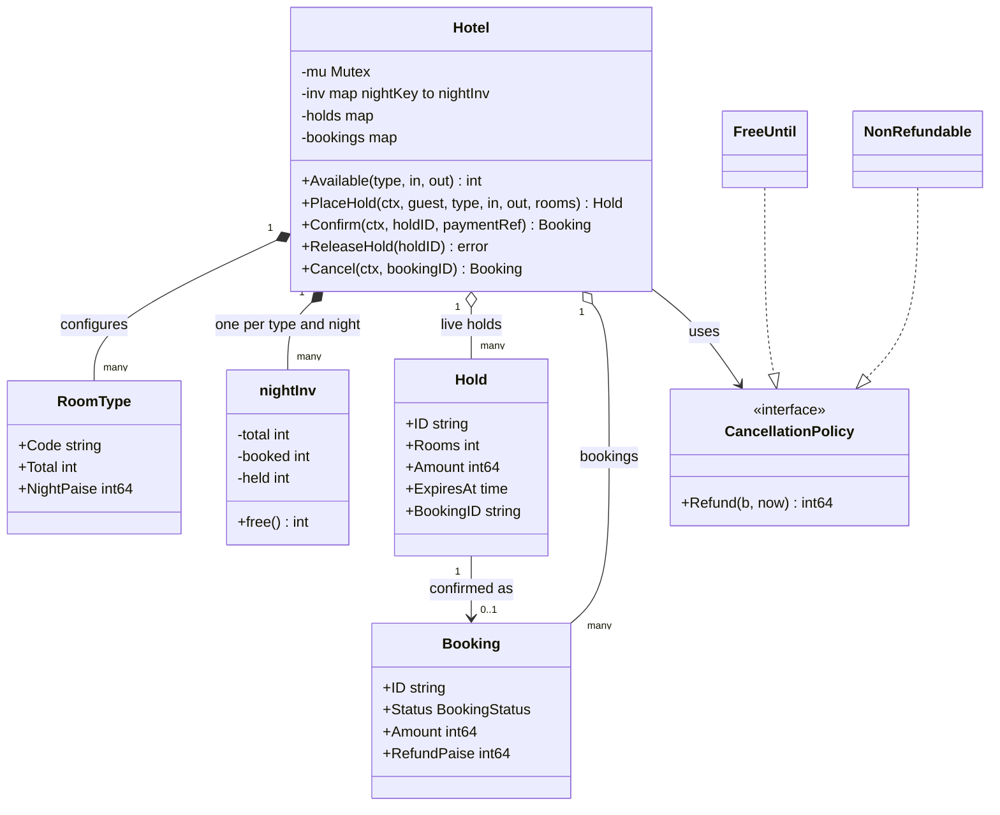
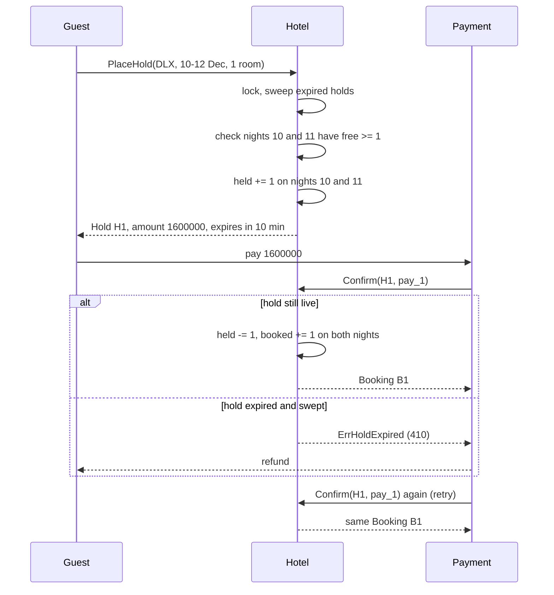
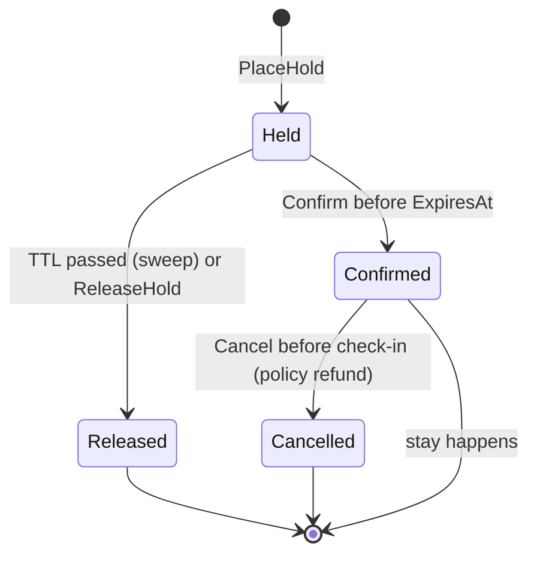

# Hotel Booking

> [!summary] TL;DR
> Hotel booking is **inventory per room type per night**. A stay from the 10th to the 12th uses the nights of the 10th and the 11th; the check-out day is not a night. A guest first places a **hold** that reserves every night and **expires** after a few minutes. Payment turns the hold into a booking. "No overbooking" means checking and reserving all the nights as one atomic step. Refunds come from a swappable **cancellation policy**. In PostgreSQL the same rule is a guarded counter update per night, or an **exclusion constraint** on date ranges when you assign real rooms.

> [!abstract] Core idea
> - The unit of inventory is (room type, night): `free = total - booked - held`.
> - A hold checks **all** nights first, then reserves **all** nights, under one lock. Partial holds are never left behind.
> - Holds expire. Expired holds are swept back into inventory before any read or write, and a late payment on an expired hold is refunded, not booked.
> - Confirm is idempotent: a retried confirm returns the same booking.
> - Refunds are a `CancellationPolicy` strategy: free until 48 hours before check-in, then the first night is kept; or non-refundable.
> - Classic mistakes: counting the check-out day as a night, checking nights one by one with separate locks, and holds that never expire.

## Problem statement

```text
Design a hotel booking system. A hotel has room types (Deluxe, Suite), each with a number of rooms
and a nightly rate. Guests search availability for a date range, hold rooms while paying,
and confirm. Holds expire if payment does not finish. Guests can cancel under a refund policy.
The hotel must never sell more rooms than it has, even with many guests booking at once.
```

- It tests interval modelling (nights, half-open ranges), all-or-nothing reservation across several keys, expiry with an injected clock, idempotency, a policy strategy, and a database schema that enforces the invariant. Time box: 10 minutes for Steps 1-4, 10 for Steps 5-6, 30 for the code, 10 for edge cases and SQL.

### Solving path

1. Clarify: room types or specific rooms, hold duration, cancellation rules, check-in time.
2. Fix the interval rule: a stay is `[checkIn, checkOut)`, one inventory row per night.
3. Name the entities: `RoomType`, night inventory, `Hold`, `Booking`, `CancellationPolicy`, `Hotel`.
4. Write `PlaceHold` (check all nights, then reserve all) and the expiry sweep.
5. Add `Confirm` (idempotent), `ReleaseHold`, `Cancel` with the policy.
6. Test overlaps, back-to-back stays, partial failure, expiry, idempotent confirm, refunds, and 60 concurrent guests under `-race`. Then show the PostgreSQL schema with the guarded update and the exclusion constraint.

## Step 1: Clarify requirements

### Questions to ask (with assumed answers)

- Does the guest book a room type or a specific room? *Assume: a room type; the front desk assigns a room at check-in. Specific rooms are the exclusion-constraint follow-up.*
- How is a stay counted? *Assume: nights in `[checkIn, checkOut)`; 10 Dec to 12 Dec is 2 nights.*
- Can one booking take several rooms? *Assume: yes, `rooms >= 1`, same type and dates.*
- How long does a hold last? *Assume: 10 minutes, which covers a payment page.*
- What is the price? *Assume: a flat rate per room type per night; seasonal pricing is a follow-up.*
- Cancellation rules? *Assume: per hotel. Flexible: full refund until 48 hours before check-in at 14:00, then the first night is kept. Non-refundable: no refund. Cancelling after the check-in time is not allowed (that is a no-show).*
- Is deliberate overbooking allowed, as some hotels do? *Assume: no; it becomes a configurable allowance in Step 10.*

### Functional

- Search: rooms free for a type and a date range (the minimum over its nights).
- Hold: reserve N rooms for every night of the stay, or fail with no change.
- Confirm a live hold after payment; a retry returns the same booking.
- Release a hold early; holds expire automatically after the TTL.
- Cancel a booking: refund from the policy, nights back to inventory.

### Non-functional

- Never sell more rooms than exist on any night, under any concurrency.
- Holds always expire, so abandoned checkouts cannot lock rooms forever.
- The refund rule can change per hotel without touching the booking flow.
- Money is `int64` paise; the clock is injected so expiry and refunds are testable.

### Out of scope

- Payments, room assignment at check-in, housekeeping, loyalty points, channel managers (Booking.com sync).
- Search across many hotels by city and price (the system design side).

## Step 2: Actors and use cases

| Actor | Use case |
|---|---|
| Guest | Search, hold, pay and confirm, cancel |
| Payment service | Calls confirm after a successful payment, with the hold ID |
| Expiry sweeper | Releases holds past their TTL (lazy in code, a job in production) |
| Hotel admin | Sets room types, counts, rates and the cancellation policy (setup, not coded) |

The hardest use case is **PlaceHold** under concurrency across several nights. Code it first, then the expiry, then confirm and cancel.

## Step 3: Entities

| Entity | Key fields | Why it exists |
|---|---|---|
| `Date` | midnight UTC | A calendar night, never a timestamp with hours |
| `RoomType` | Code, Total, NightPaise | What the guest buys and how many exist |
| night inventory | (type, night) to total, booked, held | The counter that must never go below zero free |
| `Hold` | ID, guest, type, dates, rooms, Amount, ExpiresAt, BookingID | A temporary claim on every night of a stay |
| `Booking` | ID, HoldID, dates, rooms, Amount, Status, RefundPaise, PaymentRef | The confirmed stay |
| `CancellationPolicy` | `Refund(booking, now)` | The refund rule changes per hotel and per rate plan |
| `Hotel` | types, inventory, holds, bookings, policy, clock, one mutex | The facade; owns the lock |

Modelling insights:

- **Inventory is per night, not per stay.** Two stays overlap only on the nights they share, and a 2-night stay must find room on both. Storing per-night counters turns "overlap" into simple counter checks.
- **Held and booked are separate counters.** Expiry only touches `held`, confirmation moves `held` to `booked`, and reports can show both.
- **The hold remembers its booking ID.** That makes `Confirm` idempotent without a separate key table.

## Step 4: Relationships



- **Composition** (hotel to room types and night rows): created and owned by the hotel. **Aggregation** (hotel to holds and bookings): they would live in storage.
- **Association** (hold to booking): by ID, which is what makes confirm idempotent. **Dependency on an interface** for the policy.

## Step 5: APIs and public methods

```text
GET  /hotels/{id}/availability?type=DLX&checkIn=2026-12-10&checkOut=2026-12-12   -> 200 {free: 3}
POST /hotels/{id}/holds         body: {guestId, type, checkIn, checkOut, rooms}
                                header: Idempotency-Key                          -> 201 {holdId, amount, expiresAt} | 409 sold out
DELETE /holds/{holdId}                                                           -> 204
POST /holds/{holdId}/confirm    body: {paymentRef}                               -> 201 booking | 410 hold expired
POST /bookings/{id}/cancel                                                       -> 200 {refund} | 409 already cancelled | 422 too late

Errors: 400 bad dates or rooms, 404 unknown room type
```

```go
type BookingService interface {
	Available(roomType string, in, out Date) (int, error)
	PlaceHold(ctx context.Context, guestID, roomType string, in, out Date, rooms int) (Hold, error)
	Confirm(ctx context.Context, holdID, paymentRef string) (Booking, error)
	ReleaseHold(holdID string) error
	Cancel(ctx context.Context, bookingID string) (Booking, error)
}

var _ BookingService = (*Hotel)(nil) // compile-time check
```

`410 Gone` on an expired hold tells the payment flow to refund: the money arrived after the rooms were released. API-level retries and keys are covered in [[Idempotency and Idempotency Keys]].

## Step 6: Storage and repositories

### Model A: counters per room type and night (what the code does)

```sql
CREATE TABLE room_types (
    id          TEXT PRIMARY KEY,
    hotel_id    TEXT   NOT NULL,
    total_rooms INT    NOT NULL CHECK (total_rooms >= 0),
    night_paise BIGINT NOT NULL
);

CREATE TABLE room_inventory (
    room_type_id TEXT NOT NULL REFERENCES room_types(id),
    night        DATE NOT NULL,
    total        INT  NOT NULL,
    booked       INT  NOT NULL DEFAULT 0,
    held         INT  NOT NULL DEFAULT 0,
    PRIMARY KEY (room_type_id, night),
    CHECK (booked >= 0 AND held >= 0 AND booked + held <= total)   -- the backstop
);

CREATE TABLE holds (
    id           TEXT PRIMARY KEY,
    room_type_id TEXT        NOT NULL,
    check_in     DATE        NOT NULL,
    check_out    DATE        NOT NULL CHECK (check_out > check_in),
    rooms        INT         NOT NULL CHECK (rooms >= 1),
    amount_paise BIGINT      NOT NULL,
    expires_at   TIMESTAMPTZ NOT NULL,
    status       TEXT        NOT NULL DEFAULT 'held'   -- held | confirmed | released
);
CREATE INDEX holds_expiring ON holds (expires_at) WHERE status = 'held';

-- PlaceHold, one transaction. Lock the nights in a fixed order first, so two
-- overlapping holds cannot deadlock by locking the same rows in different orders.
BEGIN;
SELECT night FROM room_inventory
WHERE room_type_id = $1 AND night >= $2 AND night < $3
ORDER BY night
FOR UPDATE;

UPDATE room_inventory SET held = held + $4
WHERE room_type_id = $1 AND night >= $2 AND night < $3
  AND total - booked - held >= $4;
-- the app compares the row count with the number of nights: fewer means sold out, ROLLBACK
INSERT INTO holds (id, room_type_id, check_in, check_out, rooms, amount_paise, expires_at)
VALUES ($5, $1, $2, $3, $4, $6, now() + interval '10 minutes');
COMMIT;

-- Confirm: only a live hold moves to confirmed (0 rows means expired or already confirmed)
UPDATE holds SET status = 'confirmed'
WHERE id = $1 AND status = 'held' AND expires_at > now();

-- Sweeper job: release expired holds without blocking on holds being confirmed right now
WITH expired AS (
    SELECT id FROM holds
    WHERE status = 'held' AND expires_at <= now()
    ORDER BY expires_at
    LIMIT 500
    FOR UPDATE SKIP LOCKED
)
UPDATE holds h SET status = 'released' FROM expired e WHERE h.id = e.id
RETURNING h.room_type_id, h.check_in, h.check_out, h.rooms;
-- then held = held - rooms for each returned stay, in the same transaction,
-- locking the night rows in (room_type_id, night) order like PlaceHold does
```

Rows for each night must exist before anyone books, so a nightly job creates them a year ahead. Under Read Committed, an `UPDATE` that waits on a locked row re-checks its `WHERE` against the newest row version, so the `total - booked - held >= $4` guard sees the other transaction's hold. The `CHECK` constraint is the last line of defence. Row locks in general are in [[Locking - Optimistic vs Pessimistic]]; transaction rules in [[Transactions and ACID]].

### Model B: specific rooms with an exclusion constraint

When the guest books a specific room (or the hotel assigns rooms at booking), the invariant becomes "no two active stays of the same room overlap". PostgreSQL enforces that directly:

```sql
CREATE EXTENSION IF NOT EXISTS btree_gist;   -- lets a GiST index use = on plain columns

CREATE TABLE room_stays (
    booking_id TEXT      NOT NULL,
    room_id    INT       NOT NULL,
    stay       daterange NOT NULL,            -- '[2026-12-10,2026-12-12)': nights 10 and 11
    status     TEXT      NOT NULL DEFAULT 'active',
    EXCLUDE USING gist (room_id WITH =, stay WITH &&) WHERE (status = 'active')
);

INSERT INTO room_stays VALUES ('B1', 101, daterange('2026-12-10', '2026-12-12'), 'active');
INSERT INTO room_stays VALUES ('B2', 101, daterange('2026-12-12', '2026-12-14'), 'active');  -- ok: [) ranges touch, no overlap
INSERT INTO room_stays VALUES ('B3', 101, daterange('2026-12-11', '2026-12-13'), 'active');  -- fails
```

Representative output (PostgreSQL 17):

```text
ERROR:  conflicting key value violates exclusion constraint "room_stays_room_id_stay_excl"
DETAIL:  Key (room_id, stay)=(101, [2026-12-11,2026-12-13)) conflicts with existing key (room_id, stay)=(101, [2026-12-10,2026-12-12)).
```

The SQLSTATE is `23P01` (`exclusion_violation`); the app maps it to 409 and tries the next free room. `daterange` is half-open `[)` by default, which matches "the check-out day is not a night". The `WHERE (status = 'active')` predicate makes cancelled stays stop counting. GiST and range indexes are covered in [[Index Types and Index Design]].

| | Model A: counters per night | Model B: exclusion constraint |
|---|---|---|
| Sells | a room type | a specific room |
| Invariant lives in | the guarded `UPDATE` plus `CHECK` | the `EXCLUDE` constraint |
| Concurrency | row locks on the night rows | the constraint check on insert |
| Availability query | `min(total - booked - held)` over nights | count rooms with no overlapping active stay |
| Fits | OTAs and most hotels | small hotels, room choice, assignment at check-in |

```go
type InventoryRepo interface {
	// Reserve runs the locked, guarded UPDATE for every night in [in, out) in one tx.
	Reserve(ctx context.Context, roomType string, in, out Date, rooms int) error // ErrSoldOut on short count
	Release(ctx context.Context, roomType string, in, out Date, rooms int, fromHeld bool) error
	Free(ctx context.Context, roomType string, in, out Date) (int, error)
}

type HoldRepo interface {
	Create(ctx context.Context, h Hold) error
	ConfirmLive(ctx context.Context, holdID string, now time.Time) (bool, error) // WHERE status='held' AND expires_at > now
	ClaimExpired(ctx context.Context, now time.Time, limit int) ([]Hold, error) // FOR UPDATE SKIP LOCKED
}
```

## Step 7: Patterns

| Pattern | Where | Why here |
|---|---|---|
| [[Strategy and Template Method]] | `CancellationPolicy` (`FreeUntil`, `NonRefundable`) | Refund rules differ per hotel and per rate plan |
| [[Facade (vs Mediator)]] | `Hotel` | One entry point hides the lock, the sweep and the counters |
| [[Repository and Unit of Work]] | `InventoryRepo`, `HoldRepo` | Reserving nights and inserting the hold must commit together |
| [[State Machines in Go]] | hold: held, confirmed, released; booking: confirmed, cancelled | Few states, but each move is guarded (live hold only, cancel once) |
| [[Observer and Event Bus]] | `booking.confirmed`, `booking.cancelled` (follow-up) | Emails, channel-manager sync and invoices stay off the booking path |

Patterns not used, and why:

- No pricing strategy in the code: one flat rate is the stated scope. Seasonal and weekend rates would be the second strategy, applied per night (Step 10).
- No per-night lock objects: one mutex makes "all nights or none" trivial. Fine-grained locks would need a fixed lock order to avoid deadlock, as the SQL version does.

## Folder structure

```text
hotel/
  date.go         -> Date, D, AddDays, Nights
  model.go        -> RoomType, nightInv, Hold, Booking, BookingStatus, Err* errors
  policy.go       -> CancellationPolicy, FreeUntil, NonRefundable
  hotel.go        -> Hotel: NewHotel, Available, PlaceHold, Confirm, ReleaseHold, Cancel, sweepLocked
  repository.go   -> InventoryRepo, HoldRepo (database version)
  hotel_test.go   -> overlap, partial failure, expiry, idempotency, refund table, concurrency
```

## Step 8: Core code

> [!tip] What to code in a 60-minute round
> Aim for about 180 lines in the room.
> - **Write:** `Date` and `Nights`, `RoomType`, the per-night counters, `Hold`, `Booking`, and `Hotel` with `PlaceHold` (check all, then reserve all), `sweepLocked` and `Confirm`.
> - **Add if time remains:** `Cancel` with the `CancellationPolicy` interface and `FreeUntil`, `ReleaseHold`, and the concurrency test.
> - **Talk only:** both SQL models, the sweeper job, seasonal pricing, overbooking allowance, room assignment.

### Walkthrough

`PlaceHold(ctx, guest, type, in, out, rooms)`:

1. Validate: `in < out`, `rooms >= 1`, known room type.
2. Take `h.mu`, then `sweepLocked` so expired holds stop blocking rooms.
3. **Phase 1, check all:** for every night in `[in, out)`, `free() >= rooms`, or return `ErrSoldOut` with nothing changed.
4. **Phase 2, reserve all:** `held += rooms` on every night. Both phases run under the same lock, so no other hold can slip in between.
5. Price it (`nights x rooms x rate`), set `ExpiresAt = now + TTL`, store and return a copy.

`Confirm(ctx, holdID, paymentRef)`:

1. Lock and sweep. A missing hold means expired (and swept) or unknown: `ErrHoldExpired`, and the payment side refunds.
2. If the hold already has a `BookingID`, return that booking: the retry is idempotent.
3. Move `held` to `booked` on every night, create the booking, link it from the hold.

`Cancel(ctx, bookingID)`:

1. Reject unknown, already cancelled, or after the check-in time (`ErrTooLate`).
2. Ask the policy for the refund, mark cancelled, `booked -= rooms` on every night.

Expiry is checked with `!now.Before(ExpiresAt)`, so a hold is dead at exactly its expiry time. The test checks the boundary.

> [!tip] Exercise: weekend pricing
> Add a `RatePlan` interface with `NightPrice(roomType, night Date) int64`, and a `WeekendRate` that charges 125 percent on Friday and Saturday nights. `PlaceHold` then sums the price night by night instead of `nights x rate`. Watch the refund: `FreeUntil` keeps "the first night", which is no longer `Amount / nights`, so the booking must store the per-night prices.

```go
package hotel

import (
	"context"
	"errors"
	"fmt"
	"sync"
	"time"
)

var (
	ErrBadDates       = errors.New("check-out must be after check-in")
	ErrBadRooms       = errors.New("rooms must be at least 1")
	ErrUnknownType    = errors.New("unknown room type")
	ErrSoldOut        = errors.New("not enough rooms on at least one night")
	ErrHoldNotFound   = errors.New("hold not found")
	ErrHoldExpired    = errors.New("hold expired or unknown")
	ErrBookingMissing = errors.New("booking not found")
	ErrAlreadyCancel  = errors.New("booking already cancelled")
	ErrTooLate        = errors.New("cancellation after check-in is not allowed")
)

// Date is a calendar night in the hotel's calendar, stored as midnight UTC only as
// a label. Night N means the stay from the afternoon of N to the morning of N+1.
// Simplification: the check-in instant below is CheckInHour in UTC; a real hotel
// uses its own time zone (see the edge-case table).
type Date struct{ t time.Time }

func D(y int, m time.Month, d int) Date { return Date{time.Date(y, m, d, 0, 0, 0, 0, time.UTC)} }
func (d Date) AddDays(n int) Date       { return Date{d.t.AddDate(0, 0, n)} }
func (d Date) Before(o Date) bool       { return d.t.Before(o.t) }
func (d Date) String() string           { return d.t.Format("2006-01-02") }

// Nights returns every night in [in, out): check-out day is not a night.
func Nights(in, out Date) []Date {
	var ns []Date
	for d := in; d.Before(out); d = d.AddDays(1) {
		ns = append(ns, d)
	}
	return ns
}

type RoomType struct {
	Code       string
	Total      int   // physical rooms of this type
	NightPaise int64 // rate per room per night
}

type nightKey struct {
	Type  string
	Night Date
}

type nightInv struct{ total, booked, held int }

func (n nightInv) free() int { return n.total - n.booked - n.held }

type Hold struct {
	ID        string
	GuestID   string
	Type      string
	CheckIn   Date
	CheckOut  Date
	Rooms     int
	Amount    int64
	ExpiresAt time.Time
	BookingID string // set once confirmed, so a retried Confirm is idempotent
}

type BookingStatus int

const (
	Confirmed BookingStatus = iota
	Cancelled
)

type Booking struct {
	ID          string
	HoldID      string
	GuestID     string
	Type        string
	CheckIn     Date
	CheckOut    Date
	Rooms       int
	Amount      int64
	Status      BookingStatus
	RefundPaise int64
	PaymentRef  string
}

// CancellationPolicy decides the refund; the service only applies it.
type CancellationPolicy interface {
	Refund(b Booking, now time.Time) int64
}

// FreeUntil: full refund until Window before the check-in time,
// after that the first night is kept and the rest refunded.
type FreeUntil struct {
	Window      time.Duration
	CheckInHour int // e.g. 14 for 2 pm
}

func (p FreeUntil) Refund(b Booking, now time.Time) int64 {
	checkIn := b.CheckIn.t.Add(time.Duration(p.CheckInHour) * time.Hour)
	if now.Before(checkIn.Add(-p.Window)) {
		return b.Amount
	}
	n := int64(len(Nights(b.CheckIn, b.CheckOut)))
	firstNight := b.Amount / n // total is nights x rooms x rate, so this is exact
	return b.Amount - firstNight
}

type NonRefundable struct{}

func (NonRefundable) Refund(Booking, time.Time) int64 { return 0 }

type Config struct {
	HoldTTL     time.Duration
	CheckInHour int
}

type Hotel struct {
	mu       sync.Mutex // guards everything below
	now      func() time.Time
	cfg      Config
	policy   CancellationPolicy
	types    map[string]RoomType
	inv      map[nightKey]*nightInv
	holds    map[string]*Hold
	bookings map[string]*Booking
	seq      int
}

func NewHotel(types []RoomType, policy CancellationPolicy, now func() time.Time, cfg Config) *Hotel {
	h := &Hotel{now: now, cfg: cfg, policy: policy, types: map[string]RoomType{},
		inv: map[nightKey]*nightInv{}, holds: map[string]*Hold{}, bookings: map[string]*Booking{}}
	for _, t := range types {
		h.types[t.Code] = t
	}
	return h
}

// invLocked creates a night's row lazily from the room-type total.
func (h *Hotel) invLocked(t string, n Date) *nightInv {
	k := nightKey{t, n}
	if h.inv[k] == nil {
		h.inv[k] = &nightInv{total: h.types[t].Total}
	}
	return h.inv[k]
}

// sweepLocked releases every expired, unconfirmed hold. O(holds); a min-heap
// by ExpiresAt makes it O(log n) per expiry.
func (h *Hotel) sweepLocked() {
	now := h.now()
	for id, hd := range h.holds {
		if hd.BookingID == "" && !now.Before(hd.ExpiresAt) {
			for _, n := range Nights(hd.CheckIn, hd.CheckOut) {
				h.invLocked(hd.Type, n).held -= hd.Rooms
			}
			delete(h.holds, id)
		}
	}
}

// Available returns the bookable count for a stay: the minimum over its nights.
func (h *Hotel) Available(roomType string, in, out Date) (int, error) {
	if !in.Before(out) {
		return 0, ErrBadDates
	}
	h.mu.Lock()
	defer h.mu.Unlock()
	if _, ok := h.types[roomType]; !ok {
		return 0, ErrUnknownType
	}
	h.sweepLocked()
	m := -1
	for _, n := range Nights(in, out) {
		if f := h.invLocked(roomType, n).free(); m == -1 || f < m {
			m = f
		}
	}
	return m, nil
}

// PlaceHold checks every night, then reserves every night, under one lock:
// all nights or none.
func (h *Hotel) PlaceHold(ctx context.Context, guestID, roomType string, in, out Date, rooms int) (Hold, error) {
	if err := ctx.Err(); err != nil {
		return Hold{}, err
	}
	if !in.Before(out) {
		return Hold{}, ErrBadDates
	}
	if rooms < 1 {
		return Hold{}, ErrBadRooms
	}
	h.mu.Lock()
	defer h.mu.Unlock()
	rt, ok := h.types[roomType]
	if !ok {
		return Hold{}, ErrUnknownType
	}
	h.sweepLocked()
	nights := Nights(in, out)
	for _, n := range nights { // phase 1: check all
		if h.invLocked(roomType, n).free() < rooms {
			return Hold{}, fmt.Errorf("%w: %s on %s", ErrSoldOut, roomType, n)
		}
	}
	for _, n := range nights { // phase 2: reserve all
		h.invLocked(roomType, n).held += rooms
	}
	h.seq++
	hd := &Hold{ID: fmt.Sprintf("H%d", h.seq), GuestID: guestID, Type: roomType,
		CheckIn: in, CheckOut: out, Rooms: rooms,
		Amount:    int64(len(nights)) * int64(rooms) * rt.NightPaise,
		ExpiresAt: h.now().Add(h.cfg.HoldTTL)}
	h.holds[hd.ID] = hd
	return *hd, nil
}

// Confirm turns a live hold into a booking after payment. Retrying with the
// same hold returns the same booking.
func (h *Hotel) Confirm(ctx context.Context, holdID, paymentRef string) (Booking, error) {
	if err := ctx.Err(); err != nil {
		return Booking{}, err
	}
	h.mu.Lock()
	defer h.mu.Unlock()
	h.sweepLocked()
	hd, ok := h.holds[holdID]
	if !ok {
		// Swept or never existed; the caller refunds the payment.
		return Booking{}, fmt.Errorf("%w: %s", ErrHoldExpired, holdID)
	}
	if hd.BookingID != "" {
		return *h.bookings[hd.BookingID], nil
	}
	for _, n := range Nights(hd.CheckIn, hd.CheckOut) {
		inv := h.invLocked(hd.Type, n)
		inv.held -= hd.Rooms
		inv.booked += hd.Rooms
	}
	h.seq++
	b := &Booking{ID: fmt.Sprintf("B%d", h.seq), HoldID: hd.ID, GuestID: hd.GuestID, Type: hd.Type,
		CheckIn: hd.CheckIn, CheckOut: hd.CheckOut, Rooms: hd.Rooms, Amount: hd.Amount,
		Status: Confirmed, PaymentRef: paymentRef}
	h.bookings[b.ID] = b
	hd.BookingID = b.ID
	return *b, nil
}

// ReleaseHold lets the guest abandon checkout before the TTL.
func (h *Hotel) ReleaseHold(holdID string) error {
	h.mu.Lock()
	defer h.mu.Unlock()
	hd, ok := h.holds[holdID]
	if !ok || hd.BookingID != "" {
		return ErrHoldNotFound
	}
	for _, n := range Nights(hd.CheckIn, hd.CheckOut) {
		h.invLocked(hd.Type, n).held -= hd.Rooms
	}
	delete(h.holds, holdID)
	return nil
}

// Cancel applies the policy and returns every night to inventory.
func (h *Hotel) Cancel(ctx context.Context, bookingID string) (Booking, error) {
	if err := ctx.Err(); err != nil {
		return Booking{}, err
	}
	h.mu.Lock()
	defer h.mu.Unlock()
	b, ok := h.bookings[bookingID]
	if !ok {
		return Booking{}, ErrBookingMissing
	}
	if b.Status == Cancelled {
		return *b, ErrAlreadyCancel
	}
	now := h.now()
	checkIn := b.CheckIn.t.Add(time.Duration(h.cfg.CheckInHour) * time.Hour)
	if !now.Before(checkIn) {
		return *b, ErrTooLate
	}
	b.RefundPaise = h.policy.Refund(*b, now)
	b.Status = Cancelled
	for _, n := range Nights(b.CheckIn, b.CheckOut) {
		h.invLocked(b.Type, n).booked -= b.Rooms
	}
	return *b, nil
}
```

## Test cases

| Test | Proves |
|---|---|
| `TestNightsExcludeCheckOut` | 30 Jan to 2 Feb is 3 nights; the last is 1 Feb |
| `TestOverlapAndBackToBackStays` | 1 room: 10-12 held, 11-13 sold out, 12-14 fine (check-out day is free), zero-night stay rejected, 2 nights cost 1600000 paise |
| `TestFailedHoldReservesNothing` | Night 10 free, night 11 full: the 10-12 hold fails and night 10 stays fully free |
| `TestHoldExpiresAndIsReleased` | Blocks at 9 minutes, released at exactly 10, confirm after expiry gives `ErrHoldExpired` |
| `TestConfirmIsIdempotentAndReleaseWorks` | Two confirms, one booking, one room used; an early release frees the room |
| `TestCancellationPolicies` | Full refund 48h + 1 min before 14:00 check-in; at exactly 48h the first night is kept (1600000 of 2400000); non-refundable gives 0; after check-in gives `ErrTooLate`; nights freed; double cancel rejected |
| `TestConcurrentHoldsNeverOverbook` | 60 guests, 3 rooms, overlapping 2-night stays, half confirming at once: no night has `booked + held > total` |

All seven pass under `go test -race` (Go 1.24.4, also with `-count=3`), and `go vet` is clean.

```go
package hotel

import (
	"context"
	"errors"
	"fmt"
	"sync"
	"testing"
	"time"
)

type fakeClock struct {
	mu sync.Mutex
	t  time.Time
}

func (c *fakeClock) Now() time.Time  { c.mu.Lock(); defer c.mu.Unlock(); return c.t }
func (c *fakeClock) Set(t time.Time) { c.mu.Lock(); defer c.mu.Unlock(); c.t = t }
func (c *fakeClock) Advance(d time.Duration) {
	c.mu.Lock()
	defer c.mu.Unlock()
	c.t = c.t.Add(d)
}

var ctx = context.Background()

func newHotel(total int, p CancellationPolicy) (*Hotel, *fakeClock) {
	clk := &fakeClock{t: time.Date(2026, 12, 1, 10, 0, 0, 0, time.UTC)}
	types := []RoomType{{Code: "DLX", Total: total, NightPaise: 800000}} // Rs 8,000 a night
	return NewHotel(types, p, clk.Now, Config{HoldTTL: 10 * time.Minute, CheckInHour: 14}), clk
}

func avail(t *testing.T, h *Hotel, in, out Date) int {
	t.Helper()
	n, err := h.Available("DLX", in, out)
	if err != nil {
		t.Fatal(err)
	}
	return n
}

func TestNightsExcludeCheckOut(t *testing.T) {
	ns := Nights(D(2026, 1, 30), D(2026, 2, 2))
	if len(ns) != 3 || ns[2].String() != "2026-02-01" {
		t.Fatalf("got %v", ns)
	}
}

func TestOverlapAndBackToBackStays(t *testing.T) {
	h, _ := newHotel(1, NonRefundable{})
	a, err := h.PlaceHold(ctx, "G1", "DLX", D(2026, 12, 10), D(2026, 12, 12), 1)
	if err != nil || a.Amount != 1600000 {
		t.Fatalf("hold: %+v %v", a, err)
	}
	if _, err := h.PlaceHold(ctx, "G2", "DLX", D(2026, 12, 11), D(2026, 12, 13), 1); !errors.Is(err, ErrSoldOut) {
		t.Fatalf("overlap: want ErrSoldOut, got %v", err)
	}
	if _, err := h.PlaceHold(ctx, "G3", "DLX", D(2026, 12, 12), D(2026, 12, 14), 1); err != nil {
		t.Fatalf("check-out day is free for the next guest: %v", err)
	}
	if _, err := h.PlaceHold(ctx, "G4", "DLX", D(2026, 12, 12), D(2026, 12, 12), 1); !errors.Is(err, ErrBadDates) {
		t.Fatalf("zero nights: want ErrBadDates, got %v", err)
	}
}

func TestFailedHoldReservesNothing(t *testing.T) {
	h, _ := newHotel(2, NonRefundable{})
	if _, err := h.PlaceHold(ctx, "G1", "DLX", D(2026, 12, 11), D(2026, 12, 12), 2); err != nil {
		t.Fatal(err)
	}
	// Night 10 is free but night 11 is full: the 2-night hold must take neither.
	if _, err := h.PlaceHold(ctx, "G2", "DLX", D(2026, 12, 10), D(2026, 12, 12), 1); !errors.Is(err, ErrSoldOut) {
		t.Fatalf("want ErrSoldOut, got %v", err)
	}
	if got := avail(t, h, D(2026, 12, 10), D(2026, 12, 11)); got != 2 {
		t.Fatalf("night 10 leaked a hold: free=%d", got)
	}
}

func TestHoldExpiresAndIsReleased(t *testing.T) {
	h, clk := newHotel(1, NonRefundable{})
	hd, _ := h.PlaceHold(ctx, "G1", "DLX", D(2026, 12, 10), D(2026, 12, 11), 1)
	clk.Advance(9 * time.Minute)
	if got := avail(t, h, D(2026, 12, 10), D(2026, 12, 11)); got != 0 {
		t.Fatalf("live hold should block: free=%d", got)
	}
	clk.Advance(time.Minute) // exactly at ExpiresAt: expired
	if got := avail(t, h, D(2026, 12, 10), D(2026, 12, 11)); got != 1 {
		t.Fatalf("expired hold should be released: free=%d", got)
	}
	if _, err := h.Confirm(ctx, hd.ID, "pay_1"); !errors.Is(err, ErrHoldExpired) {
		t.Fatalf("want ErrHoldExpired, got %v", err)
	}
}

func TestConfirmIsIdempotentAndReleaseWorks(t *testing.T) {
	h, _ := newHotel(2, NonRefundable{})
	hd, _ := h.PlaceHold(ctx, "G1", "DLX", D(2026, 12, 10), D(2026, 12, 11), 1)
	b1, err1 := h.Confirm(ctx, hd.ID, "pay_1")
	b2, err2 := h.Confirm(ctx, hd.ID, "pay_1") // client retry after a timeout
	if err1 != nil || err2 != nil || b1.ID != b2.ID {
		t.Fatalf("confirm twice: %v %v %s %s", err1, err2, b1.ID, b2.ID)
	}
	if got := avail(t, h, D(2026, 12, 10), D(2026, 12, 11)); got != 1 {
		t.Fatalf("one booking should use one room: free=%d", got)
	}
	h2, _ := h.PlaceHold(ctx, "G2", "DLX", D(2026, 12, 10), D(2026, 12, 11), 1)
	if err := h.ReleaseHold(h2.ID); err != nil {
		t.Fatal(err)
	}
	if got := avail(t, h, D(2026, 12, 10), D(2026, 12, 11)); got != 1 {
		t.Fatalf("released hold should free the room: free=%d", got)
	}
}

func TestCancellationPolicies(t *testing.T) {
	in, out := D(2026, 12, 10), D(2026, 12, 13) // 3 nights x Rs 8,000 = 2400000 paise
	cases := []struct {
		name    string
		policy  CancellationPolicy
		at      time.Time
		refund  int64
		wantErr error
	}{
		{"free: 48h + 1 min before 14:00 check-in", FreeUntil{48 * time.Hour, 14}, time.Date(2026, 12, 8, 13, 59, 0, 0, time.UTC), 2400000, nil},
		{"late: exactly 48h before keeps first night", FreeUntil{48 * time.Hour, 14}, time.Date(2026, 12, 8, 14, 0, 0, 0, time.UTC), 1600000, nil},
		{"non-refundable", NonRefundable{}, time.Date(2026, 12, 2, 9, 0, 0, 0, time.UTC), 0, nil},
		{"after check-in time", FreeUntil{48 * time.Hour, 14}, time.Date(2026, 12, 10, 14, 0, 0, 0, time.UTC), 0, ErrTooLate},
	}
	for _, c := range cases {
		t.Run(c.name, func(t *testing.T) {
			h, clk := newHotel(1, c.policy)
			hd, _ := h.PlaceHold(ctx, "G1", "DLX", in, out, 1)
			b, err := h.Confirm(ctx, hd.ID, "pay_1")
			if err != nil {
				t.Fatal(err)
			}
			clk.Set(c.at)
			got, err := h.Cancel(ctx, b.ID)
			if !errors.Is(err, c.wantErr) {
				t.Fatalf("err: got %v want %v", err, c.wantErr)
			}
			if c.wantErr != nil {
				return
			}
			if got.RefundPaise != c.refund || got.Status != Cancelled {
				t.Fatalf("refund: got %d want %d", got.RefundPaise, c.refund)
			}
			if f := avail(t, h, in, out); f != 1 {
				t.Fatalf("cancel should free all nights: free=%d", f)
			}
			if _, err := h.Cancel(ctx, b.ID); !errors.Is(err, ErrAlreadyCancel) {
				t.Fatalf("double cancel: want ErrAlreadyCancel, got %v", err)
			}
		})
	}
}

func TestConcurrentHoldsNeverOverbook(t *testing.T) {
	h, _ := newHotel(3, NonRefundable{})
	var (
		wg   sync.WaitGroup
		mu   sync.Mutex
		wins int
	)
	// 60 guests, overlapping stays starting on 10, 11 or 12 Dec, 2 nights each.
	for i := range 60 {
		wg.Add(1)
		go func() {
			defer wg.Done()
			in := D(2026, 12, 10+i%3)
			hd, err := h.PlaceHold(ctx, fmt.Sprintf("G%d", i), "DLX", in, in.AddDays(2), 1)
			if errors.Is(err, ErrSoldOut) {
				return
			}
			if err != nil {
				t.Error(err)
				return
			}
			if i%2 == 0 { // half of the winners pay at once
				if _, err := h.Confirm(ctx, hd.ID, "pay"); err != nil {
					t.Error(err)
				}
			}
			mu.Lock()
			wins++
			mu.Unlock()
		}()
	}
	wg.Wait()
	h.mu.Lock()
	defer h.mu.Unlock()
	for k, inv := range h.inv {
		if inv.booked+inv.held > inv.total || inv.free() < 0 {
			t.Fatalf("overbooked %v: %+v", k, *inv)
		}
	}
	// Night 11 is in every stay that starts on 10 or 11, so at most 3 such
	// stays win; at least 3 stays win overall.
	if wins < 3 || wins > 6 {
		t.Fatalf("wins=%d, want 3..6", wins)
	}
}
```

## Step 9: Edge cases

| Edge case | What happens | How the design handles it |
|---|---|---|
| Two guests take the last room at once | Both see 1 free | Check and reserve under one lock; in SQL, the guarded `UPDATE` plus `CHECK` |
| Stay spans a sold-out middle night | Partial hold on the free nights | Phase 1 checks every night before phase 2 touches any |
| Back-to-back stays (out 12th, in 12th) | Wrongly rejected as overlap | Half-open `[in, out)`; `daterange` is `[)` by default |
| `checkOut <= checkIn` | Zero or negative nights | `ErrBadDates` |
| Guest abandons the payment page | Rooms locked forever | TTL plus sweep; production uses a sweeper job with `SKIP LOCKED` |
| Payment succeeds after the hold expired | Money taken, no room | `Confirm` returns `ErrHoldExpired` (410); the payment is refunded |
| Payment callback delivered twice | Two bookings | The hold stores `BookingID`; a retry returns the same booking |
| Cancel at exactly the free-cancel deadline | Off-by-one dispute | `now.Before(deadline)` means the deadline itself is late; the test pins it |
| Cancel after check-in time | Refund for a used night | `ErrTooLate`; no-shows are a separate flow |
| Double cancel | Inventory released twice, counter goes up | `ErrAlreadyCancel`; in SQL `UPDATE ... WHERE status = 'confirmed'` |
| Overlapping holds lock the same nights in different orders (SQL) | Deadlock | `SELECT ... ORDER BY night FOR UPDATE` before the update |
| Time zones | Night computed from a UTC timestamp lands on the wrong date; the 14:00 check-in is a local time | Take check-in and check-out from the guest as calendar dates in the hotel's calendar and never derive them from a timestamp. The code stores those dates as midnight UTC only as a label, and it adds `CheckInHour` to that UTC midnight, so the deadline is 14:00 UTC; that is right only for a hotel on UTC. In production, store the hotel's IANA zone and build the check-in instant with `time.Date(y, m, d, 14, 0, 0, 0, loc)` |

### Common mistakes

- Treating a stay as `[in, out]` and blocking the check-out day.
- Checking availability, unlocking, then reserving (check-then-act).
- Reserving night by night and returning on the first full night, leaving earlier nights held.
- Holds without expiry, or expiry that runs only from a cron job so the in-memory path never sees it.
- A refund computed with `float64`, or a policy hard-coded with `if hotel == ...`.

## Step 10: Tradeoffs and extensions

| Follow-up | Design change |
|---|---|
| Seasonal or weekend rates | `RatePlan` strategy priced per night; store per-night prices on the booking |
| Deliberate overbooking (sell 102 percent) | `total` becomes `capacity + allowance` per type; the walk-out cost is a business decision |
| Specific room choice | Model B: `room_stays` with the exclusion constraint |
| Modify dates | Place a new hold for the new range, confirm it, then cancel the old booking, so the guest never loses the old room |
| Many hotels, high traffic | Shard by hotel; inventory rows are naturally per hotel, and the hot rows are popular nights |
| Channel managers (OTA sync) | Publish inventory changes as events; allocate per-channel quotas |
| Faster expiry | A min-heap of holds by `ExpiresAt` in memory, or the indexed `expires_at` in SQL |

Tradeoffs chosen:

- **Counters per night versus a list of bookings.** Counters make availability O(nights) and the invariant a simple check. Scanning bookings for overlaps is O(bookings) per query.
- **One mutex for the hotel.** Correct and simple; a hotel takes a handful of bookings a second. Shard across hotels, not inside one.
- **Lazy sweep on every call.** No background goroutine to stop in tests; the cost is O(live holds) per call, fine for a few hundred holds. A heap or a job scales further.
- **Hold then confirm versus book then pay.** Holding first means a guest never pays for a room that is gone; the cost is rooms briefly unavailable to others during checkout.

## Drawing





## Interview questions

> [!question]- Why model inventory per night instead of per booking?
> Two stays conflict only on the nights they share, and a stay needs room on every one of its nights. Per-night counters turn that into "free >= rooms on each night", one O(nights) check, and the invariant `booked + held <= total` can be a `CHECK` constraint. Scanning bookings for overlaps grows with the number of bookings and cannot be a simple constraint.

> [!question]- Trap: a guest checks out on the 12th and another checks in on the 12th. Is that a conflict?
> No. A stay is half-open `[checkIn, checkOut)`, so the first stay's nights are the 10th and 11th and the second starts with the 12th. Closed intervals wrongly reject back-to-back stays. PostgreSQL `daterange` is `[)` by default, so the exclusion constraint gets this right.

> [!question]- How does PlaceHold avoid leaving half a hold behind?
> It checks every night first and only then reserves every night, both under one lock. If any night is short, nothing has been touched. In SQL the guarded `UPDATE` runs in one transaction; if it updates fewer rows than there are nights, the transaction rolls back.

> [!question]- How do you prevent overbooking in PostgreSQL?
> For room types: lock the night rows in date order with `FOR UPDATE`, then `UPDATE ... SET held = held + n WHERE ... AND total - booked - held >= n`, and back it with `CHECK (booked + held <= total)`. For specific rooms: `EXCLUDE USING gist (room_id WITH =, stay WITH &&)` with `btree_gist`, which rejects an overlapping stay with SQLSTATE 23P01 even if the app has a bug.

> [!question]- The payment succeeds one second after the hold expired. What happens?
> The sweep has already returned the rooms to inventory, so `Confirm` returns `ErrHoldExpired` and the payment is refunded. You could try to re-hold the same rooms, but only through a fresh `PlaceHold` that re-checks availability; never confirm a dead hold. In SQL, `UPDATE holds ... WHERE status = 'held' AND expires_at > now()` returns 0 rows.

> [!question]- Why is the cancellation policy a strategy?
> Refund rules vary per hotel and per rate plan (flexible, 50 percent, non-refundable) and change with the season. The service only needs "how much do I refund for this booking at this time". Each rule is a small type with its own table test, and the boundary (exactly 48 hours before) is pinned in one place.

> [!question]- How do you make Confirm safe to retry?
> The hold stores the booking ID when it is confirmed. A second call finds it and returns the same booking without touching inventory. At the API level the payment callback also carries an idempotency key, and in SQL the conditional update on `status = 'held'` returns 0 rows for the second attempt.

## Interview explanation

```text
I model inventory per room type per night, with total, booked and held counters, and a stay as the half-open range of nights [checkIn, checkOut), so the check-out day is free for the next guest. Booking is two steps: PlaceHold checks every night has enough free rooms and then reserves every night, both under one lock, so it is all or nothing; the hold expires after ten minutes and expired holds are swept back before any read or write. Confirm moves held to booked and is idempotent because the hold remembers its booking ID; a confirm on an expired hold fails and the payment is refunded. Cancellation asks a CancellationPolicy strategy for the refund, such as free until 48 hours before check-in, then the first night is kept. In PostgreSQL I lock the night rows in date order, run a guarded UPDATE with a CHECK constraint as the backstop, and when rooms are specific I use an exclusion constraint on room_id and a daterange so overlapping stays are rejected by the database itself. Money is int64 paise and the clock is injected.
```

## Cheat sheet

- Stay = nights in `[checkIn, checkOut)`; inventory key = (room type, night); `free = total - booked - held`.
- PlaceHold: check all nights, then reserve all, under one lock; partial failure changes nothing.
- Holds expire (`!now.Before(expiresAt)`), swept before every read and write; a confirm on a dead hold fails and the payment is refunded.
- Confirm is idempotent through `Hold.BookingID`.
- Refund = `CancellationPolicy.Refund(booking, now)`; no cancel after check-in time.
- SQL: lock night rows `ORDER BY night FOR UPDATE`, guarded `UPDATE`, `CHECK (booked + held <= total)`; specific rooms: `EXCLUDE USING gist (room_id WITH =, stay WITH &&)` with `btree_gist`, error 23P01.

## Links

- **Before this:** [[Strategy and Template Method]], [[Concurrency for LLD]], [[Movie Ticket Booking]], [[Ride Sharing]]
- **Next:** [[Order Book Matching Engine]]
- **Compare with:** [[Meeting Room Scheduler]] (interval overlap for one resource), [[Case Study - Ticket Booking]] (holds and inventory at system scale), [[Locking - Optimistic vs Pessimistic]] and [[Transactions and ACID]] (the database guarantees), [[Index Types and Index Design]] (GiST and range indexes)
