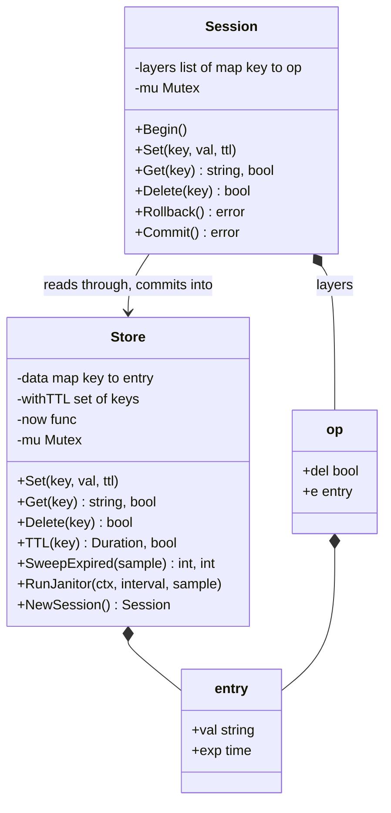
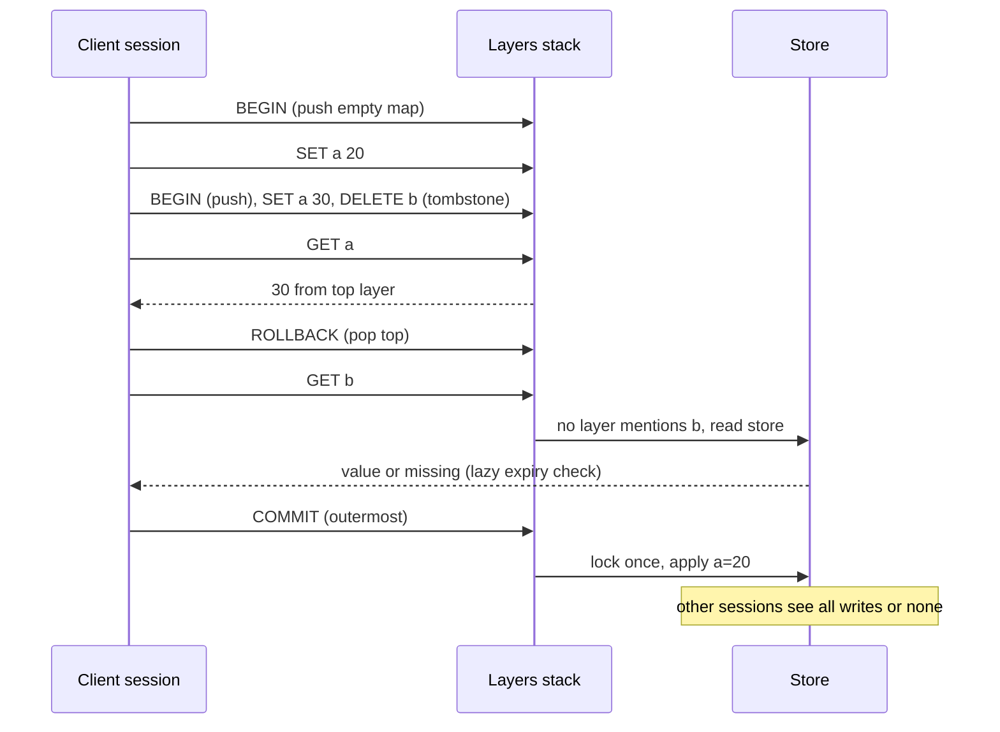
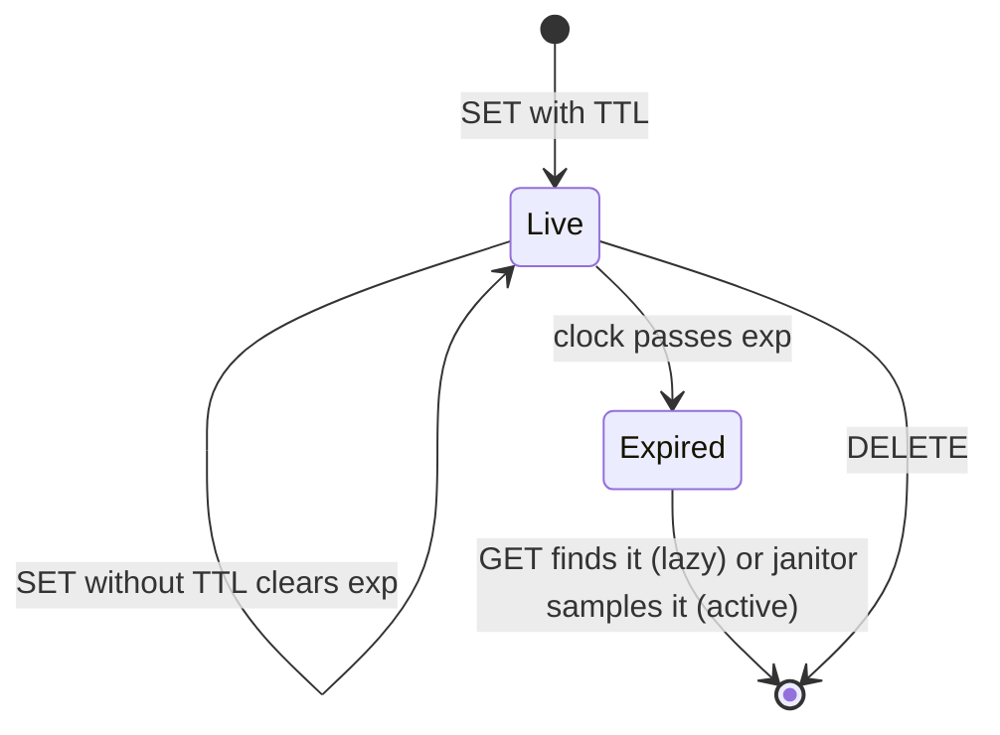

# In-memory KV Store with TTL and Transactions

> [!summary] TL;DR
> Build a tiny Redis: `GET`, `SET` with an optional TTL, `DELETE`, plus nested `BEGIN`, `ROLLBACK` and `COMMIT`. Expired keys are removed in two ways, lazily when someone reads them and actively by a background sweeper that samples keys with a TTL. Transactions are a stack of small maps that hold only the keys written since each `BEGIN`; a read walks the stack from the top down, a rollback pops one map, and the outermost commit applies everything to the store under one lock.

> [!abstract] Core idea
> - Every entry is `{value, expireAt}`; a zero `expireAt` means no TTL. TTL is turned into an absolute time at `SET` using an injected clock.
> - Lazy expiry: `GET` deletes an expired key it finds. Active expiry: a janitor samples up to N keys from a separate set of keys with a TTL, so memory is freed even for keys nobody reads.
> - Transactions are layered maps, not copies of the store: `BEGIN` pushes an empty map, writes go to the top map, a delete is a tombstone, reads check top to bottom then the store.
> - `ROLLBACK` pops one layer; an inner `COMMIT` merges into its parent; the outermost `COMMIT` applies all writes in one critical section, so other sessions see all or nothing.
> - Concurrency: one mutex on the store, one per session, and a fixed lock order (session before store) so there is no deadlock.

## Problem statement

```text
Design an in-memory key-value store with:
  SET key value [TTL]   GET key   DELETE key   TTL key
  BEGIN   ROLLBACK   COMMIT     (transactions can be nested)
ROLLBACK undoes only the innermost open transaction. Keys with a TTL disappear once
it passes, even if nobody reads them again. Many clients use the store at once.
```

- It tests data-structure choice (maps and a TTL index), two expiry strategies and their memory and latency costs, the layered-map trick for nested transactions, testability with an injected clock, and lock design. It is also the LLD half of [[Case Study - Key-Value Store]]. Time box: 10 minutes for Steps 1-4, 5 for Steps 5-7, 30 for the code, 10 for edge cases.

### Solving path

1. Ask the clarifying questions: TTL resolution, what `COMMIT` does when nested, isolation between clients.
2. Write the store: `map[string]entry` with `expireAt`, the injected clock, and lazy expiry inside a `live(key)` helper.
3. Add active expiry: a `withTTL` set and `SweepExpired(sample)`, then a janitor goroutine with a ticker.
4. Add sessions with a stack of layers; implement read-through-layers, tombstones, `ROLLBACK` and `COMMIT`.
5. Add the locks and state the lock order.
6. Test TTL at the exact boundary, the sweeper, nested rollback, inner commit then outer rollback, and many concurrent sessions under `-race`.

## Step 1: Clarify requirements

### Questions to ask (with assumed answers)

- Value types? *Assume: strings. Lists and hashes are an extension.*
- TTL resolution and semantics? *Assume: any `time.Duration`; a key is gone at exactly `SET time + TTL`; `SET` without a TTL clears an old TTL (as Redis `SET` does).*
- Must expired keys free memory if nobody reads them? *Assume: yes, so a background sweeper is required.*
- What does `COMMIT` do inside nested transactions? *Assume: it commits the innermost transaction into its parent, like a savepoint release; only the outermost `COMMIT` makes writes visible. Some versions of this problem say `COMMIT` closes all open transactions; that is the same code with a loop.*
- What does `ROLLBACK` do? *Assume: discards only the innermost transaction; with none open, it returns an error.*
- Transactions per client or global? *Assume: per client session. Two sessions can each have open transactions.*
- Isolation between sessions? *Assume: a session sees its own uncommitted writes plus the latest committed data (read committed); concurrent commits are last-writer-wins. Conflict detection is an extension.*
- Persistence? *Assume: none; snapshots and an append-only log are extensions.*

### Functional

- `Set(key, val, ttl)`, `Get(key)`, `Delete(key)`, `TTL(key)` on the store.
- `NewSession()`; on a session: `Begin`, `Set`, `Get`, `Delete`, `Rollback`, `Commit`, `Depth`.
- Expired keys are never returned and are eventually removed from memory.

### Non-functional

- `Get`, `Set` and `Delete` are O(1) on average, plus O(depth) for reads inside nested transactions.
- `BEGIN` is O(1): it never copies the store.
- The sweeper holds the lock only for one bounded sample at a time.
- Thread-safe under `go test -race`; deterministic TTL tests through an injected clock.

### Out of scope

- Eviction by memory size (see [[LRU Cache with TTL]]).
- Replication, sharding and persistence (see [[Case Study - Key-Value Store]]).
- A network protocol; a command parser is a short follow-up.

## Step 2: Actors and use cases

| Actor | Use case |
|---|---|
| Client session | Read and write keys; open, roll back and commit nested transactions |
| Janitor goroutine | Remove expired keys that nobody reads |
| Clock | Decide when a key has expired (fake in tests) |
| Operator | Read the key count; tune the sweep interval and sample size |

The hardest use case is a **read inside nested transactions** that must see the right version: the newest layer that mentions the key, a tombstone meaning "deleted", or the store.

## Step 3: Entities

| Entity | Key fields | Why it exists |
|---|---|---|
| `entry` | val, exp | A value with an absolute expiry time; zero means no TTL |
| `Store` | data, withTTL, now, mu | The committed state, the TTL index for the sweeper, the clock and the lock |
| `op` | del, e | One buffered write in a layer; `del` is a tombstone |
| Layer | `map[string]op` | Writes since one `BEGIN` |
| `Session` | store, layers, mu | One client's stack of open transactions |

Modelling insight: **a transaction layer stores only differences**. Copying the whole store on `BEGIN` is O(size) per `BEGIN` and is the most common wrong answer. **A delete inside a transaction must be a tombstone**, not a missing entry, because "missing" means "look further down" while the delete means "stop, it is gone".

## Step 4: Relationships



## Step 5: APIs and public methods

A text protocol in the style of the classic interview problem, with one connection per session:

```text
SET name alice          -> OK
SET otp 4821 EX 30      -> OK          (TTL in seconds)
GET name                -> alice | NULL
DELETE name             -> 1 | 0
TTL otp                 -> 27 | -1 (no TTL) | -2 (missing)
BEGIN                   -> OK
ROLLBACK                -> OK | NO TRANSACTION
COMMIT                  -> OK | NO TRANSACTION
```

The Go surface the command parser calls:

```go
func New(now func() time.Time) *Store
func (s *Store) NewSession() *Session

func (x *Session) Set(key, val string, ttl time.Duration)
func (x *Session) Get(key string) (string, bool)
func (x *Session) Delete(key string) bool
func (x *Session) Begin()
func (x *Session) Rollback() error // ErrNoTransaction
func (x *Session) Commit() error   // ErrNoTransaction
```

## Step 6: Storage and repositories

Everything is in memory; there is no repository. What the store keeps:

| Structure | Contents | Why |
|---|---|---|
| `data map[string]entry` | Every committed key | O(1) average lookups |
| `withTTL map[string]struct{}` | Keys that have a TTL | The sweeper samples only keys that can expire |
| Per session: `[]map[string]op` | One map per open `BEGIN` | Rollback is "drop the map" |

Memory estimate: a layer costs only the keys written inside it, so `BEGIN` followed by 3 writes costs 3 map entries no matter how many million keys the store has.

Durability, if asked: append every committed write to a log file and replay it on start, and take periodic snapshots so replay stays short. This is the Redis RDB and AOF idea ([[Redis Persistence - RDB and AOF]]); the commit path would write the whole outermost layer as one log record so a crash never leaves half a transaction.

## Step 7: Patterns

| Pattern | Where | Why here |
|---|---|---|
| [[Command, Undo and Memento]] | Each layer is a buffer of pending commands; rollback discards them | Undo without copying the store |
| [[Facade (vs Mediator)]] | `Session` | The client sees one object; it hides layers and the store lock |
| [[Strategy and Template Method]] | Expiry policy (lazy only, lazy plus sampled sweep) and the clock | Policy and time are swappable for tests and tuning |
| Background worker ([[Concurrency for LLD]]) | `RunJanitor` with a ticker and a context | Bounded, cancellable cleanup |
| [[Observer and Event Bus]] | Key-expired notifications (extension) | Callers subscribe instead of polling |

Patterns not used, and why:

- No Memento snapshot of the whole store per `BEGIN`: correct but O(size) memory and time per transaction.
- No min-heap of expiry times: it gives exact, ordered expiry, but each update to a key's TTL needs an index into the heap, and lazy expiry plus sampling is enough for correctness. The heap is the right choice when expiry callbacks must fire on time (see [[Task Scheduler (delayed and recurring jobs)]]).

## Folder structure

```text
kvstore/
  store.go       -> entry, Store, Set/Get/Delete/TTL/Len, live, put, remove
  expiry.go      -> SweepExpired, RunJanitor
  session.go     -> op, Session, Begin/Set/Get/Delete/Rollback/Commit
  kv_test.go     -> fake clock, TTL, sweeper, nested transactions, concurrency
cmd/kvcli/main.go -> line parser: SET/GET/DELETE/TTL/BEGIN/ROLLBACK/COMMIT
```

## Step 8: Core code

> [!tip] What to code in a 60-minute round
> Aim for about 220 lines in the room.
> - **Write:** `entry`, `Store` with `Set`, `Get`, `Delete` and lazy expiry in `live`, then `Session` with `Begin`, layered `Get`, tombstone `Delete`, `Rollback` and `Commit`.
> - **Add if time remains:** the `withTTL` index, `SweepExpired` and `RunJanitor`, `TTL`, and the concurrent-sessions test.
> - **Talk only:** conflict detection between sessions, persistence, eviction by memory, and the command parser.

### Walkthrough

Expiry:

1. `Set` converts the TTL to an absolute `exp = now() + ttl`. Absolute times are what make "a transaction that commits late does not revive a key" true.
2. `live(key)` is the only read path: if the entry exists and `now >= exp`, it deletes the key and reports "missing". That is lazy expiry.
3. `put` adds the key to `withTTL` when it has a TTL and removes it otherwise. `SweepExpired(sample)` walks at most `sample` keys of `withTTL` and deletes the expired ones.
4. `RunJanitor` ticks every interval. If more than a quarter of a sample was expired, it sweeps again at once, up to 16 rounds, then waits for the next tick. The Redis `EXPIRE` documentation describes the same shape: sample 20 keys that have a TTL, delete the expired ones, and repeat if more than 25% were expired. The 25% threshold follows that description; the 16-round cap is this design's own choice (Redis bounds the loop by time instead).

Transactions:

1. `Begin` pushes an empty map.
2. `Set` and `Delete` with an open transaction write to the top map; `Delete` writes a tombstone.
3. `Get` walks layers from the top. The first layer that mentions the key decides: tombstone means missing, an expired entry means missing, otherwise its value. No layer mentions it: read the store.
4. `Rollback` pops the top map.
5. `Commit` pops the top map. If a parent remains, copy its entries into the parent (later writes win). If it was the outermost, take the store lock once and apply every write.

Worked example, matching `TestNestedTransactions`:

| Command | Layers (top last) | `Get a` |
|---|---|---|
| `SET a 10` | none; store a=10 | 10 |
| `BEGIN`, `SET a 20` | [{a:20}] | 20 |
| `BEGIN`, `SET a 30`, `DELETE b` | [{a:20}, {a:30, b:tombstone}] | 30 |
| `ROLLBACK` | [{a:20}] | 20 (store still 10) |
| `COMMIT` | none; store a=20 | 20 |
| `ROLLBACK` | none | error: no transaction |

Lock order: a session method takes `x.mu`, then may take `store.mu`. No store method ever takes a session lock, so the order is always session then store and there is no cycle.

> [!tip] Exercise: a `COUNT value` command
> The classic variant asks for "how many keys currently hold this value". Add `counts map[string]int` to the store, update it in `put` and `remove`, and decide what `COUNT` returns inside a transaction. The honest answer needs the layers too: walk the layers to adjust the committed count for keys they overwrite. Write the test with a tombstone in it.

```go
package kvstore

import (
	"context"
	"errors"
	"sync"
	"time"
)

var ErrNoTransaction = errors.New("no transaction")

type entry struct {
	val string
	exp time.Time // zero means no TTL
}

func (e entry) expired(now time.Time) bool { return !e.exp.IsZero() && !now.Before(e.exp) }

// Store is the committed state. One mutex guards both maps.
type Store struct {
	mu      sync.Mutex
	data    map[string]entry
	withTTL map[string]struct{} // keys that have a TTL, so the sweeper skips the rest
	now     func() time.Time
}

func New(now func() time.Time) *Store {
	return &Store{data: map[string]entry{}, withTTL: map[string]struct{}{}, now: now}
}

// Set stores val. ttl <= 0 means no expiry; like Redis SET, it clears an old TTL.
func (s *Store) Set(key, val string, ttl time.Duration) {
	s.mu.Lock()
	defer s.mu.Unlock()
	s.put(key, entry{val: val, exp: s.expiry(ttl)})
}

func (s *Store) Get(key string) (string, bool) {
	s.mu.Lock()
	defer s.mu.Unlock()
	e, ok := s.live(key)
	return e.val, ok
}

// Delete reports whether a live key was removed.
func (s *Store) Delete(key string) bool {
	s.mu.Lock()
	defer s.mu.Unlock()
	_, ok := s.live(key)
	s.remove(key)
	return ok
}

// TTL returns the remaining time; ok is false for a missing key,
// and the duration is -1 for a key with no TTL.
func (s *Store) TTL(key string) (time.Duration, bool) {
	s.mu.Lock()
	defer s.mu.Unlock()
	e, ok := s.live(key)
	if !ok {
		return 0, false
	}
	if e.exp.IsZero() {
		return -1, true
	}
	return e.exp.Sub(s.now()), true
}

// Len counts stored keys, including expired keys not yet removed.
func (s *Store) Len() int {
	s.mu.Lock()
	defer s.mu.Unlock()
	return len(s.data)
}

// SweepExpired is active expiry: check up to sample keys that have a TTL
// and delete the expired ones. It returns (checked, deleted).
func (s *Store) SweepExpired(sample int) (int, int) {
	s.mu.Lock()
	defer s.mu.Unlock()
	now := s.now()
	checked, deleted := 0, 0
	for k := range s.withTTL { // Go map order is unspecified, so this is not always the same keys
		if checked == sample {
			break
		}
		checked++
		if s.data[k].expired(now) {
			s.remove(k)
			deleted++
		}
	}
	return checked, deleted
}

// RunJanitor sweeps every interval until ctx is done. If more than a quarter
// of a sample was expired, it sweeps again at once (bounded to 16 rounds),
// so the lock is never held for a full scan.
func (s *Store) RunJanitor(ctx context.Context, interval time.Duration, sample int) {
	t := time.NewTicker(interval)
	defer t.Stop()
	for {
		select {
		case <-ctx.Done():
			return
		case <-t.C:
			for range 16 {
				checked, deleted := s.SweepExpired(sample)
				if checked == 0 || deleted*4 <= checked {
					break
				}
			}
		}
	}
}

// live does lazy expiry: an expired key is deleted when someone reads it.
// The caller holds s.mu.
func (s *Store) live(key string) (entry, bool) {
	e, ok := s.data[key]
	if !ok {
		return entry{}, false
	}
	if e.expired(s.now()) {
		s.remove(key)
		return entry{}, false
	}
	return e, true
}

func (s *Store) put(key string, e entry) {
	s.data[key] = e
	if e.exp.IsZero() {
		delete(s.withTTL, key)
	} else {
		s.withTTL[key] = struct{}{}
	}
}

func (s *Store) remove(key string) {
	delete(s.data, key)
	delete(s.withTTL, key)
}

func (s *Store) expiry(ttl time.Duration) time.Time {
	if ttl <= 0 {
		return time.Time{}
	}
	return s.now().Add(ttl)
}

// ---------------- Transactions ----------------

// op is one buffered write inside a transaction layer.
type op struct {
	del bool
	e   entry
}

// Session is one client connection. Its transactions are a stack of layers;
// each layer holds only the keys written since its BEGIN.
type Session struct {
	mu     sync.Mutex // a session is used by one client, but stay safe if shared
	store  *Store
	layers []map[string]op
}

func (s *Store) NewSession() *Session { return &Session{store: s} }

func (x *Session) Begin() {
	x.mu.Lock()
	defer x.mu.Unlock()
	x.layers = append(x.layers, map[string]op{})
}

// Depth is the number of open transactions.
func (x *Session) Depth() int {
	x.mu.Lock()
	defer x.mu.Unlock()
	return len(x.layers)
}

func (x *Session) Set(key, val string, ttl time.Duration) {
	x.mu.Lock()
	defer x.mu.Unlock()
	if len(x.layers) == 0 {
		x.store.Set(key, val, ttl)
		return
	}
	x.store.mu.Lock()
	exp := x.store.expiry(ttl)
	x.store.mu.Unlock()
	x.layers[len(x.layers)-1][key] = op{e: entry{val: val, exp: exp}}
}

// Get reads top layer first, then lower layers, then the store:
// a transaction sees its own writes.
func (x *Session) Get(key string) (string, bool) {
	x.mu.Lock()
	defer x.mu.Unlock()
	return x.get(key)
}

func (x *Session) get(key string) (string, bool) {
	for i := len(x.layers) - 1; i >= 0; i-- {
		if o, ok := x.layers[i][key]; ok {
			if o.del {
				return "", false
			}
			x.store.mu.Lock()
			now := x.store.now()
			x.store.mu.Unlock()
			if o.e.expired(now) {
				return "", false
			}
			return o.e.val, true
		}
	}
	return x.store.Get(key)
}

func (x *Session) Delete(key string) bool {
	x.mu.Lock()
	defer x.mu.Unlock()
	if len(x.layers) == 0 {
		return x.store.Delete(key)
	}
	_, existed := x.get(key)
	x.layers[len(x.layers)-1][key] = op{del: true}
	return existed
}

// Rollback discards the innermost transaction only.
func (x *Session) Rollback() error {
	x.mu.Lock()
	defer x.mu.Unlock()
	if len(x.layers) == 0 {
		return ErrNoTransaction
	}
	x.layers = x.layers[:len(x.layers)-1]
	return nil
}

// Commit merges the innermost layer into its parent. Committing the
// outermost layer applies every write to the store under one lock, so other
// sessions see all of it or none of it.
func (x *Session) Commit() error {
	x.mu.Lock()
	defer x.mu.Unlock()
	n := len(x.layers)
	if n == 0 {
		return ErrNoTransaction
	}
	top := x.layers[n-1]
	x.layers = x.layers[:n-1]
	if n > 1 {
		parent := x.layers[n-2]
		for k, o := range top {
			parent[k] = o
		}
		return nil
	}
	s := x.store
	s.mu.Lock()
	defer s.mu.Unlock()
	for k, o := range top {
		if o.del {
			s.remove(k)
		} else {
			s.put(k, o.e)
		}
	}
	return nil
}
```

## Test cases

A fake clock built on `atomic.Int64` is safe to read from the janitor goroutine. Run with `go test -race ./...` (Go 1.24.4, all pass).

```go
package kvstore

import (
	"context"
	"errors"
	"fmt"
	"sync"
	"sync/atomic"
	"testing"
	"time"
)

// fakeClock is safe for concurrent use because the janitor reads it.
type fakeClock struct{ ns atomic.Int64 }

func newClock() *fakeClock {
	c := &fakeClock{}
	c.ns.Store(time.Date(2026, 11, 4, 10, 0, 0, 0, time.UTC).UnixNano())
	return c
}
func (c *fakeClock) now() time.Time          { return time.Unix(0, c.ns.Load()).UTC() }
func (c *fakeClock) advance(d time.Duration) { c.ns.Add(int64(d)) }

func TestGetSetDelete(t *testing.T) {
	s := New(newClock().now)
	s.Set("a", "1", 0)
	if v, ok := s.Get("a"); !ok || v != "1" {
		t.Fatalf("get a = %q %v", v, ok)
	}
	if !s.Delete("a") || s.Delete("a") {
		t.Fatal("delete should succeed once")
	}
	if _, ok := s.Get("a"); ok {
		t.Fatal("a should be gone")
	}
}

func TestLazyExpiry(t *testing.T) {
	c := newClock()
	s := New(c.now)
	s.Set("sess", "u1", 10*time.Second)
	c.advance(9 * time.Second)
	if d, ok := s.TTL("sess"); !ok || d != time.Second {
		t.Fatalf("ttl = %v %v", d, ok)
	}
	c.advance(time.Second) // exactly at expiry: gone
	if _, ok := s.Get("sess"); ok {
		t.Fatal("expired key returned")
	}
	if s.Len() != 0 {
		t.Fatal("lazy expiry should delete the key on read")
	}
}

func TestSetWithoutTTLClearsTTL(t *testing.T) {
	c := newClock()
	s := New(c.now)
	s.Set("k", "v1", time.Second)
	s.Set("k", "v2", 0)
	c.advance(time.Hour)
	if v, ok := s.Get("k"); !ok || v != "v2" {
		t.Fatalf("got %q %v", v, ok)
	}
	if d, _ := s.TTL("k"); d != -1 {
		t.Fatalf("ttl = %v, want -1", d)
	}
}

func TestActiveExpirySweep(t *testing.T) {
	c := newClock()
	s := New(c.now)
	for i := range 100 {
		s.Set(fmt.Sprint("t", i), "x", time.Minute)
	}
	s.Set("forever", "x", 0)
	c.advance(2 * time.Minute)
	total := 0
	for {
		_, d := s.SweepExpired(20)
		if d == 0 {
			break
		}
		total += d
	}
	if total != 100 || s.Len() != 1 {
		t.Fatalf("deleted %d, len %d", total, s.Len())
	}
}

func TestJanitorRemovesUnreadKeys(t *testing.T) {
	c := newClock()
	s := New(c.now)
	for i := range 50 {
		s.Set(fmt.Sprint("k", i), "x", time.Second)
	}
	c.advance(time.Minute)
	ctx, cancel := context.WithCancel(context.Background())
	defer cancel()
	go s.RunJanitor(ctx, time.Millisecond, 20)
	deadline := time.Now().Add(2 * time.Second)
	for s.Len() > 0 {
		if time.Now().After(deadline) {
			t.Fatalf("janitor left %d keys", s.Len())
		}
		time.Sleep(time.Millisecond)
	}
}

func TestNestedTransactions(t *testing.T) {
	s := New(newClock().now)
	x := s.NewSession()
	x.Set("a", "10", 0)

	x.Begin()
	x.Set("a", "20", 0)
	x.Begin()
	x.Set("a", "30", 0)
	x.Delete("b")
	if v, _ := x.Get("a"); v != "30" {
		t.Fatalf("inner sees %q", v)
	}
	if err := x.Rollback(); err != nil {
		t.Fatal(err)
	}
	if v, _ := x.Get("a"); v != "20" {
		t.Fatalf("after inner rollback %q", v)
	}
	if v, _ := s.Get("a"); v != "10" {
		t.Fatalf("store must not see uncommitted writes, got %q", v)
	}
	if err := x.Commit(); err != nil {
		t.Fatal(err)
	}
	if v, _ := s.Get("a"); v != "20" {
		t.Fatalf("after commit store has %q", v)
	}
	if err := x.Rollback(); !errors.Is(err, ErrNoTransaction) {
		t.Fatalf("want ErrNoTransaction, got %v", err)
	}
}

func TestInnerCommitMergesIntoParent(t *testing.T) {
	s := New(newClock().now)
	s.Set("a", "1", 0)
	x := s.NewSession()
	x.Begin()
	x.Begin()
	x.Delete("a")
	x.Set("b", "2", 0)
	x.Commit() // into the outer layer, not the store
	if _, ok := s.Get("a"); !ok {
		t.Fatal("store changed before the outer commit")
	}
	x.Rollback() // drops the merged writes too
	if v, ok := s.Get("a"); !ok || v != "1" {
		t.Fatal("rollback of outer must undo the merged inner writes")
	}
	if _, ok := s.Get("b"); ok {
		t.Fatal("b must not exist")
	}
}

func TestTTLInsideTransaction(t *testing.T) {
	c := newClock()
	s := New(c.now)
	x := s.NewSession()
	x.Begin()
	x.Set("otp", "4821", 30*time.Second)
	c.advance(31 * time.Second)
	if _, ok := x.Get("otp"); ok {
		t.Fatal("expired write visible inside the transaction")
	}
	x.Commit()
	if _, ok := s.Get("otp"); ok {
		t.Fatal("TTL is absolute: committing late must not revive it")
	}
}

func TestConcurrentSessions(t *testing.T) {
	c := newClock()
	s := New(c.now)
	ctx, cancel := context.WithCancel(context.Background())
	defer cancel()
	go s.RunJanitor(ctx, time.Millisecond, 20)
	var wg sync.WaitGroup
	for i := range 50 {
		wg.Add(1)
		go func() {
			defer wg.Done()
			x := s.NewSession()
			x.Begin()
			x.Set(fmt.Sprint("k", i), "v", 0)
			x.Set(fmt.Sprint("tmp", i), "v", time.Nanosecond)
			x.Begin()
			x.Set(fmt.Sprint("k", i), "inner", 0)
			x.Rollback()
			x.Commit()
			_, _ = s.Get(fmt.Sprint("k", (i+1)%50))
		}()
	}
	wg.Wait()
	c.advance(time.Second)
	for i := range 50 {
		if v, ok := s.Get(fmt.Sprint("k", i)); !ok || v != "v" {
			t.Fatalf("k%d = %q %v", i, v, ok)
		}
		if _, ok := s.Get(fmt.Sprint("tmp", i)); ok {
			t.Fatalf("tmp%d should have expired", i)
		}
	}
}
```

- `TestLazyExpiry` checks the exact boundary: at `exp` the key is already gone, and the read removed it from memory.
- `TestInnerCommitMergesIntoParent` is the case most solutions get wrong: an inner commit must not reach the store, and rolling back the outer transaction undoes it.
- `TestTTLInsideTransaction` shows TTLs are absolute: a key set with a 30 s TTL and committed 31 s later is already expired.
- `TestConcurrentSessions` runs 50 sessions with nested transactions while the janitor sweeps; under `-race` there are no data races and every committed key is present.

## Step 9: Edge cases

| Edge case | What happens | How the design handles it |
|---|---|---|
| Read exactly at the expiry instant | Off-by-one | `expired` uses `!now.Before(exp)`, so `now == exp` is expired |
| `SET` without TTL on a key that had one | Old TTL survives by mistake | `put` clears the TTL and removes the key from `withTTL` |
| Millions of expired keys nobody reads | Memory leak with lazy expiry only | Janitor sampling over `withTTL` |
| Sweeper holds the lock too long | Latency spikes | Bounded sample per lock hold, at most 16 rounds per tick |
| Delete inside a transaction, then read | Store value shows through | Tombstone in the layer |
| `ROLLBACK` or `COMMIT` with nothing open | Panic on empty stack | `ErrNoTransaction` |
| Inner `COMMIT` then outer `ROLLBACK` | Inner writes leak | Inner commit merges into the parent layer only |
| TTL set inside a transaction, committed late | Key revived with full TTL | Expiry is absolute, fixed at `SET` time |
| Two sessions commit the same key | Lost update | Last writer wins (stated); optimistic version check as an extension |
| A session used from two goroutines | Racy layer slice | Session mutex |
| Wall-clock jumps in tests | Flaky tests | Injected clock; production passes `time.Now`, which also carries a monotonic reading for durations |

### Common mistakes

- Copying the whole map on `BEGIN`.
- Representing a delete in a layer as "remove the key from the layer", which makes the store's value visible again.
- Only lazy expiry, so write-once keys leak forever.
- A sweeper that scans every key under the lock.
- Storing a relative TTL and recomputing it at commit.
- `RWMutex` with lazy deletion inside `Get` under the read lock: a write under a read lock is a data race.

## Step 10: Tradeoffs and extensions

| Follow-up | Design change |
|---|---|
| Conflict detection (serializable-ish) | Record the version of every key read in a transaction; at outermost commit, abort if any version changed (optimistic concurrency, as in [[Locking - Optimistic vs Pessimistic]]) |
| `COMMIT` closes all transactions (classic variant) | Loop `Commit` until depth is 0, or merge all layers in one pass |
| Read-heavy load | Shard the store into N maps by key hash, each with its own lock; a multi-key commit then locks the shards in index order |
| Memory limit | Add LRU or LFU eviction ([[LRU Cache with TTL]], [[Cache Eviction Policies - LRU, LFU, TTL]]) |
| Expiry notifications | A min-heap of `(exp, key)` or a timer wheel, plus Observer |
| Persistence | Append-only log of committed transactions plus snapshots |
| Network server | One goroutine per connection owns one `Session`; a line parser maps commands to methods |
| Many nodes | Partitioning and replication: [[Case Study - Key-Value Store]] |

Tradeoffs chosen:

- **One mutex for the store.** Simple and correct. `Get` writes (lazy deletion), so an `RWMutex` would need an upgrade dance; shard before reaching for it.
- **Read committed, last writer wins.** Matches what most interviewers expect for this problem; say it out loud and offer the version check.
- **Layered maps over snapshots.** `BEGIN` is O(1), memory is proportional to writes, and reads pay O(depth), which is tiny in practice.
- **Sampled sweep over a heap.** No index maintenance on every `SET`; expiry timing is approximate, but correctness comes from lazy expiry on read.

## Drawing





Redraw it from memory:

- [ ] The store map, the `withTTL` set and the janitor arrow
- [ ] The layer stack with a tombstone and the top-down read path
- [ ] Inner commit merges into the parent; outermost commit applies under one lock
- [ ] The lock order: session, then store

## Interview questions

> [!question]- Why both lazy and active expiry?
> Lazy expiry alone is correct (an expired key is never returned) but leaks memory for keys that are written once and never read again. Active expiry alone either scans everything (slow, long lock holds) or misses keys between sweeps. Together, reads are always correct and the sampled sweep reclaims memory in small, bounded steps. Redis documents the same combination.

> [!question]- How do nested transactions work without copying the store?
> Each `BEGIN` pushes a map that will hold only the keys written inside it. Reads walk the maps from the newest to the oldest and fall back to the store. `ROLLBACK` drops the newest map. Cost: `BEGIN` O(1), writes O(1), reads O(depth), memory proportional to the writes.

> [!question]- Trap: inside a transaction you `DELETE a`. How do you represent it?
> As a tombstone entry in the top layer. If you simply remove `a` from the layer, the read falls through to the store and shows the old value, so the delete is invisible inside its own transaction.

> [!question]- Trap: Redis has `MULTI` and `EXEC`. Does it roll back a failed command inside them?
> No. The Redis documentation states that if a command fails at execution time inside `EXEC`, the other commands still run; there is no rollback. Commands that are rejected while being queued (a syntax error, for example) make `EXEC` refuse the whole transaction. The design here buffers writes per session, which is what gives it a real `ROLLBACK`.

> [!question]- What does `COMMIT` do when transactions are nested?
> In this design it merges the innermost layer into its parent, like releasing a savepoint, and only the outermost commit touches the store. Some problem statements say `COMMIT` closes every open transaction; ask, then implement it as a loop. Either way, the store is updated in one critical section so other sessions never see half a commit.

> [!question]- How do you avoid deadlock between the session lock and the store lock?
> Fix an order: session first, then store. Session methods may call into the store; store methods never call into a session. A cycle needs one goroutine holding the store and waiting for a session, which cannot happen.

> [!question]- Two sessions read `x = 5`, both write `x + 1` and commit. What is `x`?
> 6, a lost update, because this design is read committed with last-writer-wins. To prevent it, give each key a version, record the versions read in the transaction, and at outermost commit abort if any changed. That is optimistic concurrency control.

> [!question]- How do you test TTL without sleeping?
> Inject `now func() time.Time`. Tests use a fake clock and advance it by exact durations, including the exact expiry instant. Only the janitor test uses real time, for the ticker, and it waits with a deadline rather than a fixed sleep.

## Cheat sheet

- `entry{val, exp}`; TTL becomes an absolute time at `SET`; plain `SET` clears the TTL.
- Lazy expiry in the single read path; active expiry samples a `withTTL` set in bounded rounds.
- Transactions: stack of `map[string]op`; tombstones for deletes; read top-down then the store.
- `ROLLBACK` pops; inner `COMMIT` merges into the parent; outermost `COMMIT` applies under one store lock.
- Lock order: session, then store. `Get` writes, so use `Mutex`, not `RWMutex`.
- Read committed and last writer wins unless you add version checks.
- Injected clock; `!now.Before(exp)` means expired at the exact instant.

## Links

- **Before this:** [[Concurrency for LLD]], [[Command, Undo and Memento]], [[ATM]]
- **Next:** [[Task Scheduler (delayed and recurring jobs)]]
- **Compare with:** [[LRU Cache with TTL]] (eviction by size), [[Case Study - Key-Value Store]] (the distributed system), [[Redis Fundamentals]], [[Isolation Levels and MVCC]], [[Locking - Optimistic vs Pessimistic]]
