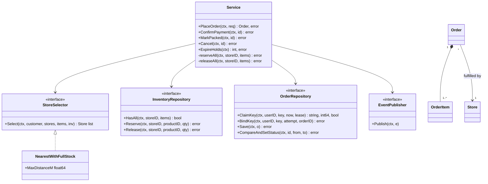
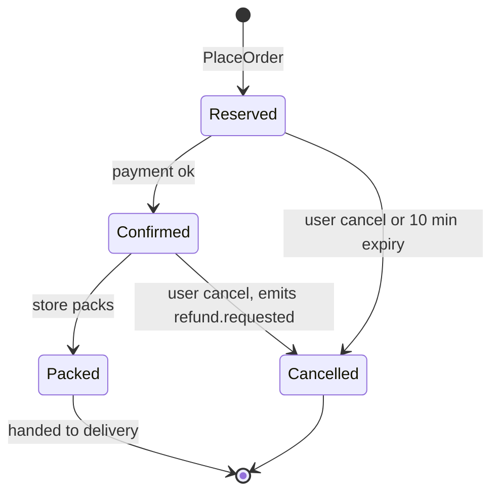
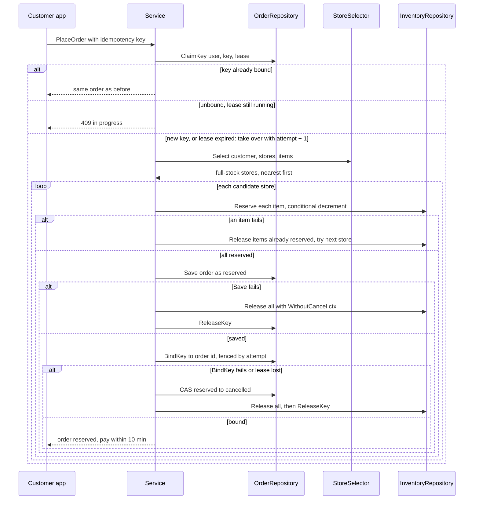

# Inventory Order Assignment (Dark Store)

> [!summary] TL;DR
> A quick-commerce order must come from one dark store near the customer that has every item. The service claims the client's idempotency key, asks a store-selection strategy for full-stock stores nearest first, reserves every item at one store all-or-nothing (falling back to the next store if it loses a race), and saves the order as `reserved` with a 10-minute payment hold. Every undo runs even if the client hung up, and every status change is a compare-and-set.

> [!abstract] Core idea
> - Stock per (store, product) is the contended resource; reserve it with a conditional decrement (`qty = qty - n WHERE qty >= n`).
> - Reserve every item at one store all or nothing, in product-ID order; if any fails, roll back and try the next store.
> - An idempotency key (a client-chosen ID for one order attempt) makes a retry return the same order.
> - Every status change is a compare-and-set (CAS: change only if the current value is still what you read), so payment and expiry cannot both win.
> - Classic mistake: running the undo on the request context, so a client hang-up skips the release and leaks stock.

## Problem statement

```text
Design a Zepto-like order assignment system. A user orders several products.
Pick a dark store near the user that has every item in stock, reserve the stock
so two users cannot buy the last packet, create the order, and support payment,
cancellation (with refund after payment) and retries. Later the order is handed
to delivery partner assignment. Design the classes, APIs, DB schema; code PlaceOrder.
```

What it tests: an **atomic multi-item reservation** (all items or none, no overselling under concurrency), and clean separation of store selection (Strategy), the order lifecycle (state machine) and retries (idempotency key). The senior signal is that no failure path leaks a reservation or an idempotency key.

### Solving path

1. Clarify the radius, payment hold, cancellation and retries.
2. Model `Store`, `OrderItem`, `Order` and the `OrderStatus` state machine.
3. Write `StoreSelector`: active stores within 3 km with every item, nearest first.
4. Write `PlaceOrder`: normalize, claim the key, select stores, reserve all at one store, save.
5. Add rollback with `context.WithoutCancel` and CAS status transitions.
6. Add `ExpireHolds` and `Cancel`, then test the last-packet race and retries.

## Step 1: Clarify requirements

- **One store or split?** *One store (the dark-store model); split fulfilment is an extension.*
- **Radius?** *3 km straight-line serviceable radius.*
- **When is stock taken?** *At checkout (`PlaceOrder`), held 10 minutes for payment.*
- **Nearest store lacks one item?** *Skip it; try the next nearest store with full stock.*
- **Retries?** *Yes, flaky mobile networks: the client sends one idempotency key per checkout tap.*
- **Payment?** *Owned by the payment service. It calls `ConfirmPayment`; a cancel after payment emits `refund.requested` for it.*
- **Scale?** *An estimate for the interview: a few hundred orders per minute per city. A large city can have dozens of stores or more (also an estimate), but only the few inside the radius are candidates for one order.*

**Functional:** place a multi-item order; pick active stores in range that have every item, nearest first; reserve all items or none; fall back to the next store on a lost race; lifecycle `reserved → confirmed → packed`, `cancelled` from reserved or confirmed (stock released, refund requested if paid); unpaid holds expire after 10 minutes; a retry with the same key returns the same order.

**Non-functional:** never oversell; never leak a reservation or a key (partial reserves roll back, compensations survive client disconnects, unpaid holds expire); `PlaceOrder` under about 200 ms (target, an estimate); the selection rule is swappable; money in `int64` paise.

**Out of scope:** payment internals, pricing and coupons ([[Cart Checkout with Coupons]]), rider assignment ([[Delivery Partner Assignment]]), restocking.

## Step 2: Actors and use cases

| Actor | Use case |
|---|---|
| Customer app | Place order (with idempotency key), view, cancel |
| Payment service | Confirm payment; consume `refund.requested` |
| Store staff app | Mark packed; set the store offline |
| Expiry job | Cancel unpaid reservations after 10 minutes |
| Ops / catalog | Update stock per store |

The hardest use case, and the one to code: **PlaceOrder**, which selects the nearest full-stock store and reserves every item atomically and idempotently.

## Step 3: Entities

| Entity | Key fields | Why it exists |
|---|---|---|
| `Store` | ID, Loc, Active | A dark store; the unit of fulfilment |
| `Product` | ID, SKU, PricePaise | Catalog item, not stock |
| `InventoryItem` | StoreID, ProductID, AvailableQty, ReservedQty | Stock of one product at one store: the row orders fight over |
| `Order` | ID, UserID, StoreID, Items, TotalPaise, Status, CreatedAt | What was bought and from where |
| `OrderItem` | ProductID, Qty, PricePaise | One line; the price is copied at order time |
| `OrderStatus` | reserved, confirmed, packed, cancelled | Lifecycle with legal transitions |
| `IdempotencyKey` | UserID, Key, OrderID (empty while running), Attempt, LeaseUntil | Makes retries safe; the lease lets a retry recover a key whose claimer crashed, and the attempt number fences the crashed claimer out |
| `Event` | Name, OrderID, Amount | `order.created`, `order.cancelled`, `refund.requested` |

Modelling insight: **a product is not an inventory item.** "Amul milk 500 ml" is global; stock lives per (store, product), and that row is what concurrent orders contend on. `OrderItem` copies the price, so later price changes do not change old orders.

## Step 4: Relationships





`Order` owns its items (composition) and points to one store by ID (association). `Service` depends only on interfaces, so tests use in-memory fakes and production uses PostgreSQL and a message broker.

## Step 5: APIs and public methods

```text
POST /orders                 Idempotency-Key: <uuid per checkout tap>
  {"items": [{"product_id": "milk", "qty": 2}], "lat": 12.97, "lng": 77.59}
  -> 201 {order_id, store_id, status: "reserved", total_paise, pay_by}
  -> 409 out of stock everywhere | 409 same key in progress (lease not expired) | 400 invalid
GET  /orders/{id}
POST /orders/{id}/cancel
POST /internal/orders/{id}/payment-confirmed      (payment service)
POST /internal/orders/{id}/packed                 (store app)
PUT  /internal/stores/{id}/inventory/{productId}  {"available_qty": 40}
```

In Go: `PlaceOrder(ctx, PlaceOrderRequest) (Order, error)`, `ConfirmPayment`, `MarkPacked`, `Cancel` (each `(ctx, orderID) error`) and `ExpireHolds(ctx) (int, error)` for a ticker.

## Step 6: Storage and repositories

```sql
CREATE TABLE stores (
    id     TEXT PRIMARY KEY,
    name   TEXT NOT NULL,
    lat    DOUBLE PRECISION NOT NULL,
    lng    DOUBLE PRECISION NOT NULL,
    active BOOLEAN NOT NULL DEFAULT true
);
-- nearby search: a PostGIS GiST index on a geography column, or a geohash column + index

CREATE TABLE products (
    id          TEXT PRIMARY KEY,
    sku         TEXT NOT NULL UNIQUE,
    name        TEXT NOT NULL,
    price_paise BIGINT NOT NULL CHECK (price_paise >= 0)
);

CREATE TABLE inventory (
    store_id      TEXT NOT NULL REFERENCES stores(id),
    product_id    TEXT NOT NULL REFERENCES products(id),
    available_qty INT  NOT NULL CHECK (available_qty >= 0),  -- the DB refuses oversell
    reserved_qty  INT  NOT NULL DEFAULT 0 CHECK (reserved_qty >= 0),
    updated_at    TIMESTAMPTZ NOT NULL DEFAULT now(),
    PRIMARY KEY (store_id, product_id)
);

CREATE TABLE orders (
    id          TEXT PRIMARY KEY,
    user_id     TEXT NOT NULL,
    store_id    TEXT NOT NULL REFERENCES stores(id),
    status      TEXT NOT NULL,           -- reserved | confirmed | packed | cancelled
    total_paise BIGINT NOT NULL,
    created_at  TIMESTAMPTZ NOT NULL DEFAULT now()
);
CREATE INDEX orders_status_created ON orders (status, created_at);  -- expiry sweeper

CREATE TABLE order_items (
    order_id    TEXT NOT NULL REFERENCES orders(id),
    product_id  TEXT NOT NULL REFERENCES products(id),
    qty         INT  NOT NULL CHECK (qty > 0),
    price_paise BIGINT NOT NULL,          -- copied at order time
    PRIMARY KEY (order_id, product_id)
);

CREATE TABLE idempotency_keys (
    user_id     TEXT NOT NULL,
    key         TEXT NOT NULL,
    order_id    TEXT NULL,                -- NULL while the first request is running
    attempt     BIGINT NOT NULL DEFAULT 1,  -- fencing token: +1 on every takeover
    lease_until TIMESTAMPTZ NOT NULL,     -- an unbound claim may be taken over after this
    created_at  TIMESTAMPTZ NOT NULL DEFAULT now(),
    PRIMARY KEY (user_id, key)            -- a second insert conflicts: it is a retry
);
```

The reservation is one transaction per candidate store, items in `product_id` order (one lock order everywhere, so no deadlock). The lease and fencing statements below (the claim, the fenced bind and the fenced release) follow the PostgreSQL 17 `INSERT ... ON CONFLICT DO UPDATE ... WHERE` and `RETURNING` syntax but have **not been executed against PostgreSQL**; only the Go version was compiled and tested.

```sql
-- Claim the key first, in its own statement. $3 = now and $4 = now + lease, both
-- from the injected clock. A row back means claimed (attempt = the fencing token):
-- a new key, or a takeover of an unbound claim whose lease has ended.
-- No row back means a retry: read order_id to tell "finished" from "still running".
INSERT INTO idempotency_keys (user_id, key, attempt, lease_until)
VALUES ($1, $2, 1, $4)
ON CONFLICT (user_id, key) DO UPDATE
SET attempt = idempotency_keys.attempt + 1, lease_until = EXCLUDED.lease_until
WHERE idempotency_keys.order_id IS NULL
  AND idempotency_keys.lease_until <= $3
RETURNING attempt;

BEGIN;
-- once per item, in product_id order; $1 = qty, $2 = store_id, $3 = product_id
UPDATE inventory
SET available_qty = available_qty - $1, reserved_qty = reserved_qty + $1, updated_at = now()
WHERE store_id = $2 AND product_id = $3 AND available_qty >= $1;
-- if any UPDATE affects 0 rows: ROLLBACK and try the next store
INSERT INTO orders (id, user_id, store_id, status, total_paise)
VALUES ($1, $2, $3, 'reserved', $4);
INSERT INTO order_items (order_id, product_id, qty, price_paise)
VALUES ($1, $2, $3, $4);                  -- once per line
-- fenced bind: 0 rows means a retry took the key over (ErrLeaseLost): ROLLBACK,
-- which also undoes this attempt's reservation and order
UPDATE idempotency_keys SET order_id = $1
WHERE user_id = $2 AND key = $3 AND attempt = $4 AND order_id IS NULL;
COMMIT;

-- fenced release after a failed attempt: free the key now, keep the attempt counter
UPDATE idempotency_keys SET lease_until = '-infinity'
WHERE user_id = $1 AND key = $2 AND attempt = $3 AND order_id IS NULL;
```

Each statement numbers its own placeholders from `$1`. In SQL the order insert and the key binding commit together, so neither can fail alone, and the `attempt = $4` condition makes the bind the fence: a late attempt whose lease was taken over binds 0 rows and rolls its whole reservation back. The in-memory repositories below make them separate calls, which is exactly why the code needs the compensation for a failed `BindKey`. A status change is also a compare-and-set: `UPDATE orders SET status = $1 WHERE id = $2 AND status = $3` ([[Locking - Optimistic vs Pessimistic]]).

## Step 7: Patterns

| Pattern | Where | Why here |
|---|---|---|
| [[Strategy and Template Method]] | `StoreSelector`, `NearestWithFullStock` | The business will change the rule (least busy, cheapest delivery) without touching `PlaceOrder` |
| [[State Machines in Go]] | `OrderStatus.CanMoveTo` plus a transitions table | Blocks pack-before-pay and cancel-after-packed |
| [[Repository and Unit of Work]] | Store, inventory and order repositories | Same service logic in tests and on PostgreSQL |
| [[Facade (vs Mediator)]] | `Service.PlaceOrder` | One call hides validation, idempotency, selection, reservation, save, events |
| [[Observer and Event Bus]] | `EventPublisher` | Delivery assignment, notifications and refunds react without the order code knowing them |

Not used: a State object per status (four states with no per-state behaviour, so a transitions map is simpler) and a validation chain (one `normalize` is enough).

## Folder structure

```text
inventory/
  model.go         -> Location, Store, OrderItem, Order, OrderStatus plus transitions, errors
  repository.go    -> StoreRepository, InventoryRepository, OrderRepository plus MemStores, MemInventory, MemOrders
  strategy.go      -> StoreSelector, NearestWithFullStock (HaversineM comes from a shared geo package)
  events.go        -> Event, EventPublisher, NopPublisher
  service.go       -> Service: PlaceOrder, reserveAll, releaseAll, ConfirmPayment, MarkPacked, Cancel, ExpireHolds
  service_test.go  -> table tests, fault-injection tests and concurrency tests
cmd/demo/main.go   -> wires the Mem* repositories, NearestWithFullStock{MaxDistanceM: 3000}, time.Now, a 10-minute hold
```

`model.go` holds plain data and the transition table; `repository.go` puts the interfaces first, then the in-memory versions (a stand-in for PostgreSQL); `service.go` is the only file that knows the order of the steps. The block below merges the files (marked by comments) so it compiles as shown.

## Step 8: Core code

> [!tip] What to code in a 60-minute round
> Aim for about 150 lines in the room.
> - **Write:** `Location`, `Store`, `OrderItem`, `OrderStatus` with `CanMoveTo`, `Order`, the three repository interfaces, `MemInventory` (`Reserve`, `Release`, `HasAll`), `NearestWithFullStock`, and `Service` with `PlaceOrder`, `place`, `reserveAll`, `releaseAll`, `transition` and `normalize`.
> - **Add if time remains:** `MemOrders` key claims, `ConfirmPayment`, `Cancel` and `ExpireHolds`.
> - **Talk only:** the key lease with attempt numbers, events and the refund flow, the SQL schema, and split orders across stores.

`PlaceOrder(ctx, req)`:

1. `normalize` merges duplicate lines, rejects empty carts and bad quantities, and sorts by product ID: the same lock order for every request.
2. `ClaimKey(user, key, now, lease)`: a retry with a bound key returns that order; an unbound key inside its lease means the first request is in flight (`ErrInProgress`). **Another leak to avoid:** if the process crashes after the claim and before `BindKey`, a claim with no lease stays "in progress" forever and every retry gets 409. Here the claim stores `leaseUntil = now + 1 min` from the injected clock (`DefaultKeyLease`, well above the 200 ms target), and a retry that finds an unbound claim past its lease takes it over with `attempt + 1`. The crashed attempt's orphan order, if it saved one, is cancelled by the expiry job like any unpaid hold.
3. `selector.Select` returns active stores within 3 km that have every item, nearest first. It reads without locks, so it can be stale.
4. For each candidate, `reserveAll` does one conditional decrement per item; on the first failure it releases what it took and the loop tries the next store.
5. Save the order as `reserved` with `CreatedAt` from the injected clock. **Leak to avoid:** if `Save` fails, a naive version releases the stock with the request's `ctx`. After a client disconnect that `ctx` is cancelled, so a real database release fails too, the error is dropped, and the units stay held forever. Here every compensation runs with `context.WithoutCancel(ctx)` (Go 1.21+), and `releaseAll` returns its failures (`errors.Join`, Go 1.20+) instead of hiding them.
6. `BindKey`. **Second leak to avoid:** if it fails after a successful save, a naive version returns the error and leaves the key "in progress" forever (every retry gets `ErrInProgress`) while the stock stays held until expiry. Here the order is moved `reserved → cancelled` by compare-and-set, the stock is released and the key is freed, so the same key works on the next try. If even that compare-and-set fails, its error is reported with the rest and the expiry job cancels the hold later. `BindKey` and `ReleaseKey` carry the attempt number, so they are **fenced**: an attempt that was only slow and lost its key to a takeover gets `ErrLeaseLost` from `BindKey`, goes down this same path (its order cancelled, its stock released), and its `ReleaseKey` leaves the new attempt's claim alone. `ReleaseKey` frees a key by ending its lease instead of deleting the row, so the attempt counter never goes back to 1 and a late attempt can never match a newer claim.
7. Publish `order.created`.

Lifecycle methods go through `transition`: check `CanMoveTo`, then `CompareAndSetStatus(from, to)`, so racing callers (cancel versus payment, payment versus expiry) cannot both win. `Cancel` releases stock only when it won, and when it moved a **confirmed** (paid) order it also publishes `refund.requested` with the amount. This service does not own payment; the payment service refunds idempotently by order ID. Publish it through an outbox so it cannot be lost ([[Transactional Outbox and CDC]]).



The store distance is the great-circle (haversine) distance; the formula is explained once in [[Geospatial Indexing]], and in a real codebase `HaversineM` lives in a shared `geo` package used by this problem and [[Delivery Partner Assignment]].

```go
// File: inventory.go
package inventory

import (
	"context"
	"errors"
	"fmt"
	"math"
	"sort"
	"sync"
	"sync/atomic"
	"time"
)

// ---------- model.go: entities, enums, errors ----------

var (
	ErrInvalidOrder  = errors.New("inventory: invalid order")
	ErrOutOfStock    = errors.New("inventory: out of stock")
	ErrNoStore       = errors.New("inventory: no store can fulfil the whole order")
	ErrOrderNotFound = errors.New("inventory: order not found")
	ErrBadTransition = errors.New("inventory: invalid order state transition")
	ErrInProgress    = errors.New("inventory: same idempotency key is still in progress")
	ErrReleaseFailed = errors.New("inventory: stock release failed, reconcile")
	ErrLeaseLost     = errors.New("inventory: idempotency key lease expired and was taken over")
)

type Location struct{ Lat, Lng float64 }

type Store struct {
	ID     string
	Loc    Location
	Active bool // store can go offline (closed, power cut)
}

type OrderItem struct {
	ProductID  string
	Qty        int
	PricePaise int64 // unit price, int64 paise, never float
}

type OrderStatus string

const (
	Reserved  OrderStatus = "reserved"  // stock held, waiting for payment
	Confirmed OrderStatus = "confirmed" // paid, store starts packing
	Packed    OrderStatus = "packed"    // handed to delivery assignment
	Cancelled OrderStatus = "cancelled" // stock released
)

// State: the only legal moves. Anything else is ErrBadTransition.
var transitions = map[OrderStatus][]OrderStatus{
	Reserved:  {Confirmed, Cancelled},
	Confirmed: {Packed, Cancelled},
}

func (s OrderStatus) CanMoveTo(next OrderStatus) bool {
	for _, n := range transitions[s] {
		if n == next {
			return true
		}
	}
	return false
}

type Order struct {
	ID         string
	UserID     string
	StoreID    string
	Items      []OrderItem
	TotalPaise int64
	Status     OrderStatus
	CreatedAt  time.Time
}

// ---------- repository.go: storage interfaces + in-memory impl ----------

type StoreRepository interface {
	ListActive(ctx context.Context) ([]Store, error)
}

type InventoryRepository interface {
	HasAll(ctx context.Context, storeID string, items []OrderItem) (bool, error)
	// Reserve is one atomic conditional decrement:
	// UPDATE inventory SET available_qty = available_qty - $1, reserved_qty = reserved_qty + $1
	// WHERE store_id = $2 AND product_id = $3 AND available_qty >= $1
	Reserve(ctx context.Context, storeID, productID string, qty int) error
	Release(ctx context.Context, storeID, productID string, qty int) error
}

type OrderRepository interface {
	// ClaimKey inserts (user_id, key) with a lease until now+lease, or takes over
	// an unbound key whose lease has ended (its claimer crashed). claimed=false
	// means the key is held: orderID != "" -> finished earlier, return that order;
	// "" -> still running. attempt is the fencing token of the claim (+1 per takeover).
	ClaimKey(ctx context.Context, userID, key string, now time.Time, lease time.Duration) (orderID string, attempt int64, claimed bool, err error)
	// BindKey succeeds only for the attempt that still holds the key; otherwise
	// ErrLeaseLost. ReleaseKey frees the key only for that attempt.
	BindKey(ctx context.Context, userID, key string, attempt int64, orderID string) error
	ReleaseKey(ctx context.Context, userID, key string, attempt int64) error
	Save(ctx context.Context, o Order) error
	Get(ctx context.Context, id string) (Order, error)
	// CompareAndSetStatus: UPDATE orders SET status = $1 WHERE id = $2 AND status = $3
	CompareAndSetStatus(ctx context.Context, id string, from, to OrderStatus) error
	ListByStatus(ctx context.Context, st OrderStatus) ([]Order, error)
}

type MemStores struct{ Stores []Store }

func (m *MemStores) ListActive(ctx context.Context) ([]Store, error) {
	var out []Store
	for _, s := range m.Stores {
		if s.Active {
			out = append(out, s)
		}
	}
	return out, nil
}

type MemInventory struct {
	mu    sync.Mutex
	avail map[string]map[string]int // storeID -> productID -> available qty
}

func NewMemInventory() *MemInventory {
	return &MemInventory{avail: make(map[string]map[string]int)}
}

func (m *MemInventory) Set(storeID, productID string, qty int) {
	m.mu.Lock()
	defer m.mu.Unlock()
	if m.avail[storeID] == nil {
		m.avail[storeID] = make(map[string]int)
	}
	m.avail[storeID][productID] = qty
}

func (m *MemInventory) Available(storeID, productID string) int {
	m.mu.Lock()
	defer m.mu.Unlock()
	return m.avail[storeID][productID]
}

func (m *MemInventory) HasAll(ctx context.Context, storeID string, items []OrderItem) (bool, error) {
	m.mu.Lock()
	defer m.mu.Unlock()
	for _, it := range items {
		if m.avail[storeID][it.ProductID] < it.Qty {
			return false, nil
		}
	}
	return true, nil
}

func (m *MemInventory) Reserve(ctx context.Context, storeID, productID string, qty int) error {
	m.mu.Lock()
	defer m.mu.Unlock()
	if m.avail[storeID][productID] < qty { // check and decrement under one lock
		return ErrOutOfStock
	}
	m.avail[storeID][productID] -= qty
	return nil
}

func (m *MemInventory) Release(ctx context.Context, storeID, productID string, qty int) error {
	m.mu.Lock()
	defer m.mu.Unlock()
	if m.avail[storeID] == nil {
		m.avail[storeID] = make(map[string]int)
	}
	m.avail[storeID][productID] += qty
	return nil
}

// keyClaim is one row of idempotency_keys.
type keyClaim struct {
	orderID    string    // "" while in progress
	attempt    int64     // fencing token, never reset, so a late attempt stays fenced out
	leaseUntil time.Time // an unbound claim may be taken over from this moment
}

type MemOrders struct {
	mu     sync.Mutex
	orders map[string]Order
	keys   map[string]keyClaim // userID|key -> claim
}

func NewMemOrders() *MemOrders {
	return &MemOrders{orders: make(map[string]Order), keys: make(map[string]keyClaim)}
}

func (m *MemOrders) ClaimKey(ctx context.Context, userID, key string, now time.Time, lease time.Duration) (string, int64, bool, error) {
	m.mu.Lock()
	defer m.mu.Unlock()
	k := userID + "|" + key
	c, ok := m.keys[k]
	if ok && (c.orderID != "" || now.Before(c.leaseUntil)) {
		return c.orderID, c.attempt, false, nil // finished, or still running inside its lease
	}
	// New key, a released key, or a takeover of a claim whose lease ended.
	c = keyClaim{attempt: c.attempt + 1, leaseUntil: now.Add(lease)}
	m.keys[k] = c
	return "", c.attempt, true, nil
}

func (m *MemOrders) BindKey(ctx context.Context, userID, key string, attempt int64, orderID string) error {
	m.mu.Lock()
	defer m.mu.Unlock()
	k := userID + "|" + key
	c, ok := m.keys[k]
	if !ok || c.attempt != attempt || c.orderID != "" {
		return fmt.Errorf("%w: attempt %d", ErrLeaseLost, attempt)
	}
	c.orderID = orderID
	m.keys[k] = c
	return nil
}

func (m *MemOrders) ReleaseKey(ctx context.Context, userID, key string, attempt int64) error {
	m.mu.Lock()
	defer m.mu.Unlock()
	k := userID + "|" + key
	if c, ok := m.keys[k]; ok && c.attempt == attempt && c.orderID == "" {
		c.leaseUntil = time.Time{} // free at once; the attempt counter is kept
		m.keys[k] = c
	}
	return nil
}

func (m *MemOrders) Save(ctx context.Context, o Order) error {
	m.mu.Lock()
	defer m.mu.Unlock()
	m.orders[o.ID] = o
	return nil
}

func (m *MemOrders) Get(ctx context.Context, id string) (Order, error) {
	m.mu.Lock()
	defer m.mu.Unlock()
	o, ok := m.orders[id]
	if !ok {
		return Order{}, ErrOrderNotFound
	}
	return o, nil
}

func (m *MemOrders) CompareAndSetStatus(ctx context.Context, id string, from, to OrderStatus) error {
	m.mu.Lock()
	defer m.mu.Unlock()
	o, ok := m.orders[id]
	if !ok {
		return ErrOrderNotFound
	}
	if o.Status != from {
		return fmt.Errorf("%w: order %s is %s, not %s", ErrBadTransition, id, o.Status, from)
	}
	o.Status = to
	m.orders[id] = o
	return nil
}

func (m *MemOrders) ListByStatus(ctx context.Context, st OrderStatus) ([]Order, error) {
	m.mu.Lock()
	defer m.mu.Unlock()
	var out []Order
	for _, o := range m.orders {
		if o.Status == st {
			out = append(out, o)
		}
	}
	return out, nil
}

// ---------- strategy.go: which store fulfils the order ----------

type StoreSelector interface {
	// Select returns candidate stores in the order they should be tried.
	Select(ctx context.Context, customer Location, stores []Store, items []OrderItem, inv InventoryRepository) ([]Store, error)
}

// NearestWithFullStock: stores inside MaxDistanceM that have every item, nearest first.
type NearestWithFullStock struct{ MaxDistanceM float64 }

func (s NearestWithFullStock) Select(ctx context.Context, customer Location, stores []Store, items []OrderItem, inv InventoryRepository) ([]Store, error) {
	type cand struct {
		st Store
		d  float64
	}
	var cs []cand
	for _, st := range stores {
		d := HaversineM(customer, st.Loc)
		if d > s.MaxDistanceM {
			continue
		}
		ok, err := inv.HasAll(ctx, st.ID, items)
		if err != nil {
			return nil, err
		}
		if ok {
			cs = append(cs, cand{st, d})
		}
	}
	sort.Slice(cs, func(i, j int) bool { return cs[i].d < cs[j].d })
	out := make([]Store, len(cs))
	for i, c := range cs {
		out[i] = c.st
	}
	return out, nil
}

func HaversineM(a, b Location) float64 {
	const earthR = 6371000.0
	rad := func(d float64) float64 { return d * math.Pi / 180 }
	dLat, dLng := rad(b.Lat-a.Lat), rad(b.Lng-a.Lng)
	h := math.Sin(dLat/2)*math.Sin(dLat/2) +
		math.Cos(rad(a.Lat))*math.Cos(rad(b.Lat))*math.Sin(dLng/2)*math.Sin(dLng/2)
	return 2 * earthR * math.Asin(math.Sqrt(h))
}

// ---------- events.go: observer hook ----------

type Event struct {
	Name    string // order.created, order.cancelled, refund.requested
	OrderID string
	Amount  int64 // paise, set on refund.requested
}

type EventPublisher interface {
	Publish(ctx context.Context, e Event)
}

type NopPublisher struct{}

func (NopPublisher) Publish(context.Context, Event) {}

// ---------- service.go: the PlaceOrder facade ----------

type PlaceOrderRequest struct {
	UserID         string
	IdempotencyKey string // client generates once per checkout tap, reuses it on retry
	Customer       Location
	Items          []OrderItem
}

type Service struct {
	stores   StoreRepository
	inv      InventoryRepository
	orders   OrderRepository
	selector StoreSelector
	events   EventPublisher
	now      func() time.Time
	holdFor  time.Duration // unpaid reservations expire after this
	keyLease time.Duration // an unbound idempotency key may be taken over after this
	seq      atomic.Int64
}

// DefaultKeyLease must be longer than a healthy PlaceOrder takes (about 200 ms);
// after it, a retry assumes the claimer crashed and takes the key over.
const DefaultKeyLease = time.Minute

func NewService(st StoreRepository, inv InventoryRepository, ord OrderRepository,
	sel StoreSelector, ev EventPublisher, now func() time.Time, holdFor time.Duration) *Service {
	return &Service{stores: st, inv: inv, orders: ord, selector: sel, events: ev, now: now, holdFor: holdFor, keyLease: DefaultKeyLease}
}

// PlaceOrder: validate -> idempotency claim -> pick store -> reserve all items -> save order.
func (s *Service) PlaceOrder(ctx context.Context, req PlaceOrderRequest) (Order, error) {
	items, err := normalize(req.Items)
	if err != nil {
		return Order{}, err
	}
	if req.UserID == "" || req.IdempotencyKey == "" {
		return Order{}, fmt.Errorf("%w: user and idempotency key required", ErrInvalidOrder)
	}
	existingID, attempt, claimed, err := s.orders.ClaimKey(ctx, req.UserID, req.IdempotencyKey, s.now(), s.keyLease)
	if err != nil {
		return Order{}, err
	}
	if !claimed {
		if existingID == "" {
			return Order{}, ErrInProgress // first request still inside its lease; client retries later
		}
		return s.orders.Get(ctx, existingID) // retry: same answer, no second reservation
	}
	undo := context.WithoutCancel(ctx) // compensations must run even if the client hung up
	o, err := s.place(ctx, req, items)
	if err != nil {
		_ = s.orders.ReleaseKey(undo, req.UserID, req.IdempotencyKey, attempt) // failed: allow a fresh retry
		return Order{}, err
	}
	if err := s.orders.BindKey(ctx, req.UserID, req.IdempotencyKey, attempt, o.ID); err != nil {
		// The order is saved but no retry can find it: cancel it and give the stock and
		// the key back, or the hold and the "in progress" key would leak. ErrLeaseLost
		// (a retry took the key over after the lease) takes the same path, and the
		// fenced ReleaseKey below then leaves the new attempt's claim alone.
		if cerr := s.orders.CompareAndSetStatus(undo, o.ID, Reserved, Cancelled); cerr == nil {
			err = errors.Join(err, s.releaseAll(undo, o.StoreID, o.Items))
		} else {
			err = errors.Join(err, cerr) // not cancelled: report it; the expiry job frees the hold
		}
		_ = s.orders.ReleaseKey(undo, req.UserID, req.IdempotencyKey, attempt)
		return Order{}, err
	}
	s.events.Publish(ctx, Event{Name: "order.created", OrderID: o.ID})
	return o, nil
}

func (s *Service) place(ctx context.Context, req PlaceOrderRequest, items []OrderItem) (Order, error) {
	stores, err := s.stores.ListActive(ctx)
	if err != nil {
		return Order{}, err
	}
	cands, err := s.selector.Select(ctx, req.Customer, stores, items, s.inv)
	if err != nil {
		return Order{}, err
	}
	for _, st := range cands {
		if err := ctx.Err(); err != nil {
			return Order{}, err
		}
		if err := s.reserveAll(ctx, st.ID, items); err != nil {
			if errors.Is(err, ErrOutOfStock) {
				continue // lost a race at this store after Select; try the next nearest
			}
			return Order{}, err
		}
		o := Order{
			ID:         fmt.Sprintf("ord-%d", s.seq.Add(1)),
			UserID:     req.UserID,
			StoreID:    st.ID,
			Items:      items,
			TotalPaise: total(items),
			Status:     Reserved,
			CreatedAt:  s.now(),
		}
		if err := s.orders.Save(ctx, o); err != nil {
			// Releasing with ctx would fail after a client disconnect and leave the
			// stock held forever. WithoutCancel keeps the values, drops the cancel.
			return Order{}, errors.Join(err, s.releaseAll(context.WithoutCancel(ctx), st.ID, items))
		}
		return o, nil
	}
	return Order{}, ErrNoStore
}

// reserveAll is all-or-nothing: on the first failure, undo what was already reserved.
// In SQL this is one transaction; rows are locked in product_id order to avoid deadlocks.
func (s *Service) reserveAll(ctx context.Context, storeID string, items []OrderItem) error {
	for i, it := range items {
		if err := s.inv.Reserve(ctx, storeID, it.ProductID, it.Qty); err != nil {
			return errors.Join(err, s.releaseAll(context.WithoutCancel(ctx), storeID, items[:i]))
		}
	}
	return nil
}

// releaseAll gives every line back and reports failures instead of hiding them,
// so the caller can flag the order for a reconciliation job.
func (s *Service) releaseAll(ctx context.Context, storeID string, items []OrderItem) error {
	var errs []error
	for _, it := range items {
		if err := s.inv.Release(ctx, storeID, it.ProductID, it.Qty); err != nil {
			errs = append(errs, fmt.Errorf("%w: %s/%s x%d: %w", ErrReleaseFailed, storeID, it.ProductID, it.Qty, err))
		}
	}
	return errors.Join(errs...)
}

// ConfirmPayment: reserved -> confirmed.
func (s *Service) ConfirmPayment(ctx context.Context, orderID string) error {
	_, _, err := s.transition(ctx, orderID, Confirmed)
	return err
}

func (s *Service) MarkPacked(ctx context.Context, orderID string) error {
	_, _, err := s.transition(ctx, orderID, Packed)
	return err
}

// Cancel releases stock only if this call won the move to cancelled. Payment is
// owned by another service: cancelling a paid (confirmed) order emits
// refund.requested, which the payment service handles idempotently by order ID.
func (s *Service) Cancel(ctx context.Context, orderID string) error {
	o, from, err := s.transition(ctx, orderID, Cancelled)
	if err != nil {
		return err
	}
	rerr := s.releaseAll(context.WithoutCancel(ctx), o.StoreID, o.Items)
	s.events.Publish(ctx, Event{Name: "order.cancelled", OrderID: o.ID})
	if from == Confirmed {
		s.events.Publish(ctx, Event{Name: "refund.requested", OrderID: o.ID, Amount: o.TotalPaise})
	}
	return rerr
}

// ExpireHolds cancels reserved orders that were not paid within holdFor.
// Run it from a ticker or a delayed job. Returns how many it cancelled.
func (s *Service) ExpireHolds(ctx context.Context) (int, error) {
	reserved, err := s.orders.ListByStatus(ctx, Reserved)
	if err != nil {
		return 0, err
	}
	n, errs := 0, []error(nil)
	for _, o := range reserved {
		if s.now().Sub(o.CreatedAt) < s.holdFor {
			continue
		}
		// CAS from reserved only: if payment confirmed a moment ago, this fails and payment wins
		if err := s.orders.CompareAndSetStatus(ctx, o.ID, Reserved, Cancelled); err != nil {
			if !errors.Is(err, ErrBadTransition) {
				errs = append(errs, err) // a storage error, not a lost race: report it, the next run retries
			}
			continue
		}
		errs = append(errs, s.releaseAll(ctx, o.StoreID, o.Items)) // nil entries are dropped by Join
		s.events.Publish(ctx, Event{Name: "order.cancelled", OrderID: o.ID})
		n++
	}
	return n, errors.Join(errs...)
}

// transition returns the moved order and the status it moved from.
func (s *Service) transition(ctx context.Context, orderID string, to OrderStatus) (Order, OrderStatus, error) {
	o, err := s.orders.Get(ctx, orderID)
	if err != nil {
		return Order{}, "", err
	}
	from := o.Status
	if !from.CanMoveTo(to) {
		return Order{}, "", fmt.Errorf("%w: %s -> %s", ErrBadTransition, from, to)
	}
	// compare-and-set: if two callers race, only one moves the order
	if err := s.orders.CompareAndSetStatus(ctx, orderID, from, to); err != nil {
		return Order{}, "", err
	}
	o.Status = to
	return o, from, nil
}

// normalize merges duplicate lines and sorts by product ID (stable lock order).
func normalize(items []OrderItem) ([]OrderItem, error) {
	if len(items) == 0 {
		return nil, fmt.Errorf("%w: empty cart", ErrInvalidOrder)
	}
	byID := make(map[string]OrderItem)
	for _, it := range items {
		if it.ProductID == "" || it.Qty <= 0 || it.PricePaise < 0 {
			return nil, fmt.Errorf("%w: bad line %+v", ErrInvalidOrder, it)
		}
		cur := byID[it.ProductID]
		cur.ProductID, cur.PricePaise = it.ProductID, it.PricePaise
		cur.Qty += it.Qty
		byID[it.ProductID] = cur
	}
	out := make([]OrderItem, 0, len(byID))
	for _, it := range byID {
		out = append(out, it)
	}
	sort.Slice(out, func(i, j int) bool { return out[i].ProductID < out[j].ProductID })
	return out, nil
}

func total(items []OrderItem) int64 {
	var t int64
	for _, it := range items {
		t += int64(it.Qty) * it.PricePaise
	}
	return t
}
```

## Test cases

| Test | Proves |
|---|---|
| `TestPlaceOrder` (table) | Nearest full-stock store wins; partial and inactive stores are skipped; duplicates merged; invalid input rejected |
| `TestTotalAndStockDeducted` | Total in paise and stock decrements are right |
| `TestPartialReservationRollsBack` | When the second item fails, the first item's stock comes back |
| `TestIdempotentRetry`, `TestFailedAttemptFreesKey` | Same key returns the same order and reserves once; a failed attempt does not burn the key |
| `TestStateTransitions` (table) | Legal and illegal moves; cancel releases stock exactly once |
| `TestExpireUnpaidHolds` | Fake clock: expiry only after 10 minutes and only for unpaid orders; a late payment fails |
| `TestConcurrentLastItems` | 50 goroutines, 10 milk: exactly 10 orders win; the 40 losers' bread is rolled back |
| `TestConcurrentSameKey` | 20 concurrent calls with one key create one order |
| `TestSaveFailureAfterDisconnectReleasesStock` | The client hangs up during `Save`: stock is back to 5 and the key is free. With the release on the request `ctx` instead, this test fails with "milk = 4, want 5" (checked by running it) |
| `TestBindKeyFailureCancelsOrderAndFreesKey` | A failed `BindKey` cancels the order, returns the stock, and the same key then succeeds |
| `TestCancelAfterPaymentRequestsRefund` | Only the paid order emits `refund.requested`, with its 6,000 paise |
| `TestCrashedClaimIsTakenOverAfterLease` | The process dies after `Save` and before `BindKey` (simulated with `runtime.Goexit` in a hook). A retry inside the lease gets `ErrInProgress`; after the lease and the expiry job, the retry succeeds, a second retry replays it, and exactly one unit of milk is held. Without the lease this test fails with "same idempotency key is still in progress" |
| `TestLateOriginalIsFencedOut` | The first attempt is slow, not dead: a retry takes the key over before its `BindKey`. The original gets `ErrLeaseLost`, cancels its own order and returns its stock; the key keeps pointing at the retry's order |

Measured: `go test -race -cover` on Go 1.24.4 passes all 14 test functions with 91.4% statement coverage, and `go test -race -count=3` passes on every run (the concurrency tests reach some branches only on some schedules).

```go
// File: inventory_test.go
package inventory

import (
	"context"
	"errors"
	"fmt"
	"runtime"
	"sync"
	"testing"
	"time"
)

var home = Location{12.9716, 77.5946}

// ~111 km per degree of latitude
func north(m float64) Location { return Location{home.Lat + m/111000, home.Lng} }

type fixture struct {
	svc    *Service
	inv    *MemInventory
	orders *MemOrders
	now    time.Time
}

// near (500 m) has milk only, far (1.5 km) has milk + bread, out (5 km) has everything.
func newFixture() *fixture {
	f := &fixture{inv: NewMemInventory(), orders: NewMemOrders(), now: time.Date(2026, 1, 1, 10, 0, 0, 0, time.UTC)}
	stores := &MemStores{Stores: []Store{
		{ID: "near", Loc: north(500), Active: true},
		{ID: "far", Loc: north(1500), Active: true},
		{ID: "out", Loc: north(5000), Active: true},
		{ID: "closed", Loc: north(100), Active: false},
	}}
	f.inv.Set("near", "milk", 5)
	f.inv.Set("far", "milk", 10)
	f.inv.Set("far", "bread", 100)
	f.inv.Set("out", "milk", 50)
	f.inv.Set("out", "bread", 50)
	f.inv.Set("closed", "milk", 50)
	f.inv.Set("closed", "bread", 50)
	f.svc = NewService(stores, f.inv, f.orders, NearestWithFullStock{MaxDistanceM: 3000},
		NopPublisher{}, func() time.Time { return f.now }, 10*time.Minute)
	return f
}

func req(key string, items ...OrderItem) PlaceOrderRequest {
	return PlaceOrderRequest{UserID: "u1", IdempotencyKey: key, Customer: home, Items: items}
}

var (
	milk  = OrderItem{ProductID: "milk", Qty: 1, PricePaise: 3000}
	bread = OrderItem{ProductID: "bread", Qty: 1, PricePaise: 4500}
)

func TestPlaceOrder(t *testing.T) {
	cases := []struct {
		name      string
		items     []OrderItem
		wantStore string
		wantErr   error
	}{
		{"nearest store has everything", []OrderItem{milk}, "near", nil},
		{"nearest is partial, skip to full-stock store", []OrderItem{milk, bread}, "far", nil},
		{"duplicate lines are merged", []OrderItem{bread, bread}, "far", nil},
		{"too many for any store in range", []OrderItem{{ProductID: "milk", Qty: 11, PricePaise: 1}}, "", ErrNoStore},
		{"unknown product", []OrderItem{{ProductID: "eggs", Qty: 1}}, "", ErrNoStore},
		{"empty cart", nil, "", ErrInvalidOrder},
		{"zero quantity", []OrderItem{{ProductID: "milk", Qty: 0}}, "", ErrInvalidOrder},
	}
	for _, tc := range cases {
		t.Run(tc.name, func(t *testing.T) {
			f := newFixture()
			o, err := f.svc.PlaceOrder(context.Background(), req("k1", tc.items...))
			if !errors.Is(err, tc.wantErr) {
				t.Fatalf("err = %v, want %v", err, tc.wantErr)
			}
			if err == nil && (o.StoreID != tc.wantStore || o.Status != Reserved) {
				t.Fatalf("got %+v", o)
			}
		})
	}
}

func TestTotalAndStockDeducted(t *testing.T) {
	f := newFixture()
	o, err := f.svc.PlaceOrder(context.Background(), req("k1", milk, bread, bread))
	if err != nil {
		t.Fatal(err)
	}
	if o.TotalPaise != 3000+2*4500 {
		t.Fatalf("total = %d", o.TotalPaise)
	}
	if f.inv.Available("far", "milk") != 9 || f.inv.Available("far", "bread") != 98 {
		t.Fatal("stock not deducted")
	}
}

// flakyInventory fails Reserve for one product, to force a partial reservation.
type flakyInventory struct {
	*MemInventory
	failOn string
}

func (f flakyInventory) Reserve(ctx context.Context, s, p string, q int) error {
	if p == f.failOn {
		return ErrOutOfStock
	}
	return f.MemInventory.Reserve(ctx, s, p, q)
}

func TestPartialReservationRollsBack(t *testing.T) {
	f := newFixture()
	inv := flakyInventory{f.inv, "milk"} // bread sorts first, so bread is reserved, then milk fails
	svc := NewService(&MemStores{Stores: []Store{{ID: "far", Loc: north(1500), Active: true}}},
		inv, f.orders, NearestWithFullStock{MaxDistanceM: 3000}, NopPublisher{}, time.Now, time.Minute)
	_, err := svc.PlaceOrder(context.Background(), req("k1", milk, bread))
	if !errors.Is(err, ErrNoStore) {
		t.Fatal(err)
	}
	if f.inv.Available("far", "bread") != 100 || f.inv.Available("far", "milk") != 10 {
		t.Fatal("rollback did not restore stock")
	}
}

func TestIdempotentRetry(t *testing.T) {
	f := newFixture()
	ctx := context.Background()
	o1, err := f.svc.PlaceOrder(ctx, req("tap-1", milk))
	if err != nil {
		t.Fatal(err)
	}
	o2, err := f.svc.PlaceOrder(ctx, req("tap-1", milk)) // network retry
	if err != nil || o2.ID != o1.ID {
		t.Fatalf("retry gave %v %v", o2.ID, err)
	}
	if f.inv.Available("near", "milk") != 4 {
		t.Fatal("retry reserved stock twice")
	}
	o3, _ := f.svc.PlaceOrder(ctx, req("tap-2", milk)) // new checkout = new key
	if o3.ID == o1.ID {
		t.Fatal("new key must create a new order")
	}
}

func TestFailedAttemptFreesKey(t *testing.T) {
	f := newFixture()
	ctx := context.Background()
	big := OrderItem{ProductID: "bread", Qty: 200, PricePaise: 1}
	if _, err := f.svc.PlaceOrder(ctx, req("k", big)); !errors.Is(err, ErrNoStore) {
		t.Fatal(err)
	}
	f.inv.Set("far", "bread", 500) // restocked
	if _, err := f.svc.PlaceOrder(ctx, req("k", big)); err != nil {
		t.Fatal("same key must be usable after a failed attempt:", err)
	}
}

func TestStateTransitions(t *testing.T) {
	cases := []struct {
		name    string
		steps   []func(*Service, string) error
		wantErr error
		status  OrderStatus
		milk    int // available milk at "near" afterwards (started at 5, order holds 1)
	}{
		{"pay", []func(*Service, string) error{pay}, nil, Confirmed, 4},
		{"pay then pack", []func(*Service, string) error{pay, pack}, nil, Packed, 4},
		{"cancel unpaid releases stock", []func(*Service, string) error{cancel}, nil, Cancelled, 5},
		{"cancel paid releases stock", []func(*Service, string) error{pay, cancel}, nil, Cancelled, 5},
		{"pay twice", []func(*Service, string) error{pay, pay}, ErrBadTransition, Confirmed, 4},
		{"pack before pay", []func(*Service, string) error{pack}, ErrBadTransition, Reserved, 4},
		{"cancel after packed", []func(*Service, string) error{pay, pack, cancel}, ErrBadTransition, Packed, 4},
		{"cancel twice releases once", []func(*Service, string) error{cancel, cancel}, ErrBadTransition, Cancelled, 5},
	}
	for _, tc := range cases {
		t.Run(tc.name, func(t *testing.T) {
			f := newFixture()
			o, _ := f.svc.PlaceOrder(context.Background(), req("k", milk))
			var err error
			for _, step := range tc.steps {
				err = step(f.svc, o.ID)
			}
			got, _ := f.orders.Get(context.Background(), o.ID)
			if !errors.Is(err, tc.wantErr) || got.Status != tc.status || f.inv.Available("near", "milk") != tc.milk {
				t.Fatalf("err=%v status=%s milk=%d", err, got.Status, f.inv.Available("near", "milk"))
			}
		})
	}
}

func pay(s *Service, id string) error    { return s.ConfirmPayment(context.Background(), id) }
func pack(s *Service, id string) error   { return s.MarkPacked(context.Background(), id) }
func cancel(s *Service, id string) error { return s.Cancel(context.Background(), id) }

func TestExpireUnpaidHolds(t *testing.T) {
	f := newFixture()
	ctx := context.Background()
	unpaid, _ := f.svc.PlaceOrder(ctx, req("k1", milk))
	paid, _ := f.svc.PlaceOrder(ctx, req("k2", milk))
	_ = f.svc.ConfirmPayment(ctx, paid.ID)

	f.now = f.now.Add(9 * time.Minute)
	if n, _ := f.svc.ExpireHolds(ctx); n != 0 {
		t.Fatal("expired too early")
	}
	f.now = f.now.Add(2 * time.Minute) // 11 min after placing
	if n, _ := f.svc.ExpireHolds(ctx); n != 1 {
		t.Fatal("want exactly the unpaid order expired, got", n)
	}
	u, _ := f.orders.Get(ctx, unpaid.ID)
	p, _ := f.orders.Get(ctx, paid.ID)
	if u.Status != Cancelled || p.Status != Confirmed || f.inv.Available("near", "milk") != 4 {
		t.Fatal(u.Status, p.Status, f.inv.Available("near", "milk"))
	}
	if err := f.svc.ConfirmPayment(ctx, unpaid.ID); !errors.Is(err, ErrBadTransition) {
		t.Fatal("late payment on expired order must fail (refund it):", err)
	}
}

// 50 users race for 10 milk at the only store. Each also buys bread (plenty).
// Exactly 10 win; losers' bread is rolled back.
func TestConcurrentLastItems(t *testing.T) {
	inv := NewMemInventory()
	inv.Set("s1", "milk", 10)
	inv.Set("s1", "bread", 100)
	svc := NewService(&MemStores{Stores: []Store{{ID: "s1", Loc: home, Active: true}}}, inv, NewMemOrders(),
		NearestWithFullStock{MaxDistanceM: 3000}, NopPublisher{}, time.Now, time.Minute)

	var wg sync.WaitGroup
	var mu sync.Mutex
	wins, noStore := 0, 0
	for i := 0; i < 50; i++ {
		wg.Add(1)
		go func(i int) {
			defer wg.Done()
			_, err := svc.PlaceOrder(context.Background(), PlaceOrderRequest{
				UserID: fmt.Sprint("u", i), IdempotencyKey: "k", Customer: home, Items: []OrderItem{milk, bread}})
			mu.Lock()
			defer mu.Unlock()
			switch {
			case err == nil:
				wins++
			case errors.Is(err, ErrNoStore):
				noStore++
			default:
				t.Error(err)
			}
		}(i)
	}
	wg.Wait()
	if wins != 10 || noStore != 40 {
		t.Fatalf("wins=%d noStore=%d", wins, noStore)
	}
	if inv.Available("s1", "milk") != 0 || inv.Available("s1", "bread") != 90 {
		t.Fatalf("milk=%d bread=%d", inv.Available("s1", "milk"), inv.Available("s1", "bread"))
	}
}

// The same request sent 20 times at once (double tap + retries) creates one order.
func TestConcurrentSameKey(t *testing.T) {
	f := newFixture()
	var wg sync.WaitGroup
	var mu sync.Mutex
	ids := map[string]bool{}
	for i := 0; i < 20; i++ {
		wg.Add(1)
		go func() {
			defer wg.Done()
			o, err := f.svc.PlaceOrder(context.Background(), req("same", milk))
			if err != nil && !errors.Is(err, ErrInProgress) {
				t.Error(err)
			}
			if err == nil {
				mu.Lock()
				ids[o.ID] = true
				mu.Unlock()
			}
		}()
	}
	wg.Wait()
	if len(ids) != 1 || f.inv.Available("near", "milk") != 4 {
		t.Fatalf("orders=%d milk=%d", len(ids), f.inv.Available("near", "milk"))
	}
}

// ctxInventory honours ctx like a real DB driver: a cancelled ctx makes Release fail.
type ctxInventory struct{ *MemInventory }

func (c ctxInventory) Release(ctx context.Context, s, p string, q int) error {
	if err := ctx.Err(); err != nil {
		return err
	}
	return c.MemInventory.Release(ctx, s, p, q)
}

// faultyOrders fails Save or BindKey on demand; onSave and onBind run first
// (the client hangs up, the process crashes, or time passes).
type faultyOrders struct {
	*MemOrders
	saveErr, bindErr error
	onSave, onBind   func()
}

func (f *faultyOrders) Save(ctx context.Context, o Order) error {
	if f.onSave != nil {
		f.onSave()
	}
	if f.saveErr != nil {
		return f.saveErr
	}
	return f.MemOrders.Save(ctx, o)
}

func (f *faultyOrders) BindKey(ctx context.Context, u, k string, attempt int64, id string) error {
	if f.onBind != nil {
		f.onBind()
	}
	if f.bindErr != nil {
		return f.bindErr
	}
	return f.MemOrders.BindKey(ctx, u, k, attempt, id)
}

func newFaulty(f *fixture, orders *faultyOrders) *Service {
	return NewService(&MemStores{Stores: []Store{{ID: "near", Loc: north(500), Active: true}}},
		ctxInventory{f.inv}, orders, NearestWithFullStock{MaxDistanceM: 3000}, NopPublisher{},
		func() time.Time { return f.now }, 10*time.Minute)
}

// Save fails after the client hung up. A release on the cancelled request ctx
// would fail silently and the milk would stay held forever.
func TestSaveFailureAfterDisconnectReleasesStock(t *testing.T) {
	f := newFixture()
	ctx, cancel := context.WithCancel(context.Background())
	errDB := errors.New("db timeout")
	svc := newFaulty(f, &faultyOrders{MemOrders: f.orders, saveErr: errDB, onSave: cancel})
	if _, err := svc.PlaceOrder(ctx, req("k1", milk)); !errors.Is(err, errDB) {
		t.Fatal(err)
	}
	if got := f.inv.Available("near", "milk"); got != 5 {
		t.Fatalf("milk = %d, want 5: the reservation leaked", got)
	}
	if _, _, claimed, _ := f.orders.ClaimKey(context.Background(), "u1", "k1", f.now, time.Minute); !claimed {
		t.Fatal("the key must be free for a retry")
	}
}

// BindKey fails after the order was saved: the order is cancelled, the stock and
// the key are given back, and the same key works on the next try.
func TestBindKeyFailureCancelsOrderAndFreesKey(t *testing.T) {
	f := newFixture()
	errDB := errors.New("db timeout")
	orders := &faultyOrders{MemOrders: f.orders, bindErr: errDB}
	svc, ctx := newFaulty(f, orders), context.Background()
	if _, err := svc.PlaceOrder(ctx, req("k1", milk)); !errors.Is(err, errDB) {
		t.Fatal(err)
	}
	if got := f.inv.Available("near", "milk"); got != 5 {
		t.Fatalf("milk = %d, want 5", got)
	}
	orders.bindErr = nil
	if o, err := svc.PlaceOrder(ctx, req("k1", milk)); err != nil || o.Status != Reserved {
		t.Fatalf("retry with the same key: %+v %v", o, err)
	}
}

type recorder struct {
	mu     sync.Mutex
	events []Event
}

func (r *recorder) Publish(_ context.Context, e Event) {
	r.mu.Lock()
	defer r.mu.Unlock()
	r.events = append(r.events, e)
}

func TestCancelAfterPaymentRequestsRefund(t *testing.T) {
	f := newFixture()
	rec := &recorder{}
	f.svc.events = rec
	ctx := context.Background()
	unpaid, err1 := f.svc.PlaceOrder(ctx, req("k1", milk))
	paid, err2 := f.svc.PlaceOrder(ctx, req("k2", milk, milk)) // merged to qty 2: 6000 paise
	if err := errors.Join(err1, err2, f.svc.ConfirmPayment(ctx, paid.ID),
		f.svc.Cancel(ctx, unpaid.ID), f.svc.Cancel(ctx, paid.ID)); err != nil {
		t.Fatal(err)
	}
	var refunds []Event
	for _, e := range rec.events {
		if e.Name == "refund.requested" {
			refunds = append(refunds, e)
		}
	}
	if len(refunds) != 1 || refunds[0].OrderID != paid.ID || refunds[0].Amount != 6000 {
		t.Fatalf("refunds %+v, want one for the paid order, 6000 paise", refunds)
	}
}

// The process dies after claiming the key and saving the order, before BindKey.
// Inside the lease a retry is told to wait; after the lease (and the 10-minute
// hold, which cancels the orphan order) the retry takes the key over and
// succeeds exactly once, and later retries replay that order.
func TestCrashedClaimIsTakenOverAfterLease(t *testing.T) {
	f := newFixture()
	orders := &faultyOrders{MemOrders: f.orders, onBind: runtime.Goexit} // dies here, like a crash
	svc, ctx := newFaulty(f, orders), context.Background()
	crashed := make(chan struct{})
	go func() {
		defer close(crashed)
		_, _ = svc.PlaceOrder(ctx, req("k1", milk))
	}()
	<-crashed
	orders.onBind = nil

	f.now = f.now.Add(30 * time.Second) // inside the lease: the first attempt may still be running
	if _, err := svc.PlaceOrder(ctx, req("k1", milk)); !errors.Is(err, ErrInProgress) {
		t.Fatalf("retry inside the lease: %v, want ErrInProgress", err)
	}
	f.now = f.now.Add(11 * time.Minute) // past the lease and the payment hold
	if n, err := svc.ExpireHolds(ctx); n != 1 || err != nil {
		t.Fatalf("expiry cancelled %d orphan orders (%v), want 1", n, err)
	}
	o, err := svc.PlaceOrder(ctx, req("k1", milk))
	if err != nil {
		t.Fatalf("retry after the lease: %v", err)
	}
	if again, err := svc.PlaceOrder(ctx, req("k1", milk)); err != nil || again.ID != o.ID {
		t.Fatalf("second retry: %v %v, want order %s", again.ID, err, o.ID)
	}
	if got := f.inv.Available("near", "milk"); got != 4 {
		t.Fatalf("milk = %d, want 4: exactly one live reservation", got)
	}
}

// The first attempt is only slow, not dead: its lease ends before BindKey and a
// retry takes the key over and finishes. The late original is fenced out: its
// BindKey fails, it cancels its own order and gives its stock back, and the key
// still points at the retry's order.
func TestLateOriginalIsFencedOut(t *testing.T) {
	f := newFixture()
	orders := &faultyOrders{MemOrders: f.orders}
	svc, ctx := newFaulty(f, orders), context.Background()
	var retry Order
	var retryErr error
	orders.onBind = func() {
		orders.onBind = nil
		f.now = f.now.Add(2 * DefaultKeyLease)
		retry, retryErr = svc.PlaceOrder(ctx, req("k1", milk))
	}
	if _, err := svc.PlaceOrder(ctx, req("k1", milk)); !errors.Is(err, ErrLeaseLost) {
		t.Fatalf("late original: %v, want ErrLeaseLost", err)
	}
	if retryErr != nil {
		t.Fatal(retryErr)
	}
	if o, err := svc.PlaceOrder(ctx, req("k1", milk)); err != nil || o.ID != retry.ID {
		t.Fatalf("replay: %v %v, want the takeover's order %s", o.ID, err, retry.ID)
	}
	reserved, _ := f.orders.ListByStatus(ctx, Reserved)
	if got := f.inv.Available("near", "milk"); got != 4 || len(reserved) != 1 {
		t.Fatalf("milk = %d, reserved orders = %d, want 4 and 1", got, len(reserved))
	}
}
```

## Step 9: Edge cases

| Edge case | Handling |
|---|---|
| Two users order the last packet | `Reserve` is check-and-decrement under one lock (SQL: `WHERE available_qty >= qty`); the loser tries the next store or gets `ErrNoStore` |
| Nearest store has only some items | `HasAll` filters it out |
| Same product twice in the cart | `normalize` merges the lines before reserving |
| Client sends its own prices | `PricePaise` arrives on the request here only to keep the code short; production copies it from `products` (or from the checkout service that priced the cart), never from the app |
| Milk reserved, bread fails | `reserveAll` releases what it took (SQL: rollback) |
| Client retries after a timeout | `(user_id, key)` claim; the retry returns the first order |
| Double tap, two requests at once | One claims the key; the other gets `ErrInProgress` (409) and polls |
| Process crashes after claiming the key | The claim has a 1-minute lease; after it a retry takes the key over with `attempt + 1`; the crashed attempt's orphan order (if saved) expires with the 10-minute hold, and in SQL an unsaved one rolled back with its transaction |
| The "crashed" attempt was only slow | `BindKey` is fenced by the attempt number: the late attempt gets `ErrLeaseLost`, cancels its own order and releases its stock |
| Client disconnects during `Save` | Compensation uses `context.WithoutCancel`, so the release still runs |
| `BindKey` fails after `Save` | Order cancelled by CAS, stock released, key freed |
| User never pays | `ExpireHolds` after 10 minutes, CAS from `reserved` only |
| Payment confirms while expiry runs | Both are CAS on status; if expiry won, `ConfirmPayment` fails and the payment service refunds |
| Cancel after payment | Stock released and `refund.requested` published with the amount |
| Cancel called twice | The second call fails `CanMoveTo`; stock is released once |
| Store goes offline after `Select` | `ListActive` filters; in SQL the reserve transaction also checks `stores.active` |
| A release itself fails (DB blip) | `releaseAll` returns `ErrReleaseFailed` with the store, product and quantity; a reconciliation job compares `available + reserved` with the physical count |

Common mistakes: an in-progress key with no lease, so one crash blocks the key forever; a takeover with no attempt number, so the late original binds over the new order; read stock then update it in a separate step; reserve item by item with no rollback; run compensations on the request context; ignore release errors; no state machine; no idempotency key; "nearest store" hard-coded in the service; logic in the HTTP handler.

## Step 10: Tradeoffs and extensions

- **Conditional `UPDATE` vs `SELECT ... FOR UPDATE` then `UPDATE`:** one round trip per item and no read-then-write gap; `FOR UPDATE` works but holds locks longer.
- **Reserve at checkout, not at add-to-cart:** abandoned carts would starve real buyers; the cost is a late "out of stock".
- **Single-store fulfilment:** one reservation and one rider; some orders fail that a split could serve.
- **Optimistic store selection:** `Select` reads without locks and the race is handled at reserve time; locking during selection would serialise every order in the area.
- **One in-memory mutex for all stock:** it stands in for the database. In a real process it would serialise every store; per-store locks or the database row locks remove that bottleneck.
- **Release on `Save` failure assumes the save did not happen.** If a database can time out after committing, re-read the order by ID before releasing, or (better) keep the order insert, the reservation and the key binding in one transaction as the SQL above does.

**Split-order fulfilment (extension).** When no single store in range has everything: pick the nearest store covering the most items, then cover the rest from the next store. Each part becomes a `Shipment` with its own reservation; the parent order is placed only if every shipment reserves (a saga with per-shipment release as the undo). Costs: two riders and two delivery fees, two ETAs to show, and partial cancellation rules. Start by offering "remove item X" instead.

| Follow-up | Change |
|---|---|
| Hot product (flash sale) | Stock in Redis with an atomic decrement (a Lua script for multi-item); write to the DB asynchronously |
| Choose by load, not distance | A new `StoreSelector` (least pending orders); no change to `Service` |
| Many stores per city | `ListActive` becomes a geo query (PostGIS `ST_DWithin` or geohash cells) |
| Assign a rider | A subscriber on `order.packed` calls the dispatcher ([[Delivery Partner Assignment]]) |
| Multi-instance service | The mutex disappears; correctness comes from the conditional `UPDATE` and the unique keys |
| Payment fails | The payment service calls `Cancel`; the stock is released |
| Events lost if the process crashes after commit | Write events to an outbox table in the same transaction; a relay publishes them ([[Transactional Outbox and CDC]]) |

**When to use this design:** any "hold limited stock before confirmation" problem: grocery stock, cinema seats, hotel rooms, wallet balance holds, coupon usage limits, rider capacity.

## Drawing

![[Inventory Order Assignment LLD Drawing.excalidraw]]

The drawing shows the `Service` facade with its four interfaces, the `PlaceOrder` chain with red failure branches (existing key, partial rollback, no store), the order state machine and the tables with their key constraints. It predates the two leak fixes in Step 8: when you redraw it, add the "Save fails" and "BindKey fails" branches with their undo, the `refund.requested` event on cancel-after-payment, and the key lease with takeover and the attempt-number fence.

## Interview questions

> [!question]- How do you stop two users from buying the last packet?
> Make the check and the decrement one atomic step: `UPDATE inventory SET available_qty = available_qty - $1 WHERE store_id = $2 AND product_id = $3 AND available_qty >= $1`, and treat 0 rows affected as out of stock. The `CHECK (available_qty >= 0)` constraint is a second guard. The loser falls back to the next store.

> [!question]- Trap: compensation runs `releaseAll(ctx, ...)`. What is wrong?
> If the client disconnected, `ctx` is cancelled, so a real database call inside the release fails at once and the stock stays held. Run undo steps with `context.WithoutCancel(ctx)` (Go 1.21+), which keeps the values but drops the cancellation, and never discard their errors.

> [!question]- The order saved but binding the idempotency key failed. What happens?
> No retry can find the order, and an unbound key looks "in progress" until its lease ends (forever, without a lease). Cancel the order with a compare-and-set, release its stock, and free the key, so the client's retry creates a fresh order. In SQL, bind the key in the same transaction as the order insert so this cannot happen.

> [!question]- The server crashed between claiming the key and binding it. What do retries see?
> Without a lease, `ErrInProgress` (409) forever. So the claim stores `lease_until` from the injected clock, and a retry that finds an unbound claim past its lease takes it over in the same `INSERT ... ON CONFLICT DO UPDATE ... WHERE lease_until <= now` statement, bumping `attempt`. The bind is `UPDATE ... WHERE attempt = $n AND order_id IS NULL`, so if the first attempt was only slow it binds 0 rows and rolls back instead of overwriting. Keep the lease well above a healthy request's duration.

> [!question]- Payment confirmation and hold expiry fire at the same moment. Who wins?
> Whoever's compare-and-set lands first: both run `UPDATE orders SET status = $1 WHERE id = $2 AND status = 'reserved'`. If expiry wins, the late `ConfirmPayment` gets `ErrBadTransition` and the payment service refunds. A paid order is never cancelled by expiry.

> [!question]- The user cancels after paying. What must happen besides releasing stock?
> A refund. This service does not own payment, so the cancel publishes `refund.requested` with the order ID and amount; the payment service refunds idempotently by order ID. Write the event through an outbox in the same transaction as the status change so it cannot be lost.

> [!question]- No single store has all five items. What do you do?
> Start by rejecting or offering to drop an item. The extension is split fulfilment: one shipment per store, each with its own reservation, placed as a saga that releases every shipment if any fails. It costs a second rider, fee and ETA, so the business has to want it.

## Interview explanation

```text
I treat stock per store and product as the contended resource. PlaceOrder first claims the client's idempotency key with a short lease and an attempt number, so a retry can take over a claim whose process crashed while a late original stays fenced out; then a pluggable StoreSelector returns active stores within 3 km that have every item, nearest first. For each candidate I reserve all items with conditional decrements in one transaction, in product-id order; if any item fails I roll back and try the next store, so a store that sold its last unit a millisecond ago does not fail the order. The order is saved as reserved with a 10-minute payment hold, and the key is bound to it in the same transaction. Every undo runs with context.WithoutCancel so a client hang-up cannot leak stock, and if the key cannot be bound I cancel the order and free the key. A sweeper with an injected clock cancels unpaid orders, and every status change is a compare-and-set, so payment and expiry cannot both win. Cancelling a paid order releases stock and publishes refund.requested for the payment service, and order.created goes out for delivery assignment.
```

## Cheat sheet

- Stock lives per (store, product); reserve with a conditional decrement; `CHECK (available_qty >= 0)`.
- Normalize and sort items: one lock order, no deadlocks.
- Selection is optimistic; a lost race falls back to the next nearest full-stock store.
- Idempotency: claim key with a lease, place, bind key fenced by the attempt number; any failure frees the key; a bind failure or lost lease cancels the order; an expired claim is taken over.
- Compensations use `context.WithoutCancel` and report errors with `errors.Join`.
- Status moves are compare-and-set; expiry only from `reserved`; cancel-after-payment requests a refund.

## Links

- **Before this:** [[Cart Checkout with Coupons]], [[State Machines in Go]], [[Repository and Unit of Work]], [[Concurrency for LLD]]
- **Next:** [[Delivery Partner Assignment]], [[Food Ordering System]]
- **Compare with:** [[Case Study - Ticket Booking]] (holding limited inventory at system scale), [[Locking - Optimistic vs Pessimistic]], [[Saga Pattern]]
