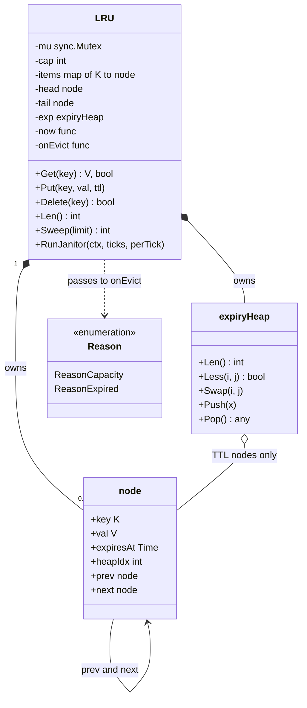
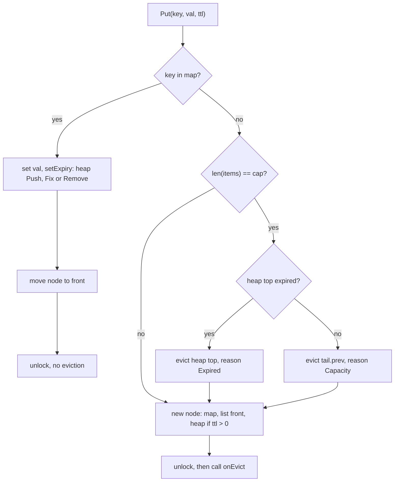

# LRU Cache with TTL

> [!summary] TL;DR
> An LRU (least recently used) cache keeps at most N entries and, when full, throws out the entry nobody has touched for the longest time. A hash map finds an entry in O(1), and a doubly linked list ordered by recency tells you the oldest one in O(1). TTL (time to live) gives each entry an expiry time: expired entries are never returned, are removed lazily on read and actively by a sweeper, and are evicted before any live entry when the cache is full.

> [!abstract] Core idea
> - A hash map finds an entry by key in O(1).
> - A doubly linked list keeps entries in recency order: the front is the newest, the back is the eviction victim.
> - Every `Get` and `Put` moves the entry to the front; the node stores its key so eviction can delete it from the map.
> - An expired entry is never returned: drop it when read, sweep it in the background, and evict it before any live entry.
> - Classic mistake: using `RLock` in `Get`, although `Get` moves the node and so writes to the list.

## Problem statement

```text
Design an in-memory LRU cache with per-entry TTL.
Get(key) returns the value if present and not expired.
Put(key, value, ttl) inserts or updates. When the cache is full, evict an
expired entry if there is one, otherwise the least recently used entry.
Expired entries must never be returned. Get and Put must be O(1) (O(log n) is
acceptable for entries that carry a TTL). Many goroutines use the cache.
```

- It tests data-structure choice (map plus doubly linked list), pointer handling, generics and guarding shared state with one mutex.
- The TTL part tests time handling: lazy plus active expiry, an injected clock, and keeping the hot path cheap.

### Solving path

1. Clarify capacity, TTL rules, eviction callbacks and concurrency.
2. Choose the structures: map plus doubly linked list, plus a min-heap of expiry times.
3. Write the list helpers: `remove`, `pushFront`, `moveToFront`.
4. Write `Get` and `Put` under one mutex, with eviction when full.
5. Add TTL: lazy expiry on `Get`, `Sweep` for active expiry, expired-first eviction.
6. Test with an injected clock (no sleeps) and with `-race`.

## Step 1: Clarify requirements

Questions to ask, with the answer this design assumes:

- Is capacity counted in entries or bytes? *Entries.*
- Is a miss an error? *No: `(zero, false)`, like a Go map.*
- One TTL for the cache or one per entry? Does `Get` extend it? *Per entry, set by `Put`. `Get` refreshes recency only (absolute expiry, not sliding). `ttl <= 0` means never expires.*
- Must expired entries free memory at once? *They must never be returned. Memory is reclaimed lazily on `Get`, by an active `Sweep`, and first in line when the cache is full.*
- Concurrent access? How read-heavy? *Concurrent; one mutex first, sharding when profiling shows contention.*
- Callback on eviction? *Yes, with a reason (capacity or expired), for metrics or write-back.*
- One process or shared? *One process. Shared across instances means Redis.*

**Functional:** `Get`, `Put` (insert or update, resets TTL), `Delete`, `Len`, `Sweep(limit)`, `RunJanitor`, optional `onEvict(key, val, reason)`, generic `LRU[K comparable, V any]`.

**Non-functional:** `Get` and `Put` are O(1) when the expiry heap does not change, and O(log n) when it does (an entry with a TTL is added, updated or removed, including as an eviction victim); safe for concurrent use; deterministic tests (clock injected as `now func() time.Time`); the callback can never deadlock the cache.

**Out of scope:** size in bytes, LFU, read-through loading (see Step 10).

## Step 2: Actors and use cases

| Actor | Use case |
|---|---|
| Caller (any goroutine) | Get a value; Put or update a value with a TTL; Delete a key |
| Janitor goroutine (optional) | Sweep expired entries on a ticker so memory is freed without reads |
| Cache owner | Receive eviction callbacks (metrics, write-back) |

The hardest use case, and the one to code first: **Put into a full cache** where some entry in the middle has already expired.

## Step 3: Entities

| Entity | Key fields | Why it exists |
|---|---|---|
| `LRU[K, V]` | mu, cap, items, head, tail, exp, now, onEvict | The cache: owns all three structures and the one lock |
| `node[K, V]` | key, val, expiresAt, heapIdx, prev, next | One entry; lives in the map, the list and (with a TTL) the heap at once |
| `items map[K]*node` | key to node pointer | O(1) lookup that points into the list |
| head / tail sentinels | empty nodes | List code never checks for nil |
| `expiryHeap` | slice of nodes with a TTL | Earliest deadline on top: active expiry and expired-first eviction without a scan |
| `Reason` | Capacity, Expired | Tells the callback why an entry left |

The modelling insight: **one node, three indexes.** The map answers "where is key k", the list answers "who is least recently used", and the heap answers "who expires first". The node stores its own `key` because eviction starts from a node (`tail.prev` or the heap top) and must delete the map entry. It stores `heapIdx` so `heap.Remove` and `heap.Fix` run in O(log n) without searching.

## Step 4: Relationships



- **Composition:** the cache owns its nodes and its heap; a node never belongs to two caches.
- **Self-association:** `prev`/`next` form the list. `head.next` is the most recently used entry, `tail.prev` the least.
- **Aggregation:** the heap holds pointers to the same nodes, only those with a TTL.
- **Dependency:** the clock and the callback are plain funcs, the Go form of single-method interfaces.

## Step 5: APIs and public methods

This is a library component, so the API is the Go method set (no REST):

| Method | Contract | Cost |
|---|---|---|
| `New[K, V](capacity, now, onEvict)` | `capacity <= 0` returns `ErrInvalidCapacity`; `now == nil` uses `time.Now` | O(1) |
| `Get(key) (V, bool)` | Live hit moves the key to the front; expired is a miss and is removed | O(1), O(log n) when it removes |
| `Put(key, val, ttl)` | Insert or update; resets the TTL; evicts expired-first when full | O(1); O(log n) when it adds, moves or removes a heap entry (a TTL on the new value, the old value, or the victim) |
| `Delete(key) bool` | Removes expired or live entries; no callback | O(log n) worst |
| `Len() int` | Stored entries, including expired ones not yet removed | O(1) |
| `Sweep(limit) int` | Removes up to `limit` expired entries, earliest deadline first | O(k log n) |
| `RunJanitor(ctx, ticks, perTick)` | Calls `Sweep(perTick)` on every tick until `ctx` ends | per tick |

No `context.Context` on `Get`/`Put`: they never block on I/O. Only the janitor, which runs for the life of the process, takes one.

## Step 6: Storage and repositories

Nothing is persisted, so there is no repository. When the cache must be shared by many instances or survive restarts, use Redis instead: `SET key val EX 60` gives the TTL and `maxmemory-policy allkeys-lru` gives eviction ([[Redis Fundamentals]]). Redis also offers `volatile-ttl`, which evicts keys that have a TTL, shortest remaining TTL first (approximated by sampling, like its LRU). That is close to this design's expired-first rule, but it evicts live keys that expire soon, while this cache only puts dead keys ahead of the LRU entry.

## Step 7: Patterns

| Pattern | Where | Why here |
|---|---|---|
| Sentinel nodes (data-structure idiom) | `head`, `tail` | No nil checks in list code |
| Callback, a small form of [[Observer and Event Bus]] | `onEvict(key, val, reason)` | Owner learns about evictions without the cache knowing why it cares |
| Injected clock (dependency injection) | `now func() time.Time` | TTL tests run instantly and deterministically ([[Testing LLD Code]]) |
| Injected ticker channel | `RunJanitor(ctx, ticks, ...)` | Tests drive the janitor tick by tick |
| [[Decorator and Middleware]] | Extension: metrics or read-through loader wrapping the cache | Adds behaviour without touching the cache |
| [[Strategy and Template Method]] | Extension: pluggable eviction (LRU, LFU, FIFO) | Only once a second policy is asked for |

Not used, and why: a Strategy interface for eviction in the base version is YAGNI with one policy. One mutex guards map, list and heap together because they must change atomically ([[Concurrency for LLD]]).

## Step 8: Core code

> [!tip] What to code in a 60-minute round
> Aim for about 150 lines in the room.
> - **Write:** `node`, `LRU` with `New`, `Get`, `Put`, `Delete`, `Len`, and the list helpers `remove`, `pushFront` and `moveToFront`; per-entry `expiresAt` checked in `Get`.
> - **Add if time remains:** `expiryHeap` with `setExpiry`, `Sweep`, and the eviction callback through `notify`.
> - **Talk only:** `RunJanitor`, sharding the cache for a 32-core hot spot, and lock-free or approximate LRU.

Folder layout: `lru/lru.go` (the cache, list and heap helpers), `lru/lru_test.go`, and `cmd/demo/main.go` for wiring (`New[string, []byte](1000, nil, logEvict)`, then `t := time.NewTicker(time.Second)`, `defer t.Stop()` and `go c.RunJanitor(ctx, t.C, 1000)`; cancel `ctx` on shutdown so the janitor goroutine exits). The whole package is one file here so it compiles as shown.

```go
// File: lru.go
package lru

import (
	"container/heap"
	"context"
	"errors"
	"sync"
	"time"
)

var ErrInvalidCapacity = errors.New("lru: capacity must be > 0")

// Reason tells the eviction callback why an entry left the cache.
type Reason int

const (
	ReasonCapacity Reason = iota // pushed out to make room for a new key
	ReasonExpired                // its TTL passed
)

// node is one entry. It sits in the map, in the recency list and, if it has
// a TTL, in the expiry heap, all at the same time.
type node[K comparable, V any] struct {
	key        K // stored so an eviction can delete the map entry
	val        V
	expiresAt  time.Time // zero means never expires
	heapIdx    int       // position in the expiry heap, -1 when not in it
	prev, next *node[K, V]
}

func (n *node[K, V]) expired(now time.Time) bool {
	return !n.expiresAt.IsZero() && !now.Before(n.expiresAt)
}

type evicted[K comparable, V any] struct {
	key    K
	val    V
	reason Reason
}

// LRU is a fixed-capacity cache with per-entry TTL. Get and Put are O(1)
// when the expiry heap is untouched and O(log n) when a TTL entry is added,
// updated or removed (heap update).
type LRU[K comparable, V any] struct {
	mu      sync.Mutex
	cap     int
	items   map[K]*node[K, V]
	head    *node[K, V] // sentinel: head.next is the most recently used
	tail    *node[K, V] // sentinel: tail.prev is the least recently used
	exp     expiryHeap[K, V]
	now     func() time.Time
	onEvict func(key K, val V, why Reason)
}

// New builds a cache. now == nil uses time.Now; tests pass a fake clock.
// onEvict may be nil; it always runs after the lock is released.
func New[K comparable, V any](capacity int, now func() time.Time, onEvict func(K, V, Reason)) (*LRU[K, V], error) {
	if capacity <= 0 {
		return nil, ErrInvalidCapacity
	}
	if now == nil {
		now = time.Now
	}
	head, tail := &node[K, V]{}, &node[K, V]{}
	head.next, tail.prev = tail, head
	return &LRU[K, V]{cap: capacity, items: make(map[K]*node[K, V], capacity),
		head: head, tail: tail, now: now, onEvict: onEvict}, nil
}

// Get returns a live value and marks it most recently used.
// An expired entry is a miss and is removed right here (lazy expiry).
func (c *LRU[K, V]) Get(key K) (V, bool) {
	var zero V
	c.mu.Lock()
	n, ok := c.items[key]
	if !ok {
		c.mu.Unlock()
		return zero, false
	}
	if n.expired(c.now()) {
		c.remove(n)
		c.mu.Unlock()
		c.notify([]evicted[K, V]{{n.key, n.val, ReasonExpired}})
		return zero, false
	}
	c.moveToFront(n)
	v := n.val
	c.mu.Unlock()
	return v, true
}

// Put inserts or updates a key and resets its TTL (ttl <= 0: never expires).
// When the cache is full it evicts an already-expired entry if one exists,
// otherwise the least recently used entry.
func (c *LRU[K, V]) Put(key K, val V, ttl time.Duration) {
	var out []evicted[K, V]
	c.mu.Lock()
	now := c.now()
	var exp time.Time
	if ttl > 0 {
		exp = now.Add(ttl)
	}
	if n, ok := c.items[key]; ok {
		n.val = val
		c.setExpiry(n, exp) // an update never evicts anything
		c.moveToFront(n)
		c.mu.Unlock()
		return
	}
	if len(c.items) == c.cap {
		victim, why := c.tail.prev, ReasonCapacity
		if len(c.exp) > 0 && c.exp[0].expired(now) {
			victim, why = c.exp[0], ReasonExpired // expired-first: drop a dead entry, keep a live one
		}
		c.remove(victim)
		out = append(out, evicted[K, V]{victim.key, victim.val, why})
	}
	n := &node[K, V]{key: key, val: val, heapIdx: -1}
	c.items[key] = n
	c.pushFront(n)
	c.setExpiry(n, exp)
	c.mu.Unlock()
	c.notify(out) // outside the lock: a callback that calls the cache cannot deadlock
}

// Delete removes a key, expired or not, and reports whether it was there.
func (c *LRU[K, V]) Delete(key K) bool {
	c.mu.Lock()
	defer c.mu.Unlock()
	n, ok := c.items[key]
	if ok {
		c.remove(n)
	}
	return ok
}

// Len counts stored entries, including expired ones not removed yet.
func (c *LRU[K, V]) Len() int {
	c.mu.Lock()
	defer c.mu.Unlock()
	return len(c.items)
}

// Sweep is active expiry: it removes up to limit expired entries (limit <= 0
// means all) and returns how many it removed. It only looks at the heap top,
// so it costs O(k log n) for k removals instead of a scan of every entry.
func (c *LRU[K, V]) Sweep(limit int) int {
	var out []evicted[K, V]
	c.mu.Lock()
	now := c.now()
	for len(c.exp) > 0 && c.exp[0].expired(now) && (limit <= 0 || len(out) < limit) {
		n := c.exp[0]
		c.remove(n)
		out = append(out, evicted[K, V]{n.key, n.val, ReasonExpired})
	}
	c.mu.Unlock()
	c.notify(out)
	return len(out)
}

// RunJanitor sweeps up to perTick entries on every tick until ctx is done.
// Production passes time.NewTicker(d).C; tests feed the channel by hand.
func (c *LRU[K, V]) RunJanitor(ctx context.Context, ticks <-chan time.Time, perTick int) {
	for {
		select {
		case <-ctx.Done():
			return
		case <-ticks:
			c.Sweep(perTick)
		}
	}
}

func (c *LRU[K, V]) notify(out []evicted[K, V]) {
	if c.onEvict == nil {
		return
	}
	for _, e := range out {
		c.onEvict(e.key, e.val, e.reason)
	}
}

// ---- helpers below: the caller holds c.mu ----

// remove takes a node out of all three structures.
func (c *LRU[K, V]) remove(n *node[K, V]) {
	n.prev.next, n.next.prev = n.next, n.prev
	n.prev, n.next = nil, nil
	delete(c.items, n.key)
	if n.heapIdx >= 0 {
		heap.Remove(&c.exp, n.heapIdx)
	}
}

func (c *LRU[K, V]) pushFront(n *node[K, V]) {
	n.prev, n.next = c.head, c.head.next
	c.head.next.prev = n
	c.head.next = n
}

func (c *LRU[K, V]) moveToFront(n *node[K, V]) {
	if c.head.next == n {
		return
	}
	n.prev.next, n.next.prev = n.next, n.prev
	c.pushFront(n)
}

// setExpiry stores a new deadline and adds, moves or drops the node in the heap.
func (c *LRU[K, V]) setExpiry(n *node[K, V], exp time.Time) {
	n.expiresAt = exp
	switch {
	case exp.IsZero() && n.heapIdx >= 0:
		heap.Remove(&c.exp, n.heapIdx) // TTL removed: never expires now
	case !exp.IsZero() && n.heapIdx >= 0:
		heap.Fix(&c.exp, n.heapIdx) // TTL changed: move to its new place
	case !exp.IsZero():
		heap.Push(&c.exp, n)
	}
}

// expiryHeap is a min-heap of the nodes that have a TTL, earliest deadline on
// top. It implements container/heap.Interface and keeps node.heapIdx current.
type expiryHeap[K comparable, V any] []*node[K, V]

func (h expiryHeap[K, V]) Len() int           { return len(h) }
func (h expiryHeap[K, V]) Less(i, j int) bool { return h[i].expiresAt.Before(h[j].expiresAt) }
func (h expiryHeap[K, V]) Swap(i, j int) {
	h[i], h[j] = h[j], h[i]
	h[i].heapIdx, h[j].heapIdx = i, j
}
func (h *expiryHeap[K, V]) Push(x any) {
	n := x.(*node[K, V])
	n.heapIdx = len(*h)
	*h = append(*h, n)
}
func (h *expiryHeap[K, V]) Pop() any {
	old := *h
	n := old[len(old)-1]
	old[len(old)-1] = nil // drop the reference so the node can be collected
	*h = old[:len(old)-1]
	n.heapIdx = -1
	return n
}
```

### Walkthrough

`Put(key, val, ttl)`:

1. Lock. Map, list and heap change together, so one lock covers all three.
2. Compute `exp = now + ttl` (zero time when `ttl <= 0`).
3. Key exists: set the value, `setExpiry` (push, fix or remove in the heap), move to the front, unlock. **An update never evicts.**
4. Key is new and the cache is full: if the heap top has expired, evict it with reason `Expired`; otherwise evict `tail.prev` with reason `Capacity`. The heap top is the entry with the earliest deadline, so if it is not expired, no entry is.
5. Insert the node in the map, at the list front and (with a TTL) in the heap.
6. Unlock, then run `onEvict`. A callback that calls `Get` or `Put` cannot deadlock.

`Get(key)` looks up the node; if `now >= expiresAt` it removes it (lazy expiry), unlocks, fires the callback and returns a miss. Otherwise it moves the node to the front. It needs a full `Lock`, not `RLock`, because moving a node is a write.

`Sweep(limit)` pops expired nodes from the heap top only, so a sweep that finds nothing costs O(1) instead of an O(n) scan of the whole list. `limit` bounds how long one sweep holds the lock, like Redis's time-bounded active expiry cycle.



## Test cases

| Test | Proves |
|---|---|
| `TestLRUAndTTL` | LRU order, update evicts nothing, alive just before the deadline, miss exactly at it, lazy removal, delete; callback reasons `[Capacity, Expired]` |
| `TestExpiredFirstEviction` | A full cache drops the expired middle entry, not the live LRU entry; with nothing expired it drops the LRU entry |
| `TestSweepIsBoundedAndEarliestFirst` | `Len` counts expired entries until they are removed; `Sweep(2)` stops at 2; removal order is earliest deadline first; live and no-TTL entries stay |
| `TestUpdateMovesEntryInHeap` | Removing a TTL takes the node out of the heap; extending it re-orders the heap |
| `TestJanitorExpiresWithoutReads` | A tick makes the janitor remove expired keys that nobody reads |
| `TestInvalidCapacity` | 0 and -1 return `ErrInvalidCapacity` |
| `TestCallbackCanReenter` | A callback that calls `Get` does not deadlock |
| `TestConcurrentExactCounts` | 16 goroutines put 4,000 distinct keys into capacity 100: exactly 100 stay and exactly 3,900 evictions fire, race-free |
| `TestRandomOpsKeepInvariants` | 5,000 seeded random operations never return a stale or expired value; map, list and heap always agree |

Measured: `go test -race -cover` on Go 1.24.4 passes all 9 tests with 100.0% statement coverage.

```go
// File: lru_test.go
package lru

import (
	"context"
	"fmt"
	"math/rand/v2"
	"sync"
	"sync/atomic"
	"testing"
	"time"
)

// fakeClock lets tests move time without sleeping.
type fakeClock struct{ t time.Time }

func (f *fakeClock) Now() time.Time          { return f.t }
func (f *fakeClock) Advance(d time.Duration) { f.t = f.t.Add(d) }

type ev struct {
	key int
	why Reason
}

func TestLRUAndTTL(t *testing.T) {
	clk := &fakeClock{t: time.Unix(0, 0)}
	var evs []ev
	c, err := New[int, string](2, clk.Now, func(k int, _ string, why Reason) { evs = append(evs, ev{k, why}) })
	if err != nil {
		t.Fatal(err)
	}
	steps := []struct {
		op      string // put | get | adv | del
		key     int
		val     string
		ttl     time.Duration
		wantVal string
		wantOK  bool
	}{
		{op: "put", key: 1, val: "a"},                        // no TTL
		{op: "put", key: 2, val: "b", ttl: 10 * time.Second}, // expires at 10s
		{op: "get", key: 1, wantVal: "a", wantOK: true},      // 1 becomes MRU, so 2 is LRU
		{op: "put", key: 3, val: "c"},                        // full, nothing expired: evict 2
		{op: "get", key: 2, wantOK: false},
		{op: "put", key: 3, val: "c2", ttl: 5 * time.Second}, // update sets a TTL, evicts nothing
		{op: "adv", ttl: 4 * time.Second},                    // t=4s
		{op: "get", key: 3, wantVal: "c2", wantOK: true},
		{op: "adv", ttl: time.Second},      // t=5s: exactly at the deadline
		{op: "get", key: 3, wantOK: false}, // expired: miss, removed lazily
		{op: "get", key: 1, wantVal: "a", wantOK: true},
		{op: "del", key: 1, wantOK: true},
		{op: "del", key: 1, wantOK: false},
	}
	for i, s := range steps {
		switch s.op {
		case "put":
			c.Put(s.key, s.val, s.ttl)
		case "adv":
			clk.Advance(s.ttl)
		case "get":
			if v, ok := c.Get(s.key); ok != s.wantOK || v != s.wantVal {
				t.Fatalf("step %d: get %d = %q,%v want %q,%v", i, s.key, v, ok, s.wantVal, s.wantOK)
			}
		case "del":
			if ok := c.Delete(s.key); ok != s.wantOK {
				t.Fatalf("step %d: delete %d = %v", i, s.key, ok)
			}
		}
		checkInvariants(t, c)
	}
	if want := []ev{{2, ReasonCapacity}, {3, ReasonExpired}}; fmt.Sprint(evs) != fmt.Sprint(want) {
		t.Fatalf("evictions %v, want %v", evs, want)
	}
}

func TestExpiredFirstEviction(t *testing.T) {
	clk := &fakeClock{t: time.Unix(0, 0)}
	var evs []ev
	c, _ := New[int, int](3, clk.Now, func(k, _ int, why Reason) { evs = append(evs, ev{k, why}) })
	c.Put(1, 1, 0) // oldest, so the LRU entry, but it never expires
	c.Put(2, 2, time.Second)
	c.Put(3, 3, 0)
	clk.Advance(2 * time.Second) // 2 is dead but still stored
	c.Put(4, 4, 0)               // full: the expired 2 goes, not the LRU 1
	if _, ok := c.Get(1); !ok {
		t.Fatal("live LRU entry was evicted while an expired one existed")
	}
	c.Put(5, 5, 0) // full, nothing expired: evict the LRU, which is now 3
	if want := []ev{{2, ReasonExpired}, {3, ReasonCapacity}}; fmt.Sprint(evs) != fmt.Sprint(want) {
		t.Fatalf("evictions %v, want %v", evs, want)
	}
}

func TestSweepIsBoundedAndEarliestFirst(t *testing.T) {
	clk := &fakeClock{t: time.Unix(0, 0)}
	var gone []int
	c, _ := New[int, int](10, clk.Now, func(k, _ int, _ Reason) { gone = append(gone, k) })
	for _, k := range []int{5, 3, 1, 4, 2} {
		c.Put(k, k, time.Duration(k)*time.Second) // key k expires at k seconds
	}
	c.Put(9, 9, 0)
	clk.Advance(3 * time.Second) // keys 1, 2, 3 are expired
	if c.Len() != 6 {
		t.Fatalf("Len = %d, want 6: expired entries count until removed", c.Len())
	}
	if n := c.Sweep(2); n != 2 {
		t.Fatalf("Sweep(2) removed %d", n)
	}
	if n := c.Sweep(0); n != 1 || c.Len() != 3 {
		t.Fatalf("Sweep(0) removed %d, len %d", n, c.Len())
	}
	if fmt.Sprint(gone) != "[1 2 3]" {
		t.Fatalf("removed %v, want earliest deadline first", gone)
	}
	checkInvariants(t, c)
}

func TestUpdateMovesEntryInHeap(t *testing.T) {
	clk := &fakeClock{t: time.Unix(0, 0)}
	c, _ := New[string, int](4, clk.Now, nil)
	c.Put("a", 1, time.Second)
	c.Put("a", 2, 0) // TTL removed: leaves the heap
	c.Put("b", 1, time.Second)
	c.Put("b", 2, 10*time.Second) // TTL extended: heap.Fix
	clk.Advance(5 * time.Second)
	if c.Sweep(0) != 0 {
		t.Fatal("nothing should have expired")
	}
	if v, ok := c.Get("a"); !ok || v != 2 {
		t.Fatal("a must never expire after its TTL was removed")
	}
	checkInvariants(t, c)
}

func TestJanitorExpiresWithoutReads(t *testing.T) {
	clk := &fakeClock{t: time.Unix(0, 0)}
	c, _ := New[int, int](10, clk.Now, nil)
	for i := range 5 {
		c.Put(i, i, time.Second)
	}
	clk.Advance(2 * time.Second) // happens before the tick send, so no data race
	ctx, cancel := context.WithCancel(context.Background())
	ticks, done := make(chan time.Time), make(chan struct{})
	go func() { c.RunJanitor(ctx, ticks, 0); close(done) }()
	ticks <- time.Time{} // unbuffered: returns once the janitor has the tick
	cancel()
	<-done // the janitor finished that sweep before it saw ctx.Done
	if c.Len() != 0 {
		t.Fatalf("janitor left %d expired entries", c.Len())
	}
}

func TestInvalidCapacity(t *testing.T) {
	for _, n := range []int{0, -1} {
		if _, err := New[int, int](n, nil, nil); err != ErrInvalidCapacity {
			t.Fatalf("capacity %d: err = %v", n, err)
		}
	}
}

func TestCallbackCanReenter(t *testing.T) {
	var c *LRU[int, int]
	c, _ = New[int, int](1, nil, func(k, _ int, _ Reason) { c.Get(k) }) // deadlocks if called under the lock
	c.Put(1, 1, 0)
	c.Put(2, 2, 0)
}

func TestConcurrentExactCounts(t *testing.T) {
	var evictions atomic.Int64
	c, _ := New[int, int](100, nil, func(int, int, Reason) { evictions.Add(1) })
	var wg sync.WaitGroup
	for g := range 16 {
		wg.Add(1)
		go func() {
			defer wg.Done()
			for i := range 250 {
				k := g*250 + i                            // 4000 distinct keys
				c.Put(k, k, time.Duration(k%2)*time.Hour) // half with a TTL: exercises the heap
				c.Get(k)
			}
		}()
	}
	wg.Wait()
	if c.Len() != 100 || evictions.Load() != 3900 {
		t.Fatalf("len=%d evictions=%d", c.Len(), evictions.Load())
	}
	checkInvariants(t, c)
}

func TestRandomOpsKeepInvariants(t *testing.T) {
	clk := &fakeClock{t: time.Unix(0, 0)}
	c, _ := New[int, int](8, clk.Now, nil)
	rng := rand.New(rand.NewPCG(1, 2))
	last, deadline := map[int]int{}, map[int]time.Time{}
	for i := range 5000 {
		k := rng.IntN(20)
		switch rng.IntN(5) {
		case 0, 1:
			ttl := time.Duration(rng.IntN(4)) * time.Second
			c.Put(k, i, ttl)
			last[k], deadline[k] = i, time.Time{}
			if ttl > 0 {
				deadline[k] = clk.t.Add(ttl)
			}
		case 2:
			v, ok := c.Get(k)
			if ok && (v != last[k] || !deadline[k].IsZero() && !clk.t.Before(deadline[k])) {
				t.Fatalf("op %d: get %d returned a stale or expired value", i, k)
			}
		case 3:
			c.Delete(k)
		case 4:
			clk.Advance(500 * time.Millisecond)
			c.Sweep(2)
		}
		checkInvariants(t, c)
	}
}

// checkInvariants proves the map, the list and the heap describe the same entries.
func checkInvariants[K comparable, V any](t *testing.T, c *LRU[K, V]) {
	t.Helper()
	c.mu.Lock()
	defer c.mu.Unlock()
	n, withTTL := 0, 0
	for x := c.head.next; x != c.tail; x = x.next {
		if c.items[x.key] != x || x.next.prev != x {
			t.Fatalf("list node %v does not match the map", x.key)
		}
		if (x.heapIdx >= 0) == x.expiresAt.IsZero() {
			t.Fatalf("key %v: in the heap = %v but expiresAt = %v", x.key, x.heapIdx >= 0, x.expiresAt)
		}
		if x.heapIdx >= 0 {
			withTTL++
		}
		n++
	}
	if n != len(c.items) || n > c.cap || withTTL != len(c.exp) {
		t.Fatalf("list %d, map %d, cap %d, TTL nodes %d, heap %d", n, len(c.items), c.cap, withTTL, len(c.exp))
	}
	for i, x := range c.exp {
		if x.heapIdx != i || i > 0 && c.exp[(i-1)/2].expiresAt.After(x.expiresAt) {
			t.Fatalf("heap order or index broken at %d", i)
		}
	}
}
```

## Step 9: Edge cases

| Edge case | Risk | Handling |
|---|---|---|
| Two goroutines `Put` at once | Corrupted `prev`/`next` pointers | One `sync.Mutex`; `go test -race` checks it |
| `Get` under `RLock` | `moveToFront` writes while other readers run | Full `Lock` in `Get` |
| Read exactly at the deadline | Off-by-one | Expired when `now >= expiresAt`; the test checks both sides |
| Expired keys never read again | Dead memory | Janitor sweeps; full cache evicts dead entries first |
| Full cache, expired entry in the middle | Evicting `tail.prev` blindly drops a live entry while a dead one keeps its slot | Heap top checked first (`TestExpiredFirstEviction`) |
| Update an existing key | Wrongly evicting | Update in place, no eviction |
| Update changes or removes the TTL | Stale heap position | `setExpiry` calls `heap.Fix` or `heap.Remove` |
| Capacity `<= 0` / 1 | Useless cache / edge of the list | Error / works: one node between sentinels |
| Callback calls the cache | Deadlock | Callbacks run after `Unlock` |
| Wall clock jumps backwards | Entries live longer or die early | `time.Now()` carries a monotonic reading and `Add` keeps it, so `Before` ignores wall-clock jumps |
| Copying the struct | Copies the mutex | Always use `*LRU`; `go vet` flags copies |
| Callback order under concurrency | Callback may run after another goroutine re-inserted the key | Document it; callbacks must not assume the key is still absent |

Common mistakes: a map without a list (no order) or a slice for order (O(n) move); not storing the key in the node; skipping the sentinels, so the empty and one-node cases need nil checks and break; forgetting to move on `Get`; evicting on update; firing callbacks under the lock; calling `time.Now()` directly so tests need `time.Sleep`.

## Step 10: Tradeoffs and extensions

**Choices made:**

- **Expired-first eviction:** a full cache drops a dead entry before a live one. The cost is the heap: `Put` with a TTL becomes O(log n) and each node carries `heapIdx`. The cheaper alternative is to evict `tail.prev` always and state that policy; it is O(1) but can throw out a live entry while dead ones hold memory.
- **Lazy plus active expiry:** lazy removal on `Get` keeps "never return expired" exact; the janitor reclaims memory from keys nobody reads. Redis does the same: a key expires passively when a client touches it, and an active cycle periodically checks keys that have a TTL and deletes the expired ones. The EXPIRE docs for Redis before 6.0 gave fixed numbers (10 runs per second, 20 random keys per run, repeat while more than 25% were expired). Redis 6.0 rewrote the cycle and made its effort tunable with `active-expire-effort` (1 to 10, default 1); at the default it tries to keep expired-but-unreclaimed keys under about 10% while bounding the CPU it spends. The current docs give no fixed numbers, so quote the old ones only as the classic algorithm.
- **Absolute TTL:** `Get` does not extend it. A sliding TTL (session caches) would call `setExpiry` in `Get` too.
- **Hand-rolled list vs `container/list`:** `list.Element.Value` is `any`, so you lose type safety; the generic hand-rolled list shows the pointer work interviewers ask for.

**Read-heavy contention.** Every `Get` writes (it moves a node), so one mutex serialises all readers. Options, cheapest first:

| Option | How | Cost |
|---|---|---|
| Sharding | N independent caches; shard by `maphash.Comparable(seed, key) % N` (`Comparable` is new in Go 1.24) | LRU becomes per shard; a hot shard still contends |
| Sampled approximate LRU | Store a last-access time per entry, updated atomically on `Get`; to evict, sample k entries and drop the oldest | No list moves on reads. Redis samples `maxmemory-samples` keys (default 5) and keeps a pool of good candidates since Redis 3.0 |
| Buffered access records | Record hits in a lossy buffer and apply them to the list in batches | Recency is slightly stale; Ristretto and Caffeine work this way |
| CLOCK (second chance) | A reference bit set on `Get`; a clock hand clears bits and evicts the first unset | Approximate LRU with no list writes |

**Production libraries.** Prefer these to a hand-rolled cache in real code:

- `github.com/hashicorp/golang-lru/v2`: a thread-safe generic LRU, a 2Q cache, and an `expirable` LRU whose TTL is set once for the whole cache in `expirable.NewLRU`, not per entry.
- `github.com/dgraph-io/ristretto/v2` (generic since v2): TinyLFU admission (a frequency sketch decides whether a new key is worth admitting), SampledLFU eviction, cost-based capacity and `SetWithTTL`. Sets are buffered and may be dropped, so a `Get` right after a `Set` can miss; `Wait()` blocks until buffered sets are applied.

**Other follow-ups:**

| Follow-up | Change |
|---|---|
| LFU instead of LRU | Map key to node plus map frequency to list, track `minFreq`; still O(1) ([[Cache Eviction Policies - LRU, LFU, TTL]]) |
| Several policies | `EvictionPolicy` interface with `OnAccess`, `OnInsert`, `Victim` (Strategy) |
| Capacity in bytes | Track used bytes; evict in a loop until the new value fits |
| Thundering herd on a miss | `singleflight.Group` around the loader ([[Cache Failure Modes - Stampede, Avalanche, Penetration, Hot and Big Keys]]) |
| Read-through and write-back | A decorator with a loader func; `onEvict` writes dirty entries back |
| Distributed cache | Redis, or many cache nodes placed with [[Consistent Hashing]] |

## Drawing

![[LRU Cache LLD Drawing.excalidraw]]

The drawing shows the map pointing into the doubly linked list with head and tail sentinels, the Get flow with its expired branch, and the Put flow with update and evict branches. It predates the expiry heap: when you redraw it, add the heap under the list with arrows to the TTL nodes, and the "heap top expired?" decision before "evict tail.prev".

Redraw it from memory: the map arrows into list nodes, the sentinels and which end is evicted, the node fields and why `key` and `heapIdx` are stored, both flows, and where the lock is taken and the callback runs.

## Interview questions

> [!question]- Why a map plus a doubly linked list, and why does the node store its key?
> The map finds a node in O(1); the list keeps recency order so the front is the most recent and `tail.prev` the least, and unlinking a node is O(1) because it knows both neighbours. Eviction starts from a node, so the node must carry its key to delete the map entry.

> [!question]- Trap: can `Get` use `RWMutex.RLock` since it only reads?
> No. A hit moves the node to the front, which writes `prev`/`next`. Two readers under `RLock` would corrupt the list. Either take a full lock, or change the design so reads do not write (sampled LRU, CLOCK bits, buffered access records).

> [!question]- The cache is full and an entry in the middle has expired. What does `Put` evict?
> The expired entry. The expiry heap keeps the earliest deadline on top; if the top has expired, evict it with reason Expired, otherwise evict `tail.prev`. Checking the top is O(1) and removing it O(log n). Without a heap you must either scan O(n) or state the simpler policy "always evict the LRU tail".

> [!question]- Lazy or active expiry?
> Both. Lazy expiry on `Get` guarantees an expired value is never returned and costs nothing extra. Active expiry (a janitor calling a bounded `Sweep`) frees memory held by keys nobody reads. Redis also combines passive expiry with a sampled active cycle.

> [!question]- How do you test TTL without `time.Sleep`?
> Inject the clock as `now func() time.Time` and advance a fake clock in the test. Inject the janitor's ticker as a channel and send ticks by hand. The tests run in milliseconds and test the exact deadline boundary.

> [!question]- The cache is a hot spot on a 32-core service. What do you change?
> Profile first. Then shard by key hash so each shard has its own lock, or remove writes from the read path: sampled approximate LRU like Redis, CLOCK reference bits, or buffered access records like Ristretto. In production code, use ristretto or golang-lru rather than a hand-rolled cache.

## Interview explanation

```text
I combine a hash map from key to node with a doubly linked list ordered by recency, using sentinel head and tail nodes, so lookups and recency moves are O(1). Entries with a TTL also sit in a min-heap ordered by expiry, and each node stores its key and its heap index so eviction and heap fixes need no search. Get removes an entry whose deadline has passed and returns a miss, otherwise it moves the node to the front. Put updates in place and resets the TTL; when the cache is full it evicts the heap top if that entry has already expired, otherwise tail.prev. One mutex guards the map, the list and the heap together, because even Get writes, and the eviction callback runs after the unlock so it cannot deadlock. The clock and the janitor's ticker are injected, so TTL tests never sleep. To scale reads I would shard by key hash or move to sampled LRU, and in production I would use ristretto or golang-lru.
```

## Cheat sheet

- Map key to node plus doubly linked list with sentinels: O(1) lookup and O(1) recency moves.
- The node stores `key` (for map delete on eviction) and `heapIdx` (for O(log n) heap fixes).
- Min-heap of TTL nodes: active expiry in O(k log n) and expired-first eviction.
- Expired when `now >= expiresAt`; `Get` removes it (lazy); the janitor sweeps (active).
- One mutex over map, list and heap; `Get` writes, so no `RLock`.
- Callbacks run after `Unlock`; clock and ticker are injected for deterministic tests.
- Scale reads with sharding or approximate LRU (Redis samples 5 keys by default); in production use ristretto or golang-lru.

## Links

- **Before this:** [[Heaps and Priority Queues]], [[Concurrency for LLD]], [[Testing LLD Code]]
- **Next:** [[Elevator System]], [[In-memory KV Store with TTL and Transactions]], [[Rate Limiter]]
- **Compare with:** [[Cache Eviction Policies - LRU, LFU, TTL]], [[Redis Fundamentals]], [[Consistent Hashing]]
