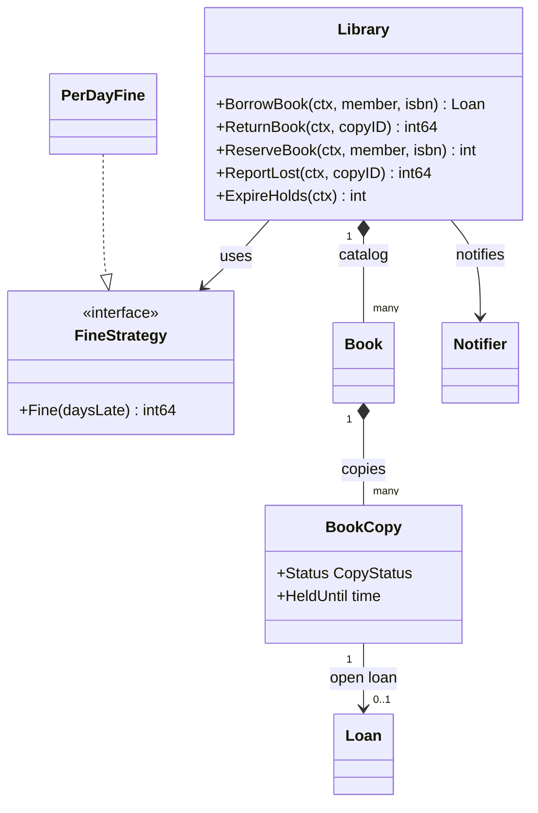
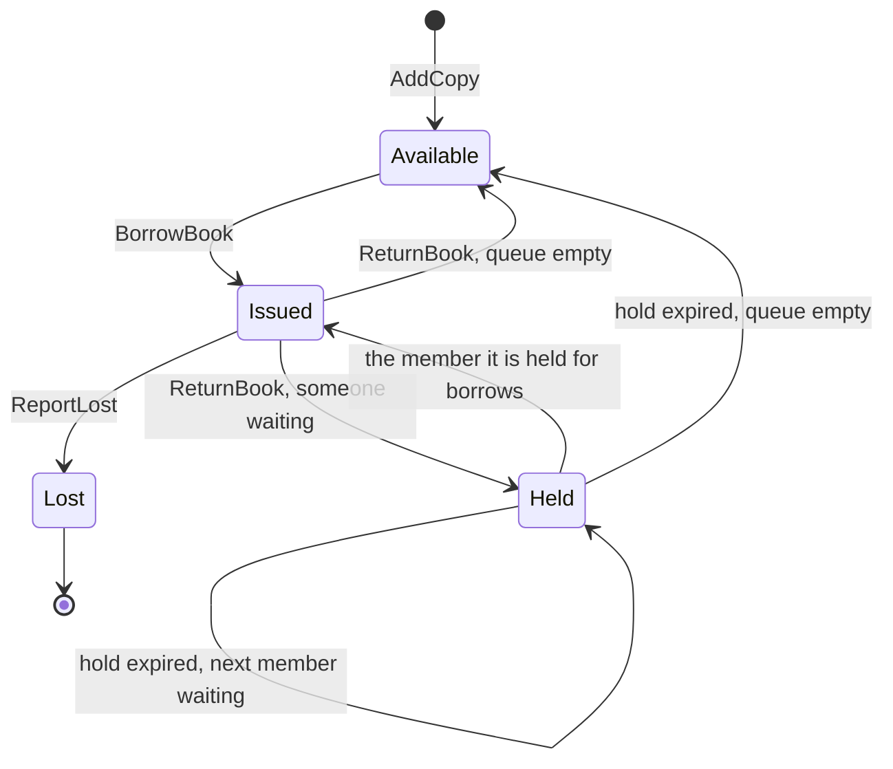
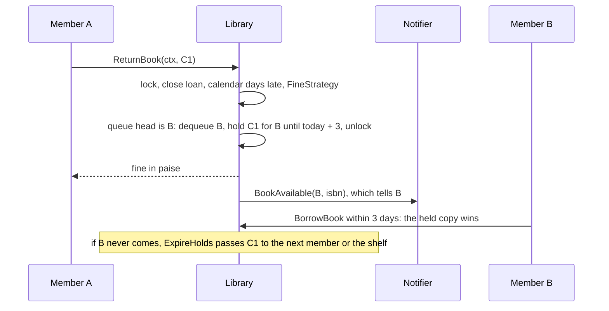

# Library Management

> [!summary] TL;DR
> The library round is about one modelling split and three rules. A `Book` is the catalog title you search and reserve; a `BookCopy` is the physical item you borrow, hold or lose. Borrowing the last copy must be atomic, a returned copy is held for the first member in a FIFO queue (and the hold expires after N days), and fines count the library's calendar days late through a swappable strategy.

## Problem statement

```text
Design a library system where members can search books, borrow copies, return copies,
and track due dates and fines. Support reservations when all copies are out,
and handle a member losing a copy.
```

- It tests Book versus BookCopy (copy states available, issued, held, lost) and rules under concurrency: the borrow limit, the last copy going to exactly one member, a held copy reserved for one member, and a pluggable fine.

## Step 1: Clarify requirements

### Questions to ask (with assumed answers)

- Can a title have many physical copies? *Assume: yes; borrowing is always of a copy.*
- Loan period and limit? *Assume: 14 days and at most 2 open loans per member, the same for everyone.*
- Fine rule? *Assume: Rs 5 per calendar day late in the library's time zone, capped, in paise, swappable. A book due on the 15th and returned at 9 a.m. on the 16th is one day late.*
- What does search cover? *Assume: case-insensitive substring on title, author and category; no ranking.*
- All copies out? *Assume: the member reserves; a FIFO queue per ISBN; a returned copy is held for the queue head for 3 days, then passes to the next member or back to the shelf.*
- What if a member loses a copy? *Assume: the loan closes, the member pays the late fine plus the book price, and the copy is marked lost and never lent again.*
- Notifications sync or async? *Assume: a `Notifier` interface called outside the lock; async through an outbox in production.*

### Functional

- Add books (ISBN, title, author, category, price) and copies (barcode); search title, author and category (case-insensitive substring, no ranking).
- Borrow a copy (due = today + 14 days), return it (fine, then hold or shelve), report it lost (late fine + book price; never lent again).
- Reserve only when no copy is on the shelf; expire uncollected holds.

### Non-functional

- Two members borrowing the last copy at once: exactly one wins; the limit holds under parallel borrows.
- A held copy cannot be taken by anyone else; the `Notifier` is never called under the lock (an outbox in production).
- Money is `int64` paise; the clock and the library's time zone are injected.

### Out of scope

- Paying fines, member sign-up, several branches, search ranking, renewals (a follow-up).

## Step 2: Actors and use cases

| Actor | Use case |
|---|---|
| Member | Search, borrow, return, reserve, report lost |
| Librarian | Add books and copies, collect fines |
| Notifier and scheduler | Tell the member a held copy is ready; run `ExpireHolds` and due-date reminders (follow-up) |

The hardest use cases are **BorrowBook** (limit, held-copy priority, last-copy race) and **ReturnBook** handing the copy to the queue. Code those first.

## Step 3: Entities

| Entity | Key fields | Why it exists |
|---|---|---|
| `Book` | ISBN, Title, Author, Category, Price | The catalog entry; what you search and reserve |
| `BookCopy` | ID, ISBN, Status, HeldFor, HeldUntil | The physical item; what you lend, hold or lose |
| `CopyStatus` | Available, Issued, Held, Lost | The copy lifecycle; Lost is terminal |
| Member | ID, open-loan count (`active` map) | The borrow limit is per member |
| `Loan` | CopyID, ISBN, MemberID, IssuedAt, DueAt | One borrowing of one copy; the source of the due date and the fine |
| Fine | `int64` paise returned by `ReturnBook` and `ReportLost` | Computed by `FineStrategy`, stored on the loan row |
| Reservation queue | `map[isbn][]memberID` | FIFO fairness when all copies are out |
| `FineStrategy` | `Fine(daysLate)` | The fine rule changes on its own |
| `Notifier`, `Config` | `BookAvailable(ctx, member, isbn)`; MaxLoans, LoanDays, HoldDays, Loc | The "your book is ready" observer; policy numbers and the library's calendar |

Modelling insight: **separate Book from BookCopy.** A count field on Book cannot say "copy C1 is held for Asha until Friday" or "copy C2 is lost".

## Step 4: Relationships





## Step 5: APIs and public methods

```text
GET    /books?q=kleppmann                     -> 200 [{isbn, title, author, category, available}]
POST   /books                                 -> 201 {isbn}
POST   /books/{isbn}/copies                   -> 201 {copyId}
POST   /loans               body: {memberId, isbn}   -> 201 {copyId, dueAt} | 409 no copy | 409 limit
POST   /loans/{copyId}/return                 -> 200 {finePaise}  | 409 not on loan
POST   /loans/{copyId}/lost                   -> 200 {chargePaise}
POST   /books/{isbn}/reservations body: {memberId} -> 201 {position} | 409 copies available
DELETE /books/{isbn}/reservations/{memberId}  -> 204
```

The Go surface is this interface; `*Library` in Step 8 implements it, and a scheduler (not an HTTP route) calls `ExpireHolds`:

```go
type LibraryService interface {
	SearchBooks(ctx context.Context, query string) ([]Book, error)
	BorrowBook(ctx context.Context, memberID, isbn string) (Loan, error)
	ReturnBook(ctx context.Context, copyID string) (int64, error) // fine in paise
	ReserveBook(ctx context.Context, memberID, isbn string) (int, error)
	ReportLost(ctx context.Context, copyID string) (int64, error) // fine + price
	ExpireHolds(ctx context.Context) int                          // run by a scheduler
}

var _ LibraryService = (*Library)(nil) // compile-time check
```

## Step 6: Storage and repositories

```sql
CREATE TABLE books (
    isbn        TEXT PRIMARY KEY,
    title       TEXT   NOT NULL,
    author      TEXT   NOT NULL,
    category    TEXT   NOT NULL,
    price_paise BIGINT NOT NULL
);
CREATE INDEX idx_books_title  ON books (lower(title));
CREATE INDEX idx_books_author ON books (lower(author));

CREATE TABLE members (
    id           TEXT PRIMARY KEY,
    name         TEXT NOT NULL,
    max_loans    INT  NOT NULL DEFAULT 2,
    active_loans INT  NOT NULL DEFAULT 0 CHECK (active_loans >= 0)
);

CREATE TABLE book_copies (
    id         TEXT PRIMARY KEY,
    isbn       TEXT NOT NULL REFERENCES books(isbn),
    status     TEXT NOT NULL DEFAULT 'available'
               CHECK (status IN ('available', 'issued', 'held', 'lost')),
    held_for   TEXT REFERENCES members(id),
    held_until TIMESTAMPTZ                       -- an expiry job sweeps holds past this
);
CREATE INDEX idx_copies_free ON book_copies (isbn) WHERE status = 'available';

CREATE TABLE loans (
    id          BIGSERIAL PRIMARY KEY,
    copy_id     TEXT NOT NULL REFERENCES book_copies(id),
    member_id   TEXT NOT NULL REFERENCES members(id),
    issued_at   TIMESTAMPTZ NOT NULL,
    due_at      TIMESTAMPTZ NOT NULL,
    returned_at TIMESTAMPTZ,
    lost        BOOLEAN NOT NULL DEFAULT false,
    fine_paise  BIGINT  NOT NULL DEFAULT 0
);
-- a copy can have only one open loan
CREATE UNIQUE INDEX uq_open_loan ON loans (copy_id) WHERE returned_at IS NULL;

CREATE TABLE reservations (
    id        BIGSERIAL PRIMARY KEY,                 -- FIFO order
    isbn      TEXT NOT NULL REFERENCES books(isbn),
    member_id TEXT NOT NULL REFERENCES members(id),
    status    TEXT NOT NULL DEFAULT 'waiting'        -- waiting | held | fulfilled | expired | cancelled
);
-- one active reservation per member per book
CREATE UNIQUE INDEX uq_active_reservation ON reservations (isbn, member_id)
    WHERE status IN ('waiting', 'held');

-- enforce the borrow limit atomically: 0 rows updated = ErrLimitReached
UPDATE members SET active_loans = active_loans + 1
WHERE id = $1 AND active_loans < max_loans;

-- borrow the last copy safely: claim one available row, skip rows others lock
UPDATE book_copies SET status = 'issued'
WHERE id = (SELECT id FROM book_copies
            WHERE isbn = $1 AND status = 'available'
            LIMIT 1 FOR UPDATE SKIP LOCKED)
RETURNING id;

-- close exactly once (a duplicate return updates 0 rows)
UPDATE loans SET returned_at = $2, fine_paise = $3
WHERE copy_id = $1 AND returned_at IS NULL;
```

Run the limit update, the copy claim and the loan insert in one transaction, so a failed claim rolls back the limit increment; the return transaction closes the loan and decrements `active_loans`. The SQL claim covers available copies only; a copy held for this member is claimed with `WHERE id = $1 AND status = 'held' AND held_for = $2`. Row-lock trade-offs live in [[Locking - Optimistic vs Pessimistic]].

```go
type BookRepo interface {
	Search(ctx context.Context, query string) ([]Book, error)
	Get(ctx context.Context, isbn string) (Book, error)
}

type CopyRepo interface {
	ClaimAvailable(ctx context.Context, isbn string) (BookCopy, error) // SKIP LOCKED claim
	SetStatus(ctx context.Context, copyID string, s CopyStatus, heldFor string, heldUntil time.Time) error
	ExpiredHolds(ctx context.Context, now time.Time) ([]BookCopy, error) // held_until <= now
}

type LoanRepo interface {
	Create(ctx context.Context, l Loan) error // uq_open_loan protects the copy
	GetOpen(ctx context.Context, copyID string) (Loan, error)
	Close(ctx context.Context, copyID string, fine int64, lost bool) error
	CountOpen(ctx context.Context, memberID string) (int, error)
}

type ReservationRepo interface {
	Enqueue(ctx context.Context, isbn, memberID string) (int, error)
	Head(ctx context.Context, isbn string) (string, bool, error)
	Remove(ctx context.Context, isbn, memberID string) error
}
```

## Step 7: Patterns

| Pattern | Where | Why here |
|---|---|---|
| [[Strategy and Template Method]] | `FineStrategy` (`PerDayFine` with a cap; slabs later) | Fine rules change by policy, not by code in Return |
| [[Observer and Event Bus]] | `Notifier.BookAvailable` when a copy is held | Decouples lending from email or SMS |
| [[Facade (vs Mediator)]] | `Library` | One entry point that hides the queue, the fine and copy selection |
| [[Repository and Unit of Work]] | `BookRepo`, `CopyRepo`, `LoanRepo`, `ReservationRepo` | Swap maps for Postgres without touching rules |
| Not used | State objects for the copy ([[State Machines in Go]]); [[Chain of Responsibility and Pipelines]] for borrow checks | An enum is enough while no action behaves very differently per state; two borrow rules do not need a chain until unpaid-fine and tier checks arrive |

## Folder structure

The code in Step 8 is printed as one file so it reads top to bottom. In the round, split it like this:

```text
library/
  model.go        -> Book, BookCopy, CopyStatus, Loan, Config, Err* errors
  fine.go         -> FineStrategy + PerDayFine, calendarDaysLate
  notifier.go     -> Notifier interface
  repository.go   -> BookRepo, CopyRepo, LoanRepo, ReservationRepo (DB version)
  service.go      -> Library: AddBook, AddCopy, SearchBooks, BorrowBook, ReturnBook, ReportLost, ReserveBook, ExpireHolds, helpers
  service_test.go -> table-driven search/borrow/return/lost tests, reservations and holds, concurrent last copy
cmd/demo/main.go  -> builds Library with PerDayFine, an email Notifier, the library's time zone and time.Now
```

- `model.go`: data and errors only.
- `fine.go`: the fine Strategy, its default and the calendar-day rule.
- `notifier.go`: the Observer seam.
- `repository.go`: storage interfaces; the interview code keeps maps in `Library`.
- `service.go`: the `sync.RWMutex` and every use case.
- `cmd/demo/main.go`: wiring only.

## Step 8: Core code

Three changes over the classic solution, each with a test:

1. **Fines count calendar days, not 24-hour periods.** `now.Sub(due) / 24h` charges nothing for a return 23 hours late and drifts across DST changes. `calendarDaysLate` compares the two dates in the library's `time.Location`, so "due on the 15th, back on the 16th" is one day late whatever the hour. State this policy in the interview.
2. **A hold takes the member out of the queue.** If the queue head stayed queued while their copy was held, a second returned copy would be held for the same member and the next member would wait forever.
3. **Holds expire.** `HeldUntil = today + HoldDays`; a scheduler calls `ExpireHolds`, which passes an uncollected copy to the next member (and notifies them after unlocking) or puts it back on the shelf.

### Walkthrough

`BorrowBook(ctx, memberID, isbn)`:

1. Return early on a cancelled context, then lock. Everything after is one atomic check-then-act.
2. The book must exist (`ErrBookNotFound`); the member must be under `MaxLoans` (`ErrLimitReached`).
3. Scan the copies: a copy `Held` for this member wins; otherwise the first `Available`. Copies held for someone else, issued or lost are skipped.
4. Nothing found: `ErrNoCopyAvailable` (the client can then call `ReserveBook`).
5. Remove the member from the queue if present, mark the copy `Issued`, create the loan with `DueAt = now + LoanDays` in the library's zone, and bump the open-loan count.

`ReturnBook(ctx, copyID)`:

1. Lock; `openLoan` finds the copy (`ErrCopyNotFound`) and its open loan (`ErrNotIssued` covers a duplicate return and a lost copy).
2. `closeLoan` counts calendar days late, computes the fine through `FineStrategy`, deletes the loan and decrements the member's count.
3. `holdOrShelve`: if the queue is non-empty, pop its head, mark the copy `Held` for that member until `today + HoldDays`; otherwise mark it `Available`.
4. Unlock, then call the `Notifier`. Slow I/O never blocks other borrowers.

`ReportLost(ctx, copyID)`: the same `openLoan` and `closeLoan`, then charge `fine + Book.Price` and set the copy `Lost`. Lost copies are never picked by Borrow, so the queue keeps waiting for other copies.

`SearchBooks(ctx, query)`: a read lock, a case-insensitive substring match on title, author or category, sorted by title; an empty query is `ErrEmptyQuery`.

`ExpireHolds(ctx)`: lock, run `holdOrShelve` on every copy whose `HeldUntil` has passed, collect the members to notify, unlock, then notify them.

```go
package library

import (
	"context"
	"errors"
	"slices"
	"strings"
	"sync"
	"time"
)

var (
	ErrBookNotFound    = errors.New("book not found")
	ErrCopyNotFound    = errors.New("copy not found")
	ErrNotIssued       = errors.New("copy is not on loan")
	ErrNoCopyAvailable = errors.New("no copy available")
	ErrLimitReached    = errors.New("borrow limit reached")
	ErrCopiesAvailable = errors.New("copies available, borrow instead")
	ErrAlreadyReserved = errors.New("already reserved")
	ErrEmptyQuery      = errors.New("empty search query")
)

type CopyStatus int

const (
	Available CopyStatus = iota
	Issued
	Held // kept aside for one member until HeldUntil
	Lost // terminal: never goes back on the shelf
)

// Book is the catalog entry (one per ISBN).
type Book struct {
	ISBN, Title, Author, Category string
	Price                         int64 // paise, charged when a copy is lost
}

// BookCopy is the physical item that is actually lent.
type BookCopy struct {
	ID, ISBN  string
	Status    CopyStatus
	HeldFor   string
	HeldUntil time.Time
}

type Loan struct {
	CopyID, ISBN, MemberID string
	IssuedAt, DueAt        time.Time
}

// FineStrategy turns calendar days late into a fine in paise.
type FineStrategy interface {
	Fine(daysLate int) int64
}

type PerDayFine struct {
	PerDay int64
	Cap    int64 // 0 = no cap
}

func (f PerDayFine) Fine(daysLate int) int64 {
	fine := int64(max(daysLate, 0)) * f.PerDay
	if f.Cap > 0 {
		fine = min(fine, f.Cap)
	}
	return fine
}

// Notifier is told when a held copy is ready (Observer).
type Notifier interface {
	BookAvailable(ctx context.Context, memberID, isbn string)
}

type Config struct {
	MaxLoans, LoanDays, HoldDays int
	Loc                          *time.Location // the library's calendar
}

type Library struct {
	mu       sync.RWMutex
	cfg      Config
	books    map[string]*Book       // isbn -> book
	copies   map[string][]*BookCopy // isbn -> copies
	copyByID map[string]*BookCopy
	loans    map[string]*Loan    // copyID -> open loan
	active   map[string]int      // memberID -> open loans
	queue    map[string][]string // isbn -> FIFO member IDs still waiting
	fine     FineStrategy
	notifier Notifier
	now      func() time.Time
}

func NewLibrary(cfg Config, fine FineStrategy, n Notifier, now func() time.Time) *Library {
	return &Library{
		cfg: cfg, books: map[string]*Book{}, copies: map[string][]*BookCopy{},
		copyByID: map[string]*BookCopy{}, loans: map[string]*Loan{},
		active: map[string]int{}, queue: map[string][]string{},
		fine: fine, notifier: n, now: now,
	}
}

func (l *Library) AddBook(b Book) {
	l.mu.Lock()
	defer l.mu.Unlock()
	l.books[b.ISBN] = &b
}

func (l *Library) AddCopy(isbn, copyID string) error {
	l.mu.Lock()
	defer l.mu.Unlock()
	if _, ok := l.books[isbn]; !ok {
		return ErrBookNotFound
	}
	c := &BookCopy{ID: copyID, ISBN: isbn}
	l.copies[isbn] = append(l.copies[isbn], c)
	l.copyByID[copyID] = c
	return nil
}

// SearchBooks matches title, author or category, case-insensitive, sorted by title.
func (l *Library) SearchBooks(ctx context.Context, query string) ([]Book, error) {
	q := strings.ToLower(strings.TrimSpace(query))
	if q == "" {
		return nil, ErrEmptyQuery
	}
	l.mu.RLock()
	defer l.mu.RUnlock()
	var out []Book
	for _, b := range l.books {
		if strings.Contains(strings.ToLower(b.Title), q) ||
			strings.Contains(strings.ToLower(b.Author), q) ||
			strings.Contains(strings.ToLower(b.Category), q) {
			out = append(out, *b)
		}
	}
	slices.SortFunc(out, func(a, b Book) int { return strings.Compare(a.Title, b.Title) })
	return out, nil
}

// BorrowBook issues one copy. Check and issue happen under one lock, so the
// last copy can never be issued twice.
func (l *Library) BorrowBook(ctx context.Context, memberID, isbn string) (Loan, error) {
	if err := ctx.Err(); err != nil {
		return Loan{}, err
	}
	l.mu.Lock()
	defer l.mu.Unlock()
	copies, ok := l.copies[isbn]
	if !ok {
		return Loan{}, ErrBookNotFound
	}
	if l.active[memberID] >= l.cfg.MaxLoans {
		return Loan{}, ErrLimitReached
	}
	var pick *BookCopy
	for _, c := range copies {
		if c.Status == Held && c.HeldFor == memberID {
			pick = c // the copy held for this member wins
			break
		}
		if c.Status == Available && pick == nil {
			pick = c
		}
	}
	if pick == nil {
		return Loan{}, ErrNoCopyAvailable
	}
	l.dequeue(isbn, memberID)
	pick.Status, pick.HeldFor, pick.HeldUntil = Issued, "", time.Time{}
	now := l.now().In(l.cfg.Loc)
	loan := &Loan{CopyID: pick.ID, ISBN: isbn, MemberID: memberID,
		IssuedAt: now, DueAt: now.AddDate(0, 0, l.cfg.LoanDays)}
	l.loans[pick.ID] = loan
	l.active[memberID]++
	return *loan, nil
}

// ReturnBook closes the loan, returns the fine, then holds or shelves the copy.
func (l *Library) ReturnBook(ctx context.Context, copyID string) (int64, error) {
	l.mu.Lock()
	c, loan, err := l.openLoan(copyID)
	if err != nil {
		l.mu.Unlock()
		return 0, err
	}
	fine := l.closeLoan(loan)
	next, held := l.holdOrShelve(c)
	l.mu.Unlock()
	if held && l.notifier != nil {
		l.notifier.BookAvailable(ctx, next, c.ISBN) // never call out under the lock
	}
	return fine, nil
}

// ReportLost charges fine + book price; the copy is Lost for good.
func (l *Library) ReportLost(ctx context.Context, copyID string) (int64, error) {
	l.mu.Lock()
	defer l.mu.Unlock()
	c, loan, err := l.openLoan(copyID)
	if err != nil {
		return 0, err
	}
	charge := l.closeLoan(loan) + l.books[c.ISBN].Price
	c.Status = Lost
	return charge, nil
}

// ReserveBook joins the FIFO queue. Only allowed when nothing is on the shelf.
func (l *Library) ReserveBook(ctx context.Context, memberID, isbn string) (int, error) {
	l.mu.Lock()
	defer l.mu.Unlock()
	copies, ok := l.copies[isbn]
	if !ok {
		return 0, ErrBookNotFound
	}
	for _, c := range copies {
		if c.Status == Available {
			return 0, ErrCopiesAvailable
		}
		if c.Status == Held && c.HeldFor == memberID {
			return 0, ErrAlreadyReserved // a copy is already waiting for them
		}
	}
	if slices.Contains(l.queue[isbn], memberID) {
		return 0, ErrAlreadyReserved
	}
	l.queue[isbn] = append(l.queue[isbn], memberID)
	return len(l.queue[isbn]), nil
}

// ExpireHolds is run by a scheduler. A hold not collected by HeldUntil passes
// to the next waiting member, or the copy goes back on the shelf.
func (l *Library) ExpireHolds(ctx context.Context) int {
	type msg struct{ member, isbn string }
	var msgs []msg
	l.mu.Lock()
	now, expired := l.now(), 0
	for _, c := range l.copyByID {
		if c.Status != Held || now.Before(c.HeldUntil) {
			continue
		}
		expired++
		if next, held := l.holdOrShelve(c); held {
			msgs = append(msgs, msg{next, c.ISBN})
		}
	}
	l.mu.Unlock()
	for _, m := range msgs {
		if l.notifier != nil {
			l.notifier.BookAvailable(ctx, m.member, m.isbn)
		}
	}
	return expired
}

// holdOrShelve (called with l.mu held, like the helpers below) gives a free copy to the head of the queue, removing that
// member from the queue so a second returned copy goes to the next member.
func (l *Library) holdOrShelve(c *BookCopy) (string, bool) {
	q := l.queue[c.ISBN]
	if len(q) == 0 {
		c.Status, c.HeldFor, c.HeldUntil = Available, "", time.Time{}
		return "", false
	}
	l.queue[c.ISBN] = q[1:]
	c.Status, c.HeldFor = Held, q[0]
	c.HeldUntil = l.now().In(l.cfg.Loc).AddDate(0, 0, l.cfg.HoldDays)
	return q[0], true
}

func (l *Library) openLoan(copyID string) (*BookCopy, *Loan, error) {
	c, ok := l.copyByID[copyID]
	if !ok {
		return nil, nil, ErrCopyNotFound
	}
	loan, ok := l.loans[copyID]
	if !ok {
		return nil, nil, ErrNotIssued // duplicate return or lost copy
	}
	return c, loan, nil
}

func (l *Library) closeLoan(loan *Loan) int64 {
	delete(l.loans, loan.CopyID)
	l.active[loan.MemberID]--
	return l.fine.Fine(calendarDaysLate(loan.DueAt, l.now(), l.cfg.Loc))
}

// calendarDaysLate counts library-local calendar dates after the due date:
// due on the 15th, returned any time on the 16th = 1 day late. Comparing
// dates, not 24-hour periods, ignores the time of day and DST shifts.
func calendarDaysLate(due, returned time.Time, loc *time.Location) int {
	dy, dm, dd := due.In(loc).Date()
	ry, rm, rd := returned.In(loc).Date()
	diff := time.Date(ry, rm, rd, 0, 0, 0, 0, time.UTC).Sub(time.Date(dy, dm, dd, 0, 0, 0, 0, time.UTC))
	return int(diff / (24 * time.Hour))
}

func (l *Library) dequeue(isbn, memberID string) {
	if i := slices.Index(l.queue[isbn], memberID); i >= 0 {
		l.queue[isbn] = slices.Delete(l.queue[isbn], i, i+1)
	}
}
```

## Test cases

| Test | Proves |
|---|---|
| `TestSearchBooks` | Title, author, category, case-insensitive, sorted, no match, empty query |
| `TestBorrowBook` | Due date, unknown book, last copy taken, second copy free, borrow limit |
| `TestReturnAndLost` | On time, due-date evening = 0, 23 hours late on the next date = 1 day, cap, unknown and never-issued copies, lost = price + fine, duplicate return, lost copy never lent |
| `TestReservationsAndHolds` | Reserve only when no copy, FIFO positions, no double reserve, two returns hold for two different members, held copy not stolen, an uncollected hold passes to the next member and then back to the shelf |
| `TestConcurrentLastCopy` | 50 goroutines, 1 copy: exactly 1 winner, 49 `ErrNoCopyAvailable` |

All five pass under `go test -race` (Go 1.24.4).

```go
package library

import (
	"context"
	"errors"
	"fmt"
	"slices"
	"sync"
	"sync/atomic"
	"testing"
	"time"
)

const day = 24 * time.Hour

var ist = time.FixedZone("IST", 5*3600+1800) // India has no DST

type recorder struct{ got []string } // called from the test goroutine only

func (r *recorder) BookAvailable(_ context.Context, memberID, _ string) {
	r.got = append(r.got, memberID)
}

// newLib: max 2 loans, 14-day loans, 3-day holds, Rs 5/day fine capped at Rs 20.
func newLib(clock *time.Time, n Notifier) *Library {
	cfg := Config{MaxLoans: 2, LoanDays: 14, HoldDays: 3, Loc: ist}
	l := NewLibrary(cfg, PerDayFine{PerDay: 500, Cap: 2000}, n, func() time.Time { return *clock })
	l.AddBook(Book{ISBN: "go", Title: "The Go Programming Language", Author: "Donovan", Category: "Programming", Price: 60000})
	l.AddBook(Book{ISBN: "ddia", Title: "Designing Data-Intensive Applications", Author: "Kleppmann", Category: "Systems", Price: 90000})
	for _, c := range [][2]string{{"go", "go-1"}, {"ddia", "ddia-1"}, {"ddia", "ddia-2"}} {
		if err := l.AddCopy(c[0], c[1]); err != nil {
			panic(err) // test fixture is broken
		}
	}
	return l
}

// noErr fails the test when a setup step returns an error.
func noErr[T any](t *testing.T) func(T, error) {
	return func(_ T, err error) {
		t.Helper()
		if err != nil {
			t.Fatal(err)
		}
	}
}

func start() time.Time { return time.Date(2026, 1, 1, 10, 0, 0, 0, ist) } // due Jan 15, 10:00

func TestSearchBooks(t *testing.T) {
	now := start()
	l := newLib(&now, nil)
	tests := []struct {
		query   string
		want    []string // ISBNs in title order
		wantErr error
	}{
		{"go programming", []string{"go"}, nil},
		{"KLEPPMANN", []string{"ddia"}, nil},
		{"systems", []string{"ddia"}, nil},
		{"a", []string{"ddia", "go"}, nil},
		{"rust", nil, nil},
		{"  ", nil, ErrEmptyQuery},
	}
	for _, tc := range tests {
		books, err := l.SearchBooks(context.Background(), tc.query)
		var got []string
		for _, b := range books {
			got = append(got, b.ISBN)
		}
		if !errors.Is(err, tc.wantErr) || !slices.Equal(got, tc.want) {
			t.Errorf("%q: got %v %v want %v", tc.query, got, err, tc.want)
		}
	}
}

func TestBorrowBook(t *testing.T) {
	tests := []struct {
		name         string
		before       [][2]string // {member, isbn} borrowed first
		member, isbn string
		wantErr      error
	}{
		{"first copy", nil, "a", "go", nil},
		{"unknown book", nil, "a", "rust", ErrBookNotFound},
		{"last copy taken", [][2]string{{"a", "go"}}, "b", "go", ErrNoCopyAvailable},
		{"second copy free", [][2]string{{"a", "ddia"}}, "b", "ddia", nil},
		{"limit reached", [][2]string{{"a", "go"}, {"a", "ddia"}}, "a", "ddia", ErrLimitReached},
	}
	for _, tc := range tests {
		t.Run(tc.name, func(t *testing.T) {
			now := start()
			l := newLib(&now, nil)
			ctx := context.Background()
			for _, b := range tc.before {
				if _, err := l.BorrowBook(ctx, b[0], b[1]); err != nil {
					t.Fatal(err)
				}
			}
			loan, err := l.BorrowBook(ctx, tc.member, tc.isbn)
			if !errors.Is(err, tc.wantErr) {
				t.Fatalf("err %v want %v", err, tc.wantErr)
			}
			if err == nil && !loan.DueAt.Equal(now.AddDate(0, 0, 14)) {
				t.Fatalf("due %v", loan.DueAt)
			}
		})
	}
}

func TestReturnAndLost(t *testing.T) {
	tests := []struct {
		name       string
		lost       bool
		copyID     string
		later      time.Duration // after borrowing at Jan 1, 10:00 IST
		wantCharge int64
		wantErr    error
	}{
		{"on the due date, late evening", false, "go-1", 14*day + 13*time.Hour, 0, nil},
		{"23 hours late, next date", false, "go-1", 14*day + 23*time.Hour, 500, nil},
		{"3 days late", false, "go-1", 17 * day, 1500, nil},
		{"fine capped", false, "go-1", 100 * day, 2000, nil},
		{"unknown copy", false, "nope", day, 0, ErrCopyNotFound},
		{"copy never issued", false, "ddia-1", day, 0, ErrNotIssued},
		{"lost on time pays price", true, "go-1", 5 * day, 60000, nil},
		{"lost and late", true, "go-1", 17 * day, 60000 + 1500, nil},
	}
	for _, tc := range tests {
		t.Run(tc.name, func(t *testing.T) {
			now := start()
			l := newLib(&now, nil)
			ctx := context.Background()
			if _, err := l.BorrowBook(ctx, "a", "go"); err != nil {
				t.Fatal(err)
			}
			now = now.Add(tc.later)
			var charge int64
			var err error
			if tc.lost {
				charge, err = l.ReportLost(ctx, tc.copyID)
			} else {
				charge, err = l.ReturnBook(ctx, tc.copyID)
			}
			if !errors.Is(err, tc.wantErr) || charge != tc.wantCharge {
				t.Fatalf("charge %d err %v", charge, err)
			}
			if err != nil {
				return
			}
			// duplicate return is rejected; a lost copy is never lent again
			if _, err := l.ReturnBook(ctx, tc.copyID); !errors.Is(err, ErrNotIssued) {
				t.Fatalf("duplicate return: %v", err)
			}
			wantStatus := Available
			if tc.lost {
				wantStatus = Lost
			}
			if got := l.copyByID[tc.copyID].Status; got != wantStatus {
				t.Fatalf("status %v want %v", got, wantStatus)
			}
			_, err = l.BorrowBook(ctx, "b", "go")
			if tc.lost != errors.Is(err, ErrNoCopyAvailable) {
				t.Fatalf("lost %v, borrow after: %v", tc.lost, err)
			}
		})
	}
}

func TestReservationsAndHolds(t *testing.T) {
	now := start()
	n := &recorder{}
	l := newLib(&now, n)
	ctx := context.Background()
	borrowed := noErr[Loan](t)
	returned := noErr[int64](t)
	borrowed(l.BorrowBook(ctx, "a", "ddia"))
	if _, err := l.ReserveBook(ctx, "b", "ddia"); !errors.Is(err, ErrCopiesAvailable) {
		t.Fatal(err) // ddia-2 is still on the shelf
	}
	borrowed(l.BorrowBook(ctx, "x", "ddia"))
	for i, m := range []string{"b", "c", "d"} {
		if p, err := l.ReserveBook(ctx, m, "ddia"); err != nil || p != i+1 {
			t.Fatal(m, p, err)
		}
	}
	if _, err := l.ReserveBook(ctx, "b", "ddia"); !errors.Is(err, ErrAlreadyReserved) {
		t.Fatal(err)
	}
	returned(l.ReturnBook(ctx, "ddia-1")) // held for b
	returned(l.ReturnBook(ctx, "ddia-2")) // held for c, not for b a second time
	if _, err := l.BorrowBook(ctx, "d", "ddia"); !errors.Is(err, ErrNoCopyAvailable) {
		t.Fatal("held copy taken by a queue jumper", err)
	}
	now = now.Add(day)
	if _, err := l.BorrowBook(ctx, "c", "ddia"); err != nil {
		t.Fatal(err)
	}
	now = now.Add(3 * day) // b never collected: the hold passes to d
	if got := l.ExpireHolds(ctx); got != 1 || !slices.Equal(n.got, []string{"b", "c", "d"}) {
		t.Fatal(got, n.got)
	}
	if _, err := l.BorrowBook(ctx, "b", "ddia"); !errors.Is(err, ErrNoCopyAvailable) {
		t.Fatal("expired hold still served b", err)
	}
	now = now.Add(3 * day) // d never collected and nobody waits: back on the shelf
	if got := l.ExpireHolds(ctx); got != 1 {
		t.Fatal(got)
	}
	if _, err := l.BorrowBook(ctx, "b", "ddia"); err != nil {
		t.Fatal(err)
	}
}

func TestConcurrentLastCopy(t *testing.T) {
	now := start()
	l := newLib(&now, nil) // "go" has exactly one copy
	var wg sync.WaitGroup
	var winners, noCopy atomic.Int32
	for i := range 50 {
		wg.Add(1)
		go func() {
			defer wg.Done()
			_, err := l.BorrowBook(context.Background(), fmt.Sprint("m", i), "go")
			switch {
			case err == nil:
				winners.Add(1)
			case errors.Is(err, ErrNoCopyAvailable):
				noCopy.Add(1)
			default:
				t.Error(err)
			}
		}()
	}
	wg.Wait()
	if winners.Load() != 1 || noCopy.Load() != 49 {
		t.Fatalf("winners %d noCopy %d", winners.Load(), noCopy.Load())
	}
}
```

## Step 9: Edge cases

| Edge case | What happens | How the design handles it |
|---|---|---|
| Race: two members borrow the last copy | Both see it available | Find + mark issued under one mutex; in the database a `SKIP LOCKED` claim plus `uq_open_loan` |
| Race: same member, parallel borrows near the limit | Both see 1 < 2 | Limit check and increment under the same lock; in SQL the conditional `UPDATE members ... WHERE active_loans < max_loans` from Step 6 |
| No copy available | Borrow fails | `ErrNoCopyAvailable`; the member can reserve |
| Member limit exceeded | Too many loans | `ErrLimitReached` |
| Overdue return | Late fine | `FineStrategy.Fine(daysLate)`, capped |
| Return 23 hours late, or across a DST change | A 24-hour division would charge 0 or drift | Calendar-day count in the library's zone: one day late, no drift |
| Duplicate return or client retry | Second call | Loan already closed: `ErrNotIssued`; the SQL update `WHERE returned_at IS NULL` hits 0 rows |
| Lost copy | The copy will never come back | `ReportLost`: fine + book price, status `Lost`, never picked by Borrow |
| Lost copy found later | The book is back on the shelf | A librarian action moves `Lost` to `Available` and refunds the price (follow-up) |
| Held copy taken by someone else | Queue jumper | Borrow skips copies held for another member |
| Two copies returned while several members wait | The same member could get both | Each hold dequeues its member, so the second copy goes to the next member |
| Held copy never collected | Copy stuck | `ExpireHolds` (`held_until` in SQL) passes it to the next member or back to the shelf |
| Reserve while copies are on the shelf, or twice | Pointless or duplicate queue entry | `ErrCopiesAvailable`; `ErrAlreadyReserved` (also when a copy is already held for them) |
| Notifier slow or failing | Return blocked or rolled back | Called after unlock; production uses an outbox and retries, and never rolls back the return |
| Empty search query | Would return the whole catalog | `ErrEmptyQuery` |

### Common mistakes

- No Book versus BookCopy split; lending "a book" with a count field makes holds, barcodes and lost copies impossible.
- Checking availability and issuing in separate steps without a lock or a condition.
- Letting anyone take a copy returned for a waiting member.
- Hardcoding the fine formula inside Return; using float for fines.
- Dividing a duration by 24 hours to get "days late".
- Calling notification code while holding the mutex.
- Forgetting the Lost state, so a lost copy silently counts as available or as an open loan forever.

## Step 10: Tradeoffs and extensions

| Follow-up | Design change |
|---|---|
| Limits and fines per membership tier | Tier on Member; a factory picks `FineStrategy` and the limit by tier |
| Renew a loan | Only if nobody waits for the ISBN and renewals < N; extend `due_at` |
| Block borrowing with unpaid fines | `unpaid_fine` on Member; a chain of borrow validators |
| Notify by SMS and email | Several Notifier subscribers, fanned out through a queue |
| Several branches | `branch_id` on the copy; borrow and reserve scoped by branch; transfers |
| Due-date reminders | A scheduled job selects loans with `due_at` in the next 24 hours |
| Big catalog search | A search index (Postgres trigram or Elasticsearch) behind `BookRepo.Search` |

### Tradeoffs I chose

- **One `sync.RWMutex`.** Search takes a read lock and runs in parallel; borrow and return take the write lock. Simple and correct for one library.
- **Linear scan of copies per ISBN.** A title has a handful of copies, so O(copies) is fine; keep a free list per ISBN only if titles have hundreds of copies.
- **Notifier called synchronously after unlock.** Easy to reason about; production moves it to an outbox for retries ([[Case Study - Notification System]]).
- **Substring search in memory.** Fine for thousands of books; millions need a real index.
- **Lost charge = fine + book price.** One simple rule; a replacement-cost strategy if a library needs it.
- **Holds expire through a scheduler call, not a timer per copy.** `ExpireHolds` is easy to test with the injected clock; a hold can outlive `HeldUntil` by up to one scheduler interval.

## Drawing

![[Library Management LLD Drawing.excalidraw]]

The drawing shows:

- Section 1: the Library facade, Book composing BookCopy, Member and Loan, the FineStrategy and Notifier interfaces.
- Section 2: the BorrowBook flow (limit, held copy, available copy, issue) with red failures, and the return, hold and notify path.
- Section 3: the BookCopy state machine (available, issued, held, lost).
- Section 4: the `books`, `book_copies`, `loans` and `reservations` tables with their unique constraints.

The drawing predates hold expiry; the state diagram in Step 4 includes it. Redraw it from memory:

- [ ] Book versus BookCopy with composition and the four copy states
- [ ] The borrow flow order and the two red failures (limit, no copy)
- [ ] The return path: queue head, Held, notify after unlock
- [ ] ReportLost: fine + price, copy Lost (terminal)
- [ ] The `uq_open_loan` partial unique index
- [ ] The hold-expiry arrow: Held to the next member, or back to Available



## Interview questions

> [!question]- Why separate Book from BookCopy?
> You search and reserve a title, but you lend, hold and lose a physical copy. With only a count on Book you cannot say which copy is held for whom, which barcode is lost, or which copy has an open loan.

> [!question]- Trap: the fine is `now.Sub(due) / (24 * time.Hour)` days. What is wrong?
> It counts full 24-hour periods, so a return 23 hours late costs nothing, and days are 23 or 25 hours long across a DST change. Libraries charge per calendar day, so compare the dates in the library's time zone, as `calendarDaysLate` does.

> [!question]- How do you stop two members from borrowing the last copy?
> In memory, find the copy and mark it issued under one mutex. In Postgres, claim with `UPDATE ... WHERE id = (SELECT ... FOR UPDATE SKIP LOCKED)` and back it with a partial unique index on open loans per copy.

> [!question]- Two copies come back while three members wait. Who gets them?
> The first two members in the queue. Each hold removes its member from the queue; if the head stayed queued, both copies would be held for the same member and the second waiter would starve.

> [!question]- What happens to a hold that nobody collects?
> `ExpireHolds`, run by a scheduler, finds holds past `HeldUntil`, gives the copy to the next waiting member (notifying them after unlocking) or puts it back on the shelf. The member who did not collect loses the turn.

## Interview explanation

```text
The key modelling decision is separating Book, the catalog entry by ISBN that you search and reserve, from BookCopy, the physical item that is borrowed, held or lost. BorrowBook checks the member's limit and picks a copy held for that member or else any available copy, all inside one lock, or in SQL with a SKIP LOCKED claim and a unique index on open loans, so the last copy can never be issued twice. ReturnBook closes the loan and calculates the fine through a FineStrategy, counting calendar days late in the library's time zone; if someone is waiting in the FIFO reservation queue, the copy is held for the queue head, who leaves the queue, and a Notifier is called after releasing the lock. A hold that is not collected within a few days passes to the next member or back to the shelf. A lost copy closes the loan, charges the late fine plus the book price, and moves to a terminal Lost state so it is never lent again. Search is a read-locked substring match on title, author and category, which I would move to a real search index at scale.
```

## Cheat sheet

- Book is the title; BookCopy is the item; Loan links one member to one copy.
- Borrow: limit, then a copy held for me, else any available copy, all under one lock.
- Return: close the loan, fine by calendar days in the library's zone, hold for the queue head or shelve.
- A hold dequeues its member and expires after `HoldDays`.
- Lost = fine + price, terminal; notify after unlocking (an outbox in production).
- Postgres: `SKIP LOCKED` claim plus `uq_open_loan`.

## Links

- **Before this:** [[Vending Machine]], [[Strategy and Template Method]], [[Observer and Event Bus]]
- **Next:** [[Meeting Room Scheduler]]
- **Compare with:** [[Case Study - Notification System]] (the notifier at system scale), [[Concurrency for LLD]], [[Testing LLD Code]]
