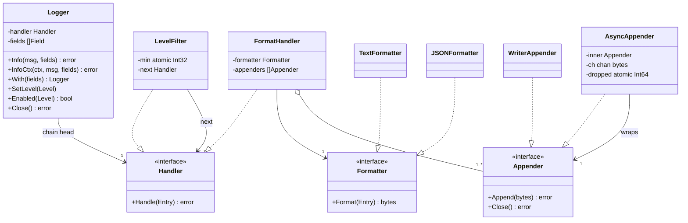
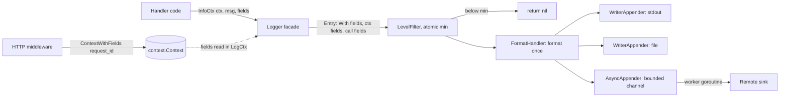
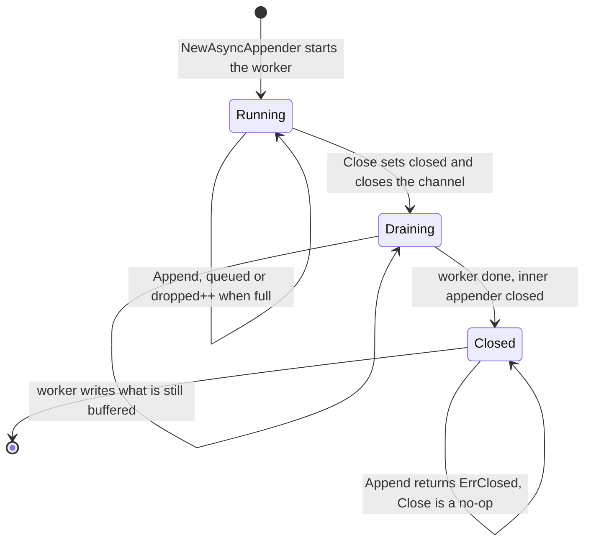

# Logging Library

> [!summary] TL;DR
> A logging library turns `log.Info("payment failed", F("order_id", "o1"))` into one line on one or more outputs. The design splits that call into small swappable steps: a **level filter** drops what nobody wants, a **formatter** turns the entry into text or JSON once, and **appenders** write the bytes to the console, a file or the network. Slow outputs sit behind an async appender that never blocks the request and flushes on shutdown, and a request ID set once in `context.Context` reaches every log line through `InfoCtx`.

> [!abstract] Core idea
> - One log call flows through a pipeline: level filter, then formatter (runs once), then one or more appenders (console, file, network).
> - The filter runs first and is cheap (one atomic load), so disabled debug logs cost almost nothing.
> - Slow outputs sit behind an async appender with a bounded buffer: when it is full, drop and count instead of blocking the request; flush on `Close`.
> - Classic mistakes: building JSON from a `map` (keys come out sorted, not in call order) and letting goroutines write partial lines into one file without a lock.

## Problem statement

```text
Design a logging library. It should support log levels (DEBUG, INFO, WARN, ERROR, FATAL),
structured fields, multiple output formats (text, JSON) and multiple destinations
(console, file, remote). Filtering by level must be possible at runtime.
It must be safe to call from many goroutines and must not slow the request path.
```

**Solving path**

1. Clarify: levels, structured fields, formats, destinations, runtime level change, concurrency.
2. Define `Level`, `Field` and `Entry`.
3. Split the work into `Formatter` (entry to bytes) and `Appender` (bytes to a destination).
4. Add a `LevelFilter` with an atomic level so it can change at runtime.
5. Build `Logger` with `Log`, the level helpers and `With` for child loggers.
6. Add the async appender, context fields and shutdown flush.
7. Test filtering, both formats, field order and concurrent writes.

What it really tests: splitting one call into small swappable steps (filter, format, write) behind clean interfaces, and handling concurrency and backpressure: torn lines, a slow sink, and flushing on shutdown.

An example line for a payment webhook failure, as the text formatter below prints it: `2026-10-10T10:00:00Z ERROR webhook processing failed provider=razorpay event_id=evt_123 request_id=req_999`. The logger filters it by level, formats it once, and sends it to the console, a file and an observability sink.

## Step 1: Clarify requirements

Questions to ask, with the assumptions this design makes:

- A library in one process, or a central log service? *An in-process library like `log/slog` or zap; shipping to ELK or Loki is a sidecar agent's job.*
- Which levels, changeable without a restart? *DEBUG < INFO < WARN < ERROR < FATAL; `SetLevel` works at runtime.*
- Text, JSON or both? *Both, chosen per logger: JSON in production, text locally. JSON keys keep their order.*
- Which destinations? *Console and file now, remote later through the same interface.*
- Can logs be dropped when a sink is slow? *Yes on the async path: never block the request, but count every drop.*
- Request-scoped fields? *Yes: `With(fields...)` child loggers, and fields carried in `context.Context` for `InfoCtx`.*
- What does FATAL do? *Log, flush, then exit with status 1. Only `main` should call it.*

**Functional:** log a message with a level, a timestamp and ordered key/value fields; drop entries below a runtime-adjustable minimum; format as text or JSON; write to one or more appenders; an async appender with a bounded buffer that drops and counts when full and flushes on `Close`; `With` child loggers; context fields through `InfoCtx`.

**Non-functional:** thread-safe with no torn lines; a filtered-out call costs almost nothing; a slow or failing sink never blocks or breaks the app; testable with no hidden globals, an injected clock and a `bytes.Buffer` sink.

**Out of scope:** log shipping and search, rotation (a decorator later, or lumberjack), sampling (an extension).

## Step 2: Actors and use cases

| Actor | Use case |
| --- | --- |
| Application code | Log at a level with fields; make a request-scoped logger with `With` |
| HTTP middleware | Put `request_id` into the context once per request |
| Operator or config | Set the minimum level at startup or at runtime |
| `main` | Build the logger from config; `Close` it on shutdown to flush |
| Slow sink (file, network) | Receive writes off the hot path from the async worker |

The use case to code: **log from many goroutines through filter → format → appenders, with an async appender that never blocks, drops when full and flushes on `Close`.**

## Step 3: Entities

| Entity | Key fields | Why it exists |
| --- | --- | --- |
| `Level` | int32 enum | Ordering, so the filter is one comparison |
| `Field` | Key, Value | Structured key/value; searchable, unlike `Sprintf` text |
| `Entry` | Time, Level, Message, Fields | One immutable event moving through the chain |
| `Formatter` (interface) | `Format(Entry) ([]byte, error)` | Text and JSON are strategies |
| `Appender` (interface) | `Append([]byte)`, `Close()` | A destination; console, file and buffer wrap `io.Writer` |
| `AsyncAppender` | inner Appender, channel, dropped counter | A decorator that moves slow writes to a goroutine |
| `Handler` (interface) | `Handle(Entry)` | One link in the chain (level filter, format and fan-out) |
| `Logger` | handler, With fields, clock | The facade the app calls |

Modelling insight: **format once, write many.** `Formatter` and `Appender` are separate strategies, so the same JSON bytes go to a file and to the network, and a new destination never touches formatting. Weak answers put `fmt.Println` inside each appender.

## Step 4: Relationships



- **Association:** `Logger → Handler`; the logger knows only the head of the chain.
- **Aggregation:** `FormatHandler o-- Appender`; appenders are built in `main` and passed in, and `Logger.Close` closes them.
- **Realization:** both chain links implement `Handler`; text and JSON implement `Formatter`; writer and async implement `Appender`.
- **Decorator:** `AsyncAppender` holds another `Appender` behind the same interface, so callers cannot tell sync from async.
- **Shared level:** `With` copies the `Logger` struct, so a child points at the **same** `LevelFilter`: `SetLevel` on a child changes the parent too. That is deliberate (one level per pipeline, like handlers sharing one `*slog.LevelVar`); a per-child level would need its own filter.

The pipeline, including where context fields join:



## Step 5: APIs and public methods

No REST API: this is an in-process library, and the API is the Go surface the app imports. (A central log service would expose something like `POST /v1/logs` taking batches, but that is a different problem.)

| Method | Contract |
| --- | --- |
| `New(Config{MinLevel, Formatter, Appenders, Clock})` | Defaults: text, console, `time.Now` |
| `Debug`, `Info`, `Warn`, `Error(msg, fields...) error` | Returns the joined appender errors; nil when filtered out |
| `InfoCtx`, `ErrorCtx`, `LogCtx(ctx, ...)` | Adds the fields stored in `ctx` |
| `Fatal(msg, fields...)` | Logs, flushes, exits with status 1 |
| `With(fields...) *Logger` | A child with extra fields; it shares the level |
| `SetLevel(level)`, `Enabled(level) bool` | Runtime level change; a cheap check before expensive fields |
| `Close() error` | Flushes async appenders and closes files |
| `ContextWithFields(ctx, fields...)` | Returns a ctx carrying fields for `*Ctx` calls |

Plain methods take no `context.Context`, which keeps the common call short; the `Ctx` variants exist for request-scoped fields, the same split as `slog.Info` and `slog.InfoContext`.

## Step 6: Storage and repositories

No database and no repository. A logger is the write path to storage (stdout, a file or a pipe to an agent), and a log store is a separate system (Elasticsearch, Loki, ClickHouse). The `Appender` interface plays the role a repository plays elsewhere: it hides where bytes go, so tests swap in a `bytes.Buffer`.

`NewConsoleAppender()` writes to `os.Stdout`, `NewFileAppender(path)` opens the file with `O_APPEND`, and `NewWriterAppender(w)` takes any `io.Writer`, which is how every test passes a `bytes.Buffer`.

Folder layout for the practice package (the core code below is one file with `// ---- file.go ----` markers, so it compiles in one paste):

```text
logging/
  model.go        -> Level, ParseLevel, Field, F, Entry, errors
  formatter.go    -> Formatter, TextFormatter, JSONFormatter
  appender.go     -> Appender, WriterAppender (console, file, buffer), AsyncAppender
  handler.go      -> Handler, LevelFilter, FormatHandler
  logger.go       -> Logger facade, Config, New, With, SetLevel, Enabled, Fatal, Close
  context.go      -> ContextWithFields, LogCtx, InfoCtx, ErrorCtx
  logging_test.go -> tests
cmd/demo/main.go  -> builds the Logger from config, defers Close
```

- `model.go` is data only, with no I/O.
- `formatter.go` and `appender.go` are the two strategy families; a `KafkaAppender` goes in `appender.go`.
- `handler.go` holds the chain links; a `Sampler` or `Redactor` goes there.
- `logger.go` and `context.go` are the only files application code touches.

## Step 7: Patterns

| Pattern | Where | Why here |
| --- | --- | --- |
| [[Chain of Responsibility and Pipelines]] | `LevelFilter → FormatHandler` | Each link decides whether to pass the entry on; sampling or redaction slot in later |
| [[Strategy and Template Method]] | `Formatter` (text, JSON), `Appender` (console, file, remote) | Two independent axes of change |
| [[Decorator and Middleware]] | `AsyncAppender` wraps any `Appender` | Buffering and a worker without changing the sink |
| [[Facade (vs Mediator)]] | `Logger` | The app calls `Info` and never sees the chain |
| [[Factory and Abstract Factory]] | `New(cfg)`, `NewFileAppender` | One place builds the chain with defaults |
| Bridge, see [[Rare GoF Patterns in Go]] | `slog.Logger` front end over a `slog.Handler` back end | The API and the implementation vary independently |
| [[Singleton and sync.Once]] (carefully) | not in the library | A global logger is convenient but hard to test |

Not used: a global singleton inside the library (build it in `main` and inject it, so each test gets a buffer-backed logger), and Observer (appenders are a fixed fan-out list set at construction).

## Step 8: Core code

> [!tip] What to code in a 60-minute round
> **Write in the room (about 150 lines):** `Level` + `String`, `Field` + `F`, `Entry`; `Formatter` + `TextFormatter`; `Appender` + `WriterAppender` (with its mutex); `Handler`, `LevelFilter`, `FormatHandler`; `Logger` with `New`, `Log`, `Info`, `Error`, `With` and `SetLevel`.
>
> **Talk through only (extensions):** `JSONFormatter` with ordered fields, `AsyncAppender` and its drop counter, `NewFileAppender` and rotation, context fields (`ContextWithFields`, `InfoCtx`), `Fatal`, `Close`, and the mapping to `log/slog`.

> [!warning] Four details in this code
> - **JSON keeps field order.** A formatter that builds a `map` loses the order, because `encoding/json` sorts map keys, so `request_id` could land anywhere. Fields are encoded one by one: `time`, `level`, `msg`, then fields in the order they were added.
> - **Context fields.** `ContextWithFields` stores fields in the context, and `InfoCtx` / `LogCtx` add them between the logger's `With` fields and the call's own fields. `slices.Clip` makes every append copy, so sibling contexts never share a backing array.
> - **`Enabled`.** `LogCtx` checks the level before building any slice; callers use it to skip expensive fields.
> - **Shared level, documented.** `SetLevel` on a child changes the parent; the comment on `With` and a test document this.

Complete package, Go 1.24, standard library only:

```go
package logging

import (
	"context"
	"encoding/json"
	"errors"
	"fmt"
	"io"
	"os"
	"slices"
	"strings"
	"sync"
	"sync/atomic"
	"time"
)

// ---- model.go: levels, entry, errors ----

type Level int32

const (
	Debug Level = iota
	Info
	Warn
	Error
	Fatal
)

func (l Level) String() string {
	switch l {
	case Debug:
		return "DEBUG"
	case Info:
		return "INFO"
	case Warn:
		return "WARN"
	case Error:
		return "ERROR"
	case Fatal:
		return "FATAL"
	}
	return fmt.Sprintf("LEVEL(%d)", int(l))
}

func ParseLevel(s string) (Level, error) {
	for l := Debug; l <= Fatal; l++ {
		if strings.EqualFold(s, l.String()) {
			return l, nil
		}
	}
	return 0, fmt.Errorf("%w: %q", ErrUnknownLevel, s)
}

type Field struct {
	Key   string
	Value any
}

func F(key string, value any) Field { return Field{Key: key, Value: value} }

// Entry is one log event. Fields keep insertion order.
type Entry struct {
	Time    time.Time
	Level   Level
	Message string
	Fields  []Field
}

var (
	ErrUnknownLevel = errors.New("unknown log level")
	ErrClosed       = errors.New("appender closed")
)

// ---- formatter.go: Strategy for the output format ----

type Formatter interface {
	Format(e Entry) ([]byte, error)
}

// TextFormatter: 2026-10-10T10:00:00Z INFO payment failed order_id=o1 amount=500
type TextFormatter struct{}

func (TextFormatter) Format(e Entry) ([]byte, error) {
	var b strings.Builder
	b.WriteString(e.Time.UTC().Format(time.RFC3339))
	b.WriteByte(' ')
	b.WriteString(e.Level.String())
	b.WriteByte(' ')
	b.WriteString(e.Message)
	for _, f := range e.Fields {
		fmt.Fprintf(&b, " %s=%v", f.Key, f.Value)
	}
	b.WriteByte('\n')
	return []byte(b.String()), nil
}

// JSONFormatter writes one JSON object per line in a fixed order: time, level,
// msg, then the fields in the order they were added. Encoding field by field
// (not through a map) keeps that order. A field named time, level or msg is
// renamed fields.<key>, so it cannot overwrite the real value.
type JSONFormatter struct{}

func (JSONFormatter) Format(e Entry) ([]byte, error) {
	msg, err := json.Marshal(e.Message)
	if err != nil {
		return nil, err
	}
	b := []byte(`{"time":"` + e.Time.UTC().Format(time.RFC3339) + `","level":"` + e.Level.String() + `","msg":`)
	b = append(b, msg...)
	for _, f := range e.Fields {
		key := f.Key
		if key == "time" || key == "level" || key == "msg" {
			key = "fields." + key
		}
		k, _ := json.Marshal(key) // marshaling a string cannot fail
		v, err := json.Marshal(f.Value)
		if err != nil {
			return nil, fmt.Errorf("field %q: %w", f.Key, err)
		}
		b = append(append(append(append(b, ','), k...), ':'), v...)
	}
	return append(b, '}', '\n'), nil
}

// ---- appender.go: Strategy for the destination ----

type Appender interface {
	Append(p []byte) error
	Close() error
}

// WriterAppender writes to any io.Writer (os.Stdout, *os.File, *bytes.Buffer).
// The mutex makes each line one atomic write, so lines never interleave.
type WriterAppender struct {
	mu sync.Mutex
	w  io.Writer
}

func NewWriterAppender(w io.Writer) *WriterAppender { return &WriterAppender{w: w} }

func NewConsoleAppender() *WriterAppender { return NewWriterAppender(os.Stdout) }

func (a *WriterAppender) Append(p []byte) error {
	a.mu.Lock()
	defer a.mu.Unlock()
	_, err := a.w.Write(p)
	return err
}

func (a *WriterAppender) Close() error {
	a.mu.Lock()
	defer a.mu.Unlock()
	if c, ok := a.w.(io.Closer); ok && a.w != os.Stdout && a.w != os.Stderr {
		return c.Close()
	}
	return nil
}

func NewFileAppender(path string) (*WriterAppender, error) {
	f, err := os.OpenFile(path, os.O_CREATE|os.O_APPEND|os.O_WRONLY, 0o644)
	if err != nil {
		return nil, err
	}
	return NewWriterAppender(f), nil
}

// AsyncAppender (a Decorator over any Appender) moves slow writes off the
// request path. Bounded channel; when full it drops and counts, never blocks.
type AsyncAppender struct {
	inner   Appender
	ch      chan []byte
	mu      sync.RWMutex // guards closed + send-vs-close race
	closed  bool
	dropped atomic.Int64
	done    chan struct{}
}

func NewAsyncAppender(inner Appender, buffer int) *AsyncAppender {
	a := &AsyncAppender{inner: inner, ch: make(chan []byte, buffer), done: make(chan struct{})}
	go a.run()
	return a
}

func (a *AsyncAppender) run() {
	defer close(a.done)
	for p := range a.ch { // drains everything still buffered after close(ch)
		_ = a.inner.Append(p) // real system: count write errors / fallback sink
	}
}

func (a *AsyncAppender) Append(p []byte) error {
	a.mu.RLock()
	defer a.mu.RUnlock()
	if a.closed {
		return ErrClosed
	}
	select {
	case a.ch <- p:
		return nil
	default:
		a.dropped.Add(1)
		return nil // dropping is a policy, not an error for the caller
	}
}

func (a *AsyncAppender) Dropped() int64 { return a.dropped.Load() }

// Close stops intake, flushes the buffer, then closes the inner appender.
func (a *AsyncAppender) Close() error {
	a.mu.Lock()
	if a.closed {
		a.mu.Unlock()
		return nil
	}
	a.closed = true
	close(a.ch)
	a.mu.Unlock()
	<-a.done
	return a.inner.Close()
}

// ---- handler.go: Chain of Responsibility ----

type Handler interface {
	Handle(e Entry) error
}

// LevelFilter drops entries below min. min is atomic so SetLevel is safe at runtime.
type LevelFilter struct {
	min  atomic.Int32
	next Handler
}

func NewLevelFilter(min Level, next Handler) *LevelFilter {
	f := &LevelFilter{next: next}
	f.min.Store(int32(min))
	return f
}

func (f *LevelFilter) SetLevel(l Level) { f.min.Store(int32(l)) }

func (f *LevelFilter) Handle(e Entry) error {
	if int32(e.Level) < f.min.Load() {
		return nil
	}
	return f.next.Handle(e)
}

// FormatHandler formats once and fans out to every appender.
type FormatHandler struct {
	formatter Formatter
	appenders []Appender
}

func NewFormatHandler(f Formatter, apps ...Appender) *FormatHandler {
	return &FormatHandler{formatter: f, appenders: apps}
}

func (h *FormatHandler) Handle(e Entry) error {
	p, err := h.formatter.Format(e)
	if err != nil {
		return err
	}
	var errs []error
	for _, a := range h.appenders { // one failing sink must not stop the others
		if err := a.Append(p); err != nil {
			errs = append(errs, err)
		}
	}
	return errors.Join(errs...)
}

// ---- logger.go: Facade ----

type Config struct {
	MinLevel  Level
	Formatter Formatter
	Appenders []Appender
	Clock     func() time.Time // injectable for tests
}

type Logger struct {
	filter    *LevelFilter
	handler   Handler
	appenders []Appender
	fields    []Field
	now       func() time.Time
	exit      func(code int)
}

func New(cfg Config) *Logger {
	if cfg.Formatter == nil {
		cfg.Formatter = TextFormatter{}
	}
	if len(cfg.Appenders) == 0 {
		cfg.Appenders = []Appender{NewConsoleAppender()}
	}
	if cfg.Clock == nil {
		cfg.Clock = time.Now
	}
	filter := NewLevelFilter(cfg.MinLevel, NewFormatHandler(cfg.Formatter, cfg.Appenders...))
	return &Logger{filter: filter, handler: filter, appenders: cfg.Appenders, now: cfg.Clock, exit: os.Exit}
}

// With returns a child logger that adds fields to every entry; the parent's
// fields are unchanged. The child shares the parent's LevelFilter, so SetLevel
// on either one changes both (as handlers sharing one *slog.LevelVar do).
func (l *Logger) With(fields ...Field) *Logger {
	child := *l
	child.fields = append(append([]Field(nil), l.fields...), fields...)
	return &child
}

func (l *Logger) SetLevel(lv Level) { l.filter.SetLevel(lv) }

// Enabled lets a caller skip building expensive fields for a dropped level.
func (l *Logger) Enabled(lv Level) bool { return int32(lv) >= l.filter.min.Load() }

func (l *Logger) Log(lv Level, msg string, fields ...Field) error {
	all := fields
	if len(l.fields) > 0 {
		all = append(append([]Field(nil), l.fields...), fields...)
	}
	return l.handler.Handle(Entry{Time: l.now(), Level: lv, Message: msg, Fields: all})
}

func (l *Logger) Debug(msg string, f ...Field) error { return l.Log(Debug, msg, f...) }
func (l *Logger) Info(msg string, f ...Field) error  { return l.Log(Info, msg, f...) }
func (l *Logger) Warn(msg string, f ...Field) error  { return l.Log(Warn, msg, f...) }
func (l *Logger) Error(msg string, f ...Field) error { return l.Log(Error, msg, f...) }

// ---- context.go: request-scoped fields ----

type ctxKey struct{}

// ContextWithFields returns a ctx carrying fields (request_id, user_id) for
// every *Ctx call further down the stack, without passing a logger around.
func ContextWithFields(ctx context.Context, fields ...Field) context.Context {
	old, _ := ctx.Value(ctxKey{}).([]Field)
	return context.WithValue(ctx, ctxKey{}, append(slices.Clip(old), fields...)) // Clip: never write into the parent's array
}

// LogCtx logs with the logger's With fields, then the ctx fields, then the call's own.
func (l *Logger) LogCtx(ctx context.Context, lv Level, msg string, fields ...Field) error {
	if !l.Enabled(lv) {
		return nil // skip the slice work for a dropped level
	}
	cf, _ := ctx.Value(ctxKey{}).([]Field)
	return l.Log(lv, msg, append(slices.Clip(cf), fields...)...)
}

func (l *Logger) InfoCtx(ctx context.Context, msg string, f ...Field) error {
	return l.LogCtx(ctx, Info, msg, f...)
}

func (l *Logger) ErrorCtx(ctx context.Context, msg string, f ...Field) error {
	return l.LogCtx(ctx, Error, msg, f...)
}

// Fatal logs, flushes every appender, then exits. Only main should call it.
func (l *Logger) Fatal(msg string, f ...Field) {
	_ = l.Log(Fatal, msg, f...)
	_ = l.Close()
	l.exit(1)
}

// Close flushes async appenders and closes files. Call once from main on shutdown.
func (l *Logger) Close() error {
	var errs []error
	for _, a := range l.appenders {
		if err := a.Close(); err != nil {
			errs = append(errs, err)
		}
	}
	return errors.Join(errs...)
}
```

Walkthrough:

1. `l.Info(msg, fields...)` → `Log` stamps the time with the injected clock and joins the `With` fields and the call fields into a **new** slice, so a child and its parent never share a backing array.
2. `LevelFilter` reads `min` with an atomic load and returns at once below it; `SetLevel` changes `min` without a lock.
3. `FormatHandler` formats **once**, then loops over the appenders and collects errors with `errors.Join`, so a failing file does not stop console output.
4. `WriterAppender.Append` holds a mutex around one `w.Write(p)`: one line is one write, so lines from 50 goroutines never interleave.
5. `AsyncAppender.Append` takes a read lock, checks `closed`, and does a non-blocking send: queued if there is room, else `dropped++` and return. The worker `range`s over the channel.
6. `Close` takes the write lock (so no `Append` is mid-send), sets `closed`, closes the channel, waits until the worker has drained it, then closes the inner sink. A second `Close` is a no-op; `Append` after `Close` returns `ErrClosed` instead of panicking.
7. `InfoCtx(ctx, ...)` → `LogCtx` checks `Enabled`, reads the context fields and calls `Log`, so the order is `With` fields, context fields, call fields.
8. `Fatal` logs, calls `Close` to flush, then `exit(1)`; `exit` is a field so a test can replace it.



### Compared with log/slog

`log/slog` (standard library since Go 1.21) makes the same split with different names. `slog.Logger` is the front end and `slog.Handler` the back end, so any API call can drive any output: a Bridge.

| This library | `log/slog` | Note |
| --- | --- | --- |
| `Logger` facade | `*slog.Logger` | Both are thin front ends |
| `Handler` chain | `slog.Handler`: `Enabled`, `Handle`, `WithAttrs`, `WithGroup` | slog asks `Enabled` first, before building the record |
| `Formatter` + `Appender` | `slog.TextHandler`, `slog.JSONHandler` writing to an `io.Writer` | slog fuses format and write in one handler |
| `Field{Key, Value any}` | `slog.Attr{Key, Value slog.Value}` | `slog.Value` stores common kinds without allocating |
| `Level` 0..4, with `Fatal` | `slog.Level`: Debug −4, Info 0, Warn 4, Error 8; no Fatal | The gaps leave room for custom levels |
| `LevelFilter` with an atomic | `*slog.LevelVar` in `HandlerOptions.Level` | Handlers sharing one `LevelVar` share the level, as `With` children do here |
| `With` copies fields | `Logger.With` calls `Handler.WithAttrs` | A handler can pre-format those attributes once |
| `InfoCtx` reads context fields | `InfoContext` passes `ctx` to `Handle` | slog never reads fields from `ctx` by itself; a wrapping handler must |
| `AsyncAppender` | none built in | Wrap the writer or the handler |
| ordered JSON | `JSONHandler` writes time, level (source, if `AddSource` is set), msg, then attributes in order | Neither removes duplicate keys. slog also writes a user attribute named `msg` as a second `msg` key, where this library renames it `fields.msg` (checked with Go 1.24.4) |

In a real service, use `slog`, and put the extra behaviour (context fields, async writes, redaction) in a handler that wraps `slog.JSONHandler`; this design is how that handler is built.

## Test cases

| Test | Proves |
| --- | --- |
| `TestLevelFilter` (table) | entries below the minimum are dropped, the rest written |
| `TestTextFormat` | exact text line: RFC 3339 time, level, message, fields in order |
| `TestJSONFormatAndReservedKeys` | valid JSON; a field named `level` does not overwrite the real level |
| `TestJSONKeepsFieldOrder` | exact JSON line with `With` fields first and call fields in order; an unencodable value returns an error |
| `TestContextFields` | `request_id` from the context reaches the line; sibling contexts stay separate; a dropped level is skipped |
| `TestChildSharesLevelWithParent` | `SetLevel` on a child changes the parent (documented behaviour) |
| `TestWithAddsFieldsWithoutMutatingParent` | a child adds `request_id`; the parent stays clean |
| `TestSetLevelAtRuntime` | the level changes without a restart |
| `TestParseLevel` | config parsing works; a bad value returns `ErrUnknownLevel` |
| `TestOneFailingAppenderDoesNotBlockOthers` | a failing sink returns an error, the other sink still gets the line |
| `TestAsyncDropsWhenFullAndFlushesOnClose` | buffer 2 with a blocked worker: exactly 3 dropped and 3 flushed; `Append` after `Close` is `ErrClosed` |
| `TestConcurrentLoggingNoLostOrTornLines` | 50 goroutines × 100 logs through async: exactly 5,000 well-formed lines and 0 drops |
| `TestFatalFlushesThenExits` | FATAL is written before `exit(1)` |

All pass with `go vet` and `go test -race` on Go 1.24.4, also with `-count=3` (measured: 87.6% statement coverage).

```go
package logging

import (
	"bytes"
	"context"
	"encoding/json"
	"errors"
	"strings"
	"sync"
	"testing"
	"time"
)

var fixed = time.Date(2026, 10, 10, 10, 0, 0, 0, time.UTC)

func newTestLogger(min Level, f Formatter) (*Logger, *bytes.Buffer) {
	var buf bytes.Buffer
	l := New(Config{MinLevel: min, Formatter: f, Appenders: []Appender{NewWriterAppender(&buf)},
		Clock: func() time.Time { return fixed }})
	return l, &buf
}

func TestLevelFilter(t *testing.T) {
	tests := []struct {
		name  string
		min   Level
		level Level
		want  bool
	}{
		{"debug dropped at info", Info, Debug, false},
		{"info passes at info", Info, Info, true},
		{"error passes at warn", Warn, Error, true},
		{"warn dropped at error", Error, Warn, false},
		{"everything passes at debug", Debug, Debug, true},
	}
	for _, tc := range tests {
		t.Run(tc.name, func(t *testing.T) {
			l, buf := newTestLogger(tc.min, TextFormatter{})
			if err := l.Log(tc.level, "hello"); err != nil {
				t.Fatal(err)
			}
			if got := buf.Len() > 0; got != tc.want {
				t.Fatalf("written=%v, want %v", got, tc.want)
			}
		})
	}
}

func TestTextFormat(t *testing.T) {
	l, buf := newTestLogger(Debug, TextFormatter{})
	_ = l.Error("payment failed", F("order_id", "o1"), F("amount", 500))
	want := "2026-10-10T10:00:00Z ERROR payment failed order_id=o1 amount=500\n"
	if buf.String() != want {
		t.Fatalf("got %q want %q", buf.String(), want)
	}
}

func TestJSONFormatAndReservedKeys(t *testing.T) {
	l, buf := newTestLogger(Debug, JSONFormatter{})
	_ = l.Info("user login", F("user_id", "u1"), F("level", "admin"))
	var m map[string]any
	if err := json.Unmarshal(buf.Bytes(), &m); err != nil {
		t.Fatalf("not valid JSON: %v", err)
	}
	if m["level"] != "INFO" || m["msg"] != "user login" || m["user_id"] != "u1" || m["fields.level"] != "admin" {
		t.Fatalf("bad json: %v", m)
	}
}

// The audit item: JSON used to go through a map, so fields came out sorted.
func TestJSONKeepsFieldOrder(t *testing.T) {
	l, buf := newTestLogger(Debug, JSONFormatter{})
	_ = l.With(F("request_id", "r1")).Info("user login", F("user_id", "u1"), F("level", "admin"))
	want := `{"time":"2026-10-10T10:00:00Z","level":"INFO","msg":"user login",` +
		`"request_id":"r1","user_id":"u1","fields.level":"admin"}` + "\n"
	if buf.String() != want {
		t.Fatalf("got  %s\nwant %s", buf.String(), want)
	}
	if err := l.Info("bad", F("ch", make(chan int))); err == nil {
		t.Fatal("a value JSON cannot encode must return an error")
	}
}

func TestContextFields(t *testing.T) {
	l, buf := newTestLogger(Info, TextFormatter{})
	svc := l.With(F("svc", "pay"))
	ctx := ContextWithFields(context.Background(), F("request_id", "r9")) // set once by HTTP middleware
	a := ContextWithFields(ctx, F("step", "a"))
	b := ContextWithFields(ctx, F("step", "b")) // a sibling must not see "a"
	_ = svc.InfoCtx(a, "charged", F("amount", 500))
	_ = svc.InfoCtx(b, "refunded")
	_ = svc.LogCtx(a, Debug, "dropped") // below Info: skipped before any slice work
	want := "2026-10-10T10:00:00Z INFO charged svc=pay request_id=r9 step=a amount=500\n" +
		"2026-10-10T10:00:00Z INFO refunded svc=pay request_id=r9 step=b\n"
	if buf.String() != want {
		t.Fatalf("got %q", buf.String())
	}
}

// Documented behaviour: a child shares the parent's level, like a shared slog.LevelVar.
func TestChildSharesLevelWithParent(t *testing.T) {
	l, buf := newTestLogger(Debug, TextFormatter{})
	child := l.With(F("request_id", "r1"))
	child.SetLevel(Error)
	_ = l.Info("parent info")
	if buf.Len() != 0 || l.Enabled(Info) {
		t.Fatal("SetLevel on the child must also change the parent")
	}
}

func TestWithAddsFieldsWithoutMutatingParent(t *testing.T) {
	l, buf := newTestLogger(Debug, TextFormatter{})
	reqLog := l.With(F("request_id", "r1"))
	_ = reqLog.Info("child")
	_ = l.Info("parent")
	lines := strings.Split(strings.TrimSpace(buf.String()), "\n")
	if !strings.HasSuffix(lines[0], "child request_id=r1") || strings.Contains(lines[1], "request_id") {
		t.Fatalf("got %q", lines)
	}
}

func TestSetLevelAtRuntime(t *testing.T) {
	l, buf := newTestLogger(Error, TextFormatter{})
	_ = l.Info("hidden")
	l.SetLevel(Debug)
	_ = l.Info("shown")
	if strings.Contains(buf.String(), "hidden") || !strings.Contains(buf.String(), "shown") {
		t.Fatalf("got %q", buf.String())
	}
}

func TestParseLevel(t *testing.T) {
	if lv, err := ParseLevel("warn"); err != nil || lv != Warn {
		t.Fatalf("got %v %v", lv, err)
	}
	if _, err := ParseLevel("loud"); !errors.Is(err, ErrUnknownLevel) {
		t.Fatalf("want ErrUnknownLevel, got %v", err)
	}
}

type failingAppender struct{}

func (failingAppender) Append([]byte) error { return errors.New("disk full") }
func (failingAppender) Close() error        { return nil }

func TestOneFailingAppenderDoesNotBlockOthers(t *testing.T) {
	var buf bytes.Buffer
	l := New(Config{Appenders: []Appender{failingAppender{}, NewWriterAppender(&buf)}, Clock: func() time.Time { return fixed }})
	err := l.Info("x")
	if err == nil || buf.Len() == 0 {
		t.Fatalf("want error returned AND second appender written; err=%v buf=%q", err, buf.String())
	}
}

// blockingAppender holds the async worker inside Append until release is closed.
type blockingAppender struct {
	entered chan struct{}
	release chan struct{}
	once    sync.Once
	mu      sync.Mutex
	lines   int
}

func (b *blockingAppender) Append([]byte) error {
	b.once.Do(func() { close(b.entered) })
	<-b.release
	b.mu.Lock()
	b.lines++
	b.mu.Unlock()
	return nil
}
func (b *blockingAppender) Close() error { return nil }

func TestAsyncDropsWhenFullAndFlushesOnClose(t *testing.T) {
	slow := &blockingAppender{entered: make(chan struct{}), release: make(chan struct{})}
	a := NewAsyncAppender(slow, 2)
	_ = a.Append([]byte("1")) // taken by worker, worker now blocked
	<-slow.entered
	_ = a.Append([]byte("2")) // buffer slot 1
	_ = a.Append([]byte("3")) // buffer slot 2
	for i := 0; i < 3; i++ {
		_ = a.Append([]byte("dropped")) // buffer full -> dropped, caller never blocks
	}
	if a.Dropped() != 3 {
		t.Fatalf("dropped=%d want 3", a.Dropped())
	}
	close(slow.release)
	if err := a.Close(); err != nil {
		t.Fatal(err)
	}
	if slow.lines != 3 {
		t.Fatalf("flushed %d lines, want 3", slow.lines)
	}
	if err := a.Append([]byte("late")); !errors.Is(err, ErrClosed) {
		t.Fatalf("want ErrClosed, got %v", err)
	}
}

func TestConcurrentLoggingNoLostOrTornLines(t *testing.T) {
	var buf bytes.Buffer
	async := NewAsyncAppender(NewWriterAppender(&buf), 10000)
	l := New(Config{Appenders: []Appender{async}, Clock: func() time.Time { return fixed }})
	const goroutines, perG = 50, 100
	var wg sync.WaitGroup
	for g := 0; g < goroutines; g++ {
		wg.Add(1)
		go func(g int) {
			defer wg.Done()
			for i := 0; i < perG; i++ {
				_ = l.Info("event", F("g", g), F("i", i))
			}
		}(g)
	}
	wg.Wait()
	if err := l.Close(); err != nil {
		t.Fatal(err)
	}
	lines := strings.Split(strings.TrimSpace(buf.String()), "\n")
	if len(lines) != goroutines*perG || async.Dropped() != 0 {
		t.Fatalf("lines=%d dropped=%d, want %d and 0", len(lines), async.Dropped(), goroutines*perG)
	}
	for _, ln := range lines {
		if !strings.HasPrefix(ln, "2026-10-10T10:00:00Z INFO event g=") {
			t.Fatalf("torn line %q", ln)
		}
	}
}

func TestFatalFlushesThenExits(t *testing.T) {
	l, buf := newTestLogger(Debug, TextFormatter{})
	code := -1
	l.exit = func(c int) { code = c }
	l.Fatal("boom")
	if code != 1 || !strings.Contains(buf.String(), "FATAL boom") {
		t.Fatalf("code=%d out=%q", code, buf.String())
	}
}
```

## Step 9: Edge cases

| Edge case | Risk | Handling |
| --- | --- | --- |
| 50 goroutines write to one file | Interleaved lines | `WriterAppender` mutex: one line is one `Write`; the test runs with `-race` |
| Remote sink slow or down | Requests block on network I/O | `AsyncAppender`: bounded channel, non-blocking send |
| Buffer full | More logs than the sink can take | Drop and count; export `Dropped()` as a metric. Alternatives: block, or drop DEBUG first |
| Shutdown with buffered entries | Lost logs | `Close` drains before returning; `Fatal` calls `Close` before exit |
| `Append` after `Close` | Panic: send on a closed channel | `closed` flag under an `RWMutex`, returns `ErrClosed` |
| One appender fails (disk full) | Others miss the line | Loop over all, `errors.Join` the errors |
| Field named `level`, `msg` or `time` | JSON loses the real level | Reserved keys win; the user value becomes `fields.level` |
| The same key twice (`With` and call) | Duplicate JSON keys | Kept in order, as slog does. RFC 8259 leaves duplicate names to the parser; Go's `encoding/json`, Python's `json` and JavaScript's `JSON.parse` keep the last value |
| A message or value containing a newline | One event splits into two lines, or a forged line (log injection) | JSON escapes it. This text formatter prints values with `%v`, so it does not; quote values with spaces and escape newlines (`%q`) as slog's `TextHandler` does, or use JSON in production |
| Expensive field for a dropped DEBUG | Wasted work | `if l.Enabled(Debug) { ... }`; `LogCtx` checks it first |
| Non-encodable value (chan, func) | `json.Marshal` fails | The formatter returns an error naming the field, and `Info` returns it; a fallback to `fmt.Sprint` is the alternative |
| SetLevel on a child | The parent changes too | Shared by design and documented; a per-child level needs its own filter |
| A global logger in tests | Tests share state | No global; each test builds a logger on a `bytes.Buffer` |

## Step 10: Tradeoffs and extensions

| Follow-up | Design change |
| --- | --- |
| Kafka or HTTP sink | A new `Appender` wrapped in `AsyncAppender`; batch in the worker (every N lines or T ms) |
| Rotation by size or day | A `RotatingFileAppender` decorator: rename and reopen past N bytes |
| Different level per sink (DEBUG to a file, ERROR to the pager) | A fan-out handler with one `LevelFilter → FormatHandler` per branch |
| Redact PII (phone, card) | A `Redactor` handler before the formatter |
| Sampling (1 in 100 DEBUG) | A `Sampler` handler with an atomic counter |
| Zero-allocation hot path | `sync.Pool` buffers and typed fields instead of `any` (the zap approach) |

Tradeoffs chosen:

- **Drop over block** when the async buffer is full: a missing log line costs less than added request latency, and `Dropped()` makes the loss visible.
- **A mutex per appender**, not one global lock, so a slow file does not block console writes.
- **An atomic for the level:** read on every call, written rarely.
- **Sync by default, async opt-in:** sync loses nothing on a crash; wrap only slow sinks.
- **`any` field values:** simple, at the cost of allocations; typed fields when it matters.
- **Hand-written JSON encoding:** keeps field order, at the cost of a few lines that `encoding/json` with a map would hide.

Common mistakes: a global mutable logger tests cannot control; no levels, or a level check after formatting; only `Sprintf` strings instead of fields; no thread safety, so lines interleave; blocking the request on a slow remote sink; no fallback when the remote sink fails; no flush on shutdown.

See [[Structured Logging]] for what to log, field naming and log levels in a service.

## Drawing

![[Logging System LLD Drawing.excalidraw]]

The drawing has three sections: the `Logger` facade with the handler chain, the two strategy interfaces and the `AsyncAppender` wrapping an inner appender; the flow from the app through the filter (below the minimum: dropped) and the formatter to the appenders, with the async path (queued, or dropped when full); and the `AsyncAppender` lifecycle (running, draining, closed). Redraw it from memory, then add the context fields joining at the `Logger`.

- [ ] The chain order: `Logger → LevelFilter → FormatHandler → []Appender`
- [ ] The two strategy interfaces (`Formatter`, `Appender`), each with two implementations
- [ ] `AsyncAppender`: a bounded channel, a worker goroutine, a dropped counter, and a `Close` that drains
- [ ] Where the locks are: a mutex in `WriterAppender`, an `RWMutex` for `closed`, atomics for the level and the drop count
- [ ] Where `ContextWithFields` puts `request_id` and where `InfoCtx` reads it

## Interview questions

> [!question]- Why are the formatter and the appender separate interfaces?
> They change for different reasons: the format (text, JSON) and the destination (console, file, Kafka). Separating them means formatting once and writing the same bytes to every appender, and a new destination never touches formatting.

> [!question]- Trap: your JSON formatter builds a `map[string]any` and calls `json.Marshal`. What is wrong?
> `encoding/json` sorts map keys, so the field order the caller chose is lost, and a field named `level` could silently overwrite the real level. Encode the fixed keys first, then each field in order, and rename reserved keys.

> [!question]- How do you get `request_id` into every log line without passing a logger everywhere?
> HTTP middleware stores it once with `ContextWithFields(ctx, F("request_id", id))`, and code down the stack calls `InfoCtx(ctx, ...)`, which reads the fields from the context. `log/slog` passes `ctx` to the handler in `InfoContext` but does not read fields itself; a wrapping handler does.

> [!question]- A child logger made with `With` calls `SetLevel(Debug)`. What happens to the parent?
> It changes too, because `With` copies the struct but both point to the same `LevelFilter`. That is the right default for one pipeline (and how handlers sharing a `*slog.LevelVar` behave); a per-child level needs its own filter in front of the shared handler.

> [!question]- How does the async appender avoid both blocking and panicking?
> `Append` does a non-blocking `select` send and counts a drop when the buffer is full. A read lock around the `closed` check and the send, plus a write lock in `Close` around `close(ch)`, mean no goroutine can send on a closed channel; after `Close`, `Append` returns `ErrClosed`.

> [!question]- What happens to buffered log lines on shutdown or `Fatal`?
> `Close` closes the channel and waits until the worker has written everything still buffered, then closes the inner sink. `Fatal` logs, calls `Close`, and only then exits; `os.Exit` skips deferred calls, so flushing first is the only way the FATAL line survives.

> [!question]- How does this design map to `log/slog`?
> `Logger` is `slog.Logger`, the handler chain is a `slog.Handler`, text and JSON are `TextHandler` and `JSONHandler`, the atomic level is a `LevelVar`, and `With` is `WithAttrs`. The front end and back end vary independently, which is the Bridge pattern.

## Cheat sheet

- Chain: `Logger → LevelFilter (atomic) → FormatHandler (format once) → []Appender`.
- One line is one `Write` under the appender's mutex: no torn lines.
- Async: bounded channel, non-blocking send, count drops, `Close` drains.
- JSON: fixed keys first, fields in order, reserved keys renamed.
- Context fields: `ContextWithFields` once, `InfoCtx` everywhere; order is With, ctx, call.
- `With` children share the level; `Enabled` before expensive fields.
- In production use `slog` with a wrapping handler for the extras.

## Links

- **Before this:** [[Chain of Responsibility and Pipelines]], [[Strategy and Template Method]], [[Decorator and Middleware]], [[Rate Limiter]]
- **Next:** [[File Search (Unix find)]], [[Concurrency for LLD]], [[Testing LLD Code]]
- **Compare with:** [[Structured Logging]], [[Notification Service]]
