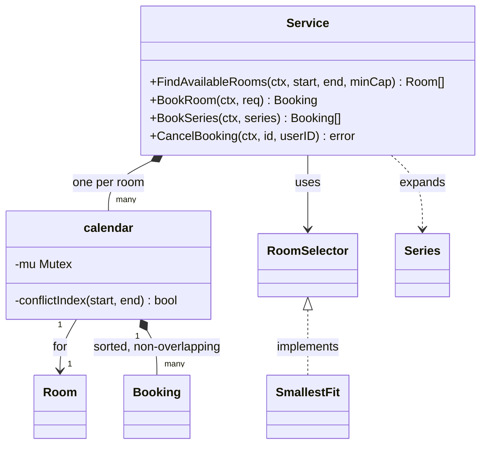
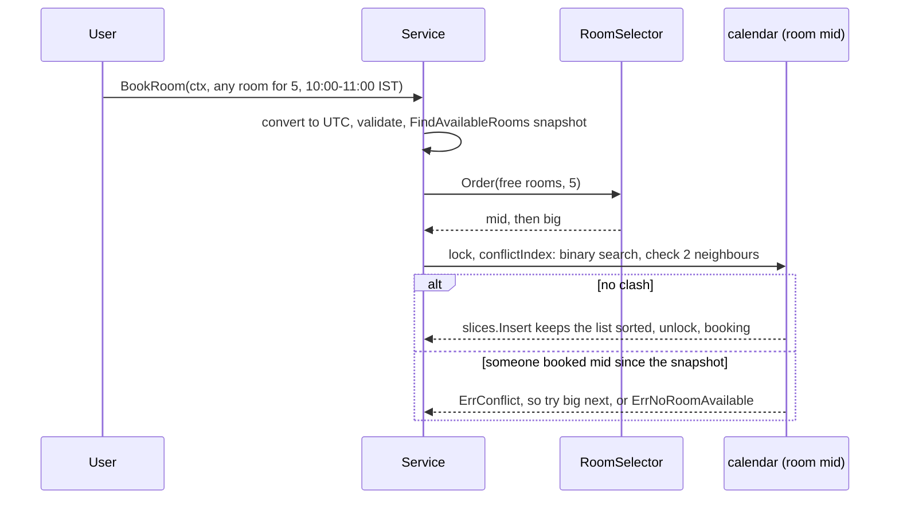

# Meeting Room Scheduler

> [!summary] TL;DR
> A meeting room scheduler is one rule and one race. The rule: half-open intervals `[start, end)` clash only if `start < otherEnd && otherStart < end`. The race: two people booking one room at the same moment, solved by checking and inserting under a per-room lock in memory, or an `EXCLUDE USING gist` constraint in Postgres. Recurring meetings expand in the organizer's time zone inside a bounded window and book all or nothing.

> [!abstract] Core idea
> - A booking is a half-open interval `[start, end)`: it includes the start and excludes the end.
> - The one rule: two bookings clash only if `start < otherEnd && otherStart < end`.
> - Check for a clash and insert the booking under the same per-room lock, so two clicks at once cannot both win.
> - Keep each room's bookings sorted, so a binary search plus two neighbour checks finds a clash.
> - Classic mistake: using `<=` (closed intervals), which makes a 10:00-11:00 and an 11:00-12:00 meeting clash.

## Problem statement

```text
Design a meeting room booking system for an office.
Admins add rooms with a capacity. Users search for rooms that are free for a time
interval and fit N people, book a room, and cancel their booking.
Two people must never hold the same room at overlapping times, even if they click
"Book" at the same moment. Code the booking method.
```

### Solving path

1. Clarify interval rules, capacity, cancellation and recurring meetings.
2. Write the overlap test and agree on half-open intervals in UTC.
3. Model `Room`, `Booking` and a per-room sorted calendar.
4. Write `BookRoom`: validate, pick rooms, check and insert under the room lock.
5. Add `FindAvailableRooms` and `CancelBooking`.
6. Add recurring series (all or nothing), then test the race and the boundaries.

## Step 1: Clarify requirements

### Questions to ask (with assumed answers)

- Half-open intervals, so 10:00-11:00 and 11:00-12:00 can both exist? *Assume: yes, `[start, end)`.*
- A specific room, or "any room for 6 people"? *Assume: both; auto-pick tries the smallest room that fits.*
- Who can cancel, and until when? *Assume: only the organizer, only before the meeting starts.*
- One server or many? *Assume: code in memory with a per-room lock; show the database guard for many instances.*
- Recurring meetings and time zones? *Assume: weekly series in the organizer's IANA zone with skipped dates, expanded 26 weeks ahead, all or nothing; store every instant in UTC.*

### Functional

- Add a room; find rooms free for `[start, end)` with capacity at least N; book a named room or auto-pick; book a weekly series; cancel before the start; get a booking.

### Non-functional

- No double booking under concurrent requests; different rooms never block each other; an O(log n) overlap check; an injected clock.

### Out of scope

- Invites and attendee calendars (only capacity counts), notifications (an Observer extension), equipment filters, approvals and waitlists.

## Step 2: Actors and use cases

| Actor | Use case |
|---|---|
| Admin | Add a room, set its capacity |
| Employee | Search free rooms; book a named room or "any room for N"; book a weekly series; cancel own booking |

The hardest use case is **BookRoom**: check-for-overlap and insert must be atomic per room, or two people get the same slot.

## Step 3: Entities

| Entity | Key fields | Why it exists |
|---|---|---|
| `Room` | ID, Name, Capacity | The resource being booked |
| `Booking` | ID, RoomID, UserID, SeriesID, Start, End (UTC), Attendees, Status (BOOKED, CANCELLED; DONE is derived from `now >= End`) | One reservation of a room for `[Start, End)`; `BookingRequest` is its input (empty RoomID = auto-pick) |
| `calendar` | room, mutex, bookings sorted by Start | One room's bookings and lock: where "no overlap" lives |
| `Series` | First, Duration, Until, Except, Loc | A weekly rule (RRULE-like) with skipped dates (EXDATE) |
| `RoomSelector` | `Order(rooms, n)` | Strategy for which free room to try first |
| `Service` | rooms, byID index, selector, clock | The facade with the use cases |

Modelling insight: **do not store slots** (30-minute cells). Store intervals and check overlap; slots break on odd times and bloat storage. Give each room its own calendar, because the invariant "no two BOOKED intervals overlap" is per room, so the room is the unit of locking.

## Step 4: Relationships



## Step 5: APIs and public methods

```text
POST   /rooms                      {name, capacity}                       -> 201 room
GET    /rooms/available?start=&end=&capacity=                             -> [room]
POST   /bookings                   Idempotency-Key header
                                   {room_id?, start, end, attendees}      -> 201 booking | 409 conflict
POST   /series                     {room_id, first, duration, until, tz, except[]}
                                                                          -> 201 [booking] | 409 clashing starts
GET    /bookings/{id}                                                     -> booking
DELETE /bookings/{id}                                                     -> 204 | 403 not owner | 409 already started
```

Times on the wire are RFC 3339 with an offset (`2026-10-12T10:00:00+05:30`); the server converts to UTC. The Go surface is this interface, which `*Service` in Step 8 implements, plus the pure function `Overlaps(s1, e1, s2, e2 time.Time) bool`:

```go
type SchedulerService interface {
	AddRoom(ctx context.Context, r Room) error
	FindAvailableRooms(ctx context.Context, start, end time.Time, minCapacity int) ([]Room, error)
	BookRoom(ctx context.Context, req BookingRequest) (Booking, error) // req.RoomID == "" -> auto-pick
	BookSeries(ctx context.Context, sr Series) ([]Booking, error)      // all or nothing
	CancelBooking(ctx context.Context, bookingID, userID string) error
	GetBooking(ctx context.Context, id string) (Booking, error)
}

var _ SchedulerService = (*Service)(nil) // compile-time check
```

## Step 6: Storage and repositories

```sql
CREATE EXTENSION IF NOT EXISTS btree_gist;  -- lets GiST index the "=" on room_id

CREATE TABLE rooms (
    id       TEXT PRIMARY KEY,
    name     TEXT NOT NULL,
    capacity INT  NOT NULL CHECK (capacity > 0)
);

CREATE TABLE bookings (
    id              TEXT PRIMARY KEY,
    room_id         TEXT NOT NULL REFERENCES rooms(id),
    user_id         TEXT NOT NULL,
    series_id       TEXT,                           -- recurring meetings share it
    during          TSTZRANGE NOT NULL,             -- '[start, end)' half-open
    attendees       INT  NOT NULL DEFAULT 1,
    status          TEXT NOT NULL DEFAULT 'BOOKED', -- BOOKED | CANCELLED
    idempotency_key TEXT,
    CHECK (lower(during) < upper(during)),
    UNIQUE (user_id, idempotency_key),
    -- THE invariant: no two BOOKED rows for one room may overlap. The database enforces it.
    EXCLUDE USING gist (room_id WITH =, during WITH &&) WHERE (status = 'BOOKED')
);

CREATE INDEX bookings_user ON bookings (user_id, lower(during));   -- "my meetings" view

-- Book: a concurrent overlapping insert fails with SQLSTATE 23P01 (exclusion_violation) -> 409.
-- A series inserts all its rows in ONE transaction, so one clash rolls back every occurrence.
INSERT INTO bookings (id, room_id, user_id, during, attendees, idempotency_key)
VALUES ($1, $2, $3, tstzrange($4, $5, '[)'), $6, $7);

-- Find available rooms for [s, e) with capacity >= n
SELECT r.* FROM rooms r
WHERE r.capacity >= $3
  AND NOT EXISTS (
      SELECT 1 FROM bookings b
      WHERE b.room_id = r.id AND b.status = 'BOOKED'
        AND b.during && tstzrange($1, $2, '[)'));

-- Alternative without EXCLUDE (MySQL etc.): lock the room row, then check, then insert, in one tx.
-- BEGIN; SELECT id FROM rooms WHERE id = $1 FOR UPDATE;
-- SELECT 1 FROM bookings WHERE room_id = $1 AND status = 'BOOKED' AND start_at < $3 AND $2 < end_at;
-- INSERT ... ; COMMIT;
```

The commented alternative assumes plain `start_at` and `end_at` columns, because MySQL has no range type. Row-lock trade-offs live in [[Locking - Optimistic vs Pessimistic]].

```go
type RoomRepository interface {
	Add(ctx context.Context, r Room) error
	ListByMinCapacity(ctx context.Context, minCap int) ([]Room, error)
}

type BookingRepository interface {
	// Insert must fail with ErrConflict if an overlapping BOOKED row exists for the room
	// (EXCLUDE constraint, or SELECT ... FOR UPDATE on the room row inside the tx).
	Insert(ctx context.Context, b Booking) error
	// InsertSeries inserts every occurrence in ONE transaction: one clash rolls back all.
	InsertSeries(ctx context.Context, occ []Booking) error
	Get(ctx context.Context, id string) (Booking, error)
	Cancel(ctx context.Context, id string) error
	FreeRooms(ctx context.Context, start, end time.Time, minCap int) ([]Room, error)
}
```

## Step 7: Patterns

| Pattern | Where | Why here |
|---|---|---|
| [[Strategy and Template Method]] | `RoomSelector` / `SmallestFit` | The picking rule changes (smallest fit, same floor, least used); booking code stays the same |
| [[Repository and Unit of Work]] | `RoomRepository`, `BookingRepository`; a series is one unit of work | Swap the in-memory calendar for Postgres with the `EXCLUDE` constraint |
| [[Facade (vs Mediator)]] | `Service` | One entry point hides calendars, locks, the selector and the clock |
| [[Observer and Event Bus]] | extension: `BookingCreated`, `BookingCancelled` | Invites, calendars and a waitlist without touching booking code |
| Not used | State pattern for Booking; a Singleton service | Two stored states and one transition; pass `*Service` through constructors, since globals make tests share state |

## Folder structure

```text
scheduler/
  model.go        -> Room, Booking, BookingRequest, Status, errors, ConflictError, Overlaps()
  calendar.go     -> per-room calendar: mutex + sorted bookings + conflictIndex()
  selector.go     -> RoomSelector interface + SmallestFit
  series.go       -> Series, Occurrences(), expansionWindow
  repository.go   -> RoomRepository, BookingRepository interfaces (+ Postgres impl later)
  service.go      -> Service: AddRoom, FindAvailableRooms, BookRoom, BookSeries, CancelBooking, GetBooking
  service_test.go -> table-driven tests, series/DST test, concurrency test
cmd/demo/main.go  -> wiring: NewService(SmallestFit{}, time.Now), add rooms, book
```

- `model.go`: plain data and the overlap rule, no locks.
- `calendar.go`: the only place that touches the sorted slice; the caller holds the lock.
- `selector.go`: strategies; add new ones here.
- `series.go`: the recurrence rule; pure, so it is tested without a service.
- `service.go`: validation, UTC conversion, locking order, the auto-pick retry loop.
- The Step 8 block below is these files merged into one, so it compiles standalone.

## Step 8: Core code

> [!tip] What to code in a 60-minute round
> Aim for about 150 lines in the room.
> - **Write:** `Room`, `Booking`, `Status`, `Overlaps`, `BookingRequest`, `calendar` with `conflictIndex`, and `Service` with `NewService`, `AddRoom`, `validate`, `BookRoom`, `bookIn` and `CancelBooking`.
> - **Add if time remains:** `FindAvailableRooms`, the `RoomSelector` interface with `SmallestFit`, and `ConflictError`.
> - **Talk only:** `Series` and `BookSeries` (recurring meetings), the Postgres `EXCLUDE USING gist` constraint, and multi-server booking.

### Walkthrough

`BookRoom(ctx, req)`:

1. Convert `Start` and `End` to UTC. All comparisons and storage use UTC, so a request sent in IST and one sent in UTC for the same instant clash correctly.
2. Validate: `start < end` (zero length is invalid) and `start` is not in the past (injected clock).
3. If a room is named, go to `bookIn`. If not, call `FindAvailableRooms` and let the `RoomSelector` order the candidates (smallest that fits first).
4. `bookIn`: look up the room's calendar under the service read lock, then check capacity.
5. **Lock the room's mutex.** From here to unlock, nobody else can check or insert for this room. Other rooms are unaffected.
6. `conflictIndex`: binary search for the first booking with `Start >= start`. Because the list is sorted and non-overlapping, only the booking just before and the booking at that index can overlap. Check both with `s1 < e2 && s2 < e1`.
7. Clash: `ErrConflict`. Free: insert at that index with `slices.Insert` (the list stays sorted), build the `Booking`, unlock, then index it by ID.
8. Auto-pick: the candidate list was a snapshot. If someone booked a candidate in between, `bookIn` returns `ErrConflict` and the loop tries the next room. Out of rooms: `ErrNoRoomAvailable`.

`CancelBooking`: find the booking, lock its room, check the owner, return early if already cancelled (idempotent), refuse if `now >= Start`, set `CANCELLED` and remove it from the sorted slice so the slot is free.

**Recurring meetings:** `Series.Occurrences` steps with `AddDate(0, 0, 7*k)` on a time in the rule's `Loc`, so "Mondays 10:00 New York" stays at 10:00 local when DST starts (15:00 UTC on 2 March 2026, 14:00 UTC from 9 March), skips `Except` dates (EXDATE), and stops at `Until` or the 26-week expansion window, whichever comes first; a periodic job materializes the next window. `BookSeries` checks every occurrence and inserts them all under the one room lock, or returns a `ConflictError` listing the clashing starts. Cancelling one occurrence later is how an exception is recorded after creation.

```go
package scheduler

import (
	"cmp"
	"context"
	"errors"
	"fmt"
	"slices"
	"sort"
	"strings"
	"sync"
	"sync/atomic"
	"time"
)

var (
	ErrInvalidRange    = errors.New("scheduler: start must be before end")
	ErrInPast          = errors.New("scheduler: cannot book in the past")
	ErrRoomNotFound    = errors.New("scheduler: room not found")
	ErrRoomExists      = errors.New("scheduler: room already exists")
	ErrTooSmall        = errors.New("scheduler: room capacity too small")
	ErrConflict        = errors.New("scheduler: room already booked for this time")
	ErrNoRoomAvailable = errors.New("scheduler: no room available")
	ErrBookingNotFound = errors.New("scheduler: booking not found")
	ErrNotOwner        = errors.New("scheduler: only the organizer can cancel")
	ErrAlreadyStarted  = errors.New("scheduler: meeting already started")
)

// ConflictError lists the clashing occurrences of a series; it wraps ErrConflict.
type ConflictError struct{ Starts []time.Time }

func (e *ConflictError) Error() string { return fmt.Sprint(ErrConflict, " at ", e.Starts) }
func (e *ConflictError) Unwrap() error { return ErrConflict }

type Status string

const (
	StatusBooked    Status = "BOOKED"
	StatusCancelled Status = "CANCELLED"
)

type Room struct {
	ID, Name string
	Capacity int
}

// Booking holds the half-open interval [Start, End) in UTC.
type Booking struct {
	ID, RoomID, UserID string
	SeriesID           string // set for occurrences of a recurring series
	Start, End         time.Time
	Attendees          int
	Status             Status
}

// Overlaps: [s1,e1) and [s2,e2) clash iff s1 < e2 && s2 < e1 (back-to-back is fine).
func Overlaps(s1, e1, s2, e2 time.Time) bool {
	return s1.Before(e2) && s2.Before(e1)
}

type BookingRequest struct {
	RoomID     string // empty = let the RoomSelector pick
	UserID     string
	Start, End time.Time
	Attendees  int
}

// RoomSelector is the Strategy that orders candidate rooms for auto-booking.
type RoomSelector interface {
	Order(candidates []Room, attendees int) []Room
}

// SmallestFit tries the smallest room that fits first, so big rooms stay free.
type SmallestFit struct{}

func (SmallestFit) Order(rooms []Room, _ int) []Room {
	out := slices.Clone(rooms)
	slices.SortFunc(out, func(a, b Room) int {
		return cmp.Or(cmp.Compare(a.Capacity, b.Capacity), strings.Compare(a.ID, b.ID))
	})
	return out
}

// calendar is one room's bookings and lock: rooms never wait on each other.
type calendar struct {
	mu       sync.Mutex
	room     Room
	bookings []*Booking // only StatusBooked, sorted by Start, non-overlapping
}

// conflictIndex returns the insert position for [start,end) and whether it clashes;
// sorted and non-overlapping means only the two neighbours matter. Caller holds c.mu.
func (c *calendar) conflictIndex(start, end time.Time) (int, bool) {
	i := sort.Search(len(c.bookings), func(k int) bool {
		return !c.bookings[k].Start.Before(start) // first booking with Start >= start
	})
	if i > 0 && Overlaps(c.bookings[i-1].Start, c.bookings[i-1].End, start, end) {
		return i, true
	}
	if i < len(c.bookings) && Overlaps(c.bookings[i].Start, c.bookings[i].End, start, end) {
		return i, true
	}
	return i, false
}

type Service struct {
	mu       sync.RWMutex // guards rooms and byID maps (not calendar contents)
	rooms    map[string]*calendar
	byID     map[string]*Booking
	selector RoomSelector
	now      func() time.Time
	seq      atomic.Int64
}

func NewService(selector RoomSelector, now func() time.Time) *Service {
	return &Service{rooms: map[string]*calendar{}, byID: map[string]*Booking{}, selector: selector, now: now}
}

func (s *Service) AddRoom(ctx context.Context, r Room) error {
	s.mu.Lock()
	defer s.mu.Unlock()
	if _, ok := s.rooms[r.ID]; ok {
		return ErrRoomExists
	}
	s.rooms[r.ID] = &calendar{room: r}
	return nil
}

func (s *Service) validate(start, end time.Time) error {
	if !start.Before(end) {
		return ErrInvalidRange
	}
	if start.Before(s.now()) {
		return ErrInPast
	}
	return nil
}

// FindAvailableRooms returns rooms with capacity >= minCapacity that are free for [start,end).
func (s *Service) FindAvailableRooms(ctx context.Context, start, end time.Time, minCapacity int) ([]Room, error) {
	start, end = start.UTC(), end.UTC()
	if !start.Before(end) {
		return nil, ErrInvalidRange
	}
	s.mu.RLock()
	cals := make([]*calendar, 0, len(s.rooms))
	for _, c := range s.rooms {
		if c.room.Capacity >= minCapacity {
			cals = append(cals, c)
		}
	}
	s.mu.RUnlock()
	var free []Room
	for _, c := range cals {
		c.mu.Lock()
		_, clash := c.conflictIndex(start, end)
		c.mu.Unlock()
		if !clash {
			free = append(free, c.room)
		}
	}
	sort.Slice(free, func(i, j int) bool { return free[i].ID < free[j].ID })
	return free, nil // a snapshot: BookRoom re-checks under the lock
}

// BookRoom books a specific room, or the best free room if req.RoomID is empty.
func (s *Service) BookRoom(ctx context.Context, req BookingRequest) (Booking, error) {
	req.Start, req.End = req.Start.UTC(), req.End.UTC() // store UTC only
	if err := s.validate(req.Start, req.End); err != nil {
		return Booking{}, err
	}
	if req.RoomID != "" {
		return s.bookIn(req.RoomID, req)
	}
	// Auto-pick: candidates are a snapshot, so try each until one succeeds.
	free, err := s.FindAvailableRooms(ctx, req.Start, req.End, req.Attendees)
	if err != nil {
		return Booking{}, err
	}
	for _, r := range s.selector.Order(free, req.Attendees) {
		if err := ctx.Err(); err != nil {
			return Booking{}, err
		}
		b, err := s.bookIn(r.ID, req)
		if errors.Is(err, ErrConflict) {
			continue // someone took it between Find and Book; try the next room
		}
		return b, err
	}
	return Booking{}, ErrNoRoomAvailable
}

func (s *Service) calendarFor(roomID string, attendees int) (*calendar, error) {
	s.mu.RLock()
	c, ok := s.rooms[roomID]
	s.mu.RUnlock()
	if !ok {
		return nil, ErrRoomNotFound
	}
	if attendees > c.room.Capacity {
		return nil, ErrTooSmall
	}
	return c, nil
}

func (s *Service) bookIn(roomID string, req BookingRequest) (Booking, error) {
	c, err := s.calendarFor(roomID, req.Attendees)
	if err != nil {
		return Booking{}, err
	}
	// Check-and-insert must be atomic per room: this is the double-booking guard.
	c.mu.Lock()
	i, clash := c.conflictIndex(req.Start, req.End)
	if clash {
		c.mu.Unlock()
		return Booking{}, ErrConflict
	}
	b := &Booking{
		ID:     fmt.Sprintf("bk-%d", s.seq.Add(1)),
		RoomID: roomID, UserID: req.UserID,
		Start: req.Start, End: req.End, Attendees: req.Attendees,
		Status: StatusBooked,
	}
	c.bookings = slices.Insert(c.bookings, i, b)
	out := *b
	c.mu.Unlock()
	s.mu.Lock()
	s.byID[b.ID] = b
	s.mu.Unlock()
	return out, nil
}

// expansionWindow: a series is materialized 26 weeks ahead; a job extends it.
const expansionWindow = 26 * 7 * 24 * time.Hour

// Series is a weekly rule (RRULE FREQ=WEEKLY plus EXDATE) in local time.
type Series struct {
	RoomID, UserID string
	First          time.Time // first occurrence, wall time in Loc
	Duration       time.Duration
	Until          time.Time
	Except         []time.Time // local dates to skip (EXDATE)
	Attendees      int
	Loc            *time.Location // IANA zone the rule is written in
}

// Occurrences steps in Loc, so 10:00 stays 10:00 across DST; UTC only at the end.
func (sr Series) Occurrences(windowEnd time.Time) []Booking {
	end := sr.Until
	if windowEnd.Before(end) {
		end = windowEnd
	}
	first := sr.First.In(sr.Loc)
	var out []Booking
	for k := 0; ; k++ {
		start := first.AddDate(0, 0, 7*k) // AddDate keeps the wall clock in Loc
		if !start.Before(end) {
			return out
		}
		day := start.Format(time.DateOnly)
		if slices.ContainsFunc(sr.Except, func(d time.Time) bool { return d.In(sr.Loc).Format(time.DateOnly) == day }) {
			continue
		}
		out = append(out, Booking{RoomID: sr.RoomID, UserID: sr.UserID, Start: start.UTC(),
			End: start.Add(sr.Duration).UTC(), Attendees: sr.Attendees, Status: StatusBooked})
	}
}

// BookSeries books all occurrences or none: one room, one lock, check then insert.
func (s *Service) BookSeries(ctx context.Context, sr Series) ([]Booking, error) {
	occ := sr.Occurrences(s.now().Add(expansionWindow))
	if sr.Duration <= 0 || len(occ) == 0 {
		return nil, ErrInvalidRange
	}
	if err := s.validate(occ[0].Start, occ[0].End); err != nil {
		return nil, err
	}
	c, err := s.calendarFor(sr.RoomID, sr.Attendees)
	if err != nil {
		return nil, err
	}
	c.mu.Lock()
	var clash []time.Time
	for _, o := range occ {
		if _, bad := c.conflictIndex(o.Start, o.End); bad {
			clash = append(clash, o.Start)
		}
	}
	if len(clash) > 0 {
		c.mu.Unlock()
		return nil, &ConflictError{Starts: clash} // all or nothing
	}
	seriesID := fmt.Sprintf("sr-%d", s.seq.Add(1))
	made := make([]*Booking, len(occ))
	for k := range occ {
		occ[k].ID, occ[k].SeriesID = fmt.Sprintf("bk-%d", s.seq.Add(1)), seriesID
		b := occ[k] // the calendar keeps its own copy; occ goes back to the caller
		i, _ := c.conflictIndex(b.Start, b.End)
		made[k] = &b
		c.bookings = slices.Insert(c.bookings, i, made[k])
	}
	c.mu.Unlock()

	s.mu.Lock()
	defer s.mu.Unlock()
	for _, b := range made {
		s.byID[b.ID] = b
	}
	return occ, nil
}

// CancelBooking: organizer only, before the start, idempotent (a later exception).
func (s *Service) CancelBooking(ctx context.Context, bookingID, userID string) error {
	b, c, err := s.find(bookingID)
	if err != nil {
		return err
	}
	c.mu.Lock() // booking fields are guarded by its room's lock
	defer c.mu.Unlock()
	if b.UserID != userID {
		return ErrNotOwner
	}
	if b.Status == StatusCancelled {
		return nil
	}
	if !s.now().Before(b.Start) {
		return ErrAlreadyStarted
	}
	b.Status = StatusCancelled
	c.bookings = slices.DeleteFunc(c.bookings, func(x *Booking) bool { return x == b })
	return nil
}

func (s *Service) GetBooking(ctx context.Context, id string) (Booking, error) {
	b, c, err := s.find(id)
	if err != nil {
		return Booking{}, err
	}
	c.mu.Lock()
	defer c.mu.Unlock()
	return *b, nil
}

func (s *Service) find(id string) (*Booking, *calendar, error) {
	s.mu.RLock()
	defer s.mu.RUnlock()
	b, ok := s.byID[id]
	if !ok {
		return nil, nil, ErrBookingNotFound
	}
	return b, s.rooms[b.RoomID], nil
}
```

## Test cases

| Test | Proves |
|---|---|
| `TestOverlaps` (8 cases) | Overlap rule including contained, enclosing, and back-to-back = no clash |
| `TestBookRoom` | Conflict, conflict when input is in IST, back-to-back ok, invalid range, zero length, past, unknown room, capacity |
| `TestFindAndAutoBook` | Capacity filter; auto-pick takes the smallest fit, then the next, then `ErrNoRoomAvailable` |
| `TestCancel` | Only the owner, unknown ID, idempotent cancel, slot reusable, no cancel after the start |
| `TestBookSeriesDSTExceptionsAllOrNothing` | 4 of 5 Mondays (one EXDATE), 15:00 then 14:00 UTC across US DST, one clash rejects the whole series, a cancelled occurrence frees its slot, the window caps a long rule at 26 |
| `TestConcurrentSameSlotOneWinner` | 50 goroutines, overlapping requests for one room: exactly 1 wins, 49 get `ErrConflict` |

All six pass under `go test -race` (Go 1.24.4). The test imports `time/tzdata` so `America/New_York` loads on any machine.

```go
package scheduler

import (
	"context"
	"errors"
	"sync"
	"sync/atomic"
	"testing"
	"time"
	_ "time/tzdata" // embed the IANA database so America/New_York loads anywhere
)

var base = time.Date(2026, 10, 12, 0, 0, 0, 0, time.UTC)

func at(h, m int) time.Time {
	return base.Add(time.Duration(h)*time.Hour + time.Duration(m)*time.Minute)
}

func newSvc(t *testing.T, now *time.Time) *Service {
	t.Helper()
	s := NewService(SmallestFit{}, func() time.Time { return *now })
	ctx := context.Background()
	for _, r := range []Room{{ID: "big", Capacity: 20}, {ID: "small", Capacity: 4}, {ID: "mid", Capacity: 8}} {
		if err := s.AddRoom(ctx, r); err != nil {
			t.Fatal(err)
		}
	}
	return s
}

func TestOverlaps(t *testing.T) {
	// existing meeting: 10:00-11:00
	tests := []struct {
		name       string
		start, end time.Time
		want       bool
	}{
		{"same slot", at(10, 0), at(11, 0), true},
		{"starts inside", at(10, 30), at(11, 30), true},
		{"ends inside", at(9, 30), at(10, 30), true},
		{"contained", at(10, 15), at(10, 45), true},
		{"encloses", at(9, 0), at(12, 0), true},
		{"back to back after", at(11, 0), at(12, 0), false},
		{"back to back before", at(9, 0), at(10, 0), false},
		{"far away", at(14, 0), at(15, 0), false},
	}
	for _, tc := range tests {
		if got := Overlaps(at(10, 0), at(11, 0), tc.start, tc.end); got != tc.want {
			t.Errorf("%s: got %v want %v", tc.name, got, tc.want)
		}
	}
}

func TestBookRoom(t *testing.T) {
	now := at(8, 0)
	s := newSvc(t, &now)
	ctx := context.Background()
	if _, err := s.BookRoom(ctx, BookingRequest{RoomID: "mid", UserID: "u1", Start: at(10, 0), End: at(11, 0), Attendees: 5}); err != nil {
		t.Fatal(err)
	}
	ist := time.FixedZone("IST", 5*3600+1800)
	tests := []struct {
		name string
		req  BookingRequest
		want error
	}{
		{"overlap", BookingRequest{RoomID: "mid", UserID: "u2", Start: at(10, 30), End: at(11, 30)}, ErrConflict},
		{"overlap given in IST", BookingRequest{RoomID: "mid", UserID: "u2", Start: at(10, 30).In(ist), End: at(10, 45).In(ist)}, ErrConflict},
		{"back to back ok", BookingRequest{RoomID: "mid", UserID: "u2", Start: at(11, 0), End: at(12, 0)}, nil},
		{"before ok", BookingRequest{RoomID: "mid", UserID: "u2", Start: at(9, 0), End: at(10, 0)}, nil},
		{"end before start", BookingRequest{RoomID: "mid", UserID: "u2", Start: at(13, 0), End: at(12, 0)}, ErrInvalidRange},
		{"zero length", BookingRequest{RoomID: "mid", UserID: "u2", Start: at(13, 0), End: at(13, 0)}, ErrInvalidRange},
		{"in the past", BookingRequest{RoomID: "mid", UserID: "u2", Start: at(7, 0), End: at(7, 30)}, ErrInPast},
		{"unknown room", BookingRequest{RoomID: "nope", UserID: "u2", Start: at(13, 0), End: at(14, 0)}, ErrRoomNotFound},
		{"too many people", BookingRequest{RoomID: "small", UserID: "u2", Start: at(13, 0), End: at(14, 0), Attendees: 6}, ErrTooSmall},
	}
	for _, tc := range tests {
		if _, err := s.BookRoom(ctx, tc.req); !errors.Is(err, tc.want) {
			t.Errorf("%s: got %v want %v", tc.name, err, tc.want)
		}
	}
}

func TestFindAndAutoBook(t *testing.T) {
	now := at(8, 0)
	s := newSvc(t, &now)
	ctx := context.Background()
	free, err := s.FindAvailableRooms(ctx, at(10, 0), at(11, 0), 5)
	if err != nil || len(free) != 2 || free[0].ID != "big" || free[1].ID != "mid" {
		t.Fatalf("free = %v, err = %v", free, err)
	}
	// auto-pick: smallest room that fits 5 is "mid", then "big", then none
	for _, want := range []string{"mid", "big"} {
		b, err := s.BookRoom(ctx, BookingRequest{UserID: "u", Start: at(10, 0), End: at(11, 0), Attendees: 5})
		if err != nil || b.RoomID != want {
			t.Fatalf("got %v %v want %s", b.RoomID, err, want)
		}
	}
	if _, err := s.BookRoom(ctx, BookingRequest{UserID: "u", Start: at(10, 0), End: at(11, 0), Attendees: 5}); !errors.Is(err, ErrNoRoomAvailable) {
		t.Fatal(err)
	}
}

func TestCancel(t *testing.T) {
	now := at(8, 0)
	s := newSvc(t, &now)
	ctx := context.Background()
	b, err := s.BookRoom(ctx, BookingRequest{RoomID: "mid", UserID: "u1", Start: at(10, 0), End: at(11, 0)})
	if err != nil {
		t.Fatal(err)
	}
	steps := []struct {
		id, user string
		want     error
	}{{b.ID, "u2", ErrNotOwner}, {"missing", "u1", ErrBookingNotFound}, {b.ID, "u1", nil}, {b.ID, "u1", nil}} // last: idempotent
	for _, st := range steps {
		if err := s.CancelBooking(ctx, st.id, st.user); !errors.Is(err, st.want) {
			t.Fatal(st, err)
		}
	}
	if got, err := s.GetBooking(ctx, b.ID); err != nil || got.Status != StatusCancelled {
		t.Fatal(got.Status, err)
	}
	// slot is free again
	b2, err := s.BookRoom(ctx, BookingRequest{RoomID: "mid", UserID: "u2", Start: at(10, 0), End: at(11, 0)})
	if err != nil {
		t.Fatal(err)
	}
	now = at(10, 5) // meeting started
	if err := s.CancelBooking(ctx, b2.ID, "u2"); !errors.Is(err, ErrAlreadyStarted) {
		t.Fatal(err)
	}
}

func TestBookSeriesDSTExceptionsAllOrNothing(t *testing.T) {
	ny, err := time.LoadLocation("America/New_York")
	if err != nil {
		t.Fatal(err)
	}
	now := time.Date(2026, 3, 1, 0, 0, 0, 0, time.UTC)
	s := newSvc(t, &now)
	ctx := context.Background()
	weekly := Series{RoomID: "mid", UserID: "u1", Duration: time.Hour, Loc: ny,
		First:  time.Date(2026, 3, 2, 10, 0, 0, 0, ny), // Mondays 10:00 New York
		Until:  time.Date(2026, 3, 31, 0, 0, 0, 0, ny),
		Except: []time.Time{time.Date(2026, 3, 16, 0, 0, 0, 0, ny)}}
	got, err := s.BookSeries(ctx, weekly)
	if err != nil || len(got) != 4 { // Mar 2, 9, 23, 30 (16 skipped)
		t.Fatal(len(got), err)
	}
	// US DST starts Sunday 8 March 2026: 10:00 EST = 15:00 UTC, 10:00 EDT = 14:00 UTC
	if got[0].Start.Hour() != 15 || got[1].Start.Hour() != 14 || got[1].Start.Day() != 9 {
		t.Fatal(got[0].Start, got[1].Start)
	}
	// all or nothing: one clash in "big" rejects the whole series there
	clashAt := time.Date(2026, 3, 23, 14, 30, 0, 0, time.UTC)
	if _, err := s.BookRoom(ctx, BookingRequest{RoomID: "big", UserID: "u2", Start: clashAt, End: clashAt.Add(30 * time.Minute)}); err != nil {
		t.Fatal(err)
	}
	weekly.RoomID = "big"
	_, err = s.BookSeries(ctx, weekly)
	var ce *ConflictError
	if !errors.As(err, &ce) || !errors.Is(err, ErrConflict) || len(ce.Starts) != 1 {
		t.Fatal(err)
	}
	if free, err := s.FindAvailableRooms(ctx, got[0].Start, got[0].End, 1); err != nil || len(free) != 2 {
		t.Fatalf("partial series left behind: %v", free) // big and small are free
	}
	// a later exception is a cancelled occurrence; its slot is bookable again
	if err := s.CancelBooking(ctx, got[1].ID, "u1"); err != nil {
		t.Fatal(err)
	}
	if _, err := s.BookRoom(ctx, BookingRequest{RoomID: "mid", UserID: "u3", Start: got[1].Start, End: got[1].End}); err != nil {
		t.Fatal(err)
	}
	// the expansion window caps a long rule at 26 weekly occurrences
	weekly.RoomID, weekly.Until, weekly.Except = "small", time.Date(2027, 12, 31, 0, 0, 0, 0, ny), nil
	if long, err := s.BookSeries(ctx, weekly); err != nil || len(long) != 26 {
		t.Fatal(len(long), err)
	}
}

func TestConcurrentSameSlotOneWinner(t *testing.T) {
	now := at(8, 0)
	s := newSvc(t, &now)
	var wins, conflicts atomic.Int32
	var wg sync.WaitGroup
	for i := range 50 {
		wg.Add(1)
		go func() {
			defer wg.Done()
			// half ask for 10:00-11:00, half for an overlapping 10:30-11:30
			start := at(10, 0)
			if i%2 == 1 {
				start = at(10, 30)
			}
			_, err := s.BookRoom(context.Background(), BookingRequest{RoomID: "mid", UserID: "u", Start: start, End: start.Add(time.Hour)})
			switch {
			case err == nil:
				wins.Add(1)
			case errors.Is(err, ErrConflict):
				conflicts.Add(1)
			default:
				t.Error(err)
			}
		}()
	}
	wg.Wait()
	if wins.Load() != 1 || conflicts.Load() != 49 {
		t.Fatalf("wins=%d conflicts=%d", wins.Load(), conflicts.Load())
	}
}
```

## Step 9: Edge cases

| Edge case | What happens | How the design handles it |
|---|---|---|
| Two users book the same room and time at once (race) | Both could see "free" and both insert | Check + insert under the per-room mutex; in the database `EXCLUDE` rejects the second insert (23P01, 409) |
| Client retries POST after a timeout | Could create two bookings | `Idempotency-Key` with `UNIQUE (user_id, idempotency_key)`; on conflict return the existing booking |
| Back-to-back meetings 10-11 and 11-12 | Must be allowed | Half-open: `10 < 11 && 11 < 11` is false, so both are allowed |
| `start >= end` or zero length | Meaningless | `ErrInvalidRange`; the database `CHECK (lower < upper)` |
| Booking in the past | Not allowed | `ErrInPast` with the injected clock |
| Request in a different time zone | Same instant, different wall clock | Convert to UTC at the edge; compare instants only |
| DST change in a weekly series | "Every Monday 10:00" drifts by an hour if stepped in UTC | Expand the rule in its IANA zone with `AddDate`, then convert each occurrence to UTC |
| One occurrence of a series clashes | Partial success would leave a broken series | All or nothing: `ConflictError` lists the clashing starts so the user can pick dates to skip |
| Cancel after the meeting started | History would change | `ErrAlreadyStarted` |
| Cancel twice | The second call should not fail | Idempotent: an already `CANCELLED` booking returns nil |
| Room picked by search is taken before Book | Stale search result | Book re-checks under the lock; auto-pick tries the next room |
| Attendees > capacity | Room too small | `ErrTooSmall`; search filters by capacity |
| Room deleted with future bookings | Dangling bookings | Soft-delete the room; cancel or move future bookings and notify (follow-up) |

## Step 10: Tradeoffs and extensions

| Follow-up | Design change |
|---|---|
| Edit a meeting time | One transaction: cancel the old interval and insert the new one; `EXCLUDE` checks the new range |
| Many app servers | The mutex is per process, so the invariant moves to the database (`EXCLUDE`, or `FOR UPDATE` on the room row) |
| Waitlist when full | On a `BookingCancelled` event, offer the slot to the first waiter (Observer) |
| Buffer between meetings (cleaning) | Widen the checked range by 10 minutes on each side before the overlap check |
| Room features (projector, VC) | Add `features` to Room; filter in Find; the selector can score by matches |
| Calendar view per room and day | `SELECT ... WHERE room_id = $1 AND during && $2 ORDER BY lower(during)`, with `$2` the day's `tstzrange` |

**Interval tree for very dense calendars.** The sorted slice gives an O(log n) check but an O(n) insert (elements shift), and a long series inserts many times. An interval tree is a balanced search tree keyed by start in which every node also stores the maximum end in its subtree; an overlap query descends only into subtrees whose max end is after the query start, so both insert and "any overlap?" cost O(log n). Postgres gets the same effect from the GiST index behind `EXCLUDE`. Below a few hundred meetings per room the slice is simpler and faster in practice (an estimate, not a benchmark).

### Tradeoffs I chose

- **Per-room mutex versus one global mutex.** Per room lets different rooms book in parallel; a global lock is simpler but serializes the office.
- **In-memory mutex versus database constraint.** The mutex only works on one instance. In production the `EXCLUDE` constraint is the real guard; the code's lock shows the same idea.
- **Sorted slice versus interval tree.** The slice gives an O(log n) check and an O(n) insert, which is fine for a few hundred meetings per room; the interval tree above is O(log n) for both but much more code.
- **Intervals versus time slots.** Intervals handle any start time and store one row per meeting.
- **Search is a snapshot, Book is the truth.** The design never promises that a searched room stays free.
- **Bounded expansion versus infinite rules.** Materializing 26 weeks keeps `EXCLUDE` as the single guard; the cost is a job that extends each series.

## Drawing

![[Meeting Room Scheduler LLD Drawing.excalidraw]]

The drawing shows:

- Section 1: the Service owning one calendar per room (per-room lock), each calendar owning sorted Bookings, and the RoomSelector strategy with SmallestFit.
- Section 2: the BookRoom flow: validate and convert to UTC, lock the room, binary search plus the two-neighbour check, insert or `ErrConflict` (auto-pick tries the next room).
- Section 3: the Booking states BOOKED, CANCELLED and the derived DONE.
- Section 4: the `rooms` and `bookings` tables with the `EXCLUDE USING gist` constraint.

The drawing predates `BookSeries`. Redraw it from memory:

- [ ] The overlap rule `s < e' && s' < e` with half-open intervals
- [ ] Service to calendar (mutex + sorted bookings) to Booking, and the RoomSelector interface
- [ ] The BookRoom chain with the red ErrConflict branch
- [ ] The bookings table with `TSTZRANGE` and the EXCLUDE constraint
- [ ] The series path: expand in the IANA zone, check all, insert all or nothing, store UTC



## Interview questions

> [!question]- Why half-open intervals, and what is the overlap test?
> With `[start, end)`, a meeting ending at 11:00 and one starting at 11:00 do not share an instant, so back-to-back bookings are allowed. Two intervals clash iff `s1 < e2 && s2 < e1`; the four "starts inside, ends inside, contains, encloses" cases all reduce to this.

> [!question]- Why check only two neighbours after a binary search?
> The room's bookings are sorted by start and never overlap each other. Any booking that overlaps `[s, e)` must be the last one starting before `s` or the first one starting at or after `s`; everything further away ends earlier or starts later.

> [!question]- How do you prevent double booking across many servers?
> Put the invariant in Postgres: a `tstzrange` column and `EXCLUDE USING gist (room_id WITH =, during WITH &&) WHERE (status = 'BOOKED')`. A concurrent overlapping insert fails with 23P01, which the API maps to 409. Without exclusion constraints, `SELECT ... FOR UPDATE` on the room row serializes bookings for that room.

> [!question]- Trap: store a weekly 10:00 meeting as "start + 7 days x k" in UTC. What breaks?
> After a DST change the meeting moves by an hour in local time: 10:00 EST is 15:00 UTC, but 10:00 EDT is 14:00 UTC. Expand the rule in the organizer's IANA zone with `AddDate`, then convert each occurrence to UTC, and bound the expansion with a window.

> [!question]- One occurrence of a 10-week series clashes. What do you return?
> Book nothing and return the clashing dates (`ConflictError`), so the user can skip them (EXDATE) or pick another room. Partial success leaves a series nobody asked for. In Postgres, insert all occurrences in one transaction so one exclusion violation rolls back all of them.

## Interview explanation

```text
The core rule is interval overlap: two bookings for the same room clash if start < otherEnd and otherStart < end, with half-open intervals so back-to-back meetings are fine. Each room has its own calendar with a mutex and a list of bookings sorted by start, so booking takes the room lock, binary searches the start, checks only the two neighbours, and inserts, which makes check-and-insert atomic per room while other rooms book in parallel. Find-available is just a snapshot; the book call re-checks, and auto-pick uses a Strategy to try the smallest fitting room first and moves to the next on conflict. Across many servers I would move the invariant into Postgres with an EXCLUDE USING gist constraint on room_id and a tstzrange, or SELECT FOR UPDATE on the room row, plus an idempotency key for retries. I store all times in UTC; a weekly series is expanded in the organizer's IANA time zone inside a 26-week window, so 10:00 stays 10:00 across DST, and all occurrences are booked in one step, all or nothing.
```

## Cheat sheet

- Clash iff `s1 < e2 && s2 < e1` on half-open `[start, end)`; back-to-back is fine.
- One calendar per room: mutex + bookings sorted by start; binary search + two neighbours.
- Search is a snapshot; Book re-checks under the lock; auto-pick tries the next room on conflict.
- Postgres: `tstzrange` + `EXCLUDE USING gist` with `btree_gist`; 23P01 maps to 409.
- Store UTC; expand recurring rules in the organizer's IANA zone inside a bounded window; a series books all or nothing; a cancelled occurrence is a later exception; an interval tree only for very dense calendars.

## Links

- **Before this:** [[Library Management]], [[Concurrency for LLD]], [[Strategy and Template Method]]
- **Next:** [[LRU Cache with TTL]]
- **Compare with:** [[Case Study - Ticket Booking]] (holding a scarce slot at system scale), [[Locking - Optimistic vs Pessimistic]], [[Testing LLD Code]]
