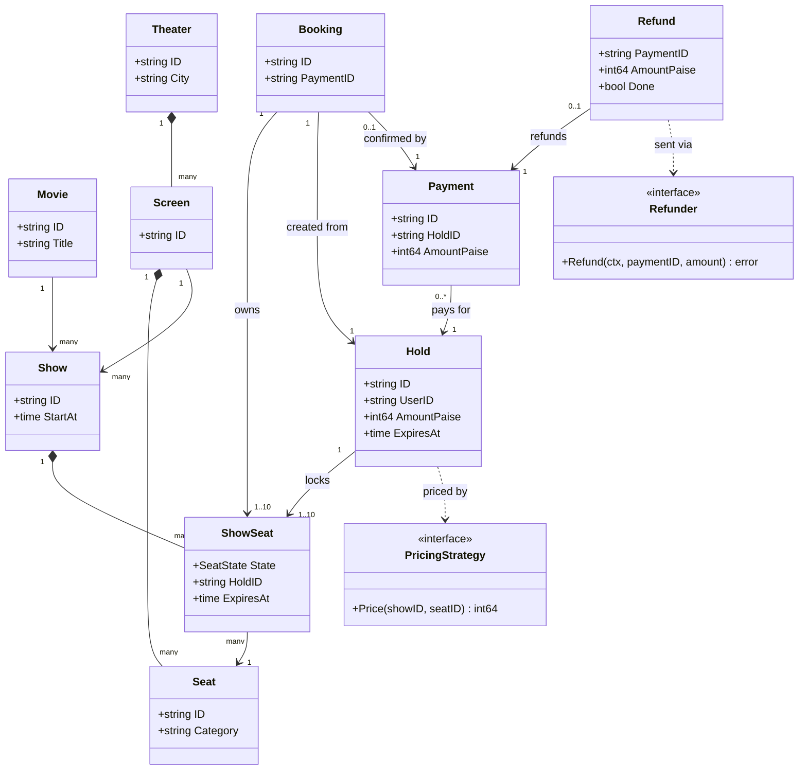
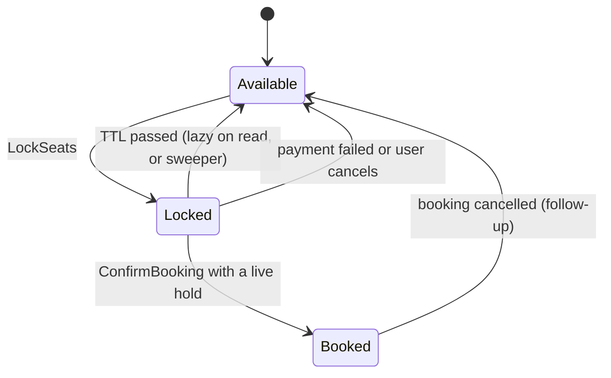
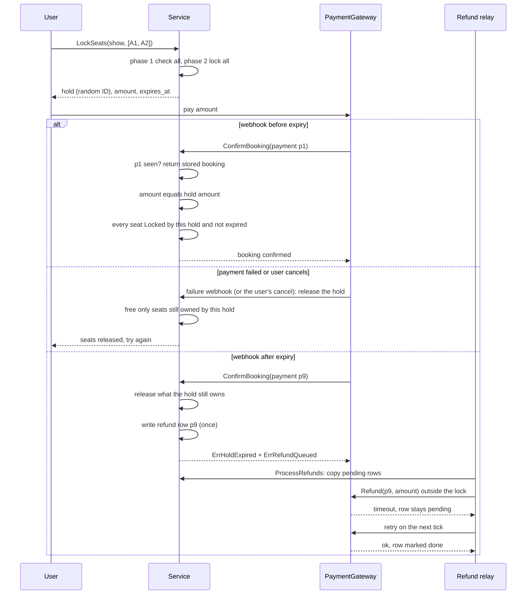

# Movie Ticket Booking

> [!summary] TL;DR
> Put the seat's state on **ShowSeat** (this seat for this show), not on the physical Seat. `LockSeats` checks every requested seat and then locks all of them in one critical section, so a multi-seat hold is all-or-nothing and two users can never hold one seat. Holds expire after a TTL; the payment webhook confirms idempotently by payment ID, and a payment that arrives after the hold expired queues exactly one refund in an outbox instead of stealing seats back.

> [!abstract] Core idea
> - Seat state belongs to `ShowSeat` (this seat for this show), not to the physical `Seat`.
> - A multi-seat hold is all-or-nothing: check every seat, then lock all of them inside one critical section.
> - Holds expire after a TTL (time to live); an expired hold counts as free right away, and a sweeper cleans it up.
> - Payment confirmation is idempotent by payment ID. A payment that arrives after its hold expired queues one refund in an outbox (a list of pending side effects saved in the same step and sent later by a relay); it never takes seats back.
> - Classic mistake: locking seats one by one, so a failure halfway leaves a partial hold.

## Problem statement

```text
Design movie ticket booking like BookMyShow. Users browse movies and shows, view
the seat map, lock one or more seats for a few minutes, pay, and get a confirmed
booking. Expired locks must be released. Two users must never book the same seat.
```

**Solving path**

1. Clarify: hold TTL, max seats per hold, payment flow, what happens on late payment.
2. Model `Seat` vs `ShowSeat` and the seat states (available, locked, booked).
3. Code `LockSeats`: check all, then lock all, under one lock.
4. Code `ConfirmBooking`: idempotent by payment ID, owner and expiry checks.
5. Add `ReleaseHold` and the expiry sweeper.
6. Add the late-payment refund outbox and the PostgreSQL version of the lock.
7. Test concurrent locking, expiry, duplicate callbacks and late payment.

It tests one thing above all: **no double booking** under heavy concurrency, which needs atomic, all-or-nothing multi-seat locking with a time to live (TTL). It also tests the seat state machine, idempotent payment callbacks, the late-payment refund path, and modeling `ShowSeat` apart from `Seat`. Time box: 10 minutes for requirements and entities, 10 for APIs and storage, 25 to 40 for code, 10 for edge cases.

## Step 1: Clarify requirements

| Question to ask | Assumption |
| --- | --- |
| How long is a hold, and can it be extended? | 10 minutes, no extension (a follow-up) |
| Max seats per booking? | Up to 10, all from the same show (checked by the HTTP handler; the core accepts any count) |
| Pricing per category or time (Silver, Gold, weekend)? | Yes, behind a pricing strategy; the price is fixed at lock time |
| Payment succeeds after the hold expired? | Never steal seats back. Queue an automatic refund |
| Cancellation? | Cancel a hold, yes. Cancel a confirmed booking is a follow-up |
| One database or a distributed lock store? | Code in memory with one mutex; explain the conditional `UPDATE` and Redis for scale |

- **Functional:** browse shows; see a show's seat map; lock seats all or nothing; pay; confirm on payment success; release on expiry, cancel or payment failure; refund late payments.
- **Non-functional:** no double booking with thousands of users on one show; expired holds free seats without waiting for a job (lazy expiry plus a sweeper); webhooks can arrive twice or late, so confirm is idempotent; hold IDs are not guessable; money is `int64` paise.
- **Out of scope:** search and recommendations, gateway internals, food add-ons, offers.

## Step 2: Actors and use cases

| Actor | Use case |
| --- | --- |
| User | Browse shows, view the seat map, lock seats, pay, cancel a hold |
| Payment gateway | Sends a success or failure webhook; executes refunds |
| Sweeper job | Releases expired holds every few seconds |
| Refund relay | Sends queued refunds to the gateway, with retries |
| Theater admin | Creates theaters, screens, seats, shows, prices |
| Notification service | Sends the ticket on the `booking.confirmed` event |

The hardest use cases, the ones to code: `LockSeats` for many seats at once under concurrency, and its partner `ConfirmBooking`, which must be idempotent, must verify the hold still owns the seats, and must refund a late payment exactly once.

## Step 3: Entities

| Entity | Key fields | Why it exists |
| --- | --- | --- |
| `Movie`, `Theater`, `Screen` | IDs, title, city | Catalog: what is shown, and where |
| `Seat` | `ID`, `Row`, `Category` | The physical seat; never changes per show |
| `Show` | `ID`, `MovieID`, `ScreenID`, `StartAt` | Movie plus screen plus time |
| `ShowSeat` | `State`, `HoldID`, `ExpiresAt` | **This seat for this show.** All state lives here |
| `Hold` | `ID` (random), `UserID`, `SeatIDs`, `AmountPaise`, `ExpiresAt` | A temporary claim on seats, with a TTL |
| `Booking` | `ID`, `SeatIDs`, `PaymentID` | The confirmed result after payment |
| `Payment` | `ID`, `HoldID`, `AmountPaise` | What the webhook carries; `ID` is the idempotency key |
| `Refund` | `PaymentID`, `AmountPaise`, `Attempts`, `Done` | An outbox row for a payment that cannot be honored |

The modeling insight is **Seat versus ShowSeat**. Seat A1 exists once, but it is available for the 6 PM show and booked for the 9 PM show. Put `State` on `Seat` and the model breaks on the second show.

## Step 4: Relationships



Composition: a theater owns its screens, a screen owns its seats, and a show owns its show-seats. Association: a show refers to a movie and a screen; a show-seat refers to a physical seat; a hold points at the show-seats it locks; a booking is created from a hold. One hold can receive several payments (a retry with a new payment ID, a double charge); at most one confirms the booking and every other one gets exactly one refund, keyed by payment ID. Dependencies on `PricingStrategy` and `Refunder` are interfaces, so Strategy and Adapter can swap them.



A late payment is not a transition: the seat is already `Available` or held by someone else, so the payment goes to the refund outbox and the seat is untouched.

## Step 5: APIs and public methods

```text
GET    /shows?movie_id=&city=&date=     -> list shows
GET    /shows/{show_id}/seats           -> seat map with state and price
POST   /shows/{show_id}/holds           -> {seat_ids:[...]}; 201 {hold_id, amount_paise, expires_at}; 409 if any seat is taken
DELETE /holds/{hold_id}                 -> user cancels the hold
POST   /holds/{hold_id}/payments        -> start payment; returns the gateway order for amount_paise
POST   /payments/webhook                -> gateway {payment_id, hold_id, amount_paise, status}; signed by the gateway
GET    /bookings/{booking_id}
POST   /bookings/{booking_id}/cancel    -> follow-up: cancel and refund through the outbox
```

Go surface (full code in Step 8): `LockSeats(ctx, showID, userID, seatIDs) (Hold, error)`, `ConfirmBooking(ctx, Payment) (Booking, error)`, `ReleaseHold(ctx, holdID, userID) error`, `ReleaseExpiredLocks(ctx) int`, `ProcessRefunds(ctx, Refunder) int`, `SeatState(showID, seatID) (SeatState, error)`.

## Step 6: Storage and repositories

```sql
CREATE TABLE shows (
    id        TEXT PRIMARY KEY,
    movie_id  TEXT NOT NULL,
    screen_id TEXT NOT NULL,
    start_at  TIMESTAMPTZ NOT NULL,
    UNIQUE (screen_id, start_at)                     -- one show per screen per time
);

CREATE TABLE show_seats (
    show_id     TEXT NOT NULL REFERENCES shows(id),
    seat_id     TEXT NOT NULL,
    state       TEXT NOT NULL DEFAULT 'available'
                CHECK (state IN ('available', 'locked', 'booked')),
    hold_id     TEXT,
    hold_expiry TIMESTAMPTZ,
    price_paise BIGINT NOT NULL CHECK (price_paise >= 0),
    PRIMARY KEY (show_id, seat_id)
);
CREATE INDEX idx_show_seats_hold ON show_seats (hold_id);
CREATE INDEX idx_show_seats_expiry ON show_seats (hold_expiry) WHERE state = 'locked'; -- sweeper

CREATE TABLE bookings (
    id           TEXT PRIMARY KEY,
    user_id      TEXT NOT NULL,
    show_id      TEXT NOT NULL REFERENCES shows(id),
    status       TEXT NOT NULL CHECK (status IN ('confirmed', 'cancelled')),
    amount_paise BIGINT NOT NULL,
    payment_id   TEXT NOT NULL UNIQUE,               -- idempotent webhook
    created_at   TIMESTAMPTZ NOT NULL
);

CREATE TABLE booking_seats (
    booking_id TEXT NOT NULL REFERENCES bookings(id),
    show_id    TEXT NOT NULL,
    seat_id    TEXT NOT NULL,
    active     BOOLEAN NOT NULL DEFAULT TRUE
);
-- last line of defence: one active booking per seat per show
CREATE UNIQUE INDEX uq_active_seat ON booking_seats (show_id, seat_id) WHERE active;

-- refund outbox: written in the same transaction that rejects the late payment
CREATE TABLE refunds (
    payment_id   TEXT PRIMARY KEY,                   -- a retried webhook cannot queue twice
    amount_paise BIGINT NOT NULL CHECK (amount_paise > 0),
    reason       TEXT NOT NULL,
    attempts     INT NOT NULL DEFAULT 0,
    done         BOOLEAN NOT NULL DEFAULT FALSE,
    created_at   TIMESTAMPTZ NOT NULL DEFAULT now()
);

-- LockSeats: a conditional UPDATE inside one transaction.
-- If the affected row count is below the number of requested seats, ROLLBACK.
UPDATE show_seats
SET state = 'locked', hold_id = $1, hold_expiry = now() + interval '10 minutes'
WHERE show_id = $2
  AND seat_id = ANY($3)
  AND (state = 'available' OR (state = 'locked' AND hold_expiry < now()));

-- Late payment: queue the refund once, even if the webhook is retried.
INSERT INTO refunds (payment_id, amount_paise, reason)
VALUES ($1, $2, 'hold expired')
ON CONFLICT (payment_id) DO NOTHING;
```

The conditional `UPDATE` is an atomic check-and-set: the row locks it takes last only until the transaction commits, and the hold itself (`state = 'locked'` with an expiry) is the application-level reservation that lasts 10 minutes. The trade-off against version-number checks is in [[Locking - Optimistic vs Pessimistic]]. A repository port hides all of this from the service ([[Repository and Unit of Work]]):

```go
package booking

import (
	"context"
	"errors"
	"time"
)

var ErrDuplicate = errors.New("duplicate payment id")

// ShowSeat is one row of the seat map: this seat for this show.
type ShowSeat struct {
	ShowID     string
	SeatID     string
	State      SeatState
	HoldID     string
	ExpiresAt  time.Time
	PricePaise int64
}

type ShowSeatRepository interface {
	// LockAll locks every seat or none; returns ErrSeatUnavailable on any conflict.
	LockAll(ctx context.Context, showID, holdID string, seatIDs []string, expiry time.Time) error
	MarkBooked(ctx context.Context, holdID string) (int, error) // rows changed
	ReleaseHold(ctx context.Context, holdID string) error
	ReleaseExpired(ctx context.Context, now time.Time) (int, error)
	SeatMap(ctx context.Context, showID string) ([]ShowSeat, error)
}

type BookingRepository interface {
	Create(ctx context.Context, b Booking) error // ErrDuplicate on payment_id
	GetByPaymentID(ctx context.Context, paymentID string) (Booking, error)
}
```

In the Step 8 code the in-memory "repository" is the maps inside `Service`, so the whole design compiles as one package.

## Step 7: Patterns

| Pattern | Where | Why here |
| --- | --- | --- |
| [[State Machines in Go]] | `ShowSeat` states | Only legal transitions happen, and they are checked in one place |
| [[Strategy and Template Method]] | `PricingStrategy` | Pricing rules change often and independently of locking |
| [[Command, Undo and Memento]] | `ReleaseExpiredLocks`, `ProcessRefunds` jobs | Scheduled, retryable work that is safe to run twice |
| [[Repository and Unit of Work]] | Seat and booking repositories | Swap maps for PostgreSQL without touching the service |
| [[Adapter]] | `Refunder` over the vendor SDK | The domain never imports a gateway SDK |
| [[Observer and Event Bus]] | `booking.confirmed` to SMS, email, QR ticket | Booking does not wait on notifications |
| [[Facade (vs Mediator)]] | `Service` | Handlers call one method per use case |

Not used: an object per seat state (three states and five transitions fit in one condition) and a Singleton service (built in `main` and injected, so tests get a fresh one).

## Folder structure

The code in Step 8 is printed as one file so it reads top to bottom. In the round, split it like this:

```text
booking/
  model.go         -> SeatState, showSeat, ShowSeat, Hold, Booking, Payment, Refund, Err* errors
  pricing.go       -> PricingStrategy, FlatPricing
  repository.go    -> ShowSeatRepository, BookingRepository (+ in-memory version)
  service.go       -> LockSeats, ConfirmBooking, ReleaseHold, SeatState
  jobs.go          -> ReleaseExpiredLocks sweeper and ProcessRefunds relay, each on a time.Ticker with ctx
  service_test.go  -> table tests, expiry and late-payment tests, the 100-goroutine race test
cmd/demo/main.go   -> wiring: repositories, pricing, service, HTTP handlers, both jobs
```

- `service.go` holds all the locking logic; it is the only file that takes `s.mu`.
- `jobs.go` never calls the gateway while holding `s.mu`.

## Step 8: Core code

> [!tip] What to code in a 60-minute round
> **Write in the room (about 150 lines):** `SeatState`, `showSeat`, `Hold`, `Booking`, `Payment`; `Service` with `NewService`, `AddShow`, `free`, `LockSeats`, `ConfirmBooking`, `ReleaseHold`, `releaseLocked`, `ReleaseExpiredLocks` and `SeatState`.
>
> **Talk through only (extensions):** `PricingStrategy`, the refund outbox (`Refund`, `queueRefund`, `ProcessRefunds`, `RefundStatus`), `SELECT ... FOR UPDATE` in PostgreSQL, Redis holds, and a waiting room for blockbuster openings.



How the main paths work:

1. **`LockSeats`** rejects empty input and a cancelled context, then takes the mutex. Phase 1 only checks: each seat exists, is not repeated, and is free (`Available`, or `Locked` by an expired hold: lazy expiry, so correctness never waits for the sweeper). Any failure returns before anything changed. Phase 2 creates the hold with a **random ID** from `crypto/rand.Text` (Go 1.24, at least 128 bits of randomness), marks every seat, and prices each one with the strategy.
2. **`ConfirmBooking`** returns the stored booking for a known payment ID (webhooks are retried) and `ErrRefundQueued` for a payment already sent to the outbox. Otherwise it verifies every seat is still `Locked` by **this** hold and not expired; a seat can expire and be re-locked by someone else, so the hold ID check matters.
3. **Late payment → refund.** If the hold is gone or expired, `ConfirmBooking` releases only what the hold still owns, writes one `Refund` row keyed by payment ID, and returns an error wrapping both causes. The gateway is never called under the mutex: `ProcessRefunds` copies pending rows, calls the gateway outside the lock, and marks successes. A failed call stays pending and the next tick retries it.
4. **Amount check.** A success webhook whose amount differs from the hold amount never books: the payment is queued for refund and the hold stays, so a correct payment can still confirm it before the TTL.
5. **`SeatState`** returns an error for an unknown show or seat; a direct `s.seats[show][seat].state` lookup would dereference a nil pointer and panic. It also applies lazy expiry, so the seat map never shows a dead hold as taken.

```go
package booking

import (
	"context"
	"crypto/rand"
	"errors"
	"fmt"
	"sync"
	"time"
)

var (
	ErrNoSeats         = errors.New("no seats requested")
	ErrShowNotFound    = errors.New("show not found")
	ErrSeatNotFound    = errors.New("seat not found")
	ErrSeatUnavailable = errors.New("seat unavailable")
	ErrHoldNotFound    = errors.New("hold not found")
	ErrHoldExpired     = errors.New("hold expired")
	ErrNotHoldOwner    = errors.New("hold belongs to another user")
	ErrAmountMismatch  = errors.New("paid amount differs from hold amount")
	ErrRefundQueued    = errors.New("payment will be refunded")
)

type SeatState int

const (
	Available SeatState = iota
	Locked
	Booked
)

func (s SeatState) String() string { return [...]string{"available", "locked", "booked"}[s] }

// showSeat is "this physical seat for this show". State lives here, not on Seat.
type showSeat struct {
	state     SeatState
	holdID    string
	expiresAt time.Time
}

type Hold struct {
	ID          string
	ShowID      string
	UserID      string
	SeatIDs     []string
	AmountPaise int64
	ExpiresAt   time.Time
}

type Booking struct {
	ID          string
	ShowID      string
	UserID      string
	SeatIDs     []string
	AmountPaise int64
	PaymentID   string
}

// Payment is what the gateway's success webhook carries.
type Payment struct {
	ID          string // gateway payment ID: the idempotency key
	HoldID      string
	AmountPaise int64
}

// Refund is an outbox row: written in the same critical section that rejects
// the late payment, sent to the gateway later by ProcessRefunds.
type Refund struct {
	PaymentID   string
	AmountPaise int64
	Reason      string
	Attempts    int
	Done        bool
}

// Refunder is the gateway's refund API behind an Adapter. The payment ID is
// sent as the idempotency key, so a retry after a timeout cannot pay twice.
type Refunder interface {
	Refund(ctx context.Context, paymentID string, amountPaise int64) error
}

// PricingStrategy prices one seat of one show (category, weekend, surge...).
type PricingStrategy interface {
	Price(showID, seatID string) int64
}

type FlatPricing struct{ Paise int64 }

func (f FlatPricing) Price(string, string) int64 { return f.Paise }

type Service struct {
	mu        sync.Mutex
	seats     map[string]map[string]*showSeat // showID -> seatID -> state
	holds     map[string]*Hold
	byPayment map[string]*Booking // idempotency: paymentID -> booking
	refunds   map[string]*Refund  // outbox: paymentID -> refund (one per payment)
	relayMu   sync.Mutex          // one refund relay at a time
	pricing   PricingStrategy
	ttl       time.Duration
	now       func() time.Time // injected clock
}

func NewService(ttl time.Duration, now func() time.Time) *Service {
	return &Service{
		seats:     map[string]map[string]*showSeat{},
		holds:     map[string]*Hold{},
		byPayment: map[string]*Booking{},
		refunds:   map[string]*Refund{},
		pricing:   FlatPricing{Paise: 20000}, // Rs 200 default
		ttl:       ttl,
		now:       now,
	}
}

func (s *Service) SetPricing(p PricingStrategy) {
	s.mu.Lock()
	defer s.mu.Unlock()
	s.pricing = p
}

func (s *Service) AddShow(showID string, seatIDs []string) {
	s.mu.Lock()
	defer s.mu.Unlock()
	m := make(map[string]*showSeat, len(seatIDs))
	for _, id := range seatIDs {
		m[id] = &showSeat{state: Available}
	}
	s.seats[showID] = m
}

// free reports whether a seat can be locked: available, or locked by an expired hold.
func free(st *showSeat, now time.Time) bool {
	return st.state == Available || (st.state == Locked && now.After(st.expiresAt))
}

// LockSeats holds all requested seats or none of them.
func (s *Service) LockSeats(ctx context.Context, showID, userID string, seatIDs []string) (Hold, error) {
	if err := ctx.Err(); err != nil {
		return Hold{}, err
	}
	if len(seatIDs) == 0 {
		return Hold{}, ErrNoSeats
	}
	s.mu.Lock()
	defer s.mu.Unlock()

	show, ok := s.seats[showID]
	if !ok {
		return Hold{}, ErrShowNotFound
	}
	now := s.now()
	seen := map[string]bool{}
	// Phase 1: check every seat. No mutation yet, so failure leaves nothing half-locked.
	for _, id := range seatIDs {
		st, ok := show[id]
		if !ok {
			return Hold{}, fmt.Errorf("%w: %s", ErrSeatNotFound, id)
		}
		if seen[id] || !free(st, now) {
			return Hold{}, fmt.Errorf("%w: %s", ErrSeatUnavailable, id)
		}
		seen[id] = true
	}
	// Phase 2: all free, lock them together and price them now (price shown = price charged).
	h := &Hold{
		ID:        "hold-" + rand.Text(), // random: a guessable ID invites probing other users' holds
		ShowID:    showID,
		UserID:    userID,
		SeatIDs:   append([]string(nil), seatIDs...),
		ExpiresAt: now.Add(s.ttl),
	}
	for _, id := range seatIDs {
		st := show[id] // may overwrite an expired hold; that hold fails on confirm
		st.state, st.holdID, st.expiresAt = Locked, h.ID, h.ExpiresAt
		h.AmountPaise += s.pricing.Price(showID, id)
	}
	s.holds[h.ID] = h
	return *h, nil
}

// ConfirmBooking is called from the payment success webhook. The same payment
// twice returns the same booking (gateways retry webhooks). A payment that
// arrives after its hold expired or was released never steals seats back: it
// queues exactly one refund in the outbox and returns ErrRefundQueued.
func (s *Service) ConfirmBooking(ctx context.Context, p Payment) (Booking, error) {
	if err := ctx.Err(); err != nil {
		return Booking{}, err
	}
	s.mu.Lock()
	defer s.mu.Unlock()

	if b, ok := s.byPayment[p.ID]; ok {
		return *b, nil
	}
	if _, ok := s.refunds[p.ID]; ok {
		return Booking{}, ErrRefundQueued // retried webhook for a refunded payment
	}
	h, ok := s.holds[p.HoldID]
	if !ok {
		s.queueRefund(p, "hold not found")
		return Booking{}, fmt.Errorf("%w: %w", ErrHoldNotFound, ErrRefundQueued)
	}
	if p.AmountPaise != h.AmountPaise { // never book on an under- or over-payment
		s.queueRefund(p, "amount mismatch") // the hold stays: a correct payment can still confirm it
		return Booking{}, fmt.Errorf("%w: %w", ErrAmountMismatch, ErrRefundQueued)
	}
	now := s.now()
	show := s.seats[h.ShowID]
	for _, id := range h.SeatIDs {
		st := show[id]
		if st.state != Locked || st.holdID != h.ID || now.After(st.expiresAt) {
			s.releaseLocked(h)
			s.queueRefund(p, "hold expired")
			return Booking{}, fmt.Errorf("%w: %w", ErrHoldExpired, ErrRefundQueued)
		}
	}
	for _, id := range h.SeatIDs {
		show[id].state, show[id].holdID = Booked, ""
	}
	delete(s.holds, h.ID)
	b := &Booking{
		ID: "bk-" + h.ID, ShowID: h.ShowID, UserID: h.UserID,
		SeatIDs: h.SeatIDs, AmountPaise: h.AmountPaise, PaymentID: p.ID,
	}
	s.byPayment[p.ID] = b
	return *b, nil
}

// queueRefund writes the outbox row. Caller holds s.mu.
func (s *Service) queueRefund(p Payment, reason string) {
	s.refunds[p.ID] = &Refund{PaymentID: p.ID, AmountPaise: p.AmountPaise, Reason: reason}
}

// ProcessRefunds is the outbox relay, run by a ticker. It copies pending rows
// under the lock, calls the gateway without holding it, and marks successes.
// A failed call stays pending and is retried on the next run.
func (s *Service) ProcessRefunds(ctx context.Context, gw Refunder) int {
	s.relayMu.Lock()
	defer s.relayMu.Unlock()
	s.mu.Lock()
	var batch []Refund
	for _, r := range s.refunds {
		if !r.Done {
			batch = append(batch, *r)
		}
	}
	s.mu.Unlock()

	sent := 0
	for _, r := range batch {
		err := gw.Refund(ctx, r.PaymentID, r.AmountPaise)
		s.mu.Lock()
		row := s.refunds[r.PaymentID]
		row.Attempts++
		row.Done = err == nil
		s.mu.Unlock()
		if err == nil {
			sent++
		}
	}
	return sent
}

// RefundStatus returns a copy of the outbox row for one payment.
func (s *Service) RefundStatus(paymentID string) (Refund, bool) {
	s.mu.Lock()
	defer s.mu.Unlock()
	r, ok := s.refunds[paymentID]
	if !ok {
		return Refund{}, false
	}
	return *r, true
}

// ReleaseHold is used on payment failure or user cancel. Only the owner may release.
func (s *Service) ReleaseHold(ctx context.Context, holdID, userID string) error {
	s.mu.Lock()
	defer s.mu.Unlock()
	h, ok := s.holds[holdID]
	if !ok {
		return ErrHoldNotFound
	}
	if h.UserID != userID {
		return ErrNotHoldOwner
	}
	s.releaseLocked(h)
	return nil
}

// releaseLocked frees only seats still owned by this hold. Caller holds s.mu.
func (s *Service) releaseLocked(h *Hold) {
	show := s.seats[h.ShowID]
	for _, id := range h.SeatIDs {
		if st := show[id]; st.state == Locked && st.holdID == h.ID {
			st.state, st.holdID = Available, ""
		}
	}
	delete(s.holds, h.ID)
}

// ReleaseExpiredLocks is run by a background sweeper (Command/job). Returns holds released.
func (s *Service) ReleaseExpiredLocks(ctx context.Context) int {
	s.mu.Lock()
	defer s.mu.Unlock()
	now, n := s.now(), 0
	for _, h := range s.holds {
		if now.After(h.ExpiresAt) {
			s.releaseLocked(h)
			n++
		}
	}
	return n
}

// SeatState reports what a seat map shows. Unknown IDs return an error instead
// of dereferencing a nil *showSeat (s.seats[show][seat].state would panic).
// An expired lock reads as Available, the same rule LockSeats uses.
func (s *Service) SeatState(showID, seatID string) (SeatState, error) {
	s.mu.Lock()
	defer s.mu.Unlock()
	show, ok := s.seats[showID]
	if !ok {
		return 0, ErrShowNotFound
	}
	st, ok := show[seatID]
	if !ok {
		return 0, fmt.Errorf("%w: %s", ErrSeatNotFound, seatID)
	}
	if free(st, s.now()) {
		return Available, nil
	}
	return st.state, nil
}
```

## Test cases

| Test | Proves |
| --- | --- |
| `TestLockSeatsValidation` (6 rows) | Empty seats, unknown show and seat, a duplicate seat, a partly taken request: a failed lock leaves nothing half-locked |
| `TestSeatStateUnknownIDsReturnErrors` | Unknown IDs return `ErrShowNotFound` and `ErrSeatNotFound` instead of panicking |
| `TestAmountMismatchRefundsAndKeepsHold` | A short payment queues a refund of what was paid, the seats stay locked, and the correct payment still confirms |
| `TestLockPayConfirm` | Hold amount is priced; hold IDs are random and unique; confirm books; the same payment twice returns the same booking |
| `TestPaymentFailureReleases` | Only the owner can release; a confirm after release queues a refund |
| `TestExpiry` | The seat map shows an expired lock as free; another user can take it; the old hold's confirm fails without freeing the new owner's seat; the sweeper releases expired holds |
| `TestLatePaymentRefundsExactlyOnce` | Three retried late webhooks queue one refund; a gateway timeout is retried; the gateway sees exactly one refund of 40000 paise |
| `TestConcurrentLock` | 100 goroutines lock the same 2 seats: exactly 1 winner |

```go
package booking

import (
	"context"
	"errors"
	"sync"
	"sync/atomic"
	"testing"
	"time"
)

func newTestService() (*Service, *time.Time) {
	now := time.Unix(0, 0)
	s := NewService(10*time.Minute, func() time.Time { return now })
	s.AddShow("s1", []string{"A1", "A2", "A3"})
	return s, &now
}

func state(t *testing.T, s *Service, show, seat string) SeatState {
	t.Helper()
	st, err := s.SeatState(show, seat)
	if err != nil {
		t.Fatal(err)
	}
	return st
}

func pay(h Hold, id string) Payment {
	return Payment{ID: id, HoldID: h.ID, AmountPaise: h.AmountPaise}
}

func TestLockSeatsValidation(t *testing.T) {
	tests := []struct {
		name    string
		show    string
		seats   []string
		wantErr error
	}{
		{"no seats", "s1", nil, ErrNoSeats},
		{"unknown show", "s9", []string{"A1"}, ErrShowNotFound},
		{"unknown seat", "s1", []string{"Z9"}, ErrSeatNotFound},
		{"same seat twice in request", "s1", []string{"A3", "A3"}, ErrSeatUnavailable},
		{"one seat already locked -> none locked", "s1", []string{"A3", "A1"}, ErrSeatUnavailable},
		{"free seat", "s1", []string{"A3"}, nil},
	}
	for _, tc := range tests {
		t.Run(tc.name, func(t *testing.T) {
			s, _ := newTestService()
			if _, err := s.LockSeats(context.Background(), "s1", "u1", []string{"A1"}); err != nil {
				t.Fatal(err)
			}
			_, err := s.LockSeats(context.Background(), tc.show, "u2", tc.seats)
			if !errors.Is(err, tc.wantErr) {
				t.Fatalf("got %v want %v", err, tc.wantErr)
			}
			if err != nil && state(t, s, "s1", "A3") != Available {
				t.Fatal("failed lock must not leave A3 half-locked")
			}
		})
	}
}

func TestSeatStateUnknownIDsReturnErrors(t *testing.T) {
	s, _ := newTestService()
	if _, err := s.SeatState("s9", "A1"); !errors.Is(err, ErrShowNotFound) {
		t.Fatalf("unknown show: %v", err)
	}
	if _, err := s.SeatState("s1", "Z9"); !errors.Is(err, ErrSeatNotFound) {
		t.Fatalf("unknown seat: %v", err) // a direct map lookup would panic here
	}
}

func TestAmountMismatchRefundsAndKeepsHold(t *testing.T) {
	s, _ := newTestService()
	ctx := context.Background()
	h, _ := s.LockSeats(ctx, "s1", "u1", []string{"A1", "A2"}) // 40000 paise
	short := Payment{ID: "p-short", HoldID: h.ID, AmountPaise: 20000}
	if _, err := s.ConfirmBooking(ctx, short); !errors.Is(err, ErrAmountMismatch) || !errors.Is(err, ErrRefundQueued) {
		t.Fatal(err)
	}
	if r, ok := s.RefundStatus("p-short"); !ok || r.AmountPaise != 20000 {
		t.Fatalf("refund row %+v ok=%v", r, ok)
	}
	if state(t, s, "s1", "A1") != Locked {
		t.Fatal("hold must survive a wrong-amount payment")
	}
	if _, err := s.ConfirmBooking(ctx, pay(h, "p-full")); err != nil {
		t.Fatal("a correct payment must still confirm", err)
	}
}

func TestLockPayConfirm(t *testing.T) {
	s, _ := newTestService()
	ctx := context.Background()
	h, err := s.LockSeats(ctx, "s1", "u1", []string{"A1", "A2"})
	if err != nil || h.AmountPaise != 40000 {
		t.Fatal(h, err)
	}
	h2, _ := s.LockSeats(ctx, "s1", "u2", []string{"A3"})
	if h.ID == h2.ID || len(h.ID) < 20 {
		t.Fatalf("hold IDs must be random and unique: %q %q", h.ID, h2.ID)
	}
	b, err := s.ConfirmBooking(ctx, pay(h, "p1"))
	if err != nil {
		t.Fatal(err)
	}
	b2, err := s.ConfirmBooking(ctx, pay(h, "p1")) // webhook retried
	if err != nil || b2.ID != b.ID {
		t.Fatal("not idempotent", err)
	}
	if state(t, s, "s1", "A1") != Booked || state(t, s, "s1", "A2") != Booked {
		t.Fatal("not booked")
	}
}

func TestPaymentFailureReleases(t *testing.T) {
	s, _ := newTestService()
	ctx := context.Background()
	h, _ := s.LockSeats(ctx, "s1", "u1", []string{"A1"})
	if err := s.ReleaseHold(ctx, h.ID, "u2"); !errors.Is(err, ErrNotHoldOwner) {
		t.Fatal(err)
	}
	if err := s.ReleaseHold(ctx, h.ID, "u1"); err != nil {
		t.Fatal(err)
	}
	if state(t, s, "s1", "A1") != Available {
		t.Fatal("seat not released")
	}
	_, err := s.ConfirmBooking(ctx, pay(h, "p-late"))
	if !errors.Is(err, ErrHoldNotFound) || !errors.Is(err, ErrRefundQueued) {
		t.Fatal(err)
	}
}

func TestExpiry(t *testing.T) {
	s, now := newTestService()
	ctx := context.Background()
	h3, _ := s.LockSeats(ctx, "s1", "u3", []string{"A3"})
	*now = now.Add(11 * time.Minute)
	if state(t, s, "s1", "A3") != Available {
		t.Fatal("seat map must show an expired lock as available")
	}
	if _, err := s.LockSeats(ctx, "s1", "u4", []string{"A3"}); err != nil {
		t.Fatal("expired hold should be free", err)
	}
	if _, err := s.ConfirmBooking(ctx, pay(h3, "p3")); !errors.Is(err, ErrHoldExpired) {
		t.Fatal(err)
	}
	if state(t, s, "s1", "A3") != Locked {
		t.Fatal("must not release other user's lock")
	}
	*now = now.Add(11 * time.Minute)
	if n := s.ReleaseExpiredLocks(ctx); n != 1 {
		t.Fatal(n)
	}
	if state(t, s, "s1", "A3") != Available {
		t.Fatal("sweeper did not free A3")
	}
}

type flakyGateway struct {
	fails int            // fail this many calls first
	sent  map[string]int // paymentID -> successful refunds
}

func (g *flakyGateway) Refund(_ context.Context, paymentID string, _ int64) error {
	if g.fails > 0 {
		g.fails--
		return errors.New("gateway timeout")
	}
	g.sent[paymentID]++
	return nil
}

func TestLatePaymentRefundsExactlyOnce(t *testing.T) {
	s, now := newTestService()
	ctx := context.Background()
	h, _ := s.LockSeats(ctx, "s1", "u1", []string{"A1", "A2"})
	*now = now.Add(11 * time.Minute) // user paid, but after the 10-minute hold
	for range 3 {                    // the gateway retries the webhook
		if _, err := s.ConfirmBooking(ctx, pay(h, "p9")); !errors.Is(err, ErrRefundQueued) {
			t.Fatal(err)
		}
	}
	if state(t, s, "s1", "A1") != Available {
		t.Fatal("late payment must not book the seat")
	}
	gw := &flakyGateway{fails: 1, sent: map[string]int{}}
	if n := s.ProcessRefunds(ctx, gw); n != 0 {
		t.Fatalf("first run should fail, sent %d", n)
	}
	if n := s.ProcessRefunds(ctx, gw); n != 1 {
		t.Fatalf("retry should send 1, sent %d", n)
	}
	if n := s.ProcessRefunds(ctx, gw); n != 0 {
		t.Fatalf("nothing pending, sent %d", n)
	}
	r, ok := s.RefundStatus("p9")
	if !ok || !r.Done || r.Attempts != 2 || r.AmountPaise != 40000 || gw.sent["p9"] != 1 {
		t.Fatalf("refund row %+v, gateway %v", r, gw.sent)
	}
}

// 100 users race for the same 2 seats: exactly one hold wins.
func TestConcurrentLock(t *testing.T) {
	s := NewService(time.Minute, time.Now)
	s.AddShow("s1", []string{"A1", "A2"})
	var ok int32
	var wg sync.WaitGroup
	for i := 0; i < 100; i++ {
		wg.Add(1)
		go func() {
			defer wg.Done()
			if _, err := s.LockSeats(context.Background(), "s1", "u", []string{"A1", "A2"}); err == nil {
				atomic.AddInt32(&ok, 1)
			}
		}()
	}
	wg.Wait()
	if ok != 1 {
		t.Fatalf("want 1 winner got %d", ok)
	}
}
```

Run in a scratch module with Go 1.24.4: `go vet` clean and `go test -race -count=1` passes all eight tests.

## Step 9: Edge cases

| Edge case | What happens | How the design handles it |
| --- | --- | --- |
| Two users lock the same seat | Both read "available" and both lock | In code, one mutex around check and mutate. In SQL, the conditional `UPDATE`, comparing the affected row count with the request and rolling back if short |
| Partial availability | A1 and A2 free, A3 taken | Phase 1 checks everything before any write: nothing is half-locked |
| Same seat twice in one request | Counted as 2 seats | The `seen` set rejects it |
| User walks away | Seats stay locked | TTL on every hold: lazy expiry on lock and on read, plus the sweeper |
| Payment failure | Seats stay locked | The failure webhook calls `ReleaseHold`; without a webhook the TTL frees them |
| Webhook retried | Two bookings for one payment | `byPayment` in code; `payment_id UNIQUE` in SQL, where a conflict reads and returns the existing booking |
| Payment after expiry | The seats may belong to someone else | `ErrHoldExpired`, one outbox refund keyed by payment ID, retried until the gateway accepts |
| Paid amount differs from the hold amount | An under-payment would book seats | `ErrAmountMismatch`: refund that payment, keep the hold for a correct payment |
| Release by seat ID only | Frees a seat another user now holds | Always match the hold ID when releasing or confirming (`releaseLocked` checks `holdID` per seat) |
| Guessable hold IDs (`hold-1`, `hold-2`) | Anyone can probe other users' holds | Random IDs from `crypto/rand.Text`; `ReleaseHold` also checks the owner |
| Unknown IDs in a lookup | Nil dereference panic | `SeatState` returns `ErrShowNotFound` or `ErrSeatNotFound` |
| Sweeper races confirm | Both touch one hold | Same mutex in code; in SQL both filter `WHERE hold_id = $1 AND state = 'locked'` |
| SQL deadlock | Two overlapping multi-seat holds lock rows in different orders. This applies to the multi-row conditional `UPDATE ... WHERE seat_id = ANY($3)` too, not only to `SELECT ... FOR UPDATE` | Lock first with `SELECT ... WHERE seat_id = ANY($3) ORDER BY seat_id FOR UPDATE`, then update, so every transaction locks rows in the same order (sorting the input array alone does not decide the scan's lock order). Also retry the transaction on SQLSTATE `40P01` (deadlock detected) |
| A bug in hold logic | Two bookings per seat | The partial unique index `uq_active_seat` is the final guarantee |
| Hot show (blockbuster opening) | One mutex or one row set is contended | Per-show locks, Redis `SET seat:{show}:{seat} <hold> NX PX 600000` (run for all seats in one Lua script, so a multi-seat hold stays all-or-nothing), and a waiting room (Step 10) |

## Step 10: Tradeoffs and extensions

| Follow-up | Design change |
| --- | --- |
| One global mutex is the bottleneck | A mutex per show: `map[showID]*showState`, each with its own lock. Shows never share seats, so no cross-show lock is needed |
| Millions of users on one release | Redis `SET NX PX` per seat for holds, the SQL unique index for the final booking, and a virtual waiting room |
| Extend a hold | `UPDATE show_seats SET hold_expiry = ... WHERE hold_id = $1 AND hold_expiry > now()`, with a cap |
| Prices per category or weekend | A new `PricingStrategy`; the price is stored on the hold at lock time |
| Cancel a confirmed booking | Booking confirmed → cancelled, `booking_seats.active = false`, seats back to available, refund through the same outbox |
| Read-heavy seat map | Cache per show with a short TTL, invalidated by lock and confirm events |
| Notify the user after booking | Publish `booking.confirmed`; [[Observer and Event Bus]] subscribers send SMS, email and the ticket QR |
| Seat rules (no single-seat gap) | A validation chain before the lock ([[Chain of Responsibility and Pipelines]]) |

**Virtual waiting room (described, not modeled).** When a hot show opens, far more users arrive than the seat service can serve. A gate in front of the booking pages gives each arriving user a signed token holding a queue position. A releaser admits tokens at a fixed rate (for example a few thousand users per minute, an estimate tuned per event), and only admitted tokens may call `LockSeats`. Everyone else sees their position. The waiting room protects the lock path from overload and makes the order fair (first come, first admitted) instead of rewarding whoever retries fastest. The system-level version is in [[Case Study - Ticket Booking]].

Choices made: one in-memory mutex (simple and obviously correct; per-show locks or the database are the scale answer); pessimistic holds before payment, because users hate paying and then losing seats; lazy expiry plus a sweeper, so correctness never depends on job timing; idempotency on the payment ID, which the gateway reuses on retries; the price computed at lock time and stored on the hold, so what the user saw is what they pay; refunds through an outbox, so a gateway outage never loses a refund and never blocks the seat lock.

## Drawing

![[Movie Ticket Booking LLD Drawing.excalidraw]]

The drawing shows the entities (Theater, Screen, Seat, Movie, Show, ShowSeat, Hold, Booking with the pricing and payment interfaces), the lock → pay → confirm flow with its red failure branches (seat taken → 409, payment failed → release, payment after expiry → refund), the seat state machine, and the `show_seats`, `bookings` and `booking_seats` tables with their key constraints. Redraw from memory: Seat versus ShowSeat, the three states with five transitions, the late-payment branch into the refund outbox, and the conditional `UPDATE` plus the two unique constraints.

## Interview questions

> [!question]- Why does the state live on ShowSeat instead of Seat?
> A physical seat exists once but takes part in many shows. Seat A1 is booked at 6 PM and free at 9 PM. State on `Seat` would make every show share one state; `ShowSeat` (show ID plus seat ID) is the unit that is locked and booked.

> [!question]- How do you make a 4-seat hold all-or-nothing in PostgreSQL?
> One transaction with a conditional `UPDATE ... WHERE seat_id = ANY($3) AND (state = 'available' OR expired)`. If the affected row count is below 4, roll back. The partial unique index on active booking seats is the backstop if any code path is wrong.

> [!question]- Trap: the payment succeeds 30 seconds after the hold expired, and the seats are still free. Do you book them?
> Not by default. Once the TTL passes, the seat map already shows those seats as free and another user may be paying for them; honoring late payments makes the TTL meaningless and needs a rule for who wins. Refund through the outbox. A short grace window is possible, but only as an explicit product rule checked under the same lock.

> [!question]- Why queue the refund instead of calling the gateway inside ConfirmBooking?
> The gateway is a slow, failing network call. Under the seat lock it would block every other booking; outside a transaction a crash could lose the refund. The outbox row is written atomically with the decision, keyed by payment ID so retried webhooks collapse, and a relay retries until the gateway accepts.

> [!question]- Why are random hold IDs needed if ReleaseHold checks the owner?
> Defense in depth. Sequential IDs leak volume ("hold-90512" means about 90,000 holds since the counter started) and let anyone probe other holds through any endpoint that forgets an owner check. `crypto/rand.Text` gives at least 128 bits of randomness, so IDs cannot be guessed.

> [!question]- What breaks first on a blockbuster opening, and what do you add?
> The single lock or the hot rows for that show. Shard locks per show, hold seats in Redis with `SET NX PX`, keep the SQL unique index as the final check, and put a virtual waiting room in front so only an admitted rate of users reaches `LockSeats`.

## Interview explanation

```text
The core entity is ShowSeat, one row per seat per show, with three states: available, locked and booked. State lives there, not on the physical Seat. LockSeats checks every requested seat and then locks all of them in one critical section, or in one transaction with a conditional UPDATE, so a multi-seat hold is all-or-nothing and two users can never hold the same seat. Each hold has a random ID and a TTL; an expired hold counts as free on every read and lock, and a sweeper tidies it up. The payment webhook calls ConfirmBooking, which is idempotent on the payment ID, checks the paid amount, and verifies every seat is still held by that exact hold before flipping them to booked. A payment that arrives too late never steals seats back: it writes one refund row keyed by the payment ID, and a relay sends it to the gateway outside the lock, with retries. A partial unique index on active booking seats is the final guarantee against double booking.
```

## Cheat sheet

- State on `ShowSeat`, never on `Seat`. Three states: available, locked, booked.
- Lock in two phases: check all, then mutate all, inside one critical section or transaction.
- Lazy expiry on lock and read, plus a sweeper only for tidiness.
- Confirm is idempotent on payment ID, checks the paid amount, and verifies the exact hold ID on every seat.
- Late payment: release what the hold owns, one refund row per payment ID, relay retries outside the lock.
- Random hold IDs (`crypto/rand.Text`, Go 1.24); lookups return errors, never panic.
- Scale: per-show locks, Redis `SET NX PX`, the partial unique index, a waiting room.

## Links

- **Before this:** [[State Machines in Go]], [[Concurrency for LLD]], [[Circuit Breaker]]
- **Next:** [[Splitwise Expense Sharing]], [[Hotel Booking]] (the same hold pattern over date ranges)
- **Compare with:** [[Case Study - Ticket Booking]] (the system-level design), [[Case Study - Payment System]] (webhooks and refunds), [[Locking - Optimistic vs Pessimistic]]
