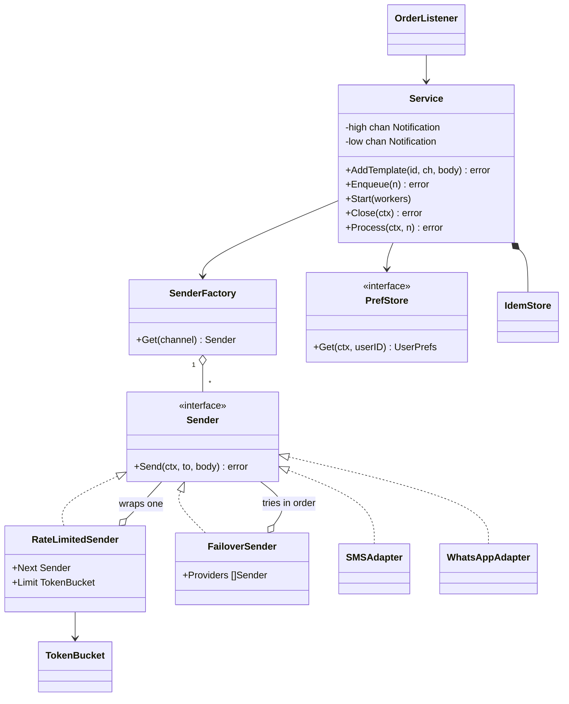
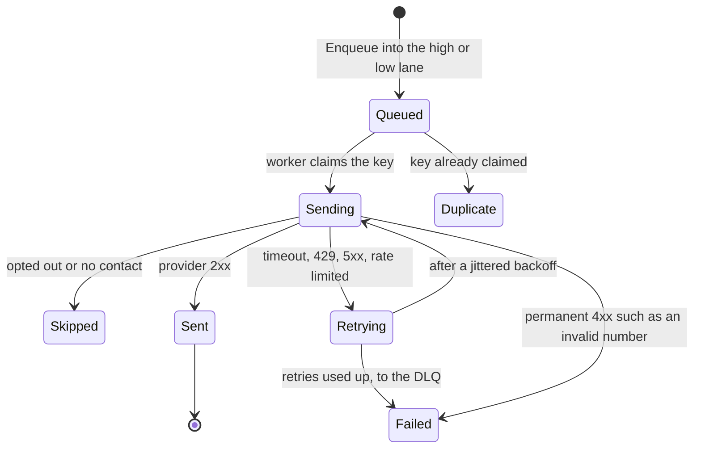
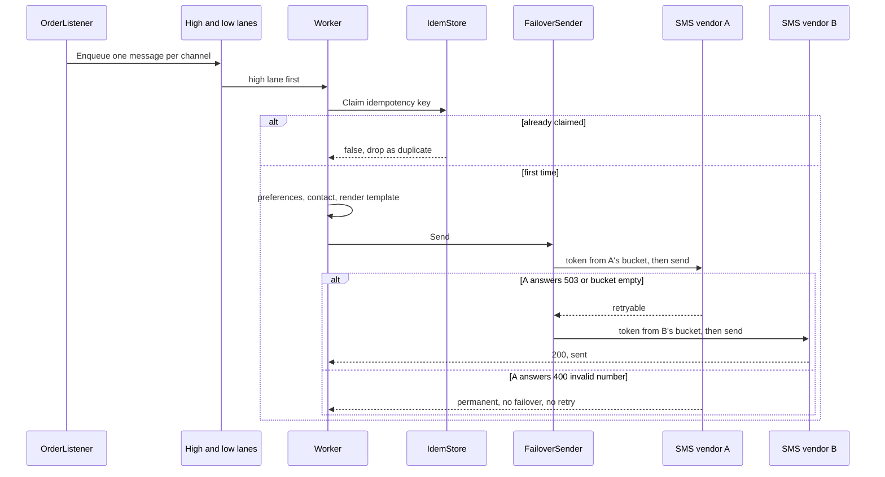

# Notification Service

> [!summary] TL;DR
> Business events (order placed, OTP requested) become one message per channel (email, SMS, push, WhatsApp). A worker pool claims an idempotency key, checks the user's preferences, renders a template, and sends through a provider adapter wrapped in a rate limiter and a failover chain. Only **retryable** failures (timeouts, 429, 5xx) are retried, with capped, jittered backoff; OTPs jump ahead of marketing in a priority lane; and shutdown drains the queue instead of dropping it.

> [!abstract] Core idea
> - Pipeline: business event, then one message per channel, then a queue, then a worker that claims an idempotency key (a unique ID per message, recorded once so a duplicate is skipped), checks preferences, renders the template and sends.
> - Each provider sits behind one `Sender` interface (Adapter); failover and rate limiting wrap a `Sender` without changing the service (Decorator).
> - The one rule: retry only retryable failures (network errors, 408, 429, 5xx) with capped, jittered backoff; any other 4xx is permanent.
> - Classic mistakes: retrying an invalid phone number, rendering SMS with `html/template` (users see `&amp;`), and dropping queued messages on deploy.

## Problem statement

```text
Design a notification system that sends email, SMS, push and WhatsApp messages when
business events happen (order placed, order delivered, OTP). Respect user preferences,
render templates, retry failed sends, never send the same message twice, and respect
each provider's rate limit. Adding a new channel or provider should be easy.
Design the classes, APIs and DB schema, and code the send path.
```

**Solving path**

1. Clarify: channels, preferences, retry policy, duplicate rule, provider rate limits.
2. Name the entities: `Notification`, `Channel`, `Template`, `UserPrefs`, `Sender`.
3. Put each provider behind `Sender` with an adapter, and pick it with a factory.
4. Build the worker pool on a channel: claim key, check prefs, render, send.
5. Classify errors and retry only retryable ones with backoff.
6. Add the priority lane, rate limiter and failover as wrappers.
7. Test retry, permanent errors, duplicates and shutdown drain.

What it really tests: Factory and Adapter for many providers behind one interface, a worker pool on channels, idempotency under concurrent duplicates, rate limiting as a decorator, and **error classification**: retrying every error would make an invalid phone number burn four provider calls and quota for nothing.

## Step 1: Clarify requirements

Questions to ask, with the assumptions this design makes:

- Which channels, transactional or marketing? *Email, SMS, push, WhatsApp; OTPs and order updates are high priority, marketing is low.*
- Delivery guarantee? *At-least-once from the queue, made effectively once by an idempotency key.*
- Rate limits? *Per provider account, for example 100 SMS/s (an example figure; each vendor contract differs).*
- What if the SMS vendor is down? *Fail over to a secondary SMS vendor.*
- Which errors are worth retrying? *Network timeouts, 408, 429 and 5xx. An invalid number (other 4xx) fails the same way every time.*
- WhatsApp consent? *Explicit opt-in; no stored WhatsApp number means not opted in.*
- Shutdown during a deploy? *Stop intake, finish what is queued, give up after a deadline.*

**Functional:** send on four channels through third-party providers wrapped by adapters; respect per-channel opt-out and contacts; render templates (HTML for email, plain text elsewhere); trigger from order events; retry retryable failures with backoff; per-provider rate limit; primary and secondary SMS provider; OTPs before marketing.

**Non-functional:** the order flow never waits on a provider (async, bounded queue that fails fast); no duplicate sends when an event arrives twice; no message lost on a deploy (drain, plus the outbox in production); a new channel or vendor is one adapter and one factory entry.

**Out of scope:** template authoring UI, localisation, campaign targeting, in-app inbox, delivery receipts (a follow-up through webhooks).

## Step 2: Actors and use cases

| Actor | Use case |
| --- | --- |
| Order service (through events) | Publish order placed or delivered; the listener turns it into notifications |
| Auth service | Request an OTP send (high priority) |
| User | Update channel preferences, opt out, opt in to WhatsApp |
| Worker (system) | Claim the key, check preferences, render, rate limit, send, retry or give up |
| Provider | Accept or reject the message; later send status webhooks |
| Ops | Replay messages from the dead letter queue |

The use case to code: **process one notification in a worker**, from the idempotency claim to a sent, skipped or failed message.

## Step 3: Entities

| Entity | Key fields | Why it exists |
| --- | --- | --- |
| `Notification` | IdempotencyKey, UserID, Channel, TemplateID, Priority, Data | One message to one user on one channel |
| `Channel` | email, sms, push, whatsapp | Picks the sender, the contact and the template engine |
| `Template` | (ID, Channel) → parsed body | Text kept out of code; HTML only for email |
| `UserPrefs` | Contacts and OptedOut per channel | Consent and addresses |
| `Sender` (interface) | `Send(ctx, to, body)` | The one shape every provider is adapted to |
| `permanentError` | wrapped error | Marks failures that a retry cannot fix |
| `TokenBucket` | capacity, perSec, tokens, last | Per-provider rate limit shared by all workers |
| `FailoverSender` | ordered providers | Primary, then secondary, on retryable errors only |

Modelling insight: **a channel is not a provider.** The channel (SMS) is what the user sees; the provider (vendor A, vendor B) is who sends it. `Service` knows only channels and `Sender`; which vendors sit behind a channel, with what limits and in what failover order, is wiring. That is why failover and rate limiting never touch `Service`.

## Step 4: Relationships



- **Realization:** both adapters and both decorators implement `Sender`, so they nest: `FailoverSender{RateLimited(SMSAdapter A), RateLimited(SMSAdapter B)}`.
- **Aggregation:** `SenderFactory` holds one `Sender` per channel, built outside and passed in.
- **Composition:** `Service` creates and owns its `IdemStore` and its two queues.
- **Dependency:** `OrderListener` only calls `Service.Enqueue`; the order service never imports provider code.

Lifecycle of one notification. The split between `Retrying` and `Failed` is the error classification:



## Step 5: APIs and public methods

```text
POST /notifications
  { "idempotency_key": "order:123:placed:sms", "user_id": "u1", "channel": "sms",
    "template_id": "placed", "priority": "high", "data": {"OrderID": "123"} }
  -> 202 Accepted | 503 Queue full or shutting down
     (a key that is already stored returns 202 with the existing notification ID,
      so a client that retries after a timeout does not see an error)
GET  /notifications/{id}               -> status, attempts, last_error
GET  /users/{id}/preferences
PUT  /users/{id}/preferences           { "sms": false, "email": true, "whatsapp_opt_in": true }
POST /webhooks/providers/{provider}    delivery receipts (verify the signature)
```

| Method | Contract |
| --- | --- |
| `NewService(factory, prefs, queueSize)` | Two lanes of `queueSize` each; 3 retries, 100 ms base, 5 s cap |
| `AddTemplate(id, channel, body) error` | `html/template` for email, `text/template` otherwise; call before `Start` |
| `Enqueue(n) error` | Never blocks: `ErrQueueFull` when the lane is full, `ErrClosed` after `Close` |
| `Start(workers)` | Launches the pool; high lane read first |
| `Close(ctx) error` | Stops intake, drains both lanes; `ctx.Err()` if the deadline wins |
| `Process(ctx, n) error` | One message end to end; `ErrDuplicate`, `ErrOptedOut`, `ErrNoContact` or the send error |
| `Permanent(err) error`, `IsPermanent(err) bool` | How adapters mark, and the loop detects, non-retryable failures |

## Step 6: Storage and repositories

```sql
CREATE TABLE user_preferences (
    user_id     TEXT NOT NULL,
    channel     TEXT NOT NULL,              -- email | sms | push | whatsapp
    contact     TEXT NOT NULL,              -- address, phone, device token
    opted_out   BOOLEAN NOT NULL DEFAULT false,
    opted_in_at TIMESTAMPTZ NULL,           -- required for whatsapp
    PRIMARY KEY (user_id, channel)
);

CREATE TABLE templates (
    id      TEXT NOT NULL,
    channel TEXT NOT NULL,                  -- the channel decides html/template or text/template
    body    TEXT NOT NULL,
    PRIMARY KEY (id, channel)
);

CREATE TABLE notifications (
    id              BIGINT GENERATED ALWAYS AS IDENTITY PRIMARY KEY,
    idempotency_key TEXT NOT NULL UNIQUE,   -- blocks duplicate sends
    user_id         TEXT NOT NULL,
    channel         TEXT NOT NULL,
    priority        SMALLINT NOT NULL DEFAULT 0,  -- 1 = OTP and order updates
    template_id     TEXT NOT NULL,
    payload         JSONB NOT NULL,
    status          TEXT NOT NULL DEFAULT 'queued', -- queued | sent | skipped | failed | dead
    attempts        INT NOT NULL DEFAULT 0,
    next_attempt_at TIMESTAMPTZ NOT NULL DEFAULT now(),
    provider_msg_id TEXT NULL,              -- set by MarkSent; matches delivery-receipt webhooks
    last_error      TEXT,
    created_at      TIMESTAMPTZ NOT NULL DEFAULT now()
);
-- the relay picks due work, high priority first
CREATE INDEX notifications_due ON notifications (priority DESC, next_attempt_at) WHERE status = 'queued';

CREATE TABLE delivery_attempts (
    notification_id BIGINT NOT NULL REFERENCES notifications (id),
    attempt         INT NOT NULL,
    provider        TEXT NOT NULL,          -- which vendor in the failover chain
    http_status     INT,
    retryable       BOOLEAN NOT NULL,
    error           TEXT,
    at              TIMESTAMPTZ NOT NULL DEFAULT now(),
    PRIMARY KEY (notification_id, attempt)
);

CREATE TABLE provider_limits (
    provider      TEXT PRIMARY KEY,         -- one row per vendor account
    sends_per_sec INT NOT NULL,             -- the TokenBucket refill rate
    burst         INT NOT NULL              -- the TokenBucket capacity
);
```

The claim in production is `INSERT INTO notifications (...) ON CONFLICT (idempotency_key) DO NOTHING` (0 rows means duplicate) or Redis `SET key 1 NX EX 86400`. With many worker pods, the provider bucket moves to Redis (a token bucket in a Lua script, keyed by provider), as in [[Rate Limiter]]. The `notifications` table doubles as the outbox when the order service writes it in its own transaction ([[Transactional Outbox and CDC]]), and that is what makes a drain deadline safe: anything not sent is still `queued` in the table.

In production a `NotificationRepository` replaces `IdemStore`: `Claim` is the `INSERT ... ON CONFLICT DO NOTHING` above, `MarkSent` stores the provider message ID, and `MarkFailed` records the attempt, the status code and whether it was retryable, which decides between a new `next_attempt_at` and the DLQ. The ports, compiled with the package below (`PrefStore` is already part of it):

```go
type NotificationRepository interface {
	Claim(ctx context.Context, n Notification) (claimed bool, err error) // INSERT ... ON CONFLICT DO NOTHING
	MarkSent(ctx context.Context, key, providerMsgID string) error
	MarkFailed(ctx context.Context, key string, err error) error // retryable: new next_attempt_at; else DLQ
}

type TemplateRepository interface {
	Get(ctx context.Context, id string, ch Channel) (string, error)
}
```

Folder layout for the practice package:

```text
notification/
  model.go          -> Channel, Priority, Notification, errors
  errors.go         -> permanentError, Permanent, IsPermanent, classify
  sender.go         -> Sender, SMSAdapter, WhatsAppAdapter (+ vendor client interfaces), FailoverSender
  ratelimit.go      -> TokenBucket, RateLimitedSender (decorator)
  factory.go        -> SenderFactory
  store.go          -> UserPrefs, PrefStore, IdemStore
  service.go        -> Service: AddTemplate, Enqueue, Start, Close, Process, deliver, backoff
  listener.go       -> OrderEvent, OrderListener
  service_test.go   -> tests
cmd/demo/main.go    -> wiring: SDK clients -> adapters -> RateLimitedSender per provider
                       -> FailoverSender for SMS -> factory -> Service.Start; Close on SIGTERM
```

- `sender.go` is the only file that knows vendor shapes and status codes.
- `ratelimit.go` and `store.go` hold the only mutable state shared by workers, each behind its own mutex.
- `service.go` knows the order of steps and never names a provider.

## Step 7: Patterns

| Pattern | Where | Why here |
| --- | --- | --- |
| [[Factory and Abstract Factory]] | `SenderFactory.Get(channel)` | No `switch channel` in the service |
| [[Adapter]] | `SMSAdapter`, `WhatsAppAdapter` | Each vendor SDK has its own shape and its own status codes; `classify` maps them once |
| [[Decorator and Middleware]] | `RateLimitedSender` wraps any `Sender` | Rate limit per provider without touching adapters |
| [[Chain of Responsibility and Pipelines]] | `FailoverSender` | Primary, then secondary; stops on success or a permanent error |
| [[Observer and Event Bus]] | `OrderListener.OnOrderEvent` | The order service publishes; notifications react |
| [[Strategy and Template Method]] | each `Sender`; the backoff policy | Swap behaviour per channel |
| [[Facade (vs Mediator)]] | `Service.Process` | Hides preferences, templates, idempotency and retry |
| Worker pool, see [[Concurrency for LLD]] | two buffered lanes + N goroutines | Async sends, bounded concurrency, priority |

Not used: a Builder for `Notification` (six plain fields, a struct literal is clearer).

## Step 8: Core code

> [!tip] What to code in a 60-minute round
> **Write in the room (about 150 lines):** `Channel`, `Priority`, `Notification`; `Permanent`, `IsPermanent`, `classify`; `Sender` and `SMSAdapter`; `SenderFactory`; `IdemStore` (`Claim`, `Release`); `PrefStore`; `Service` with `AddTemplate`, `Enqueue`, `Start`, `worker`, `Process`, `deliver` and `backoff`.
>
> **Talk through only (extensions):** `WhatsAppAdapter`, `FailoverSender`, `TokenBucket` + `RateLimitedSender`, the separate OTP lane, `Close` draining on deploy, `OrderListener`, the DB schema, and a durable queue instead of an in-memory channel.

> [!warning] Design rules this code follows
> - **Only retryable errors are retried.** Adapters run the provider's HTTP status through `classify`: network errors, 408, 429 and 5xx are retryable; any other 4xx is wrapped with `Permanent` and the loop stops after one call.
> - **Backoff has jitter and a cap.** `backoff` returns a full-jitter wait, uniform in `[0, min(maxDelay, base·2^attempt))`, so 1,000 workers that failed together do not retry together.
> - **HTML email uses `html/template`.** Email templates use `html/template`, which escapes `<b>Tom & Jerry</b>` to `&lt;b&gt;Tom &amp; Jerry&lt;/b&gt;`; SMS stays plain text, where escaping would show `&amp;` to the user.
> - **Shutdown drains the queue.** Workers that exit on context cancel would drop buffered messages, so `Close` closes both lanes, workers drain them, and only a missed deadline cancels in-flight work.
> - **Calls with side effects are not chained in one boolean expression.** staticcheck SA4000 flags `!b.Allow() || !b.Allow() || b.Allow()`, so the test stores the three calls in three named variables.

Complete package, Go 1.24, standard library only:

```go
package notification

import (
	"bytes"
	"context"
	"errors"
	"fmt"
	htmltemplate "html/template"
	"io"
	"math/rand/v2"
	"sync"
	texttemplate "text/template"
	"time"
)

// ---------- model: channels, notification, errors ----------

var (
	ErrUnknownChannel = errors.New("notification: unknown channel")
	ErrOptedOut       = errors.New("notification: user opted out")
	ErrQueueFull      = errors.New("notification: queue full")
	ErrClosed         = errors.New("notification: service closed")
	ErrDuplicate      = errors.New("notification: duplicate idempotency key")
	ErrNoContact      = errors.New("notification: user has no contact for channel")
	ErrRateLimited    = errors.New("notification: provider rate limit hit")
	ErrProviderBusy   = errors.New("notification: provider busy or down")
)

type Channel string

const (
	Email    Channel = "email"
	SMS      Channel = "sms"
	Push     Channel = "push"
	WhatsApp Channel = "whatsapp" // needs explicit opt-in: no contact stored = not opted in
)

type Priority int

const (
	Low  Priority = iota // marketing, digests
	High                 // OTPs and order updates
)

type Notification struct {
	IdempotencyKey string // e.g. "order:123:placed:sms"
	UserID         string
	Channel        Channel
	TemplateID     string
	Priority       Priority
	Data           map[string]any
}

// ---------- errors: retryable or permanent ----------

// permanentError marks a failure that fails the same way on every retry
// (invalid number, unapproved template), so the retry loop stops at once.
type permanentError struct{ err error }

func (p permanentError) Error() string { return p.err.Error() }
func (p permanentError) Unwrap() error { return p.err }

func Permanent(err error) error { return permanentError{err} }

func IsPermanent(err error) bool {
	var p permanentError
	return errors.As(err, &p)
}

// classify maps a provider response to nil, retryable or permanent. 408, 429
// and 5xx can succeed later; any other 4xx will be rejected again.
func classify(status int, err error) error {
	switch {
	case err != nil:
		return err // network error or timeout: retryable
	case status == 408 || status == 429 || status >= 500:
		return fmt.Errorf("%w: status %d", ErrProviderBusy, status)
	case status >= 400:
		return Permanent(fmt.Errorf("notification: provider rejected the message: status %d", status))
	}
	return nil
}

// ---------- senders: one interface, provider adapters ----------

type Sender interface {
	Send(ctx context.Context, to, body string) error
}

// SMSProviderClient is the vendor SDK shape; it reports the HTTP status.
type SMSProviderClient interface {
	SendSMS(ctx context.Context, phone, text string) (msgID string, httpStatus int, err error)
}

type SMSAdapter struct{ Client SMSProviderClient }

func (a SMSAdapter) Send(ctx context.Context, to, body string) error {
	_, status, err := a.Client.SendSMS(ctx, to, body)
	return classify(status, err)
}

// WhatsAppMessage is the WhatsApp Business API request shape.
type WhatsAppMessage struct {
	To   string // phone in E.164
	Type string // "text", or "template" outside the 24 h customer service window
	Text string
}

type WhatsAppClient interface {
	PostMessage(ctx context.Context, m WhatsAppMessage) (messageID string, httpStatus int, err error)
}

type WhatsAppAdapter struct{ Client WhatsAppClient }

func (a WhatsAppAdapter) Send(ctx context.Context, to, body string) error {
	_, status, err := a.Client.PostMessage(ctx, WhatsAppMessage{To: to, Type: "text", Text: body})
	return classify(status, err)
}

// FailoverSender tries providers in order (primary SMS vendor, then the
// secondary). A retryable failure moves on; a permanent one stops, because
// an invalid number is invalid at every vendor.
type FailoverSender struct{ Providers []Sender }

func (f FailoverSender) Send(ctx context.Context, to, body string) error {
	if len(f.Providers) == 0 {
		return Permanent(errors.New("notification: no providers configured"))
	}
	var errs []error
	for _, p := range f.Providers {
		err := p.Send(ctx, to, body)
		if err == nil || IsPermanent(err) {
			return err
		}
		errs = append(errs, err)
	}
	return errors.Join(errs...)
}

// ---------- rate limit: token bucket decorator ----------

type TokenBucket struct {
	mu       sync.Mutex
	capacity float64
	perSec   float64 // refill rate = the provider's allowed sends per second
	tokens   float64
	last     time.Time
	now      func() time.Time
}

func NewTokenBucket(capacity, perSec float64, now func() time.Time) *TokenBucket {
	return &TokenBucket{capacity: capacity, perSec: perSec, tokens: capacity, last: now(), now: now}
}

func (b *TokenBucket) Allow() bool {
	b.mu.Lock()
	defer b.mu.Unlock()
	t := b.now()
	b.tokens = min(b.capacity, b.tokens+t.Sub(b.last).Seconds()*b.perSec)
	b.last = t
	if b.tokens < 1 {
		return false
	}
	b.tokens--
	return true
}

// RateLimitedSender stops a send before it reaches the vendor. ErrRateLimited
// is retryable: the failover tries the next provider, the retry loop backs off.
type RateLimitedSender struct {
	Next  Sender
	Limit *TokenBucket // one bucket per provider account, shared by all workers
}

func (r RateLimitedSender) Send(ctx context.Context, to, body string) error {
	if !r.Limit.Allow() {
		return ErrRateLimited
	}
	return r.Next.Send(ctx, to, body)
}

// ---------- factory ----------

type SenderFactory struct{ senders map[Channel]Sender }

func NewSenderFactory(m map[Channel]Sender) *SenderFactory { return &SenderFactory{senders: m} }

func (f *SenderFactory) Get(ch Channel) (Sender, error) {
	s, ok := f.senders[ch]
	if !ok {
		return nil, ErrUnknownChannel
	}
	return s, nil
}

// ---------- stores: preferences + idempotency ----------

type UserPrefs struct {
	Contacts map[Channel]string // email address, phone, device token
	OptedOut map[Channel]bool
}

type PrefStore interface {
	Get(ctx context.Context, userID string) (UserPrefs, error)
}

// IdemStore claims a key before sending. In prod: a UNIQUE column or Redis SET NX EX.
type IdemStore struct {
	mu   sync.Mutex
	seen map[string]bool
}

func NewIdemStore() *IdemStore { return &IdemStore{seen: map[string]bool{}} }

func (s *IdemStore) Claim(key string) bool {
	s.mu.Lock()
	defer s.mu.Unlock()
	if s.seen[key] {
		return false
	}
	s.seen[key] = true
	return true
}

func (s *IdemStore) Release(key string) {
	s.mu.Lock()
	defer s.mu.Unlock()
	delete(s.seen, key)
}

// ---------- service: two priority lanes, worker pool, graceful drain ----------

// Template is satisfied by both *text/template.Template and *html/template.Template.
type Template interface {
	Execute(w io.Writer, data any) error
}

type tplKey struct {
	id string
	ch Channel
}

type Service struct {
	factory    *SenderFactory
	prefs      PrefStore
	idem       *IdemStore
	templates  map[tplKey]Template // register before Start
	maxRetries int
	baseDelay  time.Duration
	maxDelay   time.Duration

	high, low chan Notification
	mu        sync.RWMutex // Enqueue holds R, Close holds W: no send on a closed channel
	closed    bool
	workCtx   context.Context // cancelled when Close gives up waiting
	stop      context.CancelFunc
	wg        sync.WaitGroup
}

func NewService(f *SenderFactory, p PrefStore, queueSize int) *Service {
	ctx, stop := context.WithCancel(context.Background())
	return &Service{factory: f, prefs: p, idem: NewIdemStore(), templates: map[tplKey]Template{},
		maxRetries: 3, baseDelay: 100 * time.Millisecond, maxDelay: 5 * time.Second,
		high: make(chan Notification, queueSize), low: make(chan Notification, queueSize),
		workCtx: ctx, stop: stop}
}

// AddTemplate parses email bodies with html/template, which escapes user data
// for HTML, and other channels with text/template, where "&amp;" would show.
func (s *Service) AddTemplate(id string, ch Channel, body string) error {
	var t Template
	var err error
	if ch == Email {
		t, err = htmltemplate.New(id).Parse(body)
	} else {
		t, err = texttemplate.New(id).Parse(body)
	}
	if err != nil {
		return err
	}
	s.templates[tplKey{id, ch}] = t
	return nil
}

// Enqueue never blocks the caller: a full lane returns ErrQueueFull.
func (s *Service) Enqueue(n Notification) error {
	s.mu.RLock()
	defer s.mu.RUnlock()
	if s.closed {
		return ErrClosed
	}
	q := s.low
	if n.Priority == High {
		q = s.high
	}
	select {
	case q <- n:
		return nil
	default:
		return ErrQueueFull
	}
}

func (s *Service) Start(workers int) {
	for range workers {
		s.wg.Add(1)
		go s.worker()
	}
}

// worker always takes a high-priority message first, so an OTP never waits
// behind a marketing burst. It exits when both lanes are closed and empty.
func (s *Service) worker() {
	defer s.wg.Done()
	high, low := s.high, s.low
	for high != nil || low != nil {
		var n Notification
		var ok bool
		select {
		case n, ok = <-high:
			if !ok {
				high = nil
				continue
			}
		default:
			select {
			case n, ok = <-high:
				if !ok {
					high = nil
					continue
				}
			case n, ok = <-low:
				if !ok {
					low = nil
					continue
				}
			}
		}
		_ = s.Process(s.workCtx, n) // prod: log, metrics, DLQ after the last retry
	}
}

// Close stops intake and waits for the workers to drain both lanes. If ctx
// ends first, in-flight sends and backoff waits are cancelled and the rest
// fail fast (in prod they stay in the outbox for the next process).
func (s *Service) Close(ctx context.Context) error {
	s.mu.Lock()
	if !s.closed {
		s.closed = true
		close(s.high)
		close(s.low)
	}
	s.mu.Unlock()
	done := make(chan struct{})
	go func() { s.wg.Wait(); close(done) }()
	select {
	case <-done:
		s.stop()
		return nil
	case <-ctx.Done():
		s.stop()
		<-done
		return ctx.Err()
	}
}

// Process: idempotency -> prefs -> template -> send with retry.
func (s *Service) Process(ctx context.Context, n Notification) error {
	if err := ctx.Err(); err != nil {
		return err
	}
	if !s.idem.Claim(n.IdempotencyKey) {
		return ErrDuplicate
	}
	err := s.deliver(ctx, n)
	if err != nil {
		s.idem.Release(n.IdempotencyKey) // a later replay from the DLQ may send it
	}
	return err
}

func (s *Service) deliver(ctx context.Context, n Notification) error {
	prefs, err := s.prefs.Get(ctx, n.UserID)
	if err != nil {
		return err
	}
	if prefs.OptedOut[n.Channel] {
		return ErrOptedOut
	}
	to, ok := prefs.Contacts[n.Channel]
	if !ok {
		return fmt.Errorf("%w: %s for user %s", ErrNoContact, n.Channel, n.UserID)
	}
	tpl, ok := s.templates[tplKey{n.TemplateID, n.Channel}]
	if !ok {
		return fmt.Errorf("notification: template %q for %s not found", n.TemplateID, n.Channel)
	}
	var buf bytes.Buffer
	if err := tpl.Execute(&buf, n.Data); err != nil {
		return err
	}
	sender, err := s.factory.Get(n.Channel)
	if err != nil {
		return err
	}
	for attempt := 0; ; attempt++ {
		err = sender.Send(ctx, to, buf.String())
		if err == nil || IsPermanent(err) {
			return err // a permanent error is not retried: it would fail again
		}
		if attempt == s.maxRetries {
			return fmt.Errorf("send failed after %d retries: %w", attempt, err)
		}
		select {
		case <-ctx.Done():
			return ctx.Err()
		case <-time.After(s.backoff(attempt)):
		}
	}
}

// backoff is "full jitter": a random wait in [0, min(maxDelay, base*2^attempt)).
// The cap bounds the wait; the randomness spreads retries from many workers.
func (s *Service) backoff(attempt int) time.Duration {
	d := min(s.maxDelay, s.baseDelay<<min(attempt, 20)) // capping the shift avoids overflow
	if d <= 0 {
		return 0
	}
	return rand.N(d)
}

// ---------- listener: observer on order events ----------

type OrderEvent struct{ OrderID, UserID, Type string }

type OrderListener struct{ Svc *Service }

func (l OrderListener) OnOrderEvent(e OrderEvent) error {
	for _, ch := range []Channel{Email, SMS, Push, WhatsApp} {
		n := Notification{IdempotencyKey: e.OrderID + ":" + e.Type + ":" + string(ch), UserID: e.UserID,
			Channel: ch, TemplateID: e.Type, Priority: High, Data: map[string]any{"OrderID": e.OrderID}}
		if err := l.Svc.Enqueue(n); err != nil {
			return err
		}
	}
	return nil
}
```

Walkthrough of `Process` (run by each worker):

1. A cancelled context (shutdown deadline passed) fails at once, so the message stays in the outbox for the next process.
2. `Claim(idempotencyKey)` is atomic under a mutex, so two workers with the same key cannot both pass; the second gets `ErrDuplicate`.
3. Preferences: opted out → `ErrOptedOut`; no contact (for WhatsApp: never opted in) → `ErrNoContact`. Neither reaches a provider.
4. The template is looked up by (ID, channel) and was parsed with `html/template` for email and `text/template` otherwise.
5. The retry loop calls `Send`. The sender for SMS is `FailoverSender{RateLimited(A), RateLimited(B)}`: an empty bucket or a 503 at A moves on to B; a 400 at A stops everything.
6. A retryable error waits `backoff(attempt)` in a `select` with `ctx.Done()`, so shutdown is never stuck behind a sleep. After `maxRetries`, the error goes to the DLQ in production and the key is released for a manual replay.

The worker loop takes from the high lane first: a non-blocking receive on `high`, and only if it is empty a blocking `select` on both lanes. A closed lane is set to `nil`, which removes it from the `select`, and the worker exits once both lanes are closed and empty.



## Test cases

| Test | Proves |
| --- | --- |
| `TestProcessRetryAndIdem` | two retryable failures then success; the same key again is `ErrDuplicate`; an opted-out channel is skipped |
| `TestPermanentErrorNotRetried` | a 400 is called once and is permanent; 503, 408 and 429, then 200, is four calls and succeeds |
| `TestBackoffJitterAndCap` | 200 samples per attempt stay in `[0, min(1 s, 100 ms·2^n))`; attempt 1000 is still capped |
| `TestEmailUsesHTMLTemplate` | the email body is HTML-escaped, the SMS body is not |
| `TestFailover` | 503 at the primary fails over to the secondary; 400 at the primary does not |
| `TestPriorityLanes` | with one worker, an OTP enqueued after three promos is sent first |
| `TestCloseDrainsQueue` | 20 queued messages are all sent before `Close` returns; `Enqueue` after `Close` is `ErrClosed` |
| `TestWorkersConcurrentDuplicates` | the same event 10 times on 8 workers: exactly one email and one SMS |
| `TestChannels` (table) | WhatsApp through its adapter; no opt-in contact, opted out and unknown channel fail correctly |
| `TestTokenBucket` | burst 2, third limited, refill after 1 s, tokens cap at capacity (fake clock) |
| `TestRateLimitSharedAcrossWorkers` | 50 goroutines on a bucket of 5: exactly 5 reach the provider |
| `TestProcessRetriesAfterRateLimit` | a rate-limited send is retried and goes out once after the refill |

All pass with `go vet` and `go test -race` on Go 1.24.4, also with `-count=10` (measured: 86–87% statement coverage; the figure moves slightly between runs because goroutine scheduling decides which `select` branches the workers take).

```go
package notification

import (
	"context"
	"errors"
	"fmt"
	"slices"
	"sync"
	"sync/atomic"
	"testing"
	"time"
)

type memPrefs map[string]UserPrefs

func (m memPrefs) Get(_ context.Context, id string) (UserPrefs, error) { return m[id], nil }

// countSender fails its first `fails` calls with a retryable error.
type countSender struct{ n, fails atomic.Int64 }

func (c *countSender) Send(context.Context, string, string) error {
	if c.fails.Add(-1) >= 0 {
		return errors.New("connection reset")
	}
	c.n.Add(1)
	return nil
}

// fakeSMS answers with the scripted HTTP statuses, then 200.
type fakeSMS struct {
	mu       sync.Mutex
	statuses []int
	got      []string // every attempt, including failed ones
}

func (f *fakeSMS) SendSMS(_ context.Context, _, text string) (string, int, error) {
	f.mu.Lock()
	defer f.mu.Unlock()
	f.got = append(f.got, text)
	status := 200
	if len(f.statuses) > 0 {
		status, f.statuses = f.statuses[0], f.statuses[1:]
	}
	return "id", status, nil
}

func (f *fakeSMS) calls() []string {
	f.mu.Lock()
	defer f.mu.Unlock()
	return slices.Clone(f.got)
}

var u1 = memPrefs{"u1": {
	Contacts: map[Channel]string{Email: "a@b.c", SMS: "+9199", Push: "tok"},
	OptedOut: map[Channel]bool{Push: true},
}}

func newSvc(t *testing.T, senders map[Channel]Sender, prefs PrefStore) *Service {
	t.Helper()
	s := NewService(NewSenderFactory(senders), prefs, 100)
	s.baseDelay, s.maxDelay = time.Millisecond, 10*time.Millisecond
	for _, ch := range []Channel{Email, SMS, Push, WhatsApp} {
		if err := s.AddTemplate("placed", ch, "Order {{.OrderID}} placed"); err != nil {
			t.Fatal(err)
		}
	}
	return s
}

func placed(key string, ch Channel) Notification {
	return Notification{IdempotencyKey: key, UserID: "u1", Channel: ch, TemplateID: "placed",
		Data: map[string]any{"OrderID": "o1"}}
}

func TestProcessRetryAndIdem(t *testing.T) {
	email := &countSender{}
	email.fails.Store(2)
	s := newSvc(t, map[Channel]Sender{Email: email, Push: &countSender{}}, u1)
	ctx := context.Background()
	if err := s.Process(ctx, placed("k1", Email)); err != nil || email.n.Load() != 1 {
		t.Fatal(err, email.n.Load())
	}
	if err := s.Process(ctx, placed("k1", Email)); !errors.Is(err, ErrDuplicate) {
		t.Fatal(err)
	}
	if err := s.Process(ctx, placed("k2", Push)); !errors.Is(err, ErrOptedOut) {
		t.Fatal(err)
	}
}

// A permanent error, such as an invalid number, must be sent once and never retried.
func TestPermanentErrorNotRetried(t *testing.T) {
	ctx := context.Background()
	bad := &fakeSMS{statuses: []int{400}} // invalid number
	s := newSvc(t, map[Channel]Sender{SMS: SMSAdapter{bad}}, u1)
	if err := s.Process(ctx, placed("k1", SMS)); !IsPermanent(err) || len(bad.calls()) != 1 {
		t.Fatal("want one call and a permanent error:", err, len(bad.calls()))
	}
	busy := &fakeSMS{statuses: []int{503, 408, 429}} // retryable three times, then 200
	s = newSvc(t, map[Channel]Sender{SMS: SMSAdapter{busy}}, u1)
	if err := s.Process(ctx, placed("k2", SMS)); err != nil || len(busy.calls()) != 4 {
		t.Fatal(err, len(busy.calls()))
	}
}

func TestBackoffJitterAndCap(t *testing.T) {
	s := NewService(NewSenderFactory(nil), u1, 1)
	s.baseDelay, s.maxDelay = 100*time.Millisecond, time.Second
	for attempt, ceiling := range []time.Duration{100, 200, 400, 800, 1000, 1000} {
		ceiling *= time.Millisecond
		for range 200 {
			if d := s.backoff(attempt); d < 0 || d >= ceiling {
				t.Fatalf("attempt %d: %v outside [0, %v)", attempt, d, ceiling)
			}
		}
	}
	if s.backoff(1000) >= time.Second {
		t.Fatal("a huge attempt number must still be capped")
	}
}

func TestEmailUsesHTMLTemplate(t *testing.T) {
	email, sms := &recorder{}, &fakeSMS{}
	s := newSvc(t, map[Channel]Sender{Email: email, SMS: SMSAdapter{sms}}, u1)
	for _, ch := range []Channel{Email, SMS} {
		if err := s.AddTemplate("hi", ch, "Hi {{.Name}}"); err != nil {
			t.Fatal(err)
		}
		n := Notification{IdempotencyKey: string(ch), UserID: "u1", Channel: ch, TemplateID: "hi",
			Data: map[string]any{"Name": "<b>Tom & Jerry</b>"}}
		if err := s.Process(context.Background(), n); err != nil {
			t.Fatal(err)
		}
	}
	if email.last() != "Hi &lt;b&gt;Tom &amp; Jerry&lt;/b&gt;" || sms.calls()[0] != "Hi <b>Tom & Jerry</b>" {
		t.Fatalf("email %q sms %q", email.last(), sms.calls()[0])
	}
}

type recorder struct {
	mu   sync.Mutex
	body []string
}

func (r *recorder) Send(_ context.Context, _, body string) error {
	r.mu.Lock()
	defer r.mu.Unlock()
	r.body = append(r.body, body)
	return nil
}

func (r *recorder) last() string {
	r.mu.Lock()
	defer r.mu.Unlock()
	return r.body[len(r.body)-1]
}

func TestFailover(t *testing.T) {
	ctx := context.Background()
	primary, secondary := &fakeSMS{statuses: []int{503}}, &fakeSMS{}
	f := FailoverSender{Providers: []Sender{SMSAdapter{primary}, SMSAdapter{secondary}}}
	if err := f.Send(ctx, "+9199", "otp 1234"); err != nil || len(secondary.calls()) != 1 {
		t.Fatal("a 503 at the primary must fail over:", err)
	}
	primary, secondary = &fakeSMS{statuses: []int{400}}, &fakeSMS{}
	f = FailoverSender{Providers: []Sender{SMSAdapter{primary}, SMSAdapter{secondary}}}
	if err := f.Send(ctx, "+9199", "otp 1234"); !IsPermanent(err) || len(secondary.calls()) != 0 {
		t.Fatal("an invalid number must not fail over:", err)
	}
}

func TestPriorityLanes(t *testing.T) {
	sms := &fakeSMS{}
	s := newSvc(t, map[Channel]Sender{SMS: SMSAdapter{sms}}, u1)
	_ = s.AddTemplate("text", SMS, "{{.Text}}")
	for i, txt := range []string{"promo 1", "promo 2", "promo 3", "OTP 4821"} {
		p := Low
		if txt == "OTP 4821" {
			p = High
		}
		n := Notification{IdempotencyKey: fmt.Sprint(i), UserID: "u1", Channel: SMS, TemplateID: "text",
			Priority: p, Data: map[string]any{"Text": txt}}
		if err := s.Enqueue(n); err != nil {
			t.Fatal(err)
		}
	}
	s.Start(1) // one worker, so the processing order is visible
	if err := s.Close(context.Background()); err != nil {
		t.Fatal(err)
	}
	if got := sms.calls(); len(got) != 4 || got[0] != "OTP 4821" {
		t.Fatal("the OTP must go first:", got)
	}
}

func TestCloseDrainsQueue(t *testing.T) {
	sms := &fakeSMS{}
	s := newSvc(t, map[Channel]Sender{SMS: SMSAdapter{sms}}, u1)
	for i := range 20 {
		if err := s.Enqueue(placed(fmt.Sprint(i), SMS)); err != nil {
			t.Fatal(err)
		}
	}
	s.Start(4)
	ctx, cancel := context.WithTimeout(context.Background(), 5*time.Second)
	defer cancel()
	if err := s.Close(ctx); err != nil || len(sms.calls()) != 20 {
		t.Fatal("all 20 queued messages must be sent before Close returns:", err, len(sms.calls()))
	}
	if err := s.Enqueue(placed("late", SMS)); !errors.Is(err, ErrClosed) {
		t.Fatal(err)
	}
}

func TestWorkersConcurrentDuplicates(t *testing.T) {
	email, sms := &countSender{}, &fakeSMS{}
	s := newSvc(t, map[Channel]Sender{Email: email, SMS: SMSAdapter{sms}, Push: &countSender{}}, u1)
	s.Start(8)
	l := OrderListener{Svc: s}
	for range 10 { // the same event delivered 10 times
		if err := l.OnOrderEvent(OrderEvent{OrderID: "o1", UserID: "u1", Type: "placed"}); err != nil {
			t.Fatal(err)
		}
	}
	if err := s.Close(context.Background()); err != nil {
		t.Fatal(err)
	}
	if got := sms.calls(); email.n.Load() != 1 || len(got) != 1 || got[0] != "Order o1 placed" {
		t.Fatal(email.n.Load(), got)
	}
}

type fakeWA struct {
	mu  sync.Mutex
	got []WhatsAppMessage
}

func (f *fakeWA) PostMessage(_ context.Context, m WhatsAppMessage) (string, int, error) {
	f.mu.Lock()
	defer f.mu.Unlock()
	f.got = append(f.got, m)
	return "wamid.1", 200, nil
}

func TestChannels(t *testing.T) {
	cases := []struct {
		name    string
		prefs   UserPrefs
		channel Channel
		wantErr error
		wantWA  int
	}{
		{"whatsapp via adapter", UserPrefs{Contacts: map[Channel]string{WhatsApp: "+9199"}}, WhatsApp, nil, 1},
		{"whatsapp without opt-in contact", UserPrefs{}, WhatsApp, ErrNoContact, 0},
		{"whatsapp opted out", UserPrefs{Contacts: map[Channel]string{WhatsApp: "+9199"},
			OptedOut: map[Channel]bool{WhatsApp: true}}, WhatsApp, ErrOptedOut, 0},
		{"channel with no sender", UserPrefs{Contacts: map[Channel]string{"fax": "1"}}, "fax", ErrUnknownChannel, 0},
	}
	for _, tc := range cases {
		t.Run(tc.name, func(t *testing.T) {
			wa := &fakeWA{}
			s := newSvc(t, map[Channel]Sender{WhatsApp: WhatsAppAdapter{wa}}, memPrefs{"u1": tc.prefs})
			_ = s.AddTemplate("placed", "fax", "Order {{.OrderID}} placed")
			err := s.Process(context.Background(), placed("k", tc.channel))
			if !errors.Is(err, tc.wantErr) || len(wa.got) != tc.wantWA {
				t.Fatalf("err=%v sent=%d", err, len(wa.got))
			}
			if tc.wantWA == 1 && (wa.got[0].To != "+9199" || wa.got[0].Text != "Order o1 placed") {
				t.Fatalf("bad message %+v", wa.got[0])
			}
		})
	}
}

func TestTokenBucket(t *testing.T) {
	now := time.Date(2026, 1, 1, 0, 0, 0, 0, time.UTC)
	b := NewTokenBucket(2, 1, func() time.Time { return now }) // burst 2, 1 per second
	s := RateLimitedSender{Next: &countSender{}, Limit: b}
	ctx := context.Background()
	if s.Send(ctx, "x", "1") != nil || s.Send(ctx, "x", "2") != nil {
		t.Fatal("burst of 2 must pass")
	}
	if err := s.Send(ctx, "x", "3"); !errors.Is(err, ErrRateLimited) {
		t.Fatal("3rd send in the same second must be limited, got", err)
	}
	now = now.Add(time.Second)
	if s.Send(ctx, "x", "4") != nil {
		t.Fatal("one token refilled after 1 s")
	}
	now = now.Add(time.Hour)
	first, second, third := b.Allow(), b.Allow(), b.Allow() // each call takes a token
	if !first || !second || third {
		t.Fatal("tokens must cap at capacity 2:", first, second, third)
	}
}

// 50 goroutines share one provider bucket of 5: exactly 5 sends get through.
func TestRateLimitSharedAcrossWorkers(t *testing.T) {
	now := time.Now()
	inner := &countSender{}
	s := RateLimitedSender{Next: inner, Limit: NewTokenBucket(5, 0, func() time.Time { return now })}
	var wg sync.WaitGroup
	var limited atomic.Int64
	for range 50 {
		wg.Add(1)
		go func() {
			defer wg.Done()
			if errors.Is(s.Send(context.Background(), "x", "y"), ErrRateLimited) {
				limited.Add(1)
			}
		}()
	}
	wg.Wait()
	if inner.n.Load() != 5 || limited.Load() != 45 {
		t.Fatal(inner.n.Load(), limited.Load())
	}
}

// A rate-limited send is retried with backoff and goes out once a token refills.
func TestProcessRetriesAfterRateLimit(t *testing.T) {
	var mu sync.Mutex
	now := time.Now()
	clock := func() time.Time { mu.Lock(); defer mu.Unlock(); return now }
	inner := &countSender{}
	b := NewTokenBucket(1, 1, clock)
	b.Allow() // the bucket is now empty
	s := newSvc(t, map[Channel]Sender{SMS: RateLimitedSender{Next: inner, Limit: b}}, u1)
	s.maxRetries = 50
	go func() { time.Sleep(time.Millisecond); mu.Lock(); now = now.Add(time.Second); mu.Unlock() }()
	if err := s.Process(context.Background(), placed("k", SMS)); err != nil || inner.n.Load() != 1 {
		t.Fatal(err, inner.n.Load())
	}
}
```

## Step 9: Edge cases

| Edge case | Risk | Handling |
| --- | --- | --- |
| Same event delivered twice | Two SMS | Atomic claim before sending; `UNIQUE (idempotency_key)` |
| Crash after the provider accepted, before `sent` is stored | One duplicate | At-least-once; pass the key to providers that deduplicate |
| Invalid number, unapproved template | Retries burn quota | `classify` marks other 4xx `Permanent`; no retry, no failover |
| Provider outage | Retry storm | Capped full-jitter backoff; failover to the secondary; a [[Circuit Breaker]] in front of each vendor |
| Provider rate limit | 429s, account throttled | `RateLimitedSender` stops us first; `ErrRateLimited` is retryable |
| Many pods, one provider account | N × the allowed rate | A shared bucket in Redis (Lua script, key `rl:provider:<name>`), or split the rate across pods |
| Queue full | The order flow would block | `Enqueue` fails fast with `ErrQueueFull`; in production the outbox table is the real buffer |
| Process crash | The in-memory lanes are lost | The outbox row and a durable queue survive it |
| Bad template data | A broken message | `Execute` returns the error and nothing is sent |
| Marketing burst of 1M messages | OTPs wait minutes | Separate high lane, always read first |
| Deploy during a burst | Queued messages lost | `Close` drains; the outbox keeps what a missed deadline leaves |
| `Enqueue` racing `Close` | Panic: send on a closed channel | `RWMutex` around `closed`; `Enqueue` returns `ErrClosed` |
| User data with `<script>` in an email | HTML injection | `html/template` escapes by context |
| WhatsApp without opt-in | Policy violation, number banned | No contact unless opted in → `ErrNoContact` |
| `IdemStore` grows forever | Memory leak | TTL in production (`SET NX EX 86400`) |

## Step 10: Tradeoffs and extensions

| Follow-up | Design change |
| --- | --- |
| Never lose events | Write the notification row in the order transaction; a relay publishes it ([[Transactional Outbox and CDC]]) |
| Durable queue | One Kafka topic or SQS queue per priority; workers commit after the send |
| Poison messages | After max retries, move to a DLQ with the last error; ops replay ([[Dead Letter Queues and Poison Messages]]) |
| Starvation of the low lane | Weighted reads (for example 9 high : 1 low) instead of strict priority |
| Per-user limits and quiet hours | Check before sending; reschedule with `next_attempt_at` instead of dropping |
| Delivery status | Provider webhooks set delivered or bounced; a hard bounce opts the address out |
| WhatsApp outside the 24 h window | Send a pre-approved template message: the adapter sets `Type: "template"` |
| New channel | One adapter and one factory entry; `Service` does not change |

Tradeoffs chosen:

- **Async queue instead of a synchronous send:** the order request returns fast however slow the providers are; the cost is eventual delivery and, in production, a durable queue.
- **Strict priority:** OTPs never wait, but a constant OTP flood could starve marketing; weighted reads fix that if it happens.
- **Rate limit returns an error instead of blocking:** workers stay free and the existing backoff and failover handle it; blocking is simpler but parks workers.
- **Full jitter:** in the simulation in the AWS post (many clients contending for one resource), full jitter made the fewest total calls of the variants, while decorrelated jitter finished slightly sooner. A recovering provider therefore sees the fewest calls; the cost is a less predictable delay per message.
- **Release the key on failure:** allows a replay from the DLQ; a crash between send and store can still double-send (at-least-once).
- **In-process queue and bucket:** exact for one process; production moves both to Kafka and Redis.

Common mistakes: sending synchronously inside the order request; no idempotency key; retrying permanent errors; retrying in a tight loop, or with `time.Sleep` that ignores cancellation; blocking forever on a full channel; a `switch channel` in the service instead of a factory; ignoring opt-out or sending WhatsApp without opt-in; no provider rate limit; publishing the event outside the database transaction (the outbox fixes it).

See [[Case Study - Notification System]] for the system-level design (fan-out to millions, provider routing, analytics).

## Drawing

![[Notification System LLD Drawing.excalidraw]]

The drawing shows the `Sender` interface with its adapters and the rate-limit decorator, the worker pipeline (claim, preferences, render, factory, rate limit, send, backoff), the notification statuses, and the `notifications` table with `UNIQUE (idempotency_key)`. Redraw it from memory, then add what it predates: the high and low lanes, the failover chain, and the retryable or permanent split after each send.

- [ ] The `Sender` interface with its implementers, and which ones wrap another
- [ ] The worker pipeline in order: claim, preferences, render, factory, rate limit, send, classify, backoff
- [ ] Where a duplicate is stopped and where the key is released
- [ ] The permanent-error branch that skips both retry and failover
- [ ] The `notifications` table with `UNIQUE (idempotency_key)`

## Interview questions

> [!question]- Which errors do you retry, and how does the code know?
> Only errors a later attempt can fix: timeouts (including HTTP 408), connection resets, 429 and 5xx. The adapter is the only code that sees the vendor's status, so it classifies there and wraps the rest with `Permanent`; `deliver` checks `IsPermanent` with `errors.As` and stops after one call.

> [!question]- Trap: you added exponential backoff. Is the retry storm solved?
> No. If 1,000 workers fail at the same moment, plain exponential backoff makes them retry at the same moments too. Add jitter (full jitter: a random wait in `[0, cap)`) and a maximum delay, and put a circuit breaker in front of a provider that keeps failing.

> [!question]- How do you stop the same SMS going out twice when an event is delivered twice?
> Claim an idempotency key such as `order:123:placed:sms` atomically before sending: a mutex-guarded set here, `INSERT ... ON CONFLICT DO NOTHING` or `SET NX EX` in production. A crash after the provider accepted but before you stored "sent" can still duplicate, so it is at-least-once, effectively once.

> [!question]- Why does email need `html/template` but SMS must not use it?
> Email bodies are HTML, and user data such as a name can contain `<script>`; `html/template` escapes by context. SMS is plain text, where the same escaping would show `&amp;` and `&lt;` to the user.

> [!question]- How does an OTP avoid waiting behind a million marketing messages?
> Two lanes. The worker does a non-blocking receive on the high lane first and only then a `select` on both. Strict priority can starve the low lane, so a weighted read is the follow-up.

> [!question]- What happens to queued messages when you deploy?
> `Close` stops intake (`Enqueue` returns `ErrClosed`), closes both lanes, and the workers drain them. If the deadline passes, it cancels in-flight sends; anything left is still `queued` in the outbox table and the next process sends it.

> [!question]- How do primary and secondary SMS providers fit without changing `Service`?
> `FailoverSender` is itself a `Sender` holding the providers in order, each wrapped in its own rate limiter. A retryable error moves to the next provider; a permanent one stops, because an invalid number is invalid everywhere.

## Cheat sheet

- Event → one `Notification` per channel with key `order:<id>:<type>:<channel>`.
- Worker: claim key → preferences → template (HTML only for email) → factory → send → classify.
- Retry only network errors, 408, 429 and 5xx; other 4xx are `Permanent`.
- Backoff: full jitter, `rand.N(min(max, base·2^n))`, inside a `select` with `ctx.Done()`.
- Decorators nest: `Failover{RateLimited(A), RateLimited(B)}`.
- Two lanes, high read first; `Close` = stop intake, drain, deadline.
- Production: outbox table, Kafka, Redis bucket, DLQ.

## Links

- **Before this:** [[Factory and Abstract Factory]], [[Adapter]], [[Decorator and Middleware]], [[Delivery Partner Assignment]]
- **Next:** [[Rate Limiter]], [[Circuit Breaker]]
- **Compare with:** [[Case Study - Notification System]], [[Timeouts, Retries and Backoff]], [[Idempotency and Idempotency Keys]], [[Graceful Shutdown and Health Checks]]
