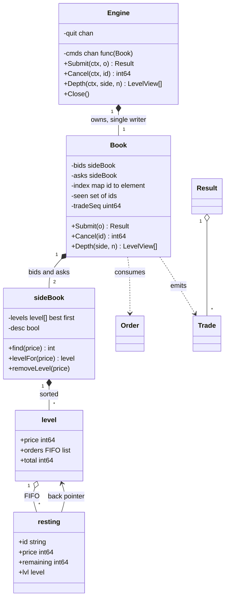
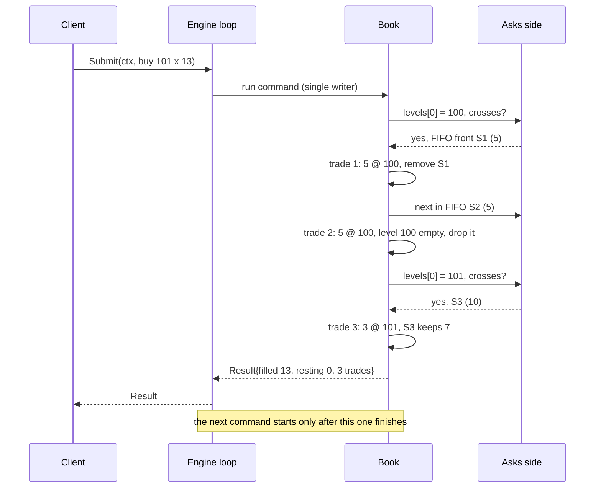
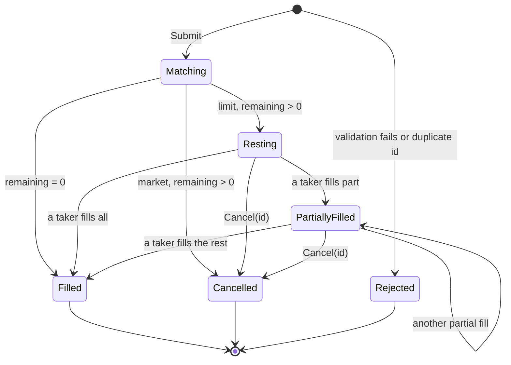

# Order Book Matching Engine

> [!summary] TL;DR
> An order book keeps resting buy orders (bids) and sell orders (asks) sorted by price, and inside each price by arrival time. An incoming order trades against the best opposite prices first, at the resting order's price, until it is filled or the prices stop crossing. A limit remainder rests on the book; a market remainder is cancelled. One goroutine owns the book (single writer), prices are integer ticks, and every fill becomes a trade event with a sequence number.

> [!abstract] Core idea
> - Two sides, each a list of **price levels** sorted best-first: bids high to low, asks low to high.
> - Each level is a **FIFO queue**: the oldest order at that price fills first (price-time priority).
> - A trade happens at the **maker's** (resting order's) price, never the taker's.
> - A map from order ID to its queue element makes **cancel O(1)** for the queue part.
> - One goroutine runs every command in order, so the matching code has no locks and the result is deterministic.
> - Classic mistakes: `float64` prices, filling a level in the wrong order, letting a market order rest, and wrapping the book in a mutex that callers hold across I/O.

## Problem statement

```text
Design the matching engine for one trading symbol.
Support limit and market orders, buy and sell, cancel by order ID, partial fills,
and a market-depth query (top N price levels per side).
Fills follow price-time priority. Emit a trade event for every fill.
Many clients submit orders at the same time.
```

- It tests choosing the right data structures (sorted levels plus FIFO queues plus an index), getting the matching loop exactly right (partial fills, sweeping several levels, the trade price rule), and a concurrency model that keeps ordering deterministic. Time box: 10 minutes for Steps 1-4, 10 for Steps 5-7, 30-35 for the code, 10 for edge cases and follow-ups.

### Solving path

1. Clarify order types, the trade price rule, what happens to an unfilled market order, and whether prices are integers.
2. Name the entities: `Order`, `Trade`, `Level`, `SideBook`, `Book`, `Engine`.
3. Choose the structures: levels sorted best-first, a FIFO list per level, and an `id -> element` map for cancel.
4. Write `Submit`: match against `levels[0]` of the opposite side while prices cross, then rest the limit remainder.
5. Write `Cancel` and `Depth`, then wrap the book in a single-writer `Engine` goroutine.
6. Test price-time priority, partial fills, multi-level sweeps, market leftovers and cancel, then a concurrent test that checks conservation of quantity and an uncrossed book.

## Step 1: Clarify requirements

### Questions to ask (with assumed answers)

- One symbol or many? *Assume: one book per symbol; many symbols means many independent books, each with its own engine.*
- Which order types? *Assume: limit and market. Stop orders, IOC (immediate or cancel) and FOK (fill or kill) are follow-ups.*
- At what price does a trade happen? *Assume: the resting (maker) order's price. A buy limit at 105 that meets an ask at 100 trades at 100.*
- What happens to an unfilled market order? *Assume: the rest is cancelled; a market order never rests (it has no price to rest at).*
- How are prices represented? *Assume: `int64` ticks, for example paise with a tick size of 1. Never `float64`.*
- Can an order be modified? *Assume: only cancel. A modify is cancel plus a new order, which loses time priority (the common exchange rule for a price change or quantity increase).*
- Self-trade prevention (the same trader on both sides)? *Assume: out of scope; discussed in Step 10.*
- Persistence and recovery? *Assume: in memory; the command log for replay is discussed in Step 6.*

### Functional

- Submit a limit order: match what crosses, rest the remainder at its limit price.
- Submit a market order: match against the best prices until filled or the book is empty; cancel the rest.
- Partial fills on both sides: a resting order can fill over many trades.
- Cancel a resting order by ID and return the open quantity.
- Depth: top N levels per side with total quantity and order count.
- Every fill produces a `Trade` with a strictly increasing sequence number.

### Non-functional

- Deterministic: the same command sequence always produces the same trades (needed for replay and audits).
- Concurrency-safe for many submitting clients, with a single, total order of commands.
- Submit and cancel run in O(log L) for the level search plus O(fills); cancel by ID does not scan the book.
- Prices and quantities are `int64`; the clock is injected so trade timestamps are testable.

### Out of scope

- Networking, FIX protocol, market data broadcast and risk checks (margin, position limits).
- Clearing and settlement of the trades (see [[Digital Wallet and Ledger]] for the money side).
- Multi-symbol routing and auctions (opening and closing auctions).

## Step 2: Actors and use cases

| Actor | Use case |
|---|---|
| Trader (client) | Submit a limit or market order, cancel a resting order |
| Market data consumer | Read depth (top N levels), consume trade events |
| Engine loop | Run commands one at a time in arrival order |
| Downstream (clearing, ledger) | Consume trade events and settle money |

The hardest use case is **Submit** for a large order: it may sweep several price levels, partially fill the last maker, and then rest its own remainder. Code that first, then Cancel, Depth and the engine wrapper.

## Step 3: Entities

| Entity | Key fields | Why it exists |
|---|---|---|
| `Order` | ID, Side, Kind, Price (ticks), Qty | The client input; immutable once submitted |
| `resting` | id, side, price, remaining, lvl | The live part of a limit order on the book; `remaining` falls with each fill |
| `level` | price, FIFO list of `*resting`, total | All resting orders at one price, oldest first; `total` serves depth in O(1) |
| `sideBook` | levels sorted best-first, desc flag | Bids sorted high to low, asks low to high, so `levels[0]` is always the best |
| `Trade` | Seq, TakerID, MakerID, TakerSide, Price, Qty, At | The event emitted per fill; Price is the maker's |
| `Result` | Trades, Filled, Resting, Cancelled | What happened to one submitted order; Filled + Resting + Cancelled = Qty |
| `Book` | bids, asks, index id -> element, seen ids, clock, trade seq | The matching logic; single-threaded |
| `Engine` | command channel, quit channel | The single writer that owns the Book |

Vocabulary: the **taker** is the incoming order that removes liquidity; the **maker** is the resting order it trades against. The **spread** is best ask minus best bid; the book is **crossed** if best bid >= best ask, which must never be true after a command finishes.

## Step 4: Relationships



The back pointer from `resting` to its `level` is what makes cancel cheap: the index gives the list element, the element gives the order, the order gives its level, and `list.Remove` is O(1).

## Step 5: APIs and public methods

```text
POST   /symbols/{sym}/orders           body: {clientOrderId, side, type, price?, qty}
                                       -> 200 {orderId, filled, resting, cancelled, trades:[...]}
DELETE /symbols/{sym}/orders/{id}      -> 200 {cancelledQty}      404 not resting
GET    /symbols/{sym}/depth?levels=10  -> 200 {bids:[{price, qty, orders}], asks:[...]}
Stream /symbols/{sym}/trades           -> {seq, price, qty, takerSide, makerId, takerId, at}

Errors: 400 bad side/type/qty/price, 409 duplicate clientOrderId, 503 engine closed
```

The client order ID doubles as the idempotency key: a retried submit with the same ID is rejected as a duplicate instead of creating a second order (the general pattern is in [[Idempotency and Idempotency Keys]]). The Go surface the handlers call:

```go
type MatchingService interface {
	Submit(ctx context.Context, o Order) (Result, error)
	Cancel(ctx context.Context, id string) (int64, error)
	Depth(ctx context.Context, s Side, n int) ([]LevelView, error)
}

var _ MatchingService = (*Engine)(nil) // compile-time check
```

## Step 6: Storage and repositories

A real matching engine does not read or write a database inside the matching loop: a row lock per order would cost far more than the match itself. The book lives in memory, and durability comes from an **append-only command log**. Because the engine is deterministic, replaying the same commands in the same order rebuilds the same book and the same trades.

```sql
-- PostgreSQL 17: the durable side, written outside the hot loop
CREATE TABLE commands (
    seq        BIGINT PRIMARY KEY,               -- assigned by the sequencer before the engine sees it
    symbol     TEXT        NOT NULL,
    kind       TEXT        NOT NULL,             -- submit | cancel
    order_id   TEXT        NOT NULL,
    side       TEXT,
    order_type TEXT,
    price      BIGINT,                           -- ticks
    qty        BIGINT,
    received_at TIMESTAMPTZ NOT NULL
);

CREATE TABLE trades (
    symbol     TEXT   NOT NULL,
    seq        BIGINT NOT NULL,                  -- Trade.Seq, gap-free per symbol
    taker_id   TEXT   NOT NULL,
    maker_id   TEXT   NOT NULL,
    taker_side TEXT   NOT NULL,
    price      BIGINT NOT NULL,
    qty        BIGINT NOT NULL CHECK (qty > 0),
    at         TIMESTAMPTZ NOT NULL,
    PRIMARY KEY (symbol, seq)                    -- a replayed publish cannot insert twice
);
```

```go
// CommandLog is written before a command reaches the engine (write-ahead).
type CommandLog interface {
	Append(ctx context.Context, symbol string, cmd Command) (seq int64, err error)
	ReadFrom(ctx context.Context, symbol string, seq int64) ([]Command, error) // recovery
}

// TradeSink receives trade events after each command, for clearing and market data.
type TradeSink interface {
	Publish(ctx context.Context, symbol string, trades []Trade) error
}
```

Recovery: load the latest snapshot of the book (optional), then replay the command log from the snapshot's sequence number. The `(symbol, seq)` primary key on `trades` makes republishing after a crash harmless. One catch: `Trade.At` comes from the injected clock, so during replay the clock must return each command's logged `received_at`, not the wall clock; otherwise the replayed trades match on price and quantity but carry new timestamps. The general replay idea is [[Event Sourcing]].

## Step 7: Patterns

| Pattern | Where | Why here |
|---|---|---|
| [[Command, Undo and Memento]] | Each request is a `func(*Book)` command on a channel; the command log | Commands serialise all writes and can be logged and replayed |
| [[Facade (vs Mediator)]] | `Engine` | Clients see Submit, Cancel and Depth; the loop, channel and book are hidden |
| [[Observer and Event Bus]] | Trade events to clearing and market data (follow-up) | The engine must not know who listens or wait for them |
| [[Strategy and Template Method]] | Matching rule (price-time FIFO versus pro-rata, a follow-up) | Some futures markets allocate fills pro-rata; the loop stays the same |
| [[Repository and Unit of Work]] | `CommandLog`, `TradeSink` | Storage stays outside the deterministic core |

Patterns not used, and why:

- No mutex around the book: one goroutine owns it (goroutine-owned state, see [[Concurrency for LLD]]). A mutex would also work at low load, but the channel gives a single total order of commands for free, which is what the command log and replay need.
- No [[State Machines in Go]] for orders: an order is new, partially filled, filled or cancelled, and those states fall out of `remaining` and the index; there are no per-state rules.
- No heap for price levels: a heap gives the best price in O(1), but cancel of a middle level and in-order depth are awkward. Sorted levels give both (see the tradeoffs in Step 10).

## Folder structure

```text
orderbook/
  model.go        -> Side, Kind, Order, Trade, Result, LevelView, Err* errors
  sidebook.go     -> level, resting, sideBook (find, levelFor, removeLevel)
  book.go         -> Book: NewBook, Submit (matching loop), Cancel, Depth
  engine.go       -> Engine: NewEngine, do, Submit, Cancel, Depth, Close
  book_test.go    -> table-driven matching tests, cancel, depth, market on empty book
  engine_test.go  -> concurrent submits, invariants, closed engine
```

- `book.go` holds every rule and is single-threaded, so it is easy to test without goroutines.
- `engine.go` is the only file that knows about goroutines and channels.

## Step 8: Core code

> [!tip] What to code in a 60-minute round
> Aim for about 160 lines in the room.
> - **Write:** `Side`, `Kind`, `Order`, `Trade`, `Result`, `level`, `resting`, `sideBook` with `find` and `levelFor`, and `Book.Submit` with the matching loop and the resting step.
> - **Add if time remains:** `Cancel` with the index, `Depth`, and the `Engine` single-writer loop with one concurrency test.
> - **Talk only:** the command log and recovery, self-trade prevention, IOC and FOK, stop orders, and the tree-or-array choice for levels.

### Walkthrough

`Submit(o)`:

1. Validate side, kind, quantity, and the price for limit orders; reject a reused order ID.
2. Pick the opposite side (`asks` for a buy, `bids` for a sell) and the own side.
3. While quantity remains and the opposite side has levels, look at `levels[0]`, the best price. Stop if a limit order's price does not cross it (buy: `price >= ask`; sell: `price <= bid`). A market order always crosses.
4. Inside the level, take the **front** of the FIFO (oldest). Fill `min(remaining, maker.remaining)` at the **level's** price. Emit a trade with the next sequence number.
5. Remove fully filled makers from the queue and the index; drop the level when its queue is empty.
6. Market remainder: cancelled. Limit remainder: pushed to the **back** of its price level (created in sorted position if new) and indexed.

`Cancel(id)`: index lookup, remove the element from its level, subtract from `total`, drop the level if empty. A filled or unknown ID returns `ErrNotFound`.

`Engine`: one goroutine reads `func(*Book)` commands from a buffered channel and runs them one by one. Each caller waits on its own `done` channel, so it gets the result of exactly its command.

### Worked example

The book holds asks S1 100x5 (oldest), S2 100x5, S3 101x10. A buy limit B1 at 101 for 13 arrives.

| Step | Level | Maker | Fill | B1 left | Book after |
|---|---|---|---|---|---|
| 1 | 100 | S1 (5) | 5 @ 100 | 8 | S1 gone |
| 2 | 100 | S2 (5) | 5 @ 100 | 3 | level 100 gone |
| 3 | 101 | S3 (10) | 3 @ 101 | 0 | S3 has 7 left |

B1 paid 100 for 10 units even though it was willing to pay 101: trades happen at the maker's price. If B1 had asked for 25, it would fill 20 and rest 5 at 101 as the new best bid; as a market order it would fill 20 and cancel 5.

```go
package orderbook

import (
	"container/list"
	"context"
	"errors"
	"sort"
	"sync"
	"time"
)

// Side is the direction of an order.
type Side int8

const (
	Buy Side = iota + 1
	Sell
)

// Kind is the order type.
type Kind int8

const (
	Limit  Kind = iota + 1 // rests on the book if not fully filled
	Market                 // takes what it can, the rest is cancelled
)

var (
	ErrBadSide     = errors.New("side must be Buy or Sell")
	ErrBadKind     = errors.New("kind must be Limit or Market")
	ErrBadQty      = errors.New("quantity must be positive")
	ErrBadPrice    = errors.New("limit price must be positive")
	ErrDuplicateID = errors.New("order id already used")
	ErrNotFound    = errors.New("order not resting on the book")
	ErrClosed      = errors.New("engine closed")
)

// Order is what a client submits. Price is in integer ticks (for example paise).
type Order struct {
	ID    string
	Side  Side
	Kind  Kind
	Price int64 // ignored for Market
	Qty   int64
}

// Trade is one match between the incoming (taker) and a resting (maker) order.
type Trade struct {
	Seq       uint64
	TakerID   string
	MakerID   string
	TakerSide Side
	Price     int64 // always the maker's price
	Qty       int64
	At        time.Time
}

// Result tells the caller what happened to one submitted order.
type Result struct {
	OrderID   string
	Trades    []Trade
	Filled    int64
	Resting   int64 // quantity left on the book (Limit only)
	Cancelled int64 // unfilled Market quantity
}

// LevelView is one row of market depth.
type LevelView struct {
	Price  int64
	Qty    int64
	Orders int
}

type resting struct {
	id        string
	side      Side
	price     int64
	remaining int64
	lvl       *level
}

type level struct {
	price  int64
	orders *list.List // FIFO of *resting: front = oldest = first to fill
	total  int64
}

// sideBook keeps price levels sorted best-first:
// bids high to low, asks low to high, so levels[0] is always the best price.
type sideBook struct {
	levels []*level
	desc   bool
}

func (s *sideBook) better(a, b int64) bool {
	if s.desc {
		return a > b
	}
	return a < b
}

// find returns the index where price p is, or where it would be inserted.
func (s *sideBook) find(p int64) (int, bool) {
	i := sort.Search(len(s.levels), func(i int) bool { return !s.better(s.levels[i].price, p) })
	return i, i < len(s.levels) && s.levels[i].price == p
}

func (s *sideBook) levelFor(p int64) *level {
	i, ok := s.find(p)
	if ok {
		return s.levels[i]
	}
	lv := &level{price: p, orders: list.New()}
	s.levels = append(s.levels, nil)
	copy(s.levels[i+1:], s.levels[i:])
	s.levels[i] = lv
	return lv
}

func (s *sideBook) removeLevel(p int64) {
	if i, ok := s.find(p); ok {
		s.levels = append(s.levels[:i], s.levels[i+1:]...)
	}
}

// Book is the matching logic. It is NOT safe for concurrent use:
// exactly one goroutine (the Engine loop) owns it.
type Book struct {
	bids, asks sideBook
	index      map[string]*list.Element // resting order id -> its FIFO element
	seen       map[string]struct{}      // every id ever accepted
	now        func() time.Time
	tradeSeq   uint64
}

func NewBook(now func() time.Time) *Book {
	return &Book{
		bids:  sideBook{desc: true},
		asks:  sideBook{desc: false},
		index: map[string]*list.Element{},
		seen:  map[string]struct{}{},
		now:   now,
	}
}

func validate(o Order) error {
	switch {
	case o.Side != Buy && o.Side != Sell:
		return ErrBadSide
	case o.Kind != Limit && o.Kind != Market:
		return ErrBadKind
	case o.Qty <= 0:
		return ErrBadQty
	case o.Kind == Limit && o.Price <= 0:
		return ErrBadPrice
	}
	return nil
}

// crosses reports whether an incoming order may trade at the opposite level price.
func crosses(o Order, levelPrice int64) bool {
	if o.Kind == Market {
		return true
	}
	if o.Side == Buy {
		return o.Price >= levelPrice
	}
	return o.Price <= levelPrice
}

// Submit matches o against the opposite side, then rests any Limit remainder.
func (b *Book) Submit(o Order) (Result, error) {
	if err := validate(o); err != nil {
		return Result{}, err
	}
	if _, dup := b.seen[o.ID]; dup {
		return Result{}, ErrDuplicateID
	}
	b.seen[o.ID] = struct{}{}

	opp, own := &b.asks, &b.bids
	if o.Side == Sell {
		opp, own = &b.bids, &b.asks
	}
	res := Result{OrderID: o.ID}
	remaining := o.Qty
	at := b.now()
	for remaining > 0 && len(opp.levels) > 0 {
		lv := opp.levels[0]
		if !crosses(o, lv.price) {
			break
		}
		for remaining > 0 && lv.orders.Len() > 0 {
			e := lv.orders.Front()
			m := e.Value.(*resting)
			q := min(remaining, m.remaining)
			b.tradeSeq++
			res.Trades = append(res.Trades, Trade{
				Seq: b.tradeSeq, TakerID: o.ID, MakerID: m.id, TakerSide: o.Side,
				Price: lv.price, Qty: q, At: at,
			})
			remaining -= q
			m.remaining -= q
			lv.total -= q
			if m.remaining == 0 {
				lv.orders.Remove(e)
				delete(b.index, m.id)
			}
		}
		if lv.orders.Len() == 0 {
			opp.levels = opp.levels[1:]
		}
	}
	res.Filled = o.Qty - remaining
	if remaining == 0 {
		return res, nil
	}
	if o.Kind == Market {
		res.Cancelled = remaining
		return res, nil
	}
	lv := own.levelFor(o.Price)
	r := &resting{id: o.ID, side: o.Side, price: o.Price, remaining: remaining, lvl: lv}
	b.index[o.ID] = lv.orders.PushBack(r)
	lv.total += remaining
	res.Resting = remaining
	return res, nil
}

// Cancel removes a resting order and returns the quantity that was still open.
func (b *Book) Cancel(id string) (int64, error) {
	e, ok := b.index[id]
	if !ok {
		return 0, ErrNotFound
	}
	r := e.Value.(*resting)
	r.lvl.orders.Remove(e)
	r.lvl.total -= r.remaining
	delete(b.index, id)
	if r.lvl.orders.Len() == 0 {
		sb := &b.bids
		if r.side == Sell {
			sb = &b.asks
		}
		sb.removeLevel(r.price)
	}
	return r.remaining, nil
}

// Depth returns up to n best levels of one side.
func (b *Book) Depth(s Side, n int) []LevelView {
	sb := &b.bids
	if s == Sell {
		sb = &b.asks
	}
	out := make([]LevelView, 0, n)
	for i := 0; i < len(sb.levels) && i < n; i++ {
		lv := sb.levels[i]
		out = append(out, LevelView{Price: lv.price, Qty: lv.total, Orders: lv.orders.Len()})
	}
	return out
}

// Engine is the single writer: one goroutine owns the Book and runs
// commands one at a time, so the matching code needs no locks.
type Engine struct {
	cmds      chan func(*Book)
	quit      chan struct{}
	closeOnce sync.Once
	wg        sync.WaitGroup
}

func NewEngine(b *Book, buffer int) *Engine {
	e := &Engine{cmds: make(chan func(*Book), buffer), quit: make(chan struct{})}
	e.wg.Add(1)
	go func() {
		defer e.wg.Done()
		for {
			select {
			case f := <-e.cmds:
				f(b)
			case <-e.quit:
				return
			}
		}
	}()
	return e
}

// do sends one command to the loop and waits for it to finish.
// If ctx ends after the command was queued, the command may still run.
func (e *Engine) do(ctx context.Context, f func(*Book)) error {
	done := make(chan struct{})
	select {
	case e.cmds <- func(b *Book) { f(b); close(done) }:
	case <-e.quit:
		return ErrClosed
	case <-ctx.Done():
		return ctx.Err()
	}
	select {
	case <-done:
		return nil
	case <-e.quit:
		return ErrClosed
	case <-ctx.Done():
		return ctx.Err()
	}
}

func (e *Engine) Submit(ctx context.Context, o Order) (Result, error) {
	var res Result
	var err error
	if derr := e.do(ctx, func(b *Book) { res, err = b.Submit(o) }); derr != nil {
		return Result{}, derr
	}
	return res, err
}

func (e *Engine) Cancel(ctx context.Context, id string) (int64, error) {
	var q int64
	var err error
	if derr := e.do(ctx, func(b *Book) { q, err = b.Cancel(id) }); derr != nil {
		return 0, derr
	}
	return q, err
}

func (e *Engine) Depth(ctx context.Context, s Side, n int) ([]LevelView, error) {
	var out []LevelView
	if err := e.do(ctx, func(b *Book) { out = b.Depth(s, n) }); err != nil {
		return nil, err
	}
	return out, nil
}

// Close stops the loop and waits for it to exit.
func (e *Engine) Close() {
	e.closeOnce.Do(func() { close(e.quit) })
	e.wg.Wait()
}

// MatchingService is what the HTTP handlers call.
type MatchingService interface {
	Submit(ctx context.Context, o Order) (Result, error)
	Cancel(ctx context.Context, id string) (int64, error)
	Depth(ctx context.Context, s Side, n int) ([]LevelView, error)
}

var _ MatchingService = (*Engine)(nil) // compile-time check
```

## Test cases

The tests use a fixed injected clock. `TestSubmit` is table-driven over one seeded book; the concurrent test checks invariants that hold whatever order the goroutines arrive in.

```go
package orderbook

import (
	"context"
	"errors"
	"fmt"
	"sync"
	"testing"
	"time"
)

func fixedClock() func() time.Time {
	t0 := time.Unix(1_700_000_000, 0)
	return func() time.Time { return t0 }
}

func lim(id string, s Side, price, qty int64) Order {
	return Order{ID: id, Side: s, Kind: Limit, Price: price, Qty: qty}
}

func mkt(id string, s Side, qty int64) Order {
	return Order{ID: id, Side: s, Kind: Market, Qty: qty}
}

type fill struct {
	maker string
	price int64
	qty   int64
}

func fills(ts []Trade) []fill {
	out := make([]fill, 0, len(ts))
	for _, t := range ts {
		out = append(out, fill{t.MakerID, t.Price, t.Qty})
	}
	return out
}

func TestSubmit(t *testing.T) {
	// resting asks: S1 100x5 (oldest), S2 100x5, S3 101x10; resting bid B0 98x10
	seed := []Order{
		lim("S1", Sell, 100, 5), lim("S2", Sell, 100, 5), lim("S3", Sell, 101, 10), lim("B0", Buy, 98, 10),
	}
	tests := []struct {
		name      string
		in        Order
		wantFills []fill
		resting   int64
		cancelled int64
		err       error
	}{
		{"no cross rests", lim("B1", Buy, 99, 4), nil, 4, 0, nil},
		{"time priority within a level", lim("B1", Buy, 100, 7),
			[]fill{{"S1", 100, 5}, {"S2", 100, 2}}, 0, 0, nil},
		{"sweep two levels at maker prices", lim("B1", Buy, 101, 13),
			[]fill{{"S1", 100, 5}, {"S2", 100, 5}, {"S3", 101, 3}}, 0, 0, nil},
		{"partial fill then rest remainder", lim("B1", Buy, 100, 12),
			[]fill{{"S1", 100, 5}, {"S2", 100, 5}}, 2, 0, nil},
		{"market takes all, rest cancelled", mkt("B1", Buy, 25),
			[]fill{{"S1", 100, 5}, {"S2", 100, 5}, {"S3", 101, 10}}, 0, 5, nil},
		{"sell hits best bid at bid price", lim("S9", Sell, 97, 3),
			[]fill{{"B0", 98, 3}}, 0, 0, nil},
		{"zero qty", lim("B1", Buy, 100, 0), nil, 0, 0, ErrBadQty},
		{"zero limit price", lim("B1", Buy, 0, 1), nil, 0, 0, ErrBadPrice},
		{"bad side", Order{ID: "X", Kind: Limit, Price: 1, Qty: 1}, nil, 0, 0, ErrBadSide},
		{"duplicate id", lim("S1", Buy, 100, 1), nil, 0, 0, ErrDuplicateID},
	}
	for _, tc := range tests {
		t.Run(tc.name, func(t *testing.T) {
			b := NewBook(fixedClock())
			for _, o := range seed {
				if _, err := b.Submit(o); err != nil {
					t.Fatal(err)
				}
			}
			res, err := b.Submit(tc.in)
			if !errors.Is(err, tc.err) {
				t.Fatalf("err %v want %v", err, tc.err)
			}
			got := fills(res.Trades)
			if fmt.Sprint(got) != fmt.Sprint(tc.wantFills) && !(len(got) == 0 && len(tc.wantFills) == 0) {
				t.Fatalf("fills %v want %v", got, tc.wantFills)
			}
			if res.Resting != tc.resting || res.Cancelled != tc.cancelled {
				t.Fatalf("resting %d cancelled %d", res.Resting, res.Cancelled)
			}
			if err == nil && res.Filled+res.Resting+res.Cancelled != tc.in.Qty {
				t.Fatalf("quantity not conserved: %+v", res)
			}
		})
	}
}

func TestDepthAfterPartialFill(t *testing.T) {
	b := NewBook(fixedClock())
	for _, o := range []Order{lim("S1", Sell, 100, 5), lim("S2", Sell, 100, 5), lim("S3", Sell, 102, 1)} {
		b.Submit(o)
	}
	b.Submit(lim("B1", Buy, 100, 7))
	got := b.Depth(Sell, 5)
	want := []LevelView{{100, 3, 1}, {102, 1, 1}}
	if fmt.Sprint(got) != fmt.Sprint(want) {
		t.Fatalf("asks %v want %v", got, want)
	}
	b.Submit(lim("B2", Buy, 99, 1))
	b.Submit(lim("B3", Buy, 98, 1))
	if d := b.Depth(Buy, 1); len(d) != 1 || d[0].Price != 99 {
		t.Fatalf("best bid %v", d)
	}
}

func TestMarketOnEmptyBook(t *testing.T) {
	b := NewBook(fixedClock())
	res, err := b.Submit(mkt("M1", Sell, 10))
	if err != nil || res.Filled != 0 || res.Cancelled != 10 || len(b.Depth(Sell, 1)) != 0 {
		t.Fatalf("market must never rest: %+v %v", res, err)
	}
}

func TestCancel(t *testing.T) {
	b := NewBook(fixedClock())
	b.Submit(lim("S1", Sell, 100, 5))
	b.Submit(lim("S2", Sell, 100, 5))
	b.Submit(lim("B1", Buy, 100, 2)) // S1 now has 3 left

	if q, err := b.Cancel("S1"); err != nil || q != 3 {
		t.Fatalf("cancel partial: %d %v", q, err)
	}
	if _, err := b.Cancel("S1"); !errors.Is(err, ErrNotFound) {
		t.Fatalf("double cancel: %v", err)
	}
	if _, err := b.Cancel("B1"); !errors.Is(err, ErrNotFound) {
		t.Fatalf("filled order is not cancellable: %v", err)
	}
	// S2 is now first in the queue
	res, _ := b.Submit(lim("B2", Buy, 100, 5))
	if len(res.Trades) != 1 || res.Trades[0].MakerID != "S2" {
		t.Fatalf("trades %+v", res.Trades)
	}
	if len(b.Depth(Sell, 5)) != 0 {
		t.Fatal("empty level must be removed")
	}
	if _, err := b.Submit(lim("S1", Sell, 100, 1)); !errors.Is(err, ErrDuplicateID) {
		t.Fatalf("cancelled id reused: %v", err)
	}
}

func TestEngineConcurrentSubmitsKeepInvariants(t *testing.T) {
	e := NewEngine(NewBook(fixedClock()), 64)
	defer e.Close()
	ctx := context.Background()

	const workers, perWorker = 8, 250
	var (
		wg        sync.WaitGroup
		mu        sync.Mutex
		submitted int64
		traded    int64
		seqs      = map[uint64]bool{}
	)
	for w := 0; w < workers; w++ {
		wg.Add(1)
		go func(w int) {
			defer wg.Done()
			for i := 0; i < perWorker; i++ {
				side := Buy
				if (w+i)%2 == 0 {
					side = Sell
				}
				price := int64(95 + (w*7+i*3)%11) // 95..105, so books cross often
				qty := int64(1 + (w+i)%5)
				res, err := e.Submit(ctx, lim(fmt.Sprintf("w%d-%d", w, i), side, price, qty))
				if err != nil {
					t.Error(err)
					return
				}
				mu.Lock()
				submitted += qty
				for _, tr := range res.Trades {
					traded += tr.Qty
					if seqs[tr.Seq] {
						t.Errorf("trade seq %d reused", tr.Seq)
					}
					seqs[tr.Seq] = true
				}
				mu.Unlock()
			}
		}(w)
	}
	wg.Wait()

	bids, _ := e.Depth(ctx, Buy, 1000)
	asks, _ := e.Depth(ctx, Sell, 1000)
	var resting int64
	for _, l := range append(bids, asks...) {
		resting += l.Qty
	}
	// every traded unit consumed one unit from a buyer and one from a seller
	if submitted != 2*traded+resting {
		t.Fatalf("submitted %d != 2*traded %d + resting %d", submitted, traded, resting)
	}
	if len(bids) > 0 && len(asks) > 0 && bids[0].Price >= asks[0].Price {
		t.Fatalf("crossed book: bid %d ask %d", bids[0].Price, asks[0].Price)
	}
	for i := uint64(1); i <= uint64(len(seqs)); i++ {
		if !seqs[i] {
			t.Fatalf("trade seq gap at %d", i)
		}
	}
}

func TestEngineClosed(t *testing.T) {
	e := NewEngine(NewBook(fixedClock()), 1)
	e.Close()
	e.Close() // idempotent
	if _, err := e.Submit(context.Background(), lim("A", Buy, 1, 1)); !errors.Is(err, ErrClosed) {
		t.Fatalf("got %v", err)
	}
}
```

What the tests prove:

- **Price-time priority:** "time priority within a level" fills S1 fully before S2 at the same price.
- **Maker price:** "sweep two levels" trades at 100 and then 101 for a buy limit of 101.
- **Partial fill and rest:** 12 against 10 available leaves 2 resting; depth shows the partially filled maker with 3 left.
- **Market orders never rest:** on an empty book and after a sweep the remainder is in `Cancelled`.
- **Cancel:** returns the open quantity of a partially filled order, fails twice, fails for filled orders, and moves the next order to the front.
- **Concurrency under `-race`:** 8 goroutines submit 2,000 crossing orders through the engine. Afterwards, submitted quantity equals twice the traded quantity plus resting quantity, the book is not crossed, and trade sequence numbers are 1..N with no gaps or repeats.

## Step 9: Edge cases

| Edge case | What happens | How the design handles it |
|---|---|---|
| Incoming order larger than one level | Must continue to the next price | Outer loop over `levels[0]` until filled or not crossing |
| Maker partially filled | It must keep its place in the queue | `remaining` is reduced in place; the element is not moved |
| Market order on an empty book | Nothing to match | `Cancelled = Qty`; it never rests |
| Market order larger than the book | Sweeps everything | Fills what exists, cancels the rest; a real venue adds price protection (Step 10) |
| Limit price not crossing | No trade | Rests at its price at the back of that level |
| Cancel of a filled or unknown order | Nothing to remove | `ErrNotFound` (404) |
| Cancel races a fill | Client sends cancel while a taker fills it | The single writer runs one first: either cancel returns the leftover or it gets `ErrNotFound` |
| Duplicate client order ID (retry) | Could create two orders | `seen` set: `ErrDuplicateID`. The set grows forever, so a real engine scopes it to a trading session and clears it at the session boundary |
| Zero or negative quantity, zero limit price | Invalid | Validation errors before touching the book |
| Last order of a level removed | An empty level would show in depth and block matching | The level is dropped from the slice on fill and on cancel |
| Float prices like 100.1 | Rounding breaks equality and sorting of levels | Prices are integer ticks |
| Caller context cancelled after the command is queued | Caller gave up | The command may still run; the client checks status by order ID (documented on `do`) |

### Common mistakes

- Trading at the taker's price instead of the maker's.
- Iterating a Go map of price levels, whose order is random, to find the best price.
- Letting a market order rest on the book.
- Moving a partially filled order to the back of its queue.
- Forgetting to delete an empty level, so depth shows a zero row and matching stalls on it.
- Using `float64` for prices or quantities.
- Wrapping the book in a mutex and publishing trade events while holding it.

## Step 10: Tradeoffs and extensions

| Follow-up | Design change |
|---|---|
| IOC (immediate or cancel) | A limit order that never rests: run the match, then cancel the remainder like a market order |
| FOK (fill or kill) | Before matching, walk the levels to check that enough crossing quantity exists; if not, reject with no trades |
| Stop orders | A separate book of triggers keyed by stop price; after each trade, release triggered stops as new orders |
| Self-trade prevention | Each order carries a trader ID; when the front maker has the same ID, cancel the newest, the oldest or both (venue policy) |
| Market order price protection | Cap a market order at a band such as best price ±5% (an estimate of a typical band; venues set their own) |
| Modify order | Quantity decrease keeps priority (change `remaining` in place); price change or increase is cancel plus new |
| Many symbols | One engine per symbol; shard symbols across cores or machines |
| Market data | Publish trades and depth changes from the loop to a channel; a separate goroutine fans out (Observer) |
| Pro-rata matching | Swap the level fill rule for a Strategy that splits a fill by size across the level |

Tradeoffs chosen:

- **Sorted slice of levels with binary search.** Finding a level is O(log L), but inserting or removing a level in the middle shifts the slice, O(L). Most activity is near the best price and L is usually small, so this is fast in practice and simple to code. A balanced tree (for example a red-black tree or a B-tree) gives O(log L) for every operation. Many production engines instead use an array indexed by price tick within a band, which is O(1) per level access.
- **Heap instead of a sorted slice.** A heap gives the best price in O(1) and push in O(log L), but depth needs a sort and removing a middle level needs lazy deletion. Good if you only ever need the top.
- **`container/list` per level.** O(1) push back, pop front and remove from the middle (cancel). The cost is a pointer per node and poor cache locality; an intrusive linked list or a ring buffer with tombstones is faster but longer to code.
- **Single writer goroutine versus a mutex.** The channel hop costs some microseconds per command (an estimate; measure on your hardware), but gives a total order, no lock contention inside matching, and a natural place to append to a command log. A mutex is fine for a single process with low load; it does not give you a replayable order by itself.

## Drawing

How one buy order moves through the engine and the book:



The lifecycle of a limit order:



## Interview questions

> [!question]- Why sort levels and use a FIFO per level instead of one priority queue of orders keyed by (price, time)?
> One heap of all orders works for matching, but cancel needs the order's heap index and depth needs a scan of every order. Levels group equal prices, so depth is one row per level with a running total, and a FIFO per level gives time priority with O(1) pop front and O(1) remove by element. The ID index makes cancel O(1) for the queue part.

> [!question]- Trap: a buy limit at 105 meets a resting ask at 100. What is the trade price?
> 100, the maker's price. The resting order set the price first; the taker gets price improvement. Using the taker's price would overcharge the buyer and break every test that sweeps levels.

> [!question]- Why a single-writer goroutine rather than a mutex or per-level locks?
> Matching touches both sides and many levels in one command, so fine-grained locks would need ordering rules and could still interleave two takers on one level. One owner goroutine runs commands in a total order, which makes results deterministic and replayable from a command log. The inner loop then needs no locks at all.

> [!question]- How do you recover the book after the process crashes?
> Append every command to a durable log before the engine runs it, with a sequence number. On restart, load the last snapshot and replay commands from its sequence. Because matching is deterministic (no wall clock in decisions, no map iteration order), the replay produces the same book and the same trades; the `(symbol, seq)` key on trades deduplicates republishing.

> [!question]- A market order arrives for 1,000 units but the book only has 20. What happens, and what would a real venue add?
> It fills 20 at progressively worse prices and cancels 980; it never rests. Venues add price protection bands or convert market orders to limit orders at a collar price, so a thin book cannot fill someone at an absurd price.

> [!question]- How do you implement fill-or-kill without undoing trades?
> Check first, then match. Walk the opposite levels from the best price and sum quantity while prices cross; if the sum is below the order quantity, reject it with no trades. Because the engine is single-threaded, nothing can change the book between the check and the match.

> [!question]- What is the cost of keeping levels in a sorted slice, and when would you change it?
> Finding a level is O(log L); inserting or deleting a level shifts the slice, O(L). Most orders land near the top of the book, so this is cheap in practice. With many sparse levels you would move to a balanced tree, or to an array indexed by tick within a price band for O(1) access.

## Interview explanation

```text
I keep two sides, bids sorted high to low and asks low to high, each as a sorted list of price levels, and each level is a FIFO queue so the oldest order at a price fills first. An index from order ID to its queue element makes cancel cheap. Submit walks the best opposite level while prices cross, fills the front order for min of the two remaining quantities at the maker's price, emits a trade with a sequence number, and removes filled orders and empty levels. A limit remainder rests at the back of its level; a market remainder is cancelled. Prices are int64 ticks. One goroutine owns the book and runs commands from a channel in order, so matching needs no locks and is deterministic, which lets me rebuild the book by replaying a command log.
```

## Cheat sheet

- Bids high to low, asks low to high; `levels[0]` is the best price.
- Per level: FIFO list; fill from the front, rest at the back; partial fills keep their place.
- Trade price = maker's price. Buy crosses if `price >= bestAsk`; sell crosses if `price <= bestBid`.
- Market orders never rest; the leftover is cancelled.
- Index `orderID -> list element` for O(1) cancel; drop empty levels.
- Invariants: Filled + Resting + Cancelled = Qty; book never crossed; trade seq gap-free.
- Single writer goroutine, integer ticks, injected clock, command log for replay.

## Links

- **Before this:** [[LLD Interview Method]], [[Concurrency for LLD]], [[Heaps and Priority Queues]]
- **Next:** [[Digital Wallet and Ledger]]
- **Compare with:** [[Event Sourcing]] (rebuild state from a command log), [[Case Study - Payment System]] (where trade money settles at system scale), [[Testing LLD Code]]
