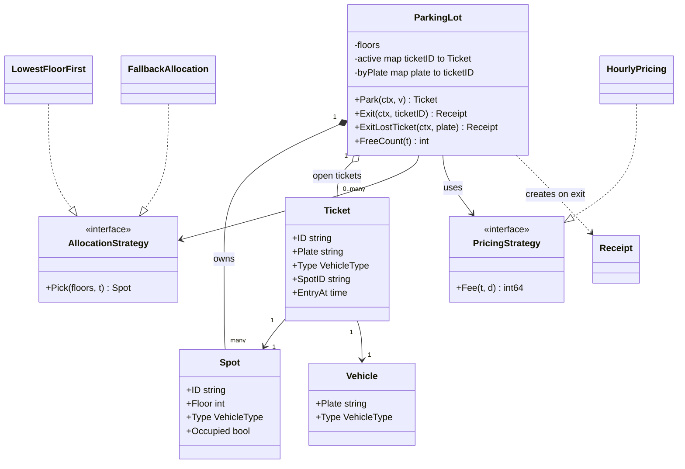
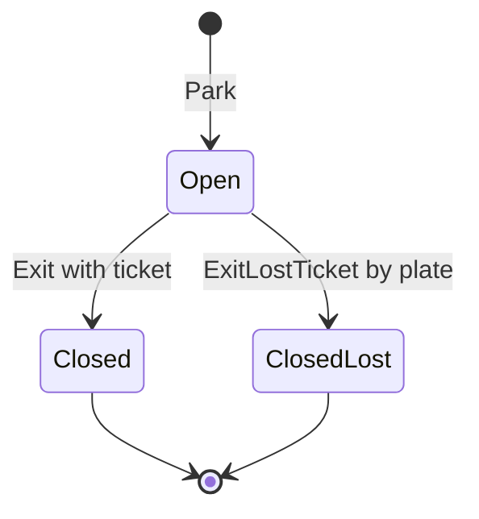
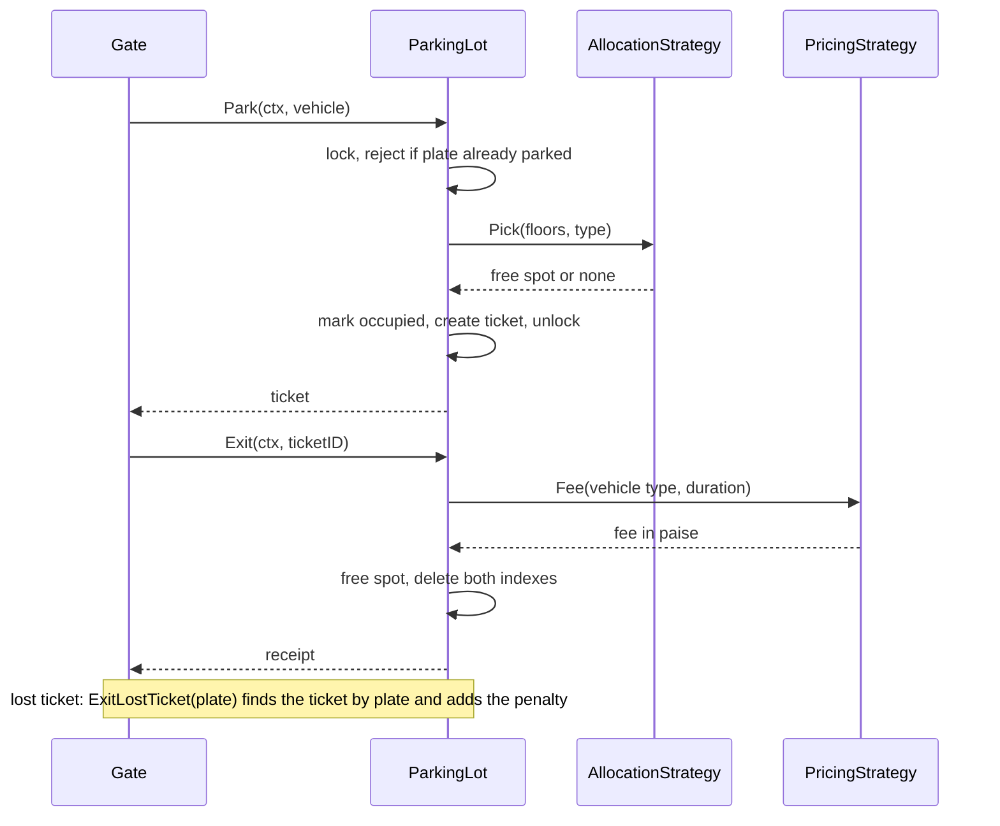

# Parking Lot

> [!summary] TL;DR
> The parking lot is the classic first LLD round. You model spots, tickets and vehicles, keep "which spot" and "how much" as two swappable strategies, and make "pick a free spot and mark it taken" one atomic step so two gates can never get the same spot. Money is `int64` paise and the clock is injected, so every fee is testable.

> [!abstract] Core idea
> - The lot is a list of floors, each a list of spots; a ticket links one vehicle to one spot by ID.
> - Two swappable strategies: one picks the spot (allocation), one computes the fee (pricing).
> - The one rule: "find a free spot" and "mark it taken" happen under the same lock, so two gates never get the same spot.
> - Money is `int64` paise and the clock is injected, so fees are exact and testable.
> - Classic mistake: checking for a free spot, unlocking, then marking it taken (a race), or using `float64` for money.

## Problem statement

```text
Design a parking lot that supports multiple floors, multiple spot types (bike, car, truck),
vehicle entry, vehicle exit, ticket generation, and fee calculation.
Handle lost tickets and many entry gates working at the same time.
```

- It tests clean entity modelling (Spot, Ticket, Vehicle), two independent strategies (allocation and pricing), and the classic race: two cars at two gates must never get the same spot. Time box: 10 minutes for Steps 1-4, 10 for Steps 5-6, 25-40 for the code, 10 for edge cases.

### Solving path

1. Ask the clarifying questions: spot types, pricing rule, lost ticket, number of gates.
2. Name the entities: `Vehicle`, `Spot`, `Ticket`, `Receipt`, `ParkingLot`.
3. Pull out the two things that change: allocation and pricing become interfaces.
4. Write `Park` and `Exit` with the pick-and-mark step under one mutex.
5. Add the lost-ticket flow and the injected clock.
6. Test concurrency (many goroutines, one spot), fees and the lost ticket; then discuss the multi-instance database version.

## Step 1: Clarify requirements

### Questions to ask (with assumed answers)

- Which vehicle and spot types exist? *Assume: bike, car and truck; each spot has one type.*
- Can a bike park in a car spot when the bike spots are full? *Assume: exact match first; the fallback is coded as a second strategy in Step 8.*
- How is the fee calculated? *Assume: per started hour, minimum one hour, a rate per vehicle type, in paise.*
- How many entry and exit gates are there? *Assume: many, so concurrent entries must be safe.*
- What if the driver loses the ticket? *Assume: the attendant checks the registration certificate (RC), finds the open ticket by plate, and charges the fee plus a flat penalty.*
- Payment integration, or only fee calculation? *Assume: only the fee; payment is a follow-up.*
- One lot in memory, or many lots with a database? *Assume: code one lot in memory and show the schema for scale.*

### Functional

- A lot has floors; each floor has spots of type bike, car or truck.
- Entry: find a free spot of the right type, mark it taken, issue a ticket.
- Exit with a ticket: compute the fee, free the spot, return a receipt.
- Exit without a ticket (lost): find the open ticket by plate, charge fee plus penalty, free the spot.
- Show the free-spot count per type on the entry display board.

### Non-functional

- Concurrent entries from many gates never double-assign a spot.
- The same plate cannot be parked twice at the same time.
- Allocation and pricing rules can be swapped without touching the lot.
- Money is `int64` paise, and the clock is injected so fee tests are deterministic.

### Out of scope

- Advance reservations, monthly passes and EV charging.
- The payment gateway and number-plate camera hardware.
- Multi-lot routing ("which lot has space").

## Step 2: Actors and use cases

| Actor | Use case |
|---|---|
| Driver at an entry gate | Park the vehicle, get a ticket |
| Driver at an exit gate | Exit with the ticket, pay the fee |
| Attendant | Exit a vehicle whose ticket is lost (fee plus penalty) |
| Display board | Read the free count per spot type |
| Admin | Configure floors, spots and rates (setup, not coded) |

The hardest use case is **Park** under concurrency: pick a free spot and claim it atomically. Code that first, then Exit and the lost-ticket Exit.

## Step 3: Entities

| Entity | Key fields | Why it exists |
|---|---|---|
| `Vehicle` | Plate, Type | Input to entry; the type drives the spot choice and the rate |
| `Spot` | ID, Floor, Type, Occupied | The scarce resource that two gates race for |
| Floor | index into `floors [][]*Spot` | Grouping for "lowest floor first"; a struct only once floors get behaviour |
| `Ticket` | ID, Plate, Type, SpotID, EntryAt | One visit: links one vehicle to one spot; Type is the vehicle's type |
| `Receipt` | TicketID, Fee, EntryAt, ExitAt, LostTicket | What exit returns |
| `ParkingLot` | floors, active tickets, byPlate index, strategies, clock | The facade the gates call; owns the lock |
| `AllocationStrategy` | `Pick(floors, type)` | The spot-choice rule changes on its own |
| `PricingStrategy` | `Fee(type, duration)` | The fee rule changes on its own |

Modelling insight: the **ticket is the visit**, not the vehicle. Index open tickets by ID (normal exit) and by plate (duplicate-entry check and lost-ticket exit). Keep Floor as a slice index, not a class, until it needs behaviour.

## Step 4: Relationships





- **Composition** (lot to spot): spots are created with the lot. **Aggregation** (lot to ticket): the lot tracks open tickets; closed ones live on in storage or as receipts.
- **Association** (ticket to spot and vehicle): by ID, no ownership. **Dependency on interfaces** (lot to both strategies): injected, so rules swap without edits.

## Step 5: APIs and public methods

```text
POST /lots/{lotId}/entries              body: {plate, vehicleType}  -> 201 {ticketId, spotId, floor, entryAt}
                                        header: Idempotency-Key (gate retry)
POST /lots/{lotId}/exits                body: {ticketId}            -> 200 {fee, entryAt, exitAt}
POST /lots/{lotId}/exits/lost-ticket    body: {plate}               -> 200 {fee, lostTicket: true}
GET  /lots/{lotId}/availability                                     -> 200 {bike: 4, car: 12, truck: 1}
GET  /tickets/{ticketId}                                            -> 200 ticket

Errors: 409 already parked, 409 lot full for type, 404 ticket not found / not parked
```

The Go surface the HTTP handlers call is this interface; `*ParkingLot` in Step 8 implements it. Each mutating method takes a `context.Context` and returns a typed error that maps to the status codes above.

```go
type ParkingService interface {
	Park(ctx context.Context, v Vehicle) (Ticket, error)
	Exit(ctx context.Context, ticketID string) (Receipt, error)
	ExitLostTicket(ctx context.Context, plate string) (Receipt, error)
	FreeCount(t VehicleType) int
}

var _ ParkingService = (*ParkingLot)(nil) // compile-time check
```

## Step 6: Storage and repositories

```sql
CREATE TABLE spots (
    id         TEXT PRIMARY KEY,
    lot_id     TEXT    NOT NULL,
    floor      INT     NOT NULL,
    type       TEXT    NOT NULL,                 -- bike | car | truck
    occupied   BOOLEAN NOT NULL DEFAULT false
);
CREATE INDEX idx_spots_free ON spots (lot_id, type, floor) WHERE occupied = false;

CREATE TABLE tickets (
    id              TEXT PRIMARY KEY,
    lot_id          TEXT        NOT NULL,
    plate           TEXT        NOT NULL,
    vehicle_type    TEXT        NOT NULL,        -- priced by this, not by the spot type
    spot_id         TEXT        NOT NULL REFERENCES spots(id),
    entry_at        TIMESTAMPTZ NOT NULL,
    exit_at         TIMESTAMPTZ,
    fee_paise       BIGINT,
    lost_ticket     BOOLEAN     NOT NULL DEFAULT false,
    idempotency_key TEXT        UNIQUE           -- gate retry returns the same ticket
);
-- invariants: one open ticket per spot and per plate
CREATE UNIQUE INDEX one_open_ticket_per_spot  ON tickets (spot_id) WHERE exit_at IS NULL;
CREATE UNIQUE INDEX one_open_ticket_per_plate ON tickets (plate)   WHERE exit_at IS NULL;

-- claim a spot atomically (one transaction): lowest floor first, skip rows other gates hold
SELECT id FROM spots
WHERE lot_id = $1 AND type = $2 AND occupied = false
ORDER BY floor, id
LIMIT 1
FOR UPDATE SKIP LOCKED;
UPDATE spots SET occupied = true WHERE id = $1;   -- $1 = the id returned above

-- close exactly once (a double exit updates 0 rows)
UPDATE tickets SET exit_at = $2, fee_paise = $3, lost_ticket = $4
WHERE id = $1 AND exit_at IS NULL;
```

```go
type SpotRepo interface {
	// ClaimFree runs SELECT ... FOR UPDATE SKIP LOCKED + UPDATE in one tx.
	ClaimFree(ctx context.Context, lotID string, t VehicleType) (Spot, error)
	Release(ctx context.Context, spotID string) error
	CountFree(ctx context.Context, lotID string, t VehicleType) (int, error)
}

type TicketRepo interface {
	Create(ctx context.Context, t Ticket, idempotencyKey string) error // unique open per plate
	GetOpen(ctx context.Context, ticketID string) (Ticket, error)
	GetOpenByPlate(ctx context.Context, plate string) (Ticket, error) // lost-ticket flow
	Close(ctx context.Context, r Receipt) error                       // WHERE exit_at IS NULL
}
```

`SKIP LOCKED` lets a second gate take the next free row instead of queueing behind the first gate's row lock. The partial unique indexes are the real guarantee: even a buggy claim path cannot open two tickets on one spot or one plate. The general row-lock trade-offs live in [[Locking - Optimistic vs Pessimistic]].

## Step 7: Patterns

| Pattern | Where | Why here |
|---|---|---|
| [[Strategy and Template Method]] | `AllocationStrategy` (lowest floor first, fallback, nearest to gate) | The spot-choice rule changes per lot without touching `Park` |
| [[Strategy and Template Method]] | `PricingStrategy` (hourly, flat, weekend) | Pricing changes more often than anything else |
| [[Facade (vs Mediator)]] | `ParkingLot` | Gates call one object; it hides the lock, the indexes and the strategies |
| [[Repository and Unit of Work]] | `SpotRepo`, `TicketRepo` | Swap in-memory maps for Postgres without changing service logic |
| [[Factory and Abstract Factory]] | build floors and spots from config, pick pricing by lot type | Setup logic stays out of the service |
| [[Singleton and sync.Once]] | one `ParkingLot` per process, built in `main` and injected | Shared state needs one owner, but not a global variable |
| [[Observer and Event Bus]] | display boards on spot taken or freed (follow-up) | Boards should not poll the lot |

Patterns not used, and why:

- No State pattern for Spot or Ticket: two or three states with no per-state behaviour; a bool and an exit time are enough (YAGNI). Reach for [[State Machines in Go]] when transitions carry rules, as in the [[Vending Machine]].
- No Floor or Gate classes: they carry no behaviour in this scope; a slice index and a parameter are enough (KISS).

## Folder structure

The code in Step 8 is printed as one file so it reads top to bottom. In the round, split it like this:

```text
parking/
  model.go        -> VehicleType, Vehicle, Spot, Ticket, Receipt, Err* errors
  strategy.go     -> AllocationStrategy + LowestFloorFirst + FallbackAllocation, PricingStrategy + HourlyPricing
  repository.go   -> SpotRepo, TicketRepo interfaces (DB version); in the interview the maps live in ParkingLot
  service.go      -> ParkingLot: NewParkingLot, Park, Exit, ExitLostTicket, FreeCount, close helper
  service_test.go -> table-driven pricing/park/exit tests, fallback test, concurrent park test
cmd/demo/main.go  -> builds floors, picks strategies, injects time.Now, runs a park/exit
```

- `model.go`: plain data and errors, no logic.
- `strategy.go`: the two interfaces and their implementations.
- `repository.go`: storage interfaces; only needed once you move to a database.
- `service.go`: the lock and all use cases; the only file with a `sync.Mutex`.
- `service_test.go`: uses an injected clock pointer to move time.
- `cmd/demo/main.go`: wiring only.

## Step 8: Core code

> [!tip] What to code in a 60-minute round
> Aim for about 150 lines in the room.
> - **Write:** `VehicleType`, `Vehicle`, `Spot`, `Ticket`, `Receipt`, the `AllocationStrategy` interface with `LowestFloorFirst`, the `PricingStrategy` interface with `HourlyPricing`, and `ParkingLot` with `NewParkingLot`, `Park`, `Exit` and `close`.
> - **Add if time remains:** `ExitLostTicket` and `FreeCount`, plus one race test.
> - **Talk only:** `FallbackAllocation`, the repositories and SQL schema, sharding the mutex, and multi-instance allocation.

### Walkthrough

`Park(ctx, v)`:

1. Return early if the context is already cancelled.
2. Take `l.mu`. Everything after this is one critical section.
3. Reject the plate if `byPlate` already holds it (`ErrAlreadyParked`): the same car was scanned twice.
4. Ask `AllocationStrategy.Pick` for a free spot. It only reads.
5. None free: return `ErrNoSpot`.
6. Set `spot.Occupied = true` **before** unlocking. This is the key line: pick and claim are atomic.
7. Create a ticket with a sequential ID, the vehicle type and the injected clock; index it by ID and by plate; return a copy.

`Exit(ctx, ticketID)`:

1. Lock and look up the open ticket. Missing means unknown or already exited: `ErrTicketNotFound`.
2. `close` computes `Fee(ticket.Type, exit - entry)` from the vehicle type stored on the ticket, frees the spot, deletes both index entries and returns the receipt.

`ExitLostTicket(ctx, plate)`:

1. Lock and look up the open ticket by plate (`ErrNotParked` if none). The attendant checks the RC before calling this.
2. `close` with `lost = true`: the normal fee plus the flat `lostPenalty`. The old ticket ID is now dead, so a ticket found later cannot be used for a second exit.

> [!tip] Exercise: a fallback allocation (bike in a car spot)
> Write `FallbackAllocation` yourself before reading it below. It takes an order per vehicle type, for example `{Bike: {Bike, Car}}`, and runs the exact-match scan once per allowed spot type. The exercise exposes a hidden coupling: if `close` priced by `spot.Type`, a bike in a car spot would pay the car rate, so the ticket stores the vehicle type and the fee uses it.

```go
package parking

import (
	"context"
	"errors"
	"fmt"
	"sync"
	"time"
)

var (
	ErrNoSpot         = errors.New("no free spot for vehicle type")
	ErrAlreadyParked  = errors.New("vehicle already parked")
	ErrTicketNotFound = errors.New("ticket not found or already closed")
	ErrNotParked      = errors.New("no open ticket for this plate")
)

type VehicleType int

const (
	Bike VehicleType = iota
	Car
	Truck
)

type Vehicle struct {
	Plate string
	Type  VehicleType
}

type Spot struct {
	ID       string
	Floor    int
	Type     VehicleType
	Occupied bool
}

// Ticket is issued on entry and stays open until exit. Type is the
// vehicle's type, which can differ from the spot's type under a fallback
// allocation; the fee is charged by vehicle type.
type Ticket struct {
	ID      string
	Plate   string
	Type    VehicleType
	SpotID  string
	EntryAt time.Time
}

// Receipt is what the exit gate prints.
type Receipt struct {
	TicketID, Plate, SpotID string
	EntryAt, ExitAt         time.Time
	Fee                     int64 // paise
	LostTicket              bool
}

// AllocationStrategy picks a free spot for a vehicle type. It runs under the
// lot lock, so it must be fast and must not mutate anything.
type AllocationStrategy interface {
	Pick(floors [][]*Spot, t VehicleType) (*Spot, bool)
}

// LowestFloorFirst fills floor 0 before floor 1, and so on (exact type only).
type LowestFloorFirst struct{}

func (LowestFloorFirst) Pick(floors [][]*Spot, t VehicleType) (*Spot, bool) {
	for _, spots := range floors {
		for _, s := range spots {
			if !s.Occupied && s.Type == t {
				return s, true
			}
		}
	}
	return nil, false
}

// FallbackAllocation tries each allowed spot type in order, lowest floor
// first within a type. Order{Bike: {Bike, Car}} lets a bike take a car spot
// only when every bike spot is full. Types without an entry get exact match.
type FallbackAllocation struct {
	Order map[VehicleType][]VehicleType
}

func (f FallbackAllocation) Pick(floors [][]*Spot, t VehicleType) (*Spot, bool) {
	order, ok := f.Order[t]
	if !ok {
		order = []VehicleType{t}
	}
	for _, spotType := range order {
		if s, ok := (LowestFloorFirst{}).Pick(floors, spotType); ok {
			return s, true
		}
	}
	return nil, false
}

// PricingStrategy computes the fee in paise for a stay of duration d.
type PricingStrategy interface {
	Fee(t VehicleType, d time.Duration) int64
}

// HourlyPricing charges per started hour (minimum one hour), rate per type.
type HourlyPricing struct {
	RatePerHour map[VehicleType]int64 // paise
}

func (p HourlyPricing) Fee(t VehicleType, d time.Duration) int64 {
	hours := int64(d / time.Hour)
	if d%time.Hour != 0 || hours == 0 {
		hours++
	}
	return hours * p.RatePerHour[t]
}

type ParkingLot struct {
	mu          sync.Mutex
	floors      [][]*Spot
	spotByID    map[string]*Spot
	active      map[string]*Ticket // ticketID -> open ticket
	byPlate     map[string]string  // plate -> open ticketID
	alloc       AllocationStrategy
	pricing     PricingStrategy
	lostPenalty int64 // paise, added on top of the normal fee
	now         func() time.Time
	seq         int
}

func NewParkingLot(floors [][]*Spot, a AllocationStrategy, p PricingStrategy,
	lostPenalty int64, now func() time.Time) *ParkingLot {
	lot := &ParkingLot{
		floors: floors, alloc: a, pricing: p, lostPenalty: lostPenalty, now: now,
		spotByID: map[string]*Spot{},
		active:   map[string]*Ticket{},
		byPlate:  map[string]string{},
	}
	for _, f := range floors {
		for _, s := range f {
			lot.spotByID[s.ID] = s
		}
	}
	return lot
}

// Park allocates a spot and issues a ticket. Pick and mark-occupied happen
// under one lock, so two gates can never get the same spot.
func (l *ParkingLot) Park(ctx context.Context, v Vehicle) (Ticket, error) {
	if err := ctx.Err(); err != nil {
		return Ticket{}, err
	}
	l.mu.Lock()
	defer l.mu.Unlock()

	if _, ok := l.byPlate[v.Plate]; ok {
		return Ticket{}, ErrAlreadyParked
	}
	spot, ok := l.alloc.Pick(l.floors, v.Type)
	if !ok {
		return Ticket{}, ErrNoSpot
	}
	spot.Occupied = true // claim before unlocking: pick + claim is atomic

	l.seq++
	t := &Ticket{
		ID:      fmt.Sprintf("T%d", l.seq),
		Plate:   v.Plate,
		Type:    v.Type,
		SpotID:  spot.ID,
		EntryAt: l.now(),
	}
	l.active[t.ID] = t
	l.byPlate[v.Plate] = t.ID
	return *t, nil
}

// Exit closes the ticket, frees the spot and returns the receipt.
func (l *ParkingLot) Exit(ctx context.Context, ticketID string) (Receipt, error) {
	if err := ctx.Err(); err != nil {
		return Receipt{}, err
	}
	l.mu.Lock()
	defer l.mu.Unlock()

	t, ok := l.active[ticketID]
	if !ok {
		return Receipt{}, ErrTicketNotFound // unknown or double exit
	}
	return l.close(t, false), nil
}

// ExitLostTicket is the attendant flow when the driver has no ticket: find
// the open ticket by plate (after checking the RC), charge fee + penalty.
func (l *ParkingLot) ExitLostTicket(ctx context.Context, plate string) (Receipt, error) {
	if err := ctx.Err(); err != nil {
		return Receipt{}, err
	}
	l.mu.Lock()
	defer l.mu.Unlock()

	id, ok := l.byPlate[plate]
	if !ok {
		return Receipt{}, ErrNotParked
	}
	return l.close(l.active[id], true), nil
}

// close must be called with l.mu held. The fee uses the vehicle type on the
// ticket, not the spot type, so a bike in a car spot pays the bike rate.
func (l *ParkingLot) close(t *Ticket, lost bool) Receipt {
	exitAt := l.now()
	fee := l.pricing.Fee(t.Type, exitAt.Sub(t.EntryAt))
	if lost {
		fee += l.lostPenalty
	}
	l.spotByID[t.SpotID].Occupied = false
	delete(l.active, t.ID)
	delete(l.byPlate, t.Plate)
	return Receipt{
		TicketID: t.ID, Plate: t.Plate, SpotID: t.SpotID,
		EntryAt: t.EntryAt, ExitAt: exitAt, Fee: fee, LostTicket: lost,
	}
}

// FreeCount returns free spots of a spot type (for the entry display board).
func (l *ParkingLot) FreeCount(t VehicleType) int {
	l.mu.Lock()
	defer l.mu.Unlock()
	n := 0
	for _, s := range l.spotByID {
		if !s.Occupied && s.Type == t {
			n++
		}
	}
	return n
}
```

## Test cases

| Test | Proves |
|---|---|
| `TestHourlyPricing` | Per started hour, minimum one hour, rate per type |
| `TestPark` | Lowest floor first, type match, duplicate plate, lot full |
| `TestExit` | Normal fee, unknown ticket, lost ticket = fee + penalty, unknown plate, double exit by ID or plate rejected, spot freed |
| `TestFallbackBikeTakesCarSpotAndPaysBikeRate` | Bike falls back to a car spot only when bike spots are full, pays the bike rate, frees the car spot; a truck with no fallback still gets `ErrNoSpot` |
| `TestConcurrentParkNeverDoubleAssigns` | 50 goroutines, 2 car spots: exactly 2 winners on 2 different spots, 48 get `ErrNoSpot` |

All five pass under `go test -race` (Go 1.24.4).

```go
package parking

import (
	"context"
	"errors"
	"fmt"
	"sync"
	"testing"
	"time"
)

const lostPenalty = 20000 // Rs 200

var rates = map[VehicleType]int64{Bike: 1000, Car: 2000, Truck: 5000} // paise per hour

func newLotWith(clock *time.Time, a AllocationStrategy) *ParkingLot {
	floors := [][]*Spot{
		{{ID: "F0-C1", Floor: 0, Type: Car}, {ID: "F0-B1", Floor: 0, Type: Bike}},
		{{ID: "F1-C1", Floor: 1, Type: Car}, {ID: "F1-T1", Floor: 1, Type: Truck}},
	}
	return NewParkingLot(floors, a, HourlyPricing{RatePerHour: rates},
		lostPenalty, func() time.Time { return *clock })
}

func newLot(clock *time.Time) *ParkingLot { return newLotWith(clock, LowestFloorFirst{}) }

func TestHourlyPricing(t *testing.T) {
	p := HourlyPricing{RatePerHour: map[VehicleType]int64{Car: 2000, Truck: 5000}}
	tests := []struct {
		name string
		typ  VehicleType
		d    time.Duration
		want int64
	}{
		{"zero is one hour", Car, 0, 2000},
		{"under an hour", Car, 10 * time.Minute, 2000},
		{"exactly one hour", Car, time.Hour, 2000},
		{"started second hour", Car, 61 * time.Minute, 4000},
		{"truck three hours", Truck, 3 * time.Hour, 15000},
	}
	for _, tc := range tests {
		t.Run(tc.name, func(t *testing.T) {
			if got := p.Fee(tc.typ, tc.d); got != tc.want {
				t.Fatalf("got %d want %d", got, tc.want)
			}
		})
	}
}

func TestPark(t *testing.T) {
	tests := []struct {
		name     string
		before   []Vehicle // parked first
		v        Vehicle
		wantSpot string
		wantErr  error
	}{
		{"lowest floor first", nil, Vehicle{"KA1", Car}, "F0-C1", nil},
		{"second car goes up", []Vehicle{{"KA1", Car}}, Vehicle{"KA2", Car}, "F1-C1", nil},
		{"type must match", nil, Vehicle{"TR1", Truck}, "F1-T1", nil},
		{"same plate twice", []Vehicle{{"KA1", Car}}, Vehicle{"KA1", Car}, "", ErrAlreadyParked},
		{"lot full for type", []Vehicle{{"B1", Bike}}, Vehicle{"B2", Bike}, "", ErrNoSpot},
	}
	for _, tc := range tests {
		t.Run(tc.name, func(t *testing.T) {
			now := time.Unix(0, 0)
			lot := newLot(&now)
			ctx := context.Background()
			for _, v := range tc.before {
				if _, err := lot.Park(ctx, v); err != nil {
					t.Fatal(err)
				}
			}
			tk, err := lot.Park(ctx, tc.v)
			if !errors.Is(err, tc.wantErr) {
				t.Fatalf("err %v want %v", err, tc.wantErr)
			}
			if tk.SpotID != tc.wantSpot {
				t.Fatalf("spot %q want %q", tk.SpotID, tc.wantSpot)
			}
		})
	}
}

func TestExit(t *testing.T) {
	tests := []struct {
		name    string
		lost    bool   // exit through the lost-ticket flow
		key     string // ticket ID or plate; "" = use the real ticket ID
		stay    time.Duration
		wantFee int64
		wantErr error
	}{
		{"normal exit 90 min", false, "", 90 * time.Minute, 4000, nil},
		{"unknown ticket", false, "T999", time.Hour, 0, ErrTicketNotFound},
		{"lost ticket adds penalty", true, "KA1", 90 * time.Minute, 4000 + lostPenalty, nil},
		{"lost ticket unknown plate", true, "XX9", time.Hour, 0, ErrNotParked},
	}
	for _, tc := range tests {
		t.Run(tc.name, func(t *testing.T) {
			now := time.Unix(0, 0)
			lot := newLot(&now)
			ctx := context.Background()
			tk, err := lot.Park(ctx, Vehicle{"KA1", Car})
			if err != nil {
				t.Fatal(err)
			}
			now = now.Add(tc.stay)
			key := tc.key
			if key == "" {
				key = tk.ID
			}
			var r Receipt
			if tc.lost {
				r, err = lot.ExitLostTicket(ctx, key)
			} else {
				r, err = lot.Exit(ctx, key)
			}
			if !errors.Is(err, tc.wantErr) {
				t.Fatalf("err %v want %v", err, tc.wantErr)
			}
			if r.Fee != tc.wantFee {
				t.Fatalf("fee %d want %d", r.Fee, tc.wantFee)
			}
			if err != nil {
				return
			}
			if r.LostTicket != tc.lost || lot.FreeCount(Car) != 2 {
				t.Fatalf("receipt %+v free %d", r, lot.FreeCount(Car))
			}
			// the ticket is closed: a second exit by ID or plate must fail
			if _, err := lot.Exit(ctx, tk.ID); !errors.Is(err, ErrTicketNotFound) {
				t.Fatalf("double exit: %v", err)
			}
			if _, err := lot.ExitLostTicket(ctx, "KA1"); !errors.Is(err, ErrNotParked) {
				t.Fatalf("double lost exit: %v", err)
			}
		})
	}
}

func TestFallbackBikeTakesCarSpotAndPaysBikeRate(t *testing.T) {
	now := time.Unix(0, 0)
	order := map[VehicleType][]VehicleType{Bike: {Bike, Car}}
	lot := newLotWith(&now, FallbackAllocation{Order: order})
	ctx := context.Background()
	b1, err := lot.Park(ctx, Vehicle{"B1", Bike})
	if err != nil {
		t.Fatal(err)
	}
	b2, err := lot.Park(ctx, Vehicle{"B2", Bike}) // bike spots full: falls back
	if b1.SpotID != "F0-B1" || err != nil || b2.SpotID != "F0-C1" {
		t.Fatalf("b1 %+v b2 %+v err %v", b1, b2, err)
	}
	if _, err := lot.Park(ctx, Vehicle{"TR1", Truck}); err != nil {
		t.Fatal(err)
	}
	if _, err := lot.Park(ctx, Vehicle{"TR2", Truck}); !errors.Is(err, ErrNoSpot) {
		t.Fatalf("truck has no fallback, got %v", err)
	}
	now = now.Add(2 * time.Hour)
	r, err := lot.Exit(ctx, b2.ID)
	if err != nil || r.Fee != 2*rates[Bike] || lot.FreeCount(Car) != 2 {
		t.Fatalf("bike in car spot pays bike rate and frees it: %+v %v", r, err)
	}
}

func TestConcurrentParkNeverDoubleAssigns(t *testing.T) {
	now := time.Unix(0, 0)
	lot := newLot(&now) // 2 car spots
	var (
		wg    sync.WaitGroup
		mu    sync.Mutex
		spots = map[string]int{}
		full  int
	)
	for i := 0; i < 50; i++ {
		wg.Add(1)
		go func(i int) {
			defer wg.Done()
			tk, err := lot.Park(context.Background(), Vehicle{fmt.Sprint("P", i), Car})
			mu.Lock()
			defer mu.Unlock()
			if errors.Is(err, ErrNoSpot) {
				full++
				return
			}
			if err != nil {
				t.Error(err)
				return
			}
			spots[tk.SpotID]++
		}(i)
	}
	wg.Wait()
	if len(spots) != 2 || full != 48 {
		t.Fatalf("spots %v full %d", spots, full)
	}
	for id, n := range spots {
		if n != 1 {
			t.Fatalf("spot %s assigned %d times", id, n)
		}
	}
	if lot.FreeCount(Car) != 0 {
		t.Fatal("free count should be 0")
	}
}
```

## Step 9: Edge cases

| Edge case | What happens | How the design handles it |
|---|---|---|
| Two gates pick the same free spot | Check-then-act bug: both see it free | Pick + `Occupied = true` under one mutex; in the database `FOR UPDATE SKIP LOCKED` plus the partial unique index per spot |
| Same car scanned twice at entry | Two open tickets for one plate | `byPlate` check gives `ErrAlreadyParked`; the partial unique index per plate in the database |
| Gate retries entry after a timeout | Could issue two tickets | `Idempotency-Key` is unique on tickets; the retry returns the first ticket |
| Lot full for a type | No spot | `ErrNoSpot` (409); the display board shows 0 |
| Vehicle type does not match the spot | Truck in a bike spot | `LowestFloorFirst` only returns `s.Type == t`; any fallback order is an explicit strategy |
| Bike in a car spot under fallback | Car rate charged by mistake | The fee uses `Ticket.Type` (vehicle), not the spot type |
| Lost ticket | Driver cannot show the ticket ID | `ExitLostTicket(plate)` charges fee + penalty and marks the receipt `LostTicket` |
| Lost ticket found later and used again | Second exit attempt | Ticket already closed: `ErrTicketNotFound` |
| Double exit | Replay of the exit call | Ticket gone from `active`; in the database `UPDATE ... WHERE exit_at IS NULL` updates 0 rows |
| Exit within a few minutes | Zero-hour fee | Minimum one hour in `HourlyPricing` |
| Clock jumps, or tests that depend on the wall clock | Flaky fee tests | Injected `now func() time.Time`; tests move a clock pointer |
| Slow strategy under the lock | Every gate waits | Strategies must be fast and must not call back into the lot |

### Common mistakes

- Finding a free spot and marking it occupied in two separate locked sections (or with no lock).
- Hardcoding pricing inside Exit with if/else on vehicle type.
- Calling `time.Now()` directly, which makes fee tests flaky.
- Modelling Floor, Gate and DisplayBoard as heavy classes before the core flow works.
- Forgetting double exit, duplicate plate and lost ticket.
- Storing money as `float64`.

## Step 10: Tradeoffs and extensions

| Follow-up | Design change |
|---|---|
| Bike can use a car spot when bike spots are full | `FallbackAllocation` (coded above); price by vehicle type |
| Nearest spot to the entry gate | The strategy takes a gate ID; precomputed distances; a min-heap of free spots per type |
| Weekend or night pricing | A new `PricingStrategy`, or a decorator over the base pricing ([[Decorator and Middleware]]) |
| Payment at exit | Exit returns the fee; a payment service charges; the ticket closes only after payment succeeds |
| Many lots, many service instances | State in the database, `FOR UPDATE SKIP LOCKED` claim, idempotency key on entry |
| Live display boards | Observer: publish `spot.taken` and `spot.freed` events |
| Very large lot, lock contention | Lock per floor or per type; a free list per type instead of a scan |

Tradeoffs chosen:

- **One `sync.Mutex` for the whole lot.** It is the simplest correct answer and is fine for one lot; shard only if profiling shows contention. Sharding by type breaks the fallback strategy, which then needs two locks taken in a fixed order.
- **In-memory maps versus a database.** In memory for the interview; in production the row lock and the partial unique indexes are the real guarantee.
- **Linear scan in `LowestFloorFirst`.** O(spots), fine for a few thousand spots; a free list per type is O(1) but more code.
- **Lost-ticket penalty as a field, not a strategy.** It is one number today; promote it to a strategy if the rules grow.

## Drawing

![[Parking Lot LLD Drawing.excalidraw]]

The drawing shows:

- Section 1: the ParkingLot facade owning Spots and open Tickets, the two strategy interfaces with their implementations, Vehicle and Receipt.
- Section 2: the Park flow (gate, lock, plate check, Pick, claim, ticket) with red failure boxes, and the lost-ticket exit flow.
- Section 3: the Spot and Ticket state machines.
- Section 4: the `spots` and `tickets` tables with their unique constraints.

The drawing predates `FallbackAllocation`; the class diagram in Step 4 includes it. Redraw it from memory:

- [ ] ParkingLot with composition to Spot and aggregation to Ticket
- [ ] Both strategy interfaces with "implements" arrows
- [ ] The Park flow with the "pick + claim under one lock" box and the two red failures
- [ ] The lost-ticket exit path by plate, with the penalty
- [ ] The two partial unique indexes on `tickets`



## Interview questions

> [!question]- Why must "pick a free spot" and "mark it occupied" happen under the same lock?
> If they are two critical sections, two gates can both read the spot as free between them and both claim it (check-then-act). Holding one lock across both makes them one atomic step. The test parks 50 cars concurrently into 2 spots and asserts exactly 2 winners on 2 different spots under `-race`.

> [!question]- How do you keep allocation correct with several service instances and one database?
> Claim inside a transaction with `SELECT ... FOR UPDATE SKIP LOCKED LIMIT 1`, then `UPDATE spots SET occupied = true`. `SKIP LOCKED` sends the second gate to the next free row instead of queueing. Back it with partial unique indexes on open tickets per spot and per plate, so even a buggy path cannot double-book.

> [!question]- Trap: a bike parks in a car spot under the fallback strategy. What does it pay?
> The bike rate, and that is a policy you must state. A version that prices by `spot.Type` silently charges the car rate once fallback exists. The fix is to store the vehicle type on the ticket and price by it; the fallback test asserts 2 hours at the bike rate.

> [!question]- How does the lost-ticket flow stop a found ticket from being used for a second exit?
> `ExitLostTicket` closes the same open ticket that the ticket ID points to, so both indexes are deleted. A later `Exit` with the found ticket returns `ErrTicketNotFound`; in the database, `UPDATE ... WHERE exit_at IS NULL` updates 0 rows.

> [!question]- When would you shard the single mutex, and what gets harder?
> Only when profiling shows gates waiting on the lock, which one lot rarely produces. Per-type or per-floor locks raise throughput, but `FreeCount` across shards is no longer one snapshot, and the fallback strategy must take two locks in a fixed order to avoid deadlock.

## Interview explanation

```text
I model ParkingLot as a facade that owns the spots and tracks open tickets, where a ticket is one visit linking a vehicle to a spot. Spot choice and fee calculation are two Strategy interfaces, so lowest-floor-first or nearest-to-gate, and hourly or weekend pricing, change without touching the lot. The hard part is concurrent entry: picking a free spot and marking it occupied must be one atomic step, so in memory I do both under one mutex, and in a database I use SELECT FOR UPDATE SKIP LOCKED plus partial unique indexes on open tickets per spot and per plate. For a lost ticket the attendant looks up the open ticket by plate and charges the normal fee plus a penalty, which also kills the old ticket ID. The ticket stores the vehicle type, so a bike that falls back to a car spot still pays the bike rate. Money is int64 paise and the clock is injected so fee tests are deterministic.
```

## Cheat sheet

- The ticket is the visit: index open tickets by ID (exit) and by plate (duplicates, lost ticket); both indexes and the database constraints reject double entry and double exit.
- Pick + claim under one lock in memory; `FOR UPDATE SKIP LOCKED` plus partial unique indexes in Postgres.
- Allocation and pricing are two separate strategies; the fallback is just another strategy.
- Price by the vehicle type stored on the ticket, never by the spot type.
- Per started hour, minimum one hour, `int64` paise, injected clock.
- Lost ticket: find by plate, fee + flat penalty, the old ticket ID dies.

## Links

- **Before this:** [[LLD Interview Method]], [[Strategy and Template Method]], [[Concurrency for LLD]]
- **Next:** [[Vending Machine]]
- **Compare with:** [[Locking - Optimistic vs Pessimistic]] (the database side of the claim), [[Case Study - Ticket Booking]] (the same "claim a scarce unit" race at system scale), [[Testing LLD Code]]
